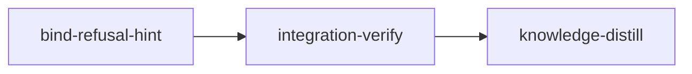

# Plan: Name the Loopback Opt-In When a Confined macOS Run Fails a Bind

Implements: none

## Overview

Issue #40 is fixed on `main` except for one reporting gap. On macOS a confined criterion, impact-test or contract run gets no IP networking unless the plan or stage sets `sandbox.network.allow_local_binding: true`. A test that calls `Bun.serve({ port: 0 })` under that default fails with bun's `EADDRINUSE`. loom reports it as an ordinary test failure and gives the stage agent nothing that points at the cause.

The knowledge topic `concerns/macos-confined-networking.md` (section "macOS Confined IP Networking Is Off by Default") records why `EADDRINUSE` stays out of the denial markers: a real port clash prints the same text. This plan keeps that rule. The run still fails. What changes is the report: when the run had no host loopback under Seatbelt and its output names a refused bind, the failure carries one note that names the opt-in and the dispute route.

## What was measured

macOS 27.2, bun 1.4.5, node and python3 from Homebrew, under `sandbox-exec -p '(version 1)(allow default)(deny network*)'`:

| Call | Output |
| --- | --- |
| node `net.createServer().listen(0, "127.0.0.1")` | `listen EPERM: operation not permitted 127.0.0.1` (already a denial marker) |
| python3 `socket.bind(("127.0.0.1", 0))` | `PermissionError: [Errno 1] Operation not permitted` (already a marker) |
| bun `net.createServer().listen(0, …)` | `EPERM Failed to listen at 127.0.0.1` (already a marker) |
| bun `Bun.listen({ port: 0, … })` | `error: Failed to listen at 127.0.0.1`, `code: "EPERM"` (already a marker) |
| bun `fetch("http://127.0.0.1:1/")` | `EPERM: Was there a typo in the url or port?` (already a marker) |
| bun `Bun.serve({ port: 0, … })` | `error: Failed to start server. Is port 0 in use?`, `code: "EADDRINUSE"`, `errno: 0` |

`Bun.serve` is the one gap. The issue also reports `FailedToOpenSocket` from the reporter's bun build. Neither text proves a sandbox denial, so both get a hint and stay failures.

## Decisions

- **A hint, never a reclassification.** The failure still counts. An accepted impact-tests dispute still matches by `verify/impact_tests/failure.rs::selection_digest` and `accepted.rs::AcceptedFailure` (id, kind, tests, digest), none of which reads the note.
- **Gated on the run's boundary.** The hint appears only for a run whose command was confined with `NetworkAccess::Denied` on macOS. The predicate is `confinement == CommandConfinement::Confined && network == NetworkAccess::Denied && cfg!(target_os = "macos")`. No further check is needed: on macOS `confine.rs::prepare` wraps every `Confined` command in Seatbelt, and `confine_seatbelt.rs::platform_command` errors when `/usr/bin/sandbox-exec` is missing, so a `Confined` run never executes outside the boundary. A Linux run, a `CommandConfinement::Inherit` run, a `NetworkAccess::Loopback` run and a provision run (`NetworkAccess::Provision`) never get the hint, so a real port clash on those reads as before.
- **Gated on the result.** Only a run that did not time out and whose exit code is not `Some(0)` gets the hint. A zero-exit command that fails only a stage stdout assertion (`result.success` false, exit `Some(0)`) gets no hint: its command did not fail. Unlike `environment::run_denial`, the hint is NOT withheld from a run that reached a test count or a build failure: a `bun test` run that counts its failures is the main case.
- **Independent of the denial note.** `output.rs::environment_note` and the hint are computed separately; a run whose output holds a denial marker and a bind marker shows both.
- **Markers** (lowercase, matched per line as a token with `environment.rs::has_marker`): `eaddrinuse` and `failedtoopensocket`, both socket error codes. The prose phrase "failed to start server" is NOT a marker: it also opens unrelated failures such as "Failed to start server because configuration is missing". The quoted line is the first line, scanning stderr then stdout (the order of `environment::run_output_denial`), that holds any marker, matched without regard to case. For the measured `Bun.serve` output that is `code: "EADDRINUSE"`.
- **Note text.** `bind_refusal_hint` returns exactly this, one line, no leading or trailing whitespace, `<line>` being the matched line trimmed and cut to `DENIAL_LINE_MAX_BYTES` (300) on a character boundary:

  ```text
  refused bind? this run had no loopback networking (macOS confinement) and printed: <line>; tests that listen or dial on loopback need sandbox.network.allow_local_binding: true in the plan or stage, which an operator sets; the run still fails, and if it fails only because of where completion runs, dispute it
  ```

  Each consumer adds its own indent. The opt-in is read from the plan snapshot (`confine_levels.rs::plan_local_binding`), which a stage agent cannot change; that is why the note names an operator.
- **Three consumers, one set-site.** Acceptance criteria, impact-selected tests and the completion contract check all run through `verify/criteria/runner.rs::run_criterion` (impact tests and contracts reach it through `probe.rs::CriteriaProbe::run`). The flag is set there and nowhere else.
- **Left out, on purpose.** Results of `executor.rs::run_spec_in_stage_network` and its wrappers keep `loopback_refused = false` and get no note: the contract freeze's red run (`contracts/freeze/prepared.rs`), dry-run `after_stage` and wiring commands, and goal-backward truth and dead-code checks. None of them renders through the three consumers. `loom plan verify --dry-run` renders through `commands/plan/verify/dry_run_classify.rs`, not `format_criterion_result`, and shows no hint.
- **Who sees the note.** The stage agent, in the output of `loom stage complete`, `loom check` and the host-job summary (for contracts, `host_verify/child_contracts.rs::record_check` joins the `failures` strings `run_contract` pushes, so the one edit in `run_contract` reaches both the completion error and that summary; `child_contracts.rs` is not edited). The adjudicator sees it only when the filer includes it: quote the note in `--reason` (works for every `--field`), or for an acceptance criterion attach the output with `--failure-output`. loom does not copy it into any adjudication evidence or prompt. The environment-marker advice in `record_check` (`contract.marker`) is untouched: the hint is not an environment marker, and freeze reads that classifier.
- **Persisted records do not change.** `impact_tests/failure.rs::ImpactFailure` is the dispute snapshot (`deny_unknown_fields`, struct literals in `host_verify/`, `daemon/` and `orchestrator/` tests) and gains no field. `contracts/completion_report.rs::ContractVerdict` gains no field.

## Sibling plans

`IN_PROGRESS-PLAN-review-remediation.md`, stage `confinement-boundaries`, worker `w2-criteria-confinement` owns `loom/src/verify/criteria/confine.rs`, `confine_host.rs`, `confine_seatbelt.rs`, `confine_scratch.rs` and `confine_protected.rs`. This plan edits none of them: the predicate lives in `runner.rs`, because `confine_levels.rs` is a private module of `confine.rs` and exporting from it would mean editing that file. No sibling stage edits `criteria/mod.rs`, `result.rs`, `probe.rs`, `runner.rs`, `output.rs`, `environment.rs`, `impact_tests/**`, `contracts/completion.rs` or `completion_report.rs`. No sibling plan consumes a name this plan adds. The same plan's `verification-evidence` stage claims the freeze red judge and the host contract summaries (`host_verify/child_contracts.rs`); this plan edits neither. `PLAN-contract-disputes-and-run-parity.md`, `PLAN-warm-stage-builds.md` and `PLAN-tmux-only-terminal-sessions.md` claim `loom/src/**`, README and knowledge broadly; this plan's edits are confined to the files in its `files:` and `artifacts:` lists and the one knowledge section and README sentence named below, and it adds no prepared-command metadata, so no sibling interface changes.

## Execution Diagram



## Stages

Knowledge bootstrap is skipped: the tier-1 files and `concerns/macos-confined-networking.md` already describe the confinement code.

### 1. bind-refusal-hint

Q1 to Q4 are all NO, so this plan has one implementation stage. One `loom-software-engineer` (sonnet) implements the whole stage; the main agent runs the gate and the review loop. The change crosses three report paths that share one new field, so it stays one cohesive unit.

Risk walk: the risk is misreporting, and a flag nobody sets. Contracts prove the text, the token match, the boundary predicate, the criteria report with and without the flag, and the impact-test message with and without it. A unit test through the real `CriteriaProbe` proves the set-site and the probe copy on macOS.

### Integration Verification

`loom check integration-verify` (`cargo test --all-targets --no-fail-fast`, clippy, fmt, warning-denying rustdoc), code review, and a re-run of stage 1's wiring and reachable checks on the merged tree. `cargo audit` (needs network) and `scripts/flake-check.sh` stay with CI. No completion on macOS can prove the kernel behaviour: the host job is itself confined, nested `sandbox-exec` is refused, and tests guarded by `sandbox_probe::skip_unless(confined_commands_runnable(), ..)` skip there. The kernel proof is the stage-1 probe test, guarded by `skip_unless`, which the nightly `test-macos` lib lane runs with `LOOM_TEST_REQUIRE_SANDBOX_FREE=1`, where a skip fails. The real `bun` smoke test is an operator step after merge (see the stage description), never a stage gate.

### Knowledge Distillation

Replace the section "macOS Confined IP Networking Is Off by Default" of `concerns/macos-confined-networking.md`, keeping its first two paragraphs word for word and rewriting the third ("Without the opt-in a listen test fails…") to the new truth. README's "What confinement adds" paragraph (sandbox section) says verification commands get no network; add one sentence after it naming the macOS opt-in `sandbox.network.allow_local_binding: true` and the refused-bind note. The issue #40 status comment is posted by the operator after merge, because a stage has no GitHub access.

---

<!-- loom METADATA -->

```yaml
loom:
  version: 2
  auto_merge: null
  sandbox:
    enabled: true
    auto_allow: true
    allow_unsandboxed_escape: false
    excluded_commands: []
    filesystem:
      deny_read:
      - ~/.ssh/**
      - ~/.aws/**
      - ~/.config/gcloud/**
      - ~/.gnupg/**
      deny_write:
      - ../../**
      allow_write: []
    network:
      allowed_domains:
      - crates.io
      - index.crates.io
      - static.crates.io
      - registry.npmjs.org
      additional_domains: []
      allow_local_binding: false
      allow_unix_sockets: []
      allow_all_unix_sockets: false
    linux:
      enable_weaker_nested: false
    command_confinement: confined
  ratchet_files:
  - loom/maintainability-baseline.txt
  - doc/loom/knowledge/check-baseline.txt
  provision:
  - working_dir: web
    command: >-
      test ! -e .npmrc && test ! -L .npmrc && bun install --frozen-lockfile
      --ignore-scripts --backend=copyfile --config=/dev/null
  stages:
  - id: bind-refusal-hint
    name: Name the loopback opt-in on a refused bind
    description: |
      Read this plan's file (loom renames it at start, so find it with
      fd 'PLAN-bind-refusal-hint.md' doc/plans) sections Overview, What was
      measured, Decisions and Sibling plans first (YAML is authoritative where
      they differ). One loom-software-engineer (sonnet) worker implements all of
      it in one brief; the main agent runs the gate and the review loop and
      writes no code.

      NOTE TEXT (authoritative; contracts compare against it). bind_refusal_hint
      returns exactly this one line, no leading or trailing whitespace, where
      <line> is the matched line trimmed and cut to DENIAL_LINE_MAX_BYTES (300)
      on a char boundary:
        refused bind? this run had no loopback networking (macOS confinement) and printed: <line>; tests that listen or dial on loopback need sandbox.network.allow_local_binding: true in the plan or stage, which an operator sets; the run still fails, and if it fails only because of where completion runs, dispute it

      PATHS: working_dir is loom/. Every path below, and in files, contracts and
      wiring, is relative to loom/. Locate every seam by symbol, never by line number.

      DO NOT EDIT: src/verify/criteria/confine.rs, confine_host.rs,
      confine_seatbelt.rs, confine_scratch.rs, confine_protected.rs (a sibling
      plan's stage owns them), src/verify/impact_tests/failure.rs::ImpactFailure
      (the persisted dispute snapshot) and loom/maintainability-baseline.txt.

      PUBLIC SURFACE (contracts are written from this before any code).

      A. src/verify/environment.rs (116 lines; has_marker and
         DENIAL_LINE_MAX_BYTES are private to it, so both functions live here):
           const BIND_REFUSAL_MARKERS: [&str; 2] =
               ["eaddrinuse", "failedtoopensocket"];
             (Socket error codes only. "failed to start server" is NOT a marker:
             it also opens unrelated failures such as "Failed to start server
             because configuration is missing".)
           pub fn bind_refusal_hint(stdout: &str, stderr: &str) -> Option<String>
             Pure, no platform or exit-code gating. Scans the lines of stderr, then
             the lines of stdout. The first line whose lowercase form holds a marker
             as a token (has_marker) is the matched line. Returns NOTE TEXT above
             with <line> = the matched line trimmed and cut to
             DENIAL_LINE_MAX_BYTES on a char boundary; no leading spaces, no
             newline. None when no line matches.
           pub fn refused_bind_note(loopback_refused: bool, timed_out: bool,
               exit_code: Option<i32>, stdout: &str, stderr: &str) -> Option<String>
             bind_refusal_hint(stdout, stderr) when loopback_refused && !timed_out
             && exit_code != Some(0); None otherwise. It does NOT consult run_denial:
             a run that reached a test count still gets the note.
         The trim-and-cut inside sandbox_denial is inline today; extract it into a
         private fn cut_line(line: &str) -> String and call it from both.
      B. src/verify/criteria/runner.rs (337 lines; it already imports
         CommandConfinement and NetworkAccess):
           pub(crate) fn refuses_loopback(confinement: CommandConfinement,
               network: NetworkAccess, macos: bool) -> bool
             macos && confinement == CommandConfinement::Confined
                   && network == NetworkAccess::Denied.
         Re-export it in src/verify/criteria/mod.rs with
         `pub(crate) use runner::refuses_loopback;` beside
         `pub use runner::{run_acceptance, run_acceptance_with_config};`, so the
         contract reaches crate::verify::criteria::refuses_loopback. It does not
         go in confine_levels.rs: that module is private to confine.rs, and
         exporting from it means editing confine.rs. NetworkAccess (Denied |
         Loopback | Provision, crate::verify::criteria::NetworkAccess) derives
         Clone, Copy, PartialEq, Eq and no Debug, so assert_eq! on it does not
         compile; tests compare with assert!.
      C. src/verify/criteria/result.rs: CriterionResult gains
           pub loopback_refused: bool
         (doc: set by the acceptance runner when the command was confined on macOS
         with no loopback networking). false in CriterionResult::new and in
         cached_verdict. These two are the only full struct literals of this type
         in the tree; every other construction calls ::new or uses
         ..result.clone(), so nothing outside src/verify changes. (The
         CriterionResult { id, passed } literals in status/, handoff/,
         orchestrator/ and stage_service/ are handoff::schema::CriterionResult, a
         different type.)
      D. src/verify/criteria/probe.rs: ProbeRun gains
           pub(in crate::verify) loopback_refused: bool
         and
           impl ProbeRun { pub(in crate::verify) fn bind_note(&self)
               -> Option<String> }
             = environment::refused_bind_note(self.loopback_refused,
               self.timed_out, self.exit_code, &self.stdout, &self.stderr).
         CriteriaProbe::run copies run.loopback_refused into the ProbeRun it builds.
         Also add, for tests only:
           #[cfg(test)] impl ProbeRun { pub(in crate::verify) fn finished(
               stdout: impl Into<String>, stderr: impl Into<String>,
               exit_code: Option<i32>) -> Self }
             timed_out false, output_complete true, cached None,
             loopback_refused false.

      SET-SITE (one). src/verify/criteria/runner.rs::run_criterion has
      level: (CommandConfinement, NetworkAccess) in scope. Right after
      run_with_cache returns, set
        outcome.result.loopback_refused =
            refuses_loopback(level.0, level.1, cfg!(target_os = "macos"));
      before the cached early return. Acceptance criteria, impact-selected tests
      and completion contracts all pass through here. Do not set the flag in
      executor.rs: results of run_spec_in_stage_network and its wrappers keep
      false (plan Decisions, "Left out, on purpose").

      CONSUMERS.
        1. src/verify/criteria/output.rs::format_criterion_result (stays at or
           under the 50-line function limit): one added line after
           `lines.extend(environment_note(index, result));`, extending `lines`
           with refused_bind_note(result.loopback_refused, result.timed_out,
           result.exit_code, &result.stdout, &result.stderr) prefixed by four
           spaces. A passing result still renders one line.
        2. Impact tests. src/verify/impact_tests/runs.rs (390 lines): the private
           struct Failure gains pub(super) note: Option<String>; judge_parsed and
           judge_incomplete_capture set note: run.bind_note() in the Failure they
           build. src/verify/impact_tests/report.rs: Report gains
           pub(super) hints: Vec<(String, String)> (failure id, note).
           Report::judge collects (failed.id, note) from `unsettled` before
           compare consumes it, in a helper function so judge stays under 50
           lines, and keeps only the pairs whose id is in the failures compare
           returns, at most one pair per failure id (the first kept).
           failure_message takes the hints and prints, directly under a
           failure's `  - ` line, a line of four spaces plus the note. The hint
           is rendered beside ImpactFailure::line, never inside its output
           excerpt (line omits the excerpt when failed tests are named, and the
           excerpt is a cut tail), and bind_note reads the ProbeRun's whole
           stdout and stderr before output_tail cuts them.
           ImpactTestsFailed::for_test passes no hints. base.rs::stands and
           ImpactFailure do not change.
        3. Contracts. src/verify/contracts/completion.rs::run_contract holds
           run: ProbeRun where it pushes the judged failure. Push
           format!("{failure}; {note}") when run.bind_note() is Some, else the
           failure unchanged. One string per contract failure, as today;
           ContractVerdict and completion_report.rs do not change. Both the
           completion error (ContractCheck::into_result) and the host-job
           summary (host_verify/child_contracts.rs::record_check, which joins
           contract.failures) consume this string, so neither renderer is
           edited. The returned environment_marker is unchanged.

      STRUCT LITERALS TO UPDATE (all under src/verify; trace with
      rg -n 'ProbeRun \{' and rg -n '\bFailure \{' src/verify/impact_tests).
      ProbeRun: probe.rs (production) plus 17 test literals in
      impact_tests_tests.rs, environment_contract_tests.rs,
      impact_tests/{base_tests,accepted_contract_tests,scoped_tests,runs_tests,
      base_contract_tests,report_tests}.rs and
      contracts/{completion_tests,completion_share_tests}.rs. runs::Failure:
      impact_tests/base_tests.rs and impact_tests/base_contract_tests.rs.
      environment_contract_tests.rs, accepted_contract_tests.rs and
      base_contract_tests.rs are earlier plans' contract files, no longer frozen:
      change only the literal, never an assertion.

      LINE LIMITS (cargo test --test maintainability fails a file over 400 lines
      or a function over 50, and the ledger may only shrink).
      contracts/completion_tests.rs and impact_tests/base_tests.rs are at exactly
      400 lines today and each holds ProbeRun literals: in those two files replace
      each literal whose other fields are timed_out false, output_complete true,
      cached None with ProbeRun::finished(..), so both end at 400 lines or fewer.
      impact_tests/runs.rs (390) and impact_tests/runs_tests.rs (385) must stay at
      or under 400; judge_parsed is 44 lines.

      TESTS the worker writes (never inside a contract file; those are frozen):
        - src/verify/environment_tests.rs: refused_bind_note is None when
          loopback_refused is false, when timed_out, and when exit_code is
          Some(0), and Some for a counted failing run (output holding a test
          summary and a marker).
        - probe.rs tests module, three tests through the real
          CriteriaProbe::run (the producer path impact tests and completion
          contracts use), each with the command
          "printf 'code: \"EADDRINUSE\"\\n' >&2; exit 1" in a tempdir:
          (a) denied: CriteriaProbe { stage: &Stage::default(), config:
              CriteriaConfig::default() }. On Err (no launcher on this host)
              return. On Ok assert run.loopback_refused ==
              cfg!(target_os = "macos").
          (b) kernel, named
              bind_refusal_macos_kernel_confined_run_carries_the_note and
              #[cfg(target_os = "macos")]: guarded by
              crate::process::sandbox_probe::skip_unless(
              confined_commands_runnable(), <name>, "confined commands cannot
              start") as confine_seatbelt_tests.rs::launcher_absent is, so the
              nightly test-macos lib lane (LOOM_TEST_REQUIRE_SANDBOX_FREE=1)
              fails a skip; asserts run.exit_code == Some(1),
              run.loopback_refused, and run.bind_note() holds
              "allow_local_binding".
          (c) opted-in and inherited: a stage whose sandbox.network sets
              allow_local_binding true (or a config with_plan_local_binding
              true), and a stage whose sandbox.command_confinement is Inherit;
              on Ok each asserts !run.loopback_refused and run.bind_note() is
              None. The Inherit case runs unconfined on every host.
          These prove the set-site and the probe copy under denied, opted-in and
          inherited policies; a renderer test that sets the flag by hand cannot.
        - src/verify/impact_tests/runs_tests.rs (or a new sibling test file if
          runs_tests.rs would pass 400 lines): judge_incomplete_capture on a
          ProbeRun with output_complete false, exit 101, loopback_refused true
          and stdout holding `code: "EADDRINUSE"` followed by more than 8 KiB of
          filler lines yields a Failure whose note is Some holding
          "allow_local_binding", while its kind stays FailureKind::Unparsed; the
          same with loopback_refused false yields note None.
        - A new src/verify/contracts/completion_bind_refusal_tests.rs, declared in
          completion.rs the way completion_share_tests.rs is, using
          super::tests::{fixture_with, run_check} and a runner like
          completion_share_tests.rs::Counting: a failing contract run with
          loopback_refused true, exit code 101 and stdout holding the line
          `code: "EADDRINUSE"` followed by
          testrun/fixtures/cargo-test/one-fail.stdout makes run_check return an
          error whose text holds "allow_local_binding" exactly once, and the
          ContractCheck that completion::run returns for that fixture holds
          the note in that contract's failures (the strings
          host_verify/child_contracts.rs::record_check joins into the host-job
          summary) and leaves its marker None; the same run with
          loopback_refused false returns an error without it.
        - Per consumer, a result with loopback_refused false and EADDRINUSE
          output renders exactly as before the change.

      MEMORY: record mistakes/decisions/surprises via loom memory immediately;
      NEVER loom knowledge (implementation stage); NEVER auto-memory.
    summary: >-
      When a confined macOS run without loopback networking fails and its output
      names a refused bind (bun's EADDRINUSE), the failure report names
      sandbox.network.allow_local_binding and the dispute route.
    dependencies: []
    parallel_group: null
    acceptance:
    - command: cargo test --lib bind_refusal
      timeout_secs: 1200
    - command: "cargo test --lib verify::"
      timeout_secs: 1200
    - command: cargo test --test maintainability
      timeout_secs: 900
    - command: cargo clippy --all-targets -- -D warnings
      timeout_secs: 900
    - cargo fmt --check
    setup: []
    files:
    - src/verify/**
    auto_merge: null
    working_dir: loom
    stage_type: standard
    artifacts:
    - src/verify/environment.rs
    - src/verify/criteria/runner.rs
    - src/verify/criteria/result.rs
    - src/verify/criteria/probe.rs
    - src/verify/criteria/output.rs
    - src/verify/impact_tests/runs.rs
    - src/verify/impact_tests/report.rs
    - src/verify/contracts/completion.rs
    - src/verify/contracts/completion_bind_refusal_tests.rs
    wiring:
    - source: src/verify/criteria/output.rs
      pattern: refused_bind_note\(
      description: the criteria failure report asks for the note
    - source: src/verify/impact_tests/runs.rs
      pattern: \.bind_note\(\)
      description: the impact judge asks each failed run for the note
    - source: src/verify/contracts/completion.rs
      pattern: \.bind_note\(\)
      description: the completion contract check asks a failing run for the note
    - source: src/verify/criteria/runner.rs
      pattern: refuses_loopback\(
      description: the acceptance runner sets the flag from the boundary predicate
    before_stage:
    - command: "! rg -q 'fn bind_refusal_hint' src/verify/environment.rs"
      description: No refused-bind hint exists before the stage.
    after_stage:
    - command: >-
        rg -q 'fn bind_refusal_hint' src/verify/environment.rs && rg -q
        'loopback_refused' src/verify/criteria/result.rs
      description: The hint and the boundary flag exist after the stage.
    context_ceiling_tokens: null
    sandbox: {}
    ultracode: false
    implementers:
    - claude
    skills:
    - loom-rust
    contracts:
    - id: bun-serve-refusal-gets-the-exact-note
      file: src/verify/bind_refusal_contract_tests.rs
      scenario: |-
        calls bind_refusal_hint with empty stdout and stderr 'error: Failed to start server. Is port 0 in use?
         syscall: "listen",
         errno: 0,
         code: "EADDRINUSE"', and compares the result for equality with the stage description's NOTE TEXT whose <line> is 'code: "EADDRINUSE"'; then, each as its own case: the marker line only on stdout; 'error: FailedToOpenSocket' alone on stderr; a mixed-case 'Error: EAddrInUse' on stdout; stdout 'code: "EADDRINUSE" (stdout)' with stderr 'error: FailedToOpenSocket (stderr)', whose quoted line is the stderr one; and a marker line followed by 400 two-byte characters
      rejects: >-
        a hint that matches only EPERM or 'operation not permitted', one that quotes
        the 'Failed to start server' line or any line without a socket code, one that reads
        stdout only or stderr only, one that prefers stdout over stderr, a
        case-sensitive match, a note that differs from NOTE TEXT or omits
        sandbox.network.allow_local_binding, or a quoted line longer than 300 bytes or cut inside a character
    - id: marker-matches-only-as-a-token
      file: src/verify/bind_refusal_contract_tests.rs
      scenario: "calls bind_refusal_hint with output whose only candidate is the identifier eaddrinuse_retries, with stderr 'error: Failed to start server because configuration is missing' and no socket code, and with output holding no marker"
      rejects: >-
        a substring match that returns Some for eaddrinuse_retries, or a hint for a
        'failed to start server' line that names no socket code
    - id: loopback-refused-only-for-confined-denied-macos
      file: src/verify/bind_refusal_contract_tests.rs
      scenario: >-
        calls crate::verify::criteria::refuses_loopback over every combination of
        CommandConfinement (Confined, Inherit), NetworkAccess (Denied, Loopback, Provision)
        and macos (true, false)
      rejects: "a predicate that is true for any combination other than (Confined, Denied, true): an Inherit run, a Loopback or Provision run, or any run off macOS"
    - id: no-hint-without-the-denied-loopback
      file: src/verify/bind_refusal_contract_tests.rs
      scenario: "builds a failed CriterionResult with CriterionResult::new (exit 1) whose stderr holds 'listen EADDRINUSE: address already in use 127.0.0.1:3000', renders it with format_criterion_result once as built (loopback_refused false) and once with loopback_refused set true; then renders a timed-out result and an exit-0 result with success false (a stdout assertion failed on a command that exited 0), both with loopback_refused true and the same stderr"
      rejects: >-
        a report that adds the hint to a run whose loopback was not refused, which
        turns a real port clash on Linux or an opted-in stage into a sandbox suggestion; a
        report that omits it when the flag is true; a hint on a timed-out run or on a
        zero-exit run that failed only its stdout assertion
    - id: probe-run-carries-the-note
      file: src/verify/bind_refusal_contract_tests.rs
      scenario: "builds a ProbeRun with ProbeRun::finished(\"\", \"code: \\\"EADDRINUSE\\\"\", Some(1)), reads bind_note() as built (None) and after setting loopback_refused true (Some holding allow_local_binding), and again with timed_out true and with exit_code Some(0)"
      rejects: >-
        a bind_note that ignores loopback_refused, or that fires on a timed-out or
        exit-0 run
    - id: impact-failure-message-carries-the-hint
      file: src/verify/impact_tests/bind_refusal_contract_tests.rs
      scenario: "as report_tests.rs::judged does: runs one cargo-test selection through Selection::new and run_group with a ProbeRunner whose ProbeRun has exit code 101, loopback_refused true and stdout 'code: \"EADDRINUSE\"' followed by a cargo summary with two failed tests, judges it with Report::judge against AcceptedImpact::default() and a BaseProbe whose commit is Err with NoBaseRunner, and reads the text of the into_outcome(\"s1\") error, asserting allow_local_binding appears exactly once, and downcasts it to ImpactTestsFailed to assert its one failure keeps the same id, kind and failed_tests as the loopback_refused false run; repeats with loopback_refused false"
      rejects: >-
        an impact judge that drops the note between the run and the gate's message
        (including when the failure names its failed tests, so ImpactFailure::line omits the
        output excerpt), a message that names allow_local_binding when loopback was not
        refused or names it twice, a hint that changes the failure's id, kind or failed
        tests, or a message that loses the dispute command
    reachable:
    - symbol: bind_refusal_hint
      from: format_criterion_result
      description: the criteria failure report reaches the hint
    - symbol: bind_refusal_hint
      from: judge_parsed
      description: an impact-test failure reaches the hint
    - symbol: refuses_loopback
      from: run_criterion
      description: the acceptance runner reaches the boundary predicate
    - symbol: bind_refusal_hint
      from: run_contract
      description: a completion contract failure reaches the hint
    - symbol: bind_refusal_hint
      from: judge_incomplete_capture
      description: an incompletely captured impact-test failure reaches the hint
  - id: integration-verify
    name: Integration Verification
    description: |
      Final verification after all stages. Verify FUNCTIONAL INTEGRATION,
      not just tests passing. NEVER Claude Code auto-memory.
      CONTEXT: read the plan's Overview and Decisions by line range (find the
      renamed file with fd 'PLAN-bind-refusal-hint.md' doc/plans),
      loom memory show --all, doc/loom/knowledge/INDEX.md and
      concerns/macos-confined-networking.md.
      BUILD & TEST (zero tolerance): run `loom check integration-verify` once.
      CODE REVIEW: spawn parallel loom-code-reviewer subagents. Paste the stage's
      acceptance and this description into each brief. They look hardest at: the
      boundary predicate and its one set-site in runner.rs::run_criterion; the
      copy in probe.rs::CriteriaProbe::run; that no ProbeRun, CriterionResult or
      runs::Failure literal sets the flag or note wrongly; that ImpactFailure,
      selection_digest and AcceptedFailure are unchanged; report rendering in
      output.rs, impact_tests/report.rs and contracts/completion.rs. Fix ALL
      findings with a loom-software-engineer. Every finding is fixed or disputed,
      never deferred.
      SUGGESTIONS: weigh every pending reviewer suggestion the signal lists;
      resolve each one implemented with loom memory resolve <id>
      --outcome implemented --reason <what changed>; leave the rest pending.
      FUNCTIONAL: no completion on macOS can prove kernel enforcement (the host
      job is confined, nested sandbox-exec is refused, and tests guarded by
      sandbox_probe::skip_unless(confined_commands_runnable(), ..) skip). So:
      confirm the three probe.rs tests exist and are not #[ignore]; that the
      denied test has no early return before its flag assertion other than
      the Err case; and that the kernel test
      bind_refusal_macos_kernel_confined_run_carries_the_note guards only
      through skip_unless (which the nightly test-macos lib lane, run with
      LOOM_TEST_REQUIRE_SANDBOX_FREE=1, turns into a failure), never a bare
      early return. Then record with loom memory note the operator step for
      after the merge, on an unconfined macOS shell:
      `cargo test --lib bind_refusal` from loom/, and, with bun installed, a
      scratch plan whose stage acceptance is
      `bun -e 'const s = Bun.serve({port: 0, fetch() { return new Response("") }}); s.stop(true)'`
      with timeout_secs: 30 (the server stops at once if the bind is
      allowed), without the opt-in, whose `loom stage complete` output must
      show the "refused bind?" line. Do not attempt that smoke test inside
      this stage. cargo audit and scripts/flake-check.sh are CI's (audit
      needs network).
      Record discoveries to loom memory for knowledge-distill, including any
      knowledge file contradicted by the tree: loom memory note "stale-knowledge: ...".
    summary: >-
      Confirms the full suite passes and the hint is wired through all three failure
      reports.
    dependencies:
    - bind-refusal-hint
    parallel_group: null
    acceptance:
    - command: cargo test --all-targets --no-fail-fast
      timeout_secs: 3600
    - command: cargo clippy --all-targets -- -D warnings
      timeout_secs: 900
    - command: RUSTDOCFLAGS='-D warnings' cargo doc --workspace --all-features --no-deps
      timeout_secs: 900
    - cargo fmt --check
    setup: []
    files:
    - src/verify/**
    auto_merge: null
    working_dir: loom
    stage_type: integration-verify
    artifacts: []
    wiring:
    - source: src/verify/criteria/output.rs
      pattern: refused_bind_note\(
      description: the criteria failure report asks for the note
    - source: src/verify/impact_tests/report.rs
      pattern: hints
      description: the impact gate's message renders the collected hints
    - source: src/verify/contracts/completion.rs
      pattern: \.bind_note\(\)
      description: the completion contract check asks a failing run for the note
    context_ceiling_tokens: null
    sandbox: {}
    ultracode: false
    implementers:
    - claude
  - id: knowledge-distill
    name: Knowledge Distillation
    description: |
      Curate all stage memories into permanent knowledge; update user docs.
      NEVER Claude Code auto-memory.
      SINGLE-AGENT: do NOT spawn subagents.
      START with loom memory pending --group; read the plan's Overview and
      Decisions by line range, and concerns/macos-confined-networking.md.
      CORRECTIONS FIRST: apply every `stale-knowledge:` memory in place with
      loom knowledge replace-section. Then replace the section "macOS Confined IP
      Networking Is Off by Default" of concerns/macos-confined-networking.md with
      loom knowledge replace-section. replace-section takes the whole section
      body: pass paragraphs one and two word for word as they stand in the file,
      and rewrite only the third ("Without the opt-in a listen test fails...") to
      the current truth: EADDRINUSE and FailedToOpenSocket stay failures and stay
      out of the denial markers, and a failed (non-zero exit, not timed out)
      criterion, impact-test or completion-contract run that was confined on macOS
      without loopback and prints either code carries a note naming allow_local_binding
      (verify/environment.rs::bind_refusal_hint and refused_bind_note, gated on
      loopback_refused, set in verify/criteria/runner.rs::run_criterion from
      refuses_loopback in the same file). State what gets no note: the contract
      freeze's red run, dry-run, after_stage, wiring and truth commands. No "was",
      no dates. Read the command's output: if it says it appended, the heading did
      not match and the old text still stands.
      Then curate mistakes, patterns, decisions via loom knowledge update.
      TIER ROUTING: ~40 lines or fewer inline in tier-1; larger to a tier-2 topic.
      README: its sandbox section's "What confinement adds" paragraph says
      verification commands get no network, which is the macOS default; append
      one sentence to that paragraph: on macOS a confined command gets no
      loopback either unless the plan or stage sets
      `sandbox.network.allow_local_binding: true`, and a failed run that prints
      a refused-bind code (EADDRINUSE, FailedToOpenSocket) carries a note
      naming that opt-in.
      SUGGESTIONS: record every unimplemented reviewer suggestion, then resolve it.
      RECEIPTS: every memory gets loom memory resolve <id> --outcome
      promoted|merged|discarded|deferred; finish with loom memory pending --strict.
      LAST, if this stage removed structural issues, ratchet the baseline:
      loom knowledge check --write-baseline doc/loom/knowledge/check-baseline.txt
    summary: >-
      Records the refused-bind hint in the macOS networking knowledge and the issue's
      status.
    dependencies:
    - integration-verify
    parallel_group: null
    acceptance:
    - loom knowledge check --strict --baseline doc/loom/knowledge/check-baseline.txt
    - loom memory pending --strict
    - rg -q 'bind_refusal_hint' doc/loom/knowledge/concerns/state-confinement-gaps.md
    - rg -q 'loopback_refused' doc/loom/knowledge/concerns/state-confinement-gaps.md
    - rg -q 'FailedToOpenSocket' README.md
    setup: []
    files:
    - doc/loom/knowledge/**
    - README.md
    auto_merge: null
    working_dir: '.'
    stage_type: knowledge-distill
    artifacts:
    - doc/loom/knowledge/concerns/macos-confined-networking.md
    - README.md
    wiring: []
    context_ceiling_tokens: null
    sandbox: {}
    ultracode: false
    implementers:
    - claude
```

<!-- END loom METADATA -->

## Pressure tests

- 2026-11-23: Claude fable, Codex gpt-6.2-astra; 1 round, review addressed
