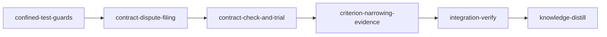

# Plan: Contract and Criterion Disputes That End, With Evidence

Implements: none

## Overview

A stage of `PLAN-toolchain-build-caches` spent about 4h40m in completion and was force-completed by the operator (`doc/loom/knowledge/mistakes/completion-runtime.md`, "Confined Contract Tests Looped Through Six Accepted Disputes"). Five frozen contracts launched a confined command from inside the completion host job; macOS refuses a nested Seatbelt profile that differs from the outer one (`sandbox_apply: Operation not permitted`, exit 71), so no implementation could pass them. Six disputes were accepted and none changed what the next completion ran.

The causes this plan removes:

| Cause | Evidence |
| --- | --- |
| An accepted contract dispute with no replacement and no patch re-freezes identical bytes and requeues | `loom/src/orchestrator/adjudication/apply_contract.rs:82-124`, notice at `:151-155` |
| A filing names one contract; four or more wrong contracts in separate files exhaust the budget of 3 | `loom/src/cli/types_stage_disputes.rs:176-199`, `loom/src/models/stage/dispute_budgets.rs:13` |
| Nothing runs a contract in the completion environment before `loom stage complete`: `loom check` runs acceptance only | `loom/src/host_verify/child.rs:96-109` |
| A replacement is judged by reading it; nothing runs it or lists the assertions it drops | `loom/src/orchestrator/adjudication/prompt/contract_replacement.rs` |
| An agent can edit a frozen file in the worktree and have an accept re-freeze it | `loom/src/orchestrator/adjudication/prompt/contract.rs:82-89`, `apply_contract.rs:116` |
| `loom stage amend` runs inside a stage session, so a stage agent can delete its own contract | `loom/src/commands/stage/amend.rs:30-68` |
| An adjudicator narrowed five acceptance criteria on its own statement that the tests "fail whatever the implementation", and handed them to integration-verify, which runs in the same confined host job and cannot run them either | `.loom/work/plan_versions/audit.md` of that run; `loom/src/verify/criteria/runner.rs:33-35` |
| About 176 tests in loom's own suite launch a confined command and fail in a macOS host job: 29 guard on the launcher existing, 57 on a probe that returns `Ok` off Linux, about 90 have no guard | `loom/src/process/sandbox_probe.rs:180-183`; inventory in `doc/plans/briefs/contract-and-criterion-dispute-guards/confined-test-guards/guards-verify.md` |

## Decisions (settled with the operator)

Priorities, in order (`doc/loom/knowledge/conventions/dispute-and-adjudication.md`, "Verification Design Priorities"):

1. **No stage code runs outside a sandbox.** Every run this plan adds is a confined host job. Seatbelt inheritance, an unwrapped run and `command_confinement: inherit` were rejected as fixes.
2. **A person is the last resort.** No path added here ends in `NeedsHumanReview` except an exhausted budget.
3. **A stage agent cannot game its checks.** A contract is never skipped or exempted. The adjudicator may narrow, rewrite or delete a check that cannot pass whatever the implementation, with evidence loom produced; the stage agent never can.

Settled points:

- **Contracts check what the code generates.** A contract that needs the OS sandbox to start is written against the generated policy (launcher argv, profile inputs, environment). Kernel enforcement is proven by guarded non-contract tests that CI runs with `LOOM_TEST_REQUIRE_SANDBOX_FREE=1`. On macOS no completion can prove kernel enforcement of a new profile; that is a platform limit.
- **Recourse for a contract that cannot run where completion runs**: the agent learns it from `loom check <stage> --contracts`, writes a replacement, trials it in a confined host job, and files one dispute. If no confined formulation exists, the adjudicator deletes the contract and the deletion is recorded as a hand-off.
- **Filing budget**: a rejected filing still spends one unit. No refund path.
- **The adjudicator keeps the power to narrow or delete an acceptance criterion**, bounded by base evidence and a recorded hand-off (stage 4).
- **A stage's own new test is never narrowed.** A test absent at the stage's base is the stage's to fix; for a frozen contract that means a replacement.
- **No new loom subcommand.** The pre-completion check, the replacement trial and the base run are flags of `loom check`.

## Design

### A. Loom's own suite in a host job (stage 1)

- `process::sandbox_probe::confined_command_blocker` gains a macOS branch that starts a trivial sandbox (`/usr/bin/sandbox-exec -p "(version 1)(allow default)" /usr/bin/true`); under a different outer profile the kernel refuses it, which is the nested case. `loom plan verify --dry-run` reads the same probe (`loom/src/commands/plan/verify/dry_run_exec.rs:55`) and then reports one blocker instead of one failure per criterion.
- Every test that launches a confined command asks `confined_commands_runnable()` first and skips otherwise. Both full-suite CI steps set `LOOM_TEST_REQUIRE_SANDBOX_FREE=1`, so a skip there is a failure.
- The five launching tests of `loom/src/stage_cache/contract_tests.rs` assert on the generated policy through a test-only accessor, `verify::criteria::confined_policy`. Their kernel halves move to `loom/src/stage_cache/kernel_tests.rs` behind the probe.
- The `host_verify` runner, guardian and wait tests that the adjudicator skipped as hanging or racing inside a host job are diagnosed and fixed or guarded.

### B. Contract disputes (stages 2 and 3)

Filing:

    loom stage dispute-contract <stage> --contract <id> [--contract <id> ...]
        [--replacement <frozen-file>=<path> ...] --reason "..."

- `DisputeKind::Contract { contract_ids, replacements }`; a replacement names any file of the freeze record, a harness file included, and carries its own base hash.
- Admission refuses, before any budget is spent: an empty or repeated id; an id that is not frozen; a replacement for a file the record lacks; a replacement for a contract file while a contract of that file is unnamed; a replacement identical to the frozen content; any recorded frozen file that is changed or missing in the worktree (restore it and file the change as a replacement); a replacement without a passing trial receipt for the same bytes at the worktree's HEAD.
- The whole filing travels in one 64 KiB ticket (`MAX_TICKET_BYTES`), 32 KiB per file. A filing that does not fit is refused and split by file.

Trial, before filing:

    loom check <stage> --contracts
    loom check <stage> --contracts --replacement <frozen-file>=<path> [...]

- `--contracts` runs the stage's frozen contracts in a Check host job, the code completion runs (`verify::contracts::completion::check`). A full `loom check <stage>` on a standard stage with a freeze runs them too.
- With `--replacement`, the job writes each replacement over its frozen file in the worktree, runs the freeze's format and static gates on those files and the contracts, and restores the frozen content whatever the outcome. A pass records a receipt (HEAD, file, sha256).

Verdict (`"verdict": "contract-rulings"`): one ruling per disputed contract, `accept` or `reject`, plus an optional `plan_patch` on `contracts`.

- An `accept` must change something: its file has a replacement, or a patch targets it. Otherwise the verdict is refused when recorded and the judge corrects it (the `Err` route freeze-refusal verdicts use, `verdict.rs:83-94`); nothing is recorded and no evidence round is spent.
- A replacement of a contract file is written when every contract in that file is accepted. A harness replacement is written when every ruling is an accept. Patches apply only to accepted contracts.
- The prompt lists the trial result and every assertion statement the replacement loses or changes (`verify::integrity::lost_statements`); the judge cites what covers each one or rejects.

Prevention: the contract writer's rules state the run environment, and the freeze refuses a red whose output carries an environment marker (the markers `dry_run_classify.rs:34-44` already uses).

### C. Criterion narrowing (stage 4)

    loom check <stage> --criterion <n> --at-base

- Runs the criterion in a checkout of the stage's base commit, confined, with the stage's build cache; the checkout persists under the stage cache root so a second base run is warm. The result is recorded as base evidence.
- `plan_patch` gains `leaves_out: [{index, tests, runs_at, reason}]`. A `delete` requires an entry. An entry requires base evidence for that criterion: it must fail at base, with tests that ran. A criterion that passes at base, selects nothing there or does not build there is refused, because its failure is the stage's own. A `replace` equal to the current entry is refused.
- Each accepted entry becomes a hand-off record. The integration-verify signal and the plan completion summary list every hand-off and every amendment of the plan.

## Limits that stay

- The freeze cannot tell that a contract cannot run where completion runs when its red is a build failure. The recourse is the trial and replacement path above.
- A narrowing the judge does not declare in `leaves_out` is not detected mechanically. It is visible: every amendment is listed for integration-verify and the operator.
- A new file matching a harness glob is frozen by the next accept as today; the judge sees it in the prompt.
- The base run compares counts, as impact tests do; adapters do not name failing tests.

## Relation to other plans

- Requires `PLAN-toolchain-build-caches` merged and its binary installed (`stage_cache` is the base-checkout home and the CI file is edited there).
- `doc/plans/PLAN-contract-disputes-and-run-parity.md` (a design draft) proposed multi-contract filing in its section A; this plan delivers that. Its run-directory and visibility sections are not covered here.

## Baseline

Not run in a host job: at HEAD the suite fails there on macOS for the nested-sandbox tests (the incident). Stage 1 owns that repair, and every later stage depends on it. `loom plan verify --strict --dry-run` is to be run by the operator once no other plan is executing.

## Execution Diagram



## Stages

No knowledge-bootstrap: the dispute, contract and confinement topics already describe this area.

### 1. `confined-test-guards`

Necessity: Q1 and Q3. Later stages' acceptance runs `host_verify`, `verify::contracts` and `verify::criteria` tests in a host job; those pass on macOS only once the guards are merged.

| Worker | Role | Tier | Files owned | Shared context | Brief path |
| --- | --- | --- | --- | --- | --- |
| probe | macOS start probe, CI | loom-software-engineer | loom/src/process/sandbox_probe.rs, .github/workflows/ci.yml | brief | doc/plans/briefs/contract-and-criterion-dispute-guards/confined-test-guards/probe.md |
| guards-verify | guard launching tests under verify | loom-software-engineer | loom/src/verify/criteria/tests/**, loom/src/verify/criteria/confine_host_tests.rs, loom/src/verify/criteria/confine_host_tool_tests.rs, loom/src/verify/criteria/confine_seatbelt_tests.rs, loom/src/verify/criteria/confine_stage_cache_tests.rs, loom/src/verify/criteria/confine_cargo_home_tests.rs, loom/src/verify/criteria/confine_git_tests.rs, loom/src/verify/goal_backward/**, loom/src/verify/impact_tests/runs_tests.rs, loom/src/verify/completion/resolved_tests.rs, loom/src/verify/contracts/format_gate_tests.rs | brief | doc/plans/briefs/contract-and-criterion-dispute-guards/confined-test-guards/guards-verify.md |
| guards-other | guard launching tests elsewhere | loom-software-engineer | loom/src/commands/stage/contracts/freeze_tests.rs, loom/src/commands/stage/contracts/freeze_run_dir_tests.rs, loom/tests/e2e/context_variables.rs, loom/tests/token_optimization_contracts.rs, loom/tests/completion_gates_contracts.rs, loom/tests/gate_dedup_contracts.rs, loom/tests/integration/confined_loom_runtime.rs | brief | doc/plans/briefs/contract-and-criterion-dispute-guards/confined-test-guards/guards-other.md |
| policy-tests | generated-policy tests | loom-software-engineer | loom/src/stage_cache/contract_tests.rs, loom/src/stage_cache/kernel_tests.rs, loom/src/stage_cache/mod.rs, loom/src/verify/criteria/confine.rs, loom/src/verify/criteria/mod.rs | brief | doc/plans/briefs/contract-and-criterion-dispute-guards/confined-test-guards/policy-tests.md |
| host-job-tests | tests that hang or race in a host job | loom-senior-software-engineer | loom/src/host_verify/tests_runner.rs, loom/src/host_verify/tests_runner_group.rs, loom/src/host_verify/tests_runner_legacy.rs, loom/src/host_verify/tests_runner_pending.rs, loom/src/host_verify/tests_runner_recovery.rs, loom/src/host_verify/tests_store.rs, loom/src/host_verify/tests_wait.rs | brief | doc/plans/briefs/contract-and-criterion-dispute-guards/confined-test-guards/host-job-tests.md |

All five start together; the helper they call already exists with its final signature.

Risk checklist: (3) process I/O, covered by `a-refused-sandbox-start-is-a-blocker`. (4) configuration propagation, covered by `the-generated-policy-carries-the-stage-cache`. (6) reachability, covered by `reachable`.

### 2. `contract-dispute-filing`

Necessity: Q2 and Q4. It rewrites the dispute model, admission, verdict and apply path that stages 3 and 4 extend.

| Worker | Role | Tier | Files owned | Shared context | Brief path |
| --- | --- | --- | --- | --- | --- |
| filing | CLI, model, admission, drift | loom-senior-software-engineer | loom/src/cli/types_stage_disputes.rs, loom/src/commands/stage/dispute_kinds.rs, loom/src/commands/stage/dispute_transport.rs, loom/src/commands/stage/dispute_replacement_tests.rs, loom/src/models/dispute.rs, loom/src/models/dispute_replacement.rs, loom/src/models/stage/dispute_budgets.rs, loom/src/stage_service/dispute_admission.rs, loom/src/stage_service/dispute_kinds.rs, loom/src/stage_service/dispute_replacement_tests.rs, loom/src/stage_service/dispute_race_tests.rs, loom/src/verify/contracts/drift.rs, loom/src/verify/contracts/completion.rs, loom/src/verify/contracts/completion_tests.rs, loom/src/verify/contracts/mod.rs, loom/src/daemon/**, loom/src/fs/stage_request/**, loom/tests/integration/** | pinned model in brief | doc/plans/briefs/contract-and-criterion-dispute-guards/contract-dispute-filing/filing.md |
| verdict-apply | rulings verdict and apply | loom-senior-software-engineer | loom/src/orchestrator/adjudication/verdict.rs, loom/src/orchestrator/adjudication/verdict_kinds.rs, loom/src/orchestrator/adjudication/verdict_kinds_tests.rs, loom/src/orchestrator/adjudication/verdict_contract.rs, loom/src/orchestrator/adjudication/verdict_hold_contract_tests.rs, loom/src/orchestrator/adjudication/record.rs, loom/src/orchestrator/adjudication/apply_kinds.rs, loom/src/orchestrator/adjudication/apply_kinds_tests.rs, loom/src/orchestrator/adjudication/apply_contract.rs, loom/src/orchestrator/adjudication/apply_contract_tests.rs, loom/src/orchestrator/adjudication/apply_contract_choice_tests.rs, loom/src/orchestrator/adjudication/apply_contract_replacement.rs, loom/src/orchestrator/adjudication/apply_contract_replacement_tests.rs, loom/src/orchestrator/adjudication/apply_contract_rulings.rs, loom/src/orchestrator/adjudication/feedback.rs, loom/src/orchestrator/adjudication/mod.rs, loom/src/commands/stage/adjudicate.rs | pinned model in brief | doc/plans/briefs/contract-and-criterion-dispute-guards/contract-dispute-filing/verdict-apply.md |
| texts | prompt, signals, amend guard, docs | loom-software-engineer | loom/src/orchestrator/adjudication/prompt.rs, loom/src/orchestrator/adjudication/prompt/**, loom/src/orchestrator/signals/v2_section.rs, loom/src/orchestrator/signals/v2_section_tests.rs, loom/src/orchestrator/signals/helpers.rs, loom/src/orchestrator/signals/tests_doctrine_v2.rs, loom/src/stage_service/control_block.rs, loom/src/stage_service/control_block_agent_tests.rs, loom/src/commands/stage/amend.rs, loom/src/cli/types_stage.rs, loom/tests/fixtures/signal_replay/plan.md, loom-hooks/tests/**, README.md, skills/** | pinned model in brief | doc/plans/briefs/contract-and-criterion-dispute-guards/contract-dispute-filing/texts.md |

All three start together against the model pinned in each brief; `filing` owns `models/dispute.rs` and writes it first.

Risk checklist: (1) untrusted input, covered by `an-accept-that-changes-nothing-is-refused` and `a-patch-outside-the-accepted-contracts-is-refused`. (2) paths, covered by `a-changed-frozen-file-is-drift`. (5) lifecycle, covered by `a-contract-file-is-written-only-when-all-its-contracts-are-accepted`. Authority, covered by `amend-refuses-inside-a-stage-session`. (6) reachability, covered by `reachable`.

### 3. `contract-check-and-trial`

Necessity: Q2 (admission, prompt and signal files of stage 2) and Q4.

| Worker | Role | Tier | Files owned | Shared context | Brief path |
| --- | --- | --- | --- | --- | --- |
| check-job | `--contracts`, trial overlay, receipt | loom-senior-software-engineer | loom/src/commands/verify.rs, loom/src/commands/verify_relay.rs, loom/src/relay/payload.rs, loom/src/host_verify/mod.rs, loom/src/host_verify/child.rs, loom/src/host_verify/child_contracts.rs, loom/src/host_verify/submit.rs, loom/src/host_verify/wait_state.rs, loom/src/host_verify/wait_report.rs, loom/src/host_verify/tests_child_contracts.rs, loom/src/orchestrator/core/inbox_drain/check.rs, loom/src/verify/contracts/trial.rs, loom/src/verify/contracts/completion.rs, loom/src/verify/contracts/completion_tests.rs, loom/src/verify/contracts/mod.rs | pinned interface in brief | doc/plans/briefs/contract-and-criterion-dispute-guards/contract-check-and-trial/check-job.md |
| gate | receipt at admission, lost statements, freeze markers, texts | loom-software-engineer | loom/src/stage_service/dispute_admission.rs, loom/src/stage_service/dispute_replacement_tests.rs, loom/src/verify/integrity/mod.rs, loom/src/verify/integrity/lost.rs, loom/src/verify/criteria/environment.rs, loom/src/verify/criteria/mod.rs, loom/src/commands/plan/verify/dry_run_classify.rs, loom/src/verify/contracts/freeze.rs, loom/src/orchestrator/adjudication/prompt/**, loom/src/orchestrator/signals/v2_section.rs, loom/src/orchestrator/signals/v2_section_tests.rs, loom/src/orchestrator/signals/contract/rules.rs, README.md, skills/** | pinned interface in brief | doc/plans/briefs/contract-and-criterion-dispute-guards/contract-check-and-trial/gate.md |

Both start together; `trial.rs` types are pinned in both briefs.

Risk checklist: (2) paths and symlinks, covered by `a-trial-never-writes-through-a-symlink`. (5) lifecycle, covered by `a-failed-trial-restores-the-frozen-file`. (1) untrusted input, covered by `a-filing-needs-a-passing-trial` and `a-changed-assertion-is-listed`. (7) external data, covered by `a-refused-sandbox-is-an-environment-red`. (4) configuration, covered by `contracts-and-criteria-selections-do-not-mix`.

### 4. `criterion-narrowing-evidence`

Necessity: Q2 (the Check job, `verdict.rs` and prompt files of stages 2 and 3) and Q4.

| Worker | Role | Tier | Files owned | Shared context | Brief path |
| --- | --- | --- | --- | --- | --- |
| base-run | `--at-base` Check job and evidence record | loom-senior-software-engineer | loom/src/commands/verify.rs, loom/src/commands/verify_relay.rs, loom/src/relay/payload.rs, loom/src/host_verify/mod.rs, loom/src/host_verify/child.rs, loom/src/host_verify/child_base.rs, loom/src/host_verify/tests_child_base.rs, loom/src/host_verify/submit.rs, loom/src/host_verify/wait_state.rs, loom/src/orchestrator/core/inbox_drain/check.rs, loom/src/verify/impact_tests/base.rs, loom/src/stage_cache/mod.rs, loom/src/stage_cache/base_checkout.rs | pinned interface in brief | doc/plans/briefs/contract-and-criterion-dispute-guards/criterion-narrowing-evidence/base-run.md |
| narrowing | `leaves_out`, validation, hand-off records, prompt | loom-senior-software-engineer | loom/src/orchestrator/adjudication/verdict.rs, loom/src/orchestrator/adjudication/verdict_narrowing.rs, loom/src/orchestrator/adjudication/plan_patch.rs, loom/src/orchestrator/adjudication/plan_patch_tests.rs, loom/src/orchestrator/adjudication/apply_accept.rs, loom/src/orchestrator/adjudication/apply_accept_tests.rs, loom/src/orchestrator/adjudication/apply_contract_rulings.rs, loom/src/orchestrator/adjudication/mod.rs, loom/src/orchestrator/adjudication/prompt/**, loom/src/verify/review/handoffs.rs, loom/src/verify/review/verdict_records.rs, loom/src/verify/review/mod.rs | pinned interface in brief | doc/plans/briefs/contract-and-criterion-dispute-guards/criterion-narrowing-evidence/narrowing.md |
| report | integration-verify signal and completion summary | loom-software-engineer | loom/src/orchestrator/signals/handoffs.rs, loom/src/orchestrator/signals/mod.rs, loom/src/orchestrator/signals/v2_section.rs, loom/src/orchestrator/signals/parse.rs, loom/src/daemon/protocol.rs, loom/src/daemon/server/status.rs, loom/src/commands/status/render/summary.rs, README.md, skills/** | pinned interface in brief | doc/plans/briefs/contract-and-criterion-dispute-guards/criterion-narrowing-evidence/report.md |

All three start together; `verify/review/handoffs.rs` types are pinned in each brief and written by `narrowing` first.

Risk checklist: (1) untrusted input, covered by `a-narrowing-needs-a-failing-base-run`, `a-test-absent-at-base-is-never-narrowed`, `a-deleted-criterion-is-handed-off` and `an-amendment-equal-to-the-current-criterion-is-refused`. (6) reachability, covered by `handoffs-are-listed-for-integration-verify` and `reachable`.

### 5. Integration Verification

Full suite, clippy and fmt; parallel reviewers (security of admission, overlay and base checkout; architecture; test coverage); every finding fixed or disputed. Functional proof: the three `loom check` flags and the repeatable dispute flags appear in `--help`, and the dispute e2e tests under `loom/tests/integration/` pass.

### 6. Knowledge Distillation

Rewrites the incident's mistake entry and the dispute, contract and confinement topics to the new truth.

---

<!-- loom METADATA -->

```yaml
loom:
  version: 2
  auto_merge: null
  sandbox:
    enabled: true
    auto_allow: true
    allow_unsandboxed_escape: false
    excluded_commands: []
    filesystem:
      deny_read:
      - ~/.ssh/**
      - ~/.aws/**
      - ~/.config/gcloud/**
      - ~/.gnupg/**
      deny_write:
      - ../../**
      allow_write: []
    network:
      allowed_domains:
      - crates.io
      - index.crates.io
      - static.crates.io
      - registry.npmjs.org
      additional_domains: []
      allow_local_binding: false
      allow_unix_sockets: []
      allow_all_unix_sockets: false
    linux:
      enable_weaker_nested: false
    command_confinement: confined
  ratchet_files:
  - loom/maintainability-baseline.txt
  - doc/loom/knowledge/check-baseline.txt
  provision:
  - working_dir: web
    command: >-
      test ! -e .npmrc && test ! -L .npmrc && bun install --frozen-lockfile
      --ignore-scripts --backend=copyfile --config=/dev/null
  stages:
  - id: confined-test-guards
    name: Confined-launch tests skip where a sandbox cannot start
    description: |
      Read doc/plans/PLAN-contract-and-criterion-dispute-guards.md sections Overview,
      Decisions and Design A first (YAML is authoritative where they differ).
      Use parallel subagents and skills to maximize performance.

      PUBLIC SURFACE (contracts are written from this before any code):
        crate::process::sandbox_probe::start_blocker(program: &Path, args: &[&str]) -> Option<String>
          Runs `program args..` with a null stdin and waits for it. None when it exits 0.
          Otherwise Some(reason): the reason holds the exit status and the first non-empty
          line of stderr. Some when the program cannot be spawned. No platform cfg.
          confined_command_blocker() calls it with the platform launcher's trivial start
          (macOS: /usr/bin/sandbox-exec -p "(version 1)(allow default)" /usr/bin/true).
        crate::verify::criteria::confined_policy(spec: &CommandSpec, tree: &Path,
            cache: &crate::stage_cache::StageCache) -> anyhow::Result<ConfinedPolicy>
          #[cfg(test)] pub(crate). Builds the command run_spec_in_stage would run for
          CommandConfinement::Confined with `tree` as working directory and tree root, and
          starts no process.
        crate::verify::criteria::ConfinedPolicy { pub program: PathBuf, pub args: Vec<String>,
            pub env: BTreeMap<String, String> }
          program is the OS launcher (file name sandbox-exec or bwrap); env holds the
          variables set on the wrapped command.

      WORKERS: see the stage table in the plan prose; spawn all five in ONE message. Each
      prompt: "Your brief: <path>. Read it in full before anything else."
      A failure that shows only in the host job is reproduced by you with
      loom check confined-test-guards --criterion <n>; hand its output to the worker.

      INTEGRITY: rewriting five tests in loom/src/stage_cache/contract_tests.rs changes
      assertion statements there (TI-edit): each launched assertion is replaced by an
      assertion on the generated policy and re-stated in loom/src/stage_cache/kernel_tests.rs
      behind the start probe. host-job-tests may change assertions in the host_verify test
      files it owns when a race is fixed. File ONE loom stage dispute-integrity for the
      events raised.

      Run cargo fmt before the final review round. Record every mistake, decision and
      surprise with loom memory immediately (subagents report theirs to you); never
      loom knowledge (implementation stage); never Claude Code auto-memory.
    summary: >-
      Makes loom's own tests that start an OS sandbox skip inside a host job and fail
      in CI when they cannot run, and rewrites the stage-cache policy tests to check
      the generated policy.
    dependencies: []
    parallel_group: null
    acceptance:
    - command: cargo test --manifest-path loom/Cargo.toml --lib process::sandbox_probe
      timeout_secs: 900
    - command: "cargo test --manifest-path loom/Cargo.toml --lib stage_cache::"
      timeout_secs: 900
    - command: "cargo test --manifest-path loom/Cargo.toml --lib verify::criteria::"
      timeout_secs: 1800
    - command: "cargo test --manifest-path loom/Cargo.toml --lib verify::goal_backward::"
      timeout_secs: 900
    - command: "cargo test --manifest-path loom/Cargo.toml --lib host_verify::"
      timeout_secs: 1800
    - command: cargo clippy --manifest-path loom/Cargo.toml --all-targets -- -D warnings
      timeout_secs: 900
    - cargo fmt --manifest-path loom/Cargo.toml --all -- --check
    setup: []
    files:
    - loom/src/process/**
    - loom/src/stage_cache/**
    - loom/src/verify/**
    - loom/src/host_verify/**
    - loom/src/commands/stage/contracts/**
    - loom/tests/**
    - .github/workflows/ci.yml
    - loom/maintainability-baseline.txt
    auto_merge: null
    working_dir: '.'
    stage_type: standard
    artifacts:
    - loom/src/stage_cache/kernel_tests.rs
    wiring: []
    before_stage:
    - command: test -f loom/src/stage_cache/session_contract_tests.rs
      description: PLAN-toolchain-build-caches is merged
    after_stage:
    - command: rg -qF 'LOOM_TEST_REQUIRE_SANDBOX_FREE' .github/workflows/ci.yml
      description: CI makes a sandbox skip fatal
    context_ceiling_tokens: null
    sandbox: {}
    ultracode: false
    implementers:
    - claude
    subagent_timeout_secs: 900
    skills:
    - loom-rust
    - loom-ci-cd
    contracts:
    - id: a-refused-sandbox-start-is-a-blocker
      file: loom/src/process/sandbox_probe_contract_tests.rs
      scenario: "writes an executable script into a TempDir that prints \"sandbox-exec: sandbox_apply: Operation not permitted\" to stderr and exits 71, and a second script that exits 0; calls start_blocker on each"
      rejects: >-
        a probe that reports no blocker without running the launcher (the non-Linux
        branch today), or one that drops the launcher's stderr line from the reason
    - id: the-generated-policy-carries-the-stage-cache
      file: loom/src/stage_cache/policy_contract_tests.rs
      scenario: >-
        resolves a StageCache under a TempDir home, calls confined_policy for
        CommandSpec::shell("true") with a TempDir tree
      rejects: >-
        an accessor that returns the unwrapped shell command instead of the OS
        launcher, or a policy whose GOCACHE is not under the stage cache root or whose arguments
        never name the stage cache root
    reachable:
    - symbol: start_blocker
      from: confined_command_blocker
      description: the confinement probe starts the platform launcher
  - id: contract-dispute-filing
    name: Contract disputes name several contracts and are ruled per contract
    description: |
      Read doc/plans/PLAN-contract-and-criterion-dispute-guards.md sections Decisions and
      Design B first (YAML is authoritative where they differ), then
      doc/loom/knowledge/conventions/dispute-and-adjudication.md section
      "Frozen Contracts Change Only Through `--replacement`".
      Use parallel subagents and skills to maximize performance.
      This stage does NOT add the trial receipt, the lost-statement report or any
      loom check flag: those are the next stage's.

      PUBLIC SURFACE (contracts are written from this before any code):
        crate::verify::contracts::drift::frozen_drift(record: &FreezeRecord,
            acceptance_dir: &Path, worktree_root: &Path) -> anyhow::Result<Vec<Drift>>
          One Drift per file of record.files whose worktree content differs from its
          recorded sha256, is missing, or cannot be read as a regular file. The paths
          resolve as verify::contracts::completion resolves them today.
        crate::verify::contracts::drift::Drift { pub path: String, pub kind: DriftKind }
        crate::verify::contracts::drift::DriftKind { Changed, Missing, Unreadable(String) }
        crate::models::dispute::ContractRuling { pub contract: String,
            pub ruling: ContractRulingKind, pub reasoning: String, pub citations: Vec<Citation> }
        crate::models::dispute::ContractRulingKind { Accept, Reject }   serde kebab-case
        crate::orchestrator::adjudication::verdict_contract::validate_contract_rulings(
            json: &serde_json::Value, disputed: &[String], replaced: &BTreeSet<String>,
            contract_index: &BTreeMap<String, usize>) -> Result<Vec<ContractRuling>, String>
          json is the judge's verdict: {"verdict":"contract-rulings","rulings":[{"contract":
          "<id>","ruling":"accept"|"reject","reasoning":"..","citations":[{"file":"..",
          "excerpt":"..","claim":".."}]}],"plan_patch":{"field":"contracts","patches":[{"op":
          "replace"|"delete","index":<n>,"value":{..}}]}}; plan_patch is optional.
          disputed: the filing's contract ids. replaced: the disputed ids whose frozen file
          has a replacement in the filing. contract_index: each contract id of the stage
          and its position in the stage's contracts list.
          Err(text for the judge) when: a disputed id has no ruling or two; a ruling names
          an id that is not disputed; a ruling lacks reasoning; an accept names a contract
          that is not in `replaced` and no patch has its index (the text contains
          "changes nothing" and the contract id); a patch index is not the index of a
          disputed contract ruled accept (the text contains "outside").
        crate::orchestrator::adjudication::apply_contract_rulings::files_to_write(
            rulings: &[ContractRuling], contract_files: &BTreeMap<String, String>,
            replacements: &[String]) -> Vec<String>
          contract_files maps every contract id of the stage to its frozen file;
          replacements lists the files the filing replaces. A file that holds at least one
          contract is returned when every contract in it is ruled accept. A file that holds
          no contract (a harness file) is returned when every ruling is an accept. Order
          follows `replacements`.
        crate::commands::stage::amend::refuse_stage_session(worktree_path: Option<&str>)
            -> anyhow::Result<()>
          Ok for None and for a blank value. Otherwise an error whose text contains
          "cannot amend" and the path. loom stage amend calls it with LOOM_WORKTREE_PATH.

      WORKERS: see the stage table in the plan prose; spawn all three in ONE message.
      Each prompt: "Your brief: <path>. Read it in full before anything else."

      INTEGRITY: the dispute model and the stage-facing text change, so assertion
      statements change in the test files the workers own that pin the old shape or
      wording (the single --contract form, contract_id, the accept and reject notices,
      NEVER_EDIT_SENTENCE, the completion failure text). Each changed assertion pins the
      new shape or wording of the same behaviour. File ONE loom stage dispute-integrity
      for the events raised.

      Run cargo fmt before the final review round. Record every mistake, decision and
      surprise with loom memory immediately (subagents report theirs to you); never
      loom knowledge (implementation stage); never Claude Code auto-memory.
    summary: >-
      Lets one contract dispute cover several contracts and files, has the
      adjudicator rule on each contract, refuses rulings that change nothing, and stops stage
      sessions from editing frozen files or amending the plan.
    dependencies:
    - confined-test-guards
    parallel_group: null
    acceptance:
    - command: "cargo test --manifest-path loom/Cargo.toml --lib orchestrator::adjudication:: -- --skip a_failed_adjudicator_spawn_retires_the_disputing_agent_before_escalating --skip the_evidence_cap_retires_the_disputing_agent_before_escalating"
      timeout_secs: 1800
    - command: "cargo test --manifest-path loom/Cargo.toml --lib stage_service::"
      timeout_secs: 1800
    - command: "cargo test --manifest-path loom/Cargo.toml --lib commands::stage:: -- --skip test_complete_knowledge_stage_with_passing_acceptance"
      timeout_secs: 1800
    - command: "cargo test --manifest-path loom/Cargo.toml --lib verify::contracts::"
      timeout_secs: 1800
    - command: "cargo test --manifest-path loom/Cargo.toml --lib orchestrator::signals::"
      timeout_secs: 1800
    - command: cargo clippy --manifest-path loom/Cargo.toml --all-targets -- -D warnings
      timeout_secs: 900
    - cargo fmt --manifest-path loom/Cargo.toml --all -- --check
    setup: []
    files:
    - loom/src/**
    - loom/tests/**
    - loom-hooks/tests/**
    - README.md
    - skills/**
    - loom/maintainability-baseline.txt
    auto_merge: null
    working_dir: '.'
    stage_type: standard
    artifacts:
    - loom/src/verify/contracts/drift.rs
    - loom/src/orchestrator/adjudication/verdict_contract.rs
    - loom/src/orchestrator/adjudication/apply_contract_rulings.rs
    wiring: []
    before_stage:
    - command: rg -qF 'fn start_blocker' loom/src/process/sandbox_probe.rs
      description: the start probe of the first stage is merged
    after_stage:
    - command: rg -qF 'contract_ids' loom/src/models/dispute.rs
      description: a contract dispute carries a list of contract ids
    context_ceiling_tokens: null
    sandbox: {}
    ultracode: false
    implementers:
    - claude
    subagent_timeout_secs: 900
    skills:
    - loom-rust
    contracts:
    - id: a-changed-frozen-file-is-drift
      file: loom/src/verify/contracts/drift_contract_tests.rs
      scenario: >-
        builds a FreezeRecord naming two files under a TempDir worktree with their
        sha256, then changes one file's bytes and deletes the other, and calls frozen_drift
      rejects: >-
        a drift check that reports only missing files, or one that compares file sizes
        or names instead of the recorded sha256
    - id: an-accept-that-changes-nothing-is-refused
      file: loom/src/orchestrator/adjudication/contract_rulings_contract_tests.rs
      scenario: >-
        calls validate_contract_rulings with disputed [a, b], replaced {a}, both ruled
        accept with reasoning and a citation, and no plan_patch
      rejects: >-
        a validator that records an accept for a contract whose frozen file has no
        replacement and that no patch targets, so the re-freeze writes identical bytes
    - id: a-patch-outside-the-accepted-contracts-is-refused
      file: loom/src/orchestrator/adjudication/contract_rulings_contract_tests.rs
      scenario: >-
        calls validate_contract_rulings with disputed [a] ruled reject and a plan_patch
        that deletes index 0, where contract_index maps a to 0 and c to 1; then with a
        ruled accept and a patch at index 1
      rejects: >-
        a validator that lets a patch delete or replace a contract the judge rejected
        or one the filing never disputed
    - id: a-contract-file-is-written-only-when-all-its-contracts-are-accepted
      file: loom/src/orchestrator/adjudication/contract_rulings_contract_tests.rs
      scenario: >-
        calls files_to_write with contracts a and b in file x.rs and c in y.rs, a
        harness file h.txt, replacements [x.rs, y.rs, h.txt], and rulings a accept, b reject,
        c accept
      rejects: >-
        an apply that writes a replaced file while one contract in it was rejected, or
        writes a harness replacement although a ruling in the filing is a reject
    - id: amend-refuses-inside-a-stage-session
      file: loom/src/commands/stage/amend_contract_tests.rs
      scenario: >-
        calls refuse_stage_session with None, with a blank string, and with a worktree
        path
      rejects: >-
        an amend that runs when LOOM_WORKTREE_PATH names a stage worktree, so a stage
        agent can delete its own contract
    reachable:
    - symbol: frozen_drift
      from: confirm_contract
      description: dispute admission refuses a filing over a drifted frozen file
    - symbol: validate_contract_rulings
      from: parse_and_validate_in
      description: a contract verdict is validated per contract when it is recorded
    - symbol: refuse_stage_session
      from: dispatch_amend
      description: loom stage amend refuses a stage session
  - id: contract-check-and-trial
    name: Contracts and replacements run in a host job before a dispute
    description: |
      Read doc/plans/PLAN-contract-and-criterion-dispute-guards.md sections Decisions and
      Design B first (YAML is authoritative where they differ), then
      doc/loom/knowledge/architecture/contract-phase.md section "Accepted Dispute Re-Freeze".
      Use parallel subagents and skills to maximize performance.

      PUBLIC SURFACE (contracts are written from this before any code):
        crate::commands::verify::CheckArgs gains `contracts: bool` (--contracts) and
            `replacement: Vec<String>` (--replacement <frozen-file>=<path>, repeatable).
        crate::commands::verify::check_selection(args: &CheckArgs) -> anyhow::Result<CheckSelection>
        crate::commands::verify::CheckSelection { All, Criteria(Vec<usize>), Contracts,
            Trial(Vec<(String, std::path::PathBuf)>) }
          --contracts with any --criterion is an error; --replacement without --contracts
          is an error; a --replacement value without "=" or with an empty side is an error.
        crate::verify::contracts::trial::with_overlay<T>(worktree_root: &Path,
            files: &[(String, Vec<u8>)], run: impl FnOnce() -> anyhow::Result<T>)
            -> anyhow::Result<T>
          files pairs a path relative to worktree_root with the bytes to try. Writes each
          over its file without following a symlink (a symlinked target or parent is an
          error and nothing is written), calls run, then restores every file's earlier
          bytes and permission bits whether run returned Ok or Err, and returns run's result.
          A file that did not exist before is an error.
        crate::verify::contracts::trial::TrialReceipt { pub head: String, pub files: Vec<TrialFile> }
        crate::verify::contracts::trial::TrialFile { pub path: String, pub sha256: String }
        crate::verify::contracts::trial::receipt_covers(receipt: Option<&TrialReceipt>,
            head: &str, replacements: &[(String, String)]) -> Result<(), String>
          replacements pairs each replaced file with the sha256 of its bytes. Err when the
          receipt is None, its head differs, or a pair is not among its files; the text
          contains "loom check" and "--replacement".
        crate::verify::integrity::lost_statements(path: &str, before: &str, after: &str) -> Vec<String>
          The assertion statements of `before` that `after` does not contain, by the
          language profile of `path` (a .rs path uses the Rust profile), in source order.
          A statement whose arguments changed is listed. An unknown extension gives an
          empty list.
        crate::verify::criteria::environment::environment_marker(stdout: &str, stderr: &str) -> Option<&'static str>
          The first environment marker found in either stream, compared in lower case;
          the list is the one loom plan verify --dry-run uses and includes
          "operation not permitted".

      WORKERS: see the stage table in the plan prose; spawn both in ONE message. Each
      prompt: "Your brief: <path>. Read it in full before anything else."

      INTEGRITY: the completion failure text, the frozen-contracts signal bullets and the
      contract prompt gain text, so assertions pinning those strings change in the test
      files the workers own; each pins the new wording of the same behaviour. File ONE
      loom stage dispute-integrity for the events raised.

      Run cargo fmt before the final review round. Record every mistake, decision and
      surprise with loom memory immediately (subagents report theirs to you); never
      loom knowledge (implementation stage); never Claude Code auto-memory.
    summary: >-
      Adds loom check --contracts and a replacement trial that runs where completion
      runs, requires a passing trial before a replacement is filed, shows the judge
      every assertion a replacement drops, and makes the freeze refuse environment reds.
    dependencies:
    - contract-dispute-filing
    parallel_group: null
    acceptance:
    - command: "cargo test --manifest-path loom/Cargo.toml --lib host_verify::"
      timeout_secs: 1800
    - command: "cargo test --manifest-path loom/Cargo.toml --lib verify::contracts::"
      timeout_secs: 1800
    - command: "cargo test --manifest-path loom/Cargo.toml --lib verify::integrity::"
      timeout_secs: 900
    - command: cargo test --manifest-path loom/Cargo.toml --lib commands::verify
      timeout_secs: 900
    - command: "cargo test --manifest-path loom/Cargo.toml --lib stage_service::"
      timeout_secs: 1800
    - command: >-
        cargo test --manifest-path loom/Cargo.toml --lib
        orchestrator::adjudication::prompt
      timeout_secs: 900
    - command: cargo clippy --manifest-path loom/Cargo.toml --all-targets -- -D warnings
      timeout_secs: 900
    - cargo fmt --manifest-path loom/Cargo.toml --all -- --check
    setup: []
    files:
    - loom/src/**
    - loom/tests/**
    - README.md
    - skills/**
    - loom/maintainability-baseline.txt
    auto_merge: null
    working_dir: '.'
    stage_type: standard
    artifacts:
    - loom/src/verify/contracts/trial.rs
    - loom/src/verify/integrity/lost.rs
    - loom/src/verify/criteria/environment.rs
    - loom/src/host_verify/child_contracts.rs
    wiring: []
    before_stage:
    - command: rg -qF 'contract_ids' loom/src/models/dispute.rs
      description: the multi-contract dispute model is merged
    after_stage:
    - command: rg -qF 'receipt_covers(' loom/src/stage_service/dispute_admission.rs
      description: dispute admission requires a passing trial for every replacement
    context_ceiling_tokens: null
    sandbox: {}
    ultracode: false
    implementers:
    - claude
    subagent_timeout_secs: 900
    skills:
    - loom-rust
    contracts:
    - id: a-failed-trial-restores-the-frozen-file
      file: loom/src/verify/contracts/trial_contract_tests.rs
      scenario: >-
        a TempDir worktree with src/t.rs holding "frozen" and mode 0o755; calls
        with_overlay with new bytes and a closure that reads the file and then returns an error
      rejects: >-
        an overlay that leaves the replacement in the worktree when the run fails, or
        that restores the bytes and loses the executable bit
    - id: a-trial-never-writes-through-a-symlink
      file: loom/src/verify/contracts/trial_contract_tests.rs
      scenario: >-
        a TempDir worktree where src/t.rs is a symlink to a file in a second TempDir;
        calls with_overlay with new bytes for src/t.rs
      rejects: an overlay that follows the symlink and overwrites the file outside the worktree
    - id: a-filing-needs-a-passing-trial
      file: loom/src/verify/contracts/trial_contract_tests.rs
      scenario: >-
        calls receipt_covers with no receipt, with a receipt for another head, with a
        receipt whose sha256 for the file differs, and with a matching receipt
      rejects: >-
        an admission that accepts a replacement whose bytes were never trialled at the
        worktree's head
    - id: a-changed-assertion-is-listed
      file: loom/src/verify/integrity/lost_contract_tests.rs
      scenario: >-
        calls lost_statements for a .rs path with a before text holding assert_eq!(a,
        1); and assert!(ok); and an after text holding assert_eq!(a, 2); and assert!(ok);
      rejects: >-
        a report that compares assertion counts, so an assertion weakened in place goes
        unlisted
    - id: a-refused-sandbox-is-an-environment-red
      file: loom/src/verify/criteria/environment_contract_tests.rs
      scenario: "calls environment_marker with stderr \"sandbox-exec: sandbox_apply: Operation not permitted\" and empty stdout, then with the output of a failed assertion (\"assertion `left == right` failed\")"
      rejects: >-
        a classifier that looks only at exit codes, or one that calls every failing
        test an environment failure
    - id: contracts-and-criteria-selections-do-not-mix
      file: loom/src/commands/verify_contract_tests.rs
      scenario: >-
        calls check_selection for --contracts alone, --contracts with a criterion
        index, --replacement without --contracts, and --contracts with a replacement
        "src/t.rs=/scratch/t.rs"
      rejects: >-
        a selection that silently ignores --contracts when a criterion is named, or
        runs a replacement trial as an ordinary check
    reachable:
    - symbol: environment_marker
      from: judge_run
      description: the freeze refuses a red that carries an environment marker
    - symbol: receipt_covers
      from: confirm_contract
      description: dispute admission checks the trial receipt
  - id: criterion-narrowing-evidence
    name: A criterion is narrowed only on base evidence, and the hand-off is recorded
    description: |
      Read doc/plans/PLAN-contract-and-criterion-dispute-guards.md sections Decisions and
      Design C first (YAML is authoritative where they differ), then
      doc/loom/knowledge/architecture/adjudication-lifecycle.md section
      "What Each Verdict Delivers".
      Use parallel subagents and skills to maximize performance.

      PUBLIC SURFACE (contracts are written from this before any code):
        crate::commands::verify::CheckArgs gains `at_base: bool` (--at-base);
          CheckSelection gains AtBase(Vec<usize>); --at-base without a --criterion is an
          error, and so is --at-base with --contracts.
        crate::verify::review::handoffs::BaseEvidence { pub index: usize, pub command: String,
            pub passed: bool, pub executed: Option<u64>, pub failed: Option<u64>,
            pub build_failed: bool, pub timed_out: bool }      serde, Clone, Debug, PartialEq
        crate::verify::review::handoffs::Handoff { pub stage: String, pub field: String,
            pub index: usize, pub tests: Vec<String>, pub runs_at: String, pub reason: String,
            pub dispute: String, pub verified: bool }          serde, Clone, Debug, PartialEq
        crate::orchestrator::adjudication::verdict_narrowing::check_narrowing(stage_id: &str,
            dispute: &str, plan_patch: &serde_json::Value, current: &[serde_json::Value],
            evidence: &[BaseEvidence]) -> Result<Vec<Handoff>, String>
          plan_patch: {"field":"acceptance","patches":[{"op":"replace"|"delete","index":<n>,
          "value":<criterion>}],"leaves_out":[{"index":<n>,"tests":["<name>",..],
          "runs_at":"<where>","reason":".."}]}; leaves_out is optional. current: the
          stage's entries of that field as JSON (a string, or an object with a "command").
          evidence: the recorded base runs; one applies to an entry when its index matches
          and its command equals the current entry's command.
          Err(text for the judge) when: a replace value equals current[index] (contains
          "changes nothing"); a delete has no leaves_out entry for its index (contains
          "leaves_out"); a leaves_out entry has no applicable evidence (contains
          "--at-base"); the evidence passed (contains "passes at the base"); the evidence
          has build_failed or executed == Some(0) (contains "the stage's own"); the
          evidence has failed == Some(n) and n is less than the entry's tests count
          (contains "fails only").
          Ok: one Handoff per leaves_out entry; verified is true when the evidence carries
          a failed count, false for a timed-out or unparsed base run.
        crate::orchestrator::signals::handoffs::append_handoffs(content: &mut String,
            handoffs: &[Handoff], amendments: &[AmendmentLine])
        crate::orchestrator::signals::handoffs::AmendmentLine { pub stage: String,
            pub field: String, pub op: String, pub index: usize, pub reason: String }
          Appends nothing when both lists are empty. Otherwise a "## Handed-Off Tests"
          section: one line per hand-off with its stage, tests, runs_at and reason, the
          word "unverified" on a hand-off whose verified is false, then one line per
          amendment.

      WORKERS: see the stage table in the plan prose; spawn all three in ONE message.
      Each prompt: "Your brief: <path>. Read it in full before anything else."

      INTEGRITY: the criterion briefing gains the narrowing rules, so the golden text in
      loom/src/orchestrator/adjudication/prompt/tests_golden.rs and assertions pinning
      the criterion prompt and the completion summary change; each pins the new wording
      of the same behaviour. File ONE loom stage dispute-integrity for the events raised.

      Run cargo fmt before the final review round. Record every mistake, decision and
      surprise with loom memory immediately (subagents report theirs to you); never
      loom knowledge (implementation stage); never Claude Code auto-memory.
    summary: >-
      Adds a confined run of a criterion at the stage's base commit, lets the
      adjudicator narrow or delete a criterion only when that run fails, and lists every
      hand-off and amendment for integration-verify and the operator.
    dependencies:
    - contract-check-and-trial
    parallel_group: null
    acceptance:
    - command: "cargo test --manifest-path loom/Cargo.toml --lib orchestrator::adjudication::"
      timeout_secs: 1800
    - command: "cargo test --manifest-path loom/Cargo.toml --lib host_verify::"
      timeout_secs: 1800
    - command: "cargo test --manifest-path loom/Cargo.toml --lib verify::review::"
      timeout_secs: 900
    - command: "cargo test --manifest-path loom/Cargo.toml --lib verify::impact_tests::"
      timeout_secs: 1800
    - command: "cargo test --manifest-path loom/Cargo.toml --lib orchestrator::signals::"
      timeout_secs: 1800
    - command: "cargo test --manifest-path loom/Cargo.toml --lib commands::status::"
      timeout_secs: 900
    - command: cargo clippy --manifest-path loom/Cargo.toml --all-targets -- -D warnings
      timeout_secs: 900
    - cargo fmt --manifest-path loom/Cargo.toml --all -- --check
    setup: []
    files:
    - loom/src/**
    - loom/tests/**
    - README.md
    - skills/**
    - loom/maintainability-baseline.txt
    auto_merge: null
    working_dir: '.'
    stage_type: standard
    artifacts:
    - loom/src/orchestrator/adjudication/verdict_narrowing.rs
    - loom/src/verify/review/handoffs.rs
    - loom/src/orchestrator/signals/handoffs.rs
    - loom/src/host_verify/child_base.rs
    wiring: []
    before_stage:
    - command: rg -qF 'fn receipt_covers' loom/src/verify/contracts/trial.rs
      description: the contracts check and trial are merged
    after_stage:
    - command: rg -qF 'check_narrowing(' loom/src/orchestrator/adjudication/verdict.rs
      description: a criterion verdict's narrowing is validated when it is recorded
    context_ceiling_tokens: null
    sandbox: {}
    ultracode: false
    implementers:
    - claude
    subagent_timeout_secs: 900
    skills:
    - loom-rust
    contracts:
    - id: a-narrowing-needs-a-failing-base-run
      file: loom/src/orchestrator/adjudication/narrowing_contract_tests.rs
      scenario: "calls check_narrowing with a replace at index 0 and a leaves_out entry naming two tests: first with no evidence, then with evidence for index 0 that passed, then with evidence that failed 2 of 40 executed"
      rejects: >-
        a validator that accepts a narrowing on the judge's statement alone, or on a
        criterion that passes at the stage's base
    - id: a-test-absent-at-base-is-never-narrowed
      file: loom/src/orchestrator/adjudication/narrowing_contract_tests.rs
      scenario: >-
        calls check_narrowing with a leaves_out entry and evidence whose executed is
        Some(0), then evidence with build_failed true
      rejects: >-
        a validator that treats "selected zero tests at base" or a base build failure
        as a failure the stage did not cause, so a stage's own new test is skipped
    - id: a-deleted-criterion-is-handed-off
      file: loom/src/orchestrator/adjudication/narrowing_contract_tests.rs
      scenario: >-
        calls check_narrowing with a delete at index 1 and no leaves_out, then with a
        leaves_out entry for index 1 and failing base evidence that timed out
      rejects: >-
        a validator that lets a criterion be deleted with no record of what it leaves
        out, or that marks a timed-out base run as verified
    - id: an-amendment-equal-to-the-current-criterion-is-refused
      file: loom/src/orchestrator/adjudication/narrowing_contract_tests.rs
      scenario: calls check_narrowing with a replace at index 0 whose value equals current[0]
      rejects: >-
        a validator that records an amendment identical to the current criterion, so
        the next completion fails the same way
    - id: handoffs-are-listed-for-integration-verify
      file: loom/src/orchestrator/signals/handoffs_contract_tests.rs
      scenario: >-
        calls append_handoffs with one verified and one unverified Handoff and one
        AmendmentLine, then with two empty lists
      rejects: >-
        a section that omits the tests or the unverified mark, or that prints a heading
        when there is nothing to hand off
    reachable:
    - symbol: check_narrowing
      from: parse_and_validate_in
      description: a criterion verdict's narrowing is validated when it is recorded
    - symbol: append_handoffs
      from: append_v2_section
      description: the integration-verify signal lists hand-offs and amendments
  - id: integration-verify
    name: Integration Verification
    description: |
      Final verification after all stages. Verify FUNCTIONAL INTEGRATION, not just tests
      passing. NEVER Claude Code auto-memory.
      CONTEXT: read the plan's Overview, Decisions, Design and Limits sections by line
      range (doc/plans/), loom memory show --all, doc/loom/knowledge/INDEX.md and only the
      relevant sections.
      BUILD & TEST (zero tolerance): run loom check integration-verify once. A test that
      launches a confined command and still fails in the host job is a guard the first
      stage missed: add the confined_commands_runnable() guard, never a --skip.
      CODE REVIEW: spawn parallel loom-code-reviewer subagents for security (dispute
      admission, the trial overlay's writes and restore, the base checkout, the amend
      refusal), architecture, and test coverage; fix ALL findings with an engineer agent.
      Every finding is fixed or disputed, never deferred. Weigh every pending reviewer
      suggestion.
      FUNCTIONAL: build the binary in this worktree and confirm that its
      `check --help` lists --contracts, --replacement and --at-base and that its
      `stage dispute-contract --help` shows --contract and --replacement as repeatable;
      confirm the dispute e2e tests under loom/tests/integration/ ran in the full suite.
      Record discoveries for knowledge-distill, including stale knowledge:
      loom memory note "stale-knowledge: ...".
    summary: >-
      Runs the full suite and reviews, and proves the new check flags and the dispute
      path are reachable from the CLI.
    dependencies:
    - criterion-narrowing-evidence
    parallel_group: null
    acceptance:
    - command: cargo test --manifest-path loom/Cargo.toml --all-targets --no-fail-fast
      timeout_secs: 3600
    - command: cargo clippy --manifest-path loom/Cargo.toml --all-targets -- -D warnings
      timeout_secs: 900
    - cargo fmt --manifest-path loom/Cargo.toml --all -- --check
    setup: []
    files:
    - loom/src/**
    - loom/tests/**
    - .github/workflows/ci.yml
    - loom/maintainability-baseline.txt
    auto_merge: null
    working_dir: '.'
    stage_type: integration-verify
    artifacts: []
    wiring: []
    context_ceiling_tokens: null
    sandbox: {}
    ultracode: false
    implementers:
    - claude
    skills:
    - loom-rust
  - id: knowledge-distill
    name: Knowledge Distillation
    description: |
      Curate all stage memories into permanent knowledge; update user docs. NEVER Claude
      Code auto-memory. SINGLE-AGENT: do NOT spawn subagents.
      START with loom memory pending --group; read the plan's Overview, Decisions, Design
      and Limits by line range.
      CORRECTIONS FIRST: apply every stale-knowledge: memory with loom knowledge
      replace-section. Then rewrite in place (replace-section, current truth only):
      conventions/dispute-and-adjudication.md "Frozen Contracts Change Only Through
      `--replacement`" (several contracts, per-file replacements, the trial receipt, drift
      refusal) and "Adjudicator Scope Convention" (loom stage amend refuses a stage
      session); architecture/adjudication-lifecycle.md "What Each Verdict Delivers" and
      the dispute-kinds table (contract-rulings, leaves_out, base evidence, hand-offs);
      architecture/contract-phase.md "Accepted Dispute Re-Freeze" (per-file writes) and
      the freeze's environment-red refusal; concerns/platform-and-commit-gaps.md and
      concerns/sandbox-and-confinement-gaps.md where they say the full suite passes under
      loom check (true on macOS only because launching tests skip there; CI runs them).
      In mistakes/completion-runtime.md, rewrite the Prevention and Fix lines of
      "Confined Contract Tests Looped Through Six Accepted Disputes" to what this plan
      built; correct mistakes/completion-runner-blocks.md "The Full Suite Fails 26 Tests
      in a Verifier Shell and Passes Under `loom check`" the same way. Record mistakes as
      mistakes entries.
      TIER ROUTING: about 40 lines or fewer inline in tier-1; larger via
      loom knowledge update <category>/<slug> with a 2-4 line tier-1 summary and link.
      Update README only where it describes disputes or loom check; if nothing else
      user-facing changed, record WHY in memory.
      SUGGESTIONS: record every unimplemented reviewer suggestion, then resolve it.
      RECEIPTS: loom memory resolve every entry; finish with loom memory pending --strict.
      LAST, if this stage removed structural issues:
      loom knowledge check --write-baseline doc/loom/knowledge/check-baseline.txt
    summary: >-
      Records the new dispute, trial and narrowing rules in the knowledge base and
      corrects the entries the incident left stale.
    dependencies:
    - integration-verify
    parallel_group: null
    acceptance:
    - loom knowledge check --strict --baseline doc/loom/knowledge/check-baseline.txt
    - loom memory pending --strict
    setup: []
    files:
    - doc/loom/knowledge/**
    - README.md
    - CONTRIBUTING.md
    auto_merge: null
    working_dir: '.'
    stage_type: knowledge-distill
    artifacts: []
    wiring: []
    context_ceiling_tokens: null
    sandbox: {}
    ultracode: false
    implementers:
    - claude
```

<!-- END loom METADATA -->
