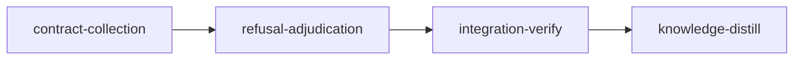

# Plan: Contract Phase Autonomy

## Overview

A contract stage in liquidmon (`fix-instance-lock`) could never freeze. The plan harnessed `src/main.rs` but not `src/device_lock/mod.rs`, the writer added `mod device_lock;`, and the freeze's format gate (`cargo fmt --all -- --check`, the stage's own format-check acceptance entry run at freeze) failed on the missing module file. The refusal parked the stage `WaitingForInput`, the dashboard showed only "awaiting input", and the writer asked the operator to pick between a command that does not exist (`loom stage amend` has no harness field) and one the relay refuses (a Contract session cannot dispute). Unblocking took several operator commands in a strict order.

Rule this plan enforces (`doc/loom/knowledge/mistakes/contract-phase-human-blocking.md`): a stage never waits on a human for something loom or an agent can resolve. Deterministic checks guide the agent. An agent never settles a disputed constraint itself: an independent adjudicator decides and justifies its verdict. A human is reached only after the dispute budget is spent, through one named command.

The plan does four things:

1. **Loom derives the test collection scaffold.** For each Rust contract, loom computes the `mod` declarations (and a declaration-only module root when none exists at base) that make the contract file part of a test target. A contract file that is itself a test-target root (a new `tests/x_contracts.rs`) needs none. The contract writer may make exactly those edits; they are checked strictly at freeze and are not frozen, so the implementer extends them. Liquidmon's case cannot recur.
2. **The freeze and completion prove each contract compiles from its frozen file.** Today completion hashes frozen files and runs each contract by test name only (`cargo test <name> -- --exact` across every target). An implementer who owns a module root can write `#[cfg(test)] #[path = "easy.rs"] mod contract_tests;`, or put `#![cfg(not(test))]` at the top of that root and a same-named shadow test in another target: the frozen file is never compiled and the name still passes. Completion, and the freeze before it, now resolve each Rust contract's test path through the crate's `mod` chain from a libtest test target root to the frozen file and fail on `#[path]`, `cfg_attr`, any `cfg` other than `test` (outer on a chain `mod` item or inner at the top of a chain file), a target with `required-features`, `test = false` or `harness = false`, a chain no test target compiles, or a run directory whose Cargo manifest does not select the contract's package (a workspace root whose `default-members` leave it out). Code elsewhere in the same test binary (a `macro_rules!` that shadows `assert!` for its descendants, a constructor that exits the binary early), `build.rs` and `.cargo/config.toml` runner overrides can still alter a run; they are recorded as concerns (Non-goals).
3. **A refused freeze is disputed and adjudicated, never parked.** One orchestrator tick step, `dispute_refused_freezes`, files every `freeze-refusal` dispute on behalf of the stage's current Contract writer: at once for a refusal the daemon made (a relayed freeze it refused, a host contract run that failed), and, for a refusal the writer's own CLI recorded, once the writer has gone quiet with no live subagent. No hook and no new CLI command files anything. An adjudicator rejects (a fresh writer starts with its instructions), accepts with a cited amendment of the stage's `contracts`, `harness` or format-check `acceptance` entry, or asks for evidence, which the next writer answers with `loom memory note` and a re-freeze. A question the writer asks with `AskUserQuestion` still reaches the operator. The budget admits three refusal disputes; the fourth refusal retires the writer and sends the stage to human review with one named command.
4. **Direct-mode codex forwards are visible again.** Since 27a62e80 (2026-10-21) `codex-forward.sh` runs `codex exec` directly when the outer sandbox refuses a nested bubblewrap (every Linux stage whose `bwrap` probe fails; the macOS Seatbelt direct lane is older). Direct mode creates no companion job, so `codex_lifecycle` reconcile marks every such forward Unknown (logging a warning every 5 s), never writes `lifecycle.jsonl`, and the stage's execution models drop `gpt-5.6-terra (requested)`. The forward receipts (`backend: "direct"`, `backend_id`, `state`, `exit_code`, `model`) hold the evidence once the forward ends (the receipt hook runs at PostToolUse); reconcile learns to write `CodexDirect` lifecycle records from them (`mistakes/codex-direct-mode-invisible.md`).

## Goals

- No contract-phase state waits on the operator while an agent or loom can act: every refused freeze reaches adjudication with no hook, CLI call or operator command in the path.
- No agent accepts a disputed constraint on its own; the adjudicator's verdict carries reasoning and at least one citation, and is validated against the stage before it is recorded.
- Completion of a Rust contract proves the frozen file is compiled into a libtest test target of its package through plain module declarations, and the freeze refuses a contract that completion would fail on that ground.
- A stage whose codex forwards run in direct mode shows their requested model in its execution models once each forward ends, and the daemon stops logging a forward as unknown while its receipt is on record or it is inside its 600 s receipt window.
- Non-goals: `AskUserQuestion`, `loom stage block` and a rejected criterion dispute keep reaching the operator: each means a person is genuinely needed. Scaffold derivation and the chain check cover Rust (`cargo-test`, `cargo-nextest`); every other adapter derives no scaffold and has no chain rule. Code in the same test binary outside the module chain (macro shadowing, constructors), `build.rs` side effects and `.cargo/config.toml` `runner` overrides remain open and are recorded as concerns; the revisit condition is pinning each Rust contract run to the target the chain check resolved (`--lib`, `--bin <n>`, `--test <n>`), which needs an adapter change this plan does not make.

## Decisions

1. **Scaffold, not harness, for collection wiring.** Harness globs freeze what they match, so harnessing a module root freezes the file the implementer must write. The scaffold set is derived by loom from the contract's file and test path, so no agent decides it. Name: "scaffold" (`wiring` already names the `wiring`/`wiring_tests` reachability checks).
2. **Strict scaffold diff.** Lines are compared with `str::lines()` (so `\r\n` and a missing final newline do not matter) and blank lines are ignored on both sides. Removing, per derived module, one `mod <name>;` line (optionally `pub` or `pub(crate)`) and at most one `#[cfg(test)]` line directly above it from the writer's version must leave exactly the base content (an existing declaring file) or nothing (a created module root, where exactly one of the offered paths exists and none existed at base). Position is free, so rustfmt's module ordering passes. Anything else is a refusal. A created root is offered as `<dir>/mod.rs` and `<dir>.rs`, except that `<dir>.rs` is never offered when that path is itself an auto target root (`tests/<n>.rs`, `src/bin/<n>.rs`). `ScaffoldModule.test_only` decides what the signal suggests; the diff accepts `#[cfg(test)]` above any derived declaration.
3. **Chain rules.** Every link from the target root to the contract file is an out-of-line `mod <name>;` item, declared exactly once in its conventional parent (`<dir>/mod.rs`, `<dir>.rs`, or the root's own directory), with outer attributes limited to `#[cfg(test)]`, `#[allow(..)]`, `#[expect(..)]` and doc comments (any comment between attributes and the item is skipped, never read as a stop). Every chain file except the frozen contract file, the target root included, carries no inner `#![cfg(..)]` other than `#![cfg(test)]` and no `#![cfg_attr(..)]`. A chain file whose tree-sitter parse has errors fails the check (grammar drift fails closed). `include!` and macro-generated modules need no rule: a second declaration of the same module under the same cfg is a compile error, and a chain whose real declaration is removed fails "declared exactly once". `#[macro_use]`, `#[rustfmt::skip]` and `#[doc(..)]` on a link are refused: over-strict, fail-closed, accepted.
4. **Target model from `Cargo.toml`, parsed with the `toml` crate.** No `cargo metadata` (it can write `Cargo.lock` and spawns a process). Roots: `[lib] path` or `src/lib.rs`; `[[bin]] path` entries (no `path`: `src/main.rs` when `name` is the package name, else `src/bin/<name>.rs` or `src/bin/<name>/main.rs`) plus `src/main.rs`, `src/bin/<n>.rs`, `src/bin/<n>/main.rs` unless `autobins = false`; `[[test]] path` entries plus `tests/<n>.rs`, `tests/<n>/main.rs` unless `autotests = false`; `autolib = false` disables the implicit lib. In edition 2015 (a manifest without `edition` is 2015), auto-discovery of a target kind is off when the manifest declares at least one target of that kind. A target with `test = false`, `harness = false` or a non-empty `required-features` (cargo skips such a target silently unless the features are enabled) is not a libtest test target. Auto targets are those whose file exists, except that a contract file that is itself an auto or `[[test]]` root counts as present though absent at base, and derives no scaffold. An explicit `[[bin]]`/`[[test]]` entry whose path (given, or defaulted from its name) equals an auto root's path replaces that auto root, so its `test`, `harness` and `required-features` apply. The package is the nearest ancestor of the contract file whose `Cargo.toml` has a `[package]` table. Cargo runs a contract in the directory `run_dir::resolve_run` picks (the contract's `cwd`, else the recorded cwd, else the nearest `Cargo.toml` ancestor of the file), and from a workspace root above the package it compiles `default-members` or every member, not necessarily the package. `collection::rust::run_dir_problems(source, contract_file, run_dir)` therefore requires the nearest `Cargo.toml` at or above the run directory to be the package's own manifest; completion runs it with the directory `resolve_run` resolved, the freeze for every Rust contract that sets `cwd` (with no `cwd` the marker rule already picks the package directory).
5. **Root choice.** The candidate roots for a contract are the libtest test targets whose module path for the contract file is a prefix of the contract's `test`. `chain_problems` passes when any candidate yields a clean chain. `derive_scaffold` derives from the candidate needing the fewest base edits; ties go to the lib target, then `src/main.rs`, then path order. No candidate: Err naming the file and its test path.
6. **The freeze runs the chain check.** When the scaffold diff is clean, `freeze_scaffold` also runs `chain_problems` over the writer's tree for every Rust contract, and `run_dir_problems` for every Rust contract that sets `cwd`, so the freeze refuses what completion would always fail.
7. **Fail closed without tree-sitter.** Both the chain check and scaffold derivation parse Rust with `tree-sitter-rust`, behind the default-on `source-graph` feature (`loom/Cargo.toml`). A build without it reports "cannot verify Rust contract collection: loom was built without the source-graph feature" as a completion failure and a freeze refusal. The feature-off library build is gated by `cargo clippy --no-default-features --lib -- -D warnings` (clean at plan time), and the fail-closed path by the unit test `collection_fails_closed_without_source_graph` (`#[cfg(not(feature = "source-graph"))]`), run with `cargo test --no-default-features --lib` (that test target compiled feature-off at plan time). Every collection unit test that parses Rust is `#[cfg(feature = "source-graph")]`; the integration contract files run with default features only.
8. **One dispute kind for refusals: `freeze-refusal`.** `DisputeKind::FreezeRefusal { problems: Vec<String> }`, filed only by the daemon on behalf of the stage's current Contract session, only before a freeze record exists. `DisputeKind::filed_by(SessionType)`: `FreezeRefusal` only by `Contract`; every other kind by any session type except `Contract` (Knowledge sessions relay criterion disputes today). `confirm` enforces it against the session record that `stage.session` names, read under the dispute lock, so the socket, relay, spool and daemon paths all get the check with no session plumbing; a stage with no current session admits no `FreezeRefusal`. That record names the stage's owner, not the caller, so the caller is fixed by the transports: the socket admits `FileDispute` from Stage sessions only (`daemon/server/self_service.rs` `DISPUTE_KINDS`), the relay refuses `(Contract, FileDispute)`, and the transport entries `handle_file_dispute` (socket, relay) and `handle_file_dispute_identified` (spool) refuse `FreezeRefusal` outright with "freeze-refusal disputes are filed by loom only", which also closes the operator's token-authenticated socket path. Only the daemon's `file_freeze_refusal` reaches the shared filing body, through a private function. The writer argues its case with `loom memory note "freeze-dispute: ..."` before freezing; the adjudication prompt quotes every memory entry the stage holds, labelled as the writer's claims. No new CLI command, relay kind or socket right: the relay matrix row `(Contract, FileDispute)` stays `Refuse`.
9. **One filer: the `dispute_refused_freezes` tick step.** It runs in `Orchestrator::run_tick` (`orchestrator/core/run.rs`) right before `hand_off_frozen_contract_phases`, so manual and daemon mode both run it. For each `Executing` v2 standard stage with contracts, no freeze record, and a current Contract session:
   - a **daemon refusal record** (`.loom/work/contracts/<stage>/refused.json`: session id, problems, time), written by the inbox drain for a relayed freeze the daemon refused and by the host job apply for a failed contract run in place of today's park, is filed at once when its session id is the stage's current session;
   - a **local refusal** (the writer's CLI refusal file, `refusal::standing` → `Refused`) is filed once the refusal file and the session's latest heartbeat are both at least `REFUSAL_QUIET_SECS` (300) old and `subagent_lifecycle` reports no live child of the session (`session_child_disposition` is `NoChildren`); its problems are agent-writable and are labelled as the writer's claim in the prompt, beside the daemon's own re-check of the change set and scaffold;
   - when `freeze_refusal_disputes` is already 3, the step retires the writer (handoff, kill, session released, as `retire_stage_agents` does) and then writes `NeedsHumanReview` with reason "contract freeze refused 4 times; adjudication could not resolve it: <last problems>. Decide with: loom stage human-review <stage-id>", naming any survivor as `escalate_dispute` does;
   - a host run that was interrupted, cancelled by a daemon stop, or whose reports or binding could not be read is recorded with a first problem starting `infrastructure:`; the prompt tells the judge such a refusal is no one's fault and is a `reject` with the instruction "run the freeze again unchanged". The budget cost is accepted.
   The record write is the retried step (`Err` → retried by the drain or host apply); filing in the tick retries on the next tick and logs every decline at warn level. A filed refusal's record is removed; a fresh writer has a new session id, so neither evidence source can re-file for it.
10. **Verdicts.** Shapes, extending the existing `DisputeVerdict` with no new fields: `{"verdict":"reject","reasoning":"<cited reason>","citations":[...],"instructions":"<what the next writer must change>"}` (stored as `Reject.reasoning = reasoning + "\n\n### Instructions\n\n" + instructions`); `{"verdict":"accept","reasoning":"...","citations":[...],"plan_patch":{"patches":[{"field":"harness","op":"insert","index":0,"value":"tests/fixtures/**"}]}}` (`plan_patch.inner` stays an object; each entry names its own field, one of `contracts`, `harness`, `acceptance`; entries apply in array order, one `amend_plan` call each with dispute id `<dispute>.<k>`, each index read against the field as the earlier entries left it, and validation checks each entry against that same running state); `{"verdict":"needs-more-evidence","questions":["..."]}`. Validation runs at recording with the stage and its worktree in hand and, for `freeze-refusal`, refuses with an `Err` that the judge sees and corrects (never a coercion to needs-more-evidence, which would reach the writer and spend its budget): empty reasoning or no citation; a reject without instructions; an accept without a patch; any other field; an `acceptance` patch that is not a `replace` of an entry `format_gate::is_format_check` recognises with a value that is itself a format check (a format gate is replaced, never deleted); a harness value for which `harness_source_matches` finds production source among the worktree's tracked and untracked files or the derived scaffold paths (both `CreateRoot` alternatives included). Reject: notice, stage requeued, a fresh Contract writer starts on the same worktree and reads the notice. Accept: amendments applied through `amend_plan`, stage requeued with the notice; a `contracts` patch that re-points a contract lists in the notice the old contract file and scaffold lines the next writer must delete. Needs-more-evidence: a freeze-refusal-specific notice tells the next writer to answer each question with `loom memory note "freeze-dispute: answer <n>: <evidence>"`, run the freeze and stop; each round is a new filing, so the three-filing budget bounds it.
11. **No more contract-phase parks.** `refusal::park`, `refusal::park_refused_relay`, `refusal::reason`, `inbox_drain/freeze.rs::park_refused_freeze`, `host_verify/freeze.rs::park`, the `Standing::Refused` park in `loom stage waiting` (that arm falls through to the plain wait, which `AskUserQuestion` still needs) and `commit-guard.sh`'s `park_contract_stage` (the Stop hook prints a reminder only) are removed. `refusal::end_wait` stays (`monitor/input_wait.rs`, `stage_service/contracts.rs` use it).
12. **Harness becomes amendable.** `AmendmentField::Harness` (kebab `harness`), value a plain glob string taken verbatim (trimmed, never parsed as YAML: `**/fixtures/*.json` would read as an alias and `tests/x #1` as a comment), refused when empty, usable by `loom stage amend --field harness` and by verdicts; `resync_after_amendment` copies `harness`; plan validation's `path_problem` still runs on the amended plan.
13. **Direct-mode evidence comes from forward receipts.** Reconcile looks up the authorization's receipt by `ForwardIdentity::receipt_id()` (parent session, agent, tool use, stage, loom session) through the existing receipt loader. A `backend: "direct"` receipt is reconciled from the receipt and writes `LifecycleProducer::CodexDirect` / `CodexExecution::Direct { thread_id: backend_id, tool_use_id }` records (`job_id` none, `thread_id` and `tool_use_id` set; `turn_id` is optional for `CodexDirect` only, its terminal time is the receipt's `observed_at`). A companion receipt, or no receipt, tries the companion job first; no job and no receipt is `Active` until `authorized_at + 600 s`, then `Unknown`. `ForwardState::Canceled` also reads `cancelled`, the direct lane's END-marker word for a 540 s timeout. No new status field: the existing `execution_models` row, the TUI ledger and the web ledger show the requested model once the lifecycle record exists, which is after the forward ends.
14. **Gates and checks.** Each code stage runs the repository's canonical gate (`cargo test --all-targets --no-fail-fast`, clippy, fmt, rustdoc, the feature-off clippy) besides its scoped filters: stage 1 changes the freeze and completion paths every contract test fixture goes through, and stage 2 removes code that integration tests (`tests/host_verification_e2e.rs`) assert on, so a scoped-only gate hands red tests to the next stage. `loom plan verify` warns that a code stage runs the whole suite; the warning is accepted (as in `PLAN-loom-ui-mods.md`). The `provision` entry stays: plan verify requires it for the `web` vitest package. Hook tests run with `bash` through `loom-hooks/tests/run-all.sh` (acceptance lines run under `sh -c`, which is dash on Linux). A worker runs exactly the one scoped check its brief names; clippy and every `--all-targets` command are the stage main agent's, because each wave shares a crate with half-written siblings and the frozen contract files name APIs later waves build.

## Sibling Plans

No sibling builds an interface this plan consumes, and this plan builds none a sibling consumes. Declared ownership overlaps, so the plans run one at a time, never concurrently (BLOCKING: do not `loom run` this plan while any plan below is in progress, nor start one of them while this one is):

| Sibling | Its stage(s) | Overlap with this plan |
| --- | --- | --- |
| `PLAN-web-host-graft-followthrough.md` | `implement-host-and-context` (`loom/src/cli/**`), `knowledge-distill` | `src/cli/types_stage.rs` and `src/cli/types_stage_amend.rs` (refusal-adjudication W3); `doc/loom/knowledge/**`; `loom/maintainability-baseline.txt` (it removes rows; this plan changes none) |
| `PLAN-loom-ui-mods.md` | `loom-ui` (`src/cli/dispatch*.rs`), `knowledge-distill` | `README.md`, `doc/loom/knowledge/**`; this plan edits no `dispatch*.rs` |
| `PLAN-model-router-hooks.md` | `router-core` (`src/cli/types.rs`, `dispatch.rs`), `integration-verify` (`loom-hooks/**`, `loom/src/**`), `knowledge-distill` | `loom-hooks/commit-guard.sh` and every `loom/src` file here under its integration glob; `README.md`, `doc/loom/knowledge/**` |

`PLAN-adopt-ecc-best-practices.md` has no stage YAML; its hook-profile proposal would edit `commit-guard.sh`, so whoever turns it into a plan re-reads the Stop hook branch this plan rewrites. Whichever plan runs second re-reads every overlapping file after the first merges and re-resolves the symbols its briefs name (`rg -n`); stage 2's `files:` lists only the two `src/cli/` files W3 owns, never `src/cli/**`. Required sibling amendment (BLOCKING before any of those three runs): add a reciprocal row naming this plan to the sibling-plans section of `PLAN-web-host-graft-followthrough.md`, `PLAN-loom-ui-mods.md` and `PLAN-model-router-hooks.md` (none names this plan today). After this plan merges, run `loom plan verify doc/plans/PLAN-loom-ui-mods.md` before its `loom run`: its contracts (`tests/loom_ui_contracts.rs`, `tests/loom_ui_install_contracts.rs`) are integration-test roots and must pass the new scaffold lint (Decision 4's contract-file-as-root rule covers them).

## Execution Diagram



## Stages

No knowledge-bootstrap: `architecture/contract-phase.md`, `mistakes/adjudication-autonomy-deadlock.md` and `mistakes/contract-phase-human-blocking.md` already describe the area.

### 1. contract-collection

Scaffold derivation, the strict scaffold check and chain check at freeze (CLI and daemon), the completion chain check, the contract signal's scaffold section, two plan-verify lints, the plan-writer guidance, and direct-mode codex visibility. Workers: W1 builds `verify::contracts::collection` (foundation); W2 integrates it; W3 updates docs; W4 fixes direct-mode codex reconciliation. W4's work shares no file with the others and needs no merge order, so the Stage Necessity Test merges it here instead of a stage of its own. Its proof is unit tests over the real liquidmon receipt rows (risk area 7, external data: the fixture is captured from the forwarder's actual output, not written from memory). Risk-checklist walk: untrusted input (the implementer and writer are adversaries of the frozen tests) → `chain-rejects-path-redirect`, `chain-rejects-inner-cfg`, `chain-rejects-non-target-root`, `scaffold-rejects-production-code`; the behaviour the stage adds → `scaffold-derives-new-module-root`, `scaffold-derives-nothing-for-new-integration-test`; over-strictness that would block every in-module contract → `chain-accepts-cfg-test-declaration`, `scaffold-accepts-reordered-declaration`. Filesystem paths: the source closures read through `fs::safe_read` beneath the worktree root (unit-tested, no contract). Shared fixture: `verify::contracts::test_support::contract_worktree` gains a `[package]` `Cargo.toml` in its base commit, or every freeze test built on it is refused once the scaffold check is wired.

### 2. refusal-adjudication

Exists separately because of Q1 and Q2: its adjudication prompt and verdict validation call the scaffold derivation (merged code from stage 1), and both stages edit `orchestrator/signals/contract.rs`. Workers: W3 harness amendment field and W4 writer-facing signal and docs (wave 1); W2 the `freeze-refusal` dispute kind, its admission, its adjudication and verdict validation (wave 2); W1 the refusal records, the `dispute_refused_freezes` tick step, the park removal and the Stop hook (wave 3). Risk-checklist walk: untrusted input (the writer's refusal file and memory notes are agent-written) → `refusal-dispute-filed-only-by-contract-writer`, plus the prompt's labelling and the daemon's own re-check; configuration propagation (an amended harness must reach the stage record the freeze reads) → `harness-amendment-reaches-stage-record`; lifecycle (a requeued writer must not charge the crash budget, an escalation must retire the writer, a writer waiting on a subagent must not be disputed) → unit and e2e tests named in the briefs.

### Integration Verification

Full suite, clippy, fmt, rustdoc, feature-off clippy, the hook test suite; review rounds; an end-to-end check of the liquidmon shape in a scratch crate under `target/` (the two scaffold edits pass `cargo fmt --check` and `cargo test --no-run`), the lint tests that build temp git repos, and the refusal e2e tests.

### Knowledge Distillation

Rewrites `architecture/contract-phase.md` to current truth (scaffold, chain check, adjudicated refusals, no parks); records the macro-shadowing, constructor, `.cargo/config.toml` runner and `build.rs` concerns; updates README.

---

<!-- loom METADATA -->

```yaml
loom:
  version: 2
  ratchet_files:
    - loom/maintainability-baseline.txt
    - doc/loom/knowledge/check-baseline.txt
  provision:
    - working_dir: "web"
      command: "test ! -e .npmrc && test ! -L .npmrc && bun install --frozen-lockfile --ignore-scripts --backend=copyfile --config=/dev/null"
  sandbox:
    enabled: true
    auto_allow: true
    filesystem:
      deny_read: ["~/.ssh/**", "~/.aws/**", "~/.config/gcloud/**", "~/.gnupg/**"]
    network:
      allowed_domains: ["crates.io", "index.crates.io", "static.crates.io", "registry.npmjs.org"]
      allow_local_binding: false
      allow_unix_sockets: []
  stages:
    - id: contract-collection
      name: "Derived test-collection scaffold, completion chain check, direct-mode codex visibility"
      summary: "Loom works out the mod declarations a Rust contract test needs, lets the contract writer add exactly those, proves at freeze and completion that each contract compiles from its frozen file, and shows the codex model of direct-mode forwards again."
      stage_type: standard
      skills: ["loom-rust", "loom-security-audit"]
      implementers: ["claude"]
      subagent_timeout_secs: 900
      working_dir: "loom"
      dependencies: []
      before_stage:
        - command: "rg -qF 'pub mod collection' src/verify/contracts/mod.rs"
          exit_code: 1
          description: "no collection module before the stage"
      after_stage:
        - command: "rg -qF 'pub mod collection' src/verify/contracts/mod.rs"
          exit_code: 0
          description: "the collection module is declared after the stage"
      description: |
        Build stage 1 of the plan (doc/plans/PLAN-contract-phase-autonomy.md, renamed IN_PROGRESS-PLAN-contract-phase-autonomy.md once loom run starts). Its Decisions section is authoritative (Decisions 1-7 and 13-14 bind this stage).
        Use parallel subagents and skills to maximize performance.
        PATHS: working_dir is loom/. YAML paths and the worker table are package-relative (../ for files outside the crate); brief paths are repo-relative from the worktree root.
        W1, W2 and W3 read doc/plans/briefs/contract-phase-autonomy/contract-collection/common.md first (the pinned public API and rules), then their own brief. W4 reads only its own brief.
        Territories are DISJOINT. Workers NEVER spawn subagents. Spawn BY AGENT TYPE (W1 loom-senior-software-engineer with effort xhigh; W2 loom-software-engineer; W3 loom-software-engineer with model haiku; W4 loom-senior-software-engineer with effort high, because its lifecycle record shapes must match the replay validator exactly and a wrong one replays as Unknown) with the fixed prompt plus "Your brief: <path>. Read it in full before anything else." Wait with one background loom subagents watch.
        WAVE 1: W1, W3 and W4 in ONE message. WAVE 2: W2 after W1 returns (W2 calls W1's API).
        WORKER CHECKS: each worker runs exactly the one scoped check its brief names, once. No worker runs clippy or any --all-targets command: the frozen tests/contract_collection_contracts.rs names W1's API and every wave shares a crate with half-written siblings. A build failure in a file the worker does not own is reported to you, never fixed by the worker.

        | Worker | Role | Tier | Files owned | Shared context | Brief path |
        | ------ | ---- | ---- | ----------- | -------------- | ---------- |
        | W1 | collection module | opus/xhigh | src/verify/contracts/collection/mod.rs; src/verify/contracts/collection/harness.rs; src/verify/contracts/collection/rust/mod.rs; src/verify/contracts/collection/rust/targets.rs; src/verify/contracts/collection/rust/items.rs; src/verify/contracts/collection/rust/chain.rs; src/verify/contracts/collection/rust/scaffold.rs; src/verify/contracts/collection/tests.rs; src/verify/contracts/collection/rust/tests_targets.rs; src/verify/contracts/collection/rust/tests_chain.rs; src/verify/contracts/collection/rust/tests_scaffold.rs; src/verify/contracts/mod.rs; src/context/rank_source.rs; src/context/rank_source/paths.rs | common.md | doc/plans/briefs/contract-phase-autonomy/contract-collection/w1-collection.md |
        | W2 | integration | sonnet | src/verify/contracts/completion.rs; src/verify/contracts/completion_tests.rs; src/verify/contracts/test_support.rs; src/commands/stage/contracts/freeze.rs; src/commands/stage/contracts/freeze_tests.rs; src/stage_service/contracts.rs; src/daemon/server/contracts_tests.rs; src/orchestrator/signals/contract.rs; src/orchestrator/signals/contract_tests.rs; src/plan/schema/validation/v2_lints/contracts.rs; src/plan/schema/validation/v2_lints/contracts_tests.rs; src/plan/schema/validation/base_tree.rs | common.md | doc/plans/briefs/contract-phase-autonomy/contract-collection/w2-integration.md |
        | W3 | docs | haiku | ../skills/loom-plan-writer/references/v2-contracts.md; ../skills/loom-plan-writer/SKILL.md; ../README.md | common.md | doc/plans/briefs/contract-phase-autonomy/contract-collection/w3-docs.md |
        | W4 | direct-mode codex visibility | opus/high | src/codex_lifecycle.rs; src/codex_lifecycle/reconcile.rs; src/codex_lifecycle/direct.rs; src/codex_lifecycle/direct_tests.rs; src/codex_lifecycle/test_support.rs; src/subagent_lifecycle/codex_evidence.rs; src/subagent_lifecycle/tests.rs; src/commands/subagents/wait/codex_binding.rs; src/commands/subagents/wait/mod.rs; src/commands/subagents/wait/direct_tests.rs; src/models/forward_receipt.rs | none | doc/plans/briefs/contract-phase-autonomy/contract-collection/w4-codex-visibility.md |

        CONTRACT SURFACE (the contract session writes tests/contract_collection_contracts.rs from this text before any code; every contract is a top-level #[test] fn, so its test value is the fn name; each fn at most 50 lines, the file at most 400 lines and rustfmt-clean; it builds fixtures as in-memory maps, never on disk, and calls only this API):
        - Module loom::verify::contracts::collection::rust, functions over a FileSource, `pub type FileSource<'a> = &'a dyn Fn(&str) -> Option<String>;` (exported from loom::verify::contracts::collection): a path relative to the source root with '/' separators maps to the file's content, None when absent.
        - pub fn chain_problems(source: FileSource<'_>, contract_file: &str, test: &str) -> Vec<String>: empty when `test` (a libtest path such as device_lock::contract_tests::rejects_x) is compiled from `contract_file` through a libtest test target of its package; otherwise one message per problem. It does not require `contract_file` itself to be present in the source.
        - pub fn derive_scaffold(base: FileSource<'_>, contracts: &[(&str, &str)]) -> Result<Vec<ScaffoldEdit>, String>: the (file, test) pairs' merged scaffold at base; Ok(vec![]) for a contract file that is itself a test-target root; Err names a contract whose test path no candidate root's module path prefixes, or whose file no test target can reach.
        - pub fn scaffold_problems(edits: &[ScaffoldEdit], base: FileSource<'_>, current: FileSource<'_>) -> Vec<String>.
        - pub enum ScaffoldEdit { Declare { path: String, module: ScaffoldModule }, CreateRoot { paths: Vec<String>, modules: Vec<ScaffoldModule> } } and pub struct ScaffoldModule { pub name: String, pub test_only: bool }, both #[derive(Debug, Clone, PartialEq, Eq)] and exported from loom::verify::contracts::collection.
        - A fixture crate: "Cargo.toml" holding "[package]\nname = \"fx\"\nversion = \"0.1.0\"\nedition = \"2021\"\n" (extra keys and tables on their own lines, valid TOML), plus the .rs files the contract names. A bin-only crate has src/main.rs and no src/lib.rs. Every chain fixture includes the contract file itself (`#[test]\nfn rejects_x() {}\n`).

        GATE: after the waves, cargo fmt --all, then cargo test --test maintainability, then one loom check contract-collection; route a failure to a fresh worker of the owning territory. No row of maintainability-baseline.txt changes; a file that outgrows 400 lines is split by its owner.
        MUTATION: the contracts freeze red because loom::verify::contracts::collection does not exist yet, which proves nothing about their assertions. Before the final review round, for each contract apply the wrong implementation its rejects text names (or revert the guarding lines), confirm it fails, restore from a copy saved under $LOOM_SCRATCH_DIR/mutation/ (never git checkout; the restored file must be byte for byte the saved one), and record loom memory note "mutation: <contract id> red under <mutation>".
        MEMORY: record mistakes, decisions and surprises via loom memory immediately (subagents report theirs to you); NEVER loom knowledge in this stage; NEVER Claude Code auto-memory.
      acceptance:
        - command: "cargo test --all-targets --no-fail-fast"
          timeout_secs: 3600
        - command: "cargo test --lib verify::contracts::"
          timeout_secs: 1800
        - command: "cargo test --lib commands::stage::contracts::"
          timeout_secs: 1800
        - command: "cargo test --lib stage_service::contracts::"
          timeout_secs: 1800
        - command: "cargo test --lib orchestrator::signals::contract::"
          timeout_secs: 1800
        - command: "cargo test --lib plan::schema::validation::v2_lints::contracts::tests::"
          timeout_secs: 1800
        - command: "cargo test --lib codex_lifecycle::direct::tests::direct_forward"
          timeout_secs: 1800
        - command: "test \"$(cargo test --lib codex_lifecycle::direct::tests::direct_forward -- --list 2>/dev/null | rg -c ': test$')\" -ge 14"
          timeout_secs: 1800
        - command: "test \"$(cargo test --no-default-features --lib collection_fails_closed_without_source_graph 2>&1 | rg -c 'collection_fails_closed_without_source_graph \\.\\.\\. ok')\" -eq 1"
          timeout_secs: 1800
        - "rg -qF 'scaffold' ../skills/loom-plan-writer/references/v2-contracts.md"
        - "rg -qF 'derived as scaffold' ../skills/loom-plan-writer/SKILL.md"
        - "rg -qF 'derived by loom (scaffold)' ../README.md"
        - command: "test \"$(cargo test --lib liquidmon_scaffold_passes_freeze_check 2>&1 | rg -c 'liquidmon_scaffold_passes_freeze_check \\.\\.\\. ok')\" -eq 1"
          timeout_secs: 1800
        - command: "test \"$(cargo test --lib accepted_freeze_with_scaffold_records_only_contract_and_harness 2>&1 | rg -c 'accepted_freeze_with_scaffold_records_only_contract_and_harness \\.\\.\\. ok')\" -eq 1"
          timeout_secs: 1800
        - command: "cargo test --lib commands::subagents::wait::direct_tests::direct_forward"
          timeout_secs: 1800
        - command: "cargo test --test maintainability"
          timeout_secs: 1800
        - command: "cargo clippy --all-targets -- -D warnings"
          timeout_secs: 1800
        - command: "cargo clippy --no-default-features --lib -- -D warnings"
          timeout_secs: 1800
        - command: "RUSTDOCFLAGS='-D warnings' cargo doc --workspace --all-features --no-deps"
          timeout_secs: 1800
        - "cargo fmt --check"
      files: ["src/verify/contracts/**", "src/context/rank_source.rs", "src/context/rank_source/paths.rs", "src/commands/stage/contracts/**", "src/stage_service/contracts.rs", "src/daemon/server/contracts_tests.rs", "src/orchestrator/signals/contract.rs", "src/orchestrator/signals/contract_tests.rs", "src/plan/schema/validation/v2_lints/**", "src/plan/schema/validation/base_tree.rs", "src/codex_lifecycle.rs", "src/codex_lifecycle/**", "src/subagent_lifecycle/codex_evidence.rs", "src/subagent_lifecycle/tests.rs", "src/commands/subagents/wait/**", "src/models/forward_receipt.rs", "tests/contract_collection_contracts.rs", "../skills/loom-plan-writer/**", "../README.md"]
      artifacts:
        - "src/verify/contracts/collection/mod.rs"
        - "src/verify/contracts/collection/rust/mod.rs"
        - "src/codex_lifecycle/direct.rs"
      wiring:
        - source: "src/verify/contracts/completion.rs"
          pattern: "chain_problems("
          literal: true
          description: "completion runs the chain check for every Rust contract"
        - source: "src/verify/contracts/completion.rs"
          pattern: "run_dir_problems("
          literal: true
          description: "completion refuses a run directory whose manifest does not select the contract's package"
        - source: "src/commands/stage/contracts/freeze.rs"
          pattern: "freeze_scaffold("
          literal: true
          description: "the writer's freeze pre-check admits and checks scaffold edits"
        - source: "src/stage_service/contracts.rs"
          pattern: "freeze_scaffold("
          literal: true
          description: "the daemon's freeze re-check admits and checks scaffold edits"
        - source: "src/orchestrator/signals/contract.rs"
          pattern: "append_scaffold("
          literal: true
          description: "the contract signal lists the derived scaffold edits"
        - source: "src/orchestrator/signals/contract.rs"
          pattern: "stage_scaffold("
          literal: true
          description: "the contract signal derives the scaffold over the stage base"
        - source: "src/plan/schema/validation/v2_lints/contracts.rs"
          pattern: "harness_source_matches("
          literal: true
          description: "plan verify warns on a harness glob over production source"
        - source: "src/plan/schema/validation/v2_lints/contracts.rs"
          pattern: "derive_scaffold("
          literal: true
          description: "plan verify reports a Rust contract no test target can collect"
        - source: "src/codex_lifecycle/reconcile.rs"
          pattern: "direct::receipt_outcome("
          literal: true
          description: "reconcile classifies direct-mode forwards from their receipts"
      contracts:
        - id: chain-rejects-path-redirect
          file: tests/contract_collection_contracts.rs
          test: chain_rejects_path_redirect
          scenario: "fixture crate: src/lib.rs `mod device_lock;`, src/device_lock/mod.rs `#[cfg(test)]\\n#[path = \"easy.rs\"]\\nmod contract_tests;`, src/device_lock/contract_tests.rs and src/device_lock/easy.rs present; chain_problems(source, \"src/device_lock/contract_tests.rs\", \"device_lock::contract_tests::rejects_x\") must be non-empty and one message must contain \"#[path\""
          rejects: "a chain check that only confirms a `mod contract_tests;` declaration exists, so an implementer redirects the frozen tests to an easy file and completion passes"
        - id: chain-rejects-inner-cfg
          file: tests/contract_collection_contracts.rs
          test: chain_rejects_inner_cfg
          scenario: "fixture crate: src/lib.rs `mod device_lock;`, src/device_lock/mod.rs `#![cfg(not(test))]\\n\\n#[cfg(test)]\\nmod contract_tests;\\n`, src/device_lock/contract_tests.rs present; chain_problems for src/device_lock/contract_tests.rs and device_lock::contract_tests::rejects_x must be non-empty and one message must contain \"#![cfg\""
          rejects: "a chain check that reads only the attributes outside each mod item, so an inner #![cfg(not(test))] at the top of an implementer-owned module root removes the frozen file from the test build while a same-named shadow test in another target passes"
        - id: chain-rejects-non-target-root
          file: tests/contract_collection_contracts.rs
          test: chain_rejects_non_target_root
          scenario: "fixture crate whose Cargo.toml is \"[package]\\nname = \\\"fx\\\"\\nversion = \\\"0.1.0\\\"\\nedition = \\\"2021\\\"\\nautobins = false\\n\\n[[bin]]\\nname = \\\"app\\\"\\npath = \\\"src/app.rs\\\"\\n\"; src/main.rs declares `mod device_lock;`, src/device_lock/mod.rs declares `#[cfg(test)]\\nmod contract_tests;`, src/device_lock/contract_tests.rs present, src/app.rs is `fn main() {}`; chain_problems for src/device_lock/contract_tests.rs and device_lock::contract_tests::rejects_x must be non-empty"
          rejects: "a chain check that assumes src/main.rs or src/lib.rs is always a crate root without reading Cargo.toml, so a chain from a file cargo never compiles passes"
        - id: chain-accepts-cfg-test-declaration
          file: tests/contract_collection_contracts.rs
          test: chain_accepts_cfg_test_declaration
          scenario: "bin-only fixture crate (no src/lib.rs): src/main.rs holds `pub mod device_lock;` and `fn main() {}`, src/device_lock/mod.rs holds `pub fn try_lock_file() {}` and `#[cfg(test)]\\nmod contract_tests;`, src/device_lock/contract_tests.rs present; chain_problems for src/device_lock/contract_tests.rs and device_lock::contract_tests::rejects_second_handle must be empty"
          rejects: "a chain check that refuses every attribute or requires src/lib.rs, which would fail every in-module contract of a binary crate such as liquidmon"
        - id: scaffold-derives-new-module-root
          file: tests/contract_collection_contracts.rs
          test: scaffold_derives_new_module_root
          scenario: "base: Cargo.toml and src/main.rs holding `mod devices;\\n\\nfn main() {}` and src/devices.rs; derive_scaffold(base, &[(\"src/device_lock/contract_tests.rs\", \"device_lock::contract_tests::rejects_x\")]) must contain Declare { path: \"src/main.rs\", module: device_lock (test_only false) } and a CreateRoot whose paths are exactly src/device_lock/mod.rs and src/device_lock.rs with modules [contract_tests (test_only true)]"
          rejects: "a derivation that only yields the contract module's own declaration and leaves the new module root to harness, the liquidmon freeze that could never pass"
        - id: scaffold-derives-nothing-for-new-integration-test
          file: tests/contract_collection_contracts.rs
          test: scaffold_derives_nothing_for_new_integration_test
          scenario: "base: Cargo.toml and src/lib.rs only (no tests/ file); derive_scaffold(base, &[(\"tests/x_contract.rs\", \"rejects_x\")]) must equal Ok(vec![])"
          rejects: "a derivation that requires the contract file to exist at base, so every new tests/<n>.rs contract (the most common shape) is refused at freeze and becomes a plan-verify error"
        - id: scaffold-rejects-production-code
          file: tests/contract_collection_contracts.rs
          test: scaffold_rejects_production_code
          scenario: "edits from the scaffold-derives-new-module-root base; current = base with `mod device_lock;` added to src/main.rs and src/device_lock/mod.rs holding `#[cfg(test)]\\nmod contract_tests;\\n\\npub fn try_lock_file() {}\\n`; scaffold_problems(edits, base, current) must be non-empty"
          rejects: "a scaffold check that only confirms the declarations are present, so the contract writer slips implementation into the module root"
        - id: scaffold-accepts-reordered-declaration
          file: tests/contract_collection_contracts.rs
          test: scaffold_accepts_reordered_declaration
          scenario: "same base and edits; current src/main.rs is `mod device_lock;\\nmod devices;\\n\\nfn main() {}` (declaration inserted above the existing one, as rustfmt orders it) and src/device_lock.rs (the other allowed root) holds `#[cfg(test)]\\nmod contract_tests;\\n`; scaffold_problems must be empty"
          rejects: "a scaffold check that requires the declaration appended at the end of the file or only accepts the mod.rs root, so rustfmt-ordered or 2018-style scaffolds are refused"

    - id: refusal-adjudication
      name: "Refused freezes are disputed and adjudicated"
      summary: "Every refused contract freeze becomes a dispute the daemon files and an adjudicator decides with a cited verdict, nothing parks the contract phase on the operator, and harness becomes amendable."
      stage_type: standard
      skills: ["loom-rust", "loom-security-audit", "loom-ci-cd"]
      implementers: ["claude"]
      subagent_timeout_secs: 900
      working_dir: "loom"
      dependencies: ["contract-collection"]
      before_stage:
        - command: "rg -qF 'FreezeRefusal' src/models/dispute.rs"
          exit_code: 1
          description: "no freeze-refusal dispute kind before the stage"
      after_stage:
        - command: "rg -qF 'FreezeRefusal' src/models/dispute.rs"
          exit_code: 0
          description: "the freeze-refusal dispute kind exists after the stage"
      description: |
        Build stage 2 of the plan (doc/plans/IN_PROGRESS-PLAN-contract-phase-autonomy.md). Its Decisions section is authoritative (Decisions 8-12 and 14 bind this stage).
        Use parallel subagents and skills to maximize performance.
        PATHS: working_dir is loom/. YAML paths and the worker table are package-relative (../ for files outside the crate); brief paths are repo-relative from the worktree root.
        Every worker reads doc/plans/briefs/contract-phase-autonomy/refusal-adjudication/common.md first, then its own brief. Read doc/loom/knowledge/mistakes/adjudication-autonomy-deadlock.md before any lifecycle edit: its prevention rules bind every path this stage adds.
        Territories are DISJOINT. Workers NEVER spawn subagents. Spawn BY AGENT TYPE (W1 loom-senior-software-engineer; W2 loom-senior-software-engineer with effort xhigh; W3 and W4 loom-software-engineer) with the fixed prompt plus "Your brief: <path>. Read it in full before anything else." Wait with one background loom subagents watch.
        WAVES (each leaves the library compiling; the order follows type dependencies): WAVE 1: W3 and W4 in ONE message (W3 adds AmendmentField::Harness; W4 is independent). WAVE 2: W2 after W3 returns (W2 adds DisputeKind::FreezeRefusal with every match arm, filed_by, its admission, its adjudication and verdict validation, and the entry point W1 files through). WAVE 3: W1 after W2 returns (W1 writes the refusal records, the dispute_refused_freezes tick step, removes every park, and rewrites the Stop hook branch).
        WORKER CHECKS: each worker runs exactly the one scoped check its brief names, once. No worker runs clippy or any --all-targets command: the frozen tests/refusal_adjudication_contracts.rs names FreezeRefusal, filed_by and AmendmentField::Harness, which only later waves add. A build failure in a file the worker does not own is reported to you, never fixed by the worker.

        | Worker | Role | Tier | Files owned | Shared context | Brief path |
        | ------ | ---- | ---- | ----------- | -------------- | ---------- |
        | W1 | refusal records and filing | opus | src/verify/contracts/refusal.rs; src/verify/contracts/refusal_tests.rs; src/verify/contracts/mod.rs; src/orchestrator/core/inbox_drain/freeze.rs; src/orchestrator/core/inbox_drain/freeze_tests.rs; src/host_verify/freeze.rs; src/host_verify/mod.rs; src/host_verify/tests_freeze.rs; src/host_verify/tests_freeze_refusal.rs; src/orchestrator/core/host_jobs_tests.rs; tests/host_verification_e2e.rs; src/daemon/server/contracts_tests.rs; src/orchestrator/core/run.rs; src/orchestrator/core/event_handler.rs; src/orchestrator/core/event_handler/freeze_refusal.rs; src/orchestrator/core/event_handler/freeze_refusal_tests.rs; src/orchestrator/monitor/input_wait.rs; src/stage_service/contracts.rs; src/commands/stage/state.rs; src/commands/stage/contracts.rs; ../loom-hooks/commit-guard.sh; ../loom-hooks/tests/commit-guard-contract-session.sh | common.md | doc/plans/briefs/contract-phase-autonomy/refusal-adjudication/w1-filing.md |
        | W2 | dispute kind, admission, adjudication | opus/xhigh | src/models/dispute.rs; src/models/dispute_tests.rs; src/models/stage/dispute_budgets.rs; src/stage_service/dispute_kinds.rs; src/daemon/server/dispute_kinds_tests.rs; src/daemon/server/dispute_freeze_refusal_tests.rs; src/commands/stage/dispute_transport.rs; src/orchestrator/core/inbox_drain/test_support.rs; src/orchestrator/adjudication/prompt.rs; src/orchestrator/adjudication/prompt/freeze_refusal.rs; src/orchestrator/adjudication/verdict.rs; src/orchestrator/adjudication/verdict_kinds.rs; src/orchestrator/adjudication/verdict_kinds_tests.rs; src/orchestrator/adjudication/record.rs; src/orchestrator/adjudication/apply_kinds.rs; src/orchestrator/adjudication/apply_freeze_refusal.rs; src/orchestrator/adjudication/apply.rs; src/orchestrator/adjudication/mod.rs; src/orchestrator/adjudication/apply_freeze_refusal_tests.rs; src/commands/status/data/disputes.rs; src/commands/status/data/disputes_tests.rs; tests/adjudication_e2e/kinds.rs | common.md | doc/plans/briefs/contract-phase-autonomy/refusal-adjudication/w2-judging.md |
        | W3 | harness amendment | sonnet | src/plan/amendment.rs; src/plan/amendment_fields.rs; src/plan/amendment_catch_up.rs; src/plan/amendment/journal.rs; src/plan/amendment/tests.rs; src/orchestrator/adjudication/apply_accept.rs; src/cli/types_stage_amend.rs; src/cli/types_stage.rs | common.md | doc/plans/briefs/contract-phase-autonomy/refusal-adjudication/w3-harness-amendment.md |
        | W4 | writer signal and docs | sonnet | src/orchestrator/signals/contract.rs; src/orchestrator/signals/contract_tests.rs; ../skills/loom-plan-writer/references/v2-contracts.md; ../README.md | common.md | doc/plans/briefs/contract-phase-autonomy/refusal-adjudication/w4-writer.md |

        CONTRACT SURFACE (the contract session writes tests/refusal_adjudication_contracts.rs from this text before any code; every contract is a top-level #[test] fn, so its test value is the fn name; each fn at most 50 lines, the file at most 400 lines and rustfmt-clean):
        - loom::models::dispute::DisputeKind gains the variant FreezeRefusal { problems: Vec<String> } (serde tag "freeze-refusal") and the method pub fn filed_by(&self, session: loom::models::session::SessionType) -> bool: FreezeRefusal only by SessionType::Contract; every other kind by any session type except SessionType::Contract.
        - loom::plan::AmendmentField gains Harness (kebab "harness"); an AmendmentRequest { stage_id, field: AmendmentField::Harness, patch: AmendmentPatch::Insert { index: 0, value: "tests/fixtures/**".into() }, reason, dispute_id: None } passed to loom::plan::apply_amendment(plan_path, work_dir, request) rewrites both the plan file and the stage file. Build the work dir and plan exactly as tests/plan_amendment_integration.rs setup() does (read it; reuse its shape, not its file), with a version: 2 plan whose standard stage carries one contract and no harness, and read the stage back with loom::verify::load_stage(stage_id, work_dir) (signature load_stage(&str, &Path)).

        GATE: after the waves, cargo fmt --all, then cargo test --test maintainability, then bash ../loom-hooks/tests/run-all.sh, then one loom check refusal-adjudication; route a failure to a fresh worker of the owning territory. No row of maintainability-baseline.txt changes and tests/adjudication_e2e.rs stays byte for byte (its row is exact at 525); a file that outgrows 400 lines (models/dispute.rs, host_verify/freeze.rs, host_verify/tests_freeze.rs, commands/stage/state.rs, adjudication/apply_kinds.rs are close) is split by its owner.
        MUTATION: before the final review round, for each contract apply the wrong implementation its rejects text names, confirm it fails, restore from a copy saved under $LOOM_SCRATCH_DIR/mutation/ (never git checkout; the restored file must be byte for byte the saved one), and record loom memory note "mutation: <contract id> red under <mutation>".
        MEMORY: record mistakes, decisions and surprises via loom memory immediately (subagents report theirs to you); NEVER loom knowledge in this stage; NEVER Claude Code auto-memory.
      acceptance:
        - command: "cargo test --all-targets --no-fail-fast"
          timeout_secs: 3600
        - command: "cargo test --lib models::"
          timeout_secs: 1800
        - command: "cargo test --lib stage_service::"
          timeout_secs: 1800
        - command: "cargo test --lib daemon::server::"
          timeout_secs: 1800
        - command: "cargo test --lib orchestrator::adjudication::"
          timeout_secs: 1800
        - command: "cargo test --lib orchestrator::core::"
          timeout_secs: 1800
        - command: "cargo test --lib orchestrator::core::event_handler::freeze_refusal::tests::"
          timeout_secs: 1800
        - command: "cargo test --lib host_verify::"
          timeout_secs: 1800
        - command: "cargo test --lib plan::amendment"
          timeout_secs: 1800
        - command: "cargo test --lib commands::stage::"
          timeout_secs: 1800
        - command: "cargo test --lib cli::"
          timeout_secs: 1800
        - command: "cargo test --lib orchestrator::signals::contract::"
          timeout_secs: 1800
        - command: "cargo test --test adjudication_e2e freeze_refusal"
          timeout_secs: 1800
        - command: "cargo test --test host_verification_e2e"
          timeout_secs: 1800
        - command: "cargo test --test maintainability"
          timeout_secs: 1800
        - command: "cargo clippy --all-targets -- -D warnings"
          timeout_secs: 1800
        - command: "cargo clippy --no-default-features --lib -- -D warnings"
          timeout_secs: 1800
        - command: "RUSTDOCFLAGS='-D warnings' cargo doc --workspace --all-features --no-deps"
          timeout_secs: 1800
        - "cargo fmt --check"
        - command: "bash ../loom-hooks/tests/run-all.sh"
          timeout_secs: 1800
        - command: "LOOM_HOOK_TEST_BSD=1 bash ../loom-hooks/tests/run-all.sh"
          timeout_secs: 1800
        - "bash ../scripts/check-hook-syntax.sh"
        - "! rg -q 'park_refused_relay|park_contract_stage|park_refused_freeze|refusal::park\\b|pub fn park\\(' src ../loom-hooks"
        - "! rg -qF 'stage waiting' ../loom-hooks/commit-guard.sh"
        - "! rg -q 'fn park\\(' src/host_verify/freeze.rs"
        - "rg -qF 'freeze-refusal' ../skills/loom-plan-writer/references/v2-contracts.md"
        - "rg -qF 'freeze-refusal' ../README.md"
      files: ["src/models/**", "src/stage_service/**", "src/daemon/server/**", "src/orchestrator/core/inbox_drain/**", "src/orchestrator/core/host_jobs_tests.rs", "src/orchestrator/core/run.rs", "src/orchestrator/core/event_handler.rs", "src/orchestrator/core/event_handler/freeze_refusal.rs", "src/orchestrator/core/event_handler/freeze_refusal_tests.rs", "src/orchestrator/monitor/input_wait.rs", "src/host_verify/**", "src/verify/contracts/refusal.rs", "src/verify/contracts/refusal_tests.rs", "src/verify/contracts/mod.rs", "src/commands/stage/**", "src/commands/status/data/disputes.rs", "src/commands/status/data/disputes_tests.rs", "src/cli/types_stage.rs", "src/cli/types_stage_amend.rs", "src/orchestrator/adjudication/**", "src/plan/**", "src/orchestrator/signals/contract.rs", "src/orchestrator/signals/contract_tests.rs", "tests/adjudication_e2e/kinds.rs", "tests/host_verification_e2e.rs", "tests/refusal_adjudication_contracts.rs", "../loom-hooks/commit-guard.sh", "../loom-hooks/tests/commit-guard-contract-session.sh", "../skills/loom-plan-writer/**", "../README.md"]
      artifacts:
        - "src/orchestrator/adjudication/prompt/freeze_refusal.rs"
        - "src/orchestrator/adjudication/apply_freeze_refusal.rs"
        - "src/orchestrator/core/event_handler/freeze_refusal.rs"
      wiring:
        - source: "src/orchestrator/adjudication/apply_kinds.rs"
          pattern: "DisputeKind::FreezeRefusal"
          literal: true
          description: "verdicts on a freeze refusal are applied"
        - source: "src/orchestrator/adjudication/prompt.rs"
          pattern: "DisputeKind::FreezeRefusal"
          literal: true
          description: "the adjudicator is briefed on a freeze refusal"
        - source: "src/stage_service/dispute_kinds.rs"
          pattern: "filed_by("
          literal: true
          description: "admission refuses a kind the stage's current session may not file"
        - source: "src/stage_service/dispute_kinds.rs"
          pattern: "freeze-refusal disputes are filed by loom only"
          literal: true
          description: "the socket, relay and spool entries refuse a freeze-refusal filing"
        - source: "src/orchestrator/core/run.rs"
          pattern: "dispute_refused_freezes("
          literal: true
          description: "every tick files the stage's recorded freeze refusals"
        - source: "src/orchestrator/core/inbox_drain/freeze.rs"
          pattern: "record_daemon_refusal("
          literal: true
          description: "a relayed freeze the daemon refuses is recorded for filing"
        - source: "src/host_verify/freeze.rs"
          pattern: "record_daemon_refusal("
          literal: true
          description: "a host contract run that refuses the freeze is recorded for filing"
        - source: "src/orchestrator/signals/contract.rs"
          pattern: "read_feedback("
          literal: true
          description: "a requeued contract writer receives the adjudicator's notice"
      contracts:
        - id: refusal-dispute-filed-only-by-contract-writer
          file: tests/refusal_adjudication_contracts.rs
          test: refusal_dispute_filed_only_by_contract_writer
          scenario: "DisputeKind::FreezeRefusal { problems: vec![\"x\".into()] }.filed_by(SessionType::Contract) is true and .filed_by(SessionType::Stage) is false; DisputeKind::Contract { contract_id: \"c\".into() }.filed_by(SessionType::Contract) is false and .filed_by(SessionType::Stage) is true"
          rejects: "opening every file-dispute kind to Contract sessions, so a contract writer disputes its own frozen contracts, findings or integrity events"
        - id: harness-amendment-reaches-stage-record
          file: tests/refusal_adjudication_contracts.rs
          test: harness_amendment_reaches_stage_record
          scenario: "temp work dir and v2 plan as in tests/plan_amendment_integration.rs setup(); apply_amendment with AmendmentField::Harness insert of tests/fixtures/** at index 0; the reloaded stage's harness equals [\"tests/fixtures/**\"] and the plan file contains tests/fixtures/**"
          rejects: "a Harness variant whose plan-file patch lands but whose stage-file sync arm is missing, so the freeze keeps reading the old globs after an accepted verdict"

    - id: integration-verify
      name: "Integration Verification"
      summary: "Confirms on the merged tree that a liquidmon-shaped contract needs no operator action, that a path redirect or inner cfg fails completion, that every refused freeze reaches adjudication, and that the full suite passes."
      stage_type: integration-verify
      skills: ["loom-rust", "loom-security-audit"]
      working_dir: "."
      dependencies: ["refusal-adjudication"]
      description: |
        Final verification of the plan (doc/plans/IN_PROGRESS-PLAN-contract-phase-autonomy.md). Verify FUNCTIONAL INTEGRATION, not only tests passing. NEVER Claude Code auto-memory.
        Use parallel subagents and skills to maximize performance.
        CONTEXT: read the plan, both common.md briefs under doc/plans/briefs/contract-phase-autonomy/, loom memory show --all, and doc/loom/knowledge/architecture/contract-phase.md and mistakes/adjudication-autonomy-deadlock.md.
        BUILD AND TEST (zero tolerance; nothing is pre-existing): every acceptance command below.
        FUNCTIONAL (from this session's shell; this session cannot git commit, so no step needs a commit):
        - Scaffold shape: in a scratch directory under loom/target/iv-scaffold/ (deleted afterwards), make a bin-only cargo crate shaped like liquidmon (Cargo.toml with [package] name, version, edition 2021; src/main.rs with `mod devices;` and `fn main() {}`; src/devices.rs). Apply exactly the two scaffold edits the contract signal lists for a contract src/device_lock/contract_tests.rs with test device_lock::contract_tests::rejects_x (mod device_lock; in src/main.rs; src/device_lock/mod.rs holding #[cfg(test)] and mod contract_tests;) plus that contract file with one failing #[test] fn rejects_x, and confirm, from the repository root (this stage's working_dir) without changing directory, that cargo fmt --manifest-path loom/target/iv-scaffold/Cargo.toml --check and cargo test --manifest-path loom/target/iv-scaffold/Cargo.toml --no-run succeed and that cargo test --manifest-path loom/target/iv-scaffold/Cargo.toml device_lock::contract_tests::rejects_x -- --exact exits non-zero (the contract is red and collected). These are supporting checks: the liquidmon format gate passes on the scaffold. The freeze proof is the real freeze path over the same shape, run by name from the repository root: cargo test --manifest-path loom/Cargo.toml --lib liquidmon_scaffold_passes_freeze_check (writer pre-check admits the scaffold) and cargo test --manifest-path loom/Cargo.toml --lib accepted_freeze_with_scaffold_records_only_contract_and_harness (the daemon freeze accepts and freeze.json lists no scaffold file); each must report exactly 1 passed. Delete loom/target/iv-scaffold/ afterwards. Record the outputs in loom memory.
        - Plan-verify lints: the lint tests build temp git repos in Rust (cargo test --manifest-path loom/Cargo.toml --lib plan::schema::validation::v2_lints::contracts::tests:: -- --nocapture); confirm by name that one covers the liquidmon shape with no scaffold error, one the harness-over-production-source warning, and one a contract no target reaches as a v2 error.
        - Chain: confirm cargo test --manifest-path loom/Cargo.toml --test contract_collection_contracts passes and that completion_tests holds a #[path]-redirect test, an inner-#![cfg] test and a workspace-root run-directory test that fail completion while the replayed run passes; record the mutation notes both stages left.
        - Refusal path: walk the e2e and tick-step tests (cargo test --manifest-path loom/Cargo.toml --test adjudication_e2e freeze_refusal -- --nocapture and cargo test --manifest-path loom/Cargo.toml --lib orchestrator::core::event_handler::freeze_refusal::tests:: -- --nocapture): a daemon refusal record is filed in the same tick and reaches NeedsAdjudication; a local refusal is filed only after the quiet window and never while a child subagent is live; an accept with a harness patch amends the stage and requeues with a Contract writer next; a reject requeues with the notice; the fourth refusal retires the writer and escalates naming loom stage human-review, leaving no live worker session (the precondition human-review --approve checks); a malformed verdict is refused at recording; a freeze-refusal filed through the socket, relay or spool entry is refused; and no path leaves a contract stage WaitingForInput unless AskUserQuestion put it there.
        - Codex visibility (informational; the running daemon is the installed binary, not this tree, so the direct_tests unit tests are the proof): if the codex CLI and plugin are installed, count codex_direct records with rg -c '"producer":"codex_direct"' .loom/work/subagents/*/lifecycle.jsonl and the daemon log's "Codex lifecycle evidence is unknown" lines, and record both counts; otherwise record that the check was skipped and why.
        CODE REVIEW: parallel loom-code-reviewer subagents - security (the chain rules against Decision 3, every attribute, inner-attribute and target edge in Decision 4, the scaffold diff rule, the filed_by check in confirm, the agent-writable refusal file and memory notes reaching the prompt only as labelled claims, verdict validation of harness and acceptance patches), architecture (shared freeze_scaffold and stage_scaffold used by CLI, daemon, signal and prompt; one filer for refusals; no orphaned park code; adjudication lifecycle against every prevention rule in mistakes/adjudication-autonomy-deadlock.md), test coverage (every contract and the mutation notes both stages recorded). Fix or dispute every finding; never defer one.
        SUGGESTIONS: weigh every pending reviewer suggestion the signal lists; resolve each one implemented with loom memory resolve <id> --outcome implemented --reason <what changed>.
        Record discoveries to loom memory for knowledge-distill, including any knowledge file the tree contradicts: loom memory note "stale-knowledge: ...".
      acceptance:
        - command: "cargo test --manifest-path loom/Cargo.toml --all-targets --no-fail-fast"
          timeout_secs: 3600
        - command: "cargo clippy --manifest-path loom/Cargo.toml --all-targets -- -D warnings"
          timeout_secs: 1800
        - command: "cargo clippy --manifest-path loom/Cargo.toml --no-default-features --lib -- -D warnings"
          timeout_secs: 1800
        - "cargo fmt --manifest-path loom/Cargo.toml --check"
        - command: "RUSTDOCFLAGS='-D warnings' cargo doc --manifest-path loom/Cargo.toml --workspace --all-features --no-deps"
          timeout_secs: 1800
        - command: "bash loom-hooks/tests/run-all.sh"
          timeout_secs: 1800
        - command: "LOOM_HOOK_TEST_BSD=1 bash loom-hooks/tests/run-all.sh"
          timeout_secs: 1800
        - "bash scripts/check-hook-syntax.sh"
        - "! rg -q 'park_refused_relay|park_contract_stage|park_refused_freeze|refusal::park\\b|pub fn park\\(' loom/src loom-hooks"
      wiring:
        - source: "loom/src/verify/contracts/completion.rs"
          pattern: "chain_problems("
          literal: true
          description: "completion runs the chain check on the merged tree"
        - source: "loom/src/orchestrator/core/run.rs"
          pattern: "dispute_refused_freezes("
          literal: true
          description: "the tick files recorded freeze refusals on the merged tree"
        - source: "loom/src/codex_lifecycle/reconcile.rs"
          pattern: "direct::receipt_outcome("
          literal: true
          description: "reconcile reads direct-mode receipts on the merged tree"

    - id: knowledge-distill
      name: "Knowledge Distillation"
      summary: "Rewrites the contract-phase knowledge to the new scaffold, chain check, adjudicated refusals and direct-mode codex reconciliation."
      stage_type: knowledge-distill
      working_dir: "."
      dependencies: ["integration-verify"]
      description: |
        Curate all stage memories into permanent knowledge; update user docs. NEVER Claude Code auto-memory.
        SINGLE-AGENT: do NOT spawn subagents; memories are compact summaries; keep code spot-reads narrow.
        START with loom memory pending --group (corrections, mistakes, decisions, other); read the plan and the knowledge sections it touches.
        CORRECTIONS FIRST: apply every stale-knowledge memory in place with loom knowledge replace-section <file> "<heading>" "<body>", never loom knowledge update; read the CLI's output line, because a heading that does not match is appended instead. Known ones in architecture/contract-phase.md: "Contract Phase: A Second Writer Session Before the Implementer" (freeze step 1 now admits scaffold edits and runs the chain check; completion runs the chain check), "A Refused Freeze Parks the Stage" (remove it with loom knowledge delete-section architecture/contract-phase.md "A Refused Freeze Parks the Stage", then add the adjudicated refusal flow under a new heading, "Refused Freezes Are Disputed", with loom knowledge update), and "Accepted Dispute Re-Freeze" (unchanged unless the tree says otherwise). The amendment cap note in plan/amendment.rs's module doc said 3 while the default is 10: confirm stage 2 fixed it or record it.
        Then curate: scaffold derivation and its strict diff rule, the chain rules and target model (inner attributes, required-features, root choice), the freeze-refusal dispute, its single filer and its verdict validation, the harness amendment field, and direct-mode codex reconciliation from forward receipts (update architecture/codex-plugin.md and the architecture/status-data-model.md heading "Execution-Model Ledgers", hyphenated, to current truth). TIER ROUTING: findings ~40 lines or fewer go inline in the tier-1 file; larger findings go via loom knowledge update <category>/<slug> with a 2-4 line tier-1 summary + link, plus loom knowledge annotate --blurb for a new topic. INDEX.md regenerates on every knowledge write and must end at or under its 16384-byte budget: trim blurbs before adding topics.
        CONCERNS to record (concerns/verification-v2-followups.md or a new topic): a macro_rules! defined before a chain link shadows assert! in the frozen file; a constructor in the same test binary can exit it early while a shadow test passes; .cargo/config.toml runner overrides and build.rs can still fake or alter a cargo test run that the chain check does not see. Revisit condition: pin each Rust contract run to the target the chain check resolved.
        DOCS: README sections on contracts and disputes (relevant sections only). Lint with bunx markdownlint-cli2 README.md WITHOUT --fix; a non-zero bunx exit with no "markdownlint-cli2 v" banner means the tool never ran.
        SUGGESTIONS: record every unimplemented reviewer suggestion (loom memory pending --group lists them) in concerns or the topic it belongs to, then resolve it promoted, merged or discarded.
        RECEIPTS: every memory taken into knowledge gets loom memory resolve <id> --outcome promoted|merged|discarded|deferred right after the write that used it; finish with loom memory pending --strict and resolve whatever it lists.
        LAST, if this stage removed structural issues, ratchet the baseline: loom knowledge check --write-baseline doc/loom/knowledge/check-baseline.txt
      acceptance:
        - "loom knowledge check --strict --baseline doc/loom/knowledge/check-baseline.txt"
        - "loom memory pending --strict"
        - "rg -q 'scaffold' doc/loom/knowledge/architecture/contract-phase.md"
        - "rg -q 'freeze-refusal' doc/loom/knowledge/architecture/contract-phase.md"
        - "! rg -q 'A Refused Freeze Parks the Stage' doc/loom/knowledge/architecture/contract-phase.md"
      files: ["doc/loom/knowledge/**", "README.md"]
```

<!-- END loom METADATA -->
