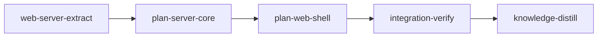

# Plan: `loom plan` server foundation and access

Implements: section_02, section_12

## Overview

Bare `loom plan` starts a server that serves an authenticated planning app: the header with the
seven-step tracker, presence, Share, and the 401 screen. The server is built from the
dashboard's parts, which move out of `loom/src/commands/status/web/` into a shared
`loom::web_server` module whose accept loop takes a router; the dashboard becomes one router and
the planning server another. On top of that the plan builds section 02 (project root, port,
lock, runtime directory, opener, lifetime, read-only mode) and section 12's access model (cookie
on every data route in every posture, exact `Origin`, browser identity, the authoring holder,
display names, request limits). Later plans 3, 5, 7, 9, 10 and 11 add route modules, WebSocket
messages and shutdown hooks to it through the extension points listed below.

Metaplan entry: `doc/plans/metaplan-planner-ui.md`, "2. Server foundation and access". Depends
on plan 1 (`PLAN-feat-planner-01-documents.md`: `loom::planning`, stages `document-model` and
`checklist-check`) being merged.

## Goals

- `loom plan [--port] [--host] [--no-open]` serves the planning shell with section 12's access
  checks, the lock, the runtime directory, read-only mode and the two-stage Ctrl-C.
- The dashboard behaves exactly as before: its suites pass with edits only to `use` paths, and
  its startup lines are pinned because plan 11 parses them.
- A second entry page in the one `web/` Vite build, embedded by the same `build.rs` step, whose
  code never enters the dashboard bundle (checked by a manifest-based bundle check).
- Non-goals: any document, chat, session or summary route (plans 3 to 11); no new dependency.

## Decisions

- **The accept loop takes the router only.** The metaplan says "a router and a publisher". The
  loop never calls a publisher; the dashboard's `Broadcaster` and the planning hub are reached only
  from each router's WebSocket upgrade. So `web_server::serve(listener, router, running, config)`
  takes `Arc<dyn Router>`, and the shared publisher is a type both routers own
  (`web_server::hub::Hub`, the fan-out lifted out of `Broadcaster`). A parameter with no reader
  would be dead weight (Discipline B).
- **Plan 2 owns the 10-minute authoring grace timer** and frees authoring at expiry; plan 7 listens
  and runs the session's final write. Without it, a holder who saved a file and closed the tab
  would hold authoring forever before plan 7 exists.
- **API prefix `/api/`**, WebSocket `/ws`. The planning server serves only the planning app.
- **One WebSocket per tab, typed both ways.** `PlanMessage` (server to browser) and
  `ClientMessage` (browser to server) are serde enums tagged `type`; later plans add variants.
- **The planning `Origin` rule is exact on loopback too** (section 12); the dashboard keeps its own
  loopback rule.
- **No `/api/checklist` route:** the checklist arrives in `hello` and in `checklist` deltas.
- **Bundle separation is checked from Vite's manifest** (`build.manifest: true`), following static
  imports only, so a lazy chunk never counts against an initial bundle.

## Interfaces later plans consume

Binding names; this section is authoritative for every later plan.

- **Path rule (all plans):** every wire field holding a document path (`path`, `target`,
  `paths`, `reading`) is repo-relative and starts with `doc/`. The only doc-relative forms are
  plan 3's HTTP request parameters (`?path=`), `SaveRequest.path`, and the browser's
  `/files/<path>` addresses. Rust helpers `plan_server::wire::paths::{to_doc_rel, to_repo_rel}`;
  plan 3 mirrors them in `web/src/plan/files/address.ts` (`docRel`, `repoRel`).

- `loom::web_server` (stage `web-server-extract`): `trait Router { upgrade, handle }`,
  `ConnInfo`, `serve(listener, Arc<dyn Router>, running, ServeConfig { policy, limits, thread_name })`,
  `hub::Hub`, `bind_listener(host, port, default_port)`, `AccessPolicy::new(local, Option<Auth>)`,
  `Auth::new(token, cookie_name)`, `Limits::new(max_inbound_bytes)`, `assets::page(name)`,
  `http::response_head(.., extra_headers)`. Dashboard `commands::status::web::startup_lines(local, remote, terminals, token, addresses) -> Vec<String>`
  with the lines unchanged: loopback `loom dashboard: http://{addr}/  (Ctrl-C to stop)`, with
  terminals `loom dashboard: http://{addr}/?token={64 hex}  (terminals enabled; Ctrl-C to stop)`,
  remote `loom dashboard listening on {addr} (remote access enabled[; terminals enabled])` then
  one `  bootstrap from {this machine|another machine} at: http://{ip}:{port}/?token={64 hex}`
  per address, the warning line and `  (Ctrl-C to stop)`.
- `loom::plan_server` (stage `plan-server-core`): `DEFAULT_PORT = 7272`; `start(ServerOptions) -> RunningServer`,
  `run(&PlanServeArgs)`; `PlanContext` (`root`, `runtime`, `project`, `authoring`, `presence`,
  `hub`, `shutdown`, `read_only`, `bind`, `is_stopping`, `require_authoring(&BrowserId, Take)`,
  `on_batch(hook)`, `own_writes()` (the watcher's `OwnWrites`, for plan 4's engine), `extensions()`);
  every module's `install` runs inside `start` before the first request is accepted; route modules `plan_server/<name>/mod.rs` with
  `routes() -> Vec<RouteSpec { method, path, body: BodyKind, role: Role, handler }>` plus one line
  in `plan_server/routes.rs::all_routes()` and optional `install(&Arc<PlanContext>)` plus one line
  in `install_all()`; `ApiRequest { ctx, head, browser, public_id, query, body }`, `ApiResponse`;
  `ids::{BrowserId, PublicId, ConnId, ConnCtx}`; `authoring::{Authoring, Take, Refusal, AuthoringEvent, FreeReason, GRACE}`;
  `authoring::Authoring::release_if(&PublicId, FreeReason) -> bool` (frees only that holder; plans 7 and 11 use it);
  `presence::{Presence, sanitize_name}`; integration tests in other targets start a server with
  `loom::plan_server::start(ServerOptions { root, host, port: Some(0), read_only })`, bootstrap with
  `GET /?token=<RunningServer.token>` and send `Origin: http://127.0.0.1:<port>`; the server resolves
  its runtime with plan 1's `server_runtime_paths` and ignores (with a warning) `LOOM_PLAN_STATE`; `ws::hub::PlanHub::{broadcast, send_to_conn, send_to_browser, send_to_holder, on_open, on_close}`;
  `ws::dispatch::dispatch` (one arm per `ClientMessage` variant; runs on the connection's thread,
  so handlers return quickly; an unparseable frame is answered with `Refused` before dispatch;
  `send_to_holder`/`send_to_browser` reach every open tab and drop the message when none is open); `shutdown::{Shutdown, ShutdownHook { name, drain, abort }}`;
  `prereq::ReadOnly::{is_read_only, problems}`; during the first-Ctrl-C drains the accept loop,
  every WebSocket and every route stay up (the holder can still answer prompts) and
  `ctx.is_stopping()` is true; `lifecycle::{line, safe}`;
  `startup::{startup_lines, already_running_lines, tunnel_hint(port, hostname)}`;
  `browser::{EnvView::current, decide}`; `BindInfo { local, remote, urls }` via `ctx.bind()`.
- Wire model: Rust `loom/src/plan_server/wire/<area>.rs` with parity tests
  `wire/tests_<area>.rs`; fixtures `web/src/plan/api/fixtures/<name>.json`; zod
  `web/src/plan/api/schema-<area>.ts` (plan 2's own is `schema.ts`). Pattern: fixture
  deserialize-serialize equality in Rust, enum wire values checked against the TS const arrays,
  vitest parses each fixture.
- Web (stage `plan-web-shell`): `web/plan.html` -> `web/src/plan/main.tsx`;
  `web/src/plan/router.tsx` (`routes`), `web/src/plan/tabs.ts` (`PLAN_TABS`, plan 3 adds Files,
  plan 5 Product and Engineering), `web/src/plan/shell.tsx` (`PlanShell`), `web/src/plan/dock.tsx`
  (`Dock`, plan 9), `web/src/plan/header-extras.tsx` (`HeaderExtras`, plan 9),
  `web/src/plan/help-keys.ts` (`PLAN_HELP_KEYS`), `web/src/plan/api/{client.ts, socket.ts}`,
  `web/src/plan/state/atoms.ts` (`canAuthorAtom`, `isHolderAtom`, `authorBlockReasonAtom` (the
  one reason text for a write control a browser may not use), `connectionEpochAtom`,
  `planSocketAtom`), the socket handle's `onResync(handler) -> unsubscribe` (fires on every
  `hello` after the page's first; every plan whose state is fed by deltas refetches there),
  `apiGet`/`apiPost` returning `{ ok: false, status: 0, error: "unreachable" }` for a down server,
  `web/src/plan/ui/disabled-reason.tsx` (`<DisabledReason reason={string | null} onClick>{label}</DisabledReason>`:
  enabled when `reason` is null; otherwise focusable, `aria-disabled`, reason visible and as
  accessible description; never a disabled button with a tooltip),
  `web/src/plan/ui/load-state.tsx` (`<LoadState state title? message? action? />` for loading,
  empty, not-found and error), `HeaderExtras` with a `compact` prop (below `lg` the header keeps
  `HeaderExtras` in its compact form and moves Presence and Share to an overflow menu),
  `PlanShell` wrapped in `TooltipProvider`, the 401 screen (`Unauthorized`, leading with "loom plan
  restarted ..." when the page had been connected; no other plan shows a restart message),
  `ServerInfo.project_key` (prefix for browser storage keys), the offer registry
  `web/src/plan/offers/actions.ts` (`registerOfferAction(kind, handler)`, `offerAction`, `runOffer`;
  plan 9 registers the authoring offers, plan 11 `pressure_test` and `start_run`; an offer with no
  handler renders as text), `ChecklistView` wire with `primary`, `secondary` and `items` offers, styles `@/index.css`
  plus `web/src/plan/plan.css`; bundle check `node web/scripts/bundle-check.mjs` with rules in
  `web/scripts/bundle-rules.json`.

## Execution Diagram



No knowledge-bootstrap stage: the knowledge base already maps this codebase (tier-1 files and the
`architecture/web-dashboard*`, `architecture/web-terminal` topics), and plan 1's distill stage
records `loom::planning`. The dashboard's server topics are corrected by this plan's distill stage.

## Stages

### 1. `web-server-extract`: the shared HTTP layer

Moves the dashboard's server infrastructure into `loom/src/web_server/`, parameterises the
accept loop by a `Router`, and turns the dashboard into a `DashboardRouter`. Exists as its own
stage by Q3: the dashboard's suites must pass on the moved code before anything is built on it;
a regression found later would be tangled with new planning code. Risk walk: reachability (the
loop must dispatch to the injected router: contract `serve-dispatches-to-router`), untrusted
input (the `Host` check must still run before any router: `host-check-before-router`), external
data (plan 11 parses the startup lines: `dashboard-startup-unchanged`). Baseline in the author's
checkout at b0f91c00: `cargo test --lib commands::status::web::` 211 passed; `--test e2e
web_terminal` 4 passed; `--test web_host` 1 passed; clippy, fmt, maintainability green. Lanes: Claude only (`implementers: ["claude"]`): one interlocking move across files that
cannot be cut into single-file units.

### 2. `plan-server-core`: the planning server

Root, lock, runtime directory, read-only mode, opener, startup lines, CLI, access gate, browser
identity, authoring, presence, the duplex WebSocket and its hub, shutdown hooks, the wire model
with fixture parity, `GET /api/server` and `GET /api/share`. One stage (Q4 checked: 16 codex
units and three Claude workers in four waves; each codex report is a short trailer and each
Claude worker stays well under 400,000 tokens, so the orchestrator's context holds briefs and
reports only). Exists by Q1: it needs stage 1 merged. Risk walk: untrusted input (display names:
`display-name-sanitized`; cookies and tokens: `token-only-on-root`), filesystem and symlinks (the
lock file: `lock-refuses-symlink`), lifecycle and concurrency (second instance:
`lock-reports-running-server`; holder away: `holder-kept-while-away`), configuration propagation
(`--no-open` and SSH: `opener-skipped-over-ssh`), reachability (bare `loom plan` serves through
the binary: `bare-loom-plan-serves`), access (`api-cookie-on-loopback`,
`ws-origin-exact-on-loopback`), refusal (`stage-worktree-refused`).

### 3. `plan-web-shell`: the planning app's second entry

Second Vite entry, zod schemas and parity, API client and socket, atoms, `PlanShell`, header
(tracker, presence, name prompt, Share popover), banners, 401 screen, checklist view, the bundle
check, and the embedded-shell Rust test; then `bun run build` and the rebuilt `web/dist`
committed as its own `chore(web)` commit. Exists by Q1: the fixtures and Rust wire types of stage
2 must be merged. Risk walk: external data (fixtures produced by Rust: `fixtures-parse`),
lifecycle (reconnect: `reconnect-delays`), untrusted state (the share link must not linger:
`share-link-not-kept`), reachability (401 screen: `unauthorized-replaces-shell`). Lanes: 13 codex units (`implementers: ["codex", "claude"]`) and one Claude worker
for the visual components and the entry files.

### 4. Integration verification

The full pre-push gate verbatim, the web gate, the bundle check, a committed-bundle freshness
check, and a security review by `loom-code-reviewer` subagents judged against
`doc/product/section_12.md` "Threat model" (rows: a web page in the user's browser, another
local user or network peer without the link, a read-only browser taking authoring, a flood of
connections or large requests) and "Requests that change something".

### 5. Knowledge distillation

Curates the stage memories; rewrites the dashboard-server knowledge topics for the new module
layout (current truth only).

## Environment inventory

- Implementation fetches: none expected (no new dependency); `crates.io` and `registry.npmjs.org`
  stay allowed for the build and the pre-commit hook's `bunx markdownlint-cli2`.
- `web/` needs `node_modules`: the `provision` entry installs it with the hardened command.
- Criteria bind loopback sockets inside the host job (allowed: private network namespace with
  `lo`); tests that cannot bind skip themselves (`skip_without_loopback` pattern).
- No credentials, no tmux, no `claude` needed by any criterion: read-only mode is the expected
  state in the host job and the binary contract tolerates it.
- `cargo test --all-targets` took 269 s in the author's checkout (9,330 passed): the
  integration-verify criterion carries `timeout_secs: 3600`.

<!-- loom METADATA -->

```yaml
loom:
  version: 2
  ratchet_files:
    - loom/maintainability-baseline.txt
    - doc/loom/knowledge/check-baseline.txt
  provision:
    - working_dir: "web"
      command: "test ! -e .npmrc && test ! -L .npmrc && bun install --frozen-lockfile --ignore-scripts --backend=copyfile --config=/dev/null"
  sandbox:
    enabled: true
    auto_allow: true
    filesystem:
      deny_read: ["~/.ssh/**", "~/.aws/**", "~/.config/gcloud/**", "~/.gnupg/**"]
    network:
      allowed_domains: ["crates.io", "index.crates.io", "static.crates.io", "registry.npmjs.org"]
      allow_local_binding: true
      allow_unix_sockets: []
  stages:
    - id: web-server-extract
      name: "Extract the shared HTTP layer"
      summary: "Moves the dashboard's server parts into loom::web_server behind a Router trait, with the dashboard unchanged on top."
      stage_type: standard
      working_dir: "."
      skills: ["loom-rust"]
      implementers: ["claude"]
      dependencies: []
      description: |
        Move the reusable parts of loom/src/commands/status/web/ into a new crate-level
        module loom/src/web_server/ (pub mod web_server; in loom/src/lib.rs) and make the
        accept loop take a router. The dashboard keeps its routes, wire model, broadcaster,
        config API and terminal lane, becomes a DashboardRouter, and must behave identically.
        Use parallel subagents and skills to maximize performance.

        One worker (the refactor is one interlocking change; splitting it would put two
        workers on the same files):

        | Worker | Role | Tier | Files owned | Shared context | Brief path |
        | ------ | ---- | ---- | ----------- | -------------- | ---------- |
        | extract | Move and parameterise the server layer | opus | loom/src/web_server/**, loom/src/commands/status/web/**, loom/src/lib.rs, loom/src/cli/dispatch.rs | doc/plans/briefs/feat-planner-02-server/common.md | doc/plans/briefs/feat-planner-02-server/web-server-extract/extract.md |

        Spawn it BY AGENT TYPE (loom-senior-software-engineer) with the fixed prompt plus
        "Your brief: doc/plans/briefs/feat-planner-02-server/web-server-extract/extract.md. Read it in
        full before anything else." Workers never spawn subagents.

        PUBLIC SURFACE the contracts call (the contract session writes them from this list):
        - loom::web_server::Router (trait, methods upgrade(&self, TcpStream, &RequestHead,
          &ConnInfo) -> Option<TcpStream> and handle(&self, &mut TcpStream, &RequestHead,
          Vec<u8>, &ConnInfo) -> io::Result<()>), loom::web_server::ConnInfo,
          loom::web_server::serve(listener: TcpListener, router: Arc<dyn Router>,
          running: Arc<AtomicBool>, config: ServeConfig) -> anyhow::Result<()>,
          loom::web_server::ServeConfig { policy, limits, thread_name },
          loom::web_server::access::AccessPolicy::new(local: SocketAddr, auth: Option<Auth>),
          loom::web_server::limits::Limits::new(max_inbound_bytes: usize) -> Arc<Limits>,
          loom::web_server::http::{RequestHead, write_response}.
        - loom::commands::status::web::startup_lines(local: SocketAddr, remote: bool,
          terminals: bool, token: Option<&str>, addresses: &[IpAddr]) -> Vec<String>.
        Contract file loom/tests/web_server_contracts.rs is its own test target (test value =
        bare function name).

        Gate: the orchestrator runs one loom check web-server-extract. The dashboard's tests
        may change only in their use paths. One test file moves with its module
        (commands/status/web/access_tests.rs to web_server/access_tests.rs), which raises the
        expected TI-edit-loom/src/commands/status/web/access_tests.rs: after the final review,
        file one loom stage dispute-integrity web-server-extract --event
        TI-edit-loom/src/commands/status/web/access_tests.rs --reason "moved with access.rs to
        loom/src/web_server/access_tests.rs, assertions unchanged". A changed assertion other
        than that moved file is a defect. The maintainability ledger has no rows under commands/status/web today; if
        a moved file or function must appear in it, stop and record why with loom memory.
        MEMORY: record mistakes/decisions/surprises via loom memory immediately (subagents
        too); NEVER loom knowledge in this stage; NEVER Claude Code auto-memory.
      acceptance:
        - "cargo build --manifest-path loom/Cargo.toml"
        - "cargo clippy --manifest-path loom/Cargo.toml --all-targets -- -D warnings"
        - "cargo fmt --manifest-path loom/Cargo.toml --check"
        - 'RUSTDOCFLAGS="-D warnings" cargo doc --manifest-path loom/Cargo.toml --workspace --all-features --no-deps'
        - "cargo test --manifest-path loom/Cargo.toml --lib web_server::"
        - "cargo test --manifest-path loom/Cargo.toml --lib commands::status::web::"
        - "cargo test --manifest-path loom/Cargo.toml --test e2e web_terminal"
        - "cargo test --manifest-path loom/Cargo.toml --test web_host"
        - "cargo test --manifest-path loom/Cargo.toml --test maintainability"
        - "test ! -e loom/src/commands/status/web/listener.rs"
      files:
        - "loom/src/web_server/**"
        - "loom/src/commands/status/web/**"
        - "loom/src/lib.rs"
        - "loom/src/cli/dispatch.rs"
        - "loom/tests/web_server_contracts.rs"
        - "loom/tests/e2e/web_terminal.rs"
      artifacts:
        - "loom/src/web_server/serve.rs"
        - "loom/src/web_server/hub.rs"
        - "loom/src/commands/status/web/router.rs"
        - "loom/src/commands/status/web/startup.rs"
      wiring:
        - source: "loom/src/commands/status/web/mod.rs"
          pattern: "web_server::serve\\("
          description: "the dashboard runs on the shared accept loop"
      before_stage:
        - command: "cargo --version"
          description: "cargo on PATH"
      after_stage:
        - command: "test ! -e loom/src/commands/status/web/listener.rs"
          description: "the listener moved out of the dashboard module"
      contracts:
        - id: serve-dispatches-to-router
          file: loom/tests/web_server_contracts.rs
          test: serve_dispatches_to_custom_router
          scenario: "binds 127.0.0.1:0, runs web_server::serve on a thread with a test Router whose handle answers 200 router-ok for GET /probe, sends a raw GET /probe with Host 127.0.0.1:<port>, then clears running"
          rejects: "a serve loop that still calls the dashboard's connection route and answers the SPA shell or 404 instead of the injected router"
        - id: host-check-before-router
          file: loom/tests/web_server_contracts.rs
          test: bad_host_never_reaches_router
          scenario: "same server as above with a Router that counts calls; sends GET /probe with Host evil.example:80"
          rejects: "a loop that hands the request to the router first and leaves the Host check to each router, so the counter is non-zero or the answer is not 403"
        - id: dashboard-startup-unchanged
          file: loom/tests/web_server_contracts.rs
          test: dashboard_startup_lines_are_unchanged
          scenario: "calls startup_lines for 127.0.0.1:7373 loopback without terminals, and with terminals and a 64-hex token, and compares to the exact strings 'loom dashboard: http://127.0.0.1:7373/  (Ctrl-C to stop)' and 'loom dashboard: http://127.0.0.1:7373/?token=<token>  (terminals enabled; Ctrl-C to stop)'"
          rejects: "a refactor that rebrands, re-spaces or reorders the dashboard startup line that plan 11 parses"

    - id: plan-server-core
      name: "Planning server core and access"
      summary: "Adds bare loom plan: lock, runtime directory, read-only mode, the cookie-on-every-route gate, authoring holder, presence, the WebSocket hub and shutdown hooks."
      stage_type: standard
      working_dir: "."
      skills: ["loom-rust"]
      implementers: ["claude", "codex"]
      subagent_timeout_secs: 900
      dependencies: ["web-server-extract"]
      description: |
        Build crate-level loom/src/plan_server/ on loom::web_server and plan 1's
        loom::planning (Project, Watcher, Batch, OwnWrites, runtime_paths, Checklist; read its
        committed code, never reimplement it). Shapes are binding: see the plan's
        "Interfaces later plans consume" and each brief.
        Use parallel subagents and skills to maximize performance.

        Lanes: codex units C1-C14, C17, C18 (wire types, fixtures and parity tests, lock,
        opener, startup lines, root, prerequisites, lifecycle lines, completions, docs, the
        server-info route module, the binary CLI tests) and Claude workers for the
        security and concurrency cores (authoring and presence, the duplex WebSocket and
        shutdown, the integrator's access gate, router and context). Waves (territories are
        DISJOINT across both lanes; workers never spawn subagents):
        - Before wave 0 the orchestrator writes loom/src/plan_server/mod.rs (DEFAULT_PORT,
          pub mod ids; pub mod wire;), loom/src/plan_server/wire/mod.rs and the
          pub mod plan_server; line in loom/src/lib.rs (a small change); before wave 1 it adds
          the wave-1 module lines and widens sandbox_prerequisite_problem to pub(crate)
          (codex-units.md "Orchestrator duties").
        - Wave 0: codex C1-C6.
        - Wave 1: Claude authoring and ws-hub (background, loom-senior-software-engineer) and
          codex C7-C12, then C13-C14 (foreground).
        - Wave 2: Claude integrator (loom-senior-software-engineer; takes over
          loom/src/plan_server/mod.rs).
        - Wave 3: codex C17 and C18.
        Claude spawns use the fixed prompt plus "Your brief: <path>. Read it in full before
        anything else."
        CODEX LANE (user decision: heavy use of codex for boilerplate, unit tests and simple
        implementation): spawn the codex units as loom-codex-forwarder subagents in the
        FOREGROUND, at most 6 at once over DISJOINT files, each with an explicit Bash timeout
        of 600000 ms and --model gpt-6.1-terra --effort high; never codex:codex-rescue. Each
        unit's prompt is exactly the fixed line "Implement unit <id> of doc/plans/briefs/feat-planner-02-server/plan-server-core/codex-units.md. Read that file
        and the spec section its row names first. Write only the files the row lists. Run no
        git." Never paste the row or the spec text into the prompt: the specs hold product
        strings and apostrophes the forward hook refuses. Codex runs compile-only checks at
        most and touches no hidden loom state or work path. After
        EVERY unit run git status --short (only that unit's files may change) and the unit's
        proof command; a unit that times out (exit 124) is re-split against the partial tree,
        never re-forwarded as is, and work that cannot be cut to one file plus its test moves
        to a Claude worker. Claude workers spawn BY AGENT TYPE in the background as usual; one
        loom subagents watch covers them.

        | Worker | Role | Tier | Files owned | Shared context | Brief path |
        | ------ | ---- | ---- | ----------- | -------------- | ---------- |
        | C1 | ids | codex terra | loom/src/plan_server/ids.rs, loom/src/plan_server/ids_tests.rs | doc/plans/briefs/feat-planner-02-server/common.md | doc/plans/briefs/feat-planner-02-server/plan-server-core/codex-units.md |
        | C2 | server wire types | codex terra | loom/src/plan_server/wire/server.rs, web/src/plan/api/fixtures/server-info.json, web/src/plan/api/fixtures/share.json, web/src/plan/api/fixtures/refused.json | doc/plans/briefs/feat-planner-02-server/common.md | doc/plans/briefs/feat-planner-02-server/plan-server-core/codex-units.md |
        | C3 | presence wire types | codex terra | loom/src/plan_server/wire/presence.rs, web/src/plan/api/fixtures/presence.json, web/src/plan/api/fixtures/authoring.json | doc/plans/briefs/feat-planner-02-server/common.md | doc/plans/briefs/feat-planner-02-server/plan-server-core/codex-units.md |
        | C4 | checklist wire types | codex terra | loom/src/plan_server/wire/checklist.rs, web/src/plan/api/fixtures/checklist.json | doc/plans/briefs/feat-planner-02-server/common.md | doc/plans/briefs/feat-planner-02-server/plan-server-core/codex-units.md |
        | C5 | wire path helpers | codex terra | loom/src/plan_server/wire/paths.rs, loom/src/plan_server/wire/paths_tests.rs | doc/plans/briefs/feat-planner-02-server/common.md | doc/plans/briefs/feat-planner-02-server/plan-server-core/codex-units.md |
        | C6 | message enums | codex terra | loom/src/plan_server/wire/message.rs, web/src/plan/api/fixtures/hello.json, web/src/plan/api/fixtures/client-set-name.json, web/src/plan/api/fixtures/client-reading.json | doc/plans/briefs/feat-planner-02-server/common.md | doc/plans/briefs/feat-planner-02-server/plan-server-core/codex-units.md |
        | C7 | server lock | codex terra | loom/src/plan_server/lock.rs, loom/src/plan_server/lock_tests.rs | doc/plans/briefs/feat-planner-02-server/common.md | doc/plans/briefs/feat-planner-02-server/plan-server-core/codex-units.md |
        | C8 | browser opener | codex terra | loom/src/plan_server/browser.rs, loom/src/plan_server/browser_tests.rs | doc/plans/briefs/feat-planner-02-server/common.md | doc/plans/briefs/feat-planner-02-server/plan-server-core/codex-units.md |
        | C9 | startup lines | codex terra | loom/src/plan_server/startup.rs, loom/src/plan_server/startup_tests.rs | doc/plans/briefs/feat-planner-02-server/common.md | doc/plans/briefs/feat-planner-02-server/plan-server-core/codex-units.md |
        | C10 | project root | codex terra | loom/src/plan_server/root.rs, loom/src/plan_server/root_tests.rs | doc/plans/briefs/feat-planner-02-server/common.md | doc/plans/briefs/feat-planner-02-server/plan-server-core/codex-units.md |
        | C11 | read-only prerequisites | codex terra | loom/src/plan_server/prereq.rs, loom/src/plan_server/prereq_tests.rs | doc/plans/briefs/feat-planner-02-server/common.md | doc/plans/briefs/feat-planner-02-server/plan-server-core/codex-units.md |
        | C12 | lifecycle lines | codex terra | loom/src/plan_server/lifecycle.rs, loom/src/plan_server/lifecycle_tests.rs | doc/plans/briefs/feat-planner-02-server/common.md | doc/plans/briefs/feat-planner-02-server/plan-server-core/codex-units.md |
        | C13 | completions | codex terra | loom/src/completions/dynamic/mod.rs, loom/src/completions/dynamic/tests/tests_commands.rs | doc/plans/briefs/feat-planner-02-server/common.md | doc/plans/briefs/feat-planner-02-server/plan-server-core/codex-units.md |
        | C14 | README and skill doctrine | codex terra | README.md, skills/loom-usage/SKILL.md | doc/plans/briefs/feat-planner-02-server/common.md | doc/plans/briefs/feat-planner-02-server/plan-server-core/codex-units.md |
        | C17 | server info routes | codex terra | loom/src/plan_server/server_info/mod.rs, loom/src/plan_server/server_info/tests.rs | doc/plans/briefs/feat-planner-02-server/common.md | doc/plans/briefs/feat-planner-02-server/plan-server-core/codex-units.md |
        | C18 | binary CLI tests | codex terra | loom/tests/plan_server_cli.rs | doc/plans/briefs/feat-planner-02-server/common.md | doc/plans/briefs/feat-planner-02-server/plan-server-core/codex-units.md |
        | authoring | authoring holder and presence | opus | loom/src/plan_server/authoring.rs, loom/src/plan_server/authoring_tests.rs, loom/src/plan_server/presence.rs, loom/src/plan_server/presence_tests.rs | doc/plans/briefs/feat-planner-02-server/common.md | doc/plans/briefs/feat-planner-02-server/plan-server-core/authoring.md |
        | ws-hub | duplex WebSocket, hub, shutdown | opus | loom/src/plan_server/ws/hub.rs, loom/src/plan_server/ws/conn.rs, loom/src/plan_server/ws/mod.rs, loom/src/plan_server/ws/tests.rs, loom/src/plan_server/shutdown.rs, loom/src/plan_server/shutdown_tests.rs | doc/plans/briefs/feat-planner-02-server/common.md | doc/plans/briefs/feat-planner-02-server/plan-server-core/ws-hub.md |
        | integrator | context, gate, router, routes, CLI, start and run | opus | loom/src/plan_server/mod.rs, loom/src/plan_server/context.rs, loom/src/plan_server/extensions.rs, loom/src/plan_server/gate.rs, loom/src/plan_server/gate_tests.rs, loom/src/plan_server/router.rs, loom/src/plan_server/routes.rs, loom/src/plan_server/request.rs, loom/src/plan_server/watch.rs, loom/src/plan_server/ws/dispatch.rs, loom/src/plan_server/tests/**, loom/src/commands/plan/serve.rs, loom/src/commands/plan/mod.rs, loom/src/cli/types_ops.rs, loom/src/cli/types.rs, loom/src/cli/dispatch.rs | doc/plans/briefs/feat-planner-02-server/common.md | doc/plans/briefs/feat-planner-02-server/plan-server-core/integrator.md |

        PUBLIC SURFACE the contracts call (contract file loom/tests/plan_server_contracts.rs,
        its own test target; test value = bare function name):
        - loom::plan_server::{start, ServerOptions { root: PathBuf, host: IpAddr,
          port: Option<u16>, read_only: ReadOnly }, RunningServer { local, token, ctx },
          RunningServer::stop}; start needs a git repository with a doc/ directory and
          touches no lock or runtime directory.
        - loom::plan_server::prereq::ReadOnly::from_problems(Vec<MissingPrereq>).
        - loom::plan_server::authoring::{Authoring::new(read_only: bool),
          require(&self, &BrowserId, &PublicId, Take, stopping: bool) -> Result<(), Refusal>,
          connection_opened(&BrowserId), connection_closed(&BrowserId, SystemTime),
          tick(SystemTime), Take::{HolderOnly, TakeIfFree}, Refusal::NotHolder { holder },
          GRACE = 600 s}; loom::plan_server::ids::{BrowserId::mint, PublicId::mint}.
        - loom::plan_server::ids::{BrowserId::{mint, parse, as_str}, PublicId::mint} (Debug of a
          BrowserId never shows its value).
        - loom::plan_server::presence::sanitize_name(&str) -> String (drops Cc and Cf
          including bidi controls, then keeps at most 32 chars).
        - loom::plan_server::lock::{acquire(&Path) -> Result<Acquired>, Acquired::{Held,
          Running(LockRecord { pid, url, token })}, ServerLock::publish(&mut self, url, token)}.
        - loom::plan_server::root::resolve_project(cwd: &Path) -> Result<PathBuf>.
        - loom::plan_server::browser::{decide(&EnvView, no_open: bool) -> OpenDecision,
          EnvView { ssh_connection, ssh_tty, display, wayland, linux }, OpenDecision::{Open,
          Skip(SkipReason::{NoOpen, Ssh, NoDisplay})}}.
        - Binary: `loom plan --no-open --port 0` run in a temp git repo (LOOM_HOME pointed at a
          temp dir) prints a line starting `http://127.0.0.1:` containing `/?token=`.
        - HTTP: cookies loom_plan_<port> and loom_plan_browser_<port>; GET /api/server; /ws.

        Gate: one loom check plan-server-core. MEMORY: record mistakes/decisions/surprises via
        loom memory immediately (subagents too); NEVER loom knowledge; NEVER auto-memory.
      acceptance:
        - "cargo build --manifest-path loom/Cargo.toml"
        - "cargo clippy --manifest-path loom/Cargo.toml --all-targets -- -D warnings"
        - "cargo fmt --manifest-path loom/Cargo.toml --check"
        - 'RUSTDOCFLAGS="-D warnings" cargo doc --manifest-path loom/Cargo.toml --workspace --all-features --no-deps'
        - "cargo test --manifest-path loom/Cargo.toml --lib plan_server::"
        - "cargo test --manifest-path loom/Cargo.toml --test plan_server_cli"
        - "cargo test --manifest-path loom/Cargo.toml --lib completions::"
        - "cargo test --manifest-path loom/Cargo.toml --lib commands::status::web::"
        - "cargo test --manifest-path loom/Cargo.toml --test maintainability"
        - 'cargo run --manifest-path loom/Cargo.toml -q -- plan --help | rg -qF -- "--no-open"'
        - 'cargo run --manifest-path loom/Cargo.toml -q -- plan verify --help | rg -qF -- "--strict"'
      files:
        - "loom/src/plan_server/**"
        - "loom/src/lib.rs"
        - "loom/src/commands/plan/serve.rs"
        - "loom/src/commands/plan/mod.rs"
        - "loom/src/commands/run/sandbox_preflight.rs"
        - "loom/src/cli/types_ops.rs"
        - "loom/src/cli/types.rs"
        - "loom/src/cli/dispatch.rs"
        - "loom/src/completions/dynamic/**"
        - "loom/tests/plan_server_contracts.rs"
        - "loom/tests/plan_server_cli.rs"
        - "web/src/plan/api/fixtures/**"
        - "README.md"
        - "skills/loom-usage/SKILL.md"
      artifacts:
        - "loom/src/plan_server/router.rs"
        - "loom/src/plan_server/gate.rs"
        - "loom/src/plan_server/authoring.rs"
        - "loom/src/plan_server/ws/hub.rs"
        - "loom/src/plan_server/shutdown.rs"
        - "loom/src/plan_server/lock.rs"
        - "web/src/plan/api/fixtures/hello.json"
      wiring:
        - source: "loom/src/cli/dispatch.rs"
          pattern: "plan::serve::execute"
          description: "bare loom plan dispatches to the planning server"
        - source: "loom/src/plan_server/mod.rs"
          pattern: "web_server::serve\\("
          description: "the planning server runs on the shared accept loop"
      before_stage:
        - command: "test -d loom/src/web_server"
          description: "web-server-extract has merged"
        - command: "test -d loom/src/planning"
          description: "plan 1 (PLAN-feat-planner-01-documents) has merged"
      after_stage:
        - command: "test -f web/src/plan/api/fixtures/hello.json"
          description: "the wire fixtures exist for the web stage"
      contracts:
        - id: api-cookie-on-loopback
          file: loom/tests/plan_server_contracts.rs
          test: api_without_cookie_is_401_on_loopback
          scenario: "start() on a temp git repo with doc/product/index.md, bound to 127.0.0.1:0; GET /api/server with correct Host and no Cookie header"
          rejects: "a gate that copies the dashboard rule and leaves viewing routes open on a loopback bind (answers 200)"
        - id: token-only-on-root
          file: loom/tests/plan_server_contracts.rs
          test: token_on_other_path_sets_no_cookie
          scenario: "same server; GET /files/x.md?token=<the right token>; then GET /api/server with whatever Set-Cookie the first response carried"
          rejects: "a bootstrap that accepts ?token= on any path, so the first response sets loom_plan_<port> and the second answers 200"
        - id: ws-origin-exact-on-loopback
          file: loom/tests/plan_server_contracts.rs
          test: ws_upgrade_with_loopback_alias_origin_is_refused
          scenario: "same server, valid access and browser cookies; WebSocket upgrade to /ws with Host 127.0.0.1:<port> and Origin http://localhost:<port>"
          rejects: "the dashboard's loopback Origin rule, which accepts any loopback alias or a missing Origin and completes the handshake"
        - id: holder-kept-while-away
          file: loom/tests/plan_server_contracts.rs
          test: second_browser_cannot_take_authoring_while_holder_away
          scenario: "Authoring::new(false); browser A requires TakeIfFree, connection_opened(A), connection_closed(A, t0), tick(t0 + 599 s); browser B requires TakeIfFree; then tick(t0 + 600 s) and B again"
          rejects: "an authoring model that frees on the holder's last WebSocket close, or lets another browser take while the holder is away (B must get NotHolder first and Ok only after 600 s)"
        - id: browser-id-is-random-and-opaque
          file: loom/tests/plan_server_contracts.rs
          test: browser_ids_are_random_128_bit_and_never_printed
          scenario: "BrowserId::mint() twice; BrowserId::parse on 32 lowercase hex, 31 and 33 chars, uppercase and non-hex; format!(\"{:?}\", id); PublicId::mint() twice"
          rejects: "an id minted from a counter, time or pid (two mints equal or not 32 lowercase hex), a parser that accepts other lengths or cases, or a Debug that prints the cookie value"
        - id: display-name-sanitized
          file: loom/tests/plan_server_contracts.rs
          test: display_names_drop_bidi_and_keep_32_chars
          scenario: "sanitize_name on a name with U+202E, U+2066 and U+0007 around Dana, and on a 40-char name of multi-byte chars"
          rejects: "a sanitizer that keeps bidi overrides, or truncates by bytes (panics or keeps fewer than 32 chars)"
        - id: lock-reports-running-server
          file: loom/tests/plan_server_contracts.rs
          test: second_lock_reports_url_and_token
          scenario: "acquire(temp/lock) -> Held, publish(http://127.0.0.1:7272, token); acquire again on the same path in the same process"
          rejects: "a lock that writes the record without an exclusive flock, so the second acquire returns Held instead of Running with the url and token"
        - id: lock-refuses-symlink
          file: loom/tests/plan_server_contracts.rs
          test: symlinked_lock_path_is_refused
          scenario: "temp/lock is a symlink to temp/target containing 'keep'; acquire(temp/lock)"
          rejects: "an open without O_NOFOLLOW that follows the link, locks or truncates temp/target, and returns Held"
        - id: stage-worktree-refused
          file: loom/tests/plan_server_contracts.rs
          test: stage_branch_checkout_is_refused
          scenario: "git init a temp repo with one commit, git checkout -b loom/demo, resolve_project(repo/doc)"
          rejects: "a root resolver that returns the toplevel without checking the branch, so loom plan would run inside a stage worktree"
        - id: opener-skipped-over-ssh
          file: loom/tests/plan_server_contracts.rs
          test: ssh_session_skips_the_opener
          scenario: "decide(EnvView { ssh_tty: true, display: true, linux: true, .. }, false)"
          rejects: "headless detection that checks only DISPLAY and opens a browser on the remote machine"
        - id: bare-loom-plan-serves
          file: loom/tests/plan_server_contracts.rs
          test: bare_loom_plan_serves_the_planning_app
          scenario: "temp git repo with doc/product/index.md, LOOM_HOME set to a temp dir; spawn env!(CARGO_BIN_EXE_loom) plan --no-open --port 0; read stdout until the http://127.0.0.1: line; GET /?token=<token> then GET /api/server with the returned cookies; kill the child"
          rejects: "a CLI that still requires a plan subcommand, or a server that prints a URL whose token does not bootstrap a session (the second request must answer 200 JSON with the project name)"

    - id: plan-web-shell
      name: "Planning app entry and shell"
      summary: "Adds the planning app as a second page of the web build: header with step tracker, presence and Share, banners, the 401 screen, and the bundle check."
      stage_type: standard
      working_dir: "."
      skills: ["loom-react", "loom-typescript", "loom-rust"]
      implementers: ["codex", "claude"]
      subagent_timeout_secs: 900
      dependencies: ["plan-server-core"]
      description: |
        Add the planning app as a second entry page of the web/ Vite build, embedded by the
        same build.rs step. Shapes are binding: see "Interfaces later plans consume".
        Use parallel subagents and skills to maximize performance.

        Lanes: codex units W1-W13 (schemas, client, socket, atoms, the enum parity test, the
        bundle check, the Vite config, the offer registry, DisabledReason, LoadState, the
        router, the tab registry, the embedded-shell test); the Claude shell worker (sonnet, loom-software-engineer)
        owns the visual components plus web/plan.html and web/src/plan/main.tsx. Waves (territories DISJOINT across lanes; workers never
        spawn subagents): A W1; B W2-W7; C W8-W10 and W13; then the shell worker in the background;
        D W11 and W12 after it returns. The orchestrator adds the two Rust module lines first
        and runs oxfmt on every codex web unit's files (codex-units.md "Orchestrator duties").
        The shell worker follows doc/loom/knowledge/conventions/web-dashboard-typography.md;
        the orchestrator escalates its visual work one tier only on a failed review.
        CODEX LANE (user decision: heavy use of codex for boilerplate, unit tests and simple
        implementation): spawn the codex units as loom-codex-forwarder subagents in the
        FOREGROUND, at most 6 at once over DISJOINT files, each with an explicit Bash timeout
        of 600000 ms and --model gpt-6.1-terra --effort high; never codex:codex-rescue. Each
        unit's prompt is exactly the fixed line "Implement unit <id> of doc/plans/briefs/feat-planner-02-server/plan-web-shell/codex-units.md. Read that file
        and the spec section its row names first. Write only the files the row lists. Run no
        git." Never paste the row or the spec text into the prompt: the specs hold product
        strings and apostrophes the forward hook refuses. Codex runs compile-only checks at
        most and touches no hidden loom state or work path. After
        EVERY unit run git status --short (only that unit's files may change) and the unit's
        proof command; a unit that times out (exit 124) is re-split against the partial tree,
        never re-forwarded as is, and work that cannot be cut to one file plus its test moves
        to a Claude worker. Claude workers spawn BY AGENT TYPE in the background as usual; one
        loom subagents watch covers them.

        | Worker | Role | Tier | Files owned | Shared context | Brief path |
        | ------ | ---- | ---- | ----------- | -------------- | ---------- |
        | W1 | plan zod schemas | codex terra | web/src/plan/api/schema.ts, web/src/plan/api/schema.test.ts | doc/plans/briefs/feat-planner-02-server/common.md | doc/plans/briefs/feat-planner-02-server/plan-web-shell/codex-units.md |
        | W2 | API client | codex terra | web/src/plan/api/client.ts, web/src/plan/api/client.test.ts | doc/plans/briefs/feat-planner-02-server/common.md | doc/plans/briefs/feat-planner-02-server/plan-web-shell/codex-units.md |
        | W3 | plan socket | codex terra | web/src/plan/api/socket.ts, web/src/plan/api/socket.test.ts | doc/plans/briefs/feat-planner-02-server/common.md | doc/plans/briefs/feat-planner-02-server/plan-web-shell/codex-units.md |
        | W4 | state atoms | codex terra | web/src/plan/state/atoms.ts, web/src/plan/state/atoms.test.ts | doc/plans/briefs/feat-planner-02-server/common.md | doc/plans/briefs/feat-planner-02-server/plan-web-shell/codex-units.md |
        | W5 | Rust enum parity test | codex terra | loom/src/plan_server/wire/tests_schema.rs | doc/plans/briefs/feat-planner-02-server/common.md | doc/plans/briefs/feat-planner-02-server/plan-web-shell/codex-units.md |
        | W6 | bundle check | codex terra | web/scripts/bundle-check.mjs, web/scripts/bundle-check.test.mjs, web/scripts/bundle-rules.json | doc/plans/briefs/feat-planner-02-server/common.md | doc/plans/briefs/feat-planner-02-server/plan-web-shell/codex-units.md |
        | W7 | Vite second entry | codex terra | web/vite.config.ts | doc/plans/briefs/feat-planner-02-server/common.md | doc/plans/briefs/feat-planner-02-server/plan-web-shell/codex-units.md |
        | W8 | offer registry | codex terra | web/src/plan/offers/actions.ts, web/src/plan/offers/actions.test.ts | doc/plans/briefs/feat-planner-02-server/common.md | doc/plans/briefs/feat-planner-02-server/plan-web-shell/codex-units.md |
        | W9 | DisabledReason | codex terra | web/src/plan/ui/disabled-reason.tsx, web/src/plan/ui/disabled-reason.test.tsx | doc/plans/briefs/feat-planner-02-server/common.md | doc/plans/briefs/feat-planner-02-server/plan-web-shell/codex-units.md |
        | W10 | LoadState | codex terra | web/src/plan/ui/load-state.tsx, web/src/plan/ui/load-state.test.tsx | doc/plans/briefs/feat-planner-02-server/common.md | doc/plans/briefs/feat-planner-02-server/plan-web-shell/codex-units.md |
        | W11 | planning router | codex terra | web/src/plan/router.tsx, web/src/plan/router.test.tsx | doc/plans/briefs/feat-planner-02-server/common.md | doc/plans/briefs/feat-planner-02-server/plan-web-shell/codex-units.md |
        | W13 | tab registry | codex terra | web/src/plan/tabs.ts, web/src/plan/tabs.test.ts | doc/plans/briefs/feat-planner-02-server/common.md | doc/plans/briefs/feat-planner-02-server/plan-web-shell/codex-units.md |
        | W12 | embedded-shell test | codex terra | loom/src/plan_server/tests/embedded.rs | doc/plans/briefs/feat-planner-02-server/common.md | doc/plans/briefs/feat-planner-02-server/plan-web-shell/codex-units.md |
        | shell | PlanShell, header, presence, Share, banners, 401, checklist view | sonnet | web/src/plan/shell.tsx, web/src/plan/shell.test.tsx, web/src/plan/dock.tsx, web/src/plan/header-extras.tsx, web/src/plan/help-keys.ts, web/src/plan/plan.css, web/src/plan/checklist-view.tsx, web/src/plan/checklist-view.test.tsx, web/src/plan/unauthorized.tsx, web/src/plan/unauthorized.test.tsx, web/src/plan/header/**, web/src/plan/offers/offer-button.tsx, web/plan.html, web/src/plan/main.tsx, web/src/components/help-dialog.tsx | doc/plans/briefs/feat-planner-02-server/common.md | doc/plans/briefs/feat-planner-02-server/plan-web-shell/shell.md |


        PUBLIC SURFACE the contracts call (contract file
        web/src/plan/plan-shell.contracts.test.tsx, vitest, run from web/):
        - PlanShell from @/plan/shell rendered in a MemoryRouter with a jotai store;
          unauthorizedAtom, connectionAtom from @/plan/state/atoms.
        - connectPlanSocket(store, { WebSocketImpl, setTimeout, clearTimeout }) from
          @/plan/api/socket, which calls apiGet("/api/server") through fetch before connecting;
          its handle has onResync(handler) -> unsubscribe.
        - Share from @/plan/header/share (fetches GET /api/share on every open).
        - Schemas from @/plan/api/schema and fixtures under @/plan/api/fixtures/.

        AFTER THE WAVES: format; build web/dist (cd web && node_modules/.bin/tsc -b &&
        node_modules/.bin/vite build) so the gate and the review see the bundle; one loom
        check; the review rounds (dist/ is build output, not reviewed line by line). After the
        gate and the final review are green and the review fixes are in, rebuild web/dist
        once, commit the feature, then web/dist as its own chore(web) commit, last. Never
        rebuild after that. The dist criterion compares a fresh build into a temp directory
        with diff -r, and the two git checks after it fail on a dist file left untracked or
        modified but not committed.
        Gate: one loom check plan-web-shell.
        MEMORY: record mistakes/decisions/surprises via loom memory immediately (subagents
        too); NEVER loom knowledge; NEVER auto-memory.
      acceptance:
        - "cd web && node_modules/.bin/tsc -b --noEmit"
        - "cd web && node_modules/.bin/oxlint --deny-warnings"
        - "cd web && node_modules/.bin/oxfmt --check"
        - "cd web && node_modules/.bin/vitest run src/plan scripts"
        - 'cd web && d=$(mktemp -d "${TMPDIR:-/tmp}/plandist.XXXXXX") && node_modules/.bin/vite build --outDir "$d" --emptyOutDir --logLevel error && diff -r "$d" dist'
        - "cd web && node scripts/bundle-check.mjs"
        - 'cd web && test -z "$(git ls-files --others --exclude-standard -- dist)"'
        - "cd web && git diff --quiet -- dist"
        - "cargo build --manifest-path loom/Cargo.toml"
        - "cargo clippy --manifest-path loom/Cargo.toml --all-targets -- -D warnings"
        - "cargo test --manifest-path loom/Cargo.toml --lib plan_server::"
        - "cargo test --manifest-path loom/Cargo.toml --lib commands::status::web::"
        - "test -f web/dist/plan.html"
      files:
        - "web/vite.config.ts"
        - "web/plan.html"
        - "web/src/plan/**"
        - "web/src/components/help-dialog.tsx"
        - "web/scripts/**"
        - "web/dist/**"
        - "loom/src/plan_server/wire/tests_schema.rs"
        - "loom/src/plan_server/wire/mod.rs"
        - "loom/src/plan_server/tests/embedded.rs"
        - "loom/src/plan_server/tests/mod.rs"
      artifacts:
        - "web/plan.html"
        - "web/src/plan/shell.tsx"
        - "web/src/plan/header/share.tsx"
        - "web/src/plan/api/socket.ts"
        - "web/scripts/bundle-check.mjs"
      wiring:
        - source: "web/vite.config.ts"
          pattern: "plan\\.html"
          description: "the planning page is a build input"
        - source: "web/src/plan/router.tsx"
          pattern: "<PlanShell"
          description: "the router renders the planning shell"
      before_stage:
        - command: "node --version"
          description: "node on PATH for the provisioned web/node_modules binaries"
        - command: "test -f web/src/plan/api/fixtures/hello.json"
          description: "plan-server-core has merged"
      after_stage:
        - command: "test -f web/dist/plan.html"
          description: "the planning page is in the committed bundle"
      contracts:
        - id: unauthorized-replaces-shell
          file: web/src/plan/plan-shell.contracts.test.tsx
          test: plan shell shows only the sign-in notice after a 401
          cwd: web
          runner: vitest
          scenario: "renders PlanShell with unauthorizedAtom set true"
          rejects: "a shell that keeps rendering the header and outlet with an error toast, or retries forever, instead of the one section 12 screen naming the link loom plan printed"
        - id: reconnect-delays
          file: web/src/plan/plan-shell.contracts.test.tsx
          test: plan socket reconnects after 1 2 5 and then every 10 seconds
          cwd: web
          runner: vitest
          scenario: "connectPlanSocket with a fake WebSocket that closes at once and a fake setTimeout recording delays; fetch stubbed to answer 200 for /api/server"
          rejects: "the dashboard's backoff copied as is, or a fixed delay, instead of 1000, 2000, 5000, 10000, 10000 ms"
        - id: unreachable-keeps-retrying
          file: web/src/plan/plan-shell.contracts.test.tsx
          test: plan socket keeps retrying while the server is unreachable
          cwd: web
          runner: vitest
          scenario: "connectPlanSocket with fetch rejecting with a TypeError twice for /api/server, then answering 200; fake timers record the delays"
          rejects: "an apiGet that lets the rejected fetch escape, so the reconnect chain stops after the first failure (no 2000 and 5000 ms delays, no connect)"
        - id: resync-after-reconnect
          file: web/src/plan/plan-shell.contracts.test.tsx
          test: plan socket calls resync handlers on the hello after a reconnect
          cwd: web
          runner: vitest
          scenario: "registers an onResync handler; delivers hello, closes the fake socket, reconnects, delivers hello again"
          rejects: "a socket that resets only its own atoms from hello and never tells later plans to refetch, or fires resync on the first hello of the page"
        - id: share-link-not-kept
          file: web/src/plan/plan-shell.contracts.test.tsx
          test: share popover fetches the link on every open
          cwd: web
          runner: vitest
          scenario: "renders Share with fetch stubbed; opens, closes, opens again"
          rejects: "a popover that caches the tokenized link in an atom or component state after close, so the second open makes no request"
        - id: fixtures-parse
          file: web/src/plan/plan-shell.contracts.test.tsx
          test: plan schema parses every wire fixture
          cwd: web
          runner: vitest
          scenario: "imports by name each of the nine fixtures plan-server-core wrote (hello, server-info, presence, authoring, checklist, share, refused, client-set-name, client-reading) and parses each with its schema; later plans add their own fixtures and tests, so the test never globs the directory"
          rejects: "zod schemas written from memory that reject a field the Rust side emits (for example away_since or frees_at) or accept an unknown one"

    - id: integration-verify
      name: "Integration verification"
      summary: "Runs the full gate, checks the bundle split, and reviews the server's access model against section 12's threat model."
      stage_type: integration-verify
      working_dir: "."
      skills: ["loom-rust", "loom-react", "loom-typescript"]
      dependencies: ["plan-web-shell"]
      description: |
        Final verification after all stages. Verify FUNCTIONAL INTEGRATION, not just tests
        passing. NEVER Claude Code auto-memory.
        CONTEXT: read the plan (doc/plans/), loom memory show --all,
        doc/loom/knowledge/INDEX.md and only the relevant sections.
        BUILD & TEST (zero tolerance): run loom check integration-verify once.
        CODE REVIEW: spawn parallel loom-code-reviewer subagents (without name): (1) SECURITY,
        judged against doc/product/section_12.md "Access to the server", "People and
        authoring", "Request limits" and the "Threat model" rows: a web page in the user's
        browser (CSRF, DNS rebinding), another local user or a network peer without the link,
        a read-only browser taking authoring or reading the browser id, a flood of connections
        or large requests; also every server-side open of the runtime directory (no-follow);
        read by name: plan_server/gate.rs, router.rs, authoring.rs, presence.rs, ids.rs (the
        browser-id minting), lock.rs (the no-follow 0600 lock that holds the token), ws/conn.rs;
        (2) ARCHITECTURE: the web_server split, the dashboard's unchanged behaviour, the
        extension points later plans use (routes.rs, wire/message.rs, ws/dispatch.rs,
        on_batch, extensions, shutdown); (3) TESTS and the web app; (4) LAYOUT AND
        ACCESSIBILITY, which jsdom cannot measure: inspect the built bundle and the rendered
        DOM (vite preview of web/dist with a stub server, or the real server) for the header
        at 390px and 1280px (no wrap, no sideways scroll, chat-button slot visible, tracker
        collapsed below lg), the remote and read-only banners, the 401 screen in both
        wordings, the Share popover, the help dialog, DisabledReason focus and description,
        12-13px Inter chrome, --tone-warning (never amber) per
        doc/loom/knowledge/conventions/web-dashboard-typography.md. Paste the acceptance list
        and this description into each reviewer brief. Fix every finding with an engineer
        agent or dispute it; never defer one.
        SUGGESTIONS: weigh every pending reviewer suggestion; resolve each implemented one
        with loom memory resolve <id> --outcome implemented --reason <what changed>.
        FUNCTIONAL: the contract bare_loom_plan_serves_the_planning_app runs in the full suite;
        also run loom plan --no-open --port 0 in a scratch repo by hand, open the printed URL's
        bootstrap with curl -i, and confirm 302 with both cookies, 401 on /api/server without
        them, and the plan.html shell on /files/x.
        Record discoveries to loom memory for knowledge-distill, including any knowledge file
        contradicted by the tree: loom memory note "stale-knowledge: ...".
      acceptance:
        - "cargo build --manifest-path loom/Cargo.toml"
        - command: "cargo test --manifest-path loom/Cargo.toml --all-targets --no-fail-fast"
          timeout_secs: 3600
        - command: "cargo test --manifest-path loom/Cargo.toml --doc --workspace --all-features -- --test-threads=1"
          timeout_secs: 1200
        - "cargo clippy --manifest-path loom/Cargo.toml --all-targets -- -D warnings"
        - "cargo fmt --manifest-path loom/Cargo.toml --check"
        - 'RUSTDOCFLAGS="-D warnings" cargo doc --manifest-path loom/Cargo.toml --workspace --all-features --no-deps'
        - "cd web && node_modules/.bin/tsc -b --noEmit"
        - "cd web && node_modules/.bin/oxlint --deny-warnings"
        - "cd web && node_modules/.bin/oxfmt --check"
        - "cd web && node_modules/.bin/vitest run"
        - 'cd web && d=$(mktemp -d "${TMPDIR:-/tmp}/plandist.XXXXXX") && node_modules/.bin/vite build --outDir "$d" --emptyOutDir --logLevel error && diff -r "$d" dist'
        - "cd web && node scripts/bundle-check.mjs"
        - 'cd web && test -z "$(git ls-files --others --exclude-standard -- dist)"'
        - "cd web && git diff --quiet -- dist"
      wiring_tests:
        - name: "loom plan help lists the server flags"
          command: "cargo run --manifest-path loom/Cargo.toml -q -- plan --help"
          success_criteria:
            exit_code: 0
            stdout_contains: ["--port", "--host", "--no-open"]
      wiring:
        - source: "loom/src/commands/status/web/mod.rs"
          pattern: "web_server::serve\\("
          description: "the dashboard still runs on the shared accept loop"

    - id: knowledge-distill
      name: "Knowledge distillation"
      summary: "Records the shared server layer, the planning server's extension points and what the plan learned in the knowledge base."
      stage_type: knowledge-distill
      working_dir: "."
      dependencies: ["integration-verify"]
      description: |
        Curate all stage memories into permanent knowledge; update user docs.
        NEVER Claude Code auto-memory.
        SINGLE-AGENT: do NOT spawn subagents.
        START with loom memory pending --group; read the plan and the knowledge sections it
        touches (architecture/web-dashboard*, architecture/web-terminal,
        mistakes/web-dashboard-server, concerns/web-dashboard-latent-issues).
        CORRECTIONS FIRST: apply every stale-knowledge: memory with loom knowledge
        replace-section, never loom knowledge update. Rewrite every section that names a
        moved file (commands/status/web/listener.rs, access.rs, auth.rs, bootstrap.rs,
        connection.rs, http.rs, ws.rs, limits.rs, assets.rs, terminal/token.rs) to the
        web_server layout, as current truth.
        Then add the planning server: one tier-2 topic architecture/plan-server (module map,
        gate order, route modules, wire model and parity pattern, WebSocket enums, authoring
        and grace timer, shutdown hooks, runtime directory, lock) with a 2-4 line summary in
        architecture.md, annotated with a blurb. TIER ROUTING as usual.
        INDEX BUDGET: doc/loom/knowledge/INDEX.md must stay at or under 15,000 bytes after
        this stage's writes (plan 1 trims it to that). Keep new blurbs short; shorten the
        longest existing ones with loom knowledge annotate <category>/<slug> --blurb "<shorter>"
        if a write pushes it over; never delete a topic to save bytes.
        README: confirm the loom plan section matches the shipped behaviour.
        SUGGESTIONS: record every unimplemented reviewer suggestion, then resolve it.
        RECEIPTS: every taken memory gets loom memory resolve; finish with loom memory pending
        --strict. LAST, if this stage removed structural issues:
        loom knowledge check --write-baseline doc/loom/knowledge/check-baseline.txt
      acceptance:
        - "loom knowledge check --strict --baseline doc/loom/knowledge/check-baseline.txt"
        - "loom memory pending --strict"
        - 'test "$(wc -c < doc/loom/knowledge/INDEX.md)" -le 15000'
      files: ["doc/loom/knowledge/**", "README.md"]
```

<!-- END loom METADATA -->
