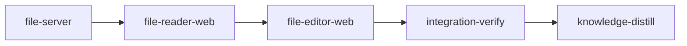

# Plan: `loom plan` file mode

Implements: section_06

## Overview

File mode is the planning app's reader and editor. The server gains document, tree, save, diff
and search routes, a text store with per-turn pins, and plan validation in process; to get it,
`loom plan verify`'s body becomes a function over proposed text that returns the structure
`--json` serialises. The browser gains the navigation tree in section 06's four groups, a Markdown
renderer that never renders raw HTML, the plan view with its Stages panel, search, the CodeMirror
editor as a lazy chunk with drafts and a merge view, the three diff kinds, and the "Add to chat"
selection control that plans 5 and 9 build on.

Metaplan entry: `doc/plans/metaplan-planner-ui.md`, "3. File mode". Depends on plan 1
(`PLAN-feat-planner-01-documents.md`) and plan 2 (`PLAN-feat-planner-02-server.md`) being merged.

## Goals

- Every document section 03 discovers is readable at `/files/<path>#<anchor>`, live as files
  change; the holder edits and saves Markdown under `doc/product/`, `doc/plans/` and Other, with
  the server refusing everything section 06 and section 12 refuse.
- Plan saves are validated by the same code as `loom plan verify`; `loom plan verify --json` stays
  byte-identical.
- The renderer resists the adversarial fixtures of section 12 "Untrusted content in the browser".
- CodeMirror is absent from both initial bundles (dashboard and planning).
- Non-goals: chat, attachment delivery, Restore (plan 9); concept mode (plan 5); turn boundaries
  (plan 7 drives the pins).

## Decisions

- **Anchors come from the server.** The renderer takes plan 1's heading sections (anchor and line)
  from `DocView.sections` and matches headings by source line; the browser never re-implements
  GitHub anchor numbering.
- **The renderer builds React elements from an mdast tree** (`mdast-util-from-markdown`,
  `micromark-extension-gfm`, `mdast-util-gfm`): the parser produces data, not HTML, so there is no
  sanitiser to get wrong. These are the "CommonMark parser with GFM" dependency the metaplan
  expects; CodeMirror 6 with `@codemirror/merge`, `lang-markdown` and `lang-yaml` is the other.
- **Atomic save is a new `fs::safe_replace`**: no existing helper walks no-follow from a root to
  the target's directory and renames through its descriptor (`fs/safe_fs.rs`'s
  `safe_replace_outside_workdir` canonicalises the parent, a racy check, and uses a fixed `.tmp`
  name), and `safe_fs.rs` is at 1,019 lines in the size ledger.
- **Input checks run over the proposed text** through a `plan_text` override in
  `plan::inputs::collect_inputs` (`visit_file` reads the plan from disk today), so a save is
  validated against what it would write.
- **A plan with no metadata block validates as valid with a note** (section 06: drafting prose
  first is normal); `loom plan verify` still reports it as it does today.
- **Search recomputes BM25 per query over in-memory chunks**: doc trees are small, and the index
  must write nothing; prose lifecycle filtering (`prose_lifecycle`, which drops archive and done
  plans) is not used, because file mode shows those.
- **Saves never create, rename or delete** (section 06); `save_document` refuses a missing target.
- **The one server `git` read is `git show HEAD:<path>`.** Section 12 asks for paths after `--`;
  in a `<rev>:<path>` expression `--` does not apply, the argument always begins with `HEAD:` so
  it cannot be read as an option, and the path has passed the syntax checks and discovery first.

## Interfaces this plan consumes

- Plan 1 (`loom::planning`, stages `document-model`, `checklist-check`): `discover::{DocTree, Document, read_doc}`,
  `sections::{sections_of, DocSections, normalized_hash}`, `paths::{check_relpath_syntax, LockedSet, LockReason, classify_write, DocArea, symlink_component}`,
  `project::{Project, ProjectDoc}`, `implements::parse`, `pressure::records`, `briefs::{plan_briefs, orphan_bundles}`,
  `metaplan::entries`, `vision::parse_sections_table`, `watch::Batch`.
- Plan 2 (`loom::plan_server`, `loom::web_server`, stages `plan-server-core`, `plan-web-shell`):
  `PlanContext` (`project`, `require_authoring`, `on_batch`, `extensions`, `hub`), `RouteSpec`
  with `BodyKind::Text { max }` and `Role::HolderOrTake`, `routes.rs::{all_routes, install_all}`,
  `ApiRequest`/`ApiResponse`, `wire/message.rs::PlanMessage`, the parity pattern, test support
  `plan_server/tests/support.rs`; web `web/src/plan/{tabs.ts, help-keys.ts, api/client.ts, api/socket.ts, state/atoms.ts}`
  (`canAuthorAtom`), `web/scripts/bundle-rules.json`.

## Interfaces later plans consume

- Rust, stage `file-server`: `commands::plan::verify::report::{verify_text(repo_root, plan_path, text) -> VerifyReport, verify_path, VerifyReport, VerifyError, YamlLocation, MetadataPresence}`;
  `plan_server::files::save::{save_document(ctx, browser, SaveRequest { path, text, opened_hash, force }) -> Result<SaveOutcome, SaveRefusal>}`
  (plan 9's Restore calls it); `plan_server::files::texts::{TextStore, TurnId, PinnedText, TurnChange}`
  with `begin_turn`, `end_turn`, `turn_pin`, `turn_end`, `current` (plan 7 drives the turn calls;
  the store is in `ctx.extensions()`); `plan_server::files::validate::validate_plan`;
  `fs::safe_replace::replace_no_follow(root, rel, bytes)`; `plan_server::search::SearchIndex`.
  Routes: `GET /api/tree`, `GET /api/doc?path=`, `POST /api/save?path=&hash=[&with_errors=1]`,
  `GET /api/diff/head?path=`, `GET /api/diff/turn?turn=&path=`, `GET /api/search?q=&scope=`.
  `PlanMessage` variants `tree_changed`, `doc_changed`, `validation`. Wire types in
  `plan_server/wire/files.rs` (`FileTree`, `TreeEntry`, `DocView`, `SectionView`, `LockView`,
  `PlanView`, `StageRow`, `ValidationView`, `SaveResult`, `DiffTexts`, `SearchResults`), zod in
  `web/src/plan/api/schema-files.ts`, fixtures `web/src/plan/api/fixtures/files-*.json`.
- Web, stages `file-reader-web` and `file-editor-web`:
  Paths follow plan 2's wire rule: every response and broadcast `path` is repo-relative
  (`doc/...`); request parameters and `SaveRequest.path` are relative to `doc/` (convert with
  `plan_server::wire::paths::to_doc_rel`); `/files/` addresses are doc-relative and built with
  `toAddress`, which accepts either form; `docRel`/`repoRel` in `address.ts`. `DocView` adds
  `truncated` and `size` (a document over 1 MiB carries only its first 1 MiB).
  `web/src/plan/markdown`: `<Markdown source path sections onNavigate docPaths anchorsOf marks? lineOffset? headingIds? />`
  (`lineOffset` for excerpts, `headingIds: false` for embedded text such as plan 5's passages
  and plan 9's chat);
  `web/src/plan/attachments`: `AttachmentDraft` (`kind: "source" | "summary"`), `pendingAttachmentsAtom`,
  `addAttachmentAtom`, `useSelectionAttachment(container, provenance)`, `<AddToChat draft rect onAdded />`,
  `registerSelectionSecondary(render: (draft) => JSX.Element | null) -> unregister` (plan 9's
  "Send to author"; AddToChat renders for every browser with a draft, its own button only for
  authors); both draft arms carry `hash` (taken at selection) and repo-relative paths; the
  summary arm is `{ kind: "summary", summary: <summary id>, sentence: <sentence id>, text, restsOn: [{ path, anchor }], hash }`;
  `web/src/plan/files`: `address.ts` (`toAddress`, `parseAddress`, `resolveLink`), `api.ts`, `atoms.ts`,
  `tree-entry-extras.tsx` (`TreeEntryExtras`, plan 9's slot), `plan/plan-actions-extras.tsx`
  (`<PlanActionsExtras plan path />` in the plan header, null here; plan 11's pressure and done-plan
  actions);
  `web/src/plan/diff`: `<DiffView before after path />`, `openDiff(kind, path, turn?)`;
  `web/src/plan/editor/load.ts`: `loadCodeMirror()` (the only route to `@codemirror/*`);
  `web/src/plan/editor/drafts.ts`: `loadDraft`, `saveDraft` (returns `saved | too_large | storage_full | unavailable`),
  `findDrafts(path)`, `clearDrafts(path)`, keys prefixed with `ServerInfo.project_key`;
  every delta-fed view refetches through plan 2's `onResync`;
  `web/src/plan/editor/request-edit.ts`: `requestEdit(store, { path, text, openedHash }) -> address`
  opens the editor with preset text, straight into the merge view when `openedHash` is stale (plan
  9's Restore fallback); provenance callbacks `renderedViewProvenance`, `editorProvenance`,
  `diffProvenance` are exported for plan 9's "Send to author".

## Execution Diagram



No knowledge-bootstrap stage: the knowledge base maps this tree, and plan 2's distill stage
recorded `architecture/plan-server`.

## Stages

### 1. `file-server`

The verify split, the file-mode wire model, tree, document, save, text store and pins,
validation, diffs and search. Exists by Q1 (the web stages need its wire fixtures and routes
merged). Four workers in two waves. Risk walk: untrusted input and paths (save refusals:
`save-refuses-done-plan`, `save-refuses-brief-of-running-plan`), filesystem and symlinks
(`save-refuses-symlinked-doc`), lifecycle (`save-conflict-returns-current`, `turn-end-reads-now`),
process I/O and request volume (`save-body-limit-before-read`), external data (the `--json`
contract other tools read: `verify-text-matches-json`), configuration (the "Save with errors"
switch: `save-blocks-invalid-plan`), search behaviour (`search-literal-quotes`,
`search-includes-done-plans`). The ledger rows for `verify.rs` (`file 504`, `execute 124`,
`print_human 98`) shrink or go: an expected `TI-ratchet` event the orchestrator disputes with the
new counts as evidence. Baseline at b0f91c00 in the author's checkout: `--test integration
plan_verify` 28 passed. Lanes (`implementers: ["claude", "codex"]`): 8 codex units (wire types and fixtures, zod
schemas, knowledge index, tree, plan view data, search query, index and route) and three Claude
workers (the verify split; the save path, text store and validation; the document and diff
routes).

### 2. `file-reader-web`

The reader: data hooks, the Markdown renderer, tree, outline, search, reading column, plan view,
and "Add to chat" in the rendered view; then the rebuilt bundle. Exists by Q1 (stage 1's
fixtures) and Q4 (the reader and the editor together would pass 500,000 tokens of orchestrator
context with nine workers' reports and two dependency installs). Risk walk: untrusted input
(`markdown-raw-html-is-text`, `markdown-javascript-link-is-text`, `markdown-image-is-a-link`),
reachability (`tree-group-order`), external data shape (`add-to-chat-anchor`). Lanes (`implementers: ["claude", "codex"]`): 7 codex units (data hooks, atoms, addresses,
plan text split, attachment types and atoms, secondary slot, view provenance) and four Claude
workers (the renderer and the UI).

### 3. `file-editor-web`

The lazy CodeMirror chunk, the editor with drafts, save flow, merge view and validation panel,
the three diffs, and "Add to chat" in the editor and diffs; then the rebuilt bundle. Exists by Q2
(it rewrites `web/dist`, `web/package.json` and `web/bun.lock`, which stage 2 also writes) and Q4.
Risk walk: lifecycle (`save-conflict-opens-merge`, `draft-keyed-by-hash`), configuration
(`save-with-errors-needs-confirmation`), bundle boundary (`only-loader-imports-codemirror`, plus
the bundle check in acceptance). Lanes (`implementers: ["claude", "codex"]`): 9 codex units (drafts, lazy loader and import
boundary, theme spec, requestEdit, leave guard, editor and diff provenance, openDiff, save-flow
reducer) and three Claude workers (the CodeMirror surface, the edit mode, the diff views).

### 4. Integration verification

Full gate, web gate, bundle check, committed-bundle freshness, and reviews: security (renderer,
save route, symlinks, git paths, search inputs) against section 12, architecture, tests.

### 5. Knowledge distillation

Curates memories; adds the file-mode section to `architecture/plan-server` and the renderer and
editor rules to the web conventions.

## Environment inventory

- Implementation fetches: `bun add` in stages 2 and 3 needs `registry.npmjs.org` (allowed); no
  cargo dependency.
- `web/node_modules` from the hardened `provision` entry; the new packages are in the committed
  lockfile after stage 2 and 3 commit it, so a retry's provision installs them.
- Criteria bind loopback sockets and run `git` read-only inside the host job; the diff tests create
  their own temp repositories.
- No credentials, tmux or `claude` in any criterion.

<!-- loom METADATA -->

```yaml
loom:
  version: 2
  ratchet_files:
    - loom/maintainability-baseline.txt
    - doc/loom/knowledge/check-baseline.txt
  provision:
    - working_dir: "web"
      command: "test ! -e .npmrc && test ! -L .npmrc && bun install --frozen-lockfile --ignore-scripts --backend=copyfile --config=/dev/null"
  sandbox:
    enabled: true
    auto_allow: true
    filesystem:
      deny_read: ["~/.ssh/**", "~/.aws/**", "~/.config/gcloud/**", "~/.gnupg/**"]
    network:
      allowed_domains: ["crates.io", "index.crates.io", "static.crates.io", "registry.npmjs.org"]
      allow_local_binding: true
      allow_unix_sockets: []
  stages:
    - id: file-server
      name: "File-mode server routes and the verify split"
      summary: "Adds the document, tree, save, diff and search routes, per-turn text pins, and in-process plan validation from a split loom plan verify."
      stage_type: standard
      working_dir: "."
      skills: ["loom-rust"]
      implementers: ["claude", "codex"]
      subagent_timeout_secs: 900
      dependencies: []
      description: |
        Server side of file mode on plan 2's loom::plan_server and plan 1's loom::planning
        (read their committed code; never reimplement discovery, sections, hashing or the path
        predicate). Shapes are binding: see the plan's "Interfaces later plans consume".
        Use parallel subagents and skills to maximize performance.

        Lanes: codex units F1-F5 and F8-F10 (wire types and fixtures, zod schemas, the knowledge
        index parser, tree, plan view data, search query, index and route module); Claude keeps
        the verify split (cross-cutting refactor), files-core (the save path, safe_replace, text
        store and pins, validation) and doc-routes (the document and diff routes, which serve
        repository content from request paths), all loom-senior-software-engineer in the
        background. Waves (territories DISJOINT across
        lanes; workers never spawn subagents): 0 verify-split with codex F1, F3, F8, then F2;
        1 files-core and doc-routes with codex F4, F5 and F9; 2 codex F10. The orchestrator's small edits
        (visibility, module lines, the three PlanMessage variants and the schema union) are in
        codex-units.md "Orchestrator duties". Claude spawns use the fixed prompt plus "Your
        brief: <path>. Read it in full before anything else."
        CODEX LANE (user decision: heavy use of codex for boilerplate, unit tests and simple
        implementation): spawn the codex units as loom-codex-forwarder subagents in the
        FOREGROUND, at most 6 at once over DISJOINT files, each with an explicit Bash timeout
        of 600000 ms and --model gpt-6.1-terra --effort high; never codex:codex-rescue. Each
        unit's prompt is exactly the fixed line "Implement unit <id> of doc/plans/briefs/feat-planner-03-file-mode/file-server/codex-units.md. Read that file
        and the spec section its row names first. Write only the files the row lists. Run no
        git." Never paste the row or the spec text into the prompt: the specs hold product
        strings and apostrophes the forward hook refuses. Codex runs compile-only checks at
        most and touches no hidden loom state or work path. After
        EVERY unit run git status --short (only that unit's files may change) and the unit's
        proof command; a unit that times out (exit 124) is re-split against the partial tree,
        never re-forwarded as is, and work that cannot be cut to one file plus its test moves
        to a Claude worker. Claude workers spawn BY AGENT TYPE in the background as usual; one
        loom subagents watch covers them.

        | Worker | Role | Tier | Files owned | Shared context | Brief path |
        | ------ | ---- | ---- | ----------- | -------------- | ---------- |
        | F1 | file-mode wire types and fixtures | codex terra | loom/src/plan_server/wire/files.rs, web/src/plan/api/fixtures/files-*.json | doc/plans/briefs/feat-planner-03-file-mode/common.md | doc/plans/briefs/feat-planner-03-file-mode/file-server/codex-units.md |
        | F2 | file-mode zod schemas | codex terra | web/src/plan/api/schema-files.ts, web/src/plan/api/schema-files.test.ts | doc/plans/briefs/feat-planner-03-file-mode/common.md | doc/plans/briefs/feat-planner-03-file-mode/file-server/codex-units.md |
        | F3 | knowledge index parser | codex terra | loom/src/plan_server/files/knowledge_index.rs, loom/src/plan_server/files/tests/knowledge_index.rs | doc/plans/briefs/feat-planner-03-file-mode/common.md | doc/plans/briefs/feat-planner-03-file-mode/file-server/codex-units.md |
        | F4 | file tree | codex terra | loom/src/plan_server/files/tree.rs, loom/src/plan_server/files/tests/tree.rs | doc/plans/briefs/feat-planner-03-file-mode/common.md | doc/plans/briefs/feat-planner-03-file-mode/file-server/codex-units.md |
        | F5 | plan view data | codex terra | loom/src/plan_server/files/plan_view.rs, loom/src/plan_server/files/tests/plan_view.rs | doc/plans/briefs/feat-planner-03-file-mode/common.md | doc/plans/briefs/feat-planner-03-file-mode/file-server/codex-units.md |
        | doc-routes | document and diff routes | opus | loom/src/plan_server/files/doc.rs, loom/src/plan_server/files/tests/doc.rs, loom/src/plan_server/files/diff.rs, loom/src/plan_server/files/tests/diff.rs | doc/plans/briefs/feat-planner-03-file-mode/common.md | doc/plans/briefs/feat-planner-03-file-mode/file-server/doc-routes.md |
        | F8 | search query parsing and snippets | codex terra | loom/src/plan_server/search/query.rs, loom/src/plan_server/search/tests_query.rs | doc/plans/briefs/feat-planner-03-file-mode/common.md | doc/plans/briefs/feat-planner-03-file-mode/file-server/codex-units.md |
        | F9 | search index | codex terra | loom/src/plan_server/search/index.rs, loom/src/plan_server/search/tests.rs | doc/plans/briefs/feat-planner-03-file-mode/common.md | doc/plans/briefs/feat-planner-03-file-mode/file-server/codex-units.md |
        | F10 | search route module | codex terra | loom/src/plan_server/search/mod.rs | doc/plans/briefs/feat-planner-03-file-mode/common.md | doc/plans/briefs/feat-planner-03-file-mode/file-server/codex-units.md |
        | verify-split | loom plan verify as a function over text | opus | loom/src/commands/plan/verify.rs, loom/src/commands/plan/verify/**, loom/src/plan/inputs.rs, loom/maintainability-baseline.txt | doc/plans/briefs/feat-planner-03-file-mode/common.md | doc/plans/briefs/feat-planner-03-file-mode/file-server/verify-split.md |
        | files-core | save, safe_replace, text store and pins, validation, files routes | opus | loom/src/plan_server/files/mod.rs, loom/src/plan_server/files/save.rs, loom/src/plan_server/files/texts.rs, loom/src/plan_server/files/validate.rs, loom/src/plan_server/files/tests/mod.rs, loom/src/plan_server/files/tests/save.rs, loom/src/plan_server/files/tests/texts.rs, loom/src/plan_server/files/tests/validate.rs, loom/src/plan_server/files/tests/routes.rs, loom/src/fs/safe_replace.rs, loom/src/fs/safe_replace_tests.rs, loom/src/fs/mod.rs, loom/src/plan_server/routes.rs | doc/plans/briefs/feat-planner-03-file-mode/common.md | doc/plans/briefs/feat-planner-03-file-mode/file-server/files-core.md |

        PUBLIC SURFACE the contracts call (contract file loom/tests/file_mode_contracts.rs,
        its own test target; test value = bare function name):
        - loom::commands::plan::verify::report::verify_text(repo_root: Option<&Path>,
          plan_path: &Path, text: &str) -> VerifyReport (Serialize, the same JSON as
          loom plan verify --json for the same file).
        - loom::plan_server::files::save::{save_document(ctx: &PlanContext, browser: &BrowserId,
          req: SaveRequest) -> Result<SaveOutcome, SaveRefusal>, SaveRequest { path (relative to
          doc/), text, opened_hash, force }, SaveOutcome::{Saved { hash, validation },
          Conflict { current_text, current_hash }, Invalid { validation }},
          SaveRefusal::{Authoring, Path, NotFound, NotEditable, TooLarge, Symlink, Io}}.
        - loom::plan_server::files::texts::{TextStore, TurnId, TurnChange} with begin_turn,
          end_turn(&TurnId, root, &Project) -> Vec<TurnChange>; the store is
          ctx.extensions().get::<TextStore>().
        - loom::plan_server::search::{SearchIndex::query(&self, q: &str, scope: Scope) ->
          SearchResults, Scope::{Product, Plans, Knowledge, All}}, from
          ctx.extensions().get::<SearchIndex>().
        - loom::plan_server::{start, ServerOptions, RunningServer { local, token, ctx }} (plan 2)
          and HTTP POST /api/save?path=&hash= with Content-Type text/plain; charset=utf-8,
          GET /api/doc?path= and GET /api/diff/head?path= (paths relative to doc/).
        - Hashes: loom::planning::sections::normalized_hash(&str).

        The verify-split worker deletes or lowers the verify.rs rows of
        loom/maintainability-baseline.txt: the orchestrator files one loom stage
        dispute-integrity for the TI-ratchet event with the before and after counts.
        Gate: one loom check file-server. MEMORY: record mistakes/decisions/surprises via loom
        memory immediately (subagents too); NEVER loom knowledge; NEVER auto-memory.
      acceptance:
        - "cargo build --manifest-path loom/Cargo.toml"
        - "cargo clippy --manifest-path loom/Cargo.toml --all-targets -- -D warnings"
        - "cargo fmt --manifest-path loom/Cargo.toml --check"
        - 'RUSTDOCFLAGS="-D warnings" cargo doc --manifest-path loom/Cargo.toml --workspace --all-features --no-deps'
        - "cargo test --manifest-path loom/Cargo.toml --lib plan_server::"
        - "cargo test --manifest-path loom/Cargo.toml --lib commands::plan::"
        - "cargo test --manifest-path loom/Cargo.toml --lib fs::safe_replace"
        - "cargo test --manifest-path loom/Cargo.toml --lib plan::inputs"
        - "cargo test --manifest-path loom/Cargo.toml --test integration plan_verify"
        - "cargo test --manifest-path loom/Cargo.toml --test maintainability"
        - "cd web && node_modules/.bin/vitest run src/plan/api"
      files:
        - "loom/src/commands/plan/verify.rs"
        - "loom/src/commands/plan/verify/**"
        - "loom/src/plan/inputs.rs"
        - "loom/src/plan_server/**"
        - "loom/src/fs/safe_replace.rs"
        - "loom/src/fs/safe_replace_tests.rs"
        - "loom/src/fs/mod.rs"
        - "loom/src/context/mod.rs"
        - "loom/src/context/rank.rs"
        - "loom/maintainability-baseline.txt"
        - "loom/tests/file_mode_contracts.rs"
        - "web/src/plan/api/**"
      artifacts:
        - "loom/src/commands/plan/verify/report.rs"
        - "loom/src/plan_server/files/save.rs"
        - "loom/src/plan_server/files/texts.rs"
        - "loom/src/plan_server/search/index.rs"
        - "loom/src/fs/safe_replace.rs"
      wiring:
        - source: "loom/src/plan_server/routes.rs"
          pattern: "files::routes\\(\\)"
          description: "file-mode routes are registered with the planning server"
        - source: "loom/src/plan_server/files/save.rs"
          pattern: "verify_text\\(|validate_plan\\("
          description: "saves validate plans with loom plan verify's code"
        - source: "loom/src/commands/plan/verify.rs"
          pattern: "verify_path\\("
          description: "loom plan verify is a caller of the split function"
      before_stage:
        - command: "test -d loom/src/plan_server"
          description: "plan 2 (PLAN-feat-planner-02-server) has merged"
        - command: "test -f web/dist/plan.html"
          description: "plan 2's planning entry is in the bundle"
      after_stage:
        - command: "test -f web/src/plan/api/fixtures/files-doc.json"
          description: "the file-mode fixtures exist for the web stages"
      contracts:
        - id: verify-text-matches-json
          file: loom/tests/file_mode_contracts.rs
          test: verify_text_agrees_with_verify_json
          scenario: "writes a plan with one structural warning and one missing brief reference into a temp git repo, runs env!(CARGO_BIN_EXE_loom) plan verify --json on it, and compares the parsed stdout with serde_json::to_value(verify_text(Some(root), path, text))"
          rejects: "a split whose verify_text skips the soft, input or base-tree checks, or serialises under different names, so the two JSON values differ"
        - id: save-refuses-done-plan
          file: loom/tests/file_mode_contracts.rs
          test: save_refuses_a_done_plan
          scenario: "start() on a temp repo with doc/plans/DONE-PLAN-x.md; save_document as a browser that takes authoring, path plans/DONE-PLAN-x.md, the file's current normalized_hash, new text"
          rejects: "editability judged by location and extension alone (Markdown under doc/plans/), so the done plan is overwritten"
        - id: save-refuses-brief-of-running-plan
          file: loom/tests/file_mode_contracts.rs
          test: save_refuses_a_brief_of_a_running_plan
          scenario: "temp repo with the running plan IN_PROGRESS-PLAN-x.md and its bundle file briefs/x/common.md, both under doc/plans; save_document on that brief (path relative to doc/) with its current hash"
          rejects: "a predicate that checks only the plan file's prefix and lets the running plan's briefs be edited"
        - id: save-conflict-returns-current
          file: loom/tests/file_mode_contracts.rs
          test: stale_opened_hash_returns_current_text
          scenario: "temp repo with doc/product/section_01.md; save_document with the hash of an older text"
          rejects: "a save that overwrites when the opened hash is stale instead of returning Conflict with the current text and hash, leaving the file unchanged"
        - id: save-refuses-symlinked-doc
          file: loom/tests/file_mode_contracts.rs
          test: save_refuses_a_symlinked_document
          scenario: "temp repo with doc/product/a.md and doc/notes/link.md a symlink to ../product/a.md (discovered per section 12); save_document on notes/link.md with the hash of a.md"
          rejects: "a save that follows the link and rewrites doc/product/a.md"
        - id: save-blocks-invalid-plan
          file: loom/tests/file_mode_contracts.rs
          test: invalid_plan_needs_save_with_errors
          scenario: "temp repo with a valid doc/plans/PLAN-x.md; save_document with text whose stage depends on itself, force false, then the same with force true"
          rejects: "a save that writes an invalid plan without the confirmation, or refuses it even with force"
        - id: save-body-limit-before-read
          file: loom/tests/file_mode_contracts.rs
          test: oversized_save_is_refused_before_the_body
          scenario: "started server, holder cookies; POST /api/save?path=product/section_01.md&hash=<h> with Content-Length 1048577 and Content-Type text/plain; charset=utf-8, sending only the head, then reading the response with a 5 s timeout"
          rejects: "a route that reads the whole body before checking its size (the response never arrives within the timeout, or is not 413)"
        - id: doc-and-diff-routes-refuse-bad-paths
          file: loom/tests/file_mode_contracts.rs
          test: doc_and_diff_routes_refuse_bad_paths
          scenario: "started server with holder cookies on a temp repo holding doc/product/a.md, a .env at the repo root, and doc/notes/out.md a symlink to ../../.env; GET /api/doc and GET /api/diff/head with path ../.env, product/../../.env, notes/out.md and an absolute /etc/passwd"
          rejects: "a route that joins the request path onto doc/ and reads it (or passes it into git show HEAD:<path>) without the syntax check, discovery membership and no-follow read, so any response carries the .env or passwd content instead of 400 or 404"
        - id: search-literal-quotes
          file: loom/tests/file_mode_contracts.rs
          test: quoted_query_matches_literal_text
          scenario: "temp repo whose doc/plans/PLAN-a.md contains the text IN_PROGRESS- and whose doc/plans/PLAN-b.md contains only the word progress; query with the quoted string \"IN_PROGRESS-\" in scope Plans"
          rejects: "a quoted query passed through the BM25 tokenizer, which splits IN_PROGRESS- into in, progress and also returns PLAN-b"
        - id: search-includes-done-plans
          file: loom/tests/file_mode_contracts.rs
          test: search_finds_done_and_archived_plans
          scenario: "temp repo with doc/plans/DONE-PLAN-old.md and doc/plans/archive/PLAN-older.md both containing the word zephyr; query zephyr in scope All"
          rejects: "an index built through prose_lifecycle, which drops done plans and the archive"
        - id: turn-end-reads-now
          file: loom/tests/file_mode_contracts.rs
          test: end_turn_sees_a_write_made_just_before
          scenario: "started server; begin_turn(t1); write doc/product/section_01.md directly; end_turn(t1) at once, before any watcher tick"
          rejects: "an end_turn that compares against the watcher's cached texts and misses the change made within the last second"

    - id: file-reader-web
      name: "File mode reader"
      summary: "Adds the file tree, the safe Markdown renderer, the plan view, search and Add to chat in the reading view."
      stage_type: standard
      working_dir: "."
      skills: ["loom-react", "loom-typescript"]
      implementers: ["claude", "codex"]
      subagent_timeout_secs: 900
      dependencies: ["file-server"]
      description: |
        Browser reader for file mode under web/src/plan/. Shapes are binding: see "Interfaces
        later plans consume".
        Use parallel subagents and skills to maximize performance.

        Lanes: codex units R1-R7 (data hooks, atoms, addresses and link resolution, the plan
        text split, attachment types, atoms, secondary slot and view provenance); Claude keeps
        the renderer (markdown, loom-senior-software-engineer: the XSS surface) and the UI
        (tree-search, plan-view, attachments-ui, loom-software-engineer). Waves (territories
        DISJOINT across lanes; workers never spawn subagents): A codex R1-R6; then the four
        Claude workers in the background with codex R7. After them the orchestrator applies
        the one-line SelectionAttach mount the attachments-ui worker reports into
        web/src/plan/files/reading-column.tsx and runs oxfmt. Visual work follows
        doc/loom/knowledge/conventions/web-dashboard-typography.md. Claude spawns use the fixed
        prompt plus "Your brief: <path>. Read it in full before anything else."
        CODEX LANE (user decision: heavy use of codex for boilerplate, unit tests and simple
        implementation): spawn the codex units as loom-codex-forwarder subagents in the
        FOREGROUND, at most 6 at once over DISJOINT files, each with an explicit Bash timeout
        of 600000 ms and --model gpt-6.1-terra --effort high; never codex:codex-rescue. Each
        unit's prompt is exactly the fixed line "Implement unit <id> of doc/plans/briefs/feat-planner-03-file-mode/file-reader-web/codex-units.md. Read that file
        and the spec section its row names first. Write only the files the row lists. Run no
        git." Never paste the row or the spec text into the prompt: the specs hold product
        strings and apostrophes the forward hook refuses. Codex runs compile-only checks at
        most and touches no hidden loom state or work path. After
        EVERY unit run git status --short (only that unit's files may change) and the unit's
        proof command; a unit that times out (exit 124) is re-split against the partial tree,
        never re-forwarded as is, and work that cannot be cut to one file plus its test moves
        to a Claude worker. Claude workers spawn BY AGENT TYPE in the background as usual; one
        loom subagents watch covers them.

        | Worker | Role | Tier | Files owned | Shared context | Brief path |
        | ------ | ---- | ---- | ----------- | -------------- | ---------- |
        | R1 | file-mode data hooks | codex terra | web/src/plan/files/api.ts, web/src/plan/files/api.test.ts | doc/plans/briefs/feat-planner-03-file-mode/common.md | doc/plans/briefs/feat-planner-03-file-mode/file-reader-web/codex-units.md |
        | R2 | file-mode atoms | codex terra | web/src/plan/files/atoms.ts, web/src/plan/files/atoms.test.ts | doc/plans/briefs/feat-planner-03-file-mode/common.md | doc/plans/briefs/feat-planner-03-file-mode/file-reader-web/codex-units.md |
        | R3 | addresses and link resolution | codex terra | web/src/plan/files/address.ts, web/src/plan/files/address.test.ts | doc/plans/briefs/feat-planner-03-file-mode/common.md | doc/plans/briefs/feat-planner-03-file-mode/file-reader-web/codex-units.md |
        | R4 | plan text split | codex terra | web/src/plan/files/plan/split.ts, web/src/plan/files/plan/split.test.ts | doc/plans/briefs/feat-planner-03-file-mode/common.md | doc/plans/briefs/feat-planner-03-file-mode/file-reader-web/codex-units.md |
        | R5 | attachment types and atoms | codex terra | web/src/plan/attachments/types.ts, web/src/plan/attachments/atoms.ts, web/src/plan/attachments/atoms.test.ts | doc/plans/briefs/feat-planner-03-file-mode/common.md | doc/plans/briefs/feat-planner-03-file-mode/file-reader-web/codex-units.md |
        | R6 | selection secondary slot | codex terra | web/src/plan/attachments/secondary.ts, web/src/plan/attachments/secondary.test.ts | doc/plans/briefs/feat-planner-03-file-mode/common.md | doc/plans/briefs/feat-planner-03-file-mode/file-reader-web/codex-units.md |
        | R7 | rendered-view provenance | codex terra | web/src/plan/attachments/view-provenance.ts, web/src/plan/attachments/view-provenance.test.ts | doc/plans/briefs/feat-planner-03-file-mode/common.md | doc/plans/briefs/feat-planner-03-file-mode/file-reader-web/codex-units.md |
        | markdown | safe Markdown renderer | opus | web/src/plan/markdown/**, web/package.json, web/bun.lock | doc/plans/briefs/feat-planner-03-file-mode/common.md | doc/plans/briefs/feat-planner-03-file-mode/file-reader-web/markdown.md |
        | tree-search | layout, tree, outline, search, reading column | sonnet | web/src/plan/files/file-mode.tsx, web/src/plan/files/tree.tsx, web/src/plan/files/tree-entry.tsx, web/src/plan/files/tree-entry-extras.tsx, web/src/plan/files/outline.tsx, web/src/plan/files/search-box.tsx, web/src/plan/files/search-results.tsx, web/src/plan/files/reading-column.tsx, web/src/plan/files/doc-header.tsx, web/src/plan/files/lock-notice.tsx, web/src/plan/files/*.test.tsx, web/src/plan/tabs.ts, web/src/plan/help-keys.ts | doc/plans/briefs/feat-planner-03-file-mode/common.md | doc/plans/briefs/feat-planner-03-file-mode/file-reader-web/tree-search.md |
        | plan-view | plan header, Stages panel, Show YAML | sonnet | web/src/plan/files/plan/plan-view.tsx, web/src/plan/files/plan/plan-header.tsx, web/src/plan/files/plan/validation-list.tsx, web/src/plan/files/plan/stages-panel.tsx, web/src/plan/files/plan/stage-row.tsx, web/src/plan/files/plan/stage-graph.tsx, web/src/plan/files/plan/plan-actions-extras.tsx, web/src/plan/files/plan/*.test.tsx | doc/plans/briefs/feat-planner-03-file-mode/common.md | doc/plans/briefs/feat-planner-03-file-mode/file-reader-web/plan-view.md |
        | attachments-ui | Add to chat control and selection hook | sonnet | web/src/plan/attachments/index.ts, web/src/plan/attachments/use-selection-attachment.ts, web/src/plan/attachments/use-selection-attachment.test.ts, web/src/plan/attachments/add-to-chat.tsx, web/src/plan/attachments/add-to-chat.test.tsx | doc/plans/briefs/feat-planner-03-file-mode/common.md | doc/plans/briefs/feat-planner-03-file-mode/file-reader-web/attachments.md |


        PUBLIC SURFACE the contracts call (vitest, run from web/):
        - Markdown from @/plan/markdown with props { source, path, sections, onNavigate,
          docPaths, anchorsOf } (contract file web/src/plan/markdown/markdown.contracts.test.tsx).
        - FileTree rendering: Tree from @/plan/files/tree with a FileTree value
          (fixture @/plan/api/fixtures/files-tree.json) (contract file
          web/src/plan/files/files.contracts.test.tsx).
        - renderedViewProvenance(path, sections) from @/plan/attachments/view-provenance
          (same contract file).

        AFTER THE WAVES: format; build web/dist (cd web && node_modules/.bin/tsc -b &&
        node_modules/.bin/vite build) so the gate and the review see the bundle; one loom
        check; the review rounds (dist/ is build output, not reviewed line by line). After the
        gate and the final review are green and the review fixes are in, rebuild web/dist
        once, commit the feature, then web/dist as its own chore(web) commit, last. Never
        rebuild after that. The dist criterion compares a fresh build into a temp directory
        with diff -r, and the two git checks after it fail on a dist file left untracked or
        modified but not committed.
        Gate: one loom check file-reader-web.
        MEMORY: record mistakes/decisions/surprises via loom memory immediately (subagents
        too); NEVER loom knowledge; NEVER auto-memory.
      acceptance:
        - "cd web && node_modules/.bin/tsc -b --noEmit"
        - "cd web && node_modules/.bin/oxlint --deny-warnings"
        - "cd web && node_modules/.bin/oxfmt --check"
        - "cd web && node_modules/.bin/vitest run src/plan scripts"
        - 'cd web && d=$(mktemp -d "${TMPDIR:-/tmp}/plandist.XXXXXX") && node_modules/.bin/vite build --outDir "$d" --emptyOutDir --logLevel error && diff -r "$d" dist'
        - "cd web && node scripts/bundle-check.mjs"
        - 'cd web && test -z "$(git ls-files --others --exclude-standard -- dist)"'
        - "cd web && git diff --quiet -- dist"
        - "cargo build --manifest-path loom/Cargo.toml"
        - "cargo test --manifest-path loom/Cargo.toml --lib plan_server::"
        - "rg -q mdast-util-from-markdown web/package.json"
      files:
        - "web/src/plan/files/**"
        - "web/src/plan/markdown/**"
        - "web/src/plan/attachments/**"
        - "web/src/plan/tabs.ts"
        - "web/src/plan/help-keys.ts"
        - "web/package.json"
        - "web/bun.lock"
        - "web/dist/**"
      artifacts:
        - "web/src/plan/markdown/markdown.tsx"
        - "web/src/plan/files/tree.tsx"
        - "web/src/plan/files/plan/stages-panel.tsx"
        - "web/src/plan/attachments/add-to-chat.tsx"
      wiring:
        - source: "web/src/plan/tabs.ts"
          pattern: "FileMode"
          description: "the Files tab is registered"
        - source: "web/src/plan/files/reading-column.tsx"
          pattern: "<Markdown"
          description: "the reading column renders documents through the safe renderer"
        - source: "web/src/plan/files/reading-column.tsx"
          pattern: "SelectionAttach"
          description: "Add to chat is mounted in the reading view"
      before_stage:
        - command: "node --version"
          description: "node on PATH for the provisioned web/node_modules binaries"
        - command: "test -f web/src/plan/api/fixtures/files-doc.json"
          description: "file-server has merged"
      after_stage:
        - command: "test -f web/src/plan/markdown/markdown.tsx"
          description: "the renderer exists for the editor stage and plans 5 and 9"
      contracts:
        - id: markdown-raw-html-is-text
          file: web/src/plan/markdown/markdown.contracts.test.tsx
          test: markdown renders raw html as escaped text
          cwd: web
          runner: vitest
          scenario: "renders a document holding a script tag block, an img tag with onerror, and an anchor tag with a javascript href as raw HTML"
          rejects: "a renderer that passes html nodes through (dangerouslySetInnerHTML or an HTML-string pipeline), leaving a script, img or on-attribute in the DOM"
        - id: markdown-javascript-link-is-text
          file: web/src/plan/markdown/markdown.contracts.test.tsx
          test: markdown renders a javascript link as plain text
          cwd: web
          runner: vitest
          scenario: "renders [x](JaVaScRiPt:alert(1)), [y](data:text/html,hi), [z](java&#x09;script:alert(1)) and [w](&#32;javascript:alert(1)) as Markdown links"
          rejects: "a scheme check by regex on the raw string, case-sensitive or a javascript-only denylist, producing an a element whose parsed protocol is javascript or data"
        - id: markdown-image-is-a-link
          file: web/src/plan/markdown/markdown.contracts.test.tsx
          test: markdown renders an image as a link and loads nothing
          cwd: web
          runner: vitest
          scenario: "renders "
          rejects: "a renderer that emits an img element, which would load the tracking pixel"
        - id: tree-group-order
          file: web/src/plan/files/files.contracts.test.tsx
          test: file tree orders product plans knowledge and other then archive
          cwd: web
          runner: vitest
          scenario: "renders Tree with the files-tree fixture holding entries in every group and a gap entry"
          rejects: "a tree that sorts groups alphabetically or by path, or hides the gap entry instead of showing it dimmed with missing"
        - id: secondary-for-read-only
          file: web/src/plan/files/files.contracts.test.tsx
          test: a read only browser sees the registered secondary instead of add to chat
          cwd: web
          runner: vitest
          scenario: "registers a secondary renderer through registerSelectionSecondary, sets another browser as holder so canAuthorAtom is false, renders AddToChat with a source draft"
          rejects: "an AddToChat that hides itself entirely for read-only browsers or takes the secondary as a per-call-site prop, so plan 9's Send to author never appears"
        - id: add-to-chat-anchor
          file: web/src/plan/files/files.contracts.test.tsx
          test: add to chat records the anchor of the section holding the selection
          cwd: web
          runner: vitest
          scenario: "renders Markdown for a document with two headings, selects text in the second section, calls renderedViewProvenance"
          rejects: "a provenance callback that uses the first heading of the document or the heading nearest the selection end"

    - id: file-editor-web
      name: "File mode editor and diffs"
      summary: "Adds the lazy CodeMirror editor with drafts, save conflicts and the validation panel, and the three diff kinds."
      stage_type: standard
      working_dir: "."
      skills: ["loom-react", "loom-typescript"]
      implementers: ["claude", "codex"]
      subagent_timeout_secs: 900
      dependencies: ["file-reader-web"]
      description: |
        Browser editor and diffs for file mode. Shapes are binding: see "Interfaces later plans
        consume".
        Use parallel subagents and skills to maximize performance.

        Lanes: codex units E1-E9 (drafts store, lazy loader and its import-boundary test, theme
        spec, requestEdit, leave guard, editor and diff provenance, openDiff, the save-flow
        reducer); Claude keeps the CodeMirror surface, the edit mode with its merge and
        validation panels, and the diff views (codemirror-core, editor-save, diffs, all
        loom-software-engineer: UI that converges by running the component tests). Waves
        (territories DISJOINT across lanes; workers never spawn subagents): 0 codemirror-core
        in the background (bun add first) with codex E1-E5 and E7; 1 editor-save and diffs in
        the background with codex E6, E8, E9. The orchestrator runs oxfmt after every codex
        unit. Claude spawns use the fixed prompt plus "Your brief: <path>. Read it in full
        before anything else."
        CODEX LANE (user decision: heavy use of codex for boilerplate, unit tests and simple
        implementation): spawn the codex units as loom-codex-forwarder subagents in the
        FOREGROUND, at most 6 at once over DISJOINT files, each with an explicit Bash timeout
        of 600000 ms and --model gpt-6.1-terra --effort high; never codex:codex-rescue. Each
        unit's prompt is exactly the fixed line "Implement unit <id> of doc/plans/briefs/feat-planner-03-file-mode/file-editor-web/codex-units.md. Read that file
        and the spec section its row names first. Write only the files the row lists. Run no
        git." Never paste the row or the spec text into the prompt: the specs hold product
        strings and apostrophes the forward hook refuses. Codex runs compile-only checks at
        most and touches no hidden loom state or work path. After
        EVERY unit run git status --short (only that unit's files may change) and the unit's
        proof command; a unit that times out (exit 124) is re-split against the partial tree,
        never re-forwarded as is, and work that cannot be cut to one file plus its test moves
        to a Claude worker. Claude workers spawn BY AGENT TYPE in the background as usual; one
        loom subagents watch covers them.

        | Worker | Role | Tier | Files owned | Shared context | Brief path |
        | ------ | ---- | ---- | ----------- | -------------- | ---------- |
        | E1 | drafts store | codex terra | web/src/plan/editor/drafts.ts, web/src/plan/editor/drafts.test.ts | doc/plans/briefs/feat-planner-03-file-mode/common.md | doc/plans/briefs/feat-planner-03-file-mode/file-editor-web/codex-units.md |
        | E2 | lazy loader and import boundary | codex terra | web/src/plan/editor/load.ts, web/src/plan/editor/load.test.ts | doc/plans/briefs/feat-planner-03-file-mode/common.md | doc/plans/briefs/feat-planner-03-file-mode/file-editor-web/codex-units.md |
        | E3 | editor theme spec | codex terra | web/src/plan/editor/theme.ts | doc/plans/briefs/feat-planner-03-file-mode/common.md | doc/plans/briefs/feat-planner-03-file-mode/file-editor-web/codex-units.md |
        | E4 | requestEdit entry point | codex terra | web/src/plan/editor/request-edit.ts, web/src/plan/editor/request-edit.test.ts | doc/plans/briefs/feat-planner-03-file-mode/common.md | doc/plans/briefs/feat-planner-03-file-mode/file-editor-web/codex-units.md |
        | E5 | leave guard | codex terra | web/src/plan/editor/leave-guard.ts, web/src/plan/editor/leave-guard.test.ts | doc/plans/briefs/feat-planner-03-file-mode/common.md | doc/plans/briefs/feat-planner-03-file-mode/file-editor-web/codex-units.md |
        | E6 | editor provenance | codex terra | web/src/plan/editor/editor-provenance.ts, web/src/plan/editor/editor-provenance.test.ts | doc/plans/briefs/feat-planner-03-file-mode/common.md | doc/plans/briefs/feat-planner-03-file-mode/file-editor-web/codex-units.md |
        | E7 | openDiff addresses | codex terra | web/src/plan/diff/open-diff.ts, web/src/plan/diff/open-diff.test.ts | doc/plans/briefs/feat-planner-03-file-mode/common.md | doc/plans/briefs/feat-planner-03-file-mode/file-editor-web/codex-units.md |
        | E8 | diff provenance | codex terra | web/src/plan/diff/diff-provenance.ts, web/src/plan/diff/diff-provenance.test.ts | doc/plans/briefs/feat-planner-03-file-mode/common.md | doc/plans/briefs/feat-planner-03-file-mode/file-editor-web/codex-units.md |
        | E9 | save flow reducer | codex terra | web/src/plan/editor/save-flow.ts, web/src/plan/editor/save-flow.test.ts | doc/plans/briefs/feat-planner-03-file-mode/common.md | doc/plans/briefs/feat-planner-03-file-mode/file-editor-web/codex-units.md |
        | codemirror-core | CodeMirror chunk, SourceEditor, dependencies, bundle rules | sonnet | web/src/plan/editor/codemirror.ts, web/src/plan/editor/source-editor.tsx, web/src/plan/editor/source-editor.test.tsx, web/package.json, web/bun.lock, web/scripts/bundle-rules.json | doc/plans/briefs/feat-planner-03-file-mode/common.md | doc/plans/briefs/feat-planner-03-file-mode/file-editor-web/codemirror-core.md |
        | editor-save | edit mode, merge and validation panels | sonnet | web/src/plan/editor/edit-mode.tsx, web/src/plan/editor/edit-mode.test.tsx, web/src/plan/editor/validation-panel.tsx, web/src/plan/editor/validation-panel.test.tsx, web/src/plan/editor/merge-panel.tsx, web/src/plan/editor/merge-panel.test.tsx, web/src/plan/files/doc-header.tsx, web/src/plan/files/reading-column.tsx, web/src/plan/help-keys.ts | doc/plans/briefs/feat-planner-03-file-mode/common.md | doc/plans/briefs/feat-planner-03-file-mode/file-editor-web/editor-save.md |
        | diffs | DiffView and DiffPage | sonnet | web/src/plan/diff/index.ts, web/src/plan/diff/diff-view.tsx, web/src/plan/diff/diff-view.test.tsx, web/src/plan/diff/diff-page.tsx, web/src/plan/diff/diff-page.test.tsx, web/src/plan/files/file-mode.tsx | doc/plans/briefs/feat-planner-03-file-mode/common.md | doc/plans/briefs/feat-planner-03-file-mode/file-editor-web/diffs.md |


        PUBLIC SURFACE the contracts call (vitest from web/, contract file
        web/src/plan/editor/editor.contracts.test.tsx):
        - EditMode from @/plan/editor/edit-mode with props { doc: DocView } and a mocked
          @/plan/editor/load (loadCodeMirror) and mocked fetch for POST /api/save.
        - loadDraft, saveDraft from @/plan/editor/drafts.
        - The source tree under web/src/plan/ read as text (for the import-boundary contract).

        AFTER THE WAVES: format; build web/dist (cd web && node_modules/.bin/tsc -b &&
        node_modules/.bin/vite build) so the gate and the review see the bundle; one loom
        check; the review rounds (dist/ is build output, not reviewed line by line). After the
        gate and the final review are green and the review fixes are in, rebuild web/dist
        once, commit the feature, then web/dist as its own chore(web) commit, last. Never
        rebuild after that. The dist criterion compares a fresh build into a temp directory
        with diff -r, and the two git checks after it fail on a dist file left untracked or
        modified but not committed.
        Gate: one loom check file-editor-web.
        MEMORY: record mistakes/decisions/surprises via loom memory immediately (subagents
        too); NEVER loom knowledge; NEVER auto-memory.
      acceptance:
        - "cd web && node_modules/.bin/tsc -b --noEmit"
        - "cd web && node_modules/.bin/oxlint --deny-warnings"
        - "cd web && node_modules/.bin/oxfmt --check"
        - "cd web && node_modules/.bin/vitest run src/plan scripts"
        - 'cd web && d=$(mktemp -d "${TMPDIR:-/tmp}/plandist.XXXXXX") && node_modules/.bin/vite build --outDir "$d" --emptyOutDir --logLevel error && diff -r "$d" dist'
        - "cd web && node scripts/bundle-check.mjs"
        - 'cd web && test -z "$(git ls-files --others --exclude-standard -- dist)"'
        - "cd web && git diff --quiet -- dist"
        - "rg -qF node_modules/@codemirror web/scripts/bundle-rules.json"
        - "cargo build --manifest-path loom/Cargo.toml"
        - "cargo test --manifest-path loom/Cargo.toml --lib plan_server::"
      files:
        - "web/src/plan/editor/**"
        - "web/src/plan/diff/**"
        - "web/src/plan/files/doc-header.tsx"
        - "web/src/plan/files/reading-column.tsx"
        - "web/src/plan/files/file-mode.tsx"
        - "web/src/plan/help-keys.ts"
        - "web/scripts/bundle-rules.json"
        - "web/package.json"
        - "web/bun.lock"
        - "web/dist/**"
      artifacts:
        - "web/src/plan/editor/codemirror.ts"
        - "web/src/plan/editor/edit-mode.tsx"
        - "web/src/plan/diff/diff-view.tsx"
      wiring:
        - source: "web/src/plan/files/reading-column.tsx"
          pattern: "EditMode"
          description: "the reading column swaps in the editor"
        - source: "web/src/plan/files/file-mode.tsx"
          pattern: "DiffPage"
          description: "file mode routes diff addresses to the diff page"
      before_stage:
        - command: "node --version"
          description: "node on PATH for the provisioned web/node_modules binaries"
        - command: "test -f web/src/plan/markdown/markdown.tsx"
          description: "file-reader-web has merged"
      after_stage:
        - command: "test -f web/src/plan/editor/load.ts"
          description: "the lazy CodeMirror loader exists"
      contracts:
        - id: save-conflict-opens-merge
          file: web/src/plan/editor/editor.contracts.test.tsx
          test: editor opens the merge view when a save conflicts
          cwd: web
          runner: vitest
          scenario: "renders EditMode for a section, edits, saves with fetch answering 409 with a conflict SaveResult, then saves again"
          rejects: "a save flow that reports the conflict as an error and keeps the old opened hash, so the second save conflicts again"
        - id: save-with-errors-needs-confirmation
          file: web/src/plan/editor/editor.contracts.test.tsx
          test: editor sends with errors only after save with errors
          cwd: web
          runner: vitest
          scenario: "renders EditMode for a plan, saves with fetch answering 422 invalid, then clicks Save with errors"
          rejects: "a flow that resends automatically with with_errors=1, or never offers it"
        - id: draft-keyed-by-hash
          file: web/src/plan/editor/editor.contracts.test.tsx
          test: editor restores a same hash draft and merges an older one
          cwd: web
          runner: vitest
          scenario: "saveDraft for path p and hash h1; open EditMode for p at h1 (the draft is the editor text), then for p after the file changed to h2"
          rejects: "drafts keyed by path alone, which load the h1 text into the editor at h2 over the changed file; at h2 the h1 draft must not be the editor text but must open the merge panel with the current text on the left and the draft on the right"
        - id: only-loader-imports-codemirror
          file: web/src/plan/editor/editor.contracts.test.tsx
          test: only the lazy loader imports codemirror
          cwd: web
          runner: vitest
          scenario: "reads every .ts and .tsx file under web/src/plan and web/src/components except web/src/plan/editor/codemirror.ts and test files, and collects static imports of @codemirror"
          rejects: "a component that imports @codemirror/view directly for a type or a helper, which pulls the editor into the initial bundle"

    - id: integration-verify
      name: "Integration verification"
      summary: "Runs the full gate, checks CodeMirror stays out of both initial bundles, and reviews the renderer and the save route against section 12."
      stage_type: integration-verify
      working_dir: "."
      skills: ["loom-rust", "loom-react", "loom-typescript"]
      dependencies: ["file-editor-web"]
      description: |
        Final verification after all stages. Verify FUNCTIONAL INTEGRATION, not just tests
        passing. NEVER Claude Code auto-memory.
        CONTEXT: read the plan (doc/plans/), loom memory show --all,
        doc/loom/knowledge/INDEX.md and only the relevant sections.
        BUILD & TEST (zero tolerance): run loom check integration-verify once.
        CODE REVIEW: spawn parallel loom-code-reviewer subagents (without name): (1) SECURITY
        against doc/product/section_12.md "Untrusted content in the browser" (renderer: raw
        HTML, link schemes, images, inline-code links, search snippets and terms as text) and
        "Server-side checks" (paths in requests, symlinks under doc/, saves: exclusive no-follow
        temp and rename through the directory fd; read by name: files/save.rs, files/doc.rs,
        files/diff.rs, fs/safe_replace.rs, files/texts.rs, git calls with checked paths, the 1 MiB and
        256-character limits refused before reading); (2) ARCHITECTURE: the verify split keeps
        --json byte-identical, the text store and pins, the search index writes nothing,
        extension points plans 5, 7 and 9 use; (3) TESTS and the web app (CodeMirror only behind
        loadCodeMirror); (4) LAYOUT AND ACCESSIBILITY, which jsdom cannot measure: inspect
        the built bundle and the rendered DOM against the real server for the tree drawer
        below 900px, tables and code blocks scrolling inside their box with no page scroll,
        editor and diff themes in light and dark, the unified diff below 900px, the floating
        Add to chat control position, DisabledReason on Save, 16px reading text versus 12-13px
        chrome, per doc/loom/knowledge/conventions/web-dashboard-typography.md. Paste the acceptance list and this description into each reviewer
        brief. Fix every finding with an engineer agent or dispute it; never defer one.
        SUGGESTIONS: weigh every pending reviewer suggestion; resolve each implemented one
        with loom memory resolve <id> --outcome implemented --reason <what changed>.
        FUNCTIONAL: run loom plan --no-open --port 0 in a scratch repo with a vision, a plan and
        a brief; with curl and the bootstrap cookies confirm /api/tree groups, /api/doc of the
        plan carries stages and validation, a save with a stale hash answers 409, a save of a
        DONE- plan 403, /api/search with a quoted query, /api/diff/head after an edit.
        Record discoveries to loom memory for knowledge-distill, including any knowledge file
        contradicted by the tree: loom memory note "stale-knowledge: ...".
      acceptance:
        - "cargo build --manifest-path loom/Cargo.toml"
        - command: "cargo test --manifest-path loom/Cargo.toml --all-targets --no-fail-fast"
          timeout_secs: 3600
        - command: "cargo test --manifest-path loom/Cargo.toml --doc --workspace --all-features -- --test-threads=1"
          timeout_secs: 1200
        - "cargo clippy --manifest-path loom/Cargo.toml --all-targets -- -D warnings"
        - "cargo fmt --manifest-path loom/Cargo.toml --check"
        - 'RUSTDOCFLAGS="-D warnings" cargo doc --manifest-path loom/Cargo.toml --workspace --all-features --no-deps'
        - "cd web && node_modules/.bin/tsc -b --noEmit"
        - "cd web && node_modules/.bin/oxlint --deny-warnings"
        - "cd web && node_modules/.bin/oxfmt --check"
        - "cd web && node_modules/.bin/vitest run"
        - 'cd web && d=$(mktemp -d "${TMPDIR:-/tmp}/plandist.XXXXXX") && node_modules/.bin/vite build --outDir "$d" --emptyOutDir --logLevel error && diff -r "$d" dist'
        - "cd web && node scripts/bundle-check.mjs"
        - 'cd web && test -z "$(git ls-files --others --exclude-standard -- dist)"'
        - "cd web && git diff --quiet -- dist"
      wiring_tests:
        - name: "loom plan keeps verify beside the server flags"
          command: "cargo run --manifest-path loom/Cargo.toml -q -- plan --help"
          success_criteria:
            exit_code: 0
            stdout_contains: ["verify", "--no-open"]
      wiring:
        - source: "loom/src/plan_server/routes.rs"
          pattern: "search::routes\\(\\)"
          description: "search is registered with the planning server"

    - id: knowledge-distill
      name: "Knowledge distillation"
      summary: "Records file mode's server routes, the renderer's safety rules and the editor's lazy-loading boundary in the knowledge base."
      stage_type: knowledge-distill
      working_dir: "."
      dependencies: ["integration-verify"]
      description: |
        Curate all stage memories into permanent knowledge; update user docs.
        NEVER Claude Code auto-memory.
        SINGLE-AGENT: do NOT spawn subagents.
        START with loom memory pending --group; read the plan and the knowledge sections it
        touches (architecture/plan-server, conventions/web-dashboard-typography, the plan
        verify sections of architecture.md and entry-points.md).
        CORRECTIONS FIRST: apply every stale-knowledge: memory with loom knowledge
        replace-section. Rewrite any section that describes loom plan verify's body or its
        JSON types as private, to the verify/report.rs split, as current truth.
        Then curate: a "File mode" section in architecture/plan-server (routes, save order of
        checks, text store and pins, validation cache, search index); the renderer rules
        (mdast to React, no raw HTML, link allowlist, images as links) and the CodeMirror
        lazy boundary (loadCodeMirror, bundle rules) under conventions. TIER ROUTING as usual.
        INDEX BUDGET: doc/loom/knowledge/INDEX.md must stay at or under 15,000 bytes after
        this stage's writes (plan 1 trims it to that). Keep new blurbs short; shorten the
        longest existing ones with loom knowledge annotate <category>/<slug> --blurb "<shorter>"
        if a write pushes it over; never delete a topic to save bytes.
        SUGGESTIONS: record every unimplemented reviewer suggestion, then resolve it.
        RECEIPTS: every taken memory gets loom memory resolve; finish with loom memory pending
        --strict. LAST, if this stage removed structural issues:
        loom knowledge check --write-baseline doc/loom/knowledge/check-baseline.txt
      acceptance:
        - "loom knowledge check --strict --baseline doc/loom/knowledge/check-baseline.txt"
        - "loom memory pending --strict"
        - 'test "$(wc -c < doc/loom/knowledge/INDEX.md)" -le 15000'
      files: ["doc/loom/knowledge/**", "README.md"]
```

<!-- END loom METADATA -->
