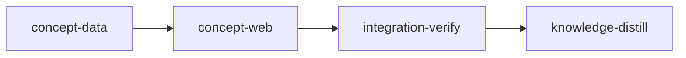

# Plan: `loom plan` concept mode

Implements: section_05

## Overview

This plan builds the reviewer's view of `loom plan`: the Product and Engineering tabs at
`/product` and `/engineering`, the document summary pages at `/product/<doc>` and
`/engineering/<slug>`, the document key with its colour chips, per-sentence marks, opening a
sentence in place down to its source passages and folding it back, keyboard reading, the
out-of-date marks, arrival flashes, the open-state rule across rebuilds, the `Implements:` links
in both directions, and the empty and partial states. The server side is one route module that
drives plan 4's summary engine from the watcher, turns its evaluation into page data, and pushes
a delta when a batch changes what a page shows.

It is metaplan entry 5 (`doc/plans/metaplan-planner-ui.md`, "5. Concept mode"). It depends on
plan 1 (document model), plan 2 (planning server and app shell), plan 3 (renderer, document
route, "Add to chat" control) and plan 4 (summary store, evaluator and engine). It needs no
session: until plan 10 lands, summaries come from a hand-run `loom plan summary seal`, and the
empty states' "build" and "start" offers render disabled with a reason. Plan 9 wires the offers
and the `a` key to the chat composer; plan 10 fills the rebuild progress, the cost line and two
out-of-date reasons.

## Goals

- A reader opens an overview sentence to the document-summary sentences it cites, a summary
  sentence to its source passages, and follows a passage header into file mode, entirely from
  the files under `doc/` and `doc/loom/summaries/`.
- The view updates where it stands when summaries or sources change: dashed marks at once, a
  flash on arrival, open runs kept by source overlap, notes where a run had to fold.
- Every rule in section 05 is reachable by keyboard and by a screen reader, and colour is never
  the only signal.
- Non-goals: producing summaries (plans 4, 10), the chat side of "Add to chat" (plan 9), any new
  dependency.

## Cross-plan interfaces

The plans this one consumes were authored together; their interfaces are stated in the producing
plans (each one's "Interfaces later plans consume" or "What this plan publishes" section and its
stage YAML). Names below are those plans'. These
plans run after their producers merge, so the merged tree is the authority: each stage confirms
every name with `loom map --find-all` and uses the merged name where it differs.

| Role | Producer | Name used here |
| --- | --- | --- |
| Loaded project: documents, titles, sections, `Implements:` both ways, open questions, locks | plan 1 | `loom::planning::project::{Project, ProjectDoc}` (`implements`, `implemented_by`, `section_text`, `content_hash`), `loom::planning::slug::PlanState`, `loom::planning::pressure::records` |
| Watcher batches and the summary-write registry | plan 1 | `loom::planning::watch::{Batch, OwnWrites}` |
| Summary scope, parsed files, evaluation, engine | plan 4 | `loom::planning::summary::{store::scope, format::{SummaryFile, Block, Sentence, LinkTarget}, evaluate::{evaluate, Evaluation, SummaryEval, SummaryState}, engine::{SummaryEngine, EngineUpdate}, claims::list_claims}` |
| Route registration, request and response, context, extensions, read-only mode, hub | plan 2 | `plan_server::routes::{all_routes, install_all}`, `RouteSpec`, `ApiRequest`, `ApiResponse`, `PlanContext` (`project()`, `on_batch`, `extensions()`, `read_only()`, `hub().broadcast`), `PlanMessage` in `plan_server/wire/message.rs` |
| Planning app: router, tabs, help keys, API client, socket, atoms | plan 2 | `web/src/plan/{router.tsx, tabs.ts, help-keys.ts}`, `web/src/plan/api/{client.ts, socket.ts}`, `web/src/plan/state/atoms.ts` (`canAuthorAtom`) |
| Markdown renderer, document route, file addresses, "Add to chat" | plan 3 | `<Markdown>` (`web/src/plan/markdown/`), `GET /api/doc?path=` (`DocView` with `text` and `sections`), `/files/<path>#<anchor>`, `useSelectionAttachment`, `<AddToChat />`, `addAttachmentAtom`, `AttachmentDraft` (`web/src/plan/attachments/`) |

Plan 4's engine shares the watcher's write registry through plan 2's `ctx.own_writes() ->
&OwnWrites` (the value `Watcher::new` received).

Path forms (one rule across the planning wire, set in plan 2): every wire field named `path`,
and every `SourceAnchor`, `Citation::Source`, `DocLink` and `ConceptChanged.sources` path here, is
repo-relative (`doc/product/section_02.md`); plan 3's request parameters (`/api/doc?path=`) and
`/files/` addresses are relative to `doc/`, and the browser converts with plan 3's
`docRel`/`repoRel` (`web/src/plan/files/address.ts`).

What this plan publishes for later plans:

- `loom::plan_server::concept::page_keys_for_summary(id: &str, project: &Project) -> Vec<String>`:
  the page keys that show a summary (its own page and its scope's overview); plan 10 uses it to
  build the `PlanMessage::ConceptChanged(ConceptChanged { pages, out_of_date, sources: vec![] })`
  it broadcasts after scheduler events.
- `loom::plan_server::concept::ConceptState` (in `ctx.extensions()`): `latest() ->
  Arc<Evaluation>` and `subscribe(f: Box<dyn Fn(&PlanContext, &EngineUpdate) + Send + Sync>)`,
  called after every engine batch; plan 10's scheduler reads `invalidated` there.
- `loom::plan_server::concept::state::out_of_date_reason(id: &str, state: &SummaryState, ctx:
  &PageContext) -> Option<OutOfDate>` and the page's `building` and `estimate` fields (always
  `null` here, set in `concept/page.rs` from `PageContext`): plan 10 adds its rebuild state as a
  `PageContext` field, the `awaiting_approval` and `failed` arms, and fills both fields.
- `web/src/plan/concept/key-row-extras.tsx` (`<KeyRowExtras page={page} />`, after the document
  key and Fold all): `null` here; plan 10 adds the above-budget notice and its approve button.
- `web/src/plan/concept/page-header-extras.tsx` (`<PageHeaderExtras page={page} />`) and
  `web/src/plan/concept/key-chip-extras.tsx` (`<KeyChipExtras chip={chip} />`): both render
  `null` here; plan 9 adds the open-question count, the "Changed after … was built" marker and
  the "changed since you looked" dot.
- `web/src/plan/concept/empty-offer.tsx` (`<EmptyOffer offer={offer} />`): renders the offer
  disabled with "Available once chat is built"; plan 9 makes it start a chat.

## Decisions

1. **The server resolves, the browser renders.** The route returns each page fully resolved:
   key chips with colours, blocks of sentences with marks, citations (`Sentence { summary, id }`
   or `Source { path, anchor }`) and `rests_on` (the source sections a sentence rests on, through
   its cited level-1 sentences). The browser computes nothing from summary files, so the
   open-state rule runs on `rests_on` alone.
2. **This plan drives plan 4's engine.** Plan 4 left the server-side call to this plan: the
   concept module's `install` creates the `SummaryEngine`, registers a `ctx.on_batch` callback
   that calls `on_batch(project, batch)`, keeps the latest `Evaluation`, and broadcasts one
   delta per batch that changed something.
3. **One page request per page, refetched on a delta.** The delta (`concept_changed`) names the
   pages whose content changed, the documents whose summaries went out of date (marks turn
   dashed at once, before any refetch), and the source paths that changed (open passages
   refetch). An overview is only ever replaced by a whole page, so it never renders half-built.
4. **Passages come from plan 3's document route.** A level-1 sentence's passages are heading
   sections of source files; the browser fetches `GET /api/doc?path=` once per file, cuts the
   section's lines out of `text` using `sections`, and renders them with plan 3's renderer. No
   second document-reading route exists, so plan 3's path checks are the only ones.
5. **Colours** are assigned server-side in overview scope order (plan 4's `store::scope`, which
   is plan 1's reading order: the vision table, then the metaplans' entries) as `index % 8 + 1`.
   A summary page uses the colour its document has in its scope's overview. The vision and the
   metaplans have no chip; a mark for a sentence citing them directly has colour `0`, drawn in
   `--muted-foreground`, with its tooltip naming the document.
6. **View state** is a jotai atom per page key, mirrored to `sessionStorage` under
   `loom-plan:concept:<page>` with every read and write in `try/catch`. The URL carries only the
   page.
7. **No browser harness.** The repository has no Playwright or other browser runner, and adding
   one means a new dependency plus a browser download the confined criteria runner cannot
   fetch. The metaplan's "browser test on a fixture project" is a vitest test that mounts the
   planning router against recorded route fixtures and walks overview, level-1 run, passage and
   the passage header's file-mode link, plus an integration-verify smoke against a real
   `loom plan` server with `curl`.
8. **No knowledge-bootstrap.** The knowledge base already maps this codebase and plans 1 to 4's
   distill stages record the planning modules.

## Execution Diagram



## Stages

### 1. concept-data (`working_dir: loom`)

The route module `loom/src/plan_server/concept/` and its wire file
`loom/src/plan_server/wire/concept.rs`: page building, the engine driver, the delta, and
registration. Stage necessity: Q1, the web stage needs the merged wire model and fixtures, and
the two stages run in different packages.

Workers (briefs under `doc/plans/briefs/feat-planner-05-concept-mode/concept-data/`, each reads
`../common.md` first). Codex gpt-6.1-terra at effort high takes the single-file units: C1 the
wire types, then C2 `state.rs`, C3 `links.rs` and C4 `key.rs`, each with its test file. Claude
keeps what converges only on fixture-backed tests or integrates plan 2's server: W1 (fixtures,
parity tests, the message variant), W2 (`body.rs`, `page.rs`, against the frozen contracts) and
W3 (engine driver, routes, delta, registration), all sonnet.

Risk checklist: untrusted input (the page key in the URL: `rejects-unsafe-page-key`); external
data (summary files written by sessions and by hand, parsed by plan 4:
`overview-rests-on-cited-sources`, `vision-citation-is-source`); lifecycle (the read-only
reason: `read-only-stale-reason`); reachability (the wiring check on `all_routes`, plus the
integration-verify smoke); paths and configuration do not apply (no file read beyond plan 1 and
4's, no setting). Behaviour: `key-colours-repeat-after-eight`, `implements-not-stated`,
`implements-broken-name-kept`, `unlisted-plans-listed`.

### 2. concept-web (`working_dir: web`)

The browser side under `web/src/plan/concept/`, the zod schema `web/src/plan/api/schema-concept.ts`,
the `--doc-1` to `--doc-8` tokens in `web/src/index.css`, the Product and Engineering tabs,
routes and help-dialog keys, and the rebuilt bundle. Stage necessity: Q1 on concept-data (wire
types and fixtures); a different package.

Workers (briefs under `doc/plans/briefs/feat-planner-05-concept-mode/concept-web/`). Codex takes the zod
schema (C1), the shared types (C7), reading order (C2), view-state atoms (C3), the passage cache
(C4), selection provenance (C5) and the colour-token test (C6). Claude keeps the open-state rule
and page state (W1, opus: the subtle part), the reading column (W2) and the pages (W3), which are
UI design and converge by iterating in vitest.

Risk checklist: untrusted input (summary text and passage Markdown: `markup-renders-as-text`);
lifecycle (rebuilds under an open run: `open-run-moves-to-best-overlap`,
`open-run-folds-with-note`; reload: `view-state-survives-reload`); reachability
(`product-route-renders-overview`); external data (route fixtures produced by concept-data's
parity tests). Behaviour: `opening-overview-sentence`, `opening-summary-sentence`,
`keyboard-enters-and-folds`, `stale-marks-dashed`, `implements-links`, `empty-project-state`.

### 3. integration-verify

Full Rust suite, web check, bundle freshness, code review, and a smoke of a real `loom plan`
server on a fixture project: the product overview route returns the fixture's sentences with
colours, a summary page answers, and an unsafe page key is refused.

### 4. knowledge-distill

Curates the stage memories into knowledge (the concept route, the engine driver, the page
model, the open-state rule) and adds a concept-mode paragraph to `README.md`'s `loom plan`
section.

---

<!-- loom METADATA -->

```yaml
loom:
  version: 2
  auto_merge: null
  sandbox:
    enabled: true
    auto_allow: true
    allow_unsandboxed_escape: false
    excluded_commands: []
    filesystem:
      deny_read:
      - ~/.ssh/**
      - ~/.aws/**
      - ~/.config/gcloud/**
      - ~/.gnupg/**
      deny_write:
      - ../../**
      allow_write: []
    network:
      allowed_domains:
      - crates.io
      - index.crates.io
      - static.crates.io
      - registry.npmjs.org
      additional_domains: []
      allow_local_binding: true
      allow_unix_sockets: []
      allow_all_unix_sockets: false
    linux:
      enable_weaker_nested: false
    command_confinement: confined
  ratchet_files:
  - loom/maintainability-baseline.txt
  - doc/loom/knowledge/check-baseline.txt
  provision:
  - working_dir: web
    command: >-
      test ! -e .npmrc && test ! -L .npmrc && bun install --frozen-lockfile
      --ignore-scripts --backend=copyfile --config=/dev/null
  stages:
  - id: concept-data
    name: Concept page data route
    description: |
      Build stage 1 of doc/plans/PLAN-feat-planner-05-concept-mode.md (after `loom run` renames it: doc/plans/IN_PROGRESS-PLAN-feat-planner-05-concept-mode.md). Read its "Cross-plan interfaces" and "Decisions" sections first.
      Use parallel subagents and skills to maximize performance.
      PATHS: working_dir is loom/; YAML paths are package-relative; brief paths are repo-relative from the worktree root.
      PRODUCERS: plans 1 to 4 are merged. Every producer name in this description is the producing plan's; before briefing a worker, confirm each with loom map --find-all <name> and put the merged name in the brief when it differs. The engine takes ctx.own_writes().
      PUBLIC SURFACE (the contract session writes tests/plan_concept_contracts.rs from this text before any code):
      - pub mod concept in the planning server module (loom::plan_server::concept); wire types in loom::plan_server::wire::concept.
      - pub enum Scope { Product, Engineering }; pub enum PageKey { Overview(Scope), Summary { scope: Scope, doc: String } }; impl PageKey { pub fn parse(rest: &str) -> Option<PageKey> } where rest is the path after /api/concept/: "product", "engineering", "product/<stem>", "engineering/<slug>"; the last component must match ^[A-Za-z0-9._-]{1,128}$ and not be . or ..; anything else (more components, empty, a percent sign) is None.
      - #[derive(Default)] pub struct PageContext { pub read_only: Option<String> } (Some(reason) when loom plan runs read-only). Plan 10 adds fields (its rebuild state), so every construction outside page.rs, the contracts included, uses ..Default::default().
      - pub fn load_page(project: &Project, eval: &Evaluation, key: &PageKey, ctx: &PageContext) -> Option<ConceptPage> (None: no such document). Pure over plan 1's Project and plan 4's Evaluation.
      - wire::concept (serde, snake_case, #[serde(tag = "kind", rename_all = "snake_case")] on enums): ConceptPage { key: String, title, path: Option<String>, colour: Option<u8>, state: Option<SummaryView>, plan_state: Option<String>, last_pressure: Option<String>, key_chips: Vec<KeyChip>, blocks: Vec<Block>, unlisted: Vec<DocLink>, implements: Option<ImplementsView>, implemented_by: Vec<PlanLink>, empty: Option<EmptyState>, building: Option<Progress>, estimate: Option<String> }; KeyChip { doc: DocLink, colour: u8, label: String, out_of_date: Option<OutOfDate>, no_plan: bool }; DocLink { id, title, path, page: String /* page key */ }; Block = Heading { level, text } | Paragraph { sentences: Vec<Sentence> }; Sentence { id, text, marks: Vec<Mark>, citations: Vec<Citation>, rests_on: Vec<SourceAnchor>, plans: Vec<PlanLink> }; Mark { doc: DocLink, colour: u8, out_of_date: Option<OutOfDate> }; Citation = Sentence { summary, id } | Source { path, anchor }; SourceAnchor { path, anchor }; SummaryView { state: current|incomplete|stale|rebuilding|missing, out_of_date: Option<OutOfDate> }; OutOfDate { reason: source_changed|rebuilding|awaiting_approval|cannot_rebuild|failed, detail: Option<String> }; ImplementsView = NotStated | Sections { links: Vec<SectionLink { number: Option<u32>, name: String, doc: Option<DocLink> }> } (doc None = broken, name as written); PlanLink { slug, title, state }; EmptyState { kind: no_vision|sections_no_vision|no_metaplan|plans_no_metaplan|never_built|building, count: Option<u32>, offer: Option<String /* plan 1 Offer::id */>, docs: Vec<DocLink> }; Progress { done, total }; ConceptChanged { pages: Vec<String>, out_of_date: Vec<String /* summary ids */>, sources: Vec<String /* doc paths */> }.
      - Path form: every path field in wire::concept (DocLink.path, SourceAnchor.path, Citation::Source.path, ConceptChanged.sources, ConceptPage.path) is repo-relative, starting doc/. ConceptPage also carries file_hash: Option<String> (planning::sections::normalized_hash of the summary file's text, the same hash plan 7's resolve compares a summary attachment's selected_hash against, for a summary page or overview with a file; the browser puts it in summary attachment drafts as the selected-at hash).
      - Rules the contracts pin: key chips follow plan 4's store::scope order for the scope (product: the vision table order; engineering: metaplan entry order); colour = index % 8 + 1 in that order; a summary page's colour is its document's colour in its scope's overview (None outside overview scope). An overview sentence's link to a document-summary sentence (LinkTarget::Sentence) is Citation::Sentence in link order; a link to a vision or metaplan heading (LinkTarget::Source) is Citation::Source; rests_on is the ordered union of the source anchors of every cited level-1 sentence plus direct Source citations, deduplicated, first occurrence wins. A level-1 sentence carries one mark, its own document's; a level-0 sentence one mark per distinct cited document in citation order, colour 0 for the vision or a metaplan. A sentence citing nothing has no marks and no citations. A plan with no Implements: line (Implements::Unmapped) gives ImplementsView::NotStated; a number with no product section in the project, or a bad token, is a SectionLink with doc None and the name as written. A summary whose state is Stale or Incomplete has out_of_date reason source_changed, Rebuilding gives rebuilding; with ctx.read_only Some(reason) every out-of-date reason becomes cannot_rebuild with detail = reason. Plans outside the engineering scope (store::scope's outside) appear in the engineering overview's unlisted, never as chips. building and estimate are always None in this plan.
      CONTRACT FIXTURES: build fixture projects in a TempDir the way plan 1's and plan 4's contract tests do (read loom/tests/planning_*_contracts.rs and loom/tests/fixtures/planning/ first): doc/product/index.md with a Specification sections table plan 1's parser accepts, product sections, a metaplan, plans, and summaries under doc/loom/summaries/ sealed through plan 4's seal function (or written in section 04's format with hashes from planning::sections::normalized_hash); then Project::load and evaluate(&project, &[]). Builders in tests/plan_concept_contracts/support.rs, declared from the contract file with #[path = "plan_concept_contracts/support.rs"] mod support;. Keep every fn under 50 lines and each file under 400, rustfmt-clean.
      WAVES: WAVE 1, codex C1 (wire::concept). WAVE 2, after C1 builds: spawn W1 (loom-software-engineer, background) first, then codex C2, C3 and C4 in the foreground in one message. WAVE 3, after wave 2 is green: W2 and W3 (loom-software-engineer each) in ONE message, background; wait with one background loom subagents watch.
      CODEX LANE: spawn every codex unit as a loom-codex-forwarder subagent in the FOREGROUND, at most 6 at once over disjoint files, ALL of one wave in ONE message, each prompt saying: --model gpt-6.1-terra --effort high, an explicit Bash timeout of 600000 ms, and "Your brief: <path>. Read it in full before anything else." Never use codex:codex-rescue. After each codex wave run git status --short (a stray write outside the unit files is reverted from a saved copy, never with git checkout), then each unit proof command named in its brief, then the build; a failing unit is fixed by a fresh forward with the failure in the prompt, re-split if it timed out, and moved to a loom-software-engineer after a second failure. Codex units run compile-only checks; you run their tests.
      
      | Worker | Role | Tier | Files owned | Shared context | Brief path |
      | ------ | ---- | ---- | ----------- | -------------- | ---------- |
      | C1 | Wire types | codex terra | src/plan_server/wire/concept.rs | common.md | doc/plans/briefs/feat-planner-05-concept-mode/concept-data/c1-wire.md |
      | C2 | Out-of-date reason | codex terra | src/plan_server/concept/state.rs; src/plan_server/concept/state_tests.rs | common.md | doc/plans/briefs/feat-planner-05-concept-mode/concept-data/c2-state.md |
      | C3 | Implements links | codex terra | src/plan_server/concept/links.rs; src/plan_server/concept/links_tests.rs | common.md | doc/plans/briefs/feat-planner-05-concept-mode/concept-data/c3-links.md |
      | C4 | Key chips | codex terra | src/plan_server/concept/key.rs; src/plan_server/concept/key_tests.rs | common.md | doc/plans/briefs/feat-planner-05-concept-mode/concept-data/c4-key.md |
      | W1 | Parity tests, fixtures, message variant | sonnet | src/plan_server/wire/tests_concept.rs; src/plan_server/wire/message.rs; ../web/src/plan/api/fixtures/concept-overview.json; ../web/src/plan/api/fixtures/concept-summary.json | common.md | doc/plans/briefs/feat-planner-05-concept-mode/concept-data/w1-wire.md |
      | W2 | Bodies and pages | sonnet | src/plan_server/concept/body.rs; src/plan_server/concept/page.rs; src/plan_server/concept/tests.rs | common.md | doc/plans/briefs/feat-planner-05-concept-mode/concept-data/w2-pages.md |
      | W3 | Engine driver, routes, delta, registration | sonnet | src/plan_server/concept/mod.rs; src/plan_server/concept/engine.rs; src/plan_server/concept/routes.rs; src/plan_server/concept/route_tests.rs; src/plan_server/routes.rs | common.md | doc/plans/briefs/feat-planner-05-concept-mode/concept-data/w3-route.md |
      
      FOUNDATION (you, before C1): also put the final `#[derive(Default)] pub struct PageContext { pub read_only: Option<String> }` and `pub enum Scope { Product, Engineering }` in src/plan_server/concept/page.rs now (W2 extends that file later), so C2 and C4 compile against them; add `pub mod concept;` to the planning server module root (one line in src/plan_server/mod.rs) and `pub mod concept;` plus `#[cfg(test)] mod tests_concept;` to src/plan_server/wire/mod.rs; create src/plan_server/concept/mod.rs with a //! line, the module declarations (key, links, state, body, page, engine, routes, and the #[cfg(test)] key_tests, links_tests, state_tests, tests and route_tests), and every new file with one //! line, so the crate compiles; cargo test --lib --no-run. W3 adds the re-exports (pub use engine::{install, ConceptState}; pub use page::{load_page, PageContext, PageKey, Scope}; pub use routes::routes;) once W2's and its own items exist.
      SHARED FILES (plan 2's, add-only): src/plan_server/routes.rs gets one line in all_routes() and one in install_all() (W3); src/plan_server/wire/message.rs gets one PlanMessage variant ConceptChanged(ConceptChanged) (W1); src/plan_server/mod.rs and src/plan_server/wire/mod.rs one or two module lines each (you).
      AFTER THE WAVES: cargo fmt --all; cargo test --test maintainability; one loom check concept-data; the review rounds. No maintainability-baseline.txt row changes.
      MEMORY: record mistakes, decisions and surprises via loom memory immediately (subagents too), including every producer name that differed from this description; NEVER loom knowledge; NEVER Claude Code auto-memory.
    summary: "Adds the planning server's concept route: overview and summary pages resolved from the summary store, the summary engine driven by the watcher, and live deltas when summaries or sources change."
    dependencies: []
    parallel_group: null
    acceptance:
    - cargo build
    - "cargo test --lib plan_server::concept::"
    - "cargo test --lib plan_server::wire::"
    - cargo test --test plan_concept_contracts
    - cargo test --test maintainability
    - cargo clippy --all-targets -- -D warnings
    - cargo fmt --check
    - RUSTDOCFLAGS='-D warnings' cargo doc --workspace --all-features --no-deps
    - cd ../web && node_modules/.bin/oxfmt --check src/plan/api/fixtures/
    setup: []
    files:
    - src/plan_server/concept/**
    - src/plan_server/wire/concept.rs
    - src/plan_server/wire/tests_concept.rs
    - src/plan_server/wire/message.rs
    - src/plan_server/wire/mod.rs
    - src/plan_server/routes.rs
    - src/plan_server/mod.rs
    - tests/plan_concept_contracts.rs
    - tests/plan_concept_contracts/**
    - ../web/src/plan/api/fixtures/concept-*.json
    auto_merge: null
    working_dir: loom
    stage_type: standard
    artifacts:
    - src/plan_server/wire/concept.rs
    - src/plan_server/concept/body.rs
    - src/plan_server/concept/page.rs
    - src/plan_server/concept/engine.rs
    - src/plan_server/concept/routes.rs
    wiring:
    - source: src/plan_server/routes.rs
      pattern: concept::routes()
      description: all_routes registers the concept routes
      literal: true
    - source: src/plan_server/routes.rs
      pattern: concept::install(
      description: install_all starts the concept module's engine driver
      literal: true
    before_stage:
    - command: cargo --version
      description: cargo on PATH
    - command: test -d src/planning/summary
      description: plans 1 and 4 (document model, summary store) are merged
    after_stage:
    - command: rg -qF "concept::routes()" src/plan_server/routes.rs
      description: the planning router registers the concept routes
    context_ceiling_tokens: null
    sandbox: {}
    ultracode: false
    implementers:
    - claude
    - codex
    subagent_timeout_secs: 1200
    skills:
    - loom-rust
    contracts:
    - id: key-colours-repeat-after-eight
      file: tests/plan_concept_contracts.rs
      test: key_colours_repeat_after_eight
      scenario: >-
        fixture vision lists nine sections in the order 03, 01, 02, 04, 05, 06, 07, 08,
        09 with sealed summaries; load_page(Overview(Product)) and read key_chips
      rejects: >-
        chips ordered by file name or colours assigned by hash, instead of vision table
        order with colours 1..8 then 1 for the ninth chip
    - id: overview-rests-on-cited-sources
      file: tests/plan_concept_contracts.rs
      test: overview_rests_on_cited_sources
      scenario: "product overview sentence links two sentences of section_01's summary, which cite #detection-rules and #pressure-tests; load_page(Overview(Product))"
      rejects: >-
        a sentence whose citations are the two summary sentences but whose rests_on is
        empty or holds only direct links, so the open-state rule has nothing to key on
    - id: vision-citation-is-source
      file: tests/plan_concept_contracts.rs
      test: vision_citation_is_source
      scenario: product overview sentence links doc/product/index.md#vision directly
      rejects: >-
        a vision link treated as a summary-sentence citation or dropped, instead of
        Citation::Source with path doc/product/index.md and anchor vision and one mark of
        colour 0
    - id: implements-not-stated
      file: tests/plan_concept_contracts.rs
      test: implements_not_stated
      scenario: "plan PLAN-a.md with no Implements: line and a sealed summary; load_page(Summary { scope: Engineering, doc: a })"
      rejects: >-
        an implements field that is None or an empty Sections list, instead of
        ImplementsView::NotStated
    - id: implements-broken-name-kept
      file: tests/plan_concept_contracts.rs
      test: implements_broken_name_kept
      scenario: "plan with Implements: section_02, section_99 where only section_02 exists"
      rejects: >-
        a broken name silently dropped, instead of a SectionLink for 99 with doc None
        and the name as written beside a resolved link for 02
    - id: unlisted-plans-listed
      file: tests/plan_concept_contracts.rs
      test: unlisted_plans_listed
      scenario: >-
        metaplan names plan a; plan b exists with a summary;
        load_page(Overview(Engineering))
      rejects: >-
        plan b missing from the page or given a key chip, instead of appearing in
        unlisted only
    - id: read-only-stale-reason
      file: tests/plan_concept_contracts.rs
      test: read_only_stale_reason
      scenario: "edit a section cited by its sealed summary, reload the project and evaluation, then load_page with PageContext { read_only: Some(\"tmux is not installed\".into()), ..Default::default() }"
      rejects: >-
        an out_of_date reason of source_changed that ignores read-only mode, instead of
        cannot_rebuild with detail tmux is not installed
    - id: rejects-unsafe-page-key
      file: tests/plan_concept_contracts.rs
      test: rejects_unsafe_page_key
      scenario: >-
        PageKey::parse on product/../x, product/a/b, product/, engineering/%2e%2e and
        product/section_04
      rejects: >-
        a parser that accepts any trailing text as a document id, instead of None for
        the first four and Summary { Product, section_04 } for the last
    harness:
    - tests/plan_concept_contracts/**
  - id: concept-web
    name: Concept mode in the planning app
    description: |
      Build stage 2 of doc/plans/PLAN-feat-planner-05-concept-mode.md (IN_PROGRESS- once running). Read its "Cross-plan interfaces" and "Decisions" sections and doc/product/section_05.md first.
      Use parallel subagents and skills to maximize performance.
      PATHS: working_dir is web/; YAML paths are package-relative; brief paths are repo-relative.
      PRODUCERS: plans 2 and 3 are merged. Confirm the planning app's router, tabs, help keys, API client, socket and atoms, plan 3's Markdown renderer, DocView schema, AddToChat control and attachment atoms before briefing; put the merged names in the briefs where they differ and amend files: if a path moved.
      Every worker reads doc/plans/briefs/feat-planner-05-concept-mode/common.md and doc/loom/knowledge/conventions/web-dashboard-typography.md first, then its brief. Erasable TypeScript only (tsconfig sets erasableSyntaxOnly; vitest passes code tsc -b rejects). Import z only from @/api/zod.
      WAVES: WAVE 1, codex C1 (schema) and C7 (types) in the foreground in one message. WAVE 2: spawn W1 (loom-senior-software-engineer, effort high, background) first, then codex C2, C3, C4, C5 in the foreground in one message. WAVE 3, after wave 2 is green: W2 and W3 (loom-software-engineer each) in ONE message, background; wait with one background loom subagents watch; then codex C6 (the token test, which reads W2 tokens) in the foreground. Codex units in web/ do not run oxfmt: run bun run format after every codex wave.
      CODEX LANE: spawn every codex unit as a loom-codex-forwarder subagent in the FOREGROUND, at most 6 at once over disjoint files, ALL of one wave in ONE message, each prompt saying: --model gpt-6.1-terra --effort high, an explicit Bash timeout of 600000 ms, and "Your brief: <path>. Read it in full before anything else." Never use codex:codex-rescue. After each codex wave run git status --short (a stray write outside the unit files is reverted from a saved copy, never with git checkout), then each unit proof command named in its brief, then the build; a failing unit is fixed by a fresh forward with the failure in the prompt, re-split if it timed out, and moved to a loom-software-engineer after a second failure. Codex units run compile-only checks; you run their tests.
      
      | Worker | Role | Tier | Files owned | Shared context | Brief path |
      | ------ | ---- | ---- | ----------- | -------------- | ---------- |
      | C1 | Concept zod schema | codex terra | src/plan/api/schema-concept.ts; src/plan/api/schema-concept.test.ts | common.md | doc/plans/briefs/feat-planner-05-concept-mode/concept-web/c1-schema.md |
      | C7 | Shared view-state types | codex terra | src/plan/concept/types.ts; src/plan/concept/types.test.ts | common.md | doc/plans/briefs/feat-planner-05-concept-mode/concept-web/c7-types.md |
      | C2 | Reading order | codex terra | src/plan/concept/reading-order.ts; src/plan/concept/reading-order.test.ts | common.md | doc/plans/briefs/feat-planner-05-concept-mode/concept-web/c2-reading-order.md |
      | C3 | View state atoms | codex terra | src/plan/concept/view-state.ts; src/plan/concept/view-state.test.ts | common.md | doc/plans/briefs/feat-planner-05-concept-mode/concept-web/c3-view-state.md |
      | C4 | Passage cache | codex terra | src/plan/concept/passages.ts; src/plan/concept/passages.test.ts | common.md | doc/plans/briefs/feat-planner-05-concept-mode/concept-web/c4-passages.md |
      | C5 | Selection provenance | codex terra | src/plan/concept/selection.ts; src/plan/concept/selection.test.ts | common.md | doc/plans/briefs/feat-planner-05-concept-mode/concept-web/c5-selection.md |
      | C6 | Document colour token test | codex terra | src/plan/concept/doc-tokens.test.ts | common.md | doc/plans/briefs/feat-planner-05-concept-mode/concept-web/c6-doc-tokens.md |
      | W1 | Page state, open-state rule | opus | src/plan/concept/page-state.ts; src/plan/concept/page-state.test.ts; src/plan/concept/open-state.ts; src/plan/concept/open-state.test.ts | common.md | doc/plans/briefs/feat-planner-05-concept-mode/concept-web/w1-state.md |
      | W2 | Reading column | sonnet | src/plan/concept/reading-column.tsx; src/plan/concept/reading-column.test.tsx; src/plan/concept/sentence.tsx; src/plan/concept/marks.tsx; src/plan/concept/run.tsx; src/plan/concept/passage.tsx; src/plan/concept/fold-handle.tsx; src/plan/concept/fold-note.tsx; src/plan/concept/plan-glyph.tsx; src/plan/concept/flash.ts; src/plan/concept/announce.tsx; src/plan/concept/concept.css; src/index.css | common.md | doc/plans/briefs/feat-planner-05-concept-mode/concept-web/w2-column.md |
      | W3 | Pages, key, empty states, routes, tabs | sonnet | src/plan/concept/concept-route.tsx; src/plan/concept/concept-route.test.tsx; src/plan/concept/page-header.tsx; src/plan/concept/page-header-extras.tsx; src/plan/concept/document-key.tsx; src/plan/concept/key-chip-extras.tsx; src/plan/concept/key-row-extras.tsx; src/plan/concept/empty-states.tsx; src/plan/concept/empty-offer.tsx; src/plan/concept/chain.test.tsx; src/plan/router.tsx; src/plan/tabs.ts; src/plan/help-keys.ts | common.md | doc/plans/briefs/feat-planner-05-concept-mode/concept-web/w3-pages.md |
      
      CONTRACT SURFACE (the contract session writes src/plan/concept/concept.contracts.test.tsx before any code):
      - Every contract is one TOP-LEVEL it() (no describe) whose title is exactly the contract's test string: loom runs bunx vitest run <file> -t '<test>', and a describe wrapper makes -t select nothing.
      - Render the planning app's real routes (plan 2's routes array from src/plan/router.tsx through createMemoryRouter, as web/src/routes/overview.test.tsx renders the dashboard) with fetch stubbed: /api/concept/... answers from src/plan/api/fixtures/concept-overview.json and concept-summary.json (deep-copied and edited per test), /api/doc?path= from a DocView built in the test (plan 3's schema) whose sections cover the cited anchors. The pure-function contracts call carryOpenState through a namespace import (import * as openState from "./open-state"), which exists only once the stage adds it, so they fail inside the test.
      - Import only modules that exist at the stage base (plans 2 and 3 merged) and reach new behaviour through rendered output or namespace imports; a named import of a missing module fails collection and hides why each contract is red.
      - Queries: the reading column is role "document" named "Reading column"; expandable sentences are role "button" with aria-expanded; a run is role "group" named "Detail of <first words>"; marks carry aria-label "<doc title>: <path>" plus ", out of date: <reason>" when dashed, and data-dashed="true"; key chips are links inside role "list" named "Document key".
      - The frozen file must be oxfmt- and oxlint-clean as written (run node_modules/.bin/oxfmt and bun run lint on it before freezing).
      PUBLIC SURFACE W1 builds (for the pure-function contracts): open-state.ts exports carryOpenState(prev: ConceptPage, next: ConceptPage, open: OpenRun[]): { open: OpenRun[]; notes: FoldNote[] } with OpenRun = { level: 0 | 1 | 2; sentenceId: string; restsOn: SourceAnchor[]; parent: string | null } and FoldNote = { paragraphOf: string; text: string; path: string }; SourceAnchor = { path: string; anchor: string; title?: string }.
      AFTER THE WAVES: bun run format; bun run build so the rebuilt dist/ is in the tree the gate and the review see (web/dist is committed and embedded by loom/build/assets.rs); run plan 2's bundle check (node scripts/bundle-check.mjs) so concept mode stays out of the dashboard entry; one loom check concept-web; the review rounds (tell every reviewer that dist/ is build output not to be reviewed line by line). After the last review fix, rebuild dist/ once more (bun run build) so it matches the final web/src, re-run loom check concept-web --criterion 5 (the fresh-build diff), and if the review gate reports the worktree changed since the latest round, run one more round told that only dist/ changed and that it is build output; then commit the feature, then dist/ as a separate chore(web) commit, last.
      MEMORY: record mistakes, decisions and surprises via loom memory immediately (subagents too); NEVER loom knowledge; NEVER Claude Code auto-memory.
    summary: "Adds the Product and Engineering tabs and document summary pages to the planning app: marks, opening and folding, keyboard reading, rebuild handling and empty states, and rebuilds the embedded bundle."
    dependencies:
    - concept-data
    parallel_group: null
    acceptance:
    - bun run typecheck
    - bun run lint
    - bun run format:check
    - bun run test
    - >-
      d=$(mktemp -d "${TMPDIR:-/tmp}/conceptdist.XXXXXX") && node_modules/.bin/vite
      build --outDir "$d" --emptyOutDir --logLevel error && diff -r "$d" dist
    setup: []
    files:
    - src/plan/concept/**
    - src/plan/api/schema-concept.ts
    - src/plan/api/schema-concept.test.ts
    - src/plan/router.tsx
    - src/plan/tabs.ts
    - src/plan/help-keys.ts
    - src/index.css
    - dist/**
    auto_merge: null
    working_dir: web
    stage_type: standard
    artifacts:
    - src/plan/concept/open-state.ts
    - src/plan/concept/reading-column.tsx
    - src/plan/concept/concept-route.tsx
    - src/plan/concept/document-key.tsx
    wiring:
    - source: src/plan/router.tsx
      pattern: ConceptRoute
      description: the planning router mounts the concept pages
      literal: true
    - source: src/plan/concept/reading-column.tsx
      pattern: carryOpenState(
      description: the reading column applies the open-state rule on every page replacement
      literal: true
    - source: src/index.css
      pattern: "--doc-8:"
      description: the eight document colour tokens exist
      literal: true
    - source: src/plan/concept/concept.css
      pattern: "max-width: 70ch"
      description: the reading column is bounded in ch, so zoom reflows
      literal: true
    - source: src/plan/concept/concept-route.tsx
      pattern: eyebrow
      description: the column label uses the existing eyebrow utility
      literal: true
    - source: src/plan/concept/concept-route.tsx
      pattern: useSelectionAttachment(
      description: concept selections reach plan 3's Add to chat control
      literal: true
    before_stage:
    - command: bun --version
      description: bun on PATH
    - command: test -f src/plan/router.tsx
      description: plan 2's planning app is merged
    after_stage:
    - command: rg -qF "Document key" dist/assets
      description: the embedded bundle carries concept mode
    context_ceiling_tokens: null
    sandbox: {}
    ultracode: false
    implementers:
    - claude
    - codex
    subagent_timeout_secs: 1200
    skills:
    - loom-react
    - loom-typescript
    - loom-accessibility
    contracts:
    - id: opening-overview-sentence
      file: src/plan/concept/concept.contracts.test.tsx
      test: concept opening an overview sentence shows its cited summary sentences in place
      scenario: >-
        renders /product from concept-overview.json, clicks the first overview
        sentence, and reads the group that replaces it
      rejects: >-
        an overview sentence that navigates to the summary page or appends the run
        after the paragraph, instead of a role group in the same paragraph holding the cited
        sentences in citation order, each with one mark
    - id: opening-summary-sentence
      file: src/plan/concept/concept.contracts.test.tsx
      test: concept opening a summary sentence shows its source passages as inset blocks
      scenario: >-
        renders /product/section_01 from concept-summary.json with /api/doc answering a
        DocView for doc/product/section_01.md, clicks a sentence
      rejects: >-
        a passage rendered inline inside the paragraph, as raw Markdown text, or as the
        whole file, instead of a block after the paragraph break holding only the cited
        section, whose header names the file and heading and links to
        /files/<path>#<anchor>
    - id: keyboard-enters-and-folds
      file: src/plan/concept/concept.contracts.test.tsx
      test: concept keyboard down arrow enters an opened run and escape folds it back
      scenario: >-
        focuses the reading column, presses Enter on the first sentence, ArrowDown,
        then Escape
      rejects: >-
        a roving focus that skips the opened run or leaves focus inside the folded run,
        instead of focusing the first run sentence on ArrowDown and the restored
        sentence after Escape
    - id: stale-marks-dashed
      file: src/plan/concept/concept.contracts.test.tsx
      test: concept stale summary draws dashed marks and a dashed key chip
      scenario: >-
        renders /product from a copy of concept-overview.json whose section_02 chip and
        marks carry out_of_date source_changed
      rejects: >-
        marks that keep the solid colour or hide the sentence, instead of data-dashed
        marks with an out-of-date aria-label on readable, openable sentences and a dashed
        section_02 chip
    - id: open-run-moves-to-best-overlap
      file: src/plan/concept/concept.contracts.test.tsx
      test: concept open run moves to the new sentence with the largest source overlap
      scenario: >-
        calls carryOpenState with an open level-1 run resting on a, b, c and a next
        page whose sentences rest on a and a, b, c, d
      rejects: >-
        a rule that keys open state on sentence id (which changes on every rebuild) or
        picks the first overlapping sentence, instead of the sentence resting on a, b, c,
        d
    - id: open-run-folds-with-note
      file: src/plan/concept/concept.contracts.test.tsx
      test: concept open run folds with a removed section note when no sentence rests on it
      scenario: "calls carryOpenState with an open passage on doc/product/section_02.md#port titled Port and a next page where no sentence rests on #port"
      rejects: >-
        a run silently dropped, instead of no open entry for it and one FoldNote naming
        Port and section_02.md
    - id: implements-links
      file: src/plan/concept/concept.contracts.test.tsx
      test: concept plan page shows implements not stated and broken section names
      scenario: "renders /engineering/a twice: implements not_stated, then sections with a broken link named section_99"
      rejects: "an empty header line or a dropped broken name, instead of Implements: not stated, and section_99 shown as written without a link"
    - id: markup-renders-as-text
      file: src/plan/concept/concept.contracts.test.tsx
      test: concept sentence text with markup renders as text
      scenario: >-
        renders /product from a fixture copy whose first sentence text is  plus words
      rejects: >-
        a sentence inserted as HTML (an img element appears), instead of the literal
        characters as text
    - id: view-state-survives-reload
      file: src/plan/concept/concept.contracts.test.tsx
      test: concept view state survives a reload through session storage
      scenario: >-
        renders /product, opens the first sentence, unmounts, renders /product again in
        the same jsdom window
      rejects: >-
        open state held in component state only, instead of the run open again after
        remount from sessionStorage
    - id: product-route-renders-overview
      file: src/plan/concept/concept.contracts.test.tsx
      test: concept product route renders the product overview from the planning router
      scenario: >-
        renders the planning routes array at /product with fetch answering from
        concept-overview.json
      rejects: >-
        a concept page built and unit-tested but never added to the planning router,
        instead of the overview's first sentence text and the Document key list on screen
    - id: empty-project-state
      file: src/plan/concept/concept.contracts.test.tsx
      test: concept empty project shows no product vision yet
      scenario: >-
        renders /product with a page whose empty kind is no_vision and offer
        start-vision
      rejects: >-
        a blank column, or a disabled button whose reason lives only in a tooltip,
        instead of EmptyState with No product vision yet and an aria-disabled offer (plan 2's
        DisabledReason) whose reason is its accessible description
  - id: integration-verify
    name: Integration Verification
    description: |
      Final verification of doc/plans/IN_PROGRESS-PLAN-feat-planner-05-concept-mode.md. Verify FUNCTIONAL INTEGRATION, not only tests passing. NEVER Claude Code auto-memory.
      Use parallel subagents and skills to maximize performance.
      CONTEXT: read the plan, doc/plans/briefs/feat-planner-05-concept-mode/common.md, loom memory show --all, and the knowledge sections the plan cites. This stage runs at the repository root; concept-data ran in loom/, concept-web in web/.
      BUILD AND TEST (zero tolerance; nothing is pre-existing): every acceptance command below, through one loom check integration-verify; also plan 2's bundle check (cd web && node scripts/bundle-check.mjs after the build) as a session step.
      CODE REVIEW: parallel loom-code-reviewer subagents: (1) security against doc/product/section_12.md "Untrusted content in the browser" and "Paths in requests" (the page key, rendering of summary text and passages); (2) correctness of the open-state rule, reading order and the engine driver against section_05.md and section_04.md; (3) accessibility and layout against this checklist, which jsdom cannot measure: reading text Inter 16px/1.6 and headings in --font-display; monospace only for paths, slugs and anchors; the eyebrow column label; a centred column at most 70ch; no coloured left border or spine on any inset; opened runs on a --muted wash; below lg the column takes the full width with a 16px gutter and fold handles inside it, marks keeping their size; 200% zoom reflows without horizontal scroll; focus ring --ring; no open-all control. Build the planning bundle and inspect the CSS and the rendered DOM of the fixture pages for each item. Fix or dispute every finding; never defer one.
      FUNCTIONAL (one Bash invocation, because each Bash call gets its own network namespace; doc/loom/knowledge/mistakes/sandbox-tooling-and-network.md): build the binary (cargo build --manifest-path loom/Cargo.toml) and use bin=$PWD/loom/target/debug/loom (the installed loom predates this plan); copy the concept contract fixture project into H=$(mktemp -d "${TMPDIR:-/tmp}/concept.XXXXXX"), git init it and commit; set LOOM_HOME to a second mktemp dir; start (cd "$H" && exec "$bin" plan --no-open --port 0) in the background with a kill trap; read the tokenized URL line (http://<addr>/?token=<hex>, plan 2's print_startup); fetch it with curl --noproxy '*' -c jar for the cookies; then with the jar: GET /api/concept/product and check with jq -e that key_chips is non-empty and the first sentence's marks carry a colour; GET /api/concept/product/section_01 answers 200; GET /api/concept/product/..%2F..%2Fx answers 4xx; edit a cited section in $H and within 5 s GET /api/concept/product shows that document's chip out of date. Record the result in loom memory.
      Record discoveries to loom memory for knowledge-distill, including any knowledge file contradicted by the tree: loom memory note "stale-knowledge: ...".
    summary: >-
      Confirms concept mode works end to end on a real loom plan server, the embedded
      bundle is current, and the full Rust and web suites pass.
    dependencies:
    - concept-web
    parallel_group: null
    acceptance:
    - command: cargo test --manifest-path loom/Cargo.toml --all-targets --no-fail-fast
      timeout_secs: 3600
    - command: >-
        cargo test --manifest-path loom/Cargo.toml --doc --workspace --all-features --
        --test-threads=1
      timeout_secs: 1200
    - cargo clippy --manifest-path loom/Cargo.toml --all-targets -- -D warnings
    - cargo fmt --manifest-path loom/Cargo.toml --check
    - >-
      RUSTDOCFLAGS='-D warnings' cargo doc --manifest-path loom/Cargo.toml
      --workspace --all-features --no-deps
    - >-
      cd web && node_modules/.bin/tsc -b --noEmit && node_modules/.bin/oxlint
      --deny-warnings && node_modules/.bin/oxfmt --check && node_modules/.bin/vitest run
    - >-
      cd web && d=$(mktemp -d "${TMPDIR:-/tmp}/conceptdist.XXXXXX") &&
      node_modules/.bin/vite build --outDir "$d" --emptyOutDir --logLevel error && diff -r "$d" dist
    setup: []
    files: []
    auto_merge: null
    working_dir: '.'
    stage_type: integration-verify
    artifacts: []
    wiring:
    - source: web/src/plan/router.tsx
      pattern: ConceptRoute
      description: the planning router mounts concept mode
      literal: true
    - source: loom/src/plan_server/routes.rs
      pattern: concept::routes()
      description: the planning server registers the concept routes
      literal: true
    context_ceiling_tokens: null
    sandbox: {}
    ultracode: false
    implementers:
    - claude
    skills:
    - loom-rust
    - loom-react
    - loom-typescript
  - id: knowledge-distill
    name: Knowledge Distillation
    description: |
      Curate all stage memories into permanent knowledge; update user docs. NEVER Claude Code auto-memory.
      SINGLE-AGENT: do NOT spawn subagents; memories are compact summaries; keep code spot-reads narrow.
      START with loom memory pending --group (corrections, mistakes, decisions, other); read the plan and the knowledge sections it touches.
      CORRECTIONS FIRST: apply every stale-knowledge memory in place with loom knowledge replace-section <file> "<heading>" "<body>", never loom knowledge update.
      Then curate: the concept route and page model (server resolves citations and rests_on; the browser renders), the engine driver and ConceptState, the open-state rule keyed to source sections, view state in sessionStorage, the extension points plans 9 and 10 fill, and every producer name that differed from the plan. TIER ROUTING: findings ~40 lines or fewer go inline in the tier-1 file; larger ones via loom knowledge update <category>/<slug> with a 2-4 line tier-1 summary + link and loom knowledge annotate --blurb for a new topic.
      DOCS: add a concept-mode paragraph to README.md's loom plan section (the two tabs, summary pages, opening and folding, keyboard keys). Lint with web/node_modules/.bin/markdownlint-cli2 README.md WITHOUT --fix; a non-zero exit with no "markdownlint-cli2 v" banner means the tool never ran.
      SUGGESTIONS: record every unimplemented reviewer suggestion in concerns or its topic, then resolve it promoted, merged or discarded.
      RECEIPTS: every memory taken into knowledge gets loom memory resolve <id> --outcome promoted|merged|discarded|deferred right after the write that used it; finish with loom memory pending --strict.
      INDEX BUDGET: doc/loom/knowledge/INDEX.md stays at or below 15,000 bytes (plan 1's distill trimmed it to that budget). Before and after adding a topic run wc -c doc/loom/knowledge/INDEX.md; when a new row would cross the budget, shorten the longest blurbs with loom knowledge annotate <category>/<slug> --blurb "<shorter>" or fold the finding into an existing topic; never delete a topic, and never use --write-baseline to absorb a budget issue.
      LAST, if this stage removed structural issues: loom knowledge check --write-baseline doc/loom/knowledge/check-baseline.txt
    summary: >-
      Records what this plan learned about concept mode in the knowledge base and
      documents it in the README.
    dependencies:
    - integration-verify
    parallel_group: null
    acceptance:
    - loom knowledge check --strict --baseline doc/loom/knowledge/check-baseline.txt
    - test "$(wc -c < doc/loom/knowledge/INDEX.md)" -le 15000
    - loom memory pending --strict
    - web/node_modules/.bin/markdownlint-cli2 README.md
    - >-
      web/node_modules/.bin/markdownlint-cli2 README.md 2>&1 | rg -q
      'markdownlint-cli2 v'
    setup: []
    files:
    - doc/loom/knowledge/**
    - README.md
    auto_merge: null
    working_dir: '.'
    stage_type: knowledge-distill
    artifacts: []
    wiring: []
    context_ceiling_tokens: null
    sandbox: {}
    ultracode: false
    implementers:
    - claude
```

<!-- END loom METADATA -->
