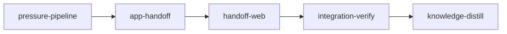

# Plan: Execution handoff

Implements: section_11, section_01

## Overview

This plan connects planning to `loom pressure` and `loom run` (`doc/product/section_11.md`). It
moves the pressure pipeline (step list, model resolution, report path, Codex runner, completion
instruction) out of `loom/src/commands/pressure/` into `loom::pressure`, which the terminal
driver and the app driver both use, and adds the `## Pressure tests` record that section 01's
detection reads, written by the shared pipeline after a run that completed every round, so
terminal runs write it too. The app runs Claude steps as pressure sessions through plan 7 and
Codex as a child of the server, shows the run in plan 9's panel, and stops cleanly on Stop, a
failed step, Ctrl-C or a dead server. The run side gives the run dialog, the commit of `doc/`
changes, `loom init` and `loom run` as children, Abandon run with its two confirmations and the
rename to `RETIRED-`, the dashboard child, the run strip, and the offers once plans complete.
Outside the app, loom's built-in default backend becomes tmux. Metaplan entry:
`doc/plans/metaplan-planner-ui.md`, "11. Execution handoff".

It depends on plan 2 (route modules, `PlanContext`, shutdown hooks, the pinned dashboard
`print_startup`), plan 6 (pressure-kind settings), plan 7 (session spawn API, session record,
recovery), plan 8 (pressure-session guidance), plan 9 (the chat panel's run-header,
composer-gate and stop-control seams), plan 10 (summary scheduler suspension) and plan 1 (plan
states and slugs, `RETIRED-`). Nothing depends on it.

## Goals

- One pressure pipeline for both drivers; `loom pressure --dry-run` lists the record step; the
  record line and placement rules of section 11 "The pressure record"; a recorded plan still
  passes `loom plan verify` and `loom init`'s plan preflight.
- App pressure runs: options and refusals, Claude steps as pressure sessions with
  `CLAUDE_CODE_EXPERIMENTAL_AGENT_TEAMS=1`, Codex as a server child with its identity recorded,
  the run view, Stop, failure, Ctrl-C and dead-server recovery, scheduler suspension, the
  summary queued for rebuild after the run.
- Run handoff: workspace-state offers, the uncommitted split at `doc/`, the commit with the
  user's hooks and signing, `loom init` and `loom run` children with streamed output, Abandon run
  (refusals stop the sequence before the rename; the holder confirms the exact branch list,
  re-checked after `loom stop`), Finish abandoning for a plan stranded by an interrupted abandon,
  Open dashboard, the 5-second run strip with a tokenless dashboard URL.
- A Codex step that changes `.claude/`, `.mcp.json` or `CLAUDE.md` ends the run and blocks new
  planning sessions until the holder confirms.
- The built-in default backend is tmux; `loom init`'s prompt says so; `README.md` notes it.
- Non-goals: stage monitoring (the dashboard does it), any check beyond loom's own refusals.

## Execution Diagram



## Stages

No knowledge-bootstrap: `doc/loom/knowledge/` already covers this codebase (pressure, web
dashboard, merge-checkout state, tmux backend topics).

### 1. `pressure-pipeline`

The shared pipeline, the record writer and the tmux default. Codex worker P1 (pipeline move,
Sol/high); codex implementer units R1, R2 (record writer and its tests) and T1-T4 (tmux default). Exists as its own stage by Q4:
together with the app driver and run handoff it would pass 500,000 tokens of context, and the
pipeline is the seam between them (Q3: the terminal driver's behaviour and the record are proven
here before the app driver builds on them).

### 2. `app-handoff`

The server side of pressure runs and of the run handoff. Codex foundation units CF1-CF6 (wire
types, fixtures, zod schemas, route registration) first, then Claude A1 (pressure driver, opus
xhigh), Codex A2 (run state, commit, start, dashboard, Sol/high) and A3 (Abandon, opus) beside codex
units CA1, CA2, CB1-CB3 (options, configuration guard, dashboard parser, strip, change split). Q1: it needs stage 1's
`loom::pressure` merged; Q4 as above.

### 3. `handoff-web`

The browser side in `web/` (its own `working_dir`): codex units CW1-CW4 (state hooks, offer
actions), then Codex Sol/high W1 (pressure dialog and panel) and W2 (run dialog, abandon, strip,
dashboard, plan actions). Q1: it consumes stage 2's fixtures and routes;
a different working directory.

### 4. `integration-verify`, 5. `knowledge-distill`

Full gate, reviews (security of the commit and abandon lanes and the Codex child against section
12), wiring proof, and an operator-run block for the real pressure test, Stop, and commit-and-run; then knowledge.

---

<!-- loom METADATA -->

```yaml
loom:
  version: 2
  auto_merge: null
  sandbox:
    enabled: true
    auto_allow: true
    allow_unsandboxed_escape: false
    excluded_commands: []
    filesystem:
      deny_read:
      - ~/.ssh/**
      - ~/.aws/**
      - ~/.config/gcloud/**
      - ~/.gnupg/**
      deny_write:
      - ../../**
      allow_write: []
    network:
      allowed_domains:
      - crates.io
      - index.crates.io
      - static.crates.io
      - registry.npmjs.org
      additional_domains: []
      allow_local_binding: false
      allow_unix_sockets: []
      allow_all_unix_sockets: false
    linux:
      enable_weaker_nested: false
    command_confinement: confined
  ratchet_files:
  - loom/maintainability-baseline.txt
  - doc/loom/knowledge/check-baseline.txt
  provision:
  - working_dir: web
    command: >-
      test ! -e .npmrc && test ! -L .npmrc && bun install --frozen-lockfile
      --ignore-scripts --backend=copyfile --config=/dev/null
  stages:
  - id: pressure-pipeline
    name: Shared pressure pipeline, record writer, tmux default
    description: |
      Implement stage 1 of doc/plans/PLAN-feat-planner-11-execution-handoff.md (renamed IN_PROGRESS-PLAN-feat-planner-11-execution-handoff.md once loom run starts). Spec: doc/product/section_11.md "The pressure record" and "How the server runs it"; section_01.md "Pressure tests". Metaplan entry: doc/plans/metaplan-planner-ui.md "11. Execution handoff".
      Use parallel subagents and skills to maximize performance.
      PATHS: working_dir is loom/; YAML paths are package-relative (../ outside the crate); brief paths are repo-relative.
      
      BEFORE SPAWNING (you): plans 1 to 10 merged first. Re-read by symbol: loom map --outline src/commands/pressure/mod.rs (Step, plan_steps, run_pipeline, execute), src/commands/pressure/spawn.rs (completion_instruction, claude_args, should_stop), src/commands/pressure/fallback.rs, src/claude/session.rs (run_foreground, AGENT_TEAMS_ENV), src/models/session/types.rs (SessionBackendKind), src/commands/init/backend.rs (backend_default_label). Plan 8 appended [plan] keys to web/src/api/fixtures/config.json and README.md; T4 edits only the backend values there. Record any difference from the briefs with loom memory note and tell the owning worker in its spawn prompt.
      
      CODEX IN THIS PLAN HAS TWO ROLES; keep them apart: implementer units are loom-codex-forwarder runs (gpt-6.1-sol for substantial work, gpt-6.1-terra for easier units, effort high for every unit; the ownership table and brief pin each unit) that write this stage's code; the Codex $pressure step is the product feature the code drives (codex exec, under the user's Codex login) and is never spawned by you as a worker.
      LANES: Use the ownership table: codex sol/high means --model gpt-6.1-sol --effort high; codex terra/high means --model gpt-6.1-terra --effort high. Spawn Codex workers as loom-codex-forwarder in the FOREGROUND, at most six per wave over disjoint files, with an explicit Bash timeout of 600000 ms and the row's brief path. Never use codex:codex-rescue. Workers never spawn subagents, run git, or write under .loom/. Workers run compile-only checks; the orchestrator runs the briefs' test commands and checks git status --short after each wave. For a broad worker territory, split the brief into ordered file-sized forwards within that territory before dispatch to fit the 540 s wrapper deadline; keep shared interfaces pinned and finish producers before consumers. A timed-out unit is re-split against its partial result, never re-forwarded unchanged. Retain the existing Claude fallback when Codex is unavailable and evidence-based escalation for failed fixes. Only rows marked opus use loom-senior-software-engineer in the background; wait for them with loom subagents watch. Each prompt says: Your brief: <path>. Read it in full before anything else.
      WAVES: (1) P1 in the foreground, including the record module declaration. (2) R1, R2 and T1-T4 in one foreground wave. Run R1/R2 proof commands and read T1's audit report after the wave.
      
      | Worker | Role | Tier | Files owned | Shared context | Brief path |
      | ------ | ---- | ---- | ----------- | -------------- | ---------- |
      | P1 | Shared pipeline and terminal driver | codex sol/high | src/lib.rs; src/pressure/mod.rs; src/pressure/steps.rs; src/pressure/models.rs; src/pressure/paths.rs; src/pressure/codex_run.rs; src/pressure/instruction.rs; src/pressure/tests.rs; src/commands/pressure/mod.rs; src/commands/pressure/spawn.rs; src/commands/pressure/terminal.rs; src/commands/pressure/tests.rs; src/commands/pressure/fallback.rs; src/commands/pressure/models.rs; src/commands/pressure/paths.rs; src/commands/init/mod.rs | record API pinned in p2 | doc/plans/briefs/feat-planner-11-execution-handoff/pressure-pipeline/p1-shared-pipeline.md |
      | R1 | Record writer (wave 1) | codex sol/high | src/pressure/record.rs | p2 spec | doc/plans/briefs/feat-planner-11-execution-handoff/pressure-pipeline/codex-units.md |
      | R2 | Record writer tests (wave 1) | codex sol/high | src/pressure/record/tests.rs | R1 API | doc/plans/briefs/feat-planner-11-execution-handoff/pressure-pipeline/codex-units.md |
      | T1 | Backend default (wave 1) | codex terra/high | src/models/session/types.rs; src/user_config/tests.rs | p3 spec | doc/plans/briefs/feat-planner-11-execution-handoff/pressure-pipeline/codex-units.md |
      | T2 | Init prompt label and its tests (wave 1) | codex terra/high | src/commands/init/backend.rs; src/commands/init/backend_tests.rs | p3 spec | doc/plans/briefs/feat-planner-11-execution-handoff/pressure-pipeline/codex-units.md |
      | T3 | Backend docs (wave 1) | codex terra/high | ../README.md; ../skills/loom-usage/SKILL.md | p3 spec | doc/plans/briefs/feat-planner-11-execution-handoff/pressure-pipeline/codex-units.md |
      | T4 | Dashboard fixture values (wave 1) | codex terra/high | ../web/src/api/fixtures/config.json; ../web/src/test/settings-kit.tsx | p3 spec | doc/plans/briefs/feat-planner-11-execution-handoff/pressure-pipeline/codex-units.md |
      
      AFTER THE WORKERS: cargo fmt --all. The gate: loom check pressure-pipeline once (bare, its own Bash call; again while its first line says requested or pending), with the final loom-code-reviewer round beside it. Each FAIL becomes a fix brief to a fresh loom-software-engineer for the owning territory (a failed codex unit's fix goes to a loom-software-engineer, sonnet); re-check with loom check pressure-pipeline --criterion <n>. You run no other test yourself.
      MUTATION: before the final review round, in src/pressure/record.rs make append_to_text always append at the end of the file (save the file to $LOOM_SCRATCH_DIR first); run cargo test --test pressure_pipeline_contracts record_appends_after_existing_section_items: it must fail; restore with cp, confirm with cmp, re-run green; record loom memory note "mutation: ...".
      LEDGER: no file this stage edits has a row in loom/maintainability-baseline.txt; every file stays under 400 lines and every function under 50.
      INTEGRITY: expected TI-edit events, all intended: src/commands/pressure/tests.rs (tests moved to src/pressure/tests.rs with the code), src/commands/pressure/models.rs and src/commands/pressure/fallback.rs (deleted; their inline tests moved to src/pressure/models.rs and src/pressure/codex_run.rs), src/commands/init/backend_tests.rs (backend_default_label's expected text and init_backend_effective_backend_defaults_to_native_without_user_config, renamed ..._defaults_to_tmux_..., change to tmux per section 11), src/user_config/tests.rs (the terminal_backend default assertion at :94 becomes Tmux). After the final review, file one loom stage dispute-integrity pressure-pipeline --event <each TI-edit id, a repository path such as TI-edit-loom/src/commands/pressure/tests.rs, copied from loom stage review integrity pressure-pipeline> --reason "tests moved with the pipeline into loom::pressure; the built-in backend default changed to tmux per doc/product/section_11.md". Any other TI event is a defect.
      WEB: T4 changes only the config fixture and a test kit file; no bundled web/src module changes, so web/dist is not rebuilt.
      INSTALLED ASSETS: ../skills/loom-usage/SKILL.md is a repository copy; the operator runs ./dev-install.sh after merge.
      
      CONTRACT SURFACE (the contract session writes tests/pressure_pipeline_contracts.rs and helpers under tests/pressure_pipeline_contracts/ only, from this text, before any implementation; top-level #[test] fns named after the ids with underscores; every fn under 50 lines, the file under 400). Public surface: loom::pressure::{plan_steps, Step, run_pipeline, PressureDriver, PressureResult, StepVerdict, PipelineInput, PipelineOutcome, completion_instruction, MarkerHome}; loom::pressure::record::{RecordLine { date: chrono::NaiveDate, claude_model: String, codex_models: Vec<String>, rounds: u32, missing_rounds: Vec<u32> }, RecordLine::render, append_record(&Path, &RecordLine) -> anyhow::Result<RecordWrite>, RecordWrite::{Written, PlanMoved}, append_to_text(&str, &str) -> String}; loom::commands::init::preflight_plan(&Path). The helper module provides a FakeDriver implementing PressureDriver that records each call, can be told to write the report file in chosen rounds, and to return StepVerdict::Stop at a chosen call; and a minimal valid version 2 plan text (one standard stage with one contract, an integration-verify and a knowledge-distill stage, sandbox enabled) ending in its END loom METADATA marker.
      - record_appends_after_existing_section_items: append_to_text on a plan whose text after the end marker is "\n## Pressure tests\n\n- 2026-10-01: old\n\n## Notes\n\ntext\n" places the new line directly after "- 2026-10-01: old" and keeps "## Notes\n\ntext\n" after it unchanged.
      - record_creates_section_at_end_when_absent: a plan with no heading after the marker ends with "\n## Pressure tests\n\n<line>\n" appended; a plan with no end marker at all gets the same.
      - record_ignores_a_heading_before_the_marker: a "## Pressure tests" heading in the prose before the metadata block is untouched and a new section is created after the marker.
      - record_line_renders_rounds_models_and_outcome: RecordLine { 2026-10-26, "opus", ["gpt-6.1-sol", "gpt-6.1-sol"], 2, [] } renders "- 2026-10-26: Claude opus, Codex gpt-6.1-sol; 2 rounds, review addressed"; { .., ["a", "a", "b"], 3, [2] } renders "- 2026-10-26: Claude opus, Codex a / a / b; 3 rounds, Codex review missing in round 2"; one round renders "1 round".
      - record_keeps_the_plan_file_mode: a plan chmod 0640 keeps mode 0640 after append_record returns Written.
      - moved_or_symlinked_plan_is_not_written: append_record on a removed path returns PlanMoved and creates nothing; on a symlink to a plan in another TempDir returns PlanMoved and the target's bytes are unchanged.
      - stopped_pipeline_writes_no_record: run_pipeline with a FakeDriver stopping at round 1's address returns Stopped, the plan's bytes are unchanged, and the report file is absent afterwards.
      - missing_report_round_is_recorded: two rounds, the FakeDriver writes the report in round 1 only; the plan's record line ends with "Codex review missing in round 2".
      - recorded_plan_passes_verify_and_preflight: the minimal plan with a record appended passes Command::new(env!("CARGO_BIN_EXE_loom")).args(["plan", "verify", <path>]) (exit 0, in a git-initialised TempDir) and loom::commands::init::preflight_plan(<path>) returns Ok.
      - completion_instruction_follows_the_marker_home: completion_instruction(marker, MarkerHome::PlanSession) contains the marker path and does not contain ".loom/work"; with MarkerHome::Workspace it contains ".loom/work".
      - dry_run_lists_the_record_step: in a git-initialised TempDir with doc/plans/PLAN-x.md, Command::new(env!("CARGO_BIN_EXE_loom")).args(["pressure", "--dry-run", "doc/plans/PLAN-x.md"]) prints a line containing "Pressure tests record" after the last delete-report step.
      - builtin_backend_default_is_tmux: loom::models::session::SessionBackendKind::default() == SessionBackendKind::Tmux.
      Red at freeze: loom::pressure does not exist and the default is Native.
      
      After the gate is green and before completing: the review round per the signal, every finding fixed or disputed.
      MEMORY: record mistakes, decisions and surprises via loom memory immediately (subagents too), including every stale knowledge claim as loom memory note "stale-knowledge: <file>#<heading> claims X; the tree does Y (file:line). Correction: <text>"; NEVER loom knowledge (implementation stage); NEVER Claude Code auto-memory.
    summary: >-
      Moves the pressure pipeline into a module both drivers use, writes the Pressure
      tests record after a completed run, and makes tmux loom's built-in default
      backend.
    dependencies: []
    parallel_group: null
    acceptance:
    - cargo build
    - cargo test --test pressure_pipeline_contracts
    - "cargo test --lib pressure::"
    - "cargo test --lib init::"
    - "cargo test --lib user_config::"
    - "cargo test --lib config_api::"
    - "cargo test --lib models::session::"
    - cargo test --test maintainability
    - command: cargo test --doc --workspace --all-features -- --test-threads=1
      timeout_secs: 1200
    - cargo clippy --all-targets -- -D warnings
    - cargo fmt --check
    - RUSTDOCFLAGS='-D warnings' cargo doc --workspace --all-features --no-deps
    - >-
      cd ../web && node_modules/.bin/tsc -b --noEmit && node_modules/.bin/vitest run
      src/components/settings-model.test.ts
    setup: []
    files:
    - src/lib.rs
    - src/pressure/**
    - src/commands/pressure/**
    - src/commands/init/mod.rs
    - src/commands/init/backend.rs
    - src/commands/init/backend_tests.rs
    - src/models/session/types.rs
    - src/models/session/methods.rs
    - src/user_config/tests.rs
    - ../web/src/api/fixtures/config.json
    - ../web/src/test/settings-kit.tsx
    - ../README.md
    - ../skills/loom-usage/SKILL.md
    - tests/pressure_pipeline_contracts.rs
    - tests/pressure_pipeline_contracts/**
    auto_merge: null
    working_dir: loom
    stage_type: standard
    artifacts:
    - src/pressure/mod.rs
    - src/pressure/record.rs
    - src/commands/pressure/terminal.rs
    wiring:
    - source: src/commands/pressure/mod.rs
      pattern: run_pipeline(
      description: the terminal driver runs the shared pipeline
      literal: true
    before_stage:
    - command: cargo --version
      description: cargo on PATH
    - command: node --version
      description: node on PATH for the provisioned web/node_modules binaries
    after_stage:
    - command: test ! -e src/commands/pressure/fallback.rs
      description: the Codex runner moved out of the terminal command
    context_ceiling_tokens: null
    sandbox: {}
    ultracode: false
    implementers:
    - codex
    - claude
    subagent_timeout_secs: 900
    skills:
    - loom-rust
    contracts:
    - id: record-appends-after-existing-section-items
      file: tests/pressure_pipeline_contracts.rs
      test: record_appends_after_existing_section_items
      scenario: >-
        append_to_text on a plan with a Pressure tests section followed by a Notes
        heading after the end marker
      rejects: >-
        a writer that appends the line at the end of the file regardless of the
        existing section
    - id: record-creates-section-at-end-when-absent
      file: tests/pressure_pipeline_contracts.rs
      test: record_creates_section_at_end_when_absent
      scenario: >-
        append_to_text on a plan with no section after the marker, and on a plan with
        no end marker
      rejects: >-
        a writer that inserts the section before the metadata block or omits the blank
        lines and heading
    - id: record-ignores-a-heading-before-the-marker
      file: tests/pressure_pipeline_contracts.rs
      test: record_ignores_a_heading_before_the_marker
      scenario: a Pressure tests heading in the prose above the metadata block
      rejects: a writer that searches the whole file for the first Pressure tests heading
    - id: record-line-renders-rounds-models-and-outcome
      file: tests/pressure_pipeline_contracts.rs
      test: record_line_renders_rounds_models_and_outcome
      scenario: >-
        renders a two-round single-model line, a three-round mixed-model line with
        round 2 missing, and a one-round line
      rejects: a renderer that shows only the last round's Codex model or writes 1 rounds
    - id: record-keeps-the-plan-file-mode
      file: tests/pressure_pipeline_contracts.rs
      test: record_keeps_the_plan_file_mode
      scenario: append_record on a plan file with mode 0640
      rejects: a temp-file-and-rename write that leaves the plan at the default 0644
    - id: moved-or-symlinked-plan-is-not-written
      file: tests/pressure_pipeline_contracts.rs
      test: moved_or_symlinked_plan_is_not_written
      scenario: >-
        append_record on a removed plan path and on a symlink pointing at a plan in
        another TempDir
      rejects: a writer that recreates the moved plan or follows the symlink into its target
    - id: stopped-pipeline-writes-no-record
      file: tests/pressure_pipeline_contracts.rs
      test: stopped_pipeline_writes_no_record
      scenario: run_pipeline with a fake driver that stops at round 1's address step
      rejects: a pipeline that writes the record or leaves the Codex report after an early stop
    - id: missing-report-round-is-recorded
      file: tests/pressure_pipeline_contracts.rs
      test: missing_report_round_is_recorded
      scenario: two rounds where the fake driver writes the Codex report only in round 1
      rejects: >-
        an outcome computed from the final report file or the Codex exit status instead
        of the report present at each address step
    - id: recorded-plan-passes-verify-and-preflight
      file: tests/pressure_pipeline_contracts.rs
      test: recorded_plan_passes_verify_and_preflight
      scenario: >-
        appends a record to a minimal valid plan and runs loom plan verify and
        preflight_plan on it
      rejects: a record placement that breaks plan parsing or brief-path scanning
    - id: completion-instruction-follows-the-marker-home
      file: tests/pressure_pipeline_contracts.rs
      test: completion_instruction_follows_the_marker_home
      scenario: builds the instruction for a planning-session marker and for a workspace marker
      rejects: one fixed text that tells planning sessions their marker sits in .loom/work
    - id: dry-run-lists-the-record-step
      file: tests/pressure_pipeline_contracts.rs
      test: dry_run_lists_the_record_step
      scenario: runs loom pressure --dry-run on a fixture plan in a git TempDir
      rejects: a dry run that omits the record step the real run performs
    - id: builtin-backend-default-is-tmux
      file: tests/pressure_pipeline_contracts.rs
      test: builtin_backend_default_is_tmux
      scenario: reads SessionBackendKind::default()
      rejects: a change that relabels the init prompt but keeps Native as the built-in default
    harness:
    - tests/pressure_pipeline_contracts/**
    reachable:
    - symbol: append_record
      from: main
      description: loom pressure reaches the record writer from the CLI
  - id: app-handoff
    name: Pressure runs and run handoff on the planning server
    description: |
      Implement stage 2 of doc/plans/PLAN-feat-planner-11-execution-handoff.md (renamed IN_PROGRESS-PLAN-feat-planner-11-execution-handoff.md once loom run starts). Spec: doc/product/section_11.md; section_12.md "Pressure sessions"; section_07.md "Crashes and kills".
      Use parallel subagents and skills to maximize performance.
      PATHS: working_dir is loom/; YAML paths are package-relative; brief paths are repo-relative.
      
      BEFORE SPAWNING (you): confirm by symbol, and record every difference from the briefs with loom memory note, telling the owning worker in its spawn prompt:
         plan 2: loom map --outline src/plan_server/routes.rs (all_routes, install_all, RouteSpec), src/plan_server/context.rs (PlanContext), src/plan_server/wire/message.rs (PlanMessage), src/plan_server/shutdown.rs (ShutdownHook), src/plan_server/authoring.rs (ctx.require_authoring(&BrowserId, Take), Take, Refusal, release_if(&PublicId, reason), AuthoringEvent::Freed { GraceExpired }), src/plan_server/mod.rs (the module list), and the dashboard print_startup pin test (loom map --find-all print_startup);
         plan 7: loom map --find-all Bridge (plan_session::bridge: start_session, subscribe, interrupt, end(id, EndMode, EndCause) -> Vec<String>, record_child, sessions, chat_snapshot, transcripts, on_recovered with RecoveryReport, release_session, add_token_transcript; BridgeEvent; StartRequest; LaunchGuidance; the AuthoringLeases extension that stops plan 7 releasing authoring while a lease is held) and doc/plans/briefs/feat-planner-07-session-bridge/common.md; plan 7 may name them differently: follow the tree;
         plan 6: SessionKind::Pressure, SessionDir::marker() and the top-level settings assembler src/plan_session/sandbox/mod.rs build_settings with its pressure snapshot test in src/plan_session/sandbox/tests_kinds.rs (A1 adds the top-level key teammateMode: in-process for the Pressure kind there and updates that snapshot);
         plan 8: loom map --find-all render_session_guidance (kind, project, runtime: &RuntimePaths, session_dir, models), SessionGuidanceKind, StartBlocks (planning::guidance: block(runtime, reason, changed), clear(runtime), current(runtime); the block persists in <runtime.dir>/config-block.json and render_session_guidance refuses EVERY kind, Pressure included, while it exists, across restarts);
         plan 10: plan_server::summaries::Rebuilds::suspend(SuspendReason::PressureRun) -> SuspendGuard (loom map --find-all Rebuilds);
         plan 1: planning::slug::plan_state, PlanState, Project reading order.
      teammateMode: run claude --version and record it with loom memory note "claude-version: ...". No one has observed teammateMode on this host: A1 sets it AND the driver checks during every /pressure step that the session's tmux server holds exactly one pane (tmux -L <socket> list-panes -a), recording a second pane as a run failure "teammates opened panes: teammateMode not honoured". Observing it on the installed Claude Code needs a live session, which integration-verify's OPERATOR TEST DEFERRAL defers: record it there as unverified, never run it on the host.
      
      CODEX IN THIS PLAN HAS TWO ROLES; keep them apart: implementer units are loom-codex-forwarder runs (gpt-6.1-sol for substantial work, gpt-6.1-terra for easier units, effort high for every unit; the ownership table and brief pin each unit) that write this stage's code; the Codex $pressure step is the product feature the code drives (codex exec, under the user's Codex login) and is never spawned by you as a worker.
      LANES: Use the ownership table: codex sol/high means --model gpt-6.1-sol --effort high; codex terra/high means --model gpt-6.1-terra --effort high. Spawn Codex workers as loom-codex-forwarder in the FOREGROUND, at most six per wave over disjoint files, with an explicit Bash timeout of 600000 ms and the row's brief path. Never use codex:codex-rescue. Workers never spawn subagents, run git, or write under .loom/. Workers run compile-only checks; the orchestrator runs the briefs' test commands and checks git status --short after each wave. For a broad worker territory, split the brief into ordered file-sized forwards within that territory before dispatch to fit the 540 s wrapper deadline; keep shared interfaces pinned and finish producers before consumers. A timed-out unit is re-split against its partial result, never re-forwarded unchanged. Retain the existing Claude fallback when Codex is unavailable and evidence-based escalation for failed fixes. Only rows marked opus use loom-senior-software-engineer in the background; wait for them with loom subagents watch. Each prompt says: Your brief: <path>. Read it in full before anything else.
      WAVES: (0) SEED as specified. (1) CF1-CF6 in one foreground wave. (2) Spawn A1 (loom-senior-software-engineer, opus/xhigh) and A3 (loom-senior-software-engineer, opus/high) in the background; run A2, CA1, CA2 and CB1-CB3 in one foreground wave. (3) Wait for A1 and A3 with loom subagents watch, then run every proof command once.
      
      | Worker | Role | Tier | Files owned | Shared context | Brief path |
      | ------ | ---- | ---- | ----------- | -------------- | ---------- |
      | CF1 | Pressure wire types and parity tests (wave 1) | codex terra/high | src/plan_server/wire/pressure.rs; src/plan_server/wire/tests_pressure.rs | f-wire spec | doc/plans/briefs/feat-planner-11-execution-handoff/app-handoff/codex-units.md |
      | CF2 | Run wire types and parity tests (wave 1) | codex terra/high | src/plan_server/wire/run.rs; src/plan_server/wire/tests_run.rs | f-wire spec | doc/plans/briefs/feat-planner-11-execution-handoff/app-handoff/codex-units.md |
      | CF3 | PlanMessage variants and wire module lines (wave 1) | codex terra/high | src/plan_server/wire/message.rs; src/plan_server/wire/mod.rs | CF1, CF2 type names | doc/plans/briefs/feat-planner-11-execution-handoff/app-handoff/codex-units.md |
      | CF4 | Pressure zod schemas and fixtures (wave 1) | codex terra/high | ../web/src/plan/api/schema-pressure.ts; ../web/src/plan/api/schema-pressure.test.ts; ../web/src/plan/api/fixtures/pressure-run.json; ../web/src/plan/api/fixtures/pressure-options.json | f-wire spec | doc/plans/briefs/feat-planner-11-execution-handoff/app-handoff/codex-units.md |
      | CF5 | Run zod schemas and fixtures (wave 1) | codex terra/high | ../web/src/plan/api/schema-run.ts; ../web/src/plan/api/schema-run.test.ts; ../web/src/plan/api/fixtures/run-state.json; ../web/src/plan/api/fixtures/run-strip.json; ../web/src/plan/api/fixtures/run-output.json | f-wire spec | doc/plans/briefs/feat-planner-11-execution-handoff/app-handoff/codex-units.md |
      | CF6 | Module wiring and module roots (wave 1) | codex terra/high | src/plan_server/mod.rs; src/plan_server/routes.rs; src/plan_server/pressure/mod.rs; src/plan_server/run/mod.rs | plan 2 routes.rs | doc/plans/briefs/feat-planner-11-execution-handoff/app-handoff/codex-units.md |
      | A1 | Pressure driver | opus/xhigh | src/plan_server/pressure/routes.rs; src/plan_server/pressure/install.rs; src/plan_server/pressure/driver.rs; src/plan_server/pressure/codex.rs; src/plan_server/pressure/recover.rs; src/plan_server/pressure/view.rs; src/plan_server/pressure/teammates.rs; src/plan_server/pressure/tests.rs; src/plan_server/pressure/fixtures/**; src/plan_session/sandbox/mod.rs; src/plan_session/sandbox/tests_kinds.rs; tests/plan_handoff_operator.rs | F types; loom::pressure; plans 6, 7, 8, 10 | doc/plans/briefs/feat-planner-11-execution-handoff/app-handoff/a1-pressure-driver.md |
      | A2 | Run state, commit, start, dashboard | codex sol/high | src/plan_server/run/routes.rs; src/plan_server/run/install.rs; src/plan_server/run/state.rs; src/plan_server/run/commit.rs; src/plan_server/run/start.rs; src/plan_server/run/child.rs; src/plan_server/run/dashboard.rs; src/plan_server/run/tests.rs; src/commands/init/work_state.rs; src/commands/init/mod.rs | F types; CB units | doc/plans/briefs/feat-planner-11-execution-handoff/app-handoff/a2-run-start-and-dashboard.md |
      | A3 | Abandon run | opus | src/plan_server/run/abandon.rs; src/plan_server/run/abandon/tests.rs; src/commands/clean/worktrees.rs; src/commands/clean/mod.rs | F types; A2 child.rs and RunJobs | doc/plans/briefs/feat-planner-11-execution-handoff/app-handoff/a3-abandon.md |
      | CA1 | Pressure options and start validation (wave 2) | codex sol/high | src/plan_server/pressure/options.rs; src/plan_server/pressure/options/tests.rs | a1 Routes | doc/plans/briefs/feat-planner-11-execution-handoff/app-handoff/codex-units.md |
      | CA2 | Codex configuration guard (wave 2) | codex sol/high | src/plan_server/pressure/config_guard.rs; src/plan_server/pressure/config_guard/tests.rs | a1 step 3 | doc/plans/briefs/feat-planner-11-execution-handoff/app-handoff/codex-units.md |
      | CB1 | Dashboard startup parser (wave 2) | codex sol/high | src/plan_server/run/dashboard_parse.rs; src/plan_server/run/dashboard_parse/tests.rs | plan 2 print_startup pin | doc/plans/briefs/feat-planner-11-execution-handoff/app-handoff/codex-units.md |
      | CB2 | Run strip (wave 2) | codex sol/high | src/plan_server/run/strip.rs; src/plan_server/run/strip/tests.rs | CB1 strip_token | doc/plans/briefs/feat-planner-11-execution-handoff/app-handoff/codex-units.md |
      | CB3 | Change split (wave 2) | codex sol/high | src/plan_server/run/changes.rs; src/plan_server/run/changes/tests.rs | a2 doc_changes rules | doc/plans/briefs/feat-planner-11-execution-handoff/app-handoff/codex-units.md |
      
      SEED (you, before wave 1; BLOCK-B point 1 does not apply, these are empty files): create every file the two module roots declare as a placeholder so the crate compiles at every wave: src/plan_server/pressure/{driver,codex,recover,view,teammates,options,config_guard,tests}.rs and src/plan_server/run/{state,commit,start,child,dashboard,dashboard_parse,strip,changes,abandon,tests}.rs each holding one line //! Placeholder: filled by <owner row> in this stage; src/plan_server/pressure/routes.rs and src/plan_server/run/routes.rs each holding use crate::plan_server::routes::RouteSpec; pub fn all() -> Vec<RouteSpec> { Vec::new() }; src/plan_server/pressure/install.rs and src/plan_server/run/install.rs each holding use std::sync::Arc; use crate::plan_server::context::PlanContext; pub fn run(_ctx: &Arc<PlanContext>) {}. Use the import paths plan 2 actually exports (check with loom map --find-all RouteSpec and PlanContext). Each owner later replaces its placeholder whole; the placeholders are listed in no row. CF6 alone writes src/plan_server/mod.rs, src/plan_server/routes.rs and the two final module roots src/plan_server/pressure/mod.rs and src/plan_server/run/mod.rs (they declare every file above and delegate routes() and install() to routes.rs and install.rs, owned by A1 and A2). After the seed and after each unit the crate compiles, so every unit's proof runs right after it.
      LEDGER: A3 shrinks confirm_branch_deletion (row "function src/commands/clean/worktrees.rs confirm_branch_deletion 73" in loom/maintainability-baseline.txt). After A3 reports the new length, you lower the row to it, or delete the row when the function is 50 lines or fewer (BLOCK-B point 1). That change raises a TI-ratchet event: file loom stage dispute-integrity app-handoff --event <id> --reason "the extraction of unmerged_loom_branches shrank confirm_branch_deletion; the ledger row follows the function". No other ledger row changes; every new file stays under 400 lines, functions under 50.
      INTEGRITY: expected TI-edit event: src/plan_session/sandbox/tests_kinds.rs (the pressure-kind snapshot gains teammateMode). After the final review, file one loom stage dispute-integrity app-handoff --event TI-edit-loom/src/plan_session/sandbox/tests_kinds.rs (copy the exact id from loom stage review integrity app-handoff) --reason "the pressure settings gain teammateMode per section 11; the snapshot follows" together with the ratchet event above.
      AFTER THE WORKERS: cargo fmt --all. The gate: loom check app-handoff once, with the final loom-code-reviewer round beside it (security: the commit lane runs the user's hooks and never --no-verify; abandon refusals stop before the rename; Codex is terminated only through a verified ProcessIdentity; every route's role; section 12 "Requests that change something"). Each FAIL becomes a fix brief to a fresh worker of the owning territory one tier up from the failed attempt; re-check with loom check app-handoff --criterion <n>. You run no other test yourself.
      MUTATION: before the final review round, in src/plan_server/run/commit.rs replace the direct git Command with crate::git::runner::run_git for the commit (save the file to $LOOM_SCRATCH_DIR first); run cargo test --test plan_handoff_contracts commit_runs_the_users_pre_commit_hook: it must fail; restore with cp, confirm with cmp, re-run green; record loom memory note "mutation: ...".
      WEB: F adds fixtures, schemas and their tests under web/src/plan/api/; no bundled module imports them until handoff-web, so web/dist is not rebuilt here.
      
      CONTRACT SURFACE (the contract session writes tests/plan_handoff_contracts.rs and helpers under tests/plan_handoff_contracts/ only, before any implementation; top-level #[test] fns named after the ids with underscores; every fn under 50 lines, the file under 400). Public surface (each pub so the integration test reaches it): loom::plan_server::run::changes::split_changes(root: &Path) -> anyhow::Result<(Vec<ChangedPath>, Vec<ChangedPath>)> returning (doc_changes, blocking_changes); loom::plan_server::run::commit::commit_doc_changes(root: &Path, paths: &[String], message: &str, current: &[ChangedPath], on_line: &mut dyn FnMut(&str)) -> anyhow::Result<i32> (Err when a path is not in current); loom::plan_server::run::state::workspace_state(root: &Path) -> anyhow::Result<(WorkspaceState, RunOffer, Option<PathBuf>)>; loom::plan_server::run::dashboard::parse_dashboard_startup(lines: &[&str]) -> Option<String>; loom::plan_server::run::abandon::run_abandon(root: &Path, runtime: &loom::planning::runtime::RuntimePaths, loom_bin: &Path, confirmed_unmerged: &[(String, usize)], on_line: &mut dyn FnMut(&str)) -> anyhow::Result<AbandonOutcome> with AbandonOutcome::{Renamed { to: PathBuf }, Refused { reason: String }, BranchesChanged { now: Vec<(String, usize)> }, Failed { step: String, code: i32 }} (confirmed_unmerged is the (branch, ahead) list the dialog showed; empty means none was shown); loom::plan_server::run::abandon::finish_abandon(root: &Path, runtime: &loom::planning::runtime::RuntimePaths) -> anyhow::Result<AbandonOutcome> (the rename step alone, allowed only when an abandon marker <runtime.dir>/abandon/<slug>.json names the plan; the server passes ctx.runtime(), the helper builds runtime with loom::planning::runtime::runtime_paths_under(<tmp loom dir>, root); with no .loom/work, no loom/* branch and no run worktree); run_abandon writes that marker before loom stop; loom::plan_server::run::strip::build_strip(work_dir: &loom::fs::work_dir::WorkDir, dashboard_url: Option<&str>) -> anyhow::Result<RunStrip>; loom::plan_server::pressure::config_guard::{snapshot(root: &Path) -> anyhow::Result<ConfigSnapshot>, changed(before: &ConfigSnapshot, after: &ConfigSnapshot) -> Vec<String>} over .claude/**, .mcp.json and CLAUDE.md (content hashes, untracked files included); loom::plan_server::pressure::options::validate_start(project: &loom::planning::project::Project, start: &PressureStart) -> Result<(), String /* error code */>; loom::plan_server::pressure::recover::codex_action(identity: Option<loom::process::identity::ProcessIdentity>) -> CodexAction with CodexAction::{Terminate, LeaveAlone, Nothing}; wire types from loom::plan_server::wire::{pressure, run}. The helper module builds git repos in tempfile::TempDir (git init, user.name/user.email set locally, one commit) and writes a fake loom executable (#!/bin/sh) whose behaviour each test sets through files beside it: the exit code per subcommand, whether "clean" deletes .loom/work, an env dump of LOOM_CLEAN_YES, and an optional script "stop" runs (used to create a commit on a loom/* branch while loom stop runs).
      - changes_split_blocks_only_tracked_outside_doc: a repo with a modified tracked file outside doc/, an untracked file outside doc/, a new file and a modified file under doc/, and 300 new files under doc/many/: blocking_changes holds exactly the modified outside file; doc_changes holds the two doc files and all 300.
      - commit_refuses_paths_outside_current_doc_changes: commit_doc_changes with a path not in current (and with "../x") returns Err and the repo's HEAD is unchanged.
      - commit_runs_the_users_pre_commit_hook: .git/hooks/pre-commit (executable) writes a marker file and exits 1; commit_doc_changes returns a non-zero code, the marker exists, and HEAD is unchanged.
      - workspace_state_follows_the_plan_prefix: .loom/work/config.toml with [plan] source_path at doc/plans/PLAN-a.md gives (Initialized, StartInitialized); at IN_PROGRESS-PLAN-a.md with no daemon gives (Stopped, Resume); at DONE-PLAN-a.md gives (Done, StartNext); no .loom/work gives (Absent, Start).
      - dashboard_url_parsed_from_print_startup: parse_dashboard_startup(["loom dashboard: http://127.0.0.1:7373/  (Ctrl-C to stop)"]) is "http://127.0.0.1:7373/"; the terminals form returns the URL with its ?token= query; the remote form returns the "this machine" bootstrap URL.
      - abandon_declined_unmerged_runs_nothing: a repo with a loom/s1 branch one commit ahead of the base and confirmed_unmerged empty: run_abandon returns BranchesChanged { now: [("loom/s1", 1)] }, the fake loom was never invoked, and the IN_PROGRESS plan keeps its name.
      - abandon_refuses_when_branches_change_during_stop: confirmed_unmerged empty, no branch ahead at the start, and the fake loom's stop script commits on loom/s2: run_abandon returns BranchesChanged naming loom/s2, the fake clean was never invoked, and loom/s2 still exists.
      - abandon_keeps_the_name_when_clean_leaves_state: the fake loom's clean exits 0 without deleting .loom/work: run_abandon returns Refused and no file exists under doc/plans/archive/.
      - abandon_renames_into_archive_after_clean: no unmerged branch, the fake clean deletes .loom/work: run_abandon returns Renamed to doc/plans/archive/RETIRED-PLAN-a.md, the fake recorded LOOM_CLEAN_YES=1, and doc/plans/IN_PROGRESS-PLAN-a.md is gone.
      - abandon_refuses_a_symlinked_archive: doc/plans/archive is a symlink into another TempDir: finish_abandon (no .loom/work) returns Refused, the plan keeps its name and the link target stays empty.
      - finish_abandon_renames_a_stranded_plan (runtime from runtime_paths_under(<tmp loom dir>, root); one case also sets LOOM_PLAN_STATE to another directory, #[serial_test::serial], and the marker is still found through the given runtime): no .loom/work, no loom/* branch, doc/plans/IN_PROGRESS-PLAN-a.md present and NO abandon marker: finish_abandon returns Refused and the plan keeps its name; with the marker <runtime.dir>/abandon/a.json written by the helper: Renamed to doc/plans/archive/RETIRED-PLAN-a.md and the marker removed; with the marker and a loom/s1 branch present: Refused.
      - commit_commits_only_ticked_paths: a staged tracked file outside doc/ and two changed doc files, one ticked; after commit_doc_changes HEAD holds only the ticked file, the outside file is still staged, and a ticked file named doc/a* commits only itself while doc/ab.md stays uncommitted.
      - run_strip_carries_no_token: build_strip(work_dir, Some("http://127.0.0.1:7373/?token=abc")) returns a RunStrip whose dashboard_url is "http://127.0.0.1:7373/".
      - codex_config_edit_is_detected: snapshot, then write .claude/settings.local.json and an untracked .claude/agents/x.md, then snapshot: changed lists both paths; an edit under doc/ lists nothing.
      - pressure_start_refuses_a_locked_plan: validate_start on a fixture project returns Err("plan_not_written") for doc/plans/IN_PROGRESS-PLAN-b.md and for doc/product/index.md, and Ok for doc/plans/PLAN-a.md with default slots.
      - codex_terminated_only_when_identity_verifies: codex_action(None) is Nothing; codex_action(Some(identity of a dead pid with a start time)) is Nothing; codex_action(Some(identity of a live child with its real start time)) is Terminate; codex_action(Some(identity with start_time None of a live child)) is LeaveAlone.
      Red at freeze: none of these modules exist.
      
      After the gate is green and before completing: the review round per the signal, every finding fixed or disputed.
      MEMORY: record mistakes, decisions and surprises via loom memory immediately (subagents too), including stale knowledge as loom memory note "stale-knowledge: ..."; NEVER loom knowledge (implementation stage); NEVER Claude Code auto-memory.
    summary: >-
      Adds the server routes and drivers that run pressure tests as planning
      sessions, commit planning documents, start and abandon runs, open the dashboard and show
      the run strip.
    dependencies:
    - pressure-pipeline
    parallel_group: null
    acceptance:
    - cargo build
    - cargo test --test plan_handoff_contracts
    - "cargo test --lib plan_server::pressure::"
    - "cargo test --lib plan_server::run::"
    - "cargo test --lib plan_server::wire::"
    - "cargo test --lib plan_session::sandbox::"
    - "cargo test --lib clean::"
    - cargo test --test maintainability
    - command: cargo test --doc --workspace --all-features -- --test-threads=1
      timeout_secs: 1200
    - cargo clippy --all-targets -- -D warnings
    - cargo fmt --check
    - RUSTDOCFLAGS='-D warnings' cargo doc --workspace --all-features --no-deps
    - >-
      cd ../web && node_modules/.bin/tsc -b --noEmit && node_modules/.bin/vitest run
      src/plan/api/schema-pressure.test.ts src/plan/api/schema-run.test.ts
    setup: []
    files:
    - src/plan_server/wire/**
    - src/plan_server/routes.rs
    - src/plan_server/pressure/**
    - src/plan_server/run/**
    - src/plan_session/sandbox/mod.rs
    - src/plan_session/sandbox/tests_kinds.rs
    - src/commands/init/work_state.rs
    - src/commands/init/mod.rs
    - src/commands/clean/worktrees.rs
    - src/commands/clean/mod.rs
    - maintainability-baseline.txt
    - ../web/src/plan/api/**
    - tests/plan_handoff_contracts.rs
    - tests/plan_handoff_contracts/**
    - tests/plan_handoff_operator.rs
    - src/plan_server/mod.rs
    auto_merge: null
    working_dir: loom
    stage_type: standard
    artifacts:
    - src/plan_server/pressure/driver.rs
    - src/plan_server/run/abandon.rs
    - src/plan_server/run/commit.rs
    - src/plan_server/run/strip.rs
    wiring:
    - source: src/plan_server/routes.rs
      pattern: pressure::routes()
      description: the pressure routes are registered in the planning router
      literal: true
    - source: src/plan_server/routes.rs
      pattern: run::routes()
      description: the run routes are registered in the planning router
      literal: true
    - source: src/plan_server/pressure/driver.rs
      pattern: run_pipeline(
      description: the app driver runs the shared pipeline
      literal: true
    - source: src/plan_server/run/routes.rs
      pattern: super::abandon::routes()
      description: the run route table registers the abandon routes
      literal: true
    - source: src/plan_server/run/abandon/route.rs
      pattern: run_abandon(
      description: the abandon route handler runs run_abandon
      literal: true
    - source: src/plan_server/pressure/driver.rs
      pattern: AppDriver(env)
      description: the planning server pressure step constructs the app driver
      literal: true
    before_stage:
    - command: cargo --version
      description: cargo on PATH
    - command: git --version
      description: git on PATH for the commit and abandon contracts
    after_stage:
    - command: test -f src/plan_server/run/abandon.rs
      description: the abandon sequence exists
    context_ceiling_tokens: null
    sandbox: {}
    ultracode: false
    implementers:
    - codex
    - claude
    subagent_timeout_secs: 900
    skills:
    - loom-rust
    - loom-typescript
    contracts:
    - id: changes-split-blocks-only-tracked-outside-doc
      file: tests/plan_handoff_contracts.rs
      test: changes_split_blocks_only_tracked_outside_doc
      scenario: >-
        a repo with tracked and untracked changes inside and outside doc/, 300 new doc
        files
      rejects: >-
        a split that blocks on untracked files outside doc/ or truncates a long status
        list
    - id: commit-refuses-paths-outside-current-doc-changes
      file: tests/plan_handoff_contracts.rs
      test: commit_refuses_paths_outside_current_doc_changes
      scenario: >-
        commit_doc_changes with a path the current change list lacks and with a
        traversal path
      rejects: a commit that stages whatever paths the browser sends
    - id: commit-runs-the-users-pre-commit-hook
      file: tests/plan_handoff_contracts.rs
      test: commit_runs_the_users_pre_commit_hook
      scenario: a failing executable pre-commit hook that writes a marker
      rejects: a commit through the hook-disabling git runner or with --no-verify
    - id: workspace-state-follows-the-plan-prefix
      file: tests/plan_handoff_contracts.rs
      test: workspace_state_follows_the_plan_prefix
      scenario: >-
        workspaces whose plan source path is PLAN-, IN_PROGRESS- and DONE-, and no
        workspace
      rejects: a state read that treats any existing .loom/work as a running plan
    - id: dashboard-url-parsed-from-print-startup
      file: tests/plan_handoff_contracts.rs
      test: dashboard_url_parsed_from_print_startup
      scenario: the loopback, terminals and remote first lines print_startup emits
      rejects: >-
        a parser that only handles the loopback line and returns nothing for the remote
        bootstrap form
    - id: abandon-declined-unmerged-runs-nothing
      file: tests/plan_handoff_contracts.rs
      test: abandon_declined_unmerged_runs_nothing
      scenario: an unmerged loom branch the dialog never showed (confirmed list empty)
      rejects: >-
        an abandon that runs loom stop or loom clean before comparing the recomputed
        list with the confirmed one
    - id: abandon-refuses-when-branches-change-during-stop
      file: tests/plan_handoff_contracts.rs
      test: abandon_refuses_when_branches_change_during_stop
      scenario: a fake loom stop that commits on a loom branch while it runs
      rejects: an abandon that decides LOOM_CLEAN_YES from the list taken before loom stop
    - id: abandon-keeps-the-name-when-clean-leaves-state
      file: tests/plan_handoff_contracts.rs
      test: abandon_keeps_the_name_when_clean_leaves_state
      scenario: a fake loom clean that exits 0 and deletes nothing
      rejects: an abandon that trusts loom clean's exit status and renames the plan
    - id: abandon-renames-into-archive-after-clean
      file: tests/plan_handoff_contracts.rs
      test: abandon_renames_into_archive_after_clean
      scenario: no unmerged branch and a fake clean that removes .loom/work
      rejects: >-
        an abandon that renames inside doc/plans/ or never sets LOOM_CLEAN_YES when
        nothing is unmerged
    - id: abandon-refuses-a-symlinked-archive
      file: tests/plan_handoff_contracts.rs
      test: abandon_refuses_a_symlinked_archive
      scenario: doc/plans/archive is a symlink into another TempDir
      rejects: >-
        a std::fs::rename that follows the symlinked archive directory out of the
        repository
    - id: finish-abandon-renames-a-stranded-plan
      file: tests/plan_handoff_contracts.rs
      test: finish_abandon_renames_a_stranded_plan
      scenario: >-
        an IN_PROGRESS plan with no workspace, without and with this machine's abandon
        marker, then with a loom branch left
      rejects: >-
        a finish-abandon that retires a plan running from another clone because local
        run state is missing, or an app that can never retire a plan whose abandon was
        interrupted after loom clean
    - id: commit-commits-only-ticked-paths
      file: tests/plan_handoff_contracts.rs
      test: commit_commits_only_ticked_paths
      scenario: >-
        a staged file outside doc/, an unticked doc file, and a ticked file whose name
        is a glob
      rejects: >-
        a commit without a pathspec, or with pathspec magic on, that commits the whole
        index
    - id: run-strip-carries-no-token
      file: tests/plan_handoff_contracts.rs
      test: run_strip_carries_no_token
      scenario: builds the broadcast strip from a tokenized dashboard URL
      rejects: a strip broadcast to every browser that carries the dashboard token
    - id: codex-config-edit-is-detected
      file: tests/plan_handoff_contracts.rs
      test: codex_config_edit_is_detected
      scenario: snapshots before and after writing .claude settings and an untracked agent file
      rejects: a check that reads only tracked changes or skips the session configuration files
    - id: pressure-start-refuses-a-locked-plan
      file: tests/plan_handoff_contracts.rs
      test: pressure_start_refuses_a_locked_plan
      scenario: validate_start for an IN_PROGRESS plan, a product section and a written plan
      rejects: a start check that only tests the path exists
    - id: codex-terminated-only-when-identity-verifies
      file: tests/plan_handoff_contracts.rs
      test: codex_terminated_only_when_identity_verifies
      scenario: >-
        recovery decisions for no identity, a dead pid, a live child with and without a
        start time
      rejects: a recovery that signals a recorded pid without verifying its start time
    harness:
    - tests/plan_handoff_contracts/**
  - id: handoff-web
    name: Pressure and run handoff in the planning app
    description: |
      Implement stage 3 of doc/plans/PLAN-feat-planner-11-execution-handoff.md (renamed IN_PROGRESS-PLAN-feat-planner-11-execution-handoff.md once loom run starts). Spec: doc/product/section_11.md, section_08.md "Pressure runs".
      Use parallel subagents and skills to maximize performance.
      PATHS: working_dir is web/; brief paths are repo-relative.
      
      BEFORE SPAWNING (you): confirm the seams by reading them: src/plan/chat/run-header.tsx, src/plan/chat/session-divider.tsx, src/plan/chat/composer-gate.ts, src/plan/chat/stop-control.tsx (plan 9), src/plan/header-extras.tsx (plan 2), the offer action registry src/plan/offers/actions.ts (plan 2: registerOfferAction, offerAction, runOffer), src/plan/files/plan/plan-actions-extras.tsx (plan 3), src/plan/concept/page-header-extras.tsx (plan 5/9), src/plan/api/schema-pressure.ts and schema-run.ts (stage app-handoff). A seam named differently in the tree: follow the tree and tell the worker; a seam that does not exist is a blocker: loom stage block handoff-web "<seam> missing; plan <n> was to provide it".
      
      CODEX IN THIS PLAN HAS TWO ROLES; keep them apart: implementer units are loom-codex-forwarder runs (gpt-6.1-sol for substantial work, gpt-6.1-terra for easier units, effort high for every unit; the ownership table and brief pin each unit) that write this stage's code; the Codex $pressure step is the product feature the code drives (codex exec, under the user's Codex login) and is never spawned by you as a worker.
      LANES: Use the ownership table: codex sol/high means --model gpt-6.1-sol --effort high; codex terra/high means --model gpt-6.1-terra --effort high. Spawn Codex workers as loom-codex-forwarder in the FOREGROUND, at most six per wave over disjoint files, with an explicit Bash timeout of 600000 ms and the row's brief path. Never use codex:codex-rescue. Workers never spawn subagents, run git, or write under .loom/. Workers run compile-only checks; the orchestrator runs the briefs' test commands and checks git status --short after each wave. For a broad worker territory, split the brief into ordered file-sized forwards within that territory before dispatch to fit the 540 s wrapper deadline; keep shared interfaces pinned and finish producers before consumers. A timed-out unit is re-split against its partial result, never re-forwarded unchanged. Retain the existing Claude fallback when Codex is unavailable and evidence-based escalation for failed fixes. Only rows marked opus use loom-senior-software-engineer in the background; wait for them with loom subagents watch. Each prompt says: Your brief: <path>. Read it in full before anything else.
      WAVES: (1) CW1-CW4 in one foreground wave, then the orchestrator runs their formatter and vitest proofs. (2) W1 and W2 in one foreground wave, importing the hooks and atoms.
      
      | Worker | Role | Tier | Files owned | Shared context | Brief path |
      | ------ | ---- | ---- | ----------- | -------------- | ---------- |
      | CW1 | Pressure state hook and test (wave 1) | codex sol/high | src/plan/chat/pressure/use-pressure.ts; src/plan/chat/pressure/use-pressure.test.ts | schema-pressure.ts | doc/plans/briefs/feat-planner-11-execution-handoff/handoff-web/codex-units.md |
      | CW2 | Run state hook and test (wave 1) | codex sol/high | src/plan/run/use-run.ts; src/plan/run/use-run.test.ts | schema-run.ts | doc/plans/briefs/feat-planner-11-execution-handoff/handoff-web/codex-units.md |
      | CW3 | pressure_test offer action (wave 1) | codex terra/high | src/plan/offers/actions-pressure.ts; src/plan/offers/actions-pressure.test.ts | plan 2 offer registry | doc/plans/briefs/feat-planner-11-execution-handoff/handoff-web/codex-units.md |
      | CW4 | start_run offer action (wave 1) | codex terra/high | src/plan/offers/actions-run.ts; src/plan/offers/actions-run.test.ts | plan 2 offer registry | doc/plans/briefs/feat-planner-11-execution-handoff/handoff-web/codex-units.md |
      | W1 | Pressure dialog and run panel | codex sol/high | src/plan/chat/pressure/pressure-dialog.tsx; src/plan/chat/pressure/pressure-header.tsx; src/plan/chat/pressure/codex-status.tsx; src/plan/chat/pressure/*.test.tsx; src/plan/chat/run-header.tsx; src/plan/chat/session-divider.tsx; src/plan/chat/composer-gate.ts; src/plan/files/plan/plan-actions-extras.tsx; src/plan/concept/page-header-extras.tsx | CW1, CW3 | doc/plans/briefs/feat-planner-11-execution-handoff/handoff-web/w1-pressure-ui.md |
      | W2 | Run dialog, abandon, strip, dashboard, plan actions | codex sol/high | src/plan/run/run-dialog.tsx; src/plan/run/abandon-dialog.tsx; src/plan/run/run-output.tsx; src/plan/run/run-strip.tsx; src/plan/run/dashboard-button.tsx; src/plan/run/plan-run-actions.tsx; src/plan/run/*.test.tsx; src/plan/header-extras.tsx | CW2, CW4 | doc/plans/briefs/feat-planner-11-execution-handoff/handoff-web/w2-run-ui.md |
      
      AFTER THE WORKERS: node_modules/.bin/oxfmt; bun run build once so node scripts/bundle-check.mjs has a manifest for the gate. After the gate and the final review are green and every review fix is in, commit the feature, then rebuild dist/ and commit it last as its own chore(web) commit (the embedded bundle is committed, as 6eab78fd did). Never rebuild after the final review round; the dist criteria build into a temp dir and diff -r it against dist/, then require no untracked file under dist/ and no uncommitted change to it, so a stale, missing or uncommitted chunk fails. The gate: loom check handoff-web once, with the final loom-code-reviewer round beside it (untrusted text rendered as text; holder-only controls; the abandon confirmations). Each FAIL becomes a fix brief to a fresh worker of the owning territory; re-check with loom check handoff-web --criterion <n>.
      CONTRACT SURFACE (the contract session writes the two files below only, before any implementation; vitest, React Testing Library as the existing web tests use it; reach new exports through namespace imports so the file loads before they exist):
      - src/plan/run/contracts/abandon.contract.test.tsx, describe "abandon dialog", it "declining the unmerged confirmation sends no request": renders AbandonDialog (import * as m from "../abandon-dialog") with the run-state fixture (one unmerged branch) and a fetch spy; clicks "Abandon run", then the second dialog's cancel; the spy saw no POST to /api/run/abandon.
      - src/plan/chat/pressure/contracts/pressure.contract.test.tsx, describe "pressure header", it "renders a codex log tail as text": renders the Codex status item (import * as m from "../codex-status") with a failed status whose log_tail is ""; the document contains that text and no img element.
      Red at freeze: neither component exists.
      After the gate is green and before completing: the review round per the signal, every finding fixed or disputed.
      MEMORY: record mistakes, decisions and surprises via loom memory immediately (subagents too); NEVER loom knowledge; NEVER Claude Code auto-memory.
    summary: >-
      Adds the pressure dialog and run panel, the run dialog with the doc/ commit,
      Abandon run, the run strip and Open dashboard to the planning app, and rebuilds the
      bundle.
    dependencies:
    - app-handoff
    parallel_group: null
    acceptance:
    - bun run typecheck
    - bun run lint
    - bun run format:check
    - node_modules/.bin/vitest run src/plan/run src/plan/chat/pressure src/plan/api
    - node scripts/bundle-check.mjs
    - >-
      d=$(mktemp -d "${TMPDIR:-/tmp}/dist.XXXXXX") && node_modules/.bin/vite build
      --outDir "$d" --emptyOutDir --logLevel error && diff -r "$d" dist
    - test -z "$(git ls-files --others --exclude-standard -- dist)"
    - git diff --quiet -- dist
    setup: []
    files:
    - src/plan/chat/pressure/**
    - src/plan/chat/run-header.tsx
    - src/plan/chat/session-divider.tsx
    - src/plan/chat/composer-gate.ts
    - src/plan/offers/actions-pressure.ts
    - src/plan/offers/actions-pressure.test.ts
    - src/plan/offers/actions-run.ts
    - src/plan/offers/actions-run.test.ts
    - src/plan/files/plan/plan-actions-extras.tsx
    - src/plan/concept/page-header-extras.tsx
    - src/plan/run/**
    - src/plan/header-extras.tsx
    - dist/**
    auto_merge: null
    working_dir: web
    stage_type: standard
    artifacts:
    - src/plan/run/run-dialog.tsx
    - src/plan/run/abandon-dialog.tsx
    - src/plan/chat/pressure/pressure-header.tsx
    wiring:
    - source: src/plan/chat/run-header.tsx
      pattern: PressureHeader
      description: the chat panel renders the pressure header for pressure sessions
      literal: true
    - source: src/plan/header-extras.tsx
      pattern: RunStrip
      description: the header mounts the run strip
      literal: true
    before_stage:
    - command: bun --version
      description: bun on PATH
    after_stage:
    - command: test -f dist/plan.html
      description: the rebuilt planning bundle is present
    context_ceiling_tokens: null
    sandbox: {}
    ultracode: false
    implementers:
    - codex
    - claude
    subagent_timeout_secs: 900
    skills:
    - loom-react
    - loom-typescript
    contracts:
    - id: abandon-decline-sends-nothing
      file: src/plan/run/contracts/abandon.contract.test.tsx
      test: abandon dialog declining the unmerged confirmation sends no request
      scenario: >-
        renders the abandon dialog on the run-state fixture with one unmerged branch,
        confirms once and cancels the second confirmation
      rejects: a dialog that posts the abandon request after the first confirmation
    - id: codex-log-tail-is-text
      file: src/plan/chat/pressure/contracts/pressure.contract.test.tsx
      test: pressure header renders a codex log tail as text
      scenario: renders the Codex status item with a failed status whose log tail is an img tag
      rejects: a status item that inserts the log tail as HTML
    harness:
    - src/plan/run/contracts/**
    - src/plan/chat/pressure/contracts/**
  - id: integration-verify
    name: Integration Verification
    description: |
      Final verification of doc/plans/PLAN-feat-planner-11-execution-handoff.md. Verify FUNCTIONAL INTEGRATION, not just tests passing. NEVER Claude Code auto-memory.
      CONTEXT: read the plan, loom memory show --all, doc/loom/knowledge/INDEX.md and only the relevant sections.
      BUILD & TEST (zero tolerance): loom check integration-verify once.
      CODE REVIEW: spawn parallel loom-code-reviewer subagents: (1) security against doc/product/section_12.md, reading in particular the codex-written loom/src/pressure/record.rs (writes the user's plan file), loom/src/plan_server/run/changes.rs (decides what the commit lane may commit) and loom/src/plan_server/pressure/config_guard.rs (the commit lane: user hooks and signing, never --no-verify, never push, literal pathspecs and a pathspec on the commit so only ticked paths are committed; the run strip and every broadcast carry no dashboard token; abandon: every refusal stops before the rename, the confirmed branch list is re-checked after loom stop, LOOM_CLEAN_YES only for a list the holder confirmed, the rename goes through safe_fs and refuses symlinked components; a Codex change to .claude/, .mcp.json or CLAUDE.md ends the run and blocks new sessions until the holder confirms; authoring stays with the run's starter; Codex terminated only through a verified ProcessIdentity; route roles and read-only refusals); (2) the shared pipeline: terminal and app drivers take their steps only from loom::pressure::plan_steps, record written once; (3) the tmux default's consumers (Session.backend serde default, init prompt, README); (4) web: untrusted text, holder-only controls, DisabledReason on every write control a browser may not use; (5) layout and accessibility, which jsdom cannot measure: inspect the built bundle and the rendered DOM of the pressure dialog, the run dialog with its output, the abandon dialogs and the run strip at 390px and 1280px in light and dark (no sideways page scroll, run output scrolls inside its box, the compact strip below lg, focus order through both abandon confirmations). Paste the plan's acceptance criteria and this description into every reviewer brief. Fix every finding through an engineer agent or dispute it; never defer one.
      SUGGESTIONS: weigh every pending reviewer suggestion; resolve each implemented one with loom memory resolve <id> --outcome implemented --reason <what changed>.
      WEB FIXES: a review fix in web/src rebuilds web/dist after the final review round and commits it last as chore(web); the dist criteria fail otherwise.
      FUNCTIONAL: the wiring_tests below.
      OPERATOR TEST DEFERRAL (explicit user instruction): no direct unsandboxed host tests, live tmux probes or operator rebuild runs are authorized. If these flows cannot be tested within a sandbox, defer them to a separate follow-up after merge. Do not hold or block this stage for operator testing, request another host run, or report deferred tests as passing. Complete using the required confined acceptance and review checks; record unverified live-session behavior and any known failure in stage memory for knowledge-distill and in the final report.
      Record discoveries to loom memory, including stale knowledge: loom memory note "stale-knowledge: ...".
    summary: >-
      Runs the full suite, reviews the plan's diff with a security pass on the commit
      and abandon lanes, and proves pressure runs and run handoff are wired into the
      planning app.
    dependencies:
    - handoff-web
    parallel_group: null
    acceptance:
    - command: cargo test --all-targets --no-fail-fast
      timeout_secs: 3600
    - command: cargo test --doc --workspace --all-features -- --test-threads=1
      timeout_secs: 1200
    - cargo clippy --all-targets -- -D warnings
    - cargo fmt --check
    - cargo build
    - RUSTDOCFLAGS='-D warnings' cargo doc --workspace --all-features --no-deps
    - >-
      cd ../web && node_modules/.bin/tsc -b --noEmit && node_modules/.bin/oxlint
      --deny-warnings && node_modules/.bin/oxfmt --check && node_modules/.bin/vitest run
    - cd ../web && node scripts/bundle-check.mjs
    - >-
      cd ../web && d=$(mktemp -d "${TMPDIR:-/tmp}/dist.XXXXXX") &&
      node_modules/.bin/vite build --outDir "$d" --emptyOutDir --logLevel error && diff -r "$d" dist
    - cd ../web && test -z "$(git ls-files --others --exclude-standard -- dist)"
    - cd ../web && git diff --quiet -- dist
    setup: []
    files: []
    auto_merge: null
    working_dir: loom
    stage_type: integration-verify
    artifacts: []
    wiring: []
    wiring_tests:
    - name: dry run renders the record step
      command: rg -qF "RECORD_STEP_LABEL" src/commands/pressure/mod.rs
      success_criteria:
        exit_code: 0
    - name: init prompt names tmux as the built-in default
      command: rg -qF "tmux, built-in default" src/commands/init/backend.rs
      success_criteria:
        exit_code: 0
    context_ceiling_tokens: null
    sandbox: {}
    ultracode: false
    implementers:
    - claude
  - id: knowledge-distill
    name: Knowledge Distillation
    description: |
      Curate all stage memories into permanent knowledge; update user docs.
      NEVER Claude Code auto-memory.
      SINGLE-AGENT: do NOT spawn subagents.
      START with loom memory pending --group; read the plan and the knowledge sections it touches (the pressure topics, architecture/web-dashboard.md "Server", architecture/merge-checkout-state.md, mistakes/tmux-backend.md).
      CORRECTIONS FIRST: apply every stale-knowledge: memory with loom knowledge replace-section <file> "<heading>" "<body>"; any knowledge claim that native is loom's default backend is now stale.
      Then curate: loom::pressure as the one pipeline (drivers, PressureDriver, the record rules and placement), the app driver's stop and recovery rules, the commit lane's hook rule (never the NO_HOOKS git runner), the abandon sequence's on-disk confirmation, the dashboard child and run strip. TIER ROUTING: about 40 lines or fewer inline in the tier-1 file; larger via loom knowledge update <category>/<slug> with a 2-4 line tier-1 summary and link.
      README: confirm T3's backend notes and add a short "Pressure tests record" note to the loom pressure section; skills/loom-usage/SKILL.md likewise if it describes loom pressure.
      SUGGESTIONS: record every unimplemented reviewer suggestion in concerns or its topic, then resolve it.
      RECEIPTS: every taken memory gets loom memory resolve <id> --outcome promoted|merged|discarded|deferred right after the write; finish with loom memory pending --strict.
      INDEX BUDGET: doc/loom/knowledge/INDEX.md stays at most 15,000 bytes (plan 1 trimmed it to that). Give every new topic a blurb under 50 characters. If the byte criterion or loom knowledge check reports INDEX.md over budget, shorten the longest blurbs with loom knowledge annotate <category>/<slug> --blurb "<shorter>" (each write regenerates INDEX.md); never delete a topic to save bytes, and never write the baseline to absorb an INDEX size issue.
      LAST, if this stage removed structural issues: loom knowledge check --write-baseline doc/loom/knowledge/check-baseline.txt
    summary: >-
      Records the shared pressure pipeline, the record, the run handoff and the tmux
      default in the knowledge base.
    dependencies:
    - integration-verify
    parallel_group: null
    acceptance:
    - loom knowledge check --strict --baseline doc/loom/knowledge/check-baseline.txt
    - loom memory pending --strict
    - test "$(wc -c < doc/loom/knowledge/INDEX.md)" -le 15000
    setup: []
    files:
    - doc/loom/knowledge/**
    - README.md
    - skills/loom-usage/SKILL.md
    auto_merge: null
    working_dir: '.'
    stage_type: knowledge-distill
    artifacts: []
    wiring: []
    context_ceiling_tokens: null
    sandbox: {}
    ultracode: false
    implementers:
    - claude
```

<!-- END loom METADATA -->
