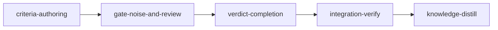

# Plan: Fewer disputes, fewer stuck stages

Implements: none

## Overview

Over the 31 days to 2026-11-07, stage sessions filed 108 disputes across about 60 stages, plus 11
contract freezes that loom refused and adjudicated itself. Judges accepted 78 of the 108. Each
filing costs a judge session, a retired stage session and a fresh one; a rejected filing costs
that twice. The evidence is grouped below by cause, with the change this plan makes for each:

| Cause                                                                                                                                | Filings         | Change                                                                           |
| ------------------------------------------------------------------------------------------------------------------------------------ | --------------- | -------------------------------------------------------------------------------- |
| Integrity events on test edits the plan ordered (a ritual "file one dispute-integrity")                                              | ~49             | Decision 11: the accepted verdict completes the stage without a fresh session    |
| Integrity detector noise: reflows, multi-line asserts, moved or split tests, tightened ratchets                                      | ~22             | Decisions 8 and 9                                                                |
| Real relaxations caught by the judge and refiled after a fix (6 rejections)                                                          | 12              | Decision 10: the final reviewer sees the integrity events before the agent files |
| Frozen contracts failing the stage's own lint or static checks; planner-chosen runner details (vitest `-t` separator, missing `cwd`) | 12 + 11 freezes | Decisions 1 and 2                                                                |
| Criteria failing only where completion runs (bubblewrap, sockets, network, 300 s default, 30 s extended default)                     | ~12             | Decisions 3 and 4                                                                |
| Wiring patterns that match only a definition, forced by the leaf rule on stages whose consumer comes later                           | 6               | Decisions 5, 6 and 7                                                             |
| Contested review findings judged against the reviewer's expectations, not the plan                                                   | 5               | Decision 10 (integration-verify's reviewers get the plan's briefs)               |

The catalogue behind these numbers was built from stage transcripts and sampled against the plans
as authored; it is evidence for the choices here, not a pinned count.

## Goals

- A contract writer's freeze is refused back to the writer's own session, with the failing output
  and no dispute, for any defect the stage's formatter, syntactic-lint and search checks would
  later find in the files it wrote (and a compiler-backed lint's, once its contracts compile), and
  for any writer-choice mistake the CLI can check before it relays the freeze; the writer, not the
  planner, names the test identifier and, where the planner left them open, the runner and
  directory.
- `loom plan verify --dry-run` runs every criterion of the plan against the base tree under the
  confinement completion uses, and names environment failures and timeouts before any stage runs.
- No wiring check is authored for a definition, and no stage has to invent one to pass the leaf
  rule.
- The integrity gate keeps its mechanical floor and its file-hash pin, and stops raising events
  for formatting, moved tests and tightened ratchets.
- An accepted integrity dispute, an accepted impact-tests dispute and a findings ruling that
  upholds nothing complete the stage from the daemon, without a fresh stage session, whenever the
  committed tree passes.
- The final code review of every stage sees the stage's integrity events; integration-verify's
  review covers performance and sees the whole plan's change and briefs.
- Non-goals: removing `wiring`, `before_stage` or the integrity detector; a stage session that
  waits for a verdict (the retirement boundary stays: a verdict that amends criteria needs a
  session that reads them fresh); a merge-time check of the merged tree (a merged stage is final,
  `conventions/config-plan-and-gate-rules.md`, "A Completed, Merged Stage Is Final"); mutation
  testing; backwards compatibility or migrations (loom is unreleased); new `config.toml` keys
  (the plan schema gains `consumer_deferred`, and the freeze command gains flags).

## Run order and sibling plans

This plan depends on no other plan and may run before or after its siblings. It is written
against the committed tree at `fc1acc87`; up to `1610ddd2` (the commit that added this plan) the
tree changed only web, `planning/` and `plan_server/` files since, none of them a seam named here. No stage checks for a sibling plan's symbols, and
nothing here reads a sibling's new values (`Live`, `gap_prefix`, `JobKind::Land`,
`needs-person`).

**Before `loom run`:** commit this plan and `doc/plans/briefs/fewer-disputes/**`; `loom run`
refuses uncommitted plan inputs. The `IN_PROGRESS-` rename happens only in the main checkout and
is never committed, so every stage worktree reads this plan as `doc/plans/PLAN-fewer-disputes.md`;
every path to the plan in a stage command uses that name.

Every brief locates its seams by symbol (`loom map --outline`, `--find-all`) and treats line
numbers as advisory. Where a brief quotes an old line or a wiring pattern quotes a new one, the
rule in this table wins over the literal text whenever a sibling merged first:

| Shared seam                                                                                                                                   | Siblings that also write it                                                                                                                                                                                                      | Rule                                                                                                                                                                                                                                                                                                                                               |
| --------------------------------------------------------------------------------------------------------------------------------------------- | -------------------------------------------------------------------------------------------------------------------------------------------------------------------------------------------------------------------------------- | -------------------------------------------------------------------------------------------------------------------------------------------------------------------------------------------------------------------------------------------------------------------------------------------------------------------------------------------------- |
| `models/stage/transitions.rs`: the `NeedsAdjudication` row of `outgoing_edges` and its `exhaustive_policy_tests` bitmask (2050 at `e6680a9d`) | autonomous-recovery `gate-waivers` (adds `Blocked`; contract `needs-adjudication-may-block`)                                                                                                                                     | add `Completed` to the slice the row holds, keeping every target already there; the bitmask becomes its current value + 8; never copy a literal slice                                                                                                                                                                                              |
| `JobKind` matches and comparisons in `host_verify/{mod,child,apply,runner}.rs`                                                                | live-test-lane `live-checks` (`JobKind::Live`), autonomous-recovery `stall-recovery` (`JobKind::Land`)                                                                                                                           | `VerdictComplete` goes directly after `Complete` in whichever arm holds `Complete`; a comparison names kinds positively (`matches!(record.kind, JobKind::Complete \| JobKind::VerdictComplete)`), never `!= JobKind::Check`, which the compiler cannot flag when a sibling adds a kind; the `JobKind` doc comment names every kind without a count |
| `skills/loom-orchestration/SKILL.md`                                                                                                          | autonomous-recovery `check-routes`, `gate-waivers`                                                                                                                                                                               | capped at 20,530 bytes by `ORCHESTRATION_SKILL_MAX_BYTES` (`orchestrator/signals/tests_size.rs`), 20,515 at `e6680a9d`; every edit this plan makes to the file is net zero or negative in bytes (`wc -c` before and after); the cap is never raised                                                                                                |
| `orchestrator/signals/helpers.rs::STAGE_EXIT_RULES` (BLOCK-F, inside the stable prefix capped by `STABLE_PREFIX_MAX_BYTES`, 8,192)            | none                                                                                                                                                                                                                             | verdict-completion's BLOCK-F rewrite grows the constant by at most 250 bytes; its acceptance runs `cargo test --lib orchestrator::signals::`, which holds the size tests                                                                                                                                                                           |
| Ledger-pinned files `models/stage/{types,methods,defaults}.rs`, `fs/stage_loading.rs`, `host_verify/runner.rs`                                | live-test-lane `live-profile`                                                                                                                                                                                                    | the line counts this plan names are the values at `e6680a9d`; when a sibling merged first, the merged `loom/maintainability-baseline.txt` row is the value to keep; this plan changes no ledger row                                                                                                                                                |
| `cli/dispatch.rs`, `cli/types_ops.rs`, `commands/hook/**`                                                                                     | loom-ui-mods `loom-ui` (`HookCommands::UiSnapshot`, a `dispatch_hook` arm), web-host-graft-followthrough (splits `dispatch` into `cli/dispatch_*.rs`), model-router-hooks `router-core` (pins its dispatch in `cli/dispatch.rs`) | additive variants and arms only; locate the functions with `rg -n 'fn dispatch_(hook\|plan)' src/cli`; `files:` and the worker rows glob `src/cli/dispatch*.rs`; a sibling's pinned wiring stays                                                                                                                                                   |
| `orchestrator/signals/cache/blocks.rs`                                                                                                        | web-host-graft-followthrough (owns `signals/cache/**`)                                                                                                                                                                           | additive: the Performance dimension is one more entry                                                                                                                                                                                                                                                                                              |
| `orchestrator/monitor/judge_watchdog.rs`                                                                                                      | autonomous-recovery `spawn-recovery` W3                                                                                                                                                                                          | disjoint lines: this plan edits only the timeout import, `check_run_limit` and the module doc                                                                                                                                                                                                                                                      |
| `process/sandbox_probe.rs`                                                                                                                    | live-test-lane `test-escape-policy` (`require_facility`, `Facility::Bubblewrap`)                                                                                                                                                 | a new test that needs bubblewrap guards itself with `require_facility(Facility::Bubblewrap, confined_commands_runnable(), "<test>", "<why>")` when `rg -q 'fn require_facility' src/process` finds it, else with `skip_unless(confined_commands_runnable(), "<test>", "<why>")`                                                                    |
| The dispute and adjudication modules, the plan-writer skill and references, `README.md`                                                       | autonomous-recovery, live-test-lane, model-router-hooks                                                                                                                                                                          | ordinary merged code; a sibling's sentence stays unless this plan's brief names it                                                                                                                                                                                                                                                                 |

Facts this plan keeps from the current tree: verdict apply retires the disputing agent before it
applies a verdict (`orchestrator/core/event_handler/stage_takedown.rs`, `retire_disputing_agents`);
an accepted integrity event stays pinned to its file's sha256; a merged stage is never
re-verified.

## Decisions

1. **The writer names the runner details the planner cannot know.** `ContractSpec.test` becomes an
   optional hint. The writer passes `--test <contract-id>=<identifier>` to
   `loom stage contracts freeze` for every contract, and `--runner <contract-id>=<adapter>` or
   `--cwd <contract-id>=<dir>` only where the planner left `runner` or `cwd` unset. The freeze
   record's `FrozenContract` (`verify/contracts/store.rs`) gains `test`; `adapter` and `cwd`
   already exist there. Completion, the implementer's frozen-contracts table, `contracts show`,
   `contracts restore` and the adjudication prompts read the record, never the plan, once a
   stage is frozen. A writer-chosen `cwd` must be an ancestor of the contract file inside the
   stage's `working_dir`, and the runner root marker that detection finds there must exist at the
   stage's base commit, so a file the writer planted cannot move a run (the trust rule in
   `architecture/contract-phase.md`, "Where a Contract Runs"). A planner-set `cwd` or `runner`
   still wins, and a writer flag for a planner-set value is refused. A writer `--test` value is an
   identifier, never a command or an option: it is refused when blank, oversized, carrying control
   characters, starting with `-`, or given for a contract with no adapter. Choices are saved by the
   daemon and merge across freezes; the CLI's own pre-check reads the saved choices before it
   derives scaffolds, so a later freeze need not repeat them. A saved choice for a contract the plan
   no longer has, or for a field the plan now sets, is dropped before the merge, so an amendment
   never leaves a stale choice that refuses every later freeze. The CLI runs the same
   `validate_choices` over the merged choices before it relays a freeze and refuses locally, so a
   writer's flag mistake costs no dispute; the daemon validates again, and a refusal only the
   daemon finds is filed as today. A freeze whose choices differ from those of a freeze job still
   pending for the same head and tree is refused by the CLI before it follows or relays anything
   (the request state records the choices it was sent with). The freeze still refuses a contract
   its adapter selects no test for, and `loom plan verify` keeps its runner and collection lints
   for planner-set values.
2. **The freeze runs the stage's static gates on what the writer wrote.** The format gate
   (`verify/contracts/format_gate.rs`) widens to every acceptance and `after_stage` criterion that
   is a pure check: the recognised formatters, the lint commands `cargo clippy`, `eslint`,
   `biome lint`, `biome check`, `ruff check`, `tsc --noEmit`, `go vet` and `golangci-lint run`,
   and simple `rg`/`grep` commands as `validation/base_tree.rs` already parses them. Formatter
   checks run from `after_stage` as well as from `acceptance` (an `after_stage` check keeps its
   30 s default). A pure check that fails at freeze, and whose output names a file the writer wrote
   (a contract file, a harness file, or a file the freeze adds; an existing file the freeze changed
   only by a scaffold declaration loom derived is loom's edit, so a failure naming it is left to
   completion), refuses the freeze back to the live writer session:
   `loom stage contracts freeze` now waits for its host job the way `loom check` does, so the
   refusal reaches the writer as `Host job: failed` with the failing output and a "returned (n of
   3)" line, and the writer fixes its files and freezes again. A returned refusal becomes a
   `freeze-refusal` dispute only on the third static refusal in one writer session, or when the
   writer stays quiet for 5 minutes after it. An interrupted or daemon-stopped freeze job of a
   writer that is waiting is returned the same way and counts toward the same limit (the wait tells
   the writer to run the freeze again). The gate's own writes (an untracked
   `tsconfig.tsbuildinfo`, a lint cache) never break the freeze's tree binding. A pure check that
   fails without naming a writer's file is left to completion. A build failure stays an accepted red outcome
   (`verify/contracts/freeze.rs`), so the compiler-backed lints (`cargo clippy`, `go vet`,
   `golangci-lint run`) run at freeze only when every contract compiled (every outcome is
   `failed`). `tsc --noEmit` never runs at freeze: vitest transpiles without type-checking, so a
   red TypeScript contract that names a member the stage has not written still "compiles", and tsc
   would blame the writer's file for that member. `eslint`, `biome lint`, `biome check`,
   `ruff check`, the formatters and the `rg`/`grep` checks always run.
3. **`loom plan verify --dry-run`.** The flag runs every stage's `acceptance`, `after_stage` and
   `wiring_tests` commands in one shared checkout of the committed `HEAD` the plan's first stages
   will branch from (`verify/impact_tests/base.rs::BaseCheckout`), placed under
   `<repo>/.loom/dry-run/` (git-ignored, on the repository's own disk: a cold build of every
   target is tens of gigabytes, too much for a RAM-backed `/tmp`) and removed when the run ends,
   after running the plan's `loom.provision` entries in that checkout, each under the stage's
   `working_dir`, confinement (the stage's override, else the plan's `sandbox.command_confinement`,
   as the daemon resolves it) and timeout, through the criteria runner. An `after_stage` or
   `wiring_tests` result is judged by completion's own assertion evaluation (`exit_code`,
   `stdout_contains`, `stdout_not_contains`, `stderr_empty`), so a check that expects a non-zero
   exit passes and a wrong `stdout` fails, exactly as at completion. Each result is classified:
   environment failure (a confinement or namespace error, a socket or network denial, no space
   left on device, and exit 126 or 127 for a stage with no dependencies, unless the command names
   a path the stage's own `files:` or `artifacts:` cover, which the stage creates; for a stage
   with dependencies a missing program or script may come from an earlier stage, so 126 or 127 is
   a note there), timeout, zero tests selected
   (`verify/criteria/zero_tests.rs`), already passing, or failing. A command that times out runs
   once more in the same checkout, whose build cache the first run warmed; only a second timeout
   is classified as one, so a cold build alone never reads as a timeout. Environment failures and
   timeouts are errors. A zero-test selection is a note: a filter naming tests the plan adds
   selects nothing at base by design, and the static Rust filter lint and completion's zero-test
   guard cover a filter that stays empty. Already passing is a note, and a warning only when
   every acceptance criterion of a standard stage with no dependencies passes at base (the stage
   could not tell done from not done); regression gates such as a format check pass at base by
   design, and a knowledge stage's `loom knowledge check --baseline` passes at base by design. A
   failure is a note (expected red before implementation), so `--strict --dry-run` passes on a
   plan with sound criteria. The flag runs locally, never through the daemon; where loom cannot confine a
   command (namespace creation denied), it reports that the dry run needs a shell where loom can
   confine commands and exits non-zero. The flag is opt-in; `--strict` alone is unchanged.
4. **An extended criterion defaults to 300 s.** `DEFAULT_EXTENDED_CRITERION_TIMEOUT` (300 s) is
   added to `verify/criteria/config.rs` and replaces `DEFAULT_CHECK_TIMEOUT` (30 s) for extended
   acceptance criteria in `runner.rs`, in the host-job budget (`verify/budget.rs`) and in the
   judge deadline (`orchestrator/monitor/judge_watchdog.rs`). Truth checks (`after_stage`,
   `before_stage`) and `wiring_tests` keep 30 s.
5. **A wiring pattern shaped like a definition is rejected at plan time.** `loom plan verify`
   rejects (an error in `version: 2`, a warning in `version: 1`) a `wiring` pattern whose text,
   after optional leading whitespace and visibility (`pub`, `pub(crate)`, `pub(super)`, `export`,
   `export default`, `async`), starts with a definition keyword: `fn`, `mod`, `struct`, `enum`,
   `trait`, `impl`, `type`, `def`, `class`, `function`, `interface`. Completion's existing
   definition-site rule (`verify/goal_backward/definition_sites.rs`) stays.
6. **`consumer_deferred` replaces an invented wiring check.** A stage may declare
   `consumer_deferred: "<reason>"` (one line, at most 300 bytes, no control characters) when its
   new units have no consumer anywhere in the plan. It satisfies the cross-stage wiring-coverage
   warning (`plan/schema/validation.rs`, `check_cross_stage_wiring_coverage`), which is what
   pushes a `version: 2` plan under `--strict` to invent a wiring check, and the leaf rule
   ("Standard leaf stage has artifacts but no wiring"), which fires only in `version: 1` plans
   because every `version: 2` standard stage is an ancestor of integration-verify. A non-empty
   `reachable` list also satisfies the coverage warning, since Decision 7 prefers `reachable`. It
   is validated when the plan parses, is copied onto
   the `Stage`, appears in the stage's signal, and is listed in integration-verify's reviewer brief
   (Decision 10). It waives nothing else: `reachable`, the unwired-file detection and the
   definition-site rule still apply.
7. **Doctrine prefers `reachable`.** The plan-writer skill and its references say: prove
   entry-point reach with `reachable`; write `wiring` only for seams the source graph cannot see
   (registration by string, configuration, templates, macros, trait objects); never point it at a
   definition; declare `consumer_deferred` when the consumer comes later; run
   `loom plan verify --strict --dry-run` before handing a plan over.
8. **The integrity detector compares assertion statements.** An assertion is the statement that
   starts at an assertion-regex match (`testrun/languages.rs`; for Kotlin and Scala, whose infix
   matchers such as `x shouldBe 1` match mid-line, at the first non-blank character of the match's
   line, or at the end of an earlier statement on that line when that is later, so the subject
   stays in the statement) and ends at the first `;` or line
   break at bracket depth zero outside string literals, or at a closing bracket that would take
   the depth below zero; a trailing backslash continues it, a single-quoted string ends at a line
   break, and line comments are dropped. It is normalized by the existing `normalize`.
   A file's lost assertions are its base statements less its head statements, as multisets. A
   reflow, a multi-line assert and a rewrap inside a hunk with a real edit then raise nothing; a
   changed or deleted statement still does. Count events (`TI-decl`, `TI-assert`) are unchanged.
9. **Moved tests and tightened ratchets are not events.** A lost statement cancels against an
   added statement in another changed or new test file only when both sit in a function node the
   source-graph extractor (`context::extract`) finds in both files with the same name and an
   identical identity: the normalized text of its decoration prefix (the contiguous lines directly
   above the span whose trimmed text starts with `#[`, `#![`, `@`, or is a bare `[Attr]` line;
   walking upward, a line that closes a bracket opened on an earlier line pulls in every line up
   to the one that opens it, so a multi-line `#[cfg_attr(..)]` or a black-formatted
   `@pytest.mark.parametrize(..)` is wholly in the prefix), the line-head text before the span on
   its first line (which carries wrappers such as `it.skip(`), and its body. A test that gains
   `#[ignore]`, `@pytest.mark.skip`, `it.skip`, `[Ignore]` or a body-level skip therefore does not
   cancel; an anonymous callback has no named node and never cancels. A destination file cancels
   only when the runner collects it at head, whether or not it existed at base (an existing file
   nothing declares, or one whose `mod` line this change removed, collects nothing): in Rust when
   `verify/contracts/collection/rust::chain_problems` finds a plain `mod` chain reaching it, or
   reaching a file that declares it with `#[path = "<rel>"]` (`<rel>` joined to the declaring
   file's directory; this repository splits its tests that way); elsewhere when its file name
   matches the runner's default collection (pytest `test_*.py` or `*_test.py`, vitest and jest
   `*.test.*` or `*.spec.*`, other languages the profile's test globs). Collection reads the head
   tree through a `FileSource` built from the scan's pinned repository, never the process's
   current directory. Languages without a grammar (Kotlin, Scala, Swift, Elixir, Dart), parse
   errors and oversized files get no cross-file cancellation. Cancellation is recomputed from the
   base on every scan and never stored. A
   ratchet file raises `TI-ratchet` only when it loosens. It parses only when every non-comment,
   non-blank line ends in an unsigned integer: the rest of the line, whitespace collapsed, is the
   key, the integer a ceiling. A new key or a higher value loosens; a removed key or a lower value
   does not. One line without an integer last token makes the file unparsable, and an unparsable,
   new or deleted ratchet file raises on any change, as today (so `check-baseline.txt` still
   raises on every change). A ledger whose numbers are floors (coverage) must not end its lines in
   a bare integer. Accepted edit and ratchet events stay
   pinned (`verify/integrity/gate.rs`; the recorded reason is in `mistakes/planner-ui-repair.md`):
   to the file's sha256 for an event with no cross-file cancellation, and to one digest of the
   file's sha256 and every cancelling partner's path and sha256 otherwise, so a later edit of a
   partner reopens the event. A deleted source file enters that digest with the literal `deleted`
   as its own sha256.
10. **Reviewers get a brief loom computes.** `loom hook reviewer-brief` (beside
    `loom hook worker-brief`, appended by `spawn-guard.sh` to every `loom-code-reviewer` spawn of a
    live stage session, under the same 5 s bound, nonce envelope and fail-open rule) lists the
    stage's current integrity events with their lost statements and asks for a finding per lost
    guard that no equal or stronger check replaces; an event the stage description names as
    expected, with its reason, needs a finding only when the changed statement no longer asserts
    what that reason describes (the stage orchestrator pastes its INTEGRITY line into every
    reviewer prompt). For an integration-verify stage it also lists
    the files the plan's merged stages changed, the plan's brief directory, and every stage's
    `consumer_deferred`. Loom records no plan base commit, so the changed files are the sorted
    union, over every other non-knowledge stage with a `completed_commit`, of the files between
    `merge-base(<merge>^1, completed_commit)` and `completed_commit`, where `<merge>` is the merge
    in the target's first-parent history whose second parent is that `completed_commit`
    (`merge_stage` writes a two-parent merge unless the target already contains the stage,
    `AlreadyUpToDate`; a fast-forward only moves the target ref to it), computed with
    `control_paths::{accepted_change_base, changed_paths}` as
    `orchestrator/signals/retrieval.rs` already does. A stage with no such merge is listed as not
    found and adds no files; knowledge stages commit on the target directly and are skipped.
    Integration-verify's parallel review gains a performance dimension.
11. **A verdict that leaves the plan unchanged completes the stage from the daemon.** After an
    accepted integrity or impact-tests dispute, or a findings ruling that upholds nothing, when the
    stage has no other open dispute, its worktree is clean and its HEAD equals the HEAD of the
    stage's newest `Complete` job record, the daemon retires the disputing agent as today and
    holds the stage in `NeedsAdjudication` with no session; a sweep at the end of
    `apply_pending_verdicts` (which also runs at startup) submits `JobKind::VerdictComplete`, a
    completion host job bound to the stage instead of a session, beside `Check`, `Complete` and
    `Freeze` in `host_verify/mod.rs`. A pass runs the daemon's completion gates and moves the stage
    `NeedsAdjudication -> Completed` through `Stage::complete_from_verdict`, the only caller
    allowed that edge; `try_complete` and `try_complete_merge` keep refusing it. The stage-bound
    receipt is `completed_commit` plus the job's `applied` marker; no session checkpoint is
    written. A failed run or a gate or binding refusal appends its failures to `feedback.md`;
    every failed, cancelled or interrupted job re-queues the stage for a fresh session, and none is
    resubmitted. The stage is eligible only when its newest `Complete` record has a saved result
    and either passed in the child (only the daemon-applied integrity or review gate refused it)
    or failed with every failed outcome labelled `impact-tests` (`IMPACT_TESTS_LABEL`: impact tests
    run in the child, so the run an impact-tests dispute follows is always `Failed`, and after the
    accept that failure is a note); a record with any other failed outcome would fail the same way
    again. That result's `policy_hash` must also equal the stage's current
    `handoff::completion::policy::effective_policy_hash`: a sibling verdict in the same batch that
    amended criteria, re-froze contracts or changed the plan since that run moves the hash, and the
    stage then needs a session that reads the new policy, whatever order the verdicts arrived in.
    A stage the operator holds (`Stage.held`, `loom stage hold`) is never completed by the daemon;
    it is re-queued and stays held. An empty rulings list, a newest `Complete` record that failed
    otherwise, a pruned or missing one or one with no saved result, a knowledge stage (its
    completion needs the session), every other verdict, any failed precondition and any error
    while the sweep checks eligibility re-queue as today. The doctrine tells agents to run
    `loom stage complete` before filing, so the `Complete` record exists.
12. **No knowledge-bootstrap.** The knowledge base maps this codebase; the briefs cite the topics
    each stage needs.

## Stages

**Gate scope of the three code stages.** Following `skills/loom-plan-writer/references/verification-rules.md`
rule 6, the unfiltered `cargo test --all-targets` runs once, in integration-verify (`loom plan verify` warns on
it elsewhere). Each code stage instead runs every repository gate that does not re-run the whole suite, verbatim
from `.github/workflows/ci.yml` and `loom/.githooks/pre-push`: `cargo build --all-targets`,
`cargo clippy --all-targets -- -D warnings`, `cargo fmt --check`,
`RUSTDOCFLAGS='-D warnings' cargo doc --workspace --all-features --no-deps`, `markdownlint-cli2` over the
markdown the stage edits (with the `markdownlint-cli2 v` banner check that proves it ran), and the hook test
scripts that exercise the hooks it edits. Its `cargo test` filters cover every module and test target that
exercises a file it changes, found with `loom map --impact` and `rg` on the changed types, not only the modules it
owns. Integration-verify adds the full suite, `scripts/check-hook-syntax.sh` and `loom-hooks/tests/run-all.sh`.

### 1. criteria-authoring (Decisions 1-7)

<!-- stage prose: stage-criteria-authoring -->

The contract writer's freeze record, the widened freeze gate, the dry run, the timeout constant,
the definition-shaped wiring lint, `consumer_deferred`, and the plan-writer doctrine for all of
them (`SKILL.md` Sections 2, 6 and 9 wording on wiring and the dry run, `references/v2-contracts.md`
Sections 1-4, `references/verification-rules.md`, `references/sandbox.md`, the README). One stage: the work
is cohesive authoring-side change, and splitting it by layer would be fragmentation.

Necessity: Q4 against the other stages (the changes of all five stages together pass 500,000 tokens of orchestrator
context), Q2 for the files it shares with gate-noise-and-review and verdict-completion
(`skills/loom-plan-writer/**`, `orchestrator/signals/**`), and Q1 for one stage: gate-noise-and-review
needs `Stage.consumer_deferred` merged, because its `before_stage` check and its reviewer brief read the field this
stage adds. The later stages depend on this one for that field and so that loom serialises their writes to the
shared files.

**Workers (eight, two waves).** Wave 1 runs the types foundation (W0, sonnet: `ContractSpec.test` becomes an
`Option`, `ContractChoice`, `FrozenContract.test`, the record overlay, `Stage.consumer_deferred`), the
mechanical test sweep that the new types force (W0b, haiku), the dry run with the timeout constant (W4,
sonnet) and the doctrine (W5, haiku); none of them needs the others' code. Wave 2 runs the freeze flags and
their three transport routes and the writer's wait for the freeze job (W1a, sonnet), the daemon-side validation, saved choices, effective stage and
completion overlay and the return of static refusals to the writer (W1b, opus: it enforces the trust rule for agent-chosen run directories), the freeze static
gate with the plan-time wiring rules (W2, sonnet) and the surfaces that print or rebuild contracts (W3,
sonnet). Territories are disjoint; the briefs are in `doc/plans/briefs/fewer-disputes/criteria-authoring/`.

**Design choices the decisions left open, settled by grounding:**

- The writer's choices travel as a `choices` map on the freeze request (relay ticket, socket RPC and spool
  line), are validated by the daemon against the stage's base commit and saved in
  `.loom/work/contracts/<stage>/choices.json`, a file only the daemon writes. The freeze job and its
  application read the stage with the plan's contracts overlaid by them (`load_effective_stage`); no `Stage`
  field holds them, so the gate-policy hash (`handoff/completion/identity.rs`) is untouched. A later freeze
  keeps the flags it does not repeat, in the daemon (`merge_choices`) and in the writer's own CLI pre-check, which
  reads the saved choices read-only (`overlay_with_saved`) before it derives scaffolds. The CLI also runs
  `validate_choices` over the merged choices before it relays, and refuses locally: a daemon admission refusal is
  recorded by `inbox_drain/freeze.rs::record_refused_freeze` as a standing daemon refusal that the tick files at
  once, so every writer mistake the CLI can catch must stop there. A request whose choices differ from those of a
  freeze job still pending for the same head and tree is refused by the CLI: `host_verify/wait.rs` follows a
  matching request state without relaying anything, so the daemon would never see the rerun; the request state
  records the choices it was sent with, as it records `criteria`. A writer `--test` is an identifier: it is
  refused when it starts with `-`, because the adapters place it in an option position.
- A planner-set `runner` or `cwd` is refused loudly when the writer passes the same flag, rather than ignored.
  A writer `--test` is refused for a contract with no adapter, because that test would run as a shell command on
  the host; a writer `--cwd` needs an adapter with run-root markers and a committed, regular marker file at the
  stage's base.
- `consumer_deferred` is validated while the plan parses (`deserialize_with`), because `validation.rs` is a
  ledgered file that may not change length; the leaf rule and the cross-stage coverage warning in it swap
  conditions line for line.
- The static gate's compiler-backed lints (`cargo clippy`, `go vet`, `golangci-lint run`) run
  only when every contract compiled: a red contract that fails to build is an accepted freeze outcome, and the
  lint would report the missing API in the contract file. `tsc --noEmit` never runs at freeze: the vitest adapter
  never reports a build failure (`testrun/adapters/vitest.rs` sets no `build_failed`), so "every contract compiled"
  says nothing about types. Formatters, `eslint`, `biome lint`, `ruff check` and
  `rg`/`grep` searches always run. A failure refuses the freeze only when its output names a file the writer
  wrote. Such a static refusal goes back to the live writer and files no dispute: `loom stage contracts freeze`
  in a contract session now follows the host job as `loom check` does, and then the daemon's application of it
  (`host_verify/wait.rs` follows application for a freeze as it does for a completion, so the writer reads whether
  the refusal was returned, `n of 3`, or filed). Before this stage it printed "end your turn" and returned, so a
  failed job reached only an adjudicator; nothing in the daemon can message a stopped session. A failed job whose
  only red outcome is `format` is recorded with a `returned` count on the session's existing `refused.json`
  record (`DaemonRefusal.returned`, no new file or key). The words every brief and the doctrine use: a static
  refusal is returned to the writer; it is filed as a `freeze-refusal` dispute on the third static refusal in the
  session, or when the writer stays quiet 5 minutes after a refusal (the tick skips a returned record while the
  writer is working and files it once the writer has been quiet for five minutes). An `Interrupted` job and a
  daemon-stopped `Cancelled` job (`host_verify/freeze.rs`, `refuse_infrastructure`) are returned the same way and
  count toward the same limit, since the waiting writer is told to rerun. Every other failed freeze job
  is filed at once. The gate's own writes (a lint cache such as `tsconfig.tsbuildinfo`) are untracked files the
  tree digest counts and the application's change check would refuse, so the freeze job lists the untracked paths
  before the gate and removes the ones the gate created, also on a refusal, before it checks the binding again.
- The dry run checks out the committed HEAD the plan's first stages branch from, never the working tree, runs
  the plan's `loom.provision` entries there first (so provisioned tools exist), and a command that times out runs
  once more in the same checkout (its build cache warm); only a second timeout is an error. Exit 126 or 127 is an
  error only for a stage with no dependencies (an earlier stage may provide the program) and only when the command
  names no path the stage's own `files:` or `artifacts:` cover; a criterion that passes at base is a note, and a
  warning only when every acceptance criterion of a dependency-free standard stage passes, so `--strict --dry-run`
  passes on a plan with sound criteria. The command executor is a parameter (`run_dry_run_with`), so the frozen
  contracts drive the dry run with a recording executor and need no confinement; one in-crate test runs the real
  confined executor. Bubblewrap nests inside the host job (the existing unguarded `orchestrator/provision_tests.rs`
  and `tests/plan_environment_contracts.rs` run the confined `run_provision` there), so that test runs in
  `loom check` and in completion; a stage session's own sandbox refuses nested bubblewrap, so the test guards itself
  (the sandbox-probe rule in "Run order and sibling plans") and skips only in a session. `run_provision` always runs
  confined, with the provision network, and is not routed through the executor parameter. The real executor maps an
  `Err` from the criteria runner (a command it could not prepare, such as a `working_dir` the stage itself creates)
  to a `CriterionResult` with no exit code and the error's first line as stderr, which classifies `Failed` (a
  note).
- `consumer_deferred` and a non-empty `reachable` list satisfy two rules: the cross-stage coverage warning a
  `version: 2` plan meets under `--strict`, and the leaf rule, which only `version: 1` plans meet because
  `v2_lints/bookends.rs` makes every version 2 standard stage an ancestor of integration-verify.

**Risk walk (v2-contracts.md Section 2).** 1 Untrusted input: the writer's flag values
(`choice-flags-parse-the-first-equals`, `writer-test-is-an-identifier-not-a-command`) and the
`consumer_deferred` text (`consumer-deferred-text-is-bounded`). 2 Paths and symlinks: the writer's directory
and its marker (`writer-cwd-must-hold-the-file-inside-working-dir`, `writer-cwd-marker-must-exist-at-base`).
3 Process I/O volume: lint output is cut to 2 KiB before it enters a refusal, and the dry run prints one
stderr line per command; both are unit-tested in the stage, with no contract (a volume bound is not a
behaviour a wrong implementation gets subtly right). 4 Configuration propagation: `writer-test-fills-open-hint`,
`planner-runner-and-cwd-beat-the-writer`, `record-test-reaches-the-effective-contract`,
`compiling-lints-wait-for-compiling-contracts`; the timeout constant is proved by the criterion
`! rg -qF DEFAULT_CHECK_TIMEOUT` over the runner and the judge deadline (red at HEAD, where both files name it),
literal wiring on the three call sites and in-crate tests that set a non-default `timeout_secs`. 5 Lifecycle and
concurrency: `choices-merge-on-refreeze` (the saved choices and the CLI pre-check's overlay); a freeze request
whose choices differ from a pending freeze job's is refused by the CLI, and the job's binding check stays as the
backstop (in-crate tests in `commands/stage/contracts/freeze_choices_tests.rs`, `stage_service/contracts_choices_tests.rs`
and `host_verify/tests_freeze.rs`); the tick's skip of a returned record is pinned by the literal wiring
`.returned > 0` in `event_handler/freeze_refusal.rs` and W1b's tick tests; the gate's own
writes leave the tree digest unchanged (`host_verify/freeze_format_tests.rs`); the writer's wait follows the
application (`host_verify/tests_wait_freeze.rs`, `freeze_follow_tests.rs`). 6 Reachability: the two `reachable` checks and
the literal wiring on each call into a new unit through a name several functions share
(`run`, `execute`, `handle_freeze_contracts`), where the source graph leaves the edge unresolved;
`dry-run-reads-the-committed-tree`, `dry-run-provisions-before-the-criteria`, `dry-run-severity-follows-the-plan`,
`a-first-timeout-is-run-again`, `a-second-timeout-is-a-timeout`, and `reachable-satisfies-the-coverage-warning`
for the plan-time rule. The returned-refusal route: `static-refusal-returns-to-the-writer`, `third-static-refusal-files-the-dispute`. 7 External data: the environment markers of
`dry-run-separates-environment-from-red` are the strings bubblewrap and libc print, and
`failure-attribution-needs-a-whole-path` covers the relative and absolute path forms linters print.

**Gates at HEAD.** `cargo test --test maintainability` passes at `fc1acc87` (8 passed, 0 failed) and the ledger
is exact, so the stage keeps six counted sizes unchanged (the brief's table). `! rg -qF DEFAULT_CHECK_TIMEOUT
src/verify/criteria/runner.rs src/orchestrator/monitor/judge_watchdog.rs` exits 1 at HEAD. The remaining
acceptance commands (build, filtered tests, clippy, fmt) were not run before the stage: they are the repository's
own gate and the frozen-contract test targets do not exist yet.

### 2. gate-noise-and-review (Decisions 8-10)

<!-- stage prose: stage-gate-noise-and-review -->

Replaces the section of the same name. Necessity: Q2 with criteria-authoring (both write
`skills/loom-plan-writer/references/v2-contracts.md`) and, later, with verdict-completion (both
write `orchestrator/signals/tests_doctrine_v2.rs`). The three parts of this stage (statement
detector, reviewer brief, review dimension) are one stage because they share the integrity event
shape and the doctrine text that describes it; splitting them would be fragmentation by layer.

**What changes.** `verify/integrity` compares assertion statements instead of diff lines
(`statements.rs`), cancels a lost statement against an identical moved test in another file
(`moves.rs`, using `context::extract` function spans) and raises `TI-ratchet` only when a ratchet
file loosens (`ratchet_diff.rs`). `loom hook reviewer-brief` renders the stage's integrity events
(and, for integration-verify, the plan-wide change, the plan's briefs directory and every
`consumer_deferred`); `spawn-guard.sh` appends it to every `loom-code-reviewer` spawn of a stage
session under the 5 s bound, nonce envelope and fail-open rule of `loom hook worker-brief`.
Integration-verify's parallel review gains a **Performance** dimension. Doctrine:
`references/v2-contracts.md` Section 5 (and the `ratchet_files` sentence of Section 4),
`references/bookend-stages.md` (its reviewer-dimension list is corrected to the signal's five
dimensions), the reviewer agent, the orchestration skill's test-integrity paragraph, and the
signal's review gate.

**Lanes (confirmed with the user, 2026-11-07).** Codex gpt-6.1-terra for the two pure scanner
units: C1 assertion-statement extraction, C2 ratchet key/value diff parsing and the loosening rule;
each is one concern behind a pinned signature, proven by its own unit tests. Claude (sonnet) for
the rest: W1 detector integration, cross-file moves and the pin; W2 the hook command; W3 the shell
guard; W4 the signal wording and doctrine. Wave 1 is C1 and C2 in the foreground; wave 2 is W1-W4
in one message. `implementers: ["codex", "claude"]`.

**Decided values.** Statement end: first `;` or line break at bracket depth zero outside strings,
and also a bracket closing below depth zero, with line comments dropped, a trailing backslash as a
continuation and a single-quote string closed at a line break. Move cancellation: same language,
innermost function node by byte span, same last scope segment, identical identity (the `normalize`d
body plus the decoration prefix: contiguous `#[`, `@`, `[Attr]` lines above the span, a multi-line
attribute or decorator block taken whole by bracket balance, and the text of the span's first line
before it, so a gained `#[ignore]`, `@pytest.mark.skip` or `it.skip` does not cancel); every
cancelling destination file, new or existing at base, must be collected by the runner at head
(Rust: `collection::rust::chain_problems` over a head-tree `FileSource` finds a plain `mod` chain from
a crate root or `tests/` target to it, or to a file that declares it with `#[path = "<rel>"]`; other
languages: the runner's default file-name collection, pytest `test_*.py`/`*_test.py`, vitest and jest
`*.test.*`/`*.spec.*`, the profile's `test_file_globs` elsewhere); `cancel_moves` takes that
head-tree reader as a parameter; no grammar, parse error or oversized file: no cancellation. Ratchet: a file parses only when every
non-comment line ends in an unsigned integer (the value; the rest of the line, whitespace collapsed,
is the key); new key or higher value loosens; one line without an integer last token makes the whole
file unparsable and any change raises. Reviewer brief: 16 KiB body, 25 statements per
event, 400 bytes per statement, 200 listed files, 50 deferred consumers; empty `{}` for a
non-integration-verify stage without events; no stdin.

**PLAN CORRECTIONS applied to the plan text.**

1. Decision 10, "the files the plan changed since its base": loom records no plan base commit
   (`config.toml` has the base branch name, `resolved_base` a branch name, `completed_commit` the
   stage tip). The stage unions each other stage's own change: for every stage with a
   `completed_commit`, the files between `merge-base(<merge>^1, completed_commit)` and
   `completed_commit`, where `<merge>` is the merge in the target's first-parent history whose second
   parent is `completed_commit` (`control_paths::accepted_change_base`); a stage with no such merge is
   named as not found. `merge_stage` always writes a two-parent merge, so a "fast-forward" of the
   target ref still lands a merge commit. Unrelated commits on the target never appear. Wording for
   Decision 10: "the files the plan's merged stages changed (the union of each stage's merge change;
   loom records no plan base commit)".
2. Decision 9, accepted events: the file-hash pin alone lets a cancelling partner's later edit grow
   the lost set under an old acceptance. The pin of an edit event with a cancelling partner is the
   sha256 of the file's sha256 and every partner's path and sha256 (sorted). Added to Decision 9:
   "an accepted edit event stays pinned to the file's sha256 and to every file that cancelled one
   of its statements".
3. Decision 8, the end rule is underspecified for a statement nested in a closure, a trailing
   comment, a backslash continuation and an apostrophe in a comment; the brief fixes these (see
   Decided values). Decision 8's text stands, with "and also at a bracket that closes below depth
   zero" added.
4. Decision 9, ratchet values: "a higher value loosens" assumes a ceiling. A floor file (a coverage
   minimum) is misread unless its last token is not a bare integer; the doctrine says to write it
   as `80%`. The knowledge check baseline has no integer last token, so its tightening still
   raises; accepted as the decided behaviour. The rule is all-or-nothing: one non-comment line without an
   integer last token makes the whole file unparsable.
5. Stage ownership: the plan gives this stage `v2-contracts.md` Section 5 and `bookend-stages.md`;
   the rule change also makes one sentence of Section 4 (`ratchet_files`) false, so this stage
   edits that sentence too. `criteria-authoring` runs before this stage, so the file has one writer
   at a time.
6. Pressure-test corrections (folded into Decisions 8-10 and the PUBLIC SURFACE; authoritative over
   every brief of this stage): the Kotlin/Scala statement start; the multi-line decoration prefix;
   collection checked for every cancelling destination at head, through a head-tree `FileSource`
   passed to `cancel_moves`, following one `#[path]` hop, with runner-default file names outside
   Rust; a deleted source enters the partner pin as `deleted`; knowledge stages skipped in the
   plan-wide change; expected events named in the stage's INTEGRITY line need no finding unless the
   statement stopped asserting the named behaviour; the orchestration skill's 20,530-byte cap
   (W4's edit is net zero in bytes); `stage_worktree_and_target` re-exported from
   `commands/stage/mod.rs`; contract fixtures carry a `Cargo.toml`, the `.worktrees/<id>` layout and
   the guard's preamble; codex workers get absolute brief paths.

**Risk-checklist walk (v2).** Untrusted input: statement text is agent-written and reaches a
reviewer prompt (contract `reviewer-brief-cannot-forge-its-marker`); lost-set pin
(`edited-move-partner-invalidates-the-accepted-pin`, a unit test in W1 for a later second loss under an old acceptance). Process
I/O volume: the guard reads no stdin and has a 5 s bound; the scan runs once
(`loom-hooks/tests/spawn-guard-reviewer-brief.sh`: bad envelopes, failing and slow stubs). Configuration propagation: not applicable (no setting).
Lifecycle: the pin is recomputed on every scan; nothing is stored. Reachability: five `reachable`
checks from `scan_changes` and `dispatch_hook`. External data: the extractor's function spans are
read from the real registry, tested against Rust sources. Filesystem paths and symlinks: the hook
reads the worktree through the existing `integrity::scan` and prints paths through `single_line`.

**Residual risks added.** The scan inside the 5 s bound on a very large change falls back to no
brief, silently (debug line only). Cross-file cancellation counts any function node, including a
non-test helper that holds assertions; the decoration prefix keeps a move that adds a skip marker
from cancelling. A JS/TS test registered through an anonymous callback has no named function node
and never cancels. Block comments are not stripped from statements. Rust collection follows one
`#[path]` hop from a file a plain `mod` chain reaches; a deeper chain of `#[path]` modules is not
followed, so a move into it raises (the safe direction).

**Contract discipline.** Every contract is red at the base commit (each states why). The floor
checks that already hold at base (other agent types, bad envelopes, a pin refusing a later loss) are
in W3's shell test and W1's in-crate tests; the move and ratchet contracts each hold a positive
fixture that fails at base, with the negative fixtures beside it.

### 3. verdict-completion (Decision 11)

<!-- stage prose: stage-verdict-completion -->

An accepted integrity dispute, an accepted impact-tests dispute, or a findings verdict whose rulings
are non-empty and all close (dismiss or defer), when it is the stage's last open dispute, no longer
re-queues the stage. The verdict apply path retires the disputing agent first, as today
(`Orchestrator::apply_one_verdict` -> `retire_disputing_agents`), then leaves the stage in
`NeedsAdjudication` with no session: held. Every verdict pass ends with a sweep over held stages
(`Orchestrator::start_verdict_completions`, called at the end of `apply_pending_verdicts`, so it also
runs at startup). A held plan-v2 standard or integration-verify stage whose worktree is committed and
clean (`committed_content`) at the head of its newest `JobKind::Complete` record gets one host job of
the new kind `JobKind::VerdictComplete`, bound to the stage (record `session_id` `daemon`); any other
held stage is re-queued, as today. The newest `Complete` record must have a saved `JobResult` whose
`policy_hash` equals the stage's current `effective_policy_hash`, and either `state` `JobState::Passed`
(its run passed acceptance and every completion check) or `JobState::Failed` with every failed outcome
labelled `impact-tests` (the run an accepted impact-tests dispute follows: impact tests run in the child,
`verify/completion/complete_verification_v2.rs`, and a failed outcome fails the job, so that run is
always `Failed`); a record with any other failed outcome, a cancelled, interrupted or missing record, or
one with no saved result or a stale `policy_hash` re-queues at once. A stage with `Stage.held` set (the
operator's `loom stage hold`) is never completed by the daemon: the sweep re-queues it and it stays
held. An error while the sweep checks a stage's eligibility hands the stage back with the error as its
failure line, so a persistent error never strands it. The child runs the job as a completion run (`child_complete::run`).
A pass that the daemon's completion gates (`daemon::check_completion_gates`) and the content binding
accept moves the stage `NeedsAdjudication -> Completed` with `completed_commit` set, and the monitor
merges it like any completed stage. A failure, a gate or binding refusal, a cancel, an interrupt or
an application that gives up re-queues the held stage; a failure or refusal also appends its failing
checks to the stage's adjudicator feedback, which the fresh session's signal shows under
"Adjudicator Feedback".

Settled during planning:

- **Receipt.** The stage-bound receipt is `completed_commit` plus the job's `applied` marker in
  `verification/<stage>/<job>/`. No session checkpoint is written: every reader of
  `CompletionCheckpoint.accepted` is session-scoped (`host_verify/apply_rejection.rs::receipt_recorded`,
  the handoff formatter, `status/data/completion_view` only while `stage.session` names the
  checkpoint's session), and merge reads `completed_commit` (`progressive_complete/finish.rs`,
  `stage/merge/landing.rs`, `merge_handler/landing.rs`).
- **Held is derived, never stored**: `NeedsAdjudication`, no session, no unapplied open dispute
  (the count `requeue_or_hold_for_remaining_disputes` already makes), and `Stage.held` false (that
  field is the operator's hold, a different thing; `is_held_for_completion` reads it). Every other verdict path
  leaves `NeedsAdjudication` in the same stage write that records its receipt, so nothing else
  reaches that state, and a crash between the verdict write and the submission heals on the next
  sweep.
- **The new edge** `NeedsAdjudication -> Completed` is taken only by `Stage::complete_from_verdict`:
  `try_complete` and `try_complete_merge` route through a guard that keeps refusing a stage in
  adjudication, because `progressive_complete/finish.rs::record_completion` relies on that refusal.
- **Concurrency.** A dispute filed while the job runs keeps it from completing (the apply guard
  sees an open dispute) and its verdict's retirement cancels the job; the cancelled job's
  application then re-queues the stage, even when that second verdict would itself hold it (safe:
  a fresh session). `loom stage reset` cancels the job (`reset_and_cancel`) and the application
  ignores a stage that left its hold; `loom stage retry` refuses a stage in `NeedsAdjudication`
  (`commands/stage/skip_retry.rs`), so it never meets the job; a daemon restart
  interrupts a running job, and its application re-queues the stage; a queued job survives the
  restart. Every dispute-lock taker on the scheduler thread uses the bounded lock, dispute lock
  before stage lock, and no call chain holds two dispute-lock descriptors.
- **Knowledge stages are excluded** (`verify::review::gate::covers`): the eligible dispute kinds
  exist only where the integrity, impact and review gates run, and a knowledge completion run
  needs the stage's session.

Doctrine: BLOCK-F (`signals/helpers.rs::STAGE_EXIT_RULES` and its pin in `tests_doctrine_v2.rs`),
`SKILL.md` Section 9, `references/v2-contracts.md` (the "Disputes." and "Dispute in batches."
bullets), `skills/loom-orchestration/SKILL.md` (review gate item 4), the signal's review-gate dispute
bullet (`signals/v2_section_review.rs`) and the dispute filing confirmation
(`commands/stage/dispute_transport.rs`) say which verdicts let the daemon complete the stage and
tell the agent to run `loom stage complete` on the committed tree before filing. A new pin test
rejects any surface that still says every verdict starts a fresh session. `CLAUDE.md.template`
states no such rule and is unchanged.

Workers: W1 (opus) the held stage, the hand-back and the transition edge, with W3 (haiku) the
doctrine; then W2 (opus, xhigh) the job kind, its application and the sweep. Five assertions in
three existing test files change their expected status from `Queued` to `NeedsAdjudication`
(`apply_kinds_tests.rs`, `apply_impact_tests.rs`, `tests/adjudication_e2e/kinds.rs`); the stage files
one `dispute-integrity` for the events loom lists among them. This stage runs on the installed
loom's line-based detector, which raises nothing for `apply_impact_tests.rs` (its changed line,
`StageStatus::Queued`, is a continuation line the assertion regex never matches), so the filing
names only the ids `loom stage review integrity verdict-completion` prints. `Applied` gains
`HandedBack`, and `tests/daemon_completion_contracts.rs::variant` matches `Applied` exhaustively,
so W2 owns that file too.

Risk checklist walk:

| Area                          | Applies                                                                                                                              | Contract                                                                                                                                                                                                                                                                                                                                                                                                                                         |
| ----------------------------- | ------------------------------------------------------------------------------------------------------------------------------------ | ------------------------------------------------------------------------------------------------------------------------------------------------------------------------------------------------------------------------------------------------------------------------------------------------------------------------------------------------------------------------------------------------------------------------------------------------ |
| Untrusted input               | Job summaries (command output) enter the feedback the next signal embeds                                                             | W1's feedback unit tests (bullets, `single_line`, 20-line cap); failure text itself in `failed-verdict-run-hands-back-with-its-failures`                                                                                                                                                                                                                                                                                                         |
| Filesystem paths and symlinks | No new path handling: the store, digest and pinned-git reads are reused                                                              | none                                                                                                                                                                                                                                                                                                                                                                                                                                             |
| Process I/O volume and scale  | No new process: the child is the existing completion run                                                                             | none                                                                                                                                                                                                                                                                                                                                                                                                                                             |
| Configuration propagation     | No new setting                                                                                                                       | none                                                                                                                                                                                                                                                                                                                                                                                                                                             |
| Lifecycle and concurrency     | Restart, cancel, a dispute filed mid-run, repeated sweeps, sibling disputes                                                          | `interrupted-verdict-run-requeues`, `open-dispute-blocks-the-verdict-completion`, `eligible-held-stage-gets-one-stage-bound-job`, `failed-verdict-run-hands-back-with-its-failures`                                                                                                                                                                                                                                                              |
| Reachability                  | The sweep and the apply arm must be reached from the tick                                                                            | `reachable` entries for `submit_verdict_completion` (from `run_tick`), `apply_verdict_completion` and `hand_back_held_stage` (from `tick_host_jobs`); wiring on the match arms the graph cannot see                                                                                                                                                                                                                                              |
| External data correctness     | none                                                                                                                                 | none                                                                                                                                                                                                                                                                                                                                                                                                                                             |
| The behaviour the stage adds  | Completion without a session, only for the three verdicts, only on the tree the agent completed, only under the policy that run used | `verdict-pass-completes-from-adjudication`, `verdict-pass-leaves-the-retired-session-alone`, `moved-head-falls-back-to-a-fresh-session`, `dirty-tree-falls-back-to-a-fresh-session`, `impact-only-failure-is-rerun`, `failed-agent-completion-is-not-rerun`, `stale-policy-falls-back-to-a-fresh-session`, `accepted-integrity-verdict-holds-the-stage`, `findings-verdict-upholding-one-finding-requeues`, `accepted-contract-verdict-requeues` |

Necessity: Q2 with gate-noise-and-review (both write `orchestrator/signals/tests_doctrine_v2.rs`,
`signals/v2_section_review.rs`, `references/v2-contracts.md` and `skills/loom-orchestration/SKILL.md`)
and with criteria-authoring (both write `skills/loom-plan-writer/SKILL.md`); Q3: a lifecycle change
reviewed on its own, after the gates it completes through have changed (a statement-level integrity
detector that still raised events on reflows would send every held stage back to a fresh session,
and nothing before integration-verify would notice).

### 4. integration-verify

Full suite, rustdoc, lint and format, the hook syntax check and the whole hook suite
(`loom-hooks/tests/run-all.sh`, since two stages edit hooks), and markdownlint over every markdown
file the plan edits; reviewers for security (the reviewer brief's content and its nonce
envelope, the writer-chosen `cwd` trust rule, the freeze gate's path attribution), concurrency (the
stage-bound completion job against requeue, a second dispute filed while it runs, a daemon restart
mid-job), gates end to end, performance, and doctrine consistency across the skill, the signals and
the knowledge base. The installed spawn guard predates `loom hook reviewer-brief`, so the stage runs
the new binary's hook itself and pastes its brief into every reviewer prompt.

### 5. knowledge-distill

Curates the stage memories into the knowledge topics this plan changed: contract phase,
verification v2 gates, adjudication lifecycle, plan lifecycle and fields.

## Execution diagram



## Open decisions

None open. Lanes were confirmed with the user on 2026-11-07: Claude in criteria-authoring and
verdict-completion; codex gpt-6.1-terra for the two pure scanner units of gate-noise-and-review
(assertion-statement extraction, ratchet-diff parsing), Claude for the rest of that stage.

## Residual risks

- **Statement extraction is lexical.** An assertion spanning a line break at depth zero without a
  terminator (a chained matcher split before `.toBe`) is cut at the break; the cut still compares
  equal on both sides when unchanged, so the risk is a missed event only when the tail alone
  changes.
- **Path attribution at freeze reads tool output.** A lint that reports a writer's defect without
  naming the file leaves it to completion, as today.
- **The dry run cannot see what later stages build.** A criterion of a stage with dependencies is
  expected to fail at base; only its environment classes are meaningful there.
- **A stage-bound completion uses the committed tree only.** A verdict that needed an edit to pass
  falls back to a fresh session, as today.
- **Status during a stage-bound completion.** While the job runs, `loom status` still shows the
  stage as adjudicating with no judge; the job's own record is the evidence.
- **`loom stop` during a stage-bound completion** leaves an interrupted job, which requeues a
  fresh session after restart instead of rerunning the job.
- **Freezes in this plan run on the installed loom.** The stages' own contract freezes and test
  edits go through the loom that runs them, so this plan's stages still meet the old freeze gate,
  the old integrity detector (each stage files only the event ids `loom stage review integrity`
  lists) and the old spawn guard (gate-noise-and-review and integration-verify paste the reviewer
  brief themselves).
- **The dry run builds the repository from nothing.** Its checkout under `.loom/dry-run/` has no
  `target/`, so a cargo criterion's first run compiles every target on the repository's disk; a
  first timeout reruns warm.
- **Daemon-only choice refusals are still filed at once.** The CLI catches every writer-choice
  mistake it can check; one only the daemon finds (a base commit the CLI could not resolve) is
  recorded as a standing refusal, as today.
- **A sibling verdict that changed nothing the policy hash covers** (an integrity, impact-tests or
  findings verdict) leaves the hash equal, so only the last verdict's kind and the hash decide
  eligibility.

---

<!-- loom METADATA -->

```yaml
loom:
  version: 2
  ratchet_files:
    - loom/maintainability-baseline.txt
    - doc/loom/knowledge/check-baseline.txt
  provision:
    - working_dir: "web"
      command: "test ! -e .npmrc && test ! -L .npmrc && bun install --frozen-lockfile --ignore-scripts --backend=copyfile --config=/dev/null"
  sandbox:
    enabled: true
    auto_allow: true
    filesystem:
      deny_read:
        ["~/.ssh/**", "~/.aws/**", "~/.config/gcloud/**", "~/.gnupg/**"]
    network:
      allowed_domains:
        [
          "crates.io",
          "index.crates.io",
          "static.crates.io",
          "registry.npmjs.org",
        ]
      allow_local_binding: false
      allow_unix_sockets: []
  stages:
    - id: criteria-authoring
      name: "Writer-chosen runner details, freeze static gates, dry run, definition-shaped wiring lint"
      summary: "The contract writer names each contract's test (and runner or directory the plan left open) on the freeze command, the freeze also runs the stage's lint and search checks over what the writer wrote, loom plan verify gains --dry-run, an extended acceptance criterion defaults to 300 s, a wiring pattern shaped like a definition is rejected, and consumer_deferred replaces an invented wiring check."
      stage_type: standard
      skills: ["loom-rust", "loom-security-audit"]
      implementers: ["claude"]
      subagent_timeout_secs: 1200
      working_dir: "loom"
      dependencies: []
      description: |
        Build stage 1 of doc/plans/PLAN-fewer-disputes.md (the worktree keeps this name; the IN_PROGRESS- rename happens only in the main checkout). Read its Decisions 1-7, its "Run order and sibling plans" table and doc/plans/briefs/fewer-disputes/criteria-authoring/common.md first; common.md is authoritative for every internal signature, this description for the PUBLIC SURFACE the frozen contracts call, and the CORRECTIONS list below over every brief.
        Use parallel subagents and skills to maximize performance.
        PATHS: working_dir is loom/; YAML paths are package-relative (../ reaches the repository root); brief paths are repo-relative. The sibling plans PLAN-autonomous-recovery and PLAN-live-test-lane may have merged; locate every seam with loom map --outline / --find-all before briefing and treat line numbers in briefs as advisory.
        PUBLIC SURFACE (the contract session writes tests/writer_choices_contracts.rs, tests/freeze_static_gate_contracts.rs, tests/plan_lints_contracts.rs and tests/dry_run_contracts.rs from this text before any code; they use the public API only, with helpers in tests/criteria_authoring_contracts/support.rs, #[path = "criteria_authoring_contracts/support.rs"] mod support;):
        - loom::plan::schema::ContractSpec { id, file, test: Option<String>, runner: Option<String>, cwd: Option<String>, scenario, rejects }; loom::plan::schema::ContractChoice { test, runner, cwd: all Option<String> } (Debug, Clone, Default, PartialEq, Eq); loom::plan::schema::ContractChoices = BTreeMap<String, ContractChoice>. ContractSpec::with_choice(&self, &ContractChoice) -> ContractSpec: test is the choice's when it has one, else the spec's hint; runner and cwd are the spec's when it has them, else the choice's.
        - loom::verify::contracts::store::FrozenContract gains test: Option<String> (fields: id, adapter: Option<String>, outcome: String, exit_code: Option<i32>, file: Option<String>, cwd: Option<String>, test). loom::verify::contracts::store::effective_contract(record: &FreezeRecord, spec: &ContractSpec) -> ContractSpec: finds the record entry with the spec's id and normalized file (else the same file, else the same id with no recorded file); the result's test is the entry's test when recorded, else the spec's; its runner is the spec's, else the entry's adapter; no entry returns the spec unchanged. FreezeRecord is built with store::write_freeze / store::FreezeRecord as tests/gate_dedup_contracts/support.rs does.
        - loom::verify::contracts::choices (new pub module): parse_choices(tests: &[String], runners: &[String], cwds: &[String]) -> anyhow::Result<ContractChoices> (each entry is <contract-id>=<value> split at the FIRST '='; the id must be a valid stage/contract id; the same id twice for one flag, an empty value, a control character, more than 64 ids, a test over 512 bytes, and more than 16 KiB of values in all (the request limit, stage_service::MAX_REQUEST_BYTES, is 64 KiB) are errors); merge_choices(current: &ContractChoices, update: &ContractChoices) -> ContractChoices (per id and field the update's value when present, else the current one); save_choices(work_dir: &Path, stage_id: &str, choices: &ContractChoices) -> anyhow::Result<()> and load_choices(work_dir: &Path, stage_id: &str) -> anyhow::Result<ContractChoices> (the daemon's saved choices.json under work_dir/contracts/<stage-id>/, empty when absent); overlay_with_saved(work_dir: &Path, stage_id: &str, contracts: &[ContractSpec], update: &ContractChoices) -> anyhow::Result<Vec<ContractSpec>> (the plan's specs overlaid, read-only, with the saved choices merged with update: a spec keeps the saved test and cwd when update repeats nothing for it, and a spec with no hint and no choice keeps test None; the writer's CLI pre-check calls it before it derives scaffolds); validate_choices(contracts: &[ContractSpec], choices: &ContractChoices, worktree_root: &Path, working_dir: &Path, base: &str) -> anyhow::Result<()> where worktree_root and working_dir are absolute paths of a git checkout (working_dir equals or lies beneath worktree_root) and base is a commit in that repository. validate_choices refuses: a choice naming no contract; a contract with no effective test; a test that is blank, over 512 bytes, holds a control character or starts with '-' (adapters place it in an option position); --runner for a contract whose plan sets runner, --cwd for one whose plan sets cwd; a runner no adapter answers to (known names include cargo-test, vitest, pytest); a writer-chosen test when the contract has no adapter (the test would run as a shell command); a cwd that is absolute, holds .., lies outside working_dir, or is not an ancestor of the contract's file (working_dir/file); a cwd whose adapter has no run-root marker, or none of whose markers (Cargo.toml for cargo-test) is a regular file tracked in the commit base at that directory (a marker present only in the worktree or untracked, or tracked as a symlink, is refused). It accepts a cwd equal to working_dir or beneath it that holds the file and has a committed marker. Rule 1 (a choice naming no contract) and the planner-set rule apply to the choices the call adds; saved choices that name no contract or set a field the plan now sets are dropped before the merge (internal, common.md). validate_choices reads git through WorktreeGit::discovered(worktree_root); the daemon calls the internal validate_choices_in with its pinned site.git (contract-phase.md: daemon git is pinned). The writer's CLI calls validate_choices before it relays the freeze and refuses locally.
        - loom::verify::contracts::format_gate: is_pure_check(command: &str, cwd: &Path) -> bool (true when every simple command in the command is a formatter check, a syntactic lint [eslint, biome lint, ruff check], a compiler-backed lint [cargo clippy, tsc --noEmit, go vet, golangci-lint run] or an rg/grep search, optionally behind a leading !; autofix forms such as cargo clippy --fix, eslint --fix, biome check --write, ruff check --fix, a compound with && and a command that is not a check are false); runs_at_freeze(command: &str, cwd: &Path, contracts_compile: bool) -> bool (is_pure_check; cargo clippy, go vet and golangci-lint run only when contracts_compile; tsc --noEmit never, since the vitest adapter reports no build failure and a red TypeScript contract that names an unwritten member would be blamed on the writer); attribute_failure(output: &str, written: &[String]) -> Vec<String> (the entries of written that the output names as a whole path: not preceded by [A-Za-z0-9_./-] and not followed by [A-Za-z0-9_-], after a leading ./ is stripped from each output path, so go vet's ./foo_test.go and rg's ./tests/x.rs match; sorted, deduplicated). Formatter checks in after_stage run at freeze as well as those in acceptance. format_gate::format_problems and is_format_check keep their signatures and behaviour.
        - Plan lints through loom::commands::plan::verify::report::verify_text(repo_root: Option<&Path>, plan_path: &Path, text: &str) -> VerifyReport (fields errors, warnings, notes, valid). Plan lints run only when the plan passes plan::schema::validate (report.rs), so every contract plan text must validate: a version 1 plan carries no contracts, harness, reachable or literal wiring (v2_fields.rs rejects them), and every non-literal wiring pattern is a valid regex (validation.rs compiles it; declared_paths( is not, so a pattern holding an unbalanced ( is literal: true in version 2 and regex-escaped in version 1). A wiring entry whose pattern, after leading whitespace and a visibility prefix (pub, pub(crate), pub(super), export, export default, async), starts with fn, mod, struct, enum, trait, impl, type, def, class, function or interface followed by whitespace is an error in a version: 2 plan and a warning in version: 1. StageDefinition.consumer_deferred: Option<String> (YAML key consumer_deferred) takes one line of at most 300 bytes with no control character, trimmed and non-empty; a bad value makes the plan fail to parse (VerifyReport.stopped, valid false). loom::models::stage::Stage::from_definition(&StageDefinition, &PlanIdentity) copies it to Stage.consumer_deferred. A standard stage with artifacts, no wiring and no wiring_tests, that no stage depends on and that no integration-verify stage covers with wiring, is an error ('Standard leaf stage has artifacts but no wiring'); consumer_deferred removes it. A standard stage with artifacts, no wiring and no wiring_tests, whose dependents and integration-verify stage have no wiring, draws the cross-stage coverage warning 'artifacts are not covered by wiring checks' (the rule a version: 2 plan meets, since a version 2 standard stage is never a leaf); consumer_deferred or a non-empty reachable list (version 2 only) removes that warning.
        - loom::commands::plan::verify::dry_run (new pub module): enum DryOutcome { Environment(String), Missing(String), TimedOut, ZeroTests, Passed, Failed } and enum DrySeverity { Error, Warning, Note } (both Debug, Clone, PartialEq, Eq); classify(result: &loom::verify::criteria::CriterionResult, failures: &[String]) -> DryOutcome: timed_out gives TimedOut; a failure string containing 'selected zero tests' gives ZeroTests; a non-zero exit whose output (lower-cased) contains 'bwrap:', 'operation not permitted', 'temporary failure in name resolution', 'could not resolve host', 'network is unreachable', 'connection refused', 'read-only file system' or 'no space left on device' gives Environment(marker); exit code 126 or 127 gives Missing(marker) (a program or script that cannot start); success with no failures gives Passed; anything else Failed (an ordinary assertion failure with exit 1 is Failed). severity(outcome: &DryOutcome, stage_has_dependencies: bool) -> Option<DrySeverity>: Environment and TimedOut give Error; ZeroTests gives Note for every stage (a filter naming tests the plan adds selects nothing at base by design); Missing gives Error when the stage has no dependencies and Note otherwise (an earlier stage may provide the program or script); Passed gives Note when the stage has no dependencies and None otherwise; Failed gives Note. run_dry_run_with downgrades a Missing of a dependency-free stage to Note when a whitespace-separated token of the command, a leading ./ stripped, is matched by the stage's own files: globs or artifacts: paths (the stage creates that program or script). stage_cannot_tell(acceptance: &[DryOutcome], stage_has_dependencies: bool) -> bool is true only for a stage with no dependencies, a non-empty list and every outcome Passed; run_dry_run_with consults it only for a stage whose detect_stage_type is Standard (a knowledge stage's baseline check passes at base by design); it is the only source of the 'already passes' warning, which goes to report.warnings.baseline, so --strict --dry-run passes on a plan with sound criteria. pub struct DryCommand { stage_id: String, field: &'static str (acceptance, after_stage or wiring_tests), index: usize, command: String, dir: PathBuf, timeout: Duration, tree_root: PathBuf, confinement } is one command about to run. run_dry_run_with(path: &Path, report: &mut VerifyReport, execute: &mut dyn FnMut(&DryCommand) -> (CriterionResult, Vec<String>)) -> anyhow::Result<()> reads the plan file at path, takes one checkout of the repository's committed HEAD (never the working tree), runs the plan's loom.provision entries in it (a failing entry is an Error finding without a stage id and no command runs), calls execute for every acceptance, after_stage and wiring_tests command with DryCommand.dir inside that checkout, classifies each returned result, and records Error findings in report.errors, Warning findings in report.warnings.baseline and Note findings in report.notes. The checkout lives under <repository root>/.loom/dry-run/ (git-ignored; the operator's repository disk, never the system temp directory) and is removed when the run ends. run_dry_run(path: &Path, report: &mut VerifyReport) -> anyhow::Result<()> is run_dry_run_with with the real confined executor, after a check that confinement is available. The real executor runs acceptance with CriteriaConfig::default().with_tree_root(..).with_only(..).with_plan_confinement(Some(<the plan's sandbox.command_confinement>)), as the daemon does (host_verify/child.rs); it judges an after_stage or wiring_tests result with completion's assertion evaluation (verify/goal_backward/truths.rs: expected_exit from exit_code, stdout_contains, stdout_not_contains, stderr_empty), looking the full check up by stage_id, field and index, and returns a CriterionResult whose success is that verdict with its failures; it maps an Err from the runner to a CriterionResult with exit_code None and the error's first line as stderr (Failed). A contract takes the VerifyReport it passes to run_dry_run_with from verify_text(None, &plan_path, &text) over the same plan text, which must validate with report.errors empty before the dry run. A command whose first run times out runs once more through execute with the same DryCommand (the same checkout, whose build cache the first run warmed), and only a second timeout is classified TimedOut: settle_timeout(first: DryOutcome, rerun: &mut dyn FnMut() -> DryOutcome) -> DryOutcome calls rerun exactly once when first is TimedOut and returns its outcome, and returns any other first outcome without calling rerun. The checkout is of the committed HEAD that loom run branches the plan's first stages from; staged, modified and untracked files are never in it.
        - loom stage contracts freeze <stage-id> accepts repeatable --test <id>=<identifier>, --runner <id>=<adapter> and --cwd <id>=<dir>; loom plan verify accepts --dry-run. loom::verify::criteria::DEFAULT_EXTENDED_CRITERION_TIMEOUT is 300 s and extended_criterion_timeout(&TruthCheck) -> Duration uses it for a check with no timeout_secs (acceptance-side only; DEFAULT_CHECK_TIMEOUT stays 30 s).
        - A static refusal is returned to the live writer; the exact words are: returned to the writer; filed as a freeze-refusal dispute on the third static refusal in the session, or when the writer stays quiet 5 minutes after a refusal. loom stage contracts freeze, run in a contract session, follows the host job like loom check (Host job: requested/pending, then passed or failed with the failing outcomes printed) and then the daemon's application of it (the job's applied marker), and prints whether a refusal was returned (n of 3) or filed. loom::host_verify::freeze::apply_freeze_result(work_dir: &Path, record: &JobRecord) -> anyhow::Result<loom::host_verify::apply::Applied> (existing) treats a Failed freeze job as a static failure when its saved result (loom::host_verify::store::save_result / load_result) has no error, a failed outcome labelled format and every other outcome passed. loom::verify::contracts::refusal::DaemonRefusal gains returned: u32 (serde default; the number of static refusals of this writer session returned to it and not yet filed; 0 is a standing refusal that loom files as a freeze-refusal dispute at once). pub const STATIC_RETURN_LIMIT: u32 = 3 and pub fn record_static_refusal(work_dir: &Path, stage_id: &str, session_id: &str, origin: JobRefusalOrigin, problems: &[String]) -> anyhow::Result<StaticRefusal> with pub enum StaticRefusal { Returned { count: u32 }, Filed, Superseded } (Debug, Clone, PartialEq, Eq) live in the same module. For a static failure, apply_freeze_result records daemon_refusal(work_dir, stage_id) with returned = prior + 1 (prior is the returned of the existing record of the SAME session, else 0) and answers Applied::FreezeRefused with the failing output in the message while prior + 1 is below STATIC_RETURN_LIMIT; at the limit it records returned = 0 (filed as today). The same job applied twice counts once; a job of another session starts at 1; any other failed job (a failed contract outcome, a result with an error, no result) records returned = 0. An Interrupted freeze job and a Cancelled one whose detail is DAEMON_STOPPED go through record_static_refusal too (same count, same limit; host_verify/freeze.rs refuse_infrastructure), because the writer's wait tells it to rerun. The tick (event_handler/freeze_refusal.rs) files a record with returned above 0 once the writer has been quiet for 5 minutes (writer_is_quiet, REFUSAL_QUIET_SECS).
        CONTRACT FIXTURES: git fixtures use git init -b main in a TempDir with local user.email and user.name and the environment isolation tests/completion_gates_contracts.rs::git uses (GIT_CONFIG_GLOBAL and GIT_CONFIG_SYSTEM pointed at absent files, GIT_CONFIG_NOSYSTEM=1); a marker 'committed at base' means committed before the base commit the test passes. Plan texts for verify_text are written inline (a minimal version 1 plan for the leaf and consumer_deferred contracts, a version 2 plan with bookends for the definition lint error and reachable contracts); the dry-run contracts drive run_dry_run_with with a recording executor closure and need no bubblewrap for the criteria (a contract that skipped for lack of confinement would pass vacuously, so none depends on it); run_provision always runs confined, which the host job supports (bubblewrap nests there, as tests/plan_environment_contracts.rs shows), so dry-run-provisions-before-the-criteria runs unguarded like that file; the one real confined end-to-end test of run_dry_run is an in-crate test in dry_run_tests.rs, outside the contracts, guarded per the sandbox-probe rule of the plan's "Run order and sibling plans" table (it skips only in a stage session's own sandbox and runs in loom check and completion), and it asserts that a committed sound two-stage plan (one dependency-free standard stage with acceptance 'true' and 'test -e absent') leaves report.errors and report.warnings empty; the in-crate provision tests in dry_run_tests.rs carry the same guard. Contract plan texts for the dry run are committed with git init -b main fixtures and the executor closure inspects DryCommand.dir. Freeze-application fixtures write a stage's work directory in a TempDir, save a JobResult through store::save_result for each JobRecord (kind Freeze, state Failed, the same stage and session, submission_order 1, 2, 3...) and call apply_freeze_result. Every function under 50 lines, every file under 400.
        WAVES: (1) W0, W0b, W4 and W5 in ONE message (they touch disjoint files and the crate does not compile afterwards). (2) W1a, W1b, W2 and W3 in ONE message, each fixing the compile errors W0 and W0b leave in its own files. Territories are DISJOINT. Workers NEVER spawn subagents. Spawn every worker BY AGENT TYPE (sonnet rows loom-software-engineer, haiku rows loom-software-developer, the opus row loom-senior-software-engineer), each with a short fixed prompt plus "Your brief: <path>. Read it in full before anything else." Wait for background workers with one loom subagents watch.

        | Worker | Role | Tier | Files owned | Shared context | Brief path |
        | ------ | ---- | ---- | ----------- | -------------- | ---------- |
        | W0 | Schema, record and Stage types (foundation) | sonnet | src/plan/schema/types_v2.rs; src/plan/schema/types.rs; src/plan/schema/mod.rs; src/models/stage/types.rs; src/models/stage/methods.rs; src/models/stage/defaults.rs; src/fs/stage_loading.rs; src/verify/contracts/store.rs; src/verify/contracts/record_view.rs; src/verify/contracts/record_view_tests.rs; src/verify/contracts/mod.rs | common.md | doc/plans/briefs/fewer-disputes/criteria-authoring/w0-types.md |
        | W0b | Test literal sweep | haiku | tests/host_verification_e2e.rs; tests/refusal_adjudication_contracts.rs; tests/gate_dedup_contracts/support.rs; tests/adjudication_e2e/kinds.rs; src/verify/contracts/run_dir_build_tests.rs; src/verify/contracts/store_tests.rs; src/verify/contracts/completion_share_tests.rs; src/verify/contracts/completion_tests.rs; src/verify/contracts/completion_adapter_tests.rs; src/verify/contracts/collection/tests.rs; src/verify/contracts/test_support.rs; src/verify/contracts/run_dir_tests.rs; src/plan/schema/validation/v2_lints/contracts_tests.rs; src/plan/schema/tests/v2_contract_lint_tests.rs; src/plan/schema/tests/v2_tests.rs; src/plan/schema/tests/mod.rs; src/models/stage/methods_v2_tests.rs; src/host_verify/tests_freeze_memo.rs; src/commands/stage/contracts/freeze_run_dir_tests.rs; src/orchestrator/adjudication/apply_contract_tests.rs; src/orchestrator/adjudication/prompt/contract_tests.rs; src/stage_service/dispute_race_tests.rs; src/fs/tests_stage_loading_round_trip.rs; src/testrun/adapters/bun_test.rs; src/host_verify/tests_freeze_refusal.rs | common.md | doc/plans/briefs/fewer-disputes/criteria-authoring/w0b-sweep.md |
        | W4 | Dry run and the extended-criterion timeout | sonnet | src/cli/types_ops.rs; src/cli/dispatch*.rs; src/commands/plan/verify.rs; src/commands/plan/verify/dry_run.rs; src/commands/plan/verify/dry_run_classify.rs; src/commands/plan/verify/dry_run_tests.rs; src/commands/plan/verify/report.rs; src/commands/plan/verify/inputs/tests.rs; src/verify/criteria/config.rs; src/verify/criteria/mod.rs; src/verify/criteria/runner.rs; src/verify/criteria/zero_tests.rs; src/verify/budget.rs; src/orchestrator/monitor/judge_watchdog.rs; src/orchestrator/monitor/judge_watchdog_timeout_tests.rs; src/models/stage/checks.rs; src/host_verify/tests_runner_recovery.rs; src/verify/impact_tests/base.rs | common.md | doc/plans/briefs/fewer-disputes/criteria-authoring/w4-dry-run.md |
        | W5 | Plan-writer doctrine and README | haiku | ../skills/loom-plan-writer/SKILL.md; ../skills/loom-plan-writer/references/v2-contracts.md; ../skills/loom-plan-writer/references/verification-rules.md; ../skills/loom-plan-writer/references/sandbox.md; ../README.md; ../skills/loom-wiring-test/SKILL.md | common.md | doc/plans/briefs/fewer-disputes/criteria-authoring/w5-doctrine.md |
        | W1a | Freeze flags, their transport, and the writer's wait for the freeze job | sonnet | src/cli/types_stage_contracts.rs; src/cli/dispatch_stage.rs; src/commands/stage/contracts.rs; src/commands/stage/contracts/freeze.rs; src/commands/stage/contracts/freeze_choices_tests.rs; src/stage_service/types.rs; src/daemon/protocol.rs; src/daemon/protocol_debug.rs; src/daemon/server/stage_control.rs; src/daemon/server/contracts.rs; src/daemon/server/self_service_tests.rs; src/relay/payload.rs; src/fs/stage_request/apply.rs; src/fs/stage_request/tests/apply.rs; src/fs/stage_request/tests/replay.rs; src/orchestrator/core/inbox_drain/apply.rs; src/orchestrator/core/inbox_drain/freeze.rs; src/orchestrator/core/inbox_drain/stage_request_dispatch.rs; src/orchestrator/core/inbox_drain/tests_matrix.rs; src/orchestrator/core/inbox_drain/test_support.rs; src/commands/stage/contracts/freeze_follow.rs; src/commands/stage/contracts/freeze_follow_tests.rs; src/host_verify/wait.rs; src/host_verify/tests_wait_freeze.rs; ../loom-hooks/commit-guard.sh; ../loom-hooks/tests/commit-guard-contract-session.sh | common.md | doc/plans/briefs/fewer-disputes/criteria-authoring/w1a-transport.md |
        | W1b | Choices at the daemon, in the job, in the record, at completion; static refusals returned to the writer | opus | src/verify/contracts/choices.rs; src/verify/contracts/choices_tests.rs; src/verify/contracts/completion.rs; src/verify/contracts/run_dir.rs; src/verify/contracts/collection/mod.rs; src/stage_service/contracts.rs; src/stage_service/contracts_choices.rs; src/stage_service/contracts_choices_tests.rs; src/host_verify/freeze.rs; src/host_verify/tests_freeze.rs; src/host_verify/tests_freeze_static.rs; src/host_verify/freeze_refuse.rs; src/verify/contracts/refusal.rs; src/verify/contracts/refusal/static_return.rs; src/verify/contracts/refusal/static_return_tests.rs; src/orchestrator/core/event_handler/freeze_refusal.rs; src/orchestrator/core/event_handler/freeze_refusal_tests.rs; src/orchestrator/core/event_handler/freeze_refusal_returned_tests.rs | common.md | doc/plans/briefs/fewer-disputes/criteria-authoring/w1b-core.md |
        | W2 | Freeze static gate and plan-time wiring rules | sonnet | src/verify/contracts/format_gate.rs; src/verify/contracts/format_gate_tests.rs; src/verify/contracts/freeze.rs; src/host_verify/freeze_format.rs; src/host_verify/freeze_format_tests.rs; src/host_verify/digest.rs; src/plan/schema/validation.rs; src/plan/schema/validation/v2_fields.rs; src/plan/schema/validation/v2_lints/mod.rs; src/plan/schema/validation/v2_lints/contracts.rs; src/plan/schema/validation/v2_lints/wiring_definition.rs; src/plan/schema/validation/v2_lints/wiring_definition_tests.rs; src/commands/stage/contracts/freeze_tests.rs | common.md | doc/plans/briefs/fewer-disputes/criteria-authoring/w2-static-checks.md |
        | W3 | Signals, adjudication prompts and contracts show | sonnet | src/orchestrator/signals/contract.rs; src/orchestrator/signals/contract/rules.rs; src/orchestrator/signals/contract/choices_tests.rs; src/orchestrator/signals/v2_section.rs; src/orchestrator/signals/v2_section_effective_tests.rs; src/orchestrator/signals/format/sections/goal_backward_section.rs; src/orchestrator/adjudication/apply_contract.rs; src/orchestrator/adjudication/apply_contract_choice_tests.rs; src/orchestrator/adjudication/apply_freeze_refusal.rs; src/orchestrator/adjudication/prompt/contract.rs; src/orchestrator/adjudication/prompt/contract_choice_tests.rs; src/orchestrator/adjudication/prompt/freeze_refusal_evidence.rs; src/orchestrator/adjudication/verdict_freeze_refusal.rs; src/commands/stage/contracts/show.rs; src/orchestrator/signals/contract_tests.rs; src/status/data/contract_testing.rs | common.md | doc/plans/briefs/fewer-disputes/criteria-authoring/w3-surfaces.md |

        A compile error in a file no row owns goes to the row whose change caused it; record the file in loom memory.
        CORRECTIONS (pressure test; authoritative over every brief of this stage; quote each worker's items into its spawn prompt):
        (1) W4 and W5: ZeroTests is a Note for every stage; the --dry-run help text (w4) and every doctrine sentence (w5) that calls an empty test selection an error say it is a note.
        (2) W4: src/host_verify/tests_runner_recovery.rs asserts job_deadline_secs(&default_acceptance) == 30 + 300 + 1_800 for one Extended(check(None)) acceptance; Decision 4 makes it 300 + 300 + 1_800; change exactly that expected value.
        (3) W4: the real executor passes .with_plan_confinement(Some(metadata.loom.sandbox.command_confinement)) to acceptance, judges after_stage and wiring_tests results with verify/goal_backward/truths.rs's AssertionSpec and evaluate, and maps a runner Err to a Failed result; the checkout is made by a new BaseCheckout::create_in(parent: &Path, worktree: &Path, commit: &str) in verify/impact_tests/base.rs (create keeps its behaviour) under <repo>/.loom/dry-run/; 'no space left on device' is an Environment marker; Missing is downgraded when the command names a path the stage's files:/artifacts: cover; stage_cannot_tell is consulted for Standard stages only; the in-crate provision tests in dry_run_tests.rs carry the sandbox-probe guard; the real-executor test also asserts in-crate that a plan-level command_confinement with no stage override reaches acceptance, and that an after_stage check with exit_code 1 and one with a missed stdout_contains are judged as completion judges them.
        (4) W5 and W3: reachable needs version 2, so it never meets the version 1 leaf rule: w5 drops "(and the version 1 leaf rule)"; W3's signal line for consumer_deferred reads "It satisfies the wiring-coverage warning and the leaf rule; reachable checks, the unwired-file detection and the definition-site rule still apply."
        (5) W1a: before it relays, the CLI loads the saved choices (load_choices), drops stale ones, merges the parsed flags and calls validate_choices with WorktreeGit::discovered on the worktree and the stage base; a refusal is printed and exits non-zero with nothing relayed. The request state (host_verify/wait.rs) records the choices it was sent with; a state with the same head and tree but other choices is refused locally ("a freeze under other flags is pending; wait for its Host job result, then rerun with the new flags") instead of being followed. Rewrite the doc comment of inbox_drain/freeze.rs::record_refused_freeze ("A relayed freeze tells its writer to end the turn") and daemon/protocol.rs's "carry no command, path, or privileged flags" for the choices map.
        (6) W1b: src/stage_service/contracts.rs is 394 lines and handle_freeze_contracts 43, so admission of choices goes in the new src/stage_service/contracts_choices.rs: admit_choices(site, request choices) loads, prunes, merges and validates through validate_choices_in(&site.git, ..) and returns the merged map; contracts.rs calls contracts_choices::admit_choices( once. src/orchestrator/core/event_handler/freeze_refusal_tests.rs is 400 lines: new tick tests go in freeze_refusal_returned_tests.rs; new static-refusal tests of host_verify go in tests_freeze_static.rs. Pruning: a saved choice whose id names no contract of the plan, or whose runner or cwd the plan now sets, is dropped before merge_choices; validate_choices's naming and planner-set rules then see only the call's own choices. Interrupted and DAEMON_STOPPED freeze jobs go through record_static_refusal; rewrite the comment in host_verify/freeze.rs that says no one else would act on the writer's ended turn. The tick skips a record only through a condition written .returned > 0 (the literal wiring pins it).
        (7) W2: format_problems keeps its public signature (tests/completion_gates_contracts.rs calls it) and runs acceptance formatters; static_problems also takes after_stage formatter checks (converted as a TruthCheck, 30 s default) and excludes formatter checks only from acceptance; an in-crate test freezes a stage with no formatter in acceptance and an after_stage formatter that names the writer's unformatted file and is refused. tsc --noEmit is never run at freeze. attribute_failure strips a leading ./ from output paths. written_paths keeps contract files, harness files and files the freeze adds, and leaves out an existing file whose only change is a scaffold declaration. format_outcome names the paths it removed in its summary. W2 owns src/commands/stage/contracts/freeze_tests.rs: the Some(..) literal edits W0b's table lists for it, and the two check_formatting call sites (one inside an assertion).
        (8) W3: apply_contract.rs's re-freeze passes effective = store::effective_contract(record, contract) (the amended spec's test winning when it is Some) to resolve_adapter and resolve_run; apply_freeze_refusal.rs's "run `loom stage contracts freeze {stage_id}` and stop" lines name the --test flags and the waiting freeze; status/data/contract_testing.rs's module doc no longer says the freeze ends the writer's work. The writer signal's rule 7 adds: change no file while the freeze's Host job reads requested or pending; a contract test listed from saved choices is marked as chosen by an earlier freeze.
        (9) W0b: also src/host_verify/tests_freeze_refusal.rs (stage.contracts[0].test = "exit 2".to_string() becomes Some(..)), the test assignments in src/plan/schema/tests/v2_tests.rs, src/verify/contracts/completion_adapter_tests.rs and src/verify/contracts/completion_tests.rs, the RefrozenContract literals in src/verify/contracts/store_tests.rs, and the exhaustive build_full_stage_definition literal in src/fs/tests_stage_loading_round_trip.rs (consumer_deferred). freeze_tests.rs is W2's.
        (10) common.md: bubblewrap nests inside the host job; only a stage session's own sandbox refuses it. A test that needs it uses the sandbox-probe rule of the plan's "Run order and sibling plans" table.
        LEDGER: loom/maintainability-baseline.txt is exact and a ratchet file; it is never edited and no row changes. src/models/stage/types.rs (591), src/models/stage/methods.rs (492), the Stage default function in src/models/stage/defaults.rs (76) and src/plan/schema/validation.rs (1063, with validate 357 and check_cross_stage_wiring_coverage 66) must keep their exact line counts (common.md says how); the plan expects no ratchet event. Every file a worker adds or grows stays at or under 400 lines and every function at or under 50 (tests/maintainability/baseline.rs fails on more; neither file above is in the ledger).
        INTEGRITY: wrapping ContractSpec test values in Some(..), adding test: None to FrozenContract literals and the signature changes of freeze helpers (check_formatting's call sites in freeze_tests.rs included) alter assertion lines in existing tests (W0b's table). src/host_verify/tests_runner_recovery.rs's expected deadline changes with Decision 4 (correction 2). Two more edits are expected and named: src/orchestrator/signals/contract_tests.rs lines 126-127 pin the writer signal's rule 7 text ("7. Finish with `loom stage contracts freeze s1`" and "then stop. If it refuses, fix what it names") that W3 rewrites for the --test flags and the waiting freeze, so W3 changes exactly those two assertion lines; and loom-hooks/tests/commit-guard-contract-session.sh lines 90-98 pin four strings of the commit-guard reminder that W1a rewrites, so W1a changes those expected strings (a shell test, outside the Rust detector, listed for the reviewer). After the final review, file the Rust ones in ONE loom stage dispute-integrity criteria-authoring with exactly the ids loom stage review integrity criteria-authoring lists (the installed line-based detector raises only for changed lines its assertion regex matches), reason "ContractSpec.test became an Option and FrozenContract gained test (plan Decision 1); the writer signal's rule 7 text changed with the freeze flags and the waiting freeze (plan Decisions 1 and 2); the default extended-criterion deadline moved from 30 s to 300 s (plan Decision 4)". Paste this INTEGRITY paragraph into every reviewer prompt, so an expected event draws no finding unless the changed statement stopped asserting what its reason describes.
        AFTER THE WAVES: cargo fmt --all; one loom check criteria-authoring; the review rounds (one reviewer with the security-audit skill on the writer-choice trust rules in choices.rs: cwd containment, marker at base, shell-test refusal, planner-set values winning, the saved choices file, agent text in refusal messages, and on the dry run never running outside the base checkout; the same round covers the six dimensions). Wire-up check for the orchestrator: loom stage contracts freeze --help lists --test, --runner and --cwd and loom plan verify --help lists --dry-run.
        MEMORY: record mistakes, decisions and surprises via loom memory immediately (subagents too), including every symbol that moved; record stale-knowledge notes for architecture/contract-phase.md ("Where a Contract Runs", "Refused Freezes Are Disputed"), architecture/plan-lifecycle-and-fields.md ("Freeze-Time Formatter Gate", which still states Extended 30 s) and any section that says a contract's test comes only from the plan; NEVER loom knowledge; NEVER Claude Code auto-memory.
      files:
        - "../loom-hooks/commit-guard.sh"
        - "../loom-hooks/tests/commit-guard-contract-session.sh"
        - "src/plan/schema/types_v2.rs"
        - "src/plan/schema/types.rs"
        - "src/plan/schema/mod.rs"
        - "src/plan/schema/validation.rs"
        - "src/plan/schema/validation/v2_fields.rs"
        - "src/plan/schema/validation/v2_lints/mod.rs"
        - "src/plan/schema/validation/v2_lints/contracts.rs"
        - "src/plan/schema/validation/v2_lints/contracts_tests.rs"
        - "src/plan/schema/validation/v2_lints/wiring_definition.rs"
        - "src/plan/schema/validation/v2_lints/wiring_definition_tests.rs"
        - "src/plan/schema/tests/v2_contract_lint_tests.rs"
        - "src/plan/schema/tests/v2_tests.rs"
        - "src/plan/schema/tests/mod.rs"
        - "src/models/stage/types.rs"
        - "src/models/stage/methods.rs"
        - "src/models/stage/defaults.rs"
        - "src/models/stage/checks.rs"
        - "src/models/stage/methods_v2_tests.rs"
        - "src/fs/stage_loading.rs"
        - "src/fs/tests_stage_loading_round_trip.rs"
        - "src/verify/contracts/store.rs"
        - "src/verify/contracts/store_tests.rs"
        - "src/verify/contracts/record_view.rs"
        - "src/verify/contracts/record_view_tests.rs"
        - "src/verify/contracts/mod.rs"
        - "src/verify/contracts/choices.rs"
        - "src/verify/contracts/choices_tests.rs"
        - "src/verify/contracts/format_gate.rs"
        - "src/verify/contracts/format_gate_tests.rs"
        - "src/verify/contracts/freeze.rs"
        - "src/verify/contracts/completion.rs"
        - "src/verify/contracts/completion_tests.rs"
        - "src/verify/contracts/completion_adapter_tests.rs"
        - "src/verify/contracts/completion_share_tests.rs"
        - "src/verify/contracts/run_dir.rs"
        - "src/verify/contracts/run_dir_tests.rs"
        - "src/verify/contracts/run_dir_build_tests.rs"
        - "src/verify/contracts/collection/mod.rs"
        - "src/verify/contracts/collection/tests.rs"
        - "src/verify/contracts/test_support.rs"
        - "src/verify/criteria/config.rs"
        - "src/verify/criteria/mod.rs"
        - "src/verify/criteria/runner.rs"
        - "src/verify/criteria/zero_tests.rs"
        - "src/verify/budget.rs"
        - "src/orchestrator/monitor/judge_watchdog.rs"
        - "src/orchestrator/monitor/judge_watchdog_timeout_tests.rs"
        - "src/stage_service/contracts.rs"
        - "src/stage_service/contracts_choices.rs"
        - "src/stage_service/contracts_choices_tests.rs"
        - "src/stage_service/types.rs"
        - "src/stage_service/dispute_race_tests.rs"
        - "src/host_verify/tests_runner_recovery.rs"
        - "src/host_verify/tests_freeze_refusal.rs"
        - "src/host_verify/tests_freeze_static.rs"
        - "src/verify/impact_tests/base.rs"
        - "src/orchestrator/core/inbox_drain/freeze.rs"
        - "src/orchestrator/core/event_handler/freeze_refusal_returned_tests.rs"
        - "src/status/data/contract_testing.rs"
        - "src/host_verify/freeze.rs"
        - "src/host_verify/freeze_format.rs"
        - "src/host_verify/freeze_format_tests.rs"
        - "src/host_verify/digest.rs"
        - "src/host_verify/wait.rs"
        - "src/host_verify/tests_wait_freeze.rs"
        - "src/host_verify/tests_freeze.rs"
        - "src/host_verify/freeze_refuse.rs"
        - "src/verify/contracts/refusal.rs"
        - "src/verify/contracts/refusal/**"
        - "src/orchestrator/core/event_handler/freeze_refusal.rs"
        - "src/orchestrator/core/event_handler/freeze_refusal_tests.rs"
        - "src/host_verify/tests_freeze_memo.rs"
        - "src/daemon/protocol.rs"
        - "src/daemon/protocol_debug.rs"
        - "src/daemon/server/stage_control.rs"
        - "src/daemon/server/contracts.rs"
        - "src/daemon/server/self_service_tests.rs"
        - "src/relay/payload.rs"
        - "src/fs/stage_request/apply.rs"
        - "src/fs/stage_request/tests/apply.rs"
        - "src/fs/stage_request/tests/replay.rs"
        - "src/orchestrator/core/inbox_drain/apply.rs"
        - "src/orchestrator/core/inbox_drain/stage_request_dispatch.rs"
        - "src/orchestrator/core/inbox_drain/tests_matrix.rs"
        - "src/orchestrator/core/inbox_drain/test_support.rs"
        - "src/cli/types_stage_contracts.rs"
        - "src/cli/dispatch_stage.rs"
        - "src/cli/types_ops.rs"
        - "src/cli/dispatch*.rs"
        - "src/commands/stage/contracts.rs"
        - "src/commands/stage/contracts/freeze.rs"
        - "src/commands/stage/contracts/freeze_choices_tests.rs"
        - "src/commands/stage/contracts/freeze_follow.rs"
        - "src/commands/stage/contracts/freeze_follow_tests.rs"
        - "src/commands/stage/contracts/freeze_tests.rs"
        - "src/commands/stage/contracts/freeze_run_dir_tests.rs"
        - "src/commands/stage/contracts/show.rs"
        - "src/commands/plan/verify.rs"
        - "src/commands/plan/verify/**"
        - "src/orchestrator/signals/contract.rs"
        - "src/orchestrator/signals/contract/**"
        - "src/orchestrator/signals/contract_tests.rs"
        - "src/orchestrator/signals/v2_section.rs"
        - "src/orchestrator/signals/v2_section_effective_tests.rs"
        - "src/orchestrator/signals/format/sections/goal_backward_section.rs"
        - "src/orchestrator/adjudication/apply_contract.rs"
        - "src/orchestrator/adjudication/apply_contract_choice_tests.rs"
        - "src/orchestrator/adjudication/apply_contract_tests.rs"
        - "src/orchestrator/adjudication/apply_freeze_refusal.rs"
        - "src/orchestrator/adjudication/verdict_freeze_refusal.rs"
        - "src/orchestrator/adjudication/prompt/contract.rs"
        - "src/orchestrator/adjudication/prompt/contract_choice_tests.rs"
        - "src/orchestrator/adjudication/prompt/contract_tests.rs"
        - "src/orchestrator/adjudication/prompt/freeze_refusal_evidence.rs"
        - "src/testrun/adapters/bun_test.rs"
        - "tests/writer_choices_contracts.rs"
        - "tests/freeze_static_gate_contracts.rs"
        - "tests/plan_lints_contracts.rs"
        - "tests/dry_run_contracts.rs"
        - "tests/criteria_authoring_contracts/**"
        - "tests/host_verification_e2e.rs"
        - "tests/refusal_adjudication_contracts.rs"
        - "tests/gate_dedup_contracts/support.rs"
        - "tests/adjudication_e2e/kinds.rs"
        - "../skills/loom-plan-writer/SKILL.md"
        - "../skills/loom-plan-writer/references/v2-contracts.md"
        - "../skills/loom-plan-writer/references/verification-rules.md"
        - "../skills/loom-plan-writer/references/sandbox.md"
        - "../skills/loom-wiring-test/SKILL.md"
        - "../README.md"
      before_stage:
        - command: "! rg -qF 'consumer_deferred' src/plan/schema/types.rs"
          description: "the plan schema has no consumer_deferred field yet"
      after_stage:
        - command: "target/debug/loom plan verify --help | rg -qF -- --dry-run"
          description: "the built binary offers loom plan verify --dry-run"
        - command: "target/debug/loom stage contracts freeze --help | rg -qF -- --runner"
          description: "the built binary offers the writer's freeze flags"
      acceptance:
        - command: "cargo build --all-targets"
          timeout_secs: 1800
        - "cargo test --lib plan::"
        - "cargo test --lib models::stage::"
        - "cargo test --lib fs::stage_loading::"
        - "cargo test --lib verify::contracts::"
        - "cargo test --lib verify::criteria::"
        - "cargo test --lib host_verify::"
        - "cargo test --lib stage_service::"
        - "cargo test --lib daemon::"
        - "cargo test --lib relay::"
        - "cargo test --lib fs::stage_request::"
        - "cargo test --lib orchestrator::core::inbox_drain::"
        - "cargo test --lib orchestrator::core::event_handler::freeze_refusal"
        - "cargo test --lib orchestrator::signals::"
        - "cargo test --lib orchestrator::adjudication::"
        - "cargo test --lib orchestrator::monitor::"
        - "cargo test --lib commands::stage::contracts::"
        - "cargo test --lib commands::plan::verify::"
        - "cargo test --lib cli::"
        - "cargo test --lib testrun::adapters::bun_test"
        - "cargo test --lib handoff::completion::"
        - "cargo test --lib verify::completion::"
        - "cargo test --lib verify::impact_tests::"
        - "cargo test --lib git::stage_commit::"
        - "cargo test --lib fs::permissions::"
        - "cargo test --lib status::"
        - "cargo test --test daemon_completion_contracts"
        - "cargo test --test contract_collection_contracts"
        - "cargo test --test integration plan_verify"
        - "cargo test --test integration home_isolation"
        - "cargo test --test writer_choices_contracts"
        - "cargo test --test freeze_static_gate_contracts"
        - "cargo test --test plan_lints_contracts"
        - "cargo test --test dry_run_contracts"
        - "cargo test --test refusal_adjudication_contracts"
        - "cargo test --test gate_dedup_contracts"
        - "cargo test --test host_verification_e2e"
        - "cargo test --test adjudication_e2e"
        - "cargo test --test completion_gates_contracts"
        - "cargo test --test maintainability"
        - "bash ../loom-hooks/tests/commit-guard-contract-session.sh"
        - "bash ../loom-hooks/tests/commit-guard-memory-reminder.sh"
        - "bash ../loom-hooks/tests/commit-guard-nested-worktree.sh"
        - "bash ../loom-hooks/tests/commit-guard-sigpipe-many-dirty-files.sh"
        - "bash ../loom-hooks/tests/worktree-guards-inherited-env.sh"
        - "! rg -qF DEFAULT_CHECK_TIMEOUT src/verify/criteria/runner.rs src/orchestrator/monitor/judge_watchdog.rs"
        - "rg -qF 'DEFAULT_EXTENDED_CRITERION_TIMEOUT: Duration = Duration::from_secs(300)' src/verify/criteria/config.rs"
        - "rg -qF -- '--strict --dry-run' ../skills/loom-plan-writer/SKILL.md"
        - "rg -qF consumer_deferred ../skills/loom-plan-writer/references/v2-contracts.md"
        - "rg -qF 'defaults to 300 s too' ../skills/loom-plan-writer/references/sandbox.md"
        - "! rg -qF '30 s (Extended)' ../skills/loom-wiring-test/SKILL.md"
        - "rg -qF '[--no-color] [--dry-run]' ../README.md"
        - command: "cargo clippy --all-targets -- -D warnings"
          timeout_secs: 1800
        - "cargo fmt --check"
        - command: "RUSTDOCFLAGS='-D warnings' cargo doc --workspace --all-features --no-deps"
          timeout_secs: 1800
        - "cd .. && web/node_modules/.bin/markdownlint-cli2 README.md skills/loom-plan-writer/SKILL.md skills/loom-plan-writer/references/v2-contracts.md skills/loom-plan-writer/references/verification-rules.md skills/loom-plan-writer/references/sandbox.md skills/loom-wiring-test/SKILL.md"
        - "cd .. && web/node_modules/.bin/markdownlint-cli2 README.md 2>&1 | rg -q 'markdownlint-cli2 v'"
      artifacts:
        - "src/verify/contracts/choices.rs"
        - "src/verify/contracts/record_view.rs"
        - "src/commands/plan/verify/dry_run.rs"
        - "src/commands/plan/verify/dry_run_classify.rs"
        - "src/plan/schema/validation/v2_lints/wiring_definition.rs"
      wiring:
        - source: "src/plan/schema/validation/v2_lints/mod.rs"
          pattern: "wiring_definition::check_definition_shaped("
          literal: true
          description: "the definition-shaped wiring lint runs with the other plan lints"
        - source: "src/commands/plan/verify.rs"
          pattern: "dry_run::run_dry_run("
          literal: true
          description: "loom plan verify --dry-run calls the dry run"
        - source: "src/stage_service/contracts.rs"
          pattern: "contracts_choices::admit_choices("
          literal: true
          description: "the daemon admits the writer's choices when it admits a freeze"
        - source: "src/stage_service/contracts_choices.rs"
          pattern: "validate_choices_in(&site.git"
          literal: true
          description: "the daemon validates the writer's choices with its pinned git"
        - source: "src/commands/stage/contracts/freeze.rs"
          pattern: "validate_choices("
          literal: true
          description: "the writer's CLI validates its choices before it relays the freeze, so a flag mistake costs no dispute"
        - source: "src/orchestrator/core/event_handler/freeze_refusal.rs"
          pattern: ".returned > 0"
          literal: true
          description: "the tick skips a returned static refusal while the writer is working"
        - source: "src/host_verify/freeze.rs"
          pattern: "load_effective_stage("
          literal: true
          description: "the freeze job runs the stage with the writer's choices applied"
        - source: "src/verify/contracts/completion.rs"
          pattern: "effective_contract(&record"
          literal: true
          description: "completion runs each contract as the freeze record describes it"
        - source: "src/verify/criteria/runner.rs"
          pattern: "extended_criterion_timeout("
          literal: true
          description: "the acceptance runner gives an extended criterion the 300 s default"
        - source: "src/orchestrator/monitor/judge_watchdog.rs"
          pattern: "extended_criterion_timeout("
          literal: true
          description: "the judge deadline counts an extended criterion at 300 s"
        - source: "src/verify/budget.rs"
          pattern: "DEFAULT_EXTENDED_CRITERION_TIMEOUT"
          literal: true
          description: "the host-job budget counts an extended criterion at 300 s"
        - source: "src/plan/schema/validation.rs"
          pattern: "has_wiring_coverage()"
          literal: true
          description: "the coverage warning and the leaf rule count reachable and consumer_deferred as coverage"
        - source: "src/host_verify/freeze_refuse.rs"
          pattern: "record_static_refusal("
          literal: true
          description: "a failed freeze job whose only red outcome is format is returned to the writer before it is filed"
        - source: "src/commands/stage/contracts/freeze.rs"
          pattern: "overlay_with_saved("
          literal: true
          description: "the writer's pre-check derives scaffolds from the saved choices as well as this call's flags"
        - source: "src/commands/stage/contracts.rs"
          pattern: "freeze_follow::follow_application("
          literal: true
          description: "the writer's freeze waits for the daemon to apply the job and learns whether a refusal was returned or filed"
        - source: "src/host_verify/freeze_format.rs"
          pattern: "digest::untracked_in("
          literal: true
          description: "the freeze gate removes the files its own checks created before the binding is checked again"
      reachable:
        - symbol: static_problems
          from: check_formatting
          description: "the freeze's format gate runs the lint and search checks over the writer's files"
        - symbol: parse_choices
          from: run_freeze
          description: "the freeze command parses the writer's --test, --runner and --cwd flags"
      harness: ["tests/criteria_authoring_contracts/**"]
      contracts:
        - id: writer-test-fills-open-hint
          file: tests/writer_choices_contracts.rs
          test: writer_test_fills_open_hint
          scenario: "a ContractSpec with test None, runner None and cwd None, and a ContractChoice { test: a::b, runner: cargo-test, cwd: loom }; with_choice is called; then a spec with a hint test old::name and a choice test new::name"
          rejects: "an overlay that ignores the choice and leaves the spec without a test, or lets the planner's hint beat the writer's --test"
        - id: planner-runner-and-cwd-beat-the-writer
          file: tests/writer_choices_contracts.rs
          test: planner_runner_and_cwd_beat_the_writer
          scenario: "a ContractSpec with runner vitest and cwd web, and a ContractChoice naming runner cargo-test and cwd loom; with_choice keeps the planner's values"
          rejects: "an overlay that lets the contract writer replace a runner or directory the planner set"
        - id: record-test-reaches-the-effective-contract
          file: tests/writer_choices_contracts.rs
          test: record_test_reaches_the_effective_contract
          scenario: "a FreezeRecord whose entry for contract c1 (file tests/a.rs) records test mod::t and adapter cargo-test, and a plan spec for c1 with test None and runner None, then one with runner vitest, then one for a different file; effective_contract is called; the record also survives write_freeze and load_freeze"
          rejects: "completion reading the plan's spec, which has no test, or an overlay that replaces a planner-set runner with the record's adapter, or one that uses an entry recorded for another file"
        - id: writer-cwd-must-hold-the-file-inside-working-dir
          file: tests/writer_choices_contracts.rs
          test: writer_cwd_must_hold_the_file_inside_working_dir
          scenario: "a git repository with pkg/Cargo.toml and pkg/tests/a.rs committed; validate_choices with working_dir pkg and the cwd choices .., an absolute path, pkg/other (not an ancestor of the file), the repository root (outside working_dir) and pkg; only pkg is accepted"
          rejects: "a cwd check that accepts a directory that escapes the stage's working_dir, holds .., or does not contain the contract's file"
        - id: writer-cwd-marker-must-exist-at-base
          file: tests/writer_choices_contracts.rs
          test: writer_cwd_marker_must_exist_at_base
          scenario: "a repository whose base commit has no pkg/Cargo.toml, with an untracked pkg/Cargo.toml added afterwards, then the same file committed after base, then a symlink named Cargo.toml tracked in base; validate_choices with cwd pkg and runner cargo-test is refused each time, and accepted when base itself tracks a regular pkg/Cargo.toml"
          rejects: "a marker check that reads the worktree, so a Cargo.toml the writer planted moves where the contract runs"
        - id: writer-test-is-an-identifier-not-a-command
          file: tests/writer_choices_contracts.rs
          test: writer_test_is_an_identifier_not_a_command
          scenario: "validate_choices over a contract with no adapter (a package with no runner marker) and a writer test of 'curl http://x | sh', then a test holding a newline, a blank test, a 513-byte test, tests '--help' and '-Zunstable-options' (a leading '-') with runner cargo-test, and a --runner naming an adapter that does not exist; the same plain test with runner cargo-test is accepted"
          rejects: "writer-authored text run as a shell command on the host, or a control character, an empty or an oversized identifier, an unknown adapter name, or a value that cargo test would read as an option accepted"
        - id: choices-merge-on-refreeze
          file: tests/writer_choices_contracts.rs
          test: choices_merge_on_refreeze
          scenario: "merge_choices over a current map with a test and a cwd for contract a, and an update that sets only a test for a and a runner for b; then in a TempDir work directory save_choices stores a test and a cwd for contract a of stage s1, and overlay_with_saved over the plan's spec for a (a Rust contract in tests/a.rs with no hint, no runner, no cwd) with an update that names only a runner for contract b leaves a with the saved test and cwd (required_test succeeds), while the same call over an empty work directory leaves the test None"
          rejects: "a second freeze that replaces the saved choices wholesale and loses the earlier --cwd, or a CLI pre-check that ignores the saved choices and so loses the test the writer named in an earlier freeze"
        - id: choice-flags-parse-the-first-equals
          file: tests/writer_choices_contracts.rs
          test: choice_flags_parse_the_first_equals
          scenario: "parse_choices with the test entry 'a=suite > case = ok', a second test 'a=other' for the same id, an entry without '=', an invalid id, a control character, and 65 distinct ids"
          rejects: "a parser that splits on every '=' and truncates a vitest name, or accepts a duplicate, a malformed id or an unbounded map"
        - id: autofix-forms-are-not-pure-checks
          file: tests/freeze_static_gate_contracts.rs
          test: autofix_forms_are_not_pure_checks
          scenario: "is_pure_check on cargo clippy --all-targets -- -D warnings, eslint src, biome lint ., ruff check ., tsc --noEmit, go vet ./..., golangci-lint run, '! rg -n FIXME tests/' (all true) and on cargo clippy --fix, eslint --fix ., biome check --write, ruff check --fix, tsc, cargo build and 'cargo clippy && cargo test' (all false)"
          rejects: "treating an autofix or compound command as a pure check, which would rewrite the contract files the freeze hashes or run the red tests"
        - id: failure-attribution-needs-a-whole-path
          file: tests/freeze_static_gate_contracts.rs
          test: failure_attribution_needs_a_whole_path
          scenario: "attribute_failure with written holding both the relative and the absolute (worktree-joined) form of each file, [tests/foo_contracts.rs, /w/pkg/tests/foo_contracts.rs, src/lib.rs, /w/pkg/src/lib.rs], over a clippy-style output naming tests/foo_contracts.rs:3:5; over output naming only src/other.rs; over output naming my_tests/foo_contracts.rs; over output naming /w/pkg/src/lib.rs:9:1 (only the absolute form); over output naming ./tests/foo_contracts.rs:3:5 (go vet and rg print a leading ./); an output path matches either form"
          rejects: "a refusal for a failure in a file the writer never touched, a substring match that blames tests/foo_contracts.rs for my_tests/foo_contracts.rs, or a boundary rule that never attributes a ./-prefixed path"
        - id: compiling-lints-wait-for-compiling-contracts
          file: tests/freeze_static_gate_contracts.rs
          test: compiling_lints_wait_for_compiling_contracts
          scenario: "runs_at_freeze for cargo clippy --all-targets and go vet ./... with contracts_compile false (false) and true (true); for tsc --noEmit with contracts_compile false and true (false both times); and for eslint src and a formatter check with contracts_compile false (true)"
          rejects: "running a compiler-backed lint while the red contracts do not build, which refuses every freeze whose contract names an API the stage has not written, or running tsc at freeze because the vitest contracts 'compiled', which blames the writer's file for a member the implementer has not written"
        - id: definition-shaped-wiring-is-rejected
          file: tests/plan_lints_contracts.rs
          test: definition_shaped_wiring_is_rejected
          scenario: "verify_text over one minimal plan per pattern, each of which passes validate on its own (plan lints run only then): version 2 plans with bookends and wiring entries marked literal: true for 'pub(crate) fn declared_paths(', 'mod eval_tests;', 'def update_variable_glyph', 'export default function Foo' (each an error containing 'starts with the definition keyword') and for 'pub terminals: bool', 'declared_paths(', 'class=' and 'typeof x' (no such error or warning); then version 1 plans with no contracts, no reachable and no literal, whose patterns are regex-valid ('pub\\(crate\\) fn declared_paths\\(', 'mod eval_tests;', 'def update_variable_glyph'), each a warning in warnings.structural containing 'starts with the definition keyword' and no such error; every plan's report.stopped is false"
          rejects: "a lint that flags only fn, flags a keyword in the middle of a pattern or a field named after a modifier, reports the definition shapes as warnings in a version 2 plan, or runs only on a pattern text that is not a valid regex"
        - id: consumer-deferred-satisfies-the-leaf-rule
          file: tests/plan_lints_contracts.rs
          test: consumer_deferred_satisfies_the_leaf_rule
          scenario: "verify_text over a version 1 plan whose last standard stage has artifacts, an acceptance command and no wiring (error), the same stage with consumer_deferred set (no leaf error), and a stage with wiring"
          rejects: "a consumer_deferred that is parsed and copied but not counted by the leaf rule, so the author still invents a wiring check"
        - id: consumer-deferred-text-is-bounded
          file: tests/plan_lints_contracts.rs
          test: consumer_deferred_text_is_bounded
          scenario: "verify_text over plans whose consumer_deferred is empty, 301 bytes, holds a tab, holds an embedded newline, and is exactly 300 ASCII bytes; Stage::from_definition copies the accepted value"
          rejects: "an unbounded or multi-line reason copied into the stage signal, or a field that validates but is dropped when the Stage is built"
        - id: reachable-satisfies-the-coverage-warning
          file: tests/plan_lints_contracts.rs
          test: reachable_satisfies_the_coverage_warning
          scenario: "verify_text over a version 2 plan with bookends whose standard stage has artifacts, a contract and a reachable entry but no wiring, no wiring_tests and no wiring in integration-verify, then the same plan with consumer_deferred instead of reachable, then the plan with neither; the warning text 'artifacts are not covered by wiring checks' is searched in every category of report.warnings"
          rejects: "a cross-stage coverage warning that still pushes a version 2 plan under --strict to invent a wiring check for a stage whose entry-point reach is already proved by reachable or whose consumer is deferred (the plan with neither must still warn)"
        - id: dry-run-separates-environment-from-red
          file: tests/dry_run_contracts.rs
          test: dry_run_separates_environment_from_red
          scenario: "classify over CriterionResult::new values: exit 127 with command not found (Missing), exit 1 with bwrap: setting up uid map: Permission denied, exit 1 with Temporary failure in name resolution, exit 1 with assertion failed, timed_out true, exit 0, and a failures list holding 'Command x: selected zero tests (cargo-test)'"
          rejects: "classifying every non-zero exit as an environment failure, which turns each criterion that is red before implementation into an error"
        - id: a-first-timeout-is-run-again
          file: tests/dry_run_contracts.rs
          test: a_first_timeout_is_run_again
          scenario: "settle_timeout with a first outcome of TimedOut and a rerun closure that counts its calls and returns Passed, then TimedOut; then with first Passed, Failed and Environment, where the rerun must never be called"
          rejects: "a first timeout reported as a timeout without the rerun, a rerun of an outcome that did not time out, or a third run"
        - id: a-second-timeout-is-a-timeout
          file: tests/dry_run_contracts.rs
          test: a_second_timeout_is_a_timeout
          scenario: "run_dry_run_with over a committed plan with two standard stages and an executor closure that records every DryCommand: for the first stage's command it returns a timed_out result on the first call and a success on the second, for the second stage's command timed_out on every call; no bubblewrap is involved"
          rejects: "a first timeout reported as an error when the rerun in the same checkout passes, a command that times out twice reported as anything but a timeout error, a third run of a command, or a rerun in another directory than the first"
        - id: dry-run-severity-follows-the-plan
          file: tests/dry_run_contracts.rs
          test: dry_run_severity_follows_the_plan
          scenario: "severity for each DryOutcome (Missing included) with stage_has_dependencies false and true; stage_cannot_tell over all Passed with no dependencies (true), the same list with a dependency, with one Failed and empty (false); run_dry_run_with over a plan with a dependency-free stage whose only acceptance passes (a baseline warning and no error), a stage whose acceptance has one passing and one failing criterion (notes, no warning, no error), a stage with a dependency whose command exits 127 (a note, no error), a dependency-free stage whose filtered test command selects zero tests (a note, no error), a dependency-free stage whose acceptance 'bash scripts/new.sh' exits 127 while its files: lists scripts/** (a note, no error), and a dependency-free knowledge stage whose only acceptance passes (no warning), with a recording executor; a normal plan like the last four leaves report.errors and report.warnings.baseline empty"
          rejects: "an already-passes warning per passing criterion, which fails --strict --dry-run on every plan with a format gate, a 126 or 127 exit of a stage that gets its program from an earlier stage or creates its script itself reported as an error, a plain failure reported as an error, a zero-test selection at base reported as an error, which fails every plan whose stages filter on tests they add, or an already-passes warning on a knowledge stage, whose baseline check passes at base by design"
        - id: dry-run-reads-the-committed-tree
          file: tests/dry_run_contracts.rs
          test: dry_run_reads_the_committed_tree
          scenario: 'a git repository with a committed plan file whose standard stage has the acceptance ''test ! -e marker.txt'', and an untracked marker.txt in the working tree; run_dry_run_with is given an executor closure keyed on DryCommand.command that returns success for ''test ! -e marker.txt'' exactly when DryCommand.dir.join("marker.txt") does not exist and for ''test -e marker.txt'' exactly when it exists, and the report shows the stage-level baseline warning for the first stage (the checkout of HEAD has no marker.txt); a second dependency-free stage in the same plan with ''test -e marker.txt'' fails under the same closure and reports a note, no warning and no error; the closure also asserts that DryCommand.dir lies outside the repository''s working tree (the checkout under .loom/dry-run/ is a separate clone, so the working tree''s untracked marker.txt is not in it)'
          rejects: "a dry run that executes in the live working tree and sees the untracked file"
        - id: dry-run-provisions-before-the-criteria
          file: tests/dry_run_contracts.rs
          test: dry_run_provisions_before_the_criteria
          scenario: "run_dry_run_with over a committed version 2 plan whose loom.provision holds {working_dir: '.', command: 'touch provisioned.txt'} and whose stage has one acceptance, with an executor that succeeds exactly when DryCommand.dir.join('provisioned.txt') exists; then a plan whose provision is 'exit 3': the report holds an error naming the provision and the executor is never called"
          rejects: "criteria run against a checkout without the plan's provisioned tools, so every JS or Python criterion reads as a missing program, or a failed provision followed by criteria whose results are noise"
        - id: static-refusal-returns-to-the-writer
          file: tests/freeze_static_gate_contracts.rs
          test: static_refusal_returns_to_the_writer
          scenario: "two failed freeze jobs of session s1 (submission_order 1 and 2) whose saved results hold contract:c1 passed and format failed with a summary naming tests/a.rs; apply_freeze_result is called for each; then a failed job of session s2 whose result has contract:c1 failed, and a failed job with a result whose error is set"
          rejects: "a writer-attributed static refusal that files a freeze-refusal dispute, recorded as a standing refusal (returned 0) for the tick to file at once, or a job application that treats every failed freeze job as a static one"
        - id: third-static-refusal-files-the-dispute
          file: tests/freeze_static_gate_contracts.rs
          test: third_static_refusal_files_the_dispute
          scenario: "three failed freeze jobs of session s1 (orders 1, 2, 3), each failing only format; the first job applied twice; then a fourth job of session s2; record_static_refusal is also called directly with the same origin twice and with an older order"
          rejects: "the third refusal of a session that still returns to the writer instead of filing, a count that never reaches the limit, one that carries into another session, or a retried application of one job counted twice"

    - id: gate-noise-and-review
      name: "Integrity gate without formatting noise, reviewers who see the events"
      summary: "The test-integrity gate compares assertion statements, ignores moved tests and lowered ratchet entries, and every code reviewer receives the stage's integrity events; integration-verify's review adds performance and the plan-wide change."
      stage_type: standard
      skills: ["loom-rust", "loom-security-audit", "loom-ci-cd"]
      implementers: ["codex", "claude"]
      subagent_timeout_secs: 1800
      working_dir: "loom"
      dependencies: ["criteria-authoring"]
      description: |
        Build stage 2 of doc/plans/PLAN-fewer-disputes.md (the worktree keeps this name). Read its Decisions 8-10, its "Run order and sibling plans" table, the PLAN CORRECTIONS list below, and doc/plans/briefs/fewer-disputes/gate-noise-and-review/common.md first. The PLAN CORRECTIONS list is authoritative over every brief of this stage; quote each worker's items into its spawn prompt.
        Use parallel subagents and skills to maximize performance.
        PATHS: working_dir is loom/; YAML paths are package-relative; brief paths are repo-relative; ../ paths are the repository root.
        PUBLIC SURFACE (the contract session writes tests/integrity_noise_contracts.rs, tests/reviewer_brief_contracts.rs and tests/reviewer_brief_guard_contracts.rs from this text; all three are integration-test targets, so a contract test value is the bare function name):
        - loom::verify::integrity::{current_events(worktree: &Path, target_branch: &str, ratchet_files: &[String]) -> Result<Vec<IntegrityEvent>>, shortfall(&IntegrityEvent, &Accepted) -> Option<String>, Accepted, AcceptedEvent, EventKind, IntegrityEvent{id, kind, language, path, base, current, current_sha256, detail}} keep their signatures. Fixture: a TempDir git repo (git init -b main; GIT_CONFIG_GLOBAL and GIT_CONFIG_SYSTEM pointed at absent files, GIT_CONFIG_NOSYSTEM=1, as tests/completion_gates_contracts.rs::git), a base commit on main with Cargo.toml ([package] name = "calc", version = "0.1.0", edition = "2021"; collection::rust::chain_problems finds no package without it), src/lib.rs declaring #[cfg(test)] mod calc_tests; and src/calc_tests.rs (Rust, #[test] fns, assert_eq!), git switch -c feature, then edits left in the worktree or committed; current_events(&root, "main", &ratchet) returns the events. A Rust test file under src/ named *_tests.rs is a test file for the rust profile. An event's detail holds each lost statement with every run of whitespace holding a line break outside string literals collapsed to one space (a line break inside a string literal is kept; the reviewer-brief hook flattens it with single_line), its terminating ; kept, cut at 600 bytes; a contract asserts on a statement with contains of a fragment.
        - TI-edit-<path> is raised once per base test file that lost or changed an assertion statement (start at an assertion match, end at the first semicolon or line break at bracket depth zero outside strings, compared after formatting normalization); detail holds each lost statement. A lost statement cancels against an added one in another changed or new test file of the same language when both sit in a function that context::extract finds in both files with the same last scope segment and an identical identity (the normalized body plus its decoration prefix: the contiguous #[, #![, @ and [Attr] lines directly above the span and the text of the span's first line before the span, so a gained #[ignore], @pytest.mark.skip, it.skip or t.Skip does not cancel; a multi-line attribute or decorator block is taken whole by bracket balance), and the runner collects the destination file at head, whether or not it existed at base (Rust: verify::contracts::collection::rust::chain_problems over a head-tree FileSource finds a plain mod chain from a crate root or tests/ target to it, or to a file that declares it with #[path = "<rel>"], <rel> joined to the declaring file's directory; other languages: pytest test_*.py or *_test.py, vitest and jest *.test.* or *.spec.*, else the profile's test_file_globs). An existing file nothing declares never collects, so a move into it raises. TI-ratchet-<path> is raised only when a listed ratchet file loosens: a file parses only when EVERY non-comment, non-blank line ends in an unsigned integer (the rest of the line is the key, the integer the value); a new key or a higher value loosens; a removed key or lower value does not; a file with even one line whose last token is not an unsigned integer, a new file and a deleted file raise on any change. The accepted-event pin is IntegrityEvent.current_sha256 compared in shortfall; an edit event with a cancelling partner file pins sha256 of the text "<file sha>\n<partner path>\t<partner sha>\n..." over its partners sorted by path, where a deleted source file's own sha is the literal deleted.
        - Binary: loom hook reviewer-brief (hidden subcommand, no stdin) with LOOM_STAGE_ID, LOOM_WORK_DIR and the current directory set to the stage worktree. It prints one line, either {} or {"nonce":"<32 hex>","brief":"<text>"}; brief's first line is the marker "<!-- loom-reviewer-brief nonce=<nonce> -->", no other line starts with "<!-- loom-"; the text holds, per event, "### <event id> (accepted | not accepted: <reason>)" and for an edit event a fenced text block with one lost statement per line. For a stage of type integration-verify it always adds "## Integration-verify context (computed by loom)" with the briefs directory line (doc/plans/briefs/<slug>/ when it exists), "Files the plan changed (<n>):" with sorted "  - <path>" lines and, when any stage sets consumer_deferred, "  - <stage id>: <reason>" lines. A missing or invalid environment, an unreadable stage, a failing scan, or a non-integration-verify stage with no events prints {} and exits 0. Fixture: the work dir is <repo>/.loom/work in a TempDir repo, with a stage created by loom::verify::transitions::create_stage (pattern tests/worker_brief_contracts.rs) whose worktree is made with git worktree add -b loom/<stage id> <repo>/.worktrees/<stage id> and recorded as Stage.worktree = Some(<stage id>) (the stage's worktree is resolved from that id under .worktrees/ and must be on branch loom/<stage id>; any other layout prints {}); the hook runs with that worktree as its current directory and LOOM_WORK_DIR = <repo>/.loom/work; the repo's main branch is the merge target. A contract spawns the binary only through helpers::loom_cmd() (#[path = "integration/helpers.rs"] mod helpers;, as tests/worker_brief_contracts.rs does): tests/integration/binary_spawn_guard.rs fails any other spawn of CARGO_BIN_EXE_loom. Plan changed files: the union, over the plan's other non-knowledge stages with a completed_commit, of the files between merge-base(<merge>^1, completed_commit) and completed_commit, where <merge> is the merge commit in the target's first-parent history whose second parent is completed_commit (control_paths::accepted_change_base); a stage with no such merge is listed as "Stages not found in the target's history: <ids>" and contributes no file; an unrelated commit on the target is never listed.
        - Spawn guard: loom-hooks/spawn-guard.sh as installed by tests/integration/hooks_spawn_guard.rs::setup_hook (files from loom::fs::permissions::constants), run with LOOM_BIN pointing at a stub loom that answers "hook reviewer-brief" with a chosen envelope, the gate environment (LOOM_STAGE_ID, LOOM_MAIN_AGENT_PID = the test process id, LOOM_WORK_DIR, LOOM_SESSION_ID) and a Task payload for subagent_type loom-code-reviewer whose prompt starts with the first line of the installed _subagent-preamble.txt (as tests/integration/hooks_spawn_guard.rs's PREAMBLE_LINE; otherwise the guard prepends the preamble and a blank line, spawn-guard.sh). updatedInput.prompt ends with "\n\n" + the validated brief exactly once; other agent types never trigger the call; a bad envelope, a failing stub or a stub slower than 5 s changes nothing and the spawn is still allowed.
        FOUNDATION (you, before any spawn): in src/verify/integrity/edits.rs make normalize pub(super); in src/verify/integrity/mod.rs add mod ratchet_diff; and mod statements; beside the other module declarations; create src/verify/integrity/statements.rs and src/verify/integrity/ratchet_diff.rs each with one //! line naming its purpose; run cargo build --lib.
        WAVES: (1) C1 and C2 in ONE message as two loom-codex-forwarder subagents in the FOREGROUND, each with --model gpt-6.1-terra --effort xhigh and an explicit Bash timeout of 1560000 ms, each told not to run git and not to touch .loom paths, with the one line "Your brief: <path>. Read it in full before anything else.", where <path> is ABSOLUTE (the output of git rev-parse --show-toplevel joined with the table's brief path; codex reads nothing by a relative path). Then git status --short, and run cargo test --lib verify::integrity::statements:: and cargo test --lib verify::integrity::ratchet_diff:: yourself; a unit that exits 124 is re-split against its partial tree, never re-forwarded as is. (2) W1, W2, W3 and W4 in ONE message as loom-software-engineer (sonnet) subagents in the background, waited on with one background loom subagents watch. Territories are DISJOINT. Workers NEVER spawn subagents. Each prompt says: Your brief: <path>. Read it in full before anything else.

        | Worker | Role | Tier | Files owned | Shared context | Brief path |
        | ------ | ---- | ---- | ----------- | -------------- | ---------- |
        | C1 | Assertion-statement extraction | codex terra | src/verify/integrity/statements.rs; src/verify/integrity/statements_tests.rs | common.md | doc/plans/briefs/fewer-disputes/gate-noise-and-review/c1-statements.md |
        | C2 | Ratchet loosening rule | codex terra | src/verify/integrity/ratchet_diff.rs; src/verify/integrity/ratchet_diff_tests.rs | common.md | doc/plans/briefs/fewer-disputes/gate-noise-and-review/c2-ratchet-diff.md |
        | W1 | Detector integration, cross-file moves, pin | sonnet | src/verify/integrity/mod.rs; src/verify/integrity/edits.rs; src/verify/integrity/count.rs; src/verify/integrity/gate.rs; src/verify/integrity/moves.rs; src/verify/integrity/moves_tests.rs; src/verify/integrity/tests.rs; src/verify/integrity/tests_statements.rs; src/verify/integrity/tests_moves.rs; src/verify/integrity/tests_ratchet.rs; src/orchestrator/adjudication/prompt/integrity.rs | common.md | doc/plans/briefs/fewer-disputes/gate-noise-and-review/w1-detector.md |
        | W2 | loom hook reviewer-brief | sonnet | src/commands/hook/reviewer_brief.rs; src/commands/hook/reviewer_brief_plan.rs; src/commands/hook/reviewer_brief_tests.rs; src/commands/hook/mod.rs; src/commands/hook/tests_cli_surface.rs; src/cli/types_ops.rs; src/cli/dispatch*.rs; src/commands/stage/review_status.rs; src/commands/stage/mod.rs | common.md | doc/plans/briefs/fewer-disputes/gate-noise-and-review/w2-reviewer-brief.md |
        | W3 | Spawn guard appends the reviewer brief | sonnet | ../loom-hooks/_spawn_policy.sh; ../loom-hooks/spawn-guard.sh; ../loom-hooks/tests/spawn-guard-reviewer-brief.sh; ../loom-hooks/tests/run-all.sh | common.md | doc/plans/briefs/fewer-disputes/gate-noise-and-review/w3-spawn-guard.md |
        | W4 | Performance dimension, signal wording, doctrine | sonnet | src/orchestrator/signals/cache/blocks.rs; src/orchestrator/signals/tests_doctrine_prefixes.rs; src/orchestrator/signals/v2_section_review.rs; src/orchestrator/signals/v2_section_tests.rs; src/orchestrator/signals/tests_doctrine_v2.rs; src/cli/types_stage_review.rs; ../agents/loom-code-reviewer.md; ../skills/loom-plan-writer/references/v2-contracts.md; ../skills/loom-plan-writer/references/bookend-stages.md; ../skills/loom-orchestration/SKILL.md; ../README.md | common.md | doc/plans/briefs/fewer-disputes/gate-noise-and-review/w4-signals-doctrine.md |

        PLAN CORRECTIONS applied (the plan prose is amended to match): (a) loom records no plan base commit; the plan-wide changed files are the union of each stage's own merge change (accepted_change_base, W2 brief, reviewer_brief_plan.rs). (b) A cancelling partner file joins the accepted-event pin (common.md). (c) The statement end rule also ends at a bracket that closes below depth zero, drops line comments, treats a trailing backslash as a continuation and ends a single-quote string at a line break. (d) Ratchet values are read as ceilings; the file is all-or-nothing (one non-comment line without an integer last token makes it unparsable and any change raises); a floor file keeps a non-integer last token such as 80%; the knowledge check baseline stays unparsable. (f) Cross-file move cancellation keeps the mechanical floor: a function's identity includes its decoration prefix, and a destination file absent at base must be collected by the runner. (g) The plan-wide change is the union of the per-stage merge changes, not a diff from a derived base. (e) The Section 4 sentences of references/v2-contracts.md about ratchet files (the rule, and the next sentence about a stage the plan expects to change one) are edited here, and the stage-exit rules in helpers.rs stay with verdict-completion. Pressure-test corrections: (h) C1: for kotlin and scala a statement starts at the first non-blank character of the match's line, or at the end of an earlier statement on that line when later (languages.rs's \bshould\w+\b and \bshould(?:Be|Equal|EqualTo)\b match mid-line); a C1 test covers x shouldBe 1 changed to y shouldBe 1; Statement.text collapses a whitespace run holding a line break to one space only outside string literals and keeps the line breaks inside a string literal, so a multi-line literal reaches the hook as written and the hook's single_line is what keeps a marker off a line start. (i) W1: cancel_moves takes the head-tree reader: cancel_moves(deltas: &mut [FileDelta], head: FileSource<'_>) (verify::contracts::collection::FileSource, built in scan_changes from the pinned repository; never the process cwd); collected(..) is checked for every destination delta, existed_at_base or not; Rust collection is chain_problems over that reader, plus one #[path = "<rel>"] hop from a file chain_problems reaches (no fallback walk from the repository root); other languages use the runner-default names of Decision 9, not for_path alone (for_path is the profile glob, which every delta already matched). (j) W1: the decoration prefix walks upward with bracket balance, so a line closing a bracket opened above pulls in its whole attribute or decorator block; tests cover a black-formatted @pytest.mark.parametrize( .. ) gaining @pytest.mark.skip above it (no cancellation) and a multi-line #[cfg_attr(..)]. (k) W1: a deleted source file composes the partner pin with the literal deleted as its own sha; Dart and C++ without its grammar are in the no-grammar list. (l) W2: commands/stage/mod.rs declares mod review_status; privately, so W2 adds pub(crate) use review_status::stage_worktree_and_target; there after making the function pub(crate); the plan-wide change skips StageType::Knowledge stages; an unaccepted event renders "### <id> (not accepted: <reason>)" with the shortfall's reason, never the words "not accepted" twice. (m) W2 and W4: the brief tells the reviewer that an event the stage description's INTEGRITY line names as expected, with its reason, needs a finding only when the changed statement no longer asserts what that reason describes; the stage orchestrator pastes its INTEGRITY line into every reviewer prompt. (n) W4: skills/loom-orchestration/SKILL.md is capped at 20,530 bytes (tests_size.rs, ORCHESTRATION_SKILL_MAX_BYTES; 20,515 at e6680a9d): the test-integrity paragraph's rewrite is net zero or negative in bytes (wc -c before and after; trim words in the same paragraph, never raise the cap); the Moved-tests doctrine bullet names the decoration prefix, the collection rule and that an anonymous callback never cancels, and drops the claim that a changed continuation line is always included (a JS chain split before .toBe is cut at the break); tests/token_optimization_contracts.rs runs in this stage's acceptance. (o) W3: the reviewer append keeps _spawn_policy.sh's .prompt | type == "string" check.
        INTEGRITY: no existing assertion is expected to change; every edit to a test file adds cases. If one must change, record loom memory note "integrity: <test> assertion changed because <reason>" and file ONE loom stage dispute-integrity naming every event, with the reason, after the final review round. Never revert a correct change to avoid the dispute. The new detector does not run on this stage's own worktree (the installed loom does), so a reflowed test raises events here as before.
        MUTATION: before the final review round, for each integrity contract apply the wrong implementation its rejects text names (for example compare lines instead of statements, cancel moves by function name alone, pin only the file sha), confirm the contract fails, restore from a copy kept under $LOOM_SCRATCH_DIR (never git checkout), and record loom memory note "mutation: <contract id> red under <mutation>".
        AFTER THE WAVES: cargo fmt --all; one loom check gate-noise-and-review; the review rounds (one reviewer with the loom-security-audit skill on the reviewer brief: statement text is agent-written and reaches a reviewer prompt, the marker and nonce envelope, the 5 s bound and fail-open guard; one on the detector: statement scanner edge cases, extractor offsets, the pin). The reviewer brief is appended to these reviewers by the installed guard once this stage's hook exists in the installed binary; until then paste loom stage review integrity gate-noise-and-review into each reviewer brief yourself, with this stage's INTEGRITY paragraph. No maintainability-baseline.txt row changes; every file stays at or under 400 lines and every function at or under 50.
        MEMORY: record mistakes, decisions and surprises via loom memory immediately (subagents too); record stale-knowledge notes for architecture/verification-v2-gates.md ("TI-edit matches removed assertion lines against added lines") and any section that says every ratchet change raises; NEVER loom knowledge; NEVER Claude Code auto-memory.
      files:
        - "src/verify/integrity/**"
        - "src/orchestrator/adjudication/prompt/integrity.rs"
        - "src/commands/hook/**"
        - "src/commands/stage/review_status.rs"
        - "src/commands/stage/mod.rs"
        - "src/cli/types_ops.rs"
        - "src/cli/dispatch*.rs"
        - "src/cli/types_stage_review.rs"
        - "src/orchestrator/signals/cache/blocks.rs"
        - "src/orchestrator/signals/tests_doctrine_prefixes.rs"
        - "src/orchestrator/signals/tests_doctrine_v2.rs"
        - "src/orchestrator/signals/v2_section_review.rs"
        - "src/orchestrator/signals/v2_section_tests.rs"
        - "tests/integrity_noise_contracts.rs"
        - "tests/reviewer_brief_contracts.rs"
        - "tests/reviewer_brief_guard_contracts.rs"
        - "../loom-hooks/_spawn_policy.sh"
        - "../loom-hooks/spawn-guard.sh"
        - "../loom-hooks/tests/spawn-guard-reviewer-brief.sh"
        - "../loom-hooks/tests/run-all.sh"
        - "../agents/loom-code-reviewer.md"
        - "../skills/loom-plan-writer/references/v2-contracts.md"
        - "../skills/loom-plan-writer/references/bookend-stages.md"
        - "../skills/loom-orchestration/SKILL.md"
        - "../README.md"
      before_stage:
        - command: "rg -qF 'consumer_deferred' src/models/stage/types.rs"
          description: "criteria-authoring has merged: the Stage model carries consumer_deferred, which the integration-verify reviewer brief lists"
      after_stage:
        - command: "rg -qF 'reviewer-brief' ../loom-hooks/_spawn_policy.sh"
          description: "the spawn policy asks loom for the reviewer brief"
      acceptance:
        - command: "cargo build --all-targets"
          timeout_secs: 1800
        - command: "cargo test --lib verify::integrity::"
          timeout_secs: 1200
        - "cargo test --lib commands::hook::"
        - "cargo test --lib orchestrator::signals::"
        - "cargo test --lib orchestrator::adjudication::"
        - "cargo test --lib cli::"
        - "cargo test --lib verify::completion::"
        - "cargo test --lib daemon::server::observer"
        - "cargo test --lib stage_service::"
        - "cargo test --lib commands::stage::"
        - "cargo test --test integrity_noise_contracts"
        - "cargo test --test reviewer_brief_contracts"
        - "cargo test --test reviewer_brief_guard_contracts"
        - "cargo test --test integration hooks_spawn_guard"
        - "cargo test --test integration binary_spawn_guard"
        - "cargo test --test spawn_compaction_contracts"
        - "cargo test --test token_optimization_contracts"
        - "bash ../loom-hooks/tests/spawn-guard-reviewer-brief.sh"
        - "bash ../loom-hooks/tests/spawn-guard-reviewer-model.sh"
        - "bash ../loom-hooks/tests/spawn-guard-home-agent-tier.sh"
        - "bash ../loom-hooks/tests/loom-relay-gates.sh"
        - "rg -qF '**Performance**' src/orchestrator/signals/cache/blocks.rs"
        - "rg -qF 'loom hook reviewer-brief' ../skills/loom-plan-writer/references/v2-contracts.md"
        - "cargo test --test maintainability"
        - command: "cargo clippy --all-targets -- -D warnings"
          timeout_secs: 1800
        - "cargo fmt --check"
        - command: "RUSTDOCFLAGS='-D warnings' cargo doc --workspace --all-features --no-deps"
          timeout_secs: 1800
        - "cd .. && web/node_modules/.bin/markdownlint-cli2 README.md agents/loom-code-reviewer.md skills/loom-plan-writer/references/v2-contracts.md skills/loom-plan-writer/references/bookend-stages.md skills/loom-orchestration/SKILL.md"
        - "cd .. && web/node_modules/.bin/markdownlint-cli2 README.md 2>&1 | rg -q 'markdownlint-cli2 v'"
      artifacts:
        - "src/verify/integrity/statements.rs"
        - "src/verify/integrity/ratchet_diff.rs"
        - "src/verify/integrity/moves.rs"
        - "src/commands/hook/reviewer_brief.rs"
        - "src/commands/hook/reviewer_brief_plan.rs"
      reachable:
        - symbol: assertion_statements
          from: scan_changes
          description: "the detector compares assertion statements"
        - symbol: ratchet_loosens
          from: scan_changes
          description: "the ratchet event is raised only for a loosening"
        - symbol: cancel_moves
          from: scan_changes
          description: "a verbatim moved test cancels across files"
        - symbol: emit_reviewer_brief
          from: dispatch_hook
          description: "loom hook reviewer-brief is dispatched"
        - symbol: plan_changed_files
          from: emit_reviewer_brief
          description: "the integration-verify brief lists the plan-wide change"
      contracts:
        - id: reflow-beside-a-real-edit-is-no-event
          file: tests/integrity_noise_contracts.rs
          test: reflow_beside_a_real_edit_is_no_event
          scenario: "base src/calc_tests.rs holds a test with the lines `let a = 1;` and `assert_eq!(compute(1, 2), 3);` adjacent; the worktree changes `let a = 1;` to `let a = 2;` and rewraps the assert over four lines with a trailing comma; current_events(root, main, []) is empty. Red at base: the line-based detector reads the rewrapped assert as lost and raises TI-edit."
          rejects: "a comparison per diff hunk that skips only hunks whose whole text normalizes equal, so the neighbouring real edit makes the reflowed assert read as lost and raises TI-edit"
        - id: changed-continuation-line-is-an-event
          file: tests/integrity_noise_contracts.rs
          test: changed_continuation_line_is_an_event
          scenario: "base holds a multi-line assert_eq!( compute(1, 2), 3, ); the worktree changes only the line `3,` to `4,`; current_events holds one TI-edit whose detail names the base statement. Red at base: only the first line `assert_eq!(` matches the assertion regex, it is unchanged, and nothing is raised."
          rejects: "a line-regex comparison that sees only the matched first line `assert_eq!(`, equal on both sides, and raises nothing"
        - id: moved-test-cancels-only-when-it-still-runs-identically
          file: tests/integrity_noise_contracts.rs
          test: moved_test_cancels_only_when_it_still_runs_identically
          scenario: "base src/calc_tests.rs holds #[test] fns adds and subtracts, src/lib.rs declares mod calc_tests; three fixtures move subtracts into a new src/calc_more_tests.rs that src/lib.rs declares with mod: (A) verbatim: current_events is empty; (B) the moved subtracts changes one non-assertion line (let a = 1; becomes let a = 2;) while its assert_eq! statement stays byte-identical: one TI-edit-src/calc_tests.rs; (C) verbatim plus a #[ignore] line above it: one TI-edit-src/calc_tests.rs. Red at base: fixture A raises the lost assert there."
          rejects: "an implementation without cross-file cancellation (fails A); cancelling by function name or the statement alone, which B's identical statement under a changed body exposes (fails B); an identity that ignores the attribute prefix, so a move that disables the test passes as a move (fails C)"
        - id: moved-test-cancels-only-into-a-collected-file
          file: tests/integrity_noise_contracts.rs
          test: moved_test_cancels_only_into_a_collected_file
          scenario: 'the verbatim move of subtracts: (A) into a new src/calc_more_tests.rs that src/lib.rs declares with #[cfg(test)] mod calc_more_tests; current_events is empty; (B) into the same new file with no mod line reaching it: one TI-edit-src/calc_tests.rs; (C) into src/unused_tests.rs, a test file committed at base that no mod line declares: one TI-edit-src/calc_tests.rs; (D) into a new src/split_tests.rs that src/calc.rs (declared by src/lib.rs with mod calc;) declares with #[cfg(test)] #[path = "split_tests.rs"] mod split; current_events is empty. Red at base: fixtures A and D raise there.'
          rejects: "cancelling into any new file of the language, so a test moved to a file the runner never compiles still passes as a move (fails B); checking collection only for files absent at base (fails C); a collection walk that refuses #[path], the way this repository splits its tests (fails D)"
        - id: edited-move-partner-invalidates-the-accepted-pin
          file: tests/integrity_noise_contracts.rs
          test: edited_move_partner_invalidates_the_accepted_pin
          scenario: "src/calc_tests.rs loses two asserts: one moved verbatim into src/calc_more_tests.rs (declared by mod), one deleted; the TI-edit event of calc_tests.rs is accepted by an Accepted record holding its current_sha256; then the moved function in calc_more_tests.rs is edited so its body differs and current_events runs again; shortfall(event, accepted) is Some. Red at base: without cancellation the first event already lists both asserts, its pin is the unchanged file sha256, and the edited partner changes nothing, so shortfall is None."
          rejects: "a pin that is the file's own sha256, which stays equal because calc_tests.rs did not change, so the grown set of lost statements passes as accepted"
        - id: ratchet-raises-only-when-the-ledger-loosens
          file: tests/integrity_noise_contracts.rs
          test: ratchet_raises_only_when_the_ledger_loosens
          scenario: "ratchet file ledger.txt holds `file src/a.rs 430` and `function src/b.rs run 60`; fixtures from that base: (A) the first lowered to 420 and the second removed: current_events is empty; (B) the first raised to 440: one TI-ratchet-ledger.txt; (C) the line `file src/c.rs 500` added: one TI-ratchet-ledger.txt; (D) a second ratchet file thresholds.txt holding `coverage 80%` lowered to `coverage 79%`: one TI-ratchet-thresholds.txt. Red at base: fixture A raises there."
          rejects: "a detector that raises on any content change (fails A), treats every parsed change as tightening (fails B and C), or reads the percentage as a ceiling (fails D)"
        - id: reviewer-brief-lists-the-lost-statement
          file: tests/reviewer_brief_contracts.rs
          test: reviewer_brief_lists_the_lost_statement
          scenario: "a standard stage whose worktree lost the assert `assert_eq!(x, 5);` from a base test file; run the real loom hook reviewer-brief with the gate environment and the worktree as current directory. Red at base: the hook subcommand does not exist."
          rejects: "a brief that names the event id and counts but omits the lost statement text, so the reviewer cannot ask for the replacing check"
        - id: reviewer-brief-fails-open-with-an-empty-object
          file: tests/reviewer_brief_contracts.rs
          test: reviewer_brief_fails_open_with_an_empty_object
          scenario: "three runs of loom hook reviewer-brief: LOOM_STAGE_ID unset; a stage id with no stage file; a standard stage with no integrity event; each exits 0 and prints exactly {}. Red at base: the hook subcommand does not exist, so the process exits non-zero."
          rejects: "a hook that exits non-zero or prints an error line or an empty brief envelope, which a fail-closed or confused guard would turn into a blocked spawn or a junk prompt suffix"
        - id: reviewer-brief-cannot-forge-its-marker
          file: tests/reviewer_brief_contracts.rs
          test: reviewer_brief_cannot_forge_its_marker
          scenario: "the base test file holds a Rust multi-line string literal whose continuation line is `<!-- loom-reviewer-brief nonce=00000000000000000000000000000000 -->` inside an assert_eq! statement; the worktree deletes that assert, so the lost statement spans several lines and one of them starts with the marker; run the hook; the output is an envelope (never {}), the brief holds the lost statement with the forged marker text in the middle of a line, and exactly one line starts with `<!-- loom-`, the first, whose nonce equals the envelope nonce. Red at base: the hook subcommand does not exist."
          rejects: "rendering statements without collapsing line breaks (single_line) or without a fence, so the continuation line of an agent-written string literal lands at a line start and plants a second marker, or answering such a statement with {} and so dropping the brief the reviewer needs"
        - id: integration-verify-brief-lists-the-plan-wide-change
          file: tests/reviewer_brief_contracts.rs
          test: integration_verify_brief_lists_the_plan_wide_change
          scenario: "main holds an unrelated commit between two plan stage merges made with merge --no-ff (their completed_commit set on the stage records), a third stage record whose completed_commit is only an ancestor of main, and one stage with consumer_deferred set; an integration-verify stage whose worktree is HEAD of main; run the hook: the brief lists exactly the two stages' files, not the unrelated commit's file, names the stage not found, and shows the consumer_deferred reason. Red at base: the hook subcommand does not exist."
          rejects: "an integration-verify brief that carries only integrity events, lists the unrelated commit's file as a plan change (a diff from the oldest merge), drops a stage whose merge is not a first-parent merge silently, or omits the consumer_deferred reason"
        - id: guard-appends-the-reviewer-brief-once
          file: tests/reviewer_brief_guard_contracts.rs
          test: guard_appends_the_reviewer_brief_once
          scenario: "installed spawn-guard.sh, gate environment, a stub loom answering BOTH hook worker-brief and hook reviewer-brief with distinct valid envelopes, Task payload for loom-code-reviewer with prompt p; updatedInput.prompt is p, then the worker brief, then the reviewer brief, each exactly once, separated by blank lines. Red at base: the guard never calls hook reviewer-brief."
          rejects: "a guard that appends the reviewer brief twice, before the prompt, or without the blank-line separator, or that drops the worker brief it also appends"

    - id: verdict-completion
      name: "Daemon completion after a verdict that changes nothing"
      summary: "After an accepted integrity or impact-tests dispute, or a findings verdict that upholds nothing, the daemon runs the stage's completion on the committed tree and completes the stage without starting a fresh session; any failure hands the stage to a fresh session with the failures listed."
      stage_type: standard
      skills: ["loom-rust", "loom-concurrency"]
      working_dir: "loom"
      dependencies: ["gate-noise-and-review"]
      subagent_timeout_secs: 900
      description: |
        Build stage 3 of doc/plans/PLAN-fewer-disputes.md (the worktree keeps this name): Decision 11. Read the plan's Decision 11, its "Run order and sibling plans" table and doc/plans/briefs/fewer-disputes/verdict-completion/common.md first; common.md carries the settled design, the pinned interfaces, the lock rules and the concurrency answers, and the CORRECTIONS list below is authoritative over every brief of this stage (quote each worker's items into its spawn prompt).
        Use parallel subagents and skills to maximize performance.
        PATHS: working_dir is loom/; brief paths are repo-relative. criteria-authoring and gate-noise-and-review have merged; locate every seam by symbol (loom map --outline, --find-all), never by line.
        WHAT CHANGES: an accepted integrity dispute, an accepted impact-tests dispute, or a findings verdict whose rulings are non-empty and all close (dismiss or defer), when it is the stage's last open dispute, leaves the stage in NeedsAdjudication with no session (held) instead of re-queueing it. The disputing agent is retired before the verdict applies, as today. Every verdict pass ends with a sweep: a held plan-v2 standard or integration-verify stage whose worktree is committed and clean at the head of its latest JobKind::Complete record, when that record has a saved result whose policy_hash equals the stage's current effective_policy_hash and which either passed or failed only outcomes labelled impact-tests, gets one host job of the new kind JobKind::VerdictComplete, bound to the stage (record session_id "daemon"); any other held stage is re-queued, and so is one whose eligibility check errs (its error is the failure line). The host child runs the job as a completion run. A pass that the daemon's completion gates and the content binding accept moves the stage NeedsAdjudication -> Completed with completed_commit set, and the monitor merges it; a failure, a gate or binding refusal, a cancel, an interrupt or an application that gives up re-queues the held stage, and a failure or refusal appends its failing checks to the stage's adjudicator feedback, which the fresh session's signal shows. No session checkpoint or receipt is written: the stage-bound receipt is completed_commit plus the job's applied marker. Knowledge and knowledge-distill stages are never eligible.
        PUBLIC SURFACE (the contract session writes the contract files from this text):
        - crate::host_verify::JobKind::VerdictComplete, name() "verdict_complete".
        - crate::host_verify::verdict_complete::{STAGE_BOUND_SESSION: &str = "daemon", VERDICT_REQUEST_ID: &str = "verdict-completion", VerdictStart { Waiting(String), Submitted(String), Ineligible(String) }, submit_verdict_completion(work_dir: &Path, stage: &Stage, now: DateTime<Utc>) -> anyhow::Result<VerdictStart>, latest_completion_head(work_dir, stage_id) -> anyhow::Result<Option<String>>}. submit_verdict_completion returns Waiting(id) while the stage's VerdictComplete job is queued, running or finished but unapplied; Ineligible when the stage is not plan v2 standard or integration-verify, has no Complete record, has uncommitted or untracked changes, or its HEAD differs from the newest Complete record's head, or that record has no saved JobResult (store::load_result), or the result's policy_hash is not Some(handoff::completion::policy::effective_policy_hash(stage, work_dir)), or the record is not Passed and not a Failed record whose every failed CriterionOutcome is labelled impact-tests (verify::completion::IMPACT_TESTS_LABEL); else Submitted(job id) with a Queued record of kind VerdictComplete, session_id "daemon" and the current HEAD. The sweep (start_verdict_completions) treats an Err from submit_verdict_completion as Ineligible with the error's first line, so a persistent error hands the stage back instead of stranding it.
        - crate::host_verify::apply::apply_finished(work_dir, &record) applies a finished VerdictComplete record: Applied::Completed { commit } for a pass on a held stage; the new Applied::HandedBack(String) when it re-queued the stage; Applied::Ignored(String) when the stage is no longer held (open dispute, session, other status) or another job of the stage is queued or running.
        - crate::orchestrator::adjudication::{is_held_for_completion(work_dir: &Path, stage: &Stage) -> bool (NeedsAdjudication, no session, no unapplied open dispute, and stage.held false: Stage.held is the operator's loom stage hold, and a stage the operator holds is handed back, stays held and waits for loom stage release), hand_back_held_stage(work_dir: &Path, stage_id: &str, failures: &[String]) -> anyhow::Result<bool>}; crate::orchestrator::adjudication::feedback::{append_completion_failures(work_dir, stage_id, failures: &[String]) -> anyhow::Result<()>, read_feedback(work_dir, stage_id)}. AdjudicatorRegistry::apply_verdict(work_dir, stage_id, dispute_id) is the verdict entry the adjudication contracts drive.
        - Stage::complete_from_verdict(&mut self) -> anyhow::Result<()> (NeedsAdjudication with no session only); Stage::try_complete keeps refusing a NeedsAdjudication stage.
        CONTRACT FILES: src/host_verify/verdict_complete_contract_tests.rs and src/orchestrator/adjudication/verdict_hold_contract_tests.rs (loom derives each scaffold line). Fixtures: in host_verify, crate::host_verify::tests_complete_support::{Fixture, STAGE, SESSION} (Fixture::new(StageType::Standard, 1 or 2), fx.record, fx.finished, fx.head, fx.commit_empty, fx.load_stage, fx.apply, fx.checkpoint, fx.session_status) with the stage held through crate::verify::transitions::update_stage (status NeedsAdjudication, session None); a raw open dispute is disputes/<stage>/<id>/request.md holding a crate::models::dispute::DisputeRequest serialized with crate::yaml::to_string between --- lines, as adjudication::tests::write_request writes it. In adjudication, super::tests::{make_stage, write_stage, write_request, write_verdict, reject_verdict}; the frozen-contract fixture is built from crate::verify::contracts::test_support (contract, contract_worktree, red_reports, CONTRACT_CONTENT, CONTRACT_FILE, CONTRACT_ID) and contract_store::write_freeze, as apply_kinds_tests.rs::frozen_contract_fixture does. No harness files.
        WAVES: (1) W1 (loom-senior-software-engineer) and W3 (loom-software-developer) in ONE message. (2) After W1 reports: W2 (loom-senior-software-engineer, spawn with effort xhigh). Territories are DISJOINT. Workers NEVER spawn subagents. Each prompt says: Your brief: <path>. Read it in full before anything else. Until W2 lands the library's test target does not compile (the frozen host_verify contract file names W2's items), so wave-1 workers run no test.

        | Worker | Role | Tier | Files owned | Shared context | Brief path |
        | ------ | ---- | ---- | ----------- | -------------- | ---------- |
        | W1 | Held stage, hand-back, transition edge | opus | src/models/stage/mod.rs; src/models/stage/transitions.rs; src/models/stage/methods.rs; src/models/stage/merge_block.rs; src/models/stage/verdict_completion.rs; src/orchestrator/adjudication/mod.rs; src/orchestrator/adjudication/apply_kinds.rs; src/orchestrator/adjudication/requeue.rs; src/orchestrator/adjudication/feedback.rs; src/orchestrator/adjudication/verdict_hold_tests.rs; src/orchestrator/adjudication/apply_kinds_tests.rs; src/orchestrator/adjudication/apply_impact_tests.rs; tests/adjudication_e2e/kinds.rs | common.md | doc/plans/briefs/fewer-disputes/verdict-completion/w1-hold-and-handback.md |
        | W3 | Doctrine and its pins | haiku | src/orchestrator/signals/helpers.rs; src/orchestrator/signals/tests_doctrine_v2.rs; src/orchestrator/signals/v2_section_review.rs; src/commands/stage/dispute_transport.rs; ../skills/loom-plan-writer/SKILL.md; ../skills/loom-plan-writer/references/v2-contracts.md; ../skills/loom-orchestration/SKILL.md | common.md | doc/plans/briefs/fewer-disputes/verdict-completion/w3-doctrine.md |
        | W2 | Stage-bound completion job and sweep | opus/xhigh | src/host_verify/mod.rs; src/host_verify/child.rs; src/host_verify/child_complete.rs; src/host_verify/runner.rs; src/host_verify/apply.rs; src/host_verify/apply_rejection.rs; src/host_verify/apply_retry.rs; src/host_verify/verdict_complete.rs; src/host_verify/verdict_complete_tests.rs; src/orchestrator/core/mod.rs; src/orchestrator/core/verdict_apply.rs; src/orchestrator/core/verdict_apply_tests.rs; src/orchestrator/core/verdict_completion.rs; tests/daemon_completion_contracts.rs | common.md | doc/plans/briefs/fewer-disputes/verdict-completion/w2-verdict-job.md |

        The contract scaffold lines in src/host_verify/mod.rs and src/orchestrator/adjudication/mod.rs are loom's; W2 and W1 keep them.
        CORRECTIONS (pressure test; authoritative over every brief of this stage):
        (1) W1 and W2, eligibility: the newest Complete record needs a saved result (store::load_result) whose policy_hash equals effective_policy_hash(stage, work_dir), and either state Passed or state Failed with every failed outcome labelled impact-tests (IMPACT_TESTS_LABEL; the impact tests run in the child, so an impact-tests dispute always follows a Failed record, and after the accept the rerun counts that failure as a note). This replaces "state must be Passed" in w2 step 2.3 and in w1 and w3. A record with no saved result is Ineligible. The policy check closes the batch case: a criteria-accept verdict amends and leaves the stage held for a remaining dispute (requeue_or_hold_for_remaining_disputes); a later accepted integrity verdict must not complete it under the amended policy without a session.
        (2) W1: is_held_for_completion also requires !stage.held (the operator's loom stage hold); the sweep hands such a stage back (Queued, still held). In-crate test in verdict_hold_tests.rs.
        (3) W2: the sweep treats an Err from submit_verdict_completion for a stage as Ineligible(<the error's first line>) and hands the stage back, so no persistent error strands it. In runner.rs::budget_for_job add VerdictComplete directly after Complete in the arm that holds Complete, and write the completion test as matches!(record.kind, JobKind::Complete | JobKind::VerdictComplete), never record.kind != JobKind::Check (a sibling's new kind would silently join it). The JobKind doc comments name every kind with no count ("all four" goes stale when a sibling adds one).
        (4) W2: tests/daemon_completion_contracts.rs::variant matches Applied exhaustively and gains Applied::HandedBack(_) => "HandedBack"; nothing else in that file changes.
        (5) W3: skills/loom-orchestration/SKILL.md is capped at 20,530 bytes (tests_size.rs; 20,515 at e6680a9d, and gate-noise-and-review's edit before this stage is net zero): Edit 4 is net zero or negative in bytes, for example "Filing ends the session; a verdict that upholds no finding lets the daemon complete a passing tree." with the difference trimmed from the same item. BLOCK-F (STAGE_EXIT_RULES) grows by at most 250 bytes in all, inside the stable prefix capped at 8,192 bytes; Replacement A can read "Filing ends this session; when the verdict changes nothing and your last `loom stage complete` tree passes, loom completes the stage, else a fresh session starts." The doctrine names the impact-only failure as eligible and drops any sentence that says only a passing run is eligible.
        (6) common.md, concurrency: a second dispute's verdict cancels a running job through its retirement, and the cancelled job's application re-queues the stage even when that verdict would itself hold it; loom stage reset cancels the job (reset_and_cancel); loom stage retry refuses a NeedsAdjudication stage (commands/stage/skip_retry.rs) and never meets the job.
        (7) Decision 11's feedback rule: a failed run or a gate or binding refusal appends its failures to feedback.md; a cancelled or interrupted job hands back with no failures; none is resubmitted.
        AFTER THE WAVES: cargo fmt --all; one loom check verdict-completion; the review rounds, with one reviewer loaded with the loom-concurrency skill on the held-stage lifecycle: lock order and nesting (dispute lock before stage lock, never two dispute-lock descriptors in one call chain), a dispute filed while the job runs, loom stage reset while it runs (retry refuses the stage), a daemon restart mid-job, a crash between the verdict write and the submission, a sibling verdict that amended criteria before the last held verdict, the operator's hold, and the stage-bound receipt. Paste this stage's INTEGRITY paragraph into every reviewer prompt. Files at their limits: src/models/stage/methods.rs stays at exactly 492 lines and src/host_verify/runner.rs at 400; no loom/maintainability-baseline.txt row changes; every file stays at or under 400 lines and every function at or under 50.
        INTEGRITY: the assertions that change, each from StageStatus::Queued to StageStatus::NeedsAdjudication: src/orchestrator/adjudication/apply_kinds_tests.rs (dismiss_ruling_closes_finding, defer_ruling_carries_finding_to_target, integrity_accept_records_counts), src/orchestrator/adjudication/apply_impact_tests.rs (an_accepted_impact_dispute_records_the_failure_as_judged) and tests/adjudication_e2e/kinds.rs (findings_dispute_round_trip). This stage runs on the installed loom's line-based detector, which raises an event only where a changed line matches the assertion regex: apply_impact_tests.rs's changed line is the continuation line StageStatus::Queued and raises nothing there. Run loom stage review integrity verdict-completion and file in ONE loom stage dispute-integrity exactly the TI-edit events it lists among these three files, reason "plan Decision 11: the last accepted integrity or impact-tests verdict, or a findings verdict that upholds nothing, now holds the stage in NeedsAdjudication for the daemon's completion run". An event on any other file is a defect to revert.
        MEMORY: record mistakes, decisions and surprises via loom memory immediately (subagents too). Record stale-knowledge notes for architecture/adjudication-lifecycle.md ("Retirement and Fresh-Session Boundary": every verdict re-queues) and concerns/agent-rule-bending-hardening.md ("Stage Agents Stop and Report Instead of Disputing or Blocking": filing always leads to a fresh session), and a note for knowledge-distill that README.md's "Disputes, Adjudication, and Amendments" section needs the verdict completion. NEVER loom knowledge; NEVER Claude Code auto-memory.
      files:
        - "src/models/stage/mod.rs"
        - "src/models/stage/transitions.rs"
        - "src/models/stage/methods.rs"
        - "src/models/stage/merge_block.rs"
        - "src/models/stage/verdict_completion.rs"
        - "src/orchestrator/adjudication/**"
        - "src/orchestrator/core/mod.rs"
        - "src/orchestrator/core/verdict_apply.rs"
        - "src/orchestrator/core/verdict_apply_tests.rs"
        - "src/orchestrator/core/verdict_completion.rs"
        - "src/host_verify/**"
        - "src/orchestrator/signals/helpers.rs"
        - "src/orchestrator/signals/tests_doctrine_v2.rs"
        - "src/orchestrator/signals/v2_section_review.rs"
        - "src/commands/stage/dispute_transport.rs"
        - "tests/adjudication_e2e/kinds.rs"
        - "tests/daemon_completion_contracts.rs"
        - "../skills/loom-plan-writer/SKILL.md"
        - "../skills/loom-plan-writer/references/v2-contracts.md"
        - "../skills/loom-orchestration/SKILL.md"
      before_stage:
        - command: "! rg -qw 'VerdictComplete' src/host_verify/mod.rs"
          description: "no stage-bound completion job kind exists yet"
      after_stage:
        - command: "rg -qw 'VerdictComplete' src/host_verify/mod.rs"
          description: "the host job kinds include the stage-bound completion"
      acceptance:
        - command: "cargo build --all-targets"
          timeout_secs: 1800
        - command: "cargo test --lib host_verify::"
          timeout_secs: 1200
        - "cargo test --lib orchestrator::adjudication::"
        - "cargo test --lib orchestrator::core::"
        - "cargo test --lib models::stage::"
        - "cargo test --lib verify::transitions::"
        - "cargo test --lib commands::stage::"
        - "cargo test --lib orchestrator::signals::"
        - "cargo test --test adjudication_e2e"
        - "cargo test --test daemon_completion_contracts"
        - "cargo test --test host_verification_e2e"
        - "cargo test --test host_verification_contracts"
        - "cargo test --test gate_dedup_contracts"
        - command: "cargo test --test e2e"
          timeout_secs: 1800
        - "cargo test --test maintainability"
        - command: "cargo clippy --all-targets -- -D warnings"
          timeout_secs: 1800
        - "cargo fmt --check"
        - command: "RUSTDOCFLAGS='-D warnings' cargo doc --workspace --all-features --no-deps"
          timeout_secs: 1800
        - "cd .. && web/node_modules/.bin/markdownlint-cli2 skills/loom-plan-writer/SKILL.md skills/loom-plan-writer/references/v2-contracts.md skills/loom-orchestration/SKILL.md"
        - "cd .. && web/node_modules/.bin/markdownlint-cli2 skills/loom-orchestration/SKILL.md 2>&1 | rg -q 'markdownlint-cli2 v'"
      artifacts:
        - "src/host_verify/verdict_complete.rs"
        - "src/orchestrator/core/verdict_completion.rs"
        - "src/models/stage/verdict_completion.rs"
      wiring:
        - source: "src/host_verify/child.rs"
          pattern: "JobKind::Complete | JobKind::VerdictComplete => child_complete::run(work_dir, &record),"
          literal: true
          description: "the host child runs a verdict completion as a completion run"
        - source: "src/host_verify/runner.rs"
          pattern: "JobKind::Complete | JobKind::VerdictComplete"
          literal: true
          description: "a verdict completion shares the arm that gives Complete the completion budget, after_stage and wiring tests included (VerdictComplete sits directly after Complete, whatever else a sibling plan put in that arm)"
        - source: "src/host_verify/apply.rs"
          pattern: "JobKind::VerdictComplete => verdict_complete::apply_verdict_completion(work_dir, record)?,"
          literal: true
          description: "the daemon applies a finished verdict completion"
        - source: "src/orchestrator/core/verdict_apply.rs"
          pattern: "self.start_verdict_completions();"
          literal: true
          description: "every verdict pass ends by starting the held stages' completion runs"
        - source: "src/models/stage/methods.rs"
          pattern: "self.try_transition_to_completed()?;"
          literal: true
          description: "try_complete refuses a stage in adjudication, so only the verdict completion takes the new edge"
      reachable:
        - symbol: submit_verdict_completion
          from: run_tick
          description: "a held stage's completion job is submitted from the scheduler tick"
        - symbol: apply_verdict_completion
          from: tick_host_jobs
          description: "a finished verdict completion is applied by the host-job pass"
        - symbol: hand_back_held_stage
          from: tick_host_jobs
          description: "a failed verdict completion hands the stage to a fresh session from the host-job pass"
      contracts:
        - id: verdict-pass-completes-from-adjudication
          file: src/host_verify/verdict_complete_contract_tests.rs
          test: host_verify::verdict_complete_contract_tests::verdict_pass_completes_from_adjudication
          scenario: 'Fixture::new(StageType::Standard, 1); the stage set to NeedsAdjudication with session None; fx.finished(JobKind::VerdictComplete, JobState::Passed, &[("acceptance-0", true)]); apply::apply_finished; then fx.load_stage() (status, completed_commit, completed_at)'
          rejects: "an apply that sends the stage-bound job through the session-bound Complete path, which refuses it because the stage is not Executing and leaves the stage in NeedsAdjudication"
        - id: verdict-pass-leaves-the-retired-session-alone
          file: src/host_verify/verdict_complete_contract_tests.rs
          test: host_verify::verdict_complete_contract_tests::verdict_pass_leaves_the_retired_session_alone
          scenario: "the held plan v1 fixture with the former session-a record still Running on disk and no completion checkpoint; a passing VerdictComplete record applied with apply::apply_finished; then fx.checkpoint() and fx.session_status()"
          rejects: "a pass that records the acceptance attempt and receipt in the retired session-a's checkpoint, or marks that session Completed, instead of keeping the receipt on the stage"
        - id: open-dispute-blocks-the-verdict-completion
          file: src/host_verify/verdict_complete_contract_tests.rs
          test: host_verify::verdict_complete_contract_tests::open_dispute_blocks_the_verdict_completion
          scenario: "the held plan v1 fixture plus a raw request.md for dispute 2 under disputes/stage-a/2 with no verdict and no applied marker; a passing VerdictComplete record applied with apply::apply_finished"
          rejects: "a pass that completes the stage while a dispute filed during the run is still open"
        - id: failed-verdict-run-hands-back-with-its-failures
          file: src/host_verify/verdict_complete_contract_tests.rs
          test: host_verify::verdict_complete_contract_tests::failed_verdict_run_hands_back_with_its_failures
          scenario: 'the held plan v1 fixture; fx.finished(JobKind::VerdictComplete, JobState::Failed, &[("acceptance-0", false)]) applied with apply::apply_finished; then the stage status and feedback::read_feedback'
          rejects: "a failed run that leaves the stage in NeedsAdjudication, or re-queues it without naming the failing check in the feedback the fresh session reads"
        - id: interrupted-verdict-run-requeues
          file: src/host_verify/verdict_complete_contract_tests.rs
          test: host_verify::verdict_complete_contract_tests::interrupted_verdict_run_requeues
          scenario: "the held plan v1 fixture; fx.record(JobKind::VerdictComplete, JobState::Interrupted), as a daemon restart leaves a running job, applied with apply::apply_finished"
          rejects: "an interrupted or cancelled run treated as nothing to do, which strands the held stage in NeedsAdjudication with no job and no judge"
        - id: eligible-held-stage-gets-one-stage-bound-job
          file: src/host_verify/verdict_complete_contract_tests.rs
          test: host_verify::verdict_complete_contract_tests::eligible_held_stage_gets_one_stage_bound_job
          scenario: 'Fixture::new(StageType::Standard, 2) held; fx.finished(JobKind::Complete, JobState::Passed, &[("acceptance-0", true)]) at the current HEAD (its result is bound to the stage''s current policy); submit_verdict_completion twice; store::load_current after each'
          rejects: "a submission bound to the retired session id, or a second job queued by the next sweep while the first is still queued"
        - id: moved-head-falls-back-to-a-fresh-session
          file: src/host_verify/verdict_complete_contract_tests.rs
          test: host_verify::verdict_complete_contract_tests::moved_head_falls_back_to_a_fresh_session
          scenario: 'the held plan v2 fixture with fx.finished(JobKind::Complete, JobState::Passed, &[("acceptance-0", true)]) at HEAD (eligible on every other count), then fx.commit_empty() moves HEAD; submit_verdict_completion and store::load_current'
          rejects: "a submission that verifies a tree the agent never ran loom stage complete on"
        - id: dirty-tree-falls-back-to-a-fresh-session
          file: src/host_verify/verdict_complete_contract_tests.rs
          test: host_verify::verdict_complete_contract_tests::dirty_tree_falls_back_to_a_fresh_session
          scenario: 'the held plan v2 fixture with fx.finished(JobKind::Complete, JobState::Passed, &[("acceptance-0", true)]) at HEAD (eligible on every other count), then a line appended to the tracked .gitignore in the worktree without a commit; submit_verdict_completion and store::load_current'
          rejects: "a submission that completes from a worktree with uncommitted changes"
        - id: failed-agent-completion-is-not-rerun
          file: src/host_verify/verdict_complete_contract_tests.rs
          test: host_verify::verdict_complete_contract_tests::failed_agent_completion_is_not_rerun
          scenario: 'the held plan v2 fixture with fx.finished(JobKind::Complete, JobState::Failed, &[("acceptance-0", false)]) at HEAD (its own run failed acceptance); submit_verdict_completion and store::load_current'
          rejects: "rerunning a completion whose own run already failed acceptance"
        - id: impact-only-failure-is-rerun
          file: src/host_verify/verdict_complete_contract_tests.rs
          test: host_verify::verdict_complete_contract_tests::impact_only_failure_is_rerun
          scenario: 'the held plan v2 fixture with fx.finished(JobKind::Complete, JobState::Failed, &[("acceptance-0", true), ("impact-tests", false)]) at HEAD, the run an accepted impact-tests dispute follows: submit_verdict_completion returns Submitted and store::load_current holds a Queued VerdictComplete record; then a second fixture whose record failed both ("acceptance-0", false) and ("impact-tests", false): Ineligible and no VerdictComplete record. Red at base: the lib test target does not build (it names submit_verdict_completion).'
          rejects: "an eligibility rule that accepts only a Passed record, so an accepted impact-tests dispute, whose run always failed in the child, holds the stage and hands it straight back; or one that reruns a record whose acceptance also failed"
        - id: stale-policy-falls-back-to-a-fresh-session
          file: src/host_verify/verdict_complete_contract_tests.rs
          test: host_verify::verdict_complete_contract_tests::stale_policy_falls_back_to_a_fresh_session
          scenario: 'the held plan v2 fixture with fx.finished(JobKind::Complete, JobState::Passed, &[("acceptance-0", true)]) at HEAD, then fx.amend_policy() (the plan changes after the run, as a sibling criteria-accept verdict in the same batch amends it); submit_verdict_completion returns Ineligible and store::load_current holds no VerdictComplete record. Red at base: the lib test target does not build.'
          rejects: "an eligibility check of state and HEAD alone, so a verdict batch whose earlier verdict amended the criteria completes under the amended policy without the fresh session that must read it"
        - id: accepted-integrity-verdict-holds-the-stage
          file: src/orchestrator/adjudication/verdict_hold_contract_tests.rs
          test: orchestrator::adjudication::verdict_hold_contract_tests::accepted_integrity_verdict_holds_the_stage
          scenario: 'make_stage("s1") in NeedsAdjudication; dispute 1 an integrity dispute over TI-assert-rust with its event as evidence and an Accept verdict with an empty plan_patch, built as apply_kinds_tests.rs::integrity_accept_records_counts builds them; AdjudicatorRegistry::apply_verdict; then the stage status, disputes/s1/1/applied.marker and is_held_for_completion on the reloaded stage'
          rejects: "an accepted integrity verdict that still re-queues the stage for a fresh session"
        - id: findings-verdict-upholding-one-finding-requeues
          file: src/orchestrator/adjudication/verdict_hold_contract_tests.rs
          test: orchestrator::adjudication::verdict_hold_contract_tests::findings_verdict_upholding_one_finding_requeues
          scenario: 'make_stage("s1") in NeedsAdjudication; dispute 1 a findings dispute over F-1-1 and F-1-2 with empty evidence; a Rulings verdict dismissing F-1-1 and upholding F-1-2; AdjudicatorRegistry::apply_verdict; then the stage status (Queued). Red at base only because the lib test target does not build (the contract file names is_held_for_completion); the assertion holds today and guards the hold against over-reach'
          rejects: "a hold that fires when any ruling closes a finding, so a stage with an upheld finding waits for a daemon run that can only fail"
        - id: accepted-contract-verdict-requeues
          file: src/orchestrator/adjudication/verdict_hold_contract_tests.rs
          test: orchestrator::adjudication::verdict_hold_contract_tests::accepted_contract_verdict_requeues
          scenario: "a stage s1 in NeedsAdjudication whose contract is frozen at CONTRACT_CONTENT (the frozen-contract fixture), the contract file edited in its worktree, dispute 1 a contract dispute with an Accept verdict and an empty plan_patch; AdjudicatorRegistry::apply_verdict; the stage is Queued. Red at base only because the lib test target does not build; the assertion holds today and guards the hold against over-reach"
          rejects: "a hold keyed to the Accept verdict instead of the dispute kind, so an accepted contract dispute, which re-freezes the contract set, completes without a session reading it"

    - id: integration-verify
      name: "Integration Verification"
      summary: "Confirms the freeze gate, the dry run, the quieter integrity detector, the reviewer brief and the daemon-run completion after a verdict all work in the built program on the merged tree, with the full Rust suite, lint and docs green and no review finding open."
      stage_type: integration-verify
      skills: ["loom-rust", "loom-security-audit", "loom-concurrency"]
      working_dir: "."
      dependencies: ["verdict-completion"]
      description: |
        Final verification of doc/plans/PLAN-fewer-disputes.md (the worktree keeps this name; the IN_PROGRESS- rename exists only in the main checkout). Verify FUNCTIONAL INTEGRATION, not only tests passing. NEVER Claude Code auto-memory.
        Use parallel subagents and skills to maximize performance.
        CONTEXT: read the plan (its Decisions and Residual risks), the three stages' common.md briefs under doc/plans/briefs/fewer-disputes/, loom memory show --all, and the knowledge sections the plan cites. This stage runs at the repository root; the feature stages ran in loom/.
        BUILD AND TEST (zero tolerance; nothing is pre-existing): every acceptance command below, through one loom check integration-verify.
        CODE REVIEW: parallel loom-code-reviewer subagents: (1) security with the loom-security-audit skill: the reviewer brief's content (control characters, length, the nonce envelope, fail-open on a slow or malformed brief), the writer-chosen cwd trust rule (an ancestor of the contract file inside working_dir, a runner marker committed at base, no planted config), writer --test values never reaching a shell, the freeze gate's path attribution, consumer_deferred text into signals and briefs. (2) concurrency with the loom-concurrency skill: the stage-bound completion job against requeue, a second dispute or loom stage retry filed while it runs, a daemon restart mid-job, the sweep at startup, the NeedsAdjudication -> Completed edge reachable only from complete_from_verdict. (3) gates end to end: each Decision's contract exists and drives its entry point; the integrity detector still raises on a changed or deleted assertion, a deleted test, a loosened ratchet and a moved test whose body changed; the doctrine (plan-writer skill, references, orchestration skill, signals, README) states one rule per Decision and no stale sentence about a fresh session after every verdict. (4) performance: the dry run's shared checkout and retry-on-timeout, the integrity scan's extra parsing per changed test file, the reviewer brief inside its 5 s bound. The installed spawn guard predates loom hook reviewer-brief and appends nothing: before spawning the reviewers, build the binary and run LOOM_STAGE_ID=integration-verify "$bin" hook reviewer-brief from the worktree root with the session's LOOM_WORK_DIR, append its brief to every reviewer prompt, and record in loom memory whether its "Files the plan changed" list equals the union of the three stages' merge changes. Fix or dispute every finding; never defer one.
        SUGGESTIONS: weigh every pending reviewer suggestion the signal lists; resolve each one implemented with loom memory resolve <id> --outcome implemented --reason <what changed>; leave the rest pending.
        FUNCTIONAL (one Bash invocation): build the binary (cargo build --manifest-path loom/Cargo.toml) and with bin=$PWD/loom/target/debug/loom: "$bin" plan verify --help lists --dry-run; "$bin" stage contracts freeze --help lists --test, --runner and --cwd; "$bin" plan verify --strict doc/plans/PLAN-fewer-disputes.md reports no definition-shaped wiring pattern; "$bin" plan verify --strict --dry-run doc/plans/PLAN-fewer-disputes.md either completes (record its errors, warnings and note count) or, in a session sandbox that cannot nest bubblewrap, exits non-zero with the single "needs a shell where loom can confine commands" error and runs nothing (record which). Record the transcript summary in loom memory.
        Record discoveries to loom memory for knowledge-distill, including any knowledge file contradicted by the tree: loom memory note "stale-knowledge: ...".
      acceptance:
        - command: "cargo test --manifest-path loom/Cargo.toml --all-targets --no-fail-fast"
          timeout_secs: 3600
        - command: "cargo test --manifest-path loom/Cargo.toml --doc --workspace --all-features -- --test-threads=1"
          timeout_secs: 1200
        - command: "cargo clippy --manifest-path loom/Cargo.toml --all-targets -- -D warnings"
          timeout_secs: 1800
        - "cargo fmt --manifest-path loom/Cargo.toml --check"
        - command: "RUSTDOCFLAGS='-D warnings' cargo doc --manifest-path loom/Cargo.toml --workspace --all-features --no-deps"
          timeout_secs: 1800
        - "bash loom-hooks/tests/spawn-guard-reviewer-brief.sh"
        - "./scripts/check-hook-syntax.sh"
        - command: "LOOM_HOOK_TEST_REQUIRE_BINARY=1 bash loom-hooks/tests/run-all.sh"
          timeout_secs: 900
        - "web/node_modules/.bin/markdownlint-cli2 README.md agents/loom-code-reviewer.md skills/loom-plan-writer/SKILL.md skills/loom-plan-writer/references/v2-contracts.md skills/loom-plan-writer/references/verification-rules.md skills/loom-plan-writer/references/sandbox.md skills/loom-plan-writer/references/bookend-stages.md skills/loom-wiring-test/SKILL.md skills/loom-orchestration/SKILL.md"
        - "web/node_modules/.bin/markdownlint-cli2 README.md 2>&1 | rg -q 'markdownlint-cli2 v'"

    - id: knowledge-distill
      name: "Knowledge Distillation"
      summary: "Records what this plan changed about contract freezes, the plan dry run, wiring rules, the integrity detector, reviewer briefs and completion after a verdict in the knowledge base and the README."
      stage_type: knowledge-distill
      working_dir: "."
      dependencies: ["integration-verify"]
      description: |
        Curate all stage memories into permanent knowledge; update user docs. NEVER Claude Code auto-memory.
        SINGLE-AGENT: do NOT spawn subagents; memories are compact summaries; keep code spot-reads narrow.
        START with loom memory pending --group (corrections, mistakes, decisions, other); read the plan and the knowledge sections it touches.
        CORRECTIONS FIRST: apply every stale-knowledge memory in place with loom knowledge replace-section <file> "<heading>" "<body>", never loom knowledge update; read each command's output to confirm the heading matched.
        Then curate, current truth only outside the mistakes files: writer-chosen contract details and the freeze's static gate with in-session refusal (architecture/contract-phase.md); loom plan verify --dry-run and the 300 s extended-criterion default (architecture/plan-lifecycle-and-fields.md, patterns/stage-lifecycle-and-verification.md); the definition-shaped wiring lint, consumer_deferred and the leaf rule (conventions/config-plan-and-gate-rules.md or the topic covering plan validation); the statement-level integrity detector, cross-file move cancellation, the ratchet direction rule and the partner-aware pin (architecture/verification-v2-gates.md, "Verification v2 Gates, Continued: Integrity, Change Fingerprint, Review Gate"); the reviewer brief hook (architecture/hook-system.md); the stage-bound completion after a verdict (architecture/adjudication-lifecycle.md, "Retirement and Fresh-Session Boundary" and "What Each Verdict Delivers"; conventions/dispute-and-adjudication.md). Record as mistakes with prevention: the leaf rule forced definition-shaped wiring checks on stages whose consumer came later; frozen contracts failed the stage's own lint because the freeze ran only the format gate; plans ordered a ritual integrity dispute whose verdict then cost a fresh stage session. TIER ROUTING: findings ~40 lines or fewer go inline in the tier-1 file; larger ones via loom knowledge update <category>/<slug> with a 2-4 line tier-1 summary + link and loom knowledge annotate --blurb for a new topic. Prefer folding a finding into an existing topic: INDEX.md is past 15,000 bytes.
        DOCS: README.md's paragraphs on contracts, plan verification, wiring and disputes: --dry-run, the freeze flags, consumer_deferred, and what follows an accepted integrity, impact-tests or findings verdict. Lint with web/node_modules/.bin/markdownlint-cli2 README.md WITHOUT --fix; a non-zero exit with no "markdownlint-cli2 v" banner means the tool never ran.
        SUGGESTIONS: record every unimplemented reviewer suggestion in concerns or its topic, then resolve it promoted, merged or discarded.
        RECEIPTS: every memory taken into knowledge gets loom memory resolve <id> --outcome promoted|merged|discarded|deferred right after the write that used it; finish with loom memory pending --strict.
        LAST, if this stage removed structural issues: loom knowledge check --write-baseline doc/loom/knowledge/check-baseline.txt
      acceptance:
        - "loom knowledge check --strict --baseline doc/loom/knowledge/check-baseline.txt"
        - "loom memory pending --strict"
        - "web/node_modules/.bin/markdownlint-cli2 README.md"
        - "web/node_modules/.bin/markdownlint-cli2 README.md 2>&1 | rg -q 'markdownlint-cli2 v'"
      files: ["doc/loom/knowledge/**", "README.md"]
```

<!-- END loom METADATA -->
