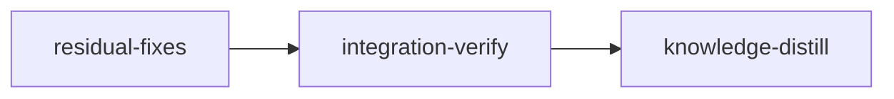

# PLAN: Full Suite Only at the Gate

Implements: none

Stop full test-suite runs outside the stage gate, and make repeated gate runs cheap through caching.

## Status

- **Built** in `d83c59b2` (2026-11-08) and checked against `c424d0e4` on 2026-11-09: the doctrine text, the skill edits, parallel `loom check` in one session (join, wait or supersede through the pending slot), stale-agent pruning at install, and the guard's runner matchers split into `loom-hooks/_verify_matchers.sh`.
- **Do not execute the old briefs** `w1-doctrine.md` to `w4-install-and-guard.md` at the top of `doc/plans/briefs/full-suite-at-gate/`. They record `d83c59b2`; their quotes predate it, and replaying them breaks the tree. The two scripts beside them, `gate_audit.py` and `full_runs.py`, stay as the record and are never edited (R3 copies `full_runs.py`). The briefs for this run are under `doc/plans/briefs/full-suite-at-gate/residual-fixes/`.
- **Loom plan.** The residual work below runs through `loom run` as the stages in `## Stages` (YAML at the end; the YAML is authoritative where it and the prose differ). Commit the plan and the `residual-fixes/` briefs before `loom run`: it refuses an uncommitted plan or brief. Once the run starts, the plan is `doc/plans/IN_PROGRESS-PLAN-full-suite-at-gate.md`; the briefs and stage descriptions name both spellings.
- **Models.** The implementation workers are Sonnet (`loom-software-engineer`) and Haiku (`loom-software-developer`); every stage keeps its stage type's default model. Each brief carries the context its worker needs, so a worker reads its brief and the plan section the brief names, and nothing else to orient.

## Decision

- **The waste is the full suite.** The number of targeted runs does not matter.
- **Subagents** run the tests for the code they wrote, and its module, when they are confident the code is ready or the fix is correct. They never run the whole suite.
- **Orchestrators** run the full suite only through `loom check`.
- **Integration-verify is exempt from the subagent rule.** Its orchestrator and reviewers may run the full suite. Every full run goes through `loom check integration-verify [--criterion <n>]`, so the pass cache and job joining dedupe it: on one tree the first request runs; a covered request joins it; an uncovered check from the same session waits behind it, merged with the other waiting selections; a later request hits the pass cache.
- **A repeated full check is never refused.** Caching makes it cheap.
- **The instructions decide; the guard only raises the cost.** `subagent-verify-guard.sh` reads each Bash command line and refuses a known runner with no filter. It cannot see a runner inside `bash -c "..."`, a script file, a package script or Makefile target under another name, or a tool it does not list, so it cannot stop an agent from running the suite. What keeps full runs at the gate is the text agents receive, plus `loom check` being cheap enough that going around it gains nothing. Because the guard is a deterrent, its own failure never stops a stage's work (R2.1).
- **The text names no language's commands.** Loom drives projects in any language, and every project's agents receive the same doctrine text. The full gate is the stage's acceptance criteria, which the plan writes for that project; subagents compile and format with the project's own tools. A command name appears only as an example beside others, never as the definition of the gate (R2.2).

Rejected designs and the reasons for rejecting them are in `doc/loom/knowledge/mistakes/test-sweep-and-fixture-discipline.md`, section "Duplicate Test Runs Were Framed as a Run-Count Problem".

## Residual work

Every edit below is anchored by symbol and quoted text. Line numbers are hints from `c424d0e4`; when they disagree with the quote, the quote wins.

| Item | Stage | Owner | Files owned (write) |
| --- | --- | --- | --- |
| R1.2 and R2.1 contract tests | `residual-fixes`, contract session | loom's contract writer | `loom/src/commands/stage/merge/live_job_tests.rs`, `loom/tests/integration/hooks_guard_fail_open.rs` (new), the `pub mod hooks_guard_fail_open;` line in `loom/tests/integration/mod.rs` |
| R1 host-job fixes | `residual-fixes` | W1, `loom-software-engineer` (Sonnet) | `loom/src/host_verify/submit.rs` (fn `cancel` only), `loom/src/host_verify/tests_submit_pending.rs`, `loom/src/host_verify/tests_submit.rs` (one `pub(super)`), `loom/src/commands/stage/merge.rs` (fn `withdraw_or_refuse_host_job` only), `loom/src/commands/verify.rs` (test placement only), `loom/src/orchestrator/core/inbox_drain/check.rs` (fn `apply_check` only), `loom/src/orchestrator/core/inbox_drain/check_merge_tests.rs` |
| R2.1, R2.4 and BLOCK-A in the guard | `residual-fixes` | W2, `loom-software-engineer` (Sonnet) | `loom-hooks/subagent-verify-guard.sh` (whole file, its BLOCK-A heredoc included), `loom-hooks/tests/require-jq-blocking.sh`, `loom-hooks/tests/require-jq-advisory.sh`, `loom/tests/integration/hooks_subagent_verify_guard.rs`, `loom/tests/integration/hooks_subagent_verify_guard_helper.rs` (new, only if needed) |
| R2.2 and R2.3 doctrine text, R3 script | `residual-fixes` | W3, `loom-software-developer` (Haiku) | `loom-hooks/_subagent-preamble.txt` (BLOCK-A only), `loom/src/orchestrator/signals/cache.rs` (`INTEGRATION_VERIFY_OVERRIDE` only), `loom/src/orchestrator/signals/cache/blocks.rs` (`append_no_verify_block` and `append_review_dimension_details` only), `loom/src/orchestrator/signals/tests_doctrine_blocks.rs` (`BLOCK_A` only), `loom/src/orchestrator/signals/tests_doctrine_prefixes.rs`, `scripts/full-runs-field-check.py` (new) |
| R5 gate | `integration-verify` | its orchestrator | none; review fixes go to one Sonnet fix worker |
| R4 knowledge | `knowledge-distill` | the distill agent, alone | `doc/loom/knowledge/**`, only through the `loom knowledge` CLI |

W1, W2 and W3 write disjoint files and run in parallel, after the contract session has frozen the two contracts. Workers run only the narrow commands their brief lists, never the full suite. BLOCK-A has four copies split between W2 (the guard's heredoc) and W3 (the other three); both take the replacement text from R2.2 verbatim, and `block_a_agrees_across_every_surface` passes only once both are done, so W3 skips that one test and the orchestrator's `loom check` covers it.

### R1. Host-job fixes

**R1.1 `submit::cancel` reads the slots in promotion-safe order** (`loom/src/host_verify/submit.rs`, fn `cancel`). Promotion (`pending::promote_locked`) saves the waiting job as current, then clears pending. `cancel`'s lock-free pre-check reads current, then pending, so a cancel interleaved with a promotion can see current terminal and pending already cleared, return `None`, and leave the promoted job live. Callers that run outside the daemon (`commands/stage/skip_retry.rs`, `git/cleanup/batch.rs`) can hit this. Replace:

```rust
    let live = |record: &JobRecord| !record.state.is_terminal();
    if !store::load_current(work_dir, stage_id)?.is_some_and(|record| live(&record))
        && store::load_pending(work_dir, stage_id)?.is_none()
    {
        return Ok(None);
    }
```

with:

```rust
    let live = |record: &JobRecord| !record.state.is_terminal();
    // Read pending BEFORE current: promotion saves the waiting job as current
    // and then clears pending, so this order always sees a job moving between
    // the slots, while the reverse order can miss it and leave it live.
    if store::load_pending(work_dir, stage_id)?.is_none()
        && !store::load_current(work_dir, stage_id)?.is_some_and(|record| live(&record))
    {
        return Ok(None);
    }
```

No regression test: the race needs two processes interleaving between two file reads, and the module has no injection seam for it. The comment carries the invariant.

**R1.2 `merge --resolved` treats a live waiting job as busy** (`loom/src/commands/stage/merge.rs`, fn `withdraw_or_refuse_host_job`). Runner shutdown cancels current ("daemon stopped") and leaves the waiting job queued for the next daemon start. The function reads only `current.json`, so `merge --resolved` proceeds and the next daemon start runs the waiting job in the worktree. Replace:

```rust
    let Some(job) = crate::host_verify::store::load_current(work_dir, stage_id)?
        .filter(|job| !job.state.is_terminal())
    else {
        return Ok(());
    };
```

with:

```rust
    // A daemon shutdown cancels current and leaves its waiting job queued for
    // the next start, so a live waiting job keeps the worktree as busy as a
    // live current one. `submit::cancel` below withdraws both slots. Read
    // pending BEFORE current, as `submit::cancel` does: promotion saves the
    // waiting job as current and then clears pending, so this order sees a
    // job moving between the slots.
    let live = |job: &crate::host_verify::JobRecord| !job.state.is_terminal();
    let waiting = crate::host_verify::store::load_pending(work_dir, stage_id)?.filter(live);
    let current = crate::host_verify::store::load_current(work_dir, stage_id)?.filter(live);
    let Some(job) = current.or(waiting) else {
        return Ok(());
    };
```

If the function's doc comment names only the current job, add "or waiting" to it. The rest of the function stays: a waiting job is never `Running`, so after `submit::cancel` it takes the "resolved proceeds" path. The test below is the stage's contract `waiting-check-keeps-worktree-busy`. Loom's contract session writes it into `loom/src/commands/stage/merge/live_job_tests.rs`, beside `a_running_daemon_refuses_and_leaves_the_job_alone`, before any code changes, and freezes that file; W1 never edits it. The file also holds the module's existing tests. Contract files normally hold only contracts, but here the test needs `stage_with_a_queued_check` and the module's imports, and the stage's acceptance runs `cargo test --lib live_job_tests`, so the frozen neighbours still run:

```rust
#[test]
#[serial]
fn a_waiting_check_behind_an_ended_one_refuses_then_is_withdrawn() {
    let temp = TempDir::new().unwrap();
    let mut current = stage_with_a_queued_check(temp.path());
    let work_dir = temp.path().join(".loom").join("work");
    let (head, tree) = ("a".repeat(40), "b".repeat(64));
    let uncached = SubmitRequest {
        stage_id: STAGE,
        session_id: "resolver",
        request_id: "r2",
        kind: JobKind::Check,
        head: &head,
        tree_digest: &tree,
        no_cache: true,
        criteria: None,
    };
    let waiting = match submit(&work_dir, &uncached, Utc::now()).unwrap() {
        Submission::Waiting { pending, .. } => *pending,
        other => panic!("expected a waiting check, got {other:?}"),
    };
    current.state = JobState::Cancelled;
    save_current(&work_dir, &current).unwrap();

    let error = format!(
        "{:#}",
        withdraw_or_refuse_host_job(STAGE, &work_dir, true).unwrap_err()
    );
    assert!(error.contains(&waiting.id), "{error}");
    withdraw_or_refuse_host_job(STAGE, &work_dir, false).unwrap();
    assert_eq!(
        crate::host_verify::store::load_pending(&work_dir, STAGE).unwrap(),
        None
    );
}
```

The uncached full request is not covered by the cached full job `stage_with_a_queued_check` queues, so it waits (same session, head and tree). Read `stage_with_a_queued_check` first: the test assumes its job uses session `"resolver"`, head `"a".repeat(40)` and tree `"b".repeat(64)`; take whatever values it uses. The two calls cover both admission paths: `true` (a daemon is running) refuses and names the waiting job; `false` (no daemon) withdraws it. The promotion interleaving between the two reads has no injection seam, as in R1.1; the read order and its comment carry it. Regression proof: with R1.2's code reverted and the test kept, the test fails on `unwrap_err()`.

**R1.3 two missing submit tests** (`loom/src/host_verify/tests_submit_pending.rs`; helpers `state_root`, `subset`, `request`, `queued`, `waiting`, `superseded`, `HEAD_A` come from `tests_submit.rs` through `use super::tests_submit::*`; `pair` and `assert_cancelled` are local). No existing test changes the tree digest while keeping the head, so dropping the tree comparison from `waits_behind` passes every test. No test sends a narrower or cached request after a full uncached waiting one, so a last-wins `no_cache` or a narrowing `union` passes every test. Add:

```rust
#[test]
fn a_changed_tree_on_the_same_head_supersedes_the_check_and_its_waiting_one() {
    let (_tmp, work) = state_root();
    let (mut current, waiting) = pair(&work);
    current.state = JobState::Running;
    store::save_current(&work, &current).unwrap();
    let digest = "d".repeat(64);
    let edited = SubmitRequest {
        tree_digest: &digest,
        ..subset("r3", &[3])
    };
    let (_, next) = superseded(submit(&work, &edited, Utc::now()).unwrap());
    let reason = format!("superseded by {}", next.id);
    assert_cancelled(&work, &current, &reason);
    assert_cancelled(&work, &waiting, &reason);
    assert_eq!(store::load_pending(&work, STAGE).unwrap(), None);
    assert_eq!(store::load_current(&work, STAGE).unwrap(), Some(next));
}

#[test]
fn widening_never_narrows_a_full_waiting_job_or_drops_its_no_cache() {
    let (_tmp, work) = state_root();
    let current = queued(submit(&work, &subset("r1", &[1]), Utc::now()).unwrap());
    let (full, behind) = waiting(submit(&work, &request("r2", HEAD_A, true), Utc::now()).unwrap());
    assert_eq!(behind, current.id);
    assert_eq!((full.criteria.clone(), full.no_cache), (None, true));
    let (widened, _) = waiting(submit(&work, &subset("r3", &[4]), Utc::now()).unwrap());
    assert_eq!(widened.id, full.id);
    assert_eq!((widened.criteria, widened.no_cache), (None, true));
}
```

Read `request` and `subset` in `tests_submit.rs` first: both tests assume they share `STAGE`, the session, `DIGEST`, and that `subset` uses `HEAD_A`. Adjust the head argument if `subset` uses another.

**R1.4 test placement.** In `loom/src/commands/verify.rs` the `#[test] fn criterion_selections_are_sorted_and_deduplicated` sits after `mod tests`, at module level; move it inside `mod tests` (reach the function through the module's `use super::...`). In `loom/src/host_verify/tests_submit.rs`, drop `pub(super)` from `#[test] fn joined_requests_append_and_keep_the_last_sixteen` after `rg -n joined_requests_append_and_keep_the_last_sixteen loom/src` shows no other reference.

**R1.5 a merge resolver's check counts as uncached** (`loom/src/orchestrator/core/inbox_drain/check.rs`, fn `apply_check`). `covers` lets a cached request join any live job of the same head, tree and selection, whatever its session. A resolver's job never reads the pass cache (`child_policy.rs::check_cache_policy`, keyed on the job record's session), but a resolver request with `no_cache: false` joins an ordinary session's cache-reading check and takes its answer. Counting the resolver's request as uncached closes this in the existing `covers` rule (`current.no_cache || !request.no_cache`): it joins only a job that reads no cache, and otherwise supersedes a `Check` (cross-session, so `waits_behind` is false) or is refused with `CHECK_BEHIND_RUN` behind a `Complete`, freeze or verdict-completion job. An ordinary request joining a resolver's job gets a run that read no cache, which is safe. A resolver's check behind another session's live cache-reading `Check` therefore cancels that check, and its followers receive "superseded". This is intended: during a merge conflict the resolver is about to change the tree that check answers, so its answer is already stale. Queueing the resolver behind it instead was rejected, because `waits_behind` queues only behind the same session and a cross-session waiting slot would be new queue logic for an answer nobody can use. Judges keep their own policy: `check_cache_policy` special-cases only `SessionType::Merge`. In the `SubmitRequest` literal inside `apply_check`, replace:

```rust
            no_cache: request.no_cache,
```

with:

```rust
            // A resolver's job never reads the pass cache (child_policy.rs), so
            // its request must not join a job that does.
            no_cache: request.no_cache || record.session_type == SessionType::Merge,
```

`SessionType` is already imported there (`admit_session` matches on it); `check.rs` goes from 385 to 387 lines. Add to `loom/src/orchestrator/core/inbox_drain/check_merge_tests.rs`, using its `resolver`, `relay_check` and the imported `repository`, `fixture`, `STAGE`:

```rust
#[test]
fn a_resolver_supersedes_a_cached_check_of_another_session_instead_of_joining_it() {
    let fx = fixture();
    let head = repository(&fx);
    let record = resolver(&fx, SessionStatus::Running, "loom/s1");
    fx.stage(StageStatus::MergeConflict, None);
    let tree = "0".repeat(64);
    let ordinary = crate::host_verify::submit::SubmitRequest {
        stage_id: STAGE,
        session_id: "stage-session",
        request_id: "r1",
        kind: JobKind::Check,
        head: &head,
        tree_digest: &tree,
        no_cache: false,
        criteria: None,
    };
    let crate::host_verify::submit::Submission::Queued(cached) =
        crate::host_verify::submit::submit(&fx.work_dir, &ordinary, Utc::now()).unwrap()
    else {
        panic!("expected the ordinary check to queue");
    };

    let settled = relay_check(&fx, &record, &head);

    assert!(matches!(settled, Settle::Applied(Some(_))), "{settled:?}");
    let job = load_current(&fx.work_dir, STAGE).unwrap().unwrap();
    assert_ne!(job.id, cached.id);
    assert_eq!((job.session_id.as_str(), job.no_cache), (record.id.as_str(), true));
}
```

The tree is `"0".repeat(64)` because `request(head)` in `check.rs`'s test module sends that digest. Check the `SubmitRequest` and `Submission` paths with `loom map --find-all SubmitRequest` and use the re-export `check.rs` imports if there is one. Regression proof: without R1.5's change the resolver's request joins, `load_current` returns the ordinary job, and `assert_ne!` fails. The existing `the_resolver_of_this_stage_is_queued_in_either_merge_status` still passes: it asserts kind, state and session only.

**R1 acceptance**, W1's own run from `loom/` in its session (the stage's acceptance in the YAML is authoritative for completion). Each test command writes a full log and prints Cargo's own exit status; a pipe into `tail` would report `tail`'s status instead (loom runs shell criteria under `sh -c` without `pipefail`):

```bash
LOG="${LOOM_SCRATCH_DIR:-${TMPDIR:-/tmp}}"
cargo test --lib host_verify:: > "$LOG/r1-host.log" 2>&1; echo "exit=$?"
cargo test --lib live_job_tests > "$LOG/r1-merge.log" 2>&1; echo "exit=$?"
cargo test --lib commands::verify > "$LOG/r1-verify.log" 2>&1; echo "exit=$?"
cargo test --lib inbox_drain::check > "$LOG/r1-inbox.log" 2>&1; echo "exit=$?"
rg -n -m 20 -M 300 'FAILED|panicked|^error|test result' "$LOG"/r1-*.log
wc -l src/host_verify/submit.rs src/host_verify/tests_submit_pending.rs src/commands/stage/merge.rs src/commands/stage/merge/live_job_tests.rs src/orchestrator/core/inbox_drain/check.rs src/orchestrator/core/inbox_drain/check_merge_tests.rs
```

Each test command prints `exit=0`, and each log's `test result` line shows zero failed and at least one passed; every file stays at or under 400 lines.

### R2. Guard and doctrine text

**R2.1 a missing `_verify_matchers.sh` or `jq` lets the call through with a warning that names the fix** (`loom-hooks/subagent-verify-guard.sh`). The guard is a deterrent (see Decision), and its header already rules that a false block strands a subagent mid-task. A broken hook install must not stop every Bash call in every stage of every project, so the guard fails open, visibly. Today the `source` of a missing file fails under `set -e` and the hook exits 1 with bash's bare "No such file or directory", which names no remedy. Exit 1 from a PreToolUse hook is a non-blocking error in Claude Code: the call proceeds and stderr reaches the user. Keep that exit status and add the remedy. Replace:

```bash
# shellcheck source=_verify_matchers.sh
source "$(dirname "${BASH_SOURCE[0]}")/_verify_matchers.sh"
```

with:

```bash
# shellcheck source=_verify_matchers.sh
# A missing helper lets the call through (exit 1 is non-blocking): this hook
# only raises the cost of a bare run, so its own breakage never stops work.
source "$(dirname "${BASH_SOURCE[0]}")/_verify_matchers.sh" || {
	echo "subagent-verify-guard.sh: _verify_matchers.sh is missing or unreadable beside this hook - test-runner checks are off for this call. Reinstall the hooks with \`loom install-assets\`." >&2
	exit 1
}
```

The guard treats a missing `jq` the same way, for the same reason. It calls `loom_require_jq` today, so without `jq` it exits 2 and denies every Bash call of every subagent and of a standard stage's main agent. Replace:

```bash
loom_require_jq "subagent-verify-guard.sh"
```

with:

```bash
# Advisory on its own breakage: without jq the call proceeds with a warning.
loom_warn_no_jq "subagent-verify-guard.sh"
```

`loom_warn_no_jq` (`loom-hooks/_common.sh`) prints the shared "jq is not installed" message and exits 1. `loom run` already refuses to start without `jq` (`commands/run/checks.rs::require_jq`), so this path is reached only when `jq` disappears from a running machine. In the header, replace the two lines

```bash
# Exit codes: 0 = allow, 2 = block with guidance on stderr (also jq not
# installed - fail closed)
```

with:

```bash
# Exit codes: 0 = allow, 2 = block with guidance on stderr. A missing jq or
# _verify_matchers.sh exits 1: the call proceeds with a warning.
```

Move the guard's case out of `loom-hooks/tests/require-jq-blocking.sh` (the block from the comment `# subagent-verify-guard.sh blocks too` to the last `GUARD_OUTPUT` check) into `loom-hooks/tests/require-jq-advisory.sh`, before its final `echo "PASS"`. In the moved block, expect exit 1 instead of 2, keep the "jq is not installed" stderr check, the empty-stdout check and the control case, and change its comment to say the guard only deters, so without `jq` it warns and lets the call through. Update each file's header comment to name the hooks it covers. `run-all.sh` keeps both entries as they are. Regression proof: with `loom_require_jq` restored, the moved case fails on exit 2.

The stage's contract `guard-warns-without-jq` pins the same behaviour in Rust, so the contract gate runs it. Loom's contract session writes it as the only test in the new file `loom/tests/integration/hooks_guard_fail_open.rs`, declared with `pub mod hooks_guard_fail_open;` in `loom/tests/integration/mod.rs` (the target root, `path = "tests/integration/mod.rs"` in `Cargo.toml`). The test needs no process tree, because `loom_require_jq` and `loom_warn_no_jq` run before the guard's role check (line 54, against `loom_is_subagent` at line 86):

1. Write `loom::fs::permissions::constants::HOOK_COMMON` as `_common.sh`, `HOOK_BOUNDED` as `_bounded.sh`, `HOOK_VERIFY_MATCHERS` as `_verify_matchers.sh` and `HOOK_SUBAGENT_VERIFY_GUARD` as `subagent-verify-guard.sh` into a `tempfile::TempDir`.
2. Build a second directory of symlinks to every file in every `PATH` directory except `jq`, keeping the first occurrence of each name (what `loom-hooks/tests/_path_without.sh` does).
3. Run `bash <dir>/subagent-verify-guard.sh` with `PATH` set to that directory, `LOOM_MAIN_AGENT_PID` removed, and stdin `{"tool_name":"Bash","tool_input":{"command":"cargo test"}}`.
4. Assert exit code 1, that stderr contains `jq is not installed`, and that stdout is empty.

It rejects a guard that keeps `loom_require_jq`, which exits 2 and denies the call.

Add the test `a_missing_matchers_helper_lets_the_call_through_with_a_warning` to `loom/tests/integration/hooks_subagent_verify_guard.rs`, modelled on `check_subagent_case`: same temp-dir and stage setup, `install_hook(dir)`, then `std::fs::remove_file(dir.join("_verify_matchers.sh"))`, then run `cargo test` as a subagent through `run_hook_in_tree`; return early through `skip_unless_gate_visible` like the other process-tree tests; assert exit code 1 (never 2) and that stderr contains `loom install-assets`. The file is 376 lines: if the test would push it past 400, put it in a new `hooks_subagent_verify_guard_helper.rs` declared the way `mod main;` declares `hooks_subagent_verify_guard_main.rs`. Regression proof: without the `|| { ... }` bash's own message lacks `loom install-assets` and the test fails.

**R2.2 the doctrine text names no language's commands.** Every project loom drives receives this text, whatever its language (see Decision). Two passages define the work in Rust commands only.

*Integration-verify override* (`loom/src/orchestrator/signals/cache.rs`, `INTEGRATION_VERIFY_OVERRIDE`). Two text changes inside the existing source lines (lines may grow; add none, `cache.rs` must stay 511 lines):

- The parenthesis `` (`cargo build`, `cargo test`, `cargo clippy -- -D warnings`, `cargo fmt --check`) `` after `it carries the COMPLETE suite` becomes `(every acceptance criterion the plan gives this stage: the project's own build, test, lint and format commands, in whatever language it uses)`. In `tests_doctrine_prefixes.rs`, replace `assert!(prefix.contains("cargo clippy -- -D warnings"));` with `assert!(prefix.contains("every acceptance criterion the plan gives this stage"));` followed by `assert!(!prefix.contains("cargo clippy"), "the IV prefix names no language's gate commands");`.
- The sentence `On one tree the first request runs; covered requests join it; later requests hit the pass cache.` (split across two source lines by `\` continuations) becomes `On one tree the first request runs; a covered request joins it; an uncovered one from the same session waits and runs with the other waiting selections, so its verdict can list criteria it did not select; later requests hit the pass cache.` Add the needle `"its verdict can list criteria it did not select"` to the "IV ownership doctrine lost" needle list in `tests_doctrine_prefixes.rs` (the list that contains `"stale evidence never waives a failing gate"`).

The integration-verify prefix has no `tests_size.rs` byte ceiling (`STABLE_PREFIX_MAX_BYTES` measures the standard prefix).

*BLOCK-A, the subagent rule.* Its first bullet tells every subagent on every project to format with `rustfmt --edition 2021` and forbids `cargo fmt`. `tests_doctrine.rs::block_a_agrees_across_every_surface` pins it byte-identical across four copies; change all four in the same edit:

- `loom/src/orchestrator/signals/cache/blocks.rs`, fn `append_no_verify_block`: the three `content.push_str` lines;
- `loom-hooks/_subagent-preamble.txt`, lines 12-14;
- `loom-hooks/subagent-verify-guard.sh`, the same three lines in `block()`'s heredoc;
- `loom/src/orchestrator/signals/tests_doctrine_blocks.rs`, const `BLOCK_A`, lines 13-15.

Replace:

```text
- Compile the files YOU wrote as often as you need (`cargo check`,
  `cargo build`, `tsc --noEmit`, `bun run build`) and format them with
  `rustfmt --edition 2021 <files>`. No linter and no `cargo fmt`.
```

with:

```text
- Compile the files YOU wrote as often as you need, and format them,
  with the project's own build and formatter commands scoped to those
  files. No linter and no formatter run over the whole project.
```

Each copy keeps its line count. The recorded payloads in `loom/tests/fixtures/signal_replay/recorded-spawn.json` and `loom/tests/fixtures/dependency_findings/` quote the old text as recorded input and stay unchanged. Any other live copy the R2 acceptance grep finds is a fifth surface: report it rather than leaving it stale.

**R2.3 review dimension 4 names its agent** (`loom/src/orchestrator/signals/cache/blocks.rs`, `append_review_dimension_details`). Replace this Rust string literal:

```text
"4. **Functional** — RUN the feature end-to-end on realistic inputs; confirm the output is correct and the feature is registered, mounted, and callable.\n"
```

with:

```text
"4. **Functional** — spawn this one as `loom-software-engineer` too, since it runs commands: RUN the feature end-to-end on realistic inputs; confirm the output is correct and the feature is registered, mounted, and callable.\n"
```

In `tests_doctrine_prefixes.rs`, add this needle to the "IV prefix lost review guard" list, after the Build/test/sandbox needle:

```text
"**Functional** — spawn this one as `loom-software-engineer`",
```

**R2.4 stale test-module comment** (`loom/tests/integration/hooks_subagent_verify_guard.rs`, module doc, lines 8-11). Replace:

```text
//! its own gate (its orchestrator runs `loom check`; its reviewers run only
//! targeted checks, which the subagent preamble states and this hook does not
//! enforce); git commits are never blocked by this hook even
```

with:

```text
//! its own gate (its orchestrator and reviewers run the full suite only through
//! `loom check integration-verify`, which the subagent preamble states and this
//! hook does not enforce); git commits are never blocked by this hook even
```

**R2 acceptance**, W2's and W3's own runs in their sessions (the stage's acceptance in the YAML is authoritative for completion; W3 adds `-- --skip block_a_agrees_across_every_surface` to the signals run). The session sandbox's `TMPDIR` contains "claude", hence `NC_TMP` below; the host job that runs the stage's acceptance has a private `/tmp` and needs no override. From the repo root, then from `loom/`:

```bash
bash -n loom-hooks/subagent-verify-guard.sh
shellcheck -x -P SCRIPTDIR loom-hooks/subagent-verify-guard.sh loom-hooks/_verify_matchers.sh
./scripts/check-hook-syntax.sh
bash loom-hooks/tests/require-jq-blocking.sh; echo "exit=$?"
bash loom-hooks/tests/require-jq-advisory.sh; echo "exit=$?"
cd loom
LOG="${LOOM_SCRATCH_DIR:-${TMPDIR:-/tmp}}"
NC_TMP="${LOOM_SCRATCH_DIR:-/var/tmp}/nc-tmp"; mkdir -p "$NC_TMP"
case "$NC_TMP" in *[cC][lL][aA][uU][dD][eE]*) NC_TMP=/var/tmp/loom-nc-tmp; mkdir -p "$NC_TMP" ;; esac
TMPDIR="$NC_TMP" cargo test --test integration hooks_subagent_verify_guard > "$LOG/r2-guard.log" 2>&1; echo "exit=$?"
cargo test --test gate_dedup_contracts > "$LOG/r2-dedup.log" 2>&1; echo "exit=$?"
cargo test --test hook_false_positive_contracts > "$LOG/r2-fp.log" 2>&1; echo "exit=$?"
cargo test --lib orchestrator::signals:: > "$LOG/r2-signals.log" 2>&1; echo "exit=$?"
rg -n -m 20 -M 300 'FAILED|panicked|^error|SKIP|test result' "$LOG"/r2-*.log
wc -l src/orchestrator/signals/cache.rs
cd ..
rg -n 'rustfmt --edition 2021 <files>|cargo clippy -- -D warnings`, `cargo fmt' --glob '!doc/**' --glob '!target' --glob '!loom/tests/fixtures/**'; echo "rg exit=$?"
```

Both `require-jq` scripts print `PASS` and `exit=0`. Each test command prints `exit=0` (never pipe one into `tail`: the pipe reports `tail`'s status), and each log's `test result` line shows zero failed and at least one passed. The final `rg` prints only `rg exit=1`. `shellcheck` without `-P SCRIPTDIR` reports SC1091 from the repo root; that is expected. The integration suite asserts its temp dir has no "claude" in its path (`temp_dir_no_claude`), hence `NC_TMP`. A "SKIP" line in its output means the sandbox hides the process tree; report it, never count it as a pass. `wc -l` prints 511.

### R3. Field-check script

Create `scripts/full-runs-field-check.py` as a copy of `doc/plans/briefs/full-suite-at-gate/full_runs.py` with the additions below; keep its `FULL` and `SCOPED_FLAGS` regexes and the `<days>` argument. The copy in the brief folder stays unchanged as the record of `d83c59b2`: loom locks a running plan's brief folder, so no stage may write there.

The new script is temporary. It exists only for the field check (Acceptance item 4). Once the operator has run that check and recorded its counts, delete `scripts/full-runs-field-check.py` in its own `chore(scripts): ...` commit. The same change rewrites the K7 concern "Integration-verify full runs are routed by doctrine only" so it no longer names the script (`loom knowledge replace-section`). The deletion is not part of this plan, because the field check runs after the plan has finished. The script is not kept because it is a one-off scan of local Claude Code transcripts, so its formats would drift with nobody maintaining it. If the K7 concern needs measuring again, the script can be restored from git history.

1. Optional `--since YYYY-MM-DD` (UTC midnight) overrides `<days>` for the mtime cutoff. Optional `--root DIR` replaces the transcript root `~/.claude/projects`, so the stage's acceptance can run the script on an empty directory without the real `HOME`. Parse the arguments with `argparse`; `<days>` stays the first positional argument with its default of 14.
2. Classify each project dir as `iv` when its name contains `integration-verify`, `knowledge` when it contains `knowledge`, else `standard` (the rule `gate_audit.py` uses to skip dirs).
3. Pair each hit with its result. In entries with `type == "user"`, `message.content[]` items with `type == "tool_result"` carry `tool_use_id` and `content` (a string or a list of `{"type": "text", "text": ...}`). A hit whose result text contains `[subagent-verify-guard/` counts as `blocked`, else `ran`.
4. Print one count per `(repo, kind, role, outcome)`, then the examples as now, each prefixed with its kind and outcome.

Acceptance, W3's own run from the repo root in its session (it reads the real transcripts, which the host job cannot): `python3 -I scripts/full-runs-field-check.py 30` exits 0, and its counts summed over every key equal the totals `python3 -I doc/plans/briefs/full-suite-at-gate/full_runs.py 30` prints when the two run back to back. `python3 -I scripts/full-runs-field-check.py 1 --since 2026-11-09` exits 0. The stage's acceptance only parses the script and runs it on an empty `--root`.

### R4. Knowledge (after R1 and R2)

The `knowledge-distill` stage applies these edits. In a stage worktree the file guard blocks the Edit and Write tools on knowledge files, so each edit goes through `loom knowledge replace-section <file> "<heading>" "<body>"`: read the section, swap the line, and pass the whole body without its `##` line. Then read the line the command prints, because a heading that does not match appends instead. K6 and K7 change a bullet inside a section, so they go through `replace-section` as well. State current truth only. Each block below is literal text: the first line of a pair is the text to find, the second its replacement.

**K1** `doc/loom/knowledge/architecture/verification-v2-gates.md`, first section (`## Verification v2 Gates: Order, Owners, and What Each Gate Reads`):

```text
Concurrent matching requests join the same host job; matching completed passes use the cache, and callers wait for the result.
A covered request joins the live host job, an uncovered check from the same session waits behind it in the pending slot, completed passes are reused from the cache, and callers wait for the result.
```

**K2** same file, `## Job Records and State`:

```text
A check on the same session, head and tree as a live check joins it when covered; an uncovered request waits in the pending slot.
A covered check joins the live job whatever its session (`submit.rs::covers`); a merge resolver's request counts as uncached (`inbox_drain/check.rs::apply_check`), so it joins only a job that reads no pass cache; an uncovered check of the same session, head and tree waits in the pending slot (`submit.rs::waits_behind`); a check behind a live completion, freeze or verdict-completion job is refused; any other request supersedes the live job and cancels the waiting one.
```

**K3** same file, `## Cancellation and Restart`:

```text
Promotion during reset is covered, and jobs submitted afterward are preserved.
Promotion during reset is covered. A replacement from another session or tree submitted afterward survives; a check that waits behind a captured job afterward is cancelled with it, because `submit::cancel_if_id` cancels the waiting slot when the captured current matches. `merge --resolved` treats a live waiting job as busy.
```

**K4** `doc/loom/knowledge/entry-points/hooks.md`, `## Hook Scripts — What Each Does`, the `subagent-verify-guard.sh` row:

```text
**Still regexes raw strings** (last hook not converted; see concerns.md).
Walks command-position tokens with a private scanner (see concerns.md); it sees only the command line, so a runner inside `bash -c`, a script or an unlisted tool passes, and it deters rather than enforces. The runner matchers live in the sourced `_verify_matchers.sh`, registered in `LOOM_HOOKS` but never as a hook; a missing helper exits 1, so the call proceeds with a warning naming `loom install-assets`. A missing `jq` also exits 1 with a warning (`loom_warn_no_jq`), although the hook blocks.
```

**K5** `doc/loom/knowledge/architecture/hook-system.md`, `## Subagent Isolation`, the `subagent-verify-guard.sh` row:

```text
**still matches raw command strings** (see concerns.md).
walks command-position tokens with a private scanner (see concerns.md) and deters rather than enforces, since it sees only the command line; its runner matchers live in the sourced `_verify_matchers.sh`, and a missing helper or a missing `jq` lets the call through with a warning.
```

**K9** same file, the `**jq availability:**` paragraph:

```text
**jq availability:** a hook must never fail open just because jq is missing. Blocking guards
**jq availability:** a hook never fails silently when jq is missing. Blocking guards
```

and, in the same paragraph:

```text
`_common.sh`; advisory hooks call `loom_warn_no_jq` instead — both defined in `loom-hooks/_common.sh`.
`_common.sh`; advisory hooks call `loom_warn_no_jq` instead — both defined in `loom-hooks/_common.sh`. `subagent-verify-guard.sh` blocks but calls `loom_warn_no_jq`: it only deters, so its own breakage must not stop a stage.
```

**K10** `doc/loom/knowledge/stack.md`, the paragraph that starts `` `jq` is a hard requirement ``:

```text
exit 2, fail closed) and advisory hooks call `loom_warn_no_jq` (exit 1, non-blocking); lifecycle hooks
exit 2, fail closed) and advisory hooks, plus the deterrent `subagent-verify-guard.sh`, call `loom_warn_no_jq` (exit 1, non-blocking); lifecycle hooks
```

**K6** `doc/loom/knowledge/entry-points/cli-and-plan-pipeline.md`, append to the end of the bullet that starts ``- `loom install-assets` ``:

```text
 `install_files` also runs `prune_stale_agents` (`assets/install/claude.rs`), removing each `$CLAUDE_DIR/agents/loom-*.md` with no embedded source: a regular file is first copied to `<name>.bak.<UTC stamp>`, a symlink is unlinked unfollowed, a directory is skipped. A prune error aborts `install_all` before commands, skills and hooks; rerun the install.
```

**K7** `doc/loom/knowledge/concerns/verification-v2-followups.md`, insert after the bullet that starts `- **Followers of one selection share wait state.**`:

```text
- **A promoted waiting job's hold counts its wait.** `hung_latch::job_holds` (`orchestrator/monitor/hung_latch.rs`) times an unstarted job from `queued_at`, and a waiting job keeps the `queued_at` of its first request. Following sessions heartbeat on every `loom check`. Revisit if a waiting job's session is flagged hung while the check ahead of it ran.
- **The `--criterion` normaliser call is unpinned.** Deleting `normalized_criteria` from `commands/verify.rs::execute` passes every test, because relay mode exits the process. Revisit when the relay path gains an in-process test seam.
- **Integration-verify full runs are routed by doctrine only.** `subagent-verify-guard.sh` exits 0 for every subagent and the main agent of an integration-verify stage. `scripts/full-runs-field-check.py` measures bare runs there until the field check is done. Revisit if they stay common next to `loom check integration-verify` calls.
- **A package-scoped run passes the guard as scoped.** `_verify_matchers.sh` reads a package selection (`cargo test -p <crate>`, `--package`, and each runner's equivalent) as scoped; in a project with one package that is the whole suite. Revisit if field data shows package scope used as a full run.
```

**K8** `doc/loom/knowledge/conventions/guidance-channels-and-plugin-scope.md`, `## Implementers Do Not Verify; the Gate Is loom check`:

```text
It may format changed files with `rustfmt --edition 2021 <files>`; linters, every `cargo fmt` form and full test suites belong to the stage's gate.
It formats those files with the project's own formatter, scoped to them; linters, formatter runs over the whole project and full test suites belong to the stage's gate.
```

Acceptance: `loom knowledge check` passes; `rg -n '_verify_matchers' doc/loom/knowledge/entry-points/hooks.md doc/loom/knowledge/architecture/hook-system.md` finds both rows; `rg -n 'Still regexes raw strings|still matches raw command strings|jobs submitted afterward are preserved|Concurrent matching requests join|rustfmt --edition 2021 <files>|missing helper fails closed|must never fail open just because jq' doc/loom/knowledge; echo "rg exit=$?"` prints `rg exit=1`.

### R5. Gate

The `integration-verify` stage's acceptance carries this gate (YAML), and its orchestrator runs it through `loom check integration-verify`. The commands below are the source the YAML criteria were written from; the YAML runs them from the repo root with `--manifest-path loom/Cargo.toml`, and calls `markdownlint-cli2` from `web/node_modules/.bin/` after the plan's web provision, since criteria have no network. These are the repo's canonical gates (CI `.github/workflows/ci.yml`; `doc/loom/knowledge/conventions/git-and-build-workflow.md`). From `loom/` (the `TMPDIR="$NC_TMP"` prefix is for a run in a session sandbox only; the host job's `/tmp` is private and needs none):

```bash
cargo fmt --all -- --check
cargo clippy --all-targets -- -D warnings
TMPDIR="$NC_TMP" cargo test --all-targets --no-fail-fast -- --test-threads=4
cargo test --doc --workspace --all-features -- --test-threads=1
cargo test --test maintainability
RUSTDOCFLAGS='-D warnings' cargo doc --workspace --all-features --no-deps
cargo audit
../scripts/flake-check.sh
```

From the repo root:

```bash
./scripts/check-hook-syntax.sh
LOOM_HOOK_TEST_REQUIRE_BINARY=1 bash loom-hooks/tests/run-all.sh
git ls-files '*.md' | grep -v '^doc/plans/' | grep -v '^loom/tests/fixtures/' | xargs bunx markdownlint-cli2
```

This is the `CONTRIBUTING.md` "The Gate" list plus the hook suites; the web check is out (R1-R4 touch nothing under `web/`). `cargo audit` is not a criterion: it fetches the advisory database, and criteria have no network. The integration-verify orchestrator runs it in its session; if it cannot fetch (no network, sandbox denial), it records it as unverified in `loom memory`, never as passed. `flake-check.sh` and `run-all.sh` are criteria with long timeouts (`run-all.sh` takes about three minutes). On a failure, fix it and rerun only the failed criterion with `loom check integration-verify --criterion <n>`. Each stage commits once through `loom stage commit`: `fix(verification): ...` for `residual-fixes` (R1-R3), `fix(...)` for review fixes in integration-verify, `docs(knowledge): ...` for R4.

## Stages



| Stage | Items | `working_dir` | Depends on | Forced by |
| --- | --- | --- | --- | --- |
| `residual-fixes` | R1, R2, R3 | `loom` | none | the plan's one implementation stage |
| `integration-verify` | R5, review | `.` | `residual-fixes` | bookend |
| `knowledge-distill` | R4 | `.` | `integration-verify` | bookend |

- **No knowledge-bootstrap.** The tier-1 knowledge files already describe this codebase, and R4 edits named sections only.
- **One implementation stage.** R1, R2 and R3 write disjoint files and none needs another merged first, so the necessity test (merge order, shared files, a checkpoint, context size) answers no on every count. Three parallel workers in one stage cost one worktree, one merge and one gate run.
- **Working directories.** `residual-fixes` runs from `loom/`, because loom runs each contract as a `cargo test` from the stage's working directory and the repository root has no `Cargo.toml`. Its YAML paths are package-relative, with `../` for `loom-hooks/` and `scripts/`; brief paths stay repository-relative. The bookends run from the root.

### residual-fixes

The contract session writes the two contracts, and loom freezes them. The orchestrator then spawns W1, W2 and W3 in one message, waits, runs `loom check residual-fixes` beside one review round, sends every finding to one Sonnet fix worker, and completes. The briefs are `doc/plans/briefs/full-suite-at-gate/residual-fixes/common.md` plus one per worker.

Risk checklist walk:

- **Lifecycle and concurrency** applies to R1. Contract `waiting-check-keeps-worktree-busy` (R1.2) rejects a `withdraw_or_refuse_host_job` that reads only the current slot. R1.1's race has no injection seam (see R1.1). R1.5 is proven by the regression test in `check_merge_tests.rs`; that file is declared with `#[path]`, which a contract's module chain refuses.
- **Partial failure of a hook** applies to R2.1. Contract `guard-warns-without-jq` rejects a guard that keeps `loom_require_jq`. The missing-matchers case needs a live process tree and self-skips where the sandbox hides it, so it is an ordinary test: a skipped contract would pass at freeze, and the freeze refuses a contract that passes before implementation.
- **Untrusted input, paths, process I/O, configuration, reachability, external data** do not apply as contracts. The hooks stay registered as before. R3's transcript parsing is checked by W3 against the real transcripts, since the host job cannot read `HOME`, and the script is temporary.

Expected test-integrity events: `TI-edit` on `src/orchestrator/signals/tests_doctrine_prefixes.rs`, where R2.2 replaces the `cargo clippy -- -D warnings` assertion with a language-neutral one plus a negative assertion. The guard case moved from `require-jq-blocking.sh` to `require-jq-advisory.sh` (R2.1) changes exit 2 to exit 1 on purpose.

Environment: `cargo` fetches need the crates.io domains in the session, and the repository's pre-commit hook runs `bunx markdownlint-cli2`, so every stage's sandbox allows `registry.npmjs.org`. `shellcheck`, `python3`, `jq` and `rg` are installed on the host (`/usr/bin`). The stage's acceptance runs in the host job, where `/tmp` is private, so no `TMPDIR` override is needed there.

### integration-verify

Runs R5's gate as acceptance through `loom check integration-verify`. It reviews with parallel `loom-code-reviewer` subagents and sends every finding to one Sonnet fix worker. It runs `cargo audit` in its own session and records it as unverified if the advisory database cannot be fetched. The plan's `provision` entry installs `web/node_modules` so the Markdown lint criterion runs without network.

### knowledge-distill

Applies R4's K1-K10 through `loom knowledge replace-section`, after any `stale-knowledge:` memories, then curates the run's memories.

## Ordering with sibling plans

While the residual work runs, no other stage writes a file in its ownership table; whichever change merges second rebases. Sibling plans that touch these files keep what `d83c59b2` and this work add:

- `PLAN-live-test-lane`, `PLAN-autonomous-recovery` (`host_verify/**`, `commands/verify.rs`, `inbox_drain/check.rs`): `Submission::Waiting`, the `pending::cancel_locked` call in `submit`'s supersede branch, `normalized_criteria`, and R1.5's `no_cache` line in `apply_check`.
- `PLAN-loom-ui-mods` (`assets/install*.rs`, `commands/install_assets.rs`): `prune_stale_agents` and `InstallReport.pruned_agents`.
- `PLAN-model-router-hooks` (`fs/permissions/constants.rs`): `_verify_matchers.sh` in `LOOM_HOOKS` and out of every hook table.
- `PLAN-web-host-graft-followthrough` (signal cache and its doctrine tests): BLOCK-A byte-identical across its four copies, with R2.2's language-neutral first bullet, and `cache.rs` at or under its 511-line baseline.
- Any knowledge stage edits R4's files only after R4 commits.

## Out of scope

- **Follow calls of a running job.** The repeated `loom check` lines are one host job being followed. `host_verify/wait.rs::budget_for` caps a call at 100 s to stay inside Claude Code's 120 s Bash limit.
- **Any count of targeted runs**, and any refusal of a full `loom check`.
- **Rewriting the briefs.** They stay as the record of `d83c59b2`.
- **Other hooks' `jq` handling.** R2.1 moves only `subagent-verify-guard.sh` to `loom_warn_no_jq`. The enforcing guards (`commit-filter.sh`, `credential-guard.sh` and the other `loom_require_jq` callers) stay closed without `jq`.

## Acceptance

1. R1-R4 acceptance commands pass as stated.
2. `rg -n 'AT MOST ONE narrowly|narrowly-scoped check|narrowly scoped check|ONE scoped check|skip if unsure|reviewers run only targeted' --glob '!doc/**' --glob '!target'; echo "rg exit=$?"` prints only `rg exit=1`. The doctrine tests' retired phrases are built with `concat!`, so they do not match.
3. The R5 gate passes on the final tree.
4. **Field check (observational).** Owner: the operator, after the first loom plan run once `dev-install.sh` has installed a binary and hooks built from `d83c59b2` or later. Run `python3 -I scripts/full-runs-field-check.py <days> --since <install date>` (R3), record the counts, then delete the script (R3).
   - The script reads command lines, as the guard does, so it counts direct runner calls only; a suite run through a script or `bash -c` is invisible to both. The counts measure whether the text and the deterrent work, not a guarantee.
   - Standard stages: zero `ran` bare full-suite runs by subagents and main agents. Baseline, 30 days before the rollout: 30 subagent and 21 main hits.
   - Integration-verify: report `ran` bare runs next to the count of `loom check integration-verify` calls. There is no zero target. Baseline: 30 subagent and 50 main hits.

## Open questions

None.

## Pressure tests

- 2026-11-09: Claude opus, Codex gpt-6-astra; 1 round, review addressed

---

<!-- loom METADATA -->

```yaml
loom:
  version: 2
  ratchet_files:
    - loom/maintainability-baseline.txt
    - doc/loom/knowledge/check-baseline.txt
  provision:
    - working_dir: "web"
      command: "test ! -e .npmrc && test ! -L .npmrc && bun install --frozen-lockfile --ignore-scripts --backend=copyfile --config=/dev/null"
  sandbox:
    enabled: true
    auto_allow: true
    filesystem:
      deny_read: ["~/.ssh/**", "~/.aws/**", "~/.config/gcloud/**", "~/.gnupg/**"]
    network:
      allowed_domains: ["crates.io", "index.crates.io", "static.crates.io", "registry.npmjs.org"]
      allow_local_binding: false
      allow_unix_sockets: []
  stages:
    - id: residual-fixes
      name: "Host-job fixes, a fail-open guard and language-neutral doctrine"
      summary: "Fixes three host-job queue edge cases, makes the test-runner guard let calls through with a warning when its helper or jq is missing, removes Rust-only commands from the doctrine every project receives, and adds a temporary field-check script."
      stage_type: standard
      skills: ["loom-rust"]
      implementers: ["claude"]
      subagent_timeout_secs: 900
      working_dir: "loom"
      dependencies: []
      description: |
        Apply the plan's items R1, R2 and R3 (doc/plans/IN_PROGRESS-PLAN-full-suite-at-gate.md once loom run has started, doc/plans/PLAN-full-suite-at-gate.md before). The plan's "### R1. Host-job fixes", "### R2. Guard and doctrine text" and "### R3. Field-check script" sections hold every edit as quoted find and replace text; the quoted text wins over line numbers. Never execute the old briefs w1-doctrine.md to w4-install-and-guard.md at the top of doc/plans/briefs/full-suite-at-gate/: they record an earlier commit.
        Use parallel subagents and skills to maximize performance.
        PATHS: working_dir is loom/, because loom runs each contract as cargo test from it and the repository root has no Cargo.toml. YAML paths and the worker table are package-relative (../ for loom-hooks/ and scripts/); brief paths are repo-relative.
        CONTRACTS (written first by loom's contract session, from this description; the test bodies are in the plan):
        - waiting-check-keeps-worktree-busy: the plan's R1.2 test a_waiting_check_behind_an_ended_one_refuses_then_is_withdrawn, added to src/commands/stage/merge/live_job_tests.rs beside a_running_daemon_refuses_and_leaves_the_job_alone. It calls super::withdraw_or_refuse_host_job(stage_id: &str, work_dir: &Path, daemon_running: bool) -> Result<()>, with the file's existing stage_with_a_queued_check helper and imports (crate::host_verify::submit::{submit, Submission, SubmitRequest}, crate::host_verify::store::save_current, crate::host_verify::{JobKind, JobState}); it reads the pending slot through crate::host_verify::store::load_pending. The file keeps its existing tests: they need the same helper, and acceptance runs cargo test --lib live_job_tests.
        - guard-warns-without-jq: the only test in the new file tests/integration/hooks_guard_fail_open.rs, declared with pub mod hooks_guard_fail_open; in tests/integration/mod.rs. Steps are in the plan's R2.1, last paragraphs: write loom::fs::permissions::constants::{HOOK_COMMON, HOOK_BOUNDED, HOOK_VERIFY_MATCHERS, HOOK_SUBAGENT_VERIFY_GUARD} as _common.sh, _bounded.sh, _verify_matchers.sh and subagent-verify-guard.sh into a tempfile::TempDir; build a PATH directory of symlinks to every PATH entry except jq (first occurrence of each name wins); run bash <dir>/subagent-verify-guard.sh with that PATH, LOOM_MAIN_AGENT_PID removed and stdin {"tool_name":"Bash","tool_input":{"command":"cargo test"}}; assert exit code 1, stderr containing "jq is not installed", empty stdout. It needs no process tree: loom_require_jq / loom_warn_no_jq run before the guard's role check.
        WORKERS. Territories are DISJOINT. Workers NEVER spawn subagents. After the contracts are frozen, spawn all three BY AGENT TYPE in ONE message, in the background, each with the fixed prompt "Your brief: <path>. Read it in full before anything else." Wait with one background loom subagents watch.

        | Worker | Role | Tier | Files owned | Shared context | Brief path |
        | --- | --- | --- | --- | --- | --- |
        | W1 | R1 host-job fixes | loom-software-engineer (sonnet) | src/host_verify/submit.rs, src/host_verify/tests_submit_pending.rs, src/host_verify/tests_submit.rs, src/commands/stage/merge.rs, src/commands/verify.rs, src/orchestrator/core/inbox_drain/check.rs, src/orchestrator/core/inbox_drain/check_merge_tests.rs | common.md, plan R1 | doc/plans/briefs/full-suite-at-gate/residual-fixes/w1-host-jobs.md |
        | W2 | R2.1 guard fail-open, R2.4, BLOCK-A in the guard | loom-software-engineer (sonnet) | ../loom-hooks/subagent-verify-guard.sh, ../loom-hooks/tests/require-jq-blocking.sh, ../loom-hooks/tests/require-jq-advisory.sh, tests/integration/hooks_subagent_verify_guard.rs, tests/integration/hooks_subagent_verify_guard_helper.rs | common.md, plan R2.1, R2.2, R2.4 | doc/plans/briefs/full-suite-at-gate/residual-fixes/w2-guard.md |
        | W3 | R2.2 and R2.3 doctrine text, R3 script | loom-software-developer (haiku) | ../loom-hooks/_subagent-preamble.txt, src/orchestrator/signals/cache.rs, src/orchestrator/signals/cache/blocks.rs, src/orchestrator/signals/tests_doctrine_blocks.rs, src/orchestrator/signals/tests_doctrine_prefixes.rs, ../scripts/full-runs-field-check.py | common.md, plan R2.2, R2.3, R3 | doc/plans/briefs/full-suite-at-gate/residual-fixes/w3-doctrine-and-script.md |

        BLOCK-A has four copies: W2 changes the guard's heredoc, W3 the other three, both from R2.2's quoted text. block_a_agrees_across_every_surface passes only when both are done; W3 skips it, and your loom check covers it.
        REVIEW: one loom-code-reviewer round beside one loom check residual-fixes. Give the reviewer the INTEGRITY line below and the plan's Decision section. Send every finding of the round to ONE loom-software-engineer (sonnet) fix worker, whose brief lists each finding, the files it may touch (only files in the worker table above) and the criteria to re-run with loom check residual-fixes --criterion <n>.
        INTEGRITY: TI-edit on src/orchestrator/signals/tests_doctrine_prefixes.rs is expected: R2.2 replaces assert!(prefix.contains("cargo clippy -- -D warnings")) with assert!(prefix.contains("every acceptance criterion the plan gives this stage")) plus assert!(!prefix.contains("cargo clippy")), because the integration-verify doctrine must name no language's gate commands.
        LIMITS: every Rust file at or under 400 lines; src/orchestrator/signals/cache.rs stays at 511 lines (maintainability baseline). No new dependencies.
        MEMORY: record mistakes, decisions and surprises via loom memory immediately, subagents too; NEVER loom knowledge (implementation stage); NEVER Claude Code auto-memory.
      acceptance:
        - command: "cargo test --lib host_verify::"
          timeout_secs: 1200
        - command: "cargo test --lib live_job_tests"
          timeout_secs: 1200
        - command: "cargo test --lib commands::verify"
          timeout_secs: 1200
        - command: "cargo test --lib inbox_drain::check"
          timeout_secs: 1200
        - command: "cargo test --lib orchestrator::signals::"
          timeout_secs: 1200
        - command: "cargo test --test integration hooks_"
          timeout_secs: 1800
        - command: "cargo test --test gate_dedup_contracts"
          timeout_secs: 1200
        - command: "cargo test --test hook_false_positive_contracts"
          timeout_secs: 1200
        - command: "cargo test --test maintainability"
          timeout_secs: 1200
        - command: "cargo clippy --all-targets -- -D warnings"
          timeout_secs: 1800
        - "cargo fmt --check"
        - "bash -n ../loom-hooks/subagent-verify-guard.sh"
        - "shellcheck -x -P SCRIPTDIR ../loom-hooks/subagent-verify-guard.sh ../loom-hooks/_verify_matchers.sh"
        - "../scripts/check-hook-syntax.sh"
        - "bash ../loom-hooks/tests/require-jq-blocking.sh"
        - "bash ../loom-hooks/tests/require-jq-advisory.sh"
        - "bash ../loom-hooks/tests/subagent-gate-payload.sh"
        - 'cd .. && { rg -n ''rustfmt --edition 2021 <files>|cargo clippy -- -D warnings`, `cargo fmt'' --glob ''!doc/**'' --glob ''!loom/tests/fixtures/**''; test $? -eq 1; }'
        - "python3 -I -c 'import ast, sys; ast.parse(open(sys.argv[1]).read())' ../scripts/full-runs-field-check.py"
        - 'd=$(mktemp -d "${TMPDIR:-/tmp}/fieldcheck.XXXXXX") && [ -n "$d" ] && python3 -I ../scripts/full-runs-field-check.py 30 --root "$d"'
      files:
        - "src/host_verify/**"
        - "src/commands/stage/merge.rs"
        - "src/commands/stage/merge/**"
        - "src/commands/verify.rs"
        - "src/orchestrator/core/inbox_drain/**"
        - "src/orchestrator/signals/**"
        - "tests/integration/**"
        - "../loom-hooks/**"
        - "../scripts/full-runs-field-check.py"
      contracts:
        - id: waiting-check-keeps-worktree-busy
          file: src/commands/stage/merge/live_job_tests.rs
          scenario: "stage_with_a_queued_check queues a cached full check for session resolver; an uncached full check of the same session, head and tree is submitted and waits in the pending slot; the current job is then saved as Cancelled; withdraw_or_refuse_host_job runs with daemon_running true, then false"
          rejects: "a withdraw_or_refuse_host_job that reads only current.json, so it returns Ok with a live waiting job and merge --resolved proceeds while the next daemon start would run that job in the worktree"
        - id: guard-warns-without-jq
          file: tests/integration/hooks_guard_fail_open.rs
          scenario: "the four hook files are written into a TempDir and subagent-verify-guard.sh runs under bash with a PATH of symlinks that lacks jq, no LOOM_MAIN_AGENT_PID, and a cargo test Bash payload on stdin"
          rejects: "a guard that keeps loom_require_jq, which exits 2 and denies every Bash call of every subagent when jq is missing"

    - id: integration-verify
      name: "Integration Verification"
      summary: "Runs the repository's full gate on the merged tree (Rust suites, lint, docs, hook suites, Markdown lint), reviews the host-job, guard and doctrine changes, and fixes every finding."
      stage_type: integration-verify
      skills: ["loom-rust"]
      working_dir: "."
      dependencies: ["residual-fixes"]
      description: |
        Final verification of the plan (doc/plans/IN_PROGRESS-PLAN-full-suite-at-gate.md). Verify FUNCTIONAL INTEGRATION, not only tests passing. NEVER Claude Code auto-memory.
        Use parallel subagents and skills to maximize performance.
        CONTEXT: read the plan's Decision, "### R5. Gate" and "## Stages", loom memory show --all, and the knowledge sections the plan names. working_dir is the repository root; residual-fixes ran in loom/.
        BUILD AND TEST (zero tolerance; nothing is pre-existing): run loom check integration-verify once; after a fix re-run only the failed criteria with --criterion <n>. Then run cargo audit --file loom/Cargo.lock in this session; if it cannot fetch the advisory database (no network, sandbox denial), record "cargo audit unverified: <reason>" with loom memory note, never as passed.
        FUNCTIONAL, from this session's shell:
        - copy loom-hooks/_common.sh, _bounded.sh and subagent-verify-guard.sh (not _verify_matchers.sh) into a mktemp directory and feed the guard a cargo test Bash payload outside any loom session: it exits 0 (the role check comes first). Record the result.
        - bash loom-hooks/tests/require-jq-advisory.sh prints PASS: the guard warns and lets the call through without jq.
        - rg -nF "with the project's own build and formatter commands scoped to those" loom-hooks/_subagent-preamble.txt loom-hooks/subagent-verify-guard.sh loom/src/orchestrator/signals/cache/blocks.rs finds all three files: the language-neutral BLOCK-A reaches subagents through the preamble, the guard's block message and the signal.
        CODE REVIEW: parallel loom-code-reviewer subagents. Correctness and concurrency: submit::cancel's pending-before-current read order and its comment; withdraw_or_refuse_host_job's handling of a live waiting job with and without a running daemon; apply_check's no_cache for SessionType::Merge and that judges keep their own cache policy. Security: the guard's fail-open covers only a missing _verify_matchers.sh or jq, never another failure; the enforcing guards (commit-filter.sh, credential-guard.sh and the other loom_require_jq callers) are unchanged. Doctrine: BLOCK-A byte-identical across its four copies; no language's commands in the integration-verify override or BLOCK-A; review dimension 4 names loom-software-engineer. Test coverage: both contracts, R1.3's two tests, R1.5's regression test, the missing-matchers test, the moved jq case. Send every finding of a round to ONE loom-software-engineer (sonnet) fix worker. Fix or dispute every finding; never defer one.
        SUGGESTIONS: weigh every pending reviewer suggestion the signal lists; resolve each one implemented with loom memory resolve <id> --outcome implemented --reason <what changed>.
        Record discoveries to loom memory for knowledge-distill, including any knowledge file the tree contradicts: loom memory note "stale-knowledge: ...".
      acceptance:
        - command: "cargo test --manifest-path loom/Cargo.toml --all-targets --no-fail-fast -- --test-threads=4"
          timeout_secs: 3600
        - command: "cargo test --manifest-path loom/Cargo.toml --doc --workspace --all-features -- --test-threads=1"
          timeout_secs: 1800
        - command: "cargo clippy --manifest-path loom/Cargo.toml --all-targets -- -D warnings"
          timeout_secs: 1800
        - "cargo fmt --manifest-path loom/Cargo.toml --all -- --check"
        - command: "RUSTDOCFLAGS='-D warnings' cargo doc --manifest-path loom/Cargo.toml --workspace --all-features --no-deps"
          timeout_secs: 1800
        - command: "scripts/flake-check.sh"
          timeout_secs: 3600
        - "scripts/check-hook-syntax.sh"
        - command: "cargo build --manifest-path loom/Cargo.toml && LOOM_HOOK_TEST_REQUIRE_BINARY=1 bash loom-hooks/tests/run-all.sh"
          timeout_secs: 1800
        - "git ls-files '*.md' | rg -v '^doc/plans/' | rg -v '^loom/tests/fixtures/' | xargs web/node_modules/.bin/markdownlint-cli2"
        - '{ rg -n ''AT MOST ONE narrowly|narrowly-scoped check|narrowly scoped check|ONE scoped check|skip if unsure|reviewers run only targeted'' --glob ''!doc/**''; test $? -eq 1; }'

    - id: knowledge-distill
      name: "Knowledge Distillation"
      summary: "Brings the knowledge base up to date with the host-job fixes, the guard's fail-open rules and the language-neutral doctrine, and records the run's memories."
      stage_type: knowledge-distill
      working_dir: "."
      dependencies: ["integration-verify"]
      description: |
        Curate all stage memories into permanent knowledge. NEVER Claude Code auto-memory.
        SINGLE-AGENT: do NOT spawn subagents; memories are compact summaries; keep code spot-reads narrow.
        START with loom memory pending --group (corrections, mistakes, decisions, suggestions, other); read the plan (doc/plans/IN_PROGRESS-PLAN-full-suite-at-gate.md), "### R4. Knowledge (after R1 and R2)".
        CORRECTIONS FIRST: apply every stale-knowledge memory in place with loom knowledge replace-section <file> "<heading>" "<body>", never loom knowledge update; read the line it prints, because a heading that does not match appends instead.
        THEN R4: apply K1 to K10 exactly as quoted, each through loom knowledge replace-section on the section that holds it (the Edit and Write tools are blocked on knowledge files in a worktree): read the section, swap the quoted line, pass the whole body without its ## line, and read the line the command prints. If a quoted "find" line is not in its section, find the sentence that states the same claim, rewrite it to the replacement's truth, and record what differed with loom memory note.
        Then curate the remaining memories: mistakes (prevention rules), patterns, decisions, conventions. TIER ROUTING: findings of about 40 lines or fewer go inline in the tier-1 file; larger ones go via loom knowledge update <category>/<slug> with a 2-4 line tier-1 summary and link, plus loom knowledge annotate --blurb for a new topic. INDEX.md regenerates on every knowledge write. No user-facing docs change in this plan (README and CONTRIBUTING describe neither the guard's internals nor the doctrine text); record that in memory.
        SUGGESTIONS: record every unimplemented reviewer suggestion in concerns or the topic it belongs to, then resolve it promoted, merged or discarded.
        RECEIPTS: every memory taken into knowledge gets loom memory resolve <id> --outcome promoted|merged|discarded|deferred right after the write that used it; finish with loom memory pending --strict and resolve whatever it lists.
        LAST, if this stage removed structural issues, ratchet the baseline: loom knowledge check --write-baseline doc/loom/knowledge/check-baseline.txt
      acceptance:
        - "loom knowledge check --strict --baseline doc/loom/knowledge/check-baseline.txt"
        - "loom memory pending --strict"
        - "rg -qF '_verify_matchers' doc/loom/knowledge/entry-points/hooks.md"
        - "rg -qF '_verify_matchers' doc/loom/knowledge/architecture/hook-system.md"
        - "rg -qF 'it only deters, so its own breakage must not stop a stage' doc/loom/knowledge/architecture/hook-system.md"
        - '{ rg -n ''Still regexes raw strings|still matches raw command strings|jobs submitted afterward are preserved|Concurrent matching requests join|rustfmt --edition 2021 <files>|missing helper fails closed|must never fail open just because jq'' doc/loom/knowledge; test $? -eq 1; }'
      files: ["doc/loom/knowledge/**"]
```

<!-- END loom METADATA -->
