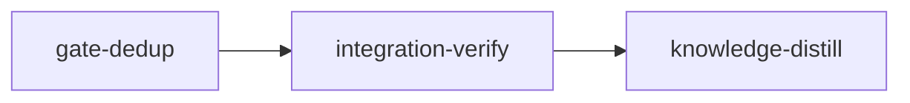

# Plan: Gate Dedup

## Overview

Every loom stage, in every project loom drives, runs the same verification commands several times on one tree. The runs come from:

- implementers;
- the main agent;
- each `loom-verifier` round, which runs the full suite in its shell and then every criterion through `loom check`;
- every `loom stage complete` retry.

This plan makes the work run once, and removes the `loom-verifier` subagent.

- The orchestrator runs `loom check <stage>` itself, once, as a compact host job.
- A fix round re-runs only the failed criteria (`loom check --criterion`).
- `loom stage complete` reuses the cached passes on the unchanged tree.
- The code reviewer, whose round a v2 stage needs anyway, judges the diff against each criterion's intent.
- The main agent is blocked from full-suite runs.
- Plans stop adding test criteria the full suite already covers.

The plan also fixes an adjudication defect that stranded the host-jobs stage: an accepted contract dispute re-freezes only the contract's own file and never the harness files. The live instance was force-completed; the defect remains for every project.

**Sequencing.** Run after `IN_PROGRESS-PLAN-host-verification` completes and `./dev-install.sh` installs it, and before `token-optim/PLAN-04` to `PLAN-06`. Its daemon-completion stage still changes `stage_service/contracts.rs`, `commands/verify.rs`, `relay/payload.rs` and `host_verify/**`. This plan's briefs pin names as they stand at `1b5a0c91`, and every worker re-reads its seams at the stage base.

## Evidence (stage transcripts 2026-10-16 to 2026-10-21, loom and collaterai)

| Stage | Observed |
| --- | --- |
| loom/integration-verify | 4 verifier sessions ran `cargo test` 30 times. Each round ran the full suite, doctests, clippy, then `loom check` re-ran the criteria. `loom stage complete` ran 15 times (about 40 min). |
| loom/host-jobs | About 2 h for a simple stage. Memory: "the gate round took about 18+ min for about 6 min of real testing ... loom check re-ran every acceptance criterion (mostly cargo test subsets already covered by --all-targets), and loom stage complete runs them a third time". |
| loom/delivery-fixes | The verifier ran the full suite, then each criterion by hand, then `loom check`. `loom stage complete` ran 12 times (about 28 min). |
| collaterai/shared-contracts | `loom stage complete` ran 20 times; the main agent ran the JS suite 22 times. |
| loom/host-jobs, dispute 2 | The accept re-froze `tests/host_verification_contracts.rs` but left `support.rs` at its pre-dispute hash. The frozen pair no longer compiled together. The completion hash check could never pass, and `contracts restore` would have broken the build. |

## Causes and what this plan changes

| # | Cause (file:line at `1b5a0c91`) | Change |
| --- | --- | --- |
| 1 | `agents/loom-verifier.md:24-25` and `VERIFIER_GATE` (`signals/cache/blocks.rs:90`) have the verifier run "the complete command, never a filtered subset" in its shell AND every criterion through `loom check`. A standard stage's acceptance is module-filtered by the plan-writer rule, so the shell full suite is a run nothing requires. | No verifier subagent. Its two jobs are covered elsewhere: running the gate without filling the orchestrator's context is what `loom check` already does (a host job with a per-criterion summary and full logs in files); judging the diff against criteria intent moves to the `loom-code-reviewer` round every v2 stage already runs. The orchestrator runs `loom check <stage>` once, plus the steps the plan lists outside acceptance, and runs no test, build or lint command itself after the workers return. The `loom-verifier` agent and every reference to it are removed. |
| 2 | A fix round re-runs the whole gate. | `loom check <stage> --criterion <n>` re-runs only the named criteria, locally or as a host job. |
| 3 | Host-job cache reuse between a Check and the Complete that follows it is untested. The child uses the cache (`host_verify/child.rs:125-129`), but no test covers a Check followed by a Complete. | A test pins it; a miss is fixed at its cause. |
| 4 | The full-suite plan lint is cargo-only (`plan/schema/validation_suite.rs:106`, hand tokenizer), although every adapter implements `TestRunnerAdapter::is_full_run` (`testrun/mod.rs:96`). Integration-verify plans also list filtered runs that the full suite already covers. | The lint uses the adapters, for every runner. A new warning flags a filtered criterion subsumed by a full-suite criterion of the same runner. |
| 5 | `subagent-verify-guard.sh:66` exits for the main agent, so the main agent re-runs suites freely. The guard misses `vitest`, `jest` and other adapters' runners. | The guard blocks unfiltered test-suite runs by a standard stage's main agent, and recognises every adapter's runner. |
| 6 | `apply_contract::accept` (`orchestrator/adjudication/apply_contract.rs:27-65`) re-freezes only contract files; `store::refreeze` (`verify/contracts/store.rs:238-276`) only upserts the paths it is given. Harness files keep stale hashes. The adjudicator prompt shows only the contract file (`prompt/contract.rs:210-223`). | Accept re-freezes the stage's whole frozen set: contract files plus harness globs re-expanded, with deleted harness files dropped. The prompt shows the diff of every changed frozen file. |

No tree binding is added to the re-freeze. Filing a dispute ends the stage session, and the daemon applies the verdict before a new session starts, so nothing edits the worktree in between.

## Goals

- A standard stage's gate is one `loom check` by the orchestrator, plus the steps acceptance cannot carry, with no verifier subagent. A fix round re-runs only failed criteria. `loom stage complete` runs once per final tree and reuses the check's cached passes.
- Every change applies to every project and to every test runner loom has an adapter for.
- An accepted contract dispute leaves a frozen set that matches the worktree, so completion's hash check passes and `restore` is safe.
- Non-goals: no change to which criteria a stage must pass; no change to the review gate; no cap on implementers' filtered runs; no change to loom's own test suite.

## Execution Diagram



## Stages

### 1. gate-dedup (standard)

One stage, five workers in disjoint territories:

- **W1:** `--criterion` and host-job reuse.
- **W2:** contract re-freeze.
- **W3:** plan lints.
- **W4:** main-agent guard.
- **W5:** doctrine.

No stage split passes the necessity test:

- Q1 (merge order): no worker needs another's code merged. W5's text names `loom check --criterion`, whose spelling is pinned here.
- Q2 (file overlap): none.
- Q3 (checkpoint before later work): none needed.
- Q4 (context): five reports fit one session.

Knowledge-bootstrap is skipped: the tier-1 files describe this codebase.

The stage runs its own gate under the new flow, in this order:

1. The workers' filtered tests.
2. The orchestrator's single `loom check gate-dedup`, plus the steps outside acceptance.
3. Fix rounds with `--criterion`.
4. The final review beside the gate, judging the diff against each criterion's intent.

There is no verifier subagent.

Risk checklist:

| Risk | Covered by |
| --- | --- |
| Lifecycle (a re-freeze after an accepted dispute) | `refreeze-covers-changed-harness-files`, `refreeze-drops-deleted-harness-files` |
| Configuration propagation (a selection that is parsed and then ignored) | `check-criterion-runs-only-named-criteria` |
| Lifecycle (a job join that lets a subset stand in for the full gate) | `full-check-never-joins-a-subset-job` |
| Untrusted input (a non-cargo runner's command) | `plan-verify-flags-full-vitest-suite-in-standard-stage`, `guard-blocks-main-agent-full-vitest-run` |
| Reachability | Every contract drives the binary, the hook script, or the public `AdjudicatorRegistry::apply_verdict` and `host_verify::submit::submit` |

### 2. integration-verify

- Runs the full suite once, through the new flow.
- Re-runs every wiring check.
- Counts gate-command executions in this plan's own stage transcripts against the evidence table, and records them in memory.

### 3. knowledge-distill

Curates the memories and corrects stale knowledge:

- the memory notes that say "`loom check` exits 0";
- the `v2-contracts.md` sentence that an accepted contract dispute re-freezes "that contract at its current content".

It records the one-run-per-tree flow, and records the 26 tests in loom's own suite that fail only in a sandboxed shell as a loom repository concern.

## Environment inventory

| Need | Stage | State |
| --- | --- | --- |
| crates.io registry (no new dependencies expected) | gate-dedup, integration-verify | allowed |
| `web/node_modules` for the repository's JS provision lint and markdownlint | all | provisioned |
| A host daemon for host jobs | none: contracts call `submit` and the binary's local path directly | n/a |
| cargo audit, markdownlint, flake-check | integration-verify, outside acceptance | the orchestrator runs them in the session; cargo audit stays with the operator (no dependency change) |

## Before `loom run` (operator)

- host-verification merged and installed with `./dev-install.sh`.
- Re-check this plan's pinned names against the merged tree. Look in particular for:
  - a `criteria` field already on `SubmitRequest`;
  - `read_files` having moved out of `stage_service/contracts.rs`;
  - a new parameter on `verify::execute`.

  Then run `loom plan verify --strict`.

## After the plan (operator)

- Run `./dev-install.sh`.
- On the next plan, confirm that no verifier subagent is spawned, that the orchestrator runs `loom check` once, and that `loom stage complete` after a passing check on an unchanged tree reports every criterion cached.

---

<!-- loom METADATA -->

```yaml
loom:
  version: 2
  ratchet_files:
    - loom/maintainability-baseline.txt
    - doc/loom/knowledge/check-baseline.txt
  provision:
    - working_dir: "web"
      command: "test ! -e .npmrc && test ! -L .npmrc && bun install --frozen-lockfile --ignore-scripts --backend=copyfile --config=/dev/null"
  sandbox:
    enabled: true
    auto_allow: true
    filesystem:
      deny_read: ["~/.ssh/**", "~/.aws/**", "~/.config/gcloud/**", "~/.gnupg/**"]
    network:
      allowed_domains: ["crates.io", "index.crates.io", "static.crates.io", "registry.npmjs.org"]
      allow_local_binding: true
      allow_unix_sockets: []
  stages:
    - id: gate-dedup
      name: "Gate dedup and harness re-freeze"
      summary: "Cuts repeated verification runs in every loom stage (no verifier subagent: the orchestrator runs loom check once, fix rounds re-run only failed criteria, the main agent cannot re-run suites, plans stop adding subsumed criteria) and makes an accepted contract dispute re-freeze the harness files too."
      stage_type: standard
      skills: ["loom-rust"]
      implementers: ["claude"]
      subagent_timeout_secs: 900
      working_dir: "loom"
      dependencies: []
      description: |
        Implement stage 1 of doc/plans/PLAN-gate-dedup.md (renamed IN_PROGRESS-PLAN-gate-dedup.md once loom run starts).
        Use parallel subagents and skills to maximize performance.
        PATHS: working_dir is loom/; YAML and worker-table paths are package-relative (../ for files outside the crate); brief paths are repo-relative from the worktree root.
        Every worker reads doc/plans/briefs/gate-dedup/gate-dedup/common.md first, then its own brief. Names were pinned at 1b5a0c91, before host-verification's daemon-completion stage: each worker re-reads its seams at this stage's base and records any moved name with loom memory note.

        MAIN AGENT, IN ORDER:
        1. SPAWN W1-W5 in ONE message, background, BY AGENT TYPE (W1, W2: loom-senior-software-engineer; W3, W4, W5: loom-software-engineer), each with a short fixed prompt plus "Your brief: <path>. Read it in full before anything else." Wait with one background loom subagents watch. Territories are DISJOINT; workers never spawn subagents and never run git.
        2. AFTER ALL RETURN: cargo fmt --all (it rewrites files, so it runs before the gate). Run no test, build or clippy yourself: the workers ran their filtered tests and loom check runs the rest. A frozen contract file the formatter would rewrite fails completion; that is a dispute-contract, never an edit. Route any failure a worker reported to a fresh worker of the owning territory with the report quoted.
        3. THE GATE, under the flow this stage ships (there is NO verifier subagent; do not spawn one even though this session's own doctrine may still describe it):
           - In ONE message, run loom check gate-dedup yourself (bare; read its first line; run it again while it says requested or pending) and spawn the review round (step 4).
           - Then run each step acceptance cannot carry, once, from loom/: bash ../loom-hooks/tests/run-all.sh; LOOM_HOOK_TEST_BSD=1 bash ../loom-hooks/tests/run-all.sh; ../scripts/check-hook-syntax.sh; git diff --quiet -- maintainability-baseline.txt.
           - Read the per-criterion summary. Open a failing criterion's full log only at the path it prints.
           - Each FAIL becomes a fix brief to a fresh worker of the owning territory. Then run loom check gate-dedup --criterion <n> for each failed criterion plus the fmt and clippy criteria, never the whole list.
           - A criterion failing only because of where it runs is disputed per the signal.
        4. REVIEW: spawn the loom-code-reviewer round alongside step 3 once step 2 is done. The reviewer also judges the diff against each acceptance criterion's intent, and treats a change that passes a criterion's letter but misses its intent as a finding. Review focus:
           - security: no path from a session-supplied value into the freeze record; the re-freeze reads no symlink, stays under the working dir, and keeps the 500-file and 64 MiB caps;
           - lifecycle: an accept retried after a partial failure gives the same record; a subset Check can never satisfy a full Check or Complete;
           - completeness: no reference to a verifier subagent survives outside CHANGELOG history.

           Fixes go to fresh workers; the re-review covers the changed files and open findings only. Edit nothing after the final round.
        5. loom stage complete gate-dedup once, after the final round. It should report the criteria cached from step 3 when nothing changed since. A failure is answered with a fix, a --criterion re-check and one more completion, never a bare retry.

          | Worker | Role | Tier | Files owned | Shared context | Brief path |
          | W1 | Check subset and host-job reuse | opus | src/cli/types.rs; src/cli/dispatch.rs; src/commands/verify.rs; src/commands/verify_relay.rs; src/commands/stage/acceptance_runner.rs; src/verify/criteria/config.rs; src/verify/criteria/runner.rs; src/host_verify/mod.rs; src/host_verify/submit.rs; src/host_verify/child.rs; src/host_verify/tests_submit.rs; src/host_verify/tests_child.rs; src/relay/payload.rs | common.md | doc/plans/briefs/gate-dedup/gate-dedup/w1-check-subset.md |
          | W2 | Contract re-freeze | opus | src/orchestrator/adjudication/apply_contract.rs; src/orchestrator/adjudication/apply_contract_tests.rs; src/orchestrator/adjudication/prompt/contract.rs; src/orchestrator/adjudication/prompt/contract_tests.rs; src/verify/contracts/store.rs; src/verify/contracts/store_tests.rs; src/verify/contracts/frozen_set.rs; src/verify/contracts/mod.rs; src/verify/contracts/completion_tests.rs; src/stage_service/contracts.rs | common.md | doc/plans/briefs/gate-dedup/gate-dedup/w2-refreeze.md |
          | W3 | Plan lints | sonnet | src/plan/schema/validation_suite.rs; src/plan/schema/tests/validation_suite_tests.rs | common.md | doc/plans/briefs/gate-dedup/gate-dedup/w3-plan-lints.md |
          | W4 | Main-agent guard | sonnet | ../loom-hooks/subagent-verify-guard.sh; ../loom-hooks/tests/subagent-gate-payload.sh; tests/integration/hooks_subagent_verify_guard.rs; tests/integration/hooks_subagent_verify_guard_cases.rs; tests/integration/hooks_subagent_verify_guard_carveout.rs; tests/integration/hooks_subagent_verify_guard_main.rs; tests/integration/mod.rs | common.md | doc/plans/briefs/gate-dedup/gate-dedup/w4-guard.md |
          | W5 | Doctrine and verifier removal | sonnet | ../agents/loom-verifier.md; ../agents/loom-code-reviewer.md; ../CLAUDE.md.template; ../AGENTS.md.template; ../README.md; ../CONTRIBUTING.md; ../loom-hooks/spawn-guard.sh; ../loom-hooks/tests/loom-relay-kinds.sh; ../skills/loom-plan-writer/references/codex-implementers.md; ../skills/loom-plan-writer/references/parallelization.md; ../skills/loom-plan-writer/references/stage-sizing.md; src/commands/usage/sections/lifecycle_orientation.rs; src/relay/matrix_host.rs; src/orchestrator/core/inbox_drain/check.rs; src/models/stage/defaults.rs; ../skills/loom-orchestration/SKILL.md; ../skills/loom-plan-writer/SKILL.md; ../skills/loom-plan-writer/references/verification-rules.md; ../skills/loom-plan-writer/references/v2-contracts.md; ../skills/loom-plan-writer/references/sandbox.md; ../skills/loom-plan-writer/references/plan-template.md; ../loom-hooks/_subagent-preamble.txt; src/orchestrator/signals/cache/blocks.rs; src/orchestrator/signals/cache.rs; src/orchestrator/signals/format/codex.rs; src/orchestrator/signals/tests_doctrine_prefixes.rs; src/orchestrator/signals/tests_doctrine_blocks.rs; src/orchestrator/signals/tests_doctrine_gate.rs; src/orchestrator/signals/mod.rs | common.md | doc/plans/briefs/gate-dedup/gate-dedup/w5-doctrine.md |

        CONTRACT SURFACE (the contract session writes tests/gate_dedup_contracts.rs and tests/gate_dedup_contracts/support.rs from this text before any code). Each contract is a top-level #[test] fn named after its id with underscores; every fn under 50 lines, every file under 400 lines, rustfmt-clean. The file declares `#[path = "integration/helpers.rs"] #[allow(dead_code)] mod helpers;`, `#[path = "host_verification_contracts/support.rs"] #[allow(dead_code)] mod hv_support;` and `#[path = "gate_dedup_contracts/support.rs"] mod support;`, and spawns the loom binary only through helpers::loom_cmd() (tests/integration/binary_spawn_guard.rs fails a direct spawn).
        - Re-freeze fixture (support.rs): copy the shape of src/orchestrator/adjudication/apply_contract_tests.rs::fixture and tests/adjudication_e2e.rs (write_stage, write_dispute, write_plan): a TempDir git repository with a stage worktree, stage-a (plan_version 2, working_dir ".", harness ["tests/support/**"], one contract c1 with file tests/x.rs), a freeze record written with loom::verify::contracts::store::write_freeze holding tests/x.rs and tests/support/helper.rs at their committed bytes, a contract dispute on c1 with an accept verdict whose plan patch changes nothing, applied through loom::orchestrator::adjudication::AdjudicatorRegistry::apply_verdict(work_dir, "stage-a", 1). Read the result with loom::verify::contracts::store::load_freeze.
        - Check fixture: hv_support::build_fixture(acceptance) gives a repository, a stage worktree and a state root; run loom check from the worktree WITHOUT session variables (helpers::loom_cmd with LOOM_WORK_DIR only), which takes the local path.
        - Library calls: loom::host_verify::submit::{submit, SubmitRequest, Submission}, loom::host_verify::JobKind; SubmitRequest gains `criteria: Option<Vec<usize>>` (None = every criterion), the one new public name the contracts use.
        - Every contract fails at the base: the re-freeze leaves helper.rs at its old hash; --criterion and SubmitRequest.criteria do not exist (a build failure counts as red); the lint and the guard ignore vitest.

        MEMORY: record mistakes, decisions and surprises via loom memory immediately (subagents too), including any knowledge the tree contradicts as loom memory note "stale-knowledge: <file>#<heading> claims X; the tree does Y (file:line). Correction: <text>". NEVER loom knowledge (implementation stage); NEVER Claude Code auto-memory.
      files:
        - "src/cli/types.rs"
        - "src/cli/dispatch.rs"
        - "src/commands/verify.rs"
        - "src/commands/verify_relay.rs"
        - "src/commands/stage/acceptance_runner.rs"
        - "src/verify/criteria/config.rs"
        - "src/verify/criteria/runner.rs"
        - "src/host_verify/**"
        - "src/relay/payload.rs"
        - "src/orchestrator/adjudication/apply_contract.rs"
        - "src/orchestrator/adjudication/apply_contract_tests.rs"
        - "src/orchestrator/adjudication/prompt/contract.rs"
        - "src/orchestrator/adjudication/prompt/contract_tests.rs"
        - "src/verify/contracts/**"
        - "src/stage_service/contracts.rs"
        - "src/plan/schema/validation_suite.rs"
        - "src/plan/schema/tests/validation_suite_tests.rs"
        - "src/orchestrator/signals/**"
        - "tests/integration/hooks_subagent_verify_guard*.rs"
        - "tests/integration/mod.rs"
        - "tests/gate_dedup_contracts.rs"
        - "tests/gate_dedup_contracts/**"
        - "../loom-hooks/subagent-verify-guard.sh"
        - "../loom-hooks/_subagent-preamble.txt"
        - "../agents/loom-verifier.md"
        - "../agents/loom-code-reviewer.md"
        - "../CONTRIBUTING.md"
        - "../loom-hooks/spawn-guard.sh"
        - "../loom-hooks/tests/subagent-gate-payload.sh"
        - "../loom-hooks/tests/loom-relay-kinds.sh"
        - "src/commands/usage/sections/lifecycle_orientation.rs"
        - "src/relay/matrix_host.rs"
        - "src/orchestrator/core/inbox_drain/check.rs"
        - "src/models/stage/defaults.rs"
        - "../CLAUDE.md.template"
        - "../AGENTS.md.template"
        - "../README.md"
        - "../skills/loom-orchestration/SKILL.md"
        - "../skills/loom-plan-writer/**"
      harness: ["tests/gate_dedup_contracts/**"]
      contracts:
        - id: refreeze-covers-changed-harness-files
          file: tests/gate_dedup_contracts.rs
          test: refreeze_covers_changed_harness_files
          scenario: "the re-freeze fixture; before applying the verdict, rewrites tests/support/helper.rs in the worktree to new bytes; applies the accept; load_freeze's entry for tests/support/helper.rs has the sha256 of the new bytes and the frozen copy under the contracts store holds the new bytes"
          rejects: "an accept that re-freezes only the disputed contract's own file and leaves every harness file at its pre-dispute hash"
        - id: refreeze-drops-deleted-harness-files
          file: tests/gate_dedup_contracts.rs
          test: refreeze_drops_deleted_harness_files
          scenario: "the re-freeze fixture; before applying the verdict, deletes tests/support/helper.rs from the worktree; applies the accept; apply_verdict returns Ok and load_freeze lists no tests/support/helper.rs entry"
          rejects: "an accept that keeps a deleted harness file in the record (completion then reports it missing forever) or fails the whole accept on the missing file"
        - id: check-criterion-runs-only-named-criteria
          file: tests/gate_dedup_contracts.rs
          test: check_criterion_runs_only_named_criteria
          scenario: "the check fixture with acceptance ['touch ran-0', 'touch ran-1', 'touch ran-2']; runs `loom check stage-a --criterion 1` from the worktree; asserts exit 0, the worktree holds ran-1 and neither ran-0 nor ran-2, and stdout names criterion 1"
          rejects: "a --criterion flag that is parsed and then ignored, so every criterion runs"
        - id: full-check-never-joins-a-subset-job
          file: tests/gate_dedup_contracts.rs
          test: full_check_never_joins_a_subset_job
          scenario: "a TempDir state root; submit() a Check for stage-a, session-a, head 40 x 'a', tree_digest 64 x 'b', no_cache false, criteria Some(vec![1]), request r1; then the same request with criteria None, request r2; asserts the second is not Submission::Joined"
          rejects: "a covers rule that ignores the criteria field, so a full gate request is answered by a one-criterion run"
        - id: plan-verify-flags-full-vitest-suite-in-standard-stage
          file: tests/gate_dedup_contracts.rs
          test: plan_verify_flags_full_vitest_suite_in_standard_stage
          scenario: "writes a version 1 plan (so missing bookends stay warnings) to a TempDir whose standard stage's acceptance is ['bunx vitest run'] and runs `loom plan verify <plan>`; asserts stdout or stderr contains 'runs the whole test suite' naming that criterion; a second plan with ['bunx vitest run src/a.test.ts'] produces no such line"
          rejects: "a full-suite lint that still recognises only cargo test and cargo nextest"
        - id: guard-blocks-main-agent-full-vitest-run
          file: tests/gate_dedup_contracts.rs
          test: guard_blocks_main_agent_full_vitest_run
          scenario: "drives ../loom-hooks/subagent-verify-guard.sh the way tests/integration/hooks_subagent_verify_guard.rs does, as the MAIN agent of a live standard stage (payload with no agent_type, LOOM_MAIN_AGENT_PID a live ancestor), with the Bash command 'bunx vitest run'; asserts the hook blocks it and its message names loom check; the same payload with 'bunx vitest run src/a.test.ts' is allowed"
          rejects: "a guard that still exits early for the main agent, or that does not recognise vitest"
      acceptance:
        - "cargo test --test gate_dedup_contracts"
        - "cargo test --lib host_verify::"
        - "cargo test --lib verify::contracts::"
        - "cargo test --lib orchestrator::adjudication::"
        - "cargo test --lib plan::schema::"
        - "cargo test --lib orchestrator::signals::"
        - "cargo test --lib verify::criteria::"
        - "cargo test --test integration hooks_subagent_verify_guard"
        - "cargo clippy --all-targets -- -D warnings"
        - "cargo fmt --check"
        - "test ! -e ../agents/loom-verifier.md"
        - 'rg -qF -- "--criterion" ../skills/loom-orchestration/SKILL.md'
      wiring:
        - source: "src/cli/dispatch.rs"
          pattern: "criterion"
          description: "loom check's --criterion selection reaches the check dispatch"
        - source: "src/orchestrator/adjudication/apply_contract.rs"
          pattern: "frozen_set"
          description: "accept re-freezes through the shared frozen-set reader"

    - id: integration-verify
      name: "Integration Verification"
      summary: "Runs the full suite once under the new flow, re-checks all wiring, and counts gate runs in this plan's own sessions against the evidence."
      stage_type: integration-verify
      skills: ["loom-rust"]
      working_dir: "loom"
      dependencies: ["gate-dedup"]
      description: |
        Final verification after gate-dedup. Verify FUNCTIONAL INTEGRATION, not just tests passing. NEVER Claude Code auto-memory.
        CONTEXT: read the plan (doc/plans/), loom memory show --all, doc/loom/knowledge/INDEX.md and only the relevant sections.
        GATE, under the flow this plan ships (no verifier subagent): you run loom check integration-verify once yourself (it carries the full suite, clippy and fmt below), plus, each once: bash ../loom-hooks/tests/run-all.sh; LOOM_HOOK_TEST_BSD=1 bash ../loom-hooks/tests/run-all.sh; ../scripts/flake-check.sh; from the repository root, git ls-files '*.md' | rg -v '^doc/plans/|^loom/tests/fixtures/' | xargs web/node_modules/.bin/markdownlint-cli2. Reviewers run only targeted checks. A fix round re-runs loom check integration-verify --criterion <n> for the failed criteria. cargo audit is the operator's (no dependency changes).
        CODE REVIEW: parallel loom-code-reviewer subagents (the re-freeze's file reads and caps; the job join rule with subsets; the guard's main-agent detection cannot block an ordinary non-loom session; doctrine states one flow on every surface; no surface, hook, agent table or code comment still names a verifier subagent; the reviewer judges criteria intent). Fix or dispute every finding, never defer one.
        SUGGESTIONS: weigh every pending reviewer suggestion the signal lists; resolve each one implemented with loom memory resolve <id> --outcome implemented --reason <what changed>.
        FUNCTIONAL: in a scratch repository (mktemp -d "${TMPDIR:-/tmp}/gd.XXXXXX"), loom init a two-stage version 1 plan whose stage has three trivial criteria, then run loom check <stage> --criterion 1 and confirm only criterion 1 ran. Count Bash calls running cargo test, cargo clippy, loom check and loom stage complete per agent in this plan's stage transcripts (~/.claude/projects/*worktrees-gate-dedup*/ and *worktrees-integration-verify*/, subagents included), compare with the plan's evidence table, and record the counts with loom memory note.
        Record discoveries to loom memory for knowledge-distill, including any knowledge file contradicted by the tree: loom memory note "stale-knowledge: ...".
      acceptance:
        - "env -u GIT_INDEX_FILE -u GIT_DIR -u GIT_WORK_TREE cargo test --all-targets --no-fail-fast"
        - "cargo test --doc --workspace --all-features -- --test-threads=1"
        - "cargo clippy --all-targets -- -D warnings"
        - "cargo fmt --check"
        - "rg -q vitest ../loom-hooks/subagent-verify-guard.sh"
      wiring:
        - source: "src/cli/dispatch.rs"
          pattern: "criterion"
          description: "loom check's --criterion selection reaches the check dispatch"

    - id: knowledge-distill
      name: "Knowledge Distillation"
      summary: "Records the one-run-per-tree gate flow and the harness re-freeze in the knowledge base and corrects the stale notes."
      stage_type: knowledge-distill
      working_dir: "."
      dependencies: ["integration-verify"]
      description: |
        Curate all stage memories into permanent knowledge; update user docs. NEVER Claude Code auto-memory.
        SINGLE-AGENT: do NOT spawn subagents.
        START with loom memory pending --group; read the plan and the knowledge sections it touches.
        CORRECTIONS FIRST: apply every stale-knowledge: memory in place with loom knowledge replace-section <file> "<heading>" "<body>", never loom knowledge update; confirm no heading got duplicated. Known stale claims: notes that loom check exits 0 on a failed criterion (commands/verify.rs ensure_passed makes it fail); architecture/verification-v2-gates.md and any section stating the verifier runs the full suite in its shell.
        Then curate: the gate flow (no verifier subagent; the orchestrator runs loom check once, --criterion for fix rounds, the reviewer judges criteria intent, complete once per final tree) in architecture/verification-v2-gates.md; the re-freeze rule (an accept re-freezes contracts plus re-expanded harness files, deleted ones dropped) beside the contract store knowledge; the evidence table and causes as a mistake entry in mistakes/verification-harness.md; the 26 loom tests that fail only in a sandboxed shell (confine_scratch.rs scratch_roots, tests/integration/hooks_subagent_verify_guard.rs TMPDIR refusal) as a concern under concerns/.
        TIER ROUTING: findings ~40 lines or fewer go inline in the tier-1 file; larger via loom knowledge update <category>/<slug> with a 2-4 line tier-1 summary + link.
        SUGGESTIONS: record every unimplemented reviewer suggestion in concerns or its topic, then resolve it promoted, merged or discarded.
        RECEIPTS: every Note/Decision/Question taken into knowledge gets loom memory resolve <id> --outcome promoted|merged|discarded|deferred; finish with loom memory pending --strict.
        LAST, if this stage removed structural issues: loom knowledge check --write-baseline doc/loom/knowledge/check-baseline.txt
      acceptance:
        - "loom knowledge check --strict --baseline doc/loom/knowledge/check-baseline.txt"
        - "loom memory pending --strict"
      files: ["doc/loom/knowledge/**", "README.md", "CONTRIBUTING.md"]
```

<!-- END loom METADATA -->
