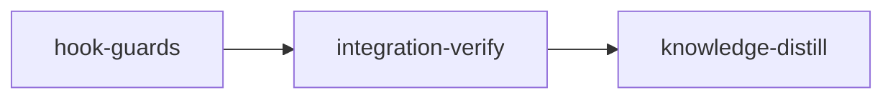

# Plan: Hook False Positives

Implements: none

## Overview

Loom's PreToolUse guards blocked 435 tool calls between 2026-10-31 and 2026-11-07. Almost all of them were legitimate, and agents routed around most of them. This plan narrows each guard so that it blocks only what it can decide soundly:

- resolve paths and git targets against the real, physical working directory instead of matching `../` lexically
- rewrite the plain completion command to the pinned one instead of rejecting it
- let file tools read the harness's own output
- let subagents compile their own files
- exempt scratch fixture repositories from the git rules
- turn the first whole read of a large file with no outline into a warning
- record every block of the seven guards this plan touches in a per-stage ledger, with a `loom hook blocks` report

Write confinement, credential denies, commit authority, the subagent completion deny and the isolation-bypass rule stay exactly as strict as they are today.

## Goals

- Remove the false-positive classes in the evidence table without weakening any invariant the capsule or the daemon enforces.
- Every relaxation ships with tests proving the hostile variant still blocks.
- Non-goal: parsing shell soundly. The lexical guards stay defense in depth; the bubblewrap capsule stays the write boundary.

## Evidence (2026-10-31 to 2026-11-07)

Mined from every transcript under `~/.claude/projects/` modified in the window (1,037 sessions): 435 deduplicated PreToolUse blocks, 197 of them in subagents.

| Blocks | Guard and rule | Typical blocked command | Legitimate | Agent's next step |
| --- | --- | --- | --- | --- |
| 123 | `worktree-isolation.sh` path traversal | `cd <wt>/web/src && sed -n … ../../doc/plans/…` (resolves inside the worktree) | ~all | same command with absolute paths |
| 96 | `loom-control-complete.sh` exact pinned command | `loom stage complete X 2>&1 \| tail -30` | yes | pinned command |
| 33 | `loom-control-complete.sh:288` bare command | `loom stage complete X`, the form CLAUDE.md Rule 4 and the signals print | yes | pinned command |
| 70 | `worktree-file-guard.sh` Read outside the worktree | harness `~/.claude/projects/<wt>/<session>/tool-results/*.txt`, `$TMPDIR/*.log` | yes | `cat`/`sed` of the same file in Bash |
| 42 | `subagent-verify-guard.sh:309` | `cargo check --lib --tests`, `cargo build`, `bun run build`, `tsc --noEmit` | yes | `rustfmt` per file, `node_modules/.bin/vitest`, or code left uncompiled |
| 37 | `worktree-isolation.sh` git override | `git -C .`, `git -C "$SCRATCH/clone"`, `git rev-parse --git-dir` | 36 of 37 | dropped `-C`; one `eval` loop became a Python `subprocess` loop |
| 19 | `_read_discipline.sh` large read | 500-line test files, tool-results files | yes | identical retry (allowed on repeat) |
| 6 | `commit-filter.sh` subagent git / no git commit | `git init && git commit` in a scratch fixture repo | yes | rearranged commands |
| 4 | `subagent-verify-guard.sh` gate-once (main agent) | `cargo test --lib --no-run` (compile only) | yes | filtered test |
| 3 | `commit-filter.sh` isolation bypass | `unset LOOM_MAIN_AGENT_PID` | no | correct block, unchanged |

The 42 verify-guard blocks explain a recent stage whose wave-2 code reached the gate uncompiled; the gate then found six failures. The capsule is active and is the real write boundary: the same window shows 71 `Read-only file system` denials. `worktree-isolation.sh:14-19` and `subagent-verify-guard.sh:38-42` already describe themselves as best-effort.

## Decisions

| Decision | Choice | Reason |
| --- | --- | --- |
| Subagent compile commands | Allow `cargo check`, `cargo build`, `cargo test --no-run`, `tsc` with `--noEmit` and no watch flag, and `<pm> run build`; `vite build` and `rustfmt --edition 2021 <files>` are already allowed. Keep blocking every `cargo fmt` form, `cargo clippy`, unfiltered suites, and `lint`/`typecheck` scripts, whose bodies are not inspected | Compiler feedback is part of writing code; full suites and lints are the gate's. `cargo fmt -- <files>` is no per-file form: cargo appends the named files to every target's and reformats the whole package (observed on a scratch crate). `rustfmt` on a file that declares `mod x;` also formats x; accepted |
| Parallel `cargo` lock contention | Accept it | Cargo serializes on the build lock; a wait costs less than a failed gate round |
| Completion rewrite scope | Only `loom stage complete <own-id>` from a main agent, bare or followed by `2>&1` and/or one `\| tail/head -N`. `updatedInput` is the pinned command plus the model's `timeout` and `description`, nothing else | The rewritten command is byte-identical to the pinned one, so the trust argument does not change. Claude Code 2.1.319 replaces the whole tool input with `updatedInput`, so the timeout is carried over; `run_in_background` and `dangerouslyDisableSandbox` never ride on a hook allow. A deny from any other hook (`commit-filter.sh`'s subagent completion deny) still wins |
| Effective cwd | Track `cd` through `&&`, `;` and newline only; after any subshell, `$(`, backtick or `sh -c` splice, every segment past the first `cd` is unknown. Resolve paths physically (`cd -P` on existing prefixes) | `(cd x && :); cmd`, `$(cd x)` and `sh -c "cd x"` leave the outer cwd unchanged, and every worktree's `.loom/work` is a symlink into the main checkout (`git/worktree/settings.rs:49-76`) |
| Path traversal with an unknown cwd | Warn for a token today's pair check flags; keep today's allow for a token only the new single-`..` widening finds | The capsule enforces writes; reads inside the repository are harmless |
| Git `-C` with an unknown cwd | Block | A retargeted git writes refs |
| Scratch class | `$LOOM_SCRATCH_DIR` only, never `$TMPDIR`. A `$LOOM_SCRATCH_DIR` reference in a command expands to the hook's value unless the command could reassign it | Hooks inherit the daemon's environment (`process/environment.rs:94`); the Bash tool exports `TMPDIR=/tmp/claude-<uid>` only inside each command, and the hooks' own read ledgers sit in `/tmp/loom-reads/<sid>`. A uid-owned test TMPDIR would class every fixture as scratch. LOOM_SCRATCH_DIR has one value in both environments (`wrapper/host_env.rs:46-51`) and lives outside `/tmp` and the repo (`relay/scratch.rs:33-60`) |
| Scratch-repo git | Lift only the subagent `git commit`/`git add` rule and the no-git-commit rule, and only when every git segment targets scratch and the hook's rev-parse puts its toplevel, git dir and common dir in scratch, or the same `&&` chain ran `git init` there first | A `.git` gitfile in scratch can point into the main repository (observed); a command with no git segment is never exempt, or `cd <scratch> && loom stage complete` from a subagent would pass |
| File-tool reads | Read tool only: this session's harness `tool-results/` files, and regular files under the literal `/tmp/claude-<uid>` outside other sessions' uuid directories | Bash already reads them; blocking only the file tool adds nothing. A Grep or Glob over the root would recurse into other sessions |
| First large read | Warn only when no outline is available; an outlined first read keeps today's deny-once | Supersedes, for unoutlined files, the deny-once gate that `loom/tests/read_gate_contracts.rs` froze (commit 495f843a): a denial that offers no route but a retry teaches nothing, while the outlined denial carries the outline |
| Shared helpers | New functions go into files the guards already source: `_containment.sh`, `_common.sh`, `_read_ledger.sh`, `_git-command.sh`. No new sourced files | 17 Rust fixtures copy fixed helper lists (`rg -l '"_common.sh"' loom/src loom/tests`), and `LOOM_HOOKS` (`fs/permissions/constants.rs:198`) embeds every helper |
| Ledger location | `$LOOM_WORK_DIR/heartbeat/<stage>.blocks.jsonl` | Claude-lane hooks already write that directory (`_post-tool-heartbeat.sh:128-136`, the `.context-ceilings` files); every Rust reader there addresses `<stage>.json` by name or filters on `json` (`orchestrator/monitor/heartbeat.rs:221`), and no watcher reacts to writes |
| Ledger scope | Claude-lane main-agent and subagent blocks of the guards in `common.md`, in stage sessions of the current plan run. Operator, planning and codex-lane blocks, and the guards `common.md` lists as unrecorded, are not recorded. `loom init`/`loom clean` delete the ledger unarchived. Write failures are silent | Codex-lane hooks run inside the stage Bash sandbox, where `<repo>/.loom` is denied (`sandbox/control_surfaces/session_denies.rs:79-80`). A before/after comparison with the Evidence table re-mines transcripts |
| `loom hook blocks` directory | `$LOOM_WORK_DIR/heartbeat` verbatim when the variable is set, else `WorkDir::new(".")` | The hooks write the variable verbatim; `WorkDir::new` maps a work dir not named `.loom/work` to `<dir>/.loom/work` or walks up into the enclosing checkout (`fs/work_dir.rs:153-167`) |
| Ledger safety | Writer: append only when the ledger is absent or a regular non-symlink file of at most 4 MiB, under `umask 077`, no lock. Reader: last 4 MiB and 50,000 lines per file, lines over 4,096 bytes malformed, every control character printed as `?` | Mirrors `loom_lifecycle_journal_ready` (`_lifecycle.sh:227-240`): a planted FIFO would hang the guard before its exit 2, a symlink would redirect the append. The ledger is written by any process in the stage, so the report must not replay terminal escapes |
| Recorded blocks | One line per semantic block of the seven guards in `common.md`'s table; infrastructure exits (missing jq, unsourceable helpers) and the guards `common.md` lists as unrecorded stay out | The promise is what the contract test can prove decision by decision |
| BLOCK-A wording | The text in `doc/plans/briefs/hook-false-positives/hook-guards/common.md`, copied to all four surfaces | `signals/tests_doctrine.rs` fails when the copies drift |
| Doctrine size | Trim wording to stay under every `signals/tests_size.rs` ceiling; never raise one | Each ceiling equals the surface's size by design (template 20,131 against 20,112 bytes, orchestration skill 20,530 against 20,515) |
| Hostile variants | Each contract test also asserts the hostile variants its scenario names | The combined test still fails at HEAD through its allow half, and a frozen file protects the hostile half: test integrity counts only Rust `assert!`/`assert_eq!`/`assert_ne!` lines and has no shell profile (`testrun/languages.rs`), so bash cases and moved case tuples raise no event |
| Replaying the mined blocks | Not a criterion | The payloads live outside the worktree and embed other worktrees' absolute paths; the evidence classes are covered case by case in the new tests |

## Baseline (observed at e3a4e3eb, 2026-11-07, in the operator shell)

HEAD has since moved to 104ec387, which merged criteria-authoring (including a `commit-guard.sh` change); re-observe at stage start. The confined dry run (`loom plan verify --dry-run`) is committed (`loom/src/commands/plan/verify/dry_run.rs`) but not yet in the installed binary. A build of the current tree ran `loom plan verify --strict` on this plan with 0 errors and 0 warnings.


- `./scripts/check-hook-syntax.sh`: exit 0
- `bash loom-hooks/tests/run-all.sh`: exit 0
- `LOOM_HOOK_TEST_BSD=1 bash loom-hooks/tests/run-all.sh`: exit 0
- `cargo fmt --check`: exit 0 (6 s)
- `cargo clippy --all-targets -- -D warnings`: exit 0 (51 s)
- `cargo test --test integration hooks_`: 165 passed (44 s)
- `cargo test --lib orchestrator::signals::`: 363 passed, 3 ignored
- `cargo test --lib fs::permissions::`: 135 passed
- `cargo test --lib commands::hook::`: 230 passed
- `cargo test --all-targets` (the integration-verify full suite): 13,556 passed, 0 failed, 538 s
- These runs are operator-shell evidence, not host-job evidence
- `loom knowledge check --strict --baseline doc/loom/knowledge/check-baseline.txt`: 0 issues, so knowledge-bootstrap is skipped

## Sibling plans

Run this plan only after `IN_PROGRESS-PLAN-fewer-disputes.md` has merged, and never alongside the plans marked below. Every edit to a shared file is additive and located by symbol, never by line number.

| Plan | Shared surface | Rule |
| --- | --- | --- |
| `IN_PROGRESS-PLAN-fewer-disputes.md` (executing) | Its gate-noise-and-review worktree edits `signals/cache/blocks.rs`, `tests_doctrine_prefixes.rs`, `skills/loom-orchestration/SKILL.md`, `cli/types_ops.rs`, `cli/dispatch.rs`, `commands/hook/mod.rs`, `loom-hooks/tests/run-all.sh` and `spawn-guard.sh`; verdict-completion edits `signals/helpers.rs` (`STAGE_EXIT_RULES`) and `SKILL.md`, budgeting up to +250 bytes against the stable-prefix ceiling (its plan line 73). Its knowledge-distill also curates `architecture/hook-system.md` | Run after it merges. J2 measures the byte ceilings at its own start, and the orchestrator re-reads the `run-all.sh` insertion points |
| `PLAN-web-host-graft-followthrough.md` | Moves `generate_knowledge_distill_stable_prefix` out of `signals/cache.rs` into `cache/knowledge_distill.rs`, moves `cache.rs`'s tests, and splits `cli/dispatch.rs` (its plan lines 218-221) | Never alongside. If it merges first, J2's text anchors still hold, the `cache.rs` maintainability rows change, and the wiring source glob `loom/src/cli/dispatch*.rs` covers the split |
| `PLAN-autonomous-recovery.md` | gate-waivers W4 edits `signals/helpers.rs` and `CLAUDE.md.template`; check-routes W5 edits `signals/helpers.rs` and `skills/loom-orchestration/SKILL.md` | Never alongside |
| `PLAN-loom-ui-mods.md` | One additive `HookCommands` variant, dispatch arm and `pub mod` | Never alongside |
| `PLAN-model-router-hooks.md` | Its router-core stage owns CLI dispatch; it adds `model-router.py` to `LOOM_HOOKS` without a helper file | Never alongside |
| `PLAN-adopt-ecc-best-practices.md` | Its lines 120-121 propose a new sourced `loom-hooks/lib/hook-profile.sh`, which this plan's shared-helper decision rules out; it has no loom YAML, so nothing executes it | No ordering; a later plan that adopts it must update every fixture helper list |

No overlap: `PLAN-live-test-lane.md` (`credential-guard.sh` only), `PLAN-scheduler-busy-status.md`, `PLAN-planner-background-activity-and-skills.md`. No sibling consumes `loom_record_block`, `loom_track_cwd`, `*.blocks.jsonl` or `loom hook blocks`, and none rewrites `loom_tokenize_command`, `loom_payload_agent_verdict` or the heartbeat layout.

## Execution Diagram



## Stages

### 1. hook-guards

All eight work items run in one stage. Every one of Q1-Q4 answers no: no item needs another merged first, the shared files are split by worker ownership inside the stage, nothing needs an intermediate checkpoint, and the work fits one session. The worker briefs carry the detail; `common.md` pins the shared interfaces.

Waves:

- Wave 1: worker F (resolver and ledger helpers) with codex jobs J1 and J2, which need nothing from F. Neither codex job runs cargo, since both edit the one crate at once.
- After wave 1: the orchestrator compiles the tree and runs the codex units' tests, so wave 2 never builds on code nobody compiled.
- Wave 2: workers A, B, C and D, all of which call F's functions.
- After wave 2: the orchestrator adds the seven new `run_test` lines to `loom-hooks/tests/run-all.sh`, compiles, and runs the gate.

The guards that run during this stage are the installed HEAD copies, which still block a subagent's `cargo check`, `cargo build` and `cargo fmt`. The hook workers compile Rust only through their one filtered `cargo test`.

Risk-checklist walk:

| Area | Applies because | Contract |
| --- | --- | --- |
| Untrusted input | The guards parse model-written commands | `completion-bare-rewritten`, `completion-tail-rewritten` |
| Filesystem paths and symlinks | Path resolution and new read allowances | `traversal-inside-worktree-allowed`, `own-tool-results-read-allowed`, `git-c-scratch-allowed` |
| Configuration propagation | The verify policy reads the caller's role; the scratch class reads the hook's environment | `subagent-cargo-check-allowed`, `git-c-scratch-allowed` |
| Lifecycle and concurrency | Git rules and the ledger act on repository and session state | `scratch-repo-commit-allowed`, `every-guard-records-its-block` |
| Reachability | The read-discipline verdict is reached through `read-guard.sh` in a live session | `large-read-warns` |

Process I/O volume and external data do not apply.

A hostile variant alone passes at HEAD, so it cannot be a contract by itself. Each contract test therefore asserts its allowed form (which fails at HEAD) and the hostile variants its scenario names (which must keep blocking); the frozen file then protects both. The remaining hostile cases live in the new bash tests the acceptance suite runs.

### 2. integration-verify

Runs the full gate, reviews and functional smoke on the merged tree.

### 3. knowledge-distill

Records the hook behaviour and the mistake in knowledge.

## Out of scope

- Closing the lexical holes in `subagent-verify-guard.sh` (`bash -c`, direct runner paths). It stays doctrine plus raised cost.
- Splitting `subagent-verify-guard.sh` (591 lines) and `commit-filter.sh` (454 lines). Both are over the 400-line rule already; this plan adds only minimal edits, and knowledge-distill records the split as a concern.
- Capsule changes, and triage of the 71 capsule denials.
- Recording the blocks of the guards `common.md` lists as unrecorded, and of codex-lane hooks, whose sandbox denies `<repo>/.loom`.
- The codex lane's `DO NOT VERIFY` wording (`loom-hooks/codex-forward.sh:99-101`, `AGENTS.md.template:56`).
- Expanding any shell variable other than `$LOOM_SCRATCH_DIR` in a path.

---

<!-- loom METADATA -->

```yaml
loom:
  version: 2
  ratchet_files:
    - loom/maintainability-baseline.txt
    - doc/loom/knowledge/check-baseline.txt
  provision:
    - working_dir: "web"
      command: "test ! -e .npmrc && test ! -L .npmrc && bun install --frozen-lockfile --ignore-scripts --backend=copyfile --config=/dev/null"
  sandbox:
    enabled: true
    auto_allow: true
    filesystem:
      deny_read:
        ["~/.ssh/**", "~/.aws/**", "~/.config/gcloud/**", "~/.gnupg/**"]
    network:
      allowed_domains:
        ["crates.io", "index.crates.io", "static.crates.io", "registry.npmjs.org"]
      allow_local_binding: false
      allow_unix_sockets: []
  stages:
    - id: hook-guards
      name: "Narrow the hook guards to sound decisions"
      summary: "Guards resolve paths and git targets, rewrite the plain completion command, let subagents compile, allow harness output reads, warn on large unoutlined reads, and record the blocks of the seven touched guards in a per-stage ledger with a loom hook blocks report."
      stage_type: standard
      skills: ["loom-rust", "loom-security-audit"]
      implementers: ["claude", "codex"]
      subagent_timeout_secs: 1800
      working_dir: "."
      dependencies: []
      description: |
        Build stage 1 of doc/plans/PLAN-hook-false-positives.md. Read its Evidence and Decisions tables, then doc/plans/briefs/hook-false-positives/hook-guards/common.md, which is authoritative for every shared interface: the effective-cwd resolver, the block ledger line, guard/rule ids and the new BLOCK-A text.
        Use parallel subagents and skills to maximize performance.
        PATHS: working_dir is the repository root; every YAML and brief path is repo-relative; cargo runs with --manifest-path loom/Cargo.toml.

        PUBLIC SURFACE the contracts call (each hook reads one PreToolUse JSON payload on stdin; exit 0 allows, exit 2 blocks with stderr; a structured decision is JSON on stdout). Every contract runs the hook with `env -u LOOM_SCRATCH_DIR TMPDIR=<temp>/tmpdir` (created, uid-owned, holding no fixture), sets LOOM_SCRATCH_DIR only where named, scrubs every other ambient LOOM_* variable (test_support::clear_loom_env), creates every directory a command names, and gives each fixture worktree the real `<wt>/.loom/work -> ../../../.loom/work` symlink:
        - loom-hooks/loom-control-complete.sh, with LOOM_STAGE_ID, LOOM_SESSION_ID, LOOM_WORKTREE_PATH=<repo>/.worktrees/<id>, LOOM_WORK_DIR, LOOM_CONTROL_TESTING=1 and LOOM_CONTROL_TEST_BIN=<absolute executable>. For `loom stage complete <id>` and `loom stage complete <id> 2>&1 | tail -30` from a main-agent payload whose tool_input carries "timeout": 300000, it exits 0 and prints {"hookSpecificOutput":{"hookEventName":"PreToolUse","permissionDecision":"allow","updatedInput":{"command":"<LOOM_CONTROL_TEST_BIN> stage complete <id>","timeout":300000},...}}. `loom stage complete <id> | tail -30 | sh`, and the bare form from a subagent payload (agent_type set), still exit 2. Setup precedent: loom-hooks/tests/loom-control-complete.sh.
        - loom-hooks/worktree-isolation.sh, run with cwd <repo>/.worktrees/<id>/web/src. `sed -n 1p ../../doc/x.md` exits 0 with no block; `sed -n 1p ../../../../doc/x.md` (resolving to <repo>/doc/x.md) exits 2. With LOOM_SCRATCH_DIR an existing uid-owned mode-700 directory outside the repo, `git -C <LOOM_SCRATCH_DIR>/clone status` with the path written literally and `git -C "$LOOM_SCRATCH_DIR/clone" status` exit 0, while `git -C <repo> status` and `git -C <repo>/.worktrees/<id>/.loom/work log` exit 2. Setup precedent: loom-hooks/tests/worktree-isolation-quoted-payload.sh.
        - loom-hooks/worktree-file-guard.sh, Read tool, payload session_id S, HOME=<temp>. Reading $HOME/.claude/projects/p/S/tool-results/b1.txt (a regular uid-owned file) exits 0; reading $HOME/.claude/projects/p/T/tool-results/b1.txt (another session) and a tool-results entry that is a symlink to /etc/hostname exit 2. Setup precedent: loom-hooks/tests/worktree-file-guard-scratchpad.sh.
        - loom-hooks/subagent-verify-guard.sh, run as a subagent (payload agent_type set) inside a live-session process chain in a standard stage. `cargo check --lib --tests` exits 0; `cargo fmt -- src/a.rs` and `cargo clippy` exit 2. Chain precedents: loom/tests/gate_dedup_contracts/support.rs:344-390 (main agent; it clears LOOM_STAGE_ID and LOOM_WORK_DIR and sends no agent_type, so the contract needs its own variant) and loom/tests/integration/hooks_subagent_verify_guard.rs:130-180 (subagent).
        - loom-hooks/commit-filter.sh, subagent payload under a live LOOM_MAIN_AGENT_PID chain, LOOM_STAGE_ID=s, LOOM_SESSION_ID=x, LOOM_SCRATCH_DIR=<uid-owned mode-700 dir>. Without the stage variables and the live chain the rules never fire and the allow passes at HEAD. With fx a directory in the scratch dir holding doc/a.md and no repository, `cd <LOOM_SCRATCH_DIR>/fx && git init -q && git add doc && git commit -qm x` exits 0. `cd <wt> && git commit -qm x`, `(cd <LOOM_SCRATCH_DIR>/fx && :); git commit -qm x`, `cd <LOOM_SCRATCH_DIR>/gf && git commit -qm x` (gf holding a `.git` gitfile that points into <repo>/.git/worktrees/<id>) and `cd <LOOM_SCRATCH_DIR>/fx && loom stage complete s` exit 2.
        - loom-hooks/read-guard.sh in a live session, set up as loom/tests/read_gate_contracts/support.rs:105-124,166-185 does (LOOM_STAGE_ID set, LOOM_MAIN_AGENT_PID a live ancestor, LOOM_BIN a missing path, no config.toml). The first Read of a 600-line file, without offset or limit, exits 0 and prints the `no outline is available` guidance as hookSpecificOutput.additionalContext. loom-hooks/tests/read-guard-session-ledgers.sh is NOT a precedent: it runs without a live session, where HEAD already warns.
        - One block each, with LOOM_WORK_DIR=<temp>/work, LOOM_STAGE_ID=s and LOOM_SESSION_ID=x: worktree-isolation `cat ../../../outside`; worktree-file-guard Read of /etc/hostname; subagent-verify-guard subagent `cargo clippy`; commit-filter `git commit -qm x` from the worktree; git-add-guard `git add -A`; loom-control-complete `loom stage complete s; true`. Each appends exactly one JSON line to <temp>/work/heartbeat/s.blocks.jsonl carrying its guard and rule (worktree-isolation/path-traversal, worktree-file-guard/outside-worktree, subagent-verify-guard/subagent-verify, commit-filter/no-git-commit, git-add-guard/dangerous-add, loom-control-complete/not-pinned), and the first non-empty line of its stderr starts with `[<guard>/<rule>]`. Then env!("CARGO_BIN_EXE_loom") `hook blocks --by-rule --since-hours 1`, run with every LOOM_* scrubbed except LOOM_WORK_DIR=<temp>/work, exits 0 and prints `1 worktree-isolation/path-traversal main=1 subagent=0` and `1 subagent-verify-guard/subagent-verify main=0 subagent=1`, so the hooks' writer and the CLI's reader agree on one directory and one line format.
        - read-guard.sh, same live session: a second identical whole Read of the 600-line unoutlined file also exits 0 with the same guidance (the warning records no denial row, so it never turns into a deny).
        Contract tests copy every regular file of env!("CARGO_MANIFEST_DIR")/../loom-hooks/ (not tests/) into a temp root whose path holds no "claude" and run the copies with bash: the live-session detector matches "claude" anywhere in a process command line (loom/tests/integration/hooks_subagent_verify_guard.rs:14-19; temp root precedent loom/tests/gate_dedup_contracts/support.rs:260-281). The harness under loom/tests/hook_false_positive_contracts/ is self-contained: it copies the temp_dir_no_claude, write_exec and write_standard_stage patterns instead of `mod`-including another test crate's support, adds a chain builder that takes agent_type, and keeps files under 400 lines and functions under 50 (loom/tests/maintainability.rs scans tests/).

        WORKERS (spawn by agent type; every brief starts with common.md):
        | Worker | Role | Tier | Files owned | Shared context | Brief path |
        | --- | --- | --- | --- | --- | --- |
        | F | resolver and ledger helpers | loom-senior-software-engineer (effort medium) | loom-hooks/_containment.sh; loom-hooks/_common.sh; loom-hooks/tests/containment-cwd-resolve.sh; loom-hooks/tests/common-block-ledger.sh | common.md | doc/plans/briefs/hook-false-positives/hook-guards/f-foundation.md |
        | A | path traversal and git targets | loom-senior-software-engineer (effort medium) | loom-hooks/worktree-isolation.sh; loom-hooks/_worktree_policy.sh; loom-hooks/tests/worktree-isolation-traversal-resolve.sh; loom-hooks/tests/worktree-isolation-git-target.sh; loom-hooks/tests/worktree-isolation-quoted-payload.sh; loom-hooks/tests/worktree-shared-policy.sh | common.md | doc/plans/briefs/hook-false-positives/hook-guards/a-isolation.md |
        | B | completion rewrite | loom-senior-software-engineer (effort medium) | loom-hooks/loom-control-complete.sh; loom-hooks/tests/loom-control-complete.sh; loom-hooks/tests/loom-control-complete-heartbeat.sh; loom-hooks/tests/loom-control-complete-knowledge.sh; loom-hooks/tests/loom-control-complete-rewrite.sh | common.md | doc/plans/briefs/hook-false-positives/hook-guards/b-completion.md |
        | C | harness reads and the unoutlined-read warning | loom-senior-software-engineer (effort medium) | loom-hooks/worktree-file-guard.sh; loom-hooks/_read_ledger.sh; loom-hooks/_read_discipline.sh; loom-hooks/read-guard.sh; loom-hooks/poll-guard.sh; loom-hooks/tests/worktree-file-guard-harness-output.sh; loom/tests/read_gate_contracts.rs; loom/tests/read_gate_contracts/**; loom/tests/integration/hooks_read_guard.rs; loom/tests/integration/hooks_read_guard_cases.rs; loom/tests/integration/hooks_read_guard_repeat.rs; loom/tests/integration/hooks_poll_guard_reads.rs; loom/tests/integration/hooks_poll_guard_read_forms.rs | common.md | doc/plans/briefs/hook-false-positives/hook-guards/c-file-reads.md |
        | D | subagent compile and scratch-repo git | loom-senior-software-engineer (effort medium) | loom-hooks/subagent-verify-guard.sh; loom-hooks/commit-filter.sh; loom-hooks/_git-command.sh; loom-hooks/git-add-guard.sh; loom/tests/integration/hooks_subagent_verify_guard.rs; loom/tests/integration/hooks_subagent_verify_guard_cases.rs; loom/tests/integration/hooks_subagent_verify_guard_main.rs; loom-hooks/tests/commit-filter-scratch-repo.sh | common.md | doc/plans/briefs/hook-false-positives/hook-guards/d-verify-commit.md |
        | J1 | loom hook blocks report | codex sol | loom/src/commands/hook/blocks.rs; loom/src/commands/hook/tests_blocks.rs; loom/src/commands/hook/mod.rs; loom/src/cli/types_ops.rs; loom/src/cli/dispatch.rs | common.md | doc/plans/briefs/hook-false-positives/hook-guards/j1-blocks-report.md |
        | J2 | doctrine text | codex sol | loom/src/orchestrator/signals/helpers.rs; loom/src/orchestrator/signals/cache.rs; loom/src/orchestrator/signals/cache/blocks.rs; loom/src/orchestrator/signals/tests_doctrine_blocks.rs; loom/src/orchestrator/signals/tests_doctrine.rs; loom/src/orchestrator/signals/tests_doctrine_prefixes.rs; loom-hooks/_subagent-preamble.txt; CLAUDE.md.template; skills/loom-orchestration/SKILL.md; agents/loom-senior-software-engineer.md | common.md | doc/plans/briefs/hook-false-positives/hook-guards/j2-doctrine-text.md |

        ORDER:
        - Wave 1: spawn F (background) and the two codex forwarders J1 and J2 in ONE message. The codex forwarders run in the FOREGROUND as loom-codex-forwarder, each with --model gpt-6.1-sol --effort high (the operator chose sol at high for this plan), an explicit Bash timeout of 1560000 ms, and one forwarded line naming the absolute brief path in this worktree. Codex runs no git, no cargo, and touches no .loom/ path; run git status --short after each codex run.
        - After wave 1 (F, J1 and J2 all returned), before wave 2: run `cargo check --manifest-path loom/Cargo.toml --all-targets`, `cargo test --manifest-path loom/Cargo.toml --lib commands::hook::tests_blocks` and `cargo test --manifest-path loom/Cargo.toml --lib orchestrator::signals::tests_size` (the byte ceilings J2 budgets for). `block_a_agrees_across_every_surface` fails until worker D's guard copy lands; that is expected here. Send any other failure to one loom-software-engineer fix subagent before wave 2.
        - Wave 2: spawn A, B, C and D in ONE message.
        - After every worker returns:
          - Add one run_test line per new test script to loom-hooks/tests/run-all.sh (containment-cwd-resolve.sh, common-block-ledger.sh, worktree-isolation-traversal-resolve.sh, worktree-isolation-git-target.sh, loom-control-complete-rewrite.sh, worktree-file-guard-harness-output.sh, commit-filter-scratch-repo.sh), following the existing lines.
          - Run cargo check --all-targets, then cargo test --lib orchestrator::signals:: (the BLOCK-A drift test must pass now).
          - Format with cargo fmt --manifest-path loom/Cargo.toml, then run one loom check beside the final review round.
        Hook workers run at most one narrowly-scoped check each, as their briefs say; the installed HEAD guards still block their cargo check and cargo build.

        EXPECTED TEST-INTEGRITY EVENTS. Test integrity counts only Rust assert!/assert_eq!/assert_ne! lines and has no shell profile, so some of these edits raise no event at all. Dispute any event they do raise with loom stage dispute-integrity, citing this plan's Decisions table:
        - BLOCK_CASES/ALLOW_CASES and REGRESSION case edits in loom/tests/integration/hooks_subagent_verify_guard_cases.rs, hooks_subagent_verify_guard.rs and hooks_subagent_verify_guard_main.rs (worker D)
        - BLOCK_A in loom/src/orchestrator/signals/tests_doctrine_blocks.rs, and any pinned doctrine sentence J2 updates
        - unoutlined first-read deny assertions changed to warnings in loom/tests/read_gate_contracts.rs and the four hooks_read_guard_*/hooks_poll_guard_* integration files (worker C; the Decisions row "First large read")
        Revert anything else. Never raise a loom/src/orchestrator/signals/tests_size.rs ceiling, and never edit loom/maintainability-baseline.txt (a ratchet file).

        HOSTILE CASES: each contract test asserts the hostile variants its scenario names, and the new bash tests carry the rest of the still-blocked variants each brief lists. The acceptance suite runs them; a relaxation without its hostile case is incomplete.

        MEMORY: record mistakes, decisions and surprises with loom memory immediately, subagents too. NEVER loom knowledge (implementation stage); NEVER Claude Code auto-memory.
      files:
        - "loom-hooks/**"
        - "CLAUDE.md.template"
        - "skills/loom-orchestration/SKILL.md"
        - "agents/loom-senior-software-engineer.md"
        - "loom/src/commands/hook/blocks.rs"
        - "loom/src/commands/hook/tests_blocks.rs"
        - "loom/src/commands/hook/mod.rs"
        - "loom/src/cli/types_ops.rs"
        - "loom/src/cli/dispatch*.rs"
        - "loom/src/orchestrator/signals/**"
        - "loom/tests/integration/hooks_subagent_verify_guard.rs"
        - "loom/tests/integration/hooks_subagent_verify_guard_cases.rs"
        - "loom/tests/integration/hooks_subagent_verify_guard_main.rs"
        - "loom/tests/integration/hooks_read_guard.rs"
        - "loom/tests/integration/hooks_read_guard_cases.rs"
        - "loom/tests/integration/hooks_read_guard_repeat.rs"
        - "loom/tests/integration/hooks_poll_guard_reads.rs"
        - "loom/tests/integration/hooks_poll_guard_read_forms.rs"
        - "loom/tests/read_gate_contracts.rs"
        - "loom/tests/read_gate_contracts/**"
        - "loom/tests/hook_false_positive_contracts.rs"
        - "loom/tests/hook_false_positive_contracts/**"
      harness: ["loom/tests/hook_false_positive_contracts/**"]
      before_stage:
        - command: "! rg -qF 'loom_track_cwd' loom-hooks/_containment.sh"
          description: "the effective-cwd resolver does not exist yet"
        - command: "! rg -qF 'Blocks {' loom/src/cli/types_ops.rs"
          description: "loom hook has no blocks subcommand yet"
      after_stage:
        - command: "rg -qF 'loom_record_block' loom-hooks/_common.sh"
          description: "the block ledger helper is defined where every guard sources it"
        - command: "rg -qF 'permissionDecision' loom-hooks/loom-control-complete.sh"
          description: "the completion hook emits a structured allow with the rewritten command"
        - command: "rg -qF 'Compile the files YOU wrote' loom-hooks/_subagent-preamble.txt && rg -qF 'Compile the files YOU wrote' loom-hooks/subagent-verify-guard.sh && rg -qF 'Compile the files YOU wrote' loom/src/orchestrator/signals/cache/blocks.rs && rg -qF 'Compile the files YOU wrote' loom/src/orchestrator/signals/tests_doctrine_blocks.rs"
          description: "the new BLOCK-A text is in all four copies"
        - command: "! rg -qF 'Do NOT verify your work' loom-hooks loom/src skills agents CLAUDE.md.template"
          description: "no copy of the old BLOCK-A text remains"
        - command: "rg -qF 'Run it alone; at most' CLAUDE.md.template && rg -qF 'Run it alone; at most' loom/src/orchestrator/signals/helpers.rs && rg -qF 'Run it alone; at most' loom/src/orchestrator/signals/cache.rs"
          description: "the completion doctrine names the one allowed suffix"
        - command: "rg -qF 'compiles its own files freely' CLAUDE.md.template && rg -qF 'compiles the tree once before the next wave' skills/loom-orchestration/SKILL.md && rg -qF 'compiling your own files is fine' agents/loom-senior-software-engineer.md"
          description: "Rule 5, the wave rule and the senior engineer's self-review allow compiling"
      contracts:
        - id: completion-bare-rewritten
          file: loom/tests/hook_false_positive_contracts.rs
          test: completion_bare_command_is_rewritten_to_pinned
          scenario: "runs loom-control-complete.sh in a fake .worktrees/build-api checkout with LOOM_CONTROL_TESTING=1 and LOOM_CONTROL_TEST_BIN set, on the Bash command `loom stage complete build-api` from a main-agent payload whose tool_input carries timeout 300000; then on the same command from a subagent payload (agent_type set)"
          rejects: "a hook that still exits 2 with retry with the pinned command, that allows the call without an updatedInput.command equal to the pinned command, that drops the model's timeout from updatedInput, or that rewrites a subagent's completion"
        - id: completion-tail-rewritten
          file: loom/tests/hook_false_positive_contracts.rs
          test: completion_tail_suffix_is_rewritten_to_pinned
          scenario: "same fixture, on the Bash command `loom stage complete build-api 2>&1 | tail -30`, then on `loom stage complete build-api | tail -30 | sh`, which must exit 2"
          rejects: "a rewrite that keeps the pipe in updatedInput.command, a hook that still rejects the suffix form, or one that rewrites a second pipe"
        - id: traversal-inside-worktree-allowed
          file: loom/tests/hook_false_positive_contracts.rs
          test: traversal_resolving_inside_worktree_is_allowed
          scenario: "runs worktree-isolation.sh with cwd <repo>/.worktrees/st/web/src (created) and TMPDIR=<temp>/tmpdir on `sed -n 1p ../../doc/x.md`, then on `sed -n 1p ../../../../doc/x.md`, which resolves to <repo>/doc/x.md and must exit 2"
          rejects: "the lexical ../../ check that blocks a path which resolves inside the worktree, or a resolver that allows a path leaving it"
        - id: own-tool-results-read-allowed
          file: loom/tests/hook_false_positive_contracts.rs
          test: own_tool_results_read_is_allowed
          scenario: "runs worktree-file-guard.sh in a worktree for a Read of $HOME/.claude/projects/p/S/tool-results/b1.txt, with HOME a temp dir and payload session_id S; then a Read of $HOME/.claude/projects/p/T/tool-results/b1.txt and of a tool-results entry that is a symlink to /etc/hostname, each of which must exit 2"
          rejects: "a guard that blocks the session's own harness output as outside the worktree, or one that also opens another session's output or a symlinked entry"
        - id: git-c-scratch-allowed
          file: loom/tests/hook_false_positive_contracts.rs
          test: git_c_into_scratch_clone_is_allowed
          scenario: "runs worktree-isolation.sh in a worktree (with its real .loom/work symlink into the fixture repo) with LOOM_SCRATCH_DIR an existing uid-owned mode-700 dir outside the repo and TMPDIR=<temp>/tmpdir, on `git -C <LOOM_SCRATCH_DIR>/clone status` with the path written literally and on `git -C \"$LOOM_SCRATCH_DIR/clone\" status`; then on `git -C <repo> status` and `git -C <wt>/.loom/work log`, each of which must exit 2"
          rejects: "a git-override check that blocks every -C regardless of where its target resolves, one that ignores LOOM_SCRATCH_DIR references, or one that classes a path lexically and lets the .loom/work symlink retarget git at the main checkout"
        - id: subagent-cargo-check-allowed
          file: loom/tests/hook_false_positive_contracts.rs
          test: subagent_cargo_check_is_allowed
          scenario: "runs subagent-verify-guard.sh as a subagent (payload agent_type set) under a live LOOM_MAIN_AGENT_PID chain in a standard stage, on `cargo check --lib --tests`; then on `cargo fmt -- src/a.rs` and `cargo clippy`, each of which must exit 2"
          rejects: "check_cargo still blocking build and check for subagents, or a relaxation that also lets cargo fmt or clippy through"
        - id: scratch-repo-commit-allowed
          file: loom/tests/hook_false_positive_contracts.rs
          test: scratch_repo_commit_is_allowed_for_subagent
          scenario: "runs commit-filter.sh with a subagent payload under a live LOOM_MAIN_AGENT_PID chain, LOOM_STAGE_ID=s, LOOM_SESSION_ID=x, LOOM_SCRATCH_DIR a uid-owned mode-700 dir and every other LOOM_* removed, on `cd <LOOM_SCRATCH_DIR>/fx && git init -q && git add doc && git commit -qm x`, where fx holds doc/a.md and no repository; then on `cd <wt> && git commit -qm x`, `(cd <LOOM_SCRATCH_DIR>/fx && :); git commit -qm x`, `cd <LOOM_SCRATCH_DIR>/gf && git commit -qm x` with gf holding a .git gitfile into <repo>/.git/worktrees/<id>, and `cd <LOOM_SCRATCH_DIR>/fx && loom stage complete s`, each of which must exit 2"
          rejects: "a commit filter that blocks every git commit by a subagent whatever repository it targets, or an exemption that a subshell cd, a gitfile or a command with no git segment can borrow"
        - id: large-read-warns
          file: loom/tests/hook_false_positive_contracts.rs
          test: first_large_unoutlined_read_warns_instead_of_blocking
          scenario: "runs read-guard.sh in a live session (LOOM_STAGE_ID set, LOOM_MAIN_AGENT_PID a live ancestor, LOOM_BIN a missing path, no config.toml, as loom/tests/read_gate_contracts/support.rs sets it up) for the first Read, with no offset or limit, of a 600-line file, and expects exit 0 with the no-outline guidance in hookSpecificOutput.additionalContext; then repeats the identical Read and expects exit 0 with the same guidance again"
          rejects: "a read discipline that still exits 2 on the first read and only allows the repeat, or a warning that records a denial row so a later read is denied"
        - id: every-guard-records-its-block
          file: loom/tests/hook_false_positive_contracts.rs
          test: every_guard_block_is_recorded_in_stage_ledger
          scenario: "with LOOM_WORK_DIR=<temp>/work, LOOM_STAGE_ID=s and LOOM_SESSION_ID=x, triggers one block each: worktree-isolation `cat ../../../outside`; worktree-file-guard Read of /etc/hostname; subagent-verify-guard `cargo clippy` from a subagent; commit-filter `git commit -qm x` from the worktree; git-add-guard `git add -A`; loom-control-complete `loom stage complete s; true`; then reads <temp>/work/heartbeat/s.blocks.jsonl, and runs CARGO_BIN_EXE_loom `hook blocks --by-rule --since-hours 1` with only LOOM_WORK_DIR=<temp>/work set, expecting `1 worktree-isolation/path-traversal main=1 subagent=0` and `1 subagent-verify-guard/subagent-verify main=0 subagent=1` in its stdout"
          rejects: "a block that appends no line carrying its guard and rule, whose stderr first non-empty line lacks [<guard>/<rule>], or a loom hook blocks that reads a different directory or format than the hooks write"
      acceptance:
        - command: "./scripts/check-hook-syntax.sh"
          timeout_secs: 300
        - command: "cargo build --locked --manifest-path loom/Cargo.toml --bin loom"
          timeout_secs: 900
        - command: "LOOM_HOOK_TEST_REQUIRE_BINARY=1 bash loom-hooks/tests/run-all.sh"
          timeout_secs: 900
        - command: "LOOM_HOOK_TEST_REQUIRE_BINARY=1 LOOM_HOOK_TEST_BSD=1 bash loom-hooks/tests/run-all.sh"
          timeout_secs: 900
        - "cargo fmt --manifest-path loom/Cargo.toml --check"
        - command: "cargo clippy --manifest-path loom/Cargo.toml --all-targets -- -D warnings"
          timeout_secs: 900
        - command: "RUSTDOCFLAGS='-D warnings' cargo doc --manifest-path loom/Cargo.toml --workspace --all-features --no-deps"
          timeout_secs: 900
        - command: "cargo test --manifest-path loom/Cargo.toml --test integration hooks_"
          timeout_secs: 900
        - command: "cargo test --manifest-path loom/Cargo.toml --test read_gate_contracts --test read_intent_contracts --test gate_dedup_contracts --test maintainability"
          timeout_secs: 900
        - command: "cargo test --manifest-path loom/Cargo.toml --lib orchestrator::signals::"
          timeout_secs: 900
        - command: "cargo test --manifest-path loom/Cargo.toml --lib commands::hook::"
          timeout_secs: 900
        - command: "cargo test --manifest-path loom/Cargo.toml --lib fs::permissions::"
          timeout_secs: 900
        - command: "cargo test --manifest-path loom/Cargo.toml --lib cli::"
          timeout_secs: 900
        - command: "cargo run --manifest-path loom/Cargo.toml -q -- hook blocks --help"
          timeout_secs: 900
          stdout_contains: ["--by-rule", "--since-hours"]
      wiring:
        - source: "loom/src/cli/dispatch*.rs"
          pattern: "hook::blocks::blocks("
          literal: true
          description: "loom hook blocks is dispatched from the hook command router"
        - source: "loom-hooks/worktree-isolation.sh"
          pattern: "loom_track_cwd"
          literal: true
          description: "worktree-isolation resolves tokens against the effective cwd"
        - source: "loom-hooks/_git-command.sh"
          pattern: "loom_track_cwd"
          literal: true
          description: "the scratch-repo helper decides the target repository from the effective cwd"
        - source: "loom-hooks/commit-filter.sh"
          pattern: "loom_git_targets_scratch_only"
          literal: true
          description: "commit-filter consults the scratch-repo helper"
        - source: "loom-hooks/_read_ledger.sh"
          pattern: "LOOM_RD_V1_OUTLINED"
          literal: true
          description: "the first-read deny distinguishes outlined from unoutlined files"
        - source: "loom-hooks/loom-control-complete.sh"
          pattern: "updatedInput"
          literal: true
          description: "completion is rewritten to the pinned command"
        - source: "loom-hooks/tests/run-all.sh"
          pattern: "run_test .*worktree-isolation-traversal-resolve\\.sh"
          literal: false
          description: "traversal resolution tests run in the hook suite"
        - source: "loom-hooks/tests/run-all.sh"
          pattern: "run_test .*worktree-isolation-git-target\\.sh"
          literal: false
          description: "git target tests run in the hook suite"
        - source: "loom-hooks/tests/run-all.sh"
          pattern: "run_test .*loom-control-complete-rewrite\\.sh"
          literal: false
          description: "completion rewrite tests run in the hook suite"
        - source: "loom-hooks/tests/run-all.sh"
          pattern: "run_test .*worktree-file-guard-harness-output\\.sh"
          literal: false
          description: "harness output read tests run in the hook suite"
        - source: "loom-hooks/tests/run-all.sh"
          pattern: "run_test .*commit-filter-scratch-repo\\.sh"
          literal: false
          description: "scratch repository git tests run in the hook suite"
        - source: "loom-hooks/tests/run-all.sh"
          pattern: "run_test .*containment-cwd-resolve\\.sh"
          literal: false
          description: "resolver tests run in the hook suite"
        - source: "loom-hooks/tests/run-all.sh"
          pattern: "run_test .*common-block-ledger\\.sh"
          literal: false
          description: "ledger tests run in the hook suite"
      artifacts:
        - "loom/src/commands/hook/blocks.rs"
        - "loom/src/commands/hook/tests_blocks.rs"
        - "loom-hooks/tests/containment-cwd-resolve.sh"
        - "loom-hooks/tests/common-block-ledger.sh"
        - "loom-hooks/tests/worktree-isolation-traversal-resolve.sh"
        - "loom-hooks/tests/worktree-isolation-git-target.sh"
        - "loom-hooks/tests/loom-control-complete-rewrite.sh"
        - "loom-hooks/tests/worktree-file-guard-harness-output.sh"
        - "loom-hooks/tests/commit-filter-scratch-repo.sh"

    - id: integration-verify
      name: "Integration Verification"
      summary: "Confirms the narrowed guards, the completion rewrite and the block report work on the merged tree and the full suite passes."
      stage_type: integration-verify
      working_dir: "loom"
      dependencies: ["hook-guards"]
      description: |
        Final verification after hook-guards. Verify FUNCTIONAL INTEGRATION, not just tests passing. NEVER Claude Code auto-memory.
        CONTEXT: read doc/plans/PLAN-hook-false-positives.md (Evidence, Decisions), loom memory show --all, doc/loom/knowledge/INDEX.md and only the hook-system and security-and-isolation sections.
        BUILD & TEST (zero tolerance, fix ALL warnings and errors): run loom check integration-verify once.
        CODE REVIEW: spawn parallel loom-code-reviewer subagents:
        - security: every relaxation in loom-hooks/ against its hostile variant, especially symlinks and hard links in allow_tool_results and allow_tmpdir, cwd tracking across subshells, $(…), sh -c splices, pipes and failed cds, physical resolution through <wt>/.loom/work, git global-option parsing (-c, chained -C), the W6 gitfile and same-command-init rules, the LOOM_SCRATCH_DIR expansion refusal, the completion rewrite's token matching and its updatedInput field allow-list, and the ledger subject truncation
        - correctness and portability: bash 3.2 and set -u in the new helpers, cd -P on BSD and macOS /private paths
        - Rust: loom hook blocks (the verbatim LOOM_WORK_DIR read, the window arithmetic) and the doctrine text and its byte budgets
        Fix ALL findings with an engineer agent. Every finding is fixed or disputed, never deferred.
        SUGGESTIONS: weigh every pending reviewer suggestion the signal lists; resolve each one implemented with loom memory resolve <id> --outcome implemented --reason <what changed>.
        FUNCTIONAL: from this worktree (its cwd is inside .worktrees/<id>, which the guards need), pipe these payloads to the repository scripts (../loom-hooks/*.sh) and record each decision in loom memory. Use a scratch work dir, W=$(mktemp -d "${TMPDIR:-/tmp}/hook-blocks.XXXXXX"), and pass LOOM_WORK_DIR=$W LOOM_STAGE_ID=s LOOM_SESSION_ID=x to every hook run: without that override the hook would append to the real .loom/work, which this stage's Bash sandbox denies, and record nothing.
        - a blocked traversal (`cat ../../../outside`), then confirm exactly one line lands in $W/heartbeat/s.blocks.jsonl with guard worktree-isolation and rule path-traversal
        - the completion rewrite JSON, with the setup of ../loom-hooks/tests/loom-control-complete.sh (LOOM_CONTROL_TESTING=1, LOOM_CONTROL_TEST_BIN, LOOM_WORKTREE_PATH), checking that updatedInput.command is the pinned command and a payload timeout survives
        - a subagent cargo check, under a live LOOM_MAIN_AGENT_PID chain in a standard stage
        Then run `LOOM_WORK_DIR=$W cargo run -q -- hook blocks --by-rule --since-hours 1` (cargo run, never a target/debug path) and check that it reports `1 worktree-isolation/path-traversal main=1 subagent=0`.
        Record discoveries for knowledge-distill, including any knowledge file contradicted by the tree: loom memory note "stale-knowledge: ...".
      acceptance:
        - command: "cargo test --all-targets --no-fail-fast"
          timeout_secs: 3600
        - command: "cargo clippy --all-targets -- -D warnings"
          timeout_secs: 900
        - "cargo fmt --check"
        - command: "RUSTDOCFLAGS='-D warnings' cargo doc --workspace --all-features --no-deps"
          timeout_secs: 900
        - command: "cargo build"
          timeout_secs: 900
        - command: "../scripts/check-hook-syntax.sh"
          timeout_secs: 300
        - command: "LOOM_HOOK_TEST_REQUIRE_BINARY=1 bash ../loom-hooks/tests/run-all.sh"
          timeout_secs: 900
        - command: "LOOM_HOOK_TEST_REQUIRE_BINARY=1 LOOM_HOOK_TEST_BSD=1 bash ../loom-hooks/tests/run-all.sh"
          timeout_secs: 900
      wiring_tests:
        - name: "loom hook blocks reports a recorded block"
          command: "d=$(mktemp -d \"${TMPDIR:-/tmp}/hook-blocks.XXXXXX\") && mkdir -p \"$d/heartbeat\" && printf '%s\\n' '{\"ts\":\"2099-01-01T00:00:00Z\",\"stage\":\"s\",\"session\":\"x\",\"role\":\"main\",\"guard\":\"worktree-isolation\",\"rule\":\"path-traversal\",\"tool\":\"Bash\",\"subject\":\"cat ../../x\"}' > \"$d/heartbeat/s.blocks.jsonl\" && LOOM_WORK_DIR=\"$d\" cargo run -q -- hook blocks --by-rule"
          success_criteria:
            exit_code: 0
            stdout_contains: ["1 worktree-isolation/path-traversal main=1 subagent=0"]

    - id: knowledge-distill
      name: "Knowledge Distillation"
      summary: "Records the narrowed guard behaviour, the completion rewrite, the block ledger and the false-positive mistake in the knowledge base."
      stage_type: knowledge-distill
      working_dir: "."
      dependencies: ["integration-verify"]
      description: |
        Curate all stage memories into permanent knowledge. NEVER Claude Code auto-memory.
        SINGLE-AGENT: do NOT spawn subagents. Memories are compact summaries; lean on them and keep code spot-reads narrow.
        START with loom memory pending --group; read doc/plans/PLAN-hook-false-positives.md and the knowledge sections it touches.
        CORRECTIONS FIRST: apply every stale-knowledge: memory in place with loom knowledge replace-section <file> "<heading>" "<body>", never with loom knowledge update.
        THEN:
        - architecture/hook-system.md: rewrite each changed guard's row to the current behaviour with replace-section, naming the resolver (_containment.sh: physical resolution, the cd-tracking taint rule, the scratch class keyed on LOOM_SCRATCH_DIR only), the ledger (_common.sh, heartbeat/<stage>.blocks.jsonl, Claude lane only) and loom hook blocks (reads $LOOM_WORK_DIR/heartbeat verbatim).
        - architecture/read-gate.md "Rule 1 Is Deny-Once": rewrite to the current truth (an unoutlined first read warns; the outlined first read keeps the deny-once).
        - The stale verification-rule copies, each rewritten to the compile-allowed rule with replace-section: conventions.md (the line about at most one narrowly scoped check), conventions/guidance-channels-and-plugin-scope.md, entry-points/hooks.md and architecture/hook-system.md. Also correct architecture/token-accounting-and-receipts.md, which gives the CLAUDE.md.template cap as 20,138; loom/src/orchestrator/signals/tests_size.rs pins 20,131.
        - mistakes: one entry, "Lexical Hooks Blocked Legitimate Work and Were Routed Around", with What happened (the Evidence table counts), Why (lexical matching without a cwd, doctrine printing a command the hook rejected, a policy that withheld compiler feedback), Prevention (a guard blocks only what it decides soundly, every block names the sanctioned route, rewrite where loom owns the exact command, each relaxation ships with its hostile test, resolve paths physically, never key a hook decision on TMPDIR) and Fix.
        - concerns: subagent-verify-guard.sh and commit-filter.sh exceed the 400-line rule and need a split; the guards whose blocks are not recorded (commit-guard.sh, credential-guard.sh, spawn-guard.sh, plans-path-guard.sh, stage-terminal-guard.sh, codex-forward-guard.sh, poll-guard.sh's loom_hook_deny_or_warn) and the codex lane, whose hooks cannot write the ledger; a `.git` gitfile in a scratch repo retargets plain git just as in-worktree git shares refs; spawn-guard.sh's header (lines 37-39) still says Claude Code discards an updatedInput without a permissionDecision, which 2.1.319 no longer does.
        TIER ROUTING: findings of about 40 lines or fewer go inline in the tier-1 file; larger ones go through loom knowledge update <category>/<slug> with a 2-4 line tier-1 summary and link.
        README and CONTRIBUTING, unconditionally: README.md's CLI reference gains `loom hook blocks [--since-hours N] [--by-rule]` after the `loom hook user-prompt` line (602 at 104ec387), and the subagent check sentences at README.md:965 and CONTRIBUTING.md:96 become the compile-allowed rule.
        SUGGESTIONS: record every unimplemented reviewer suggestion in concerns or its topic, then resolve it.
        RECEIPTS: every Note/Decision/Question taken into knowledge gets loom memory resolve <id> --outcome promoted|merged|discarded|deferred right after the write that used it; finish with loom memory pending --strict.
        LAST, if this stage removed structural issues: loom knowledge check --write-baseline doc/loom/knowledge/check-baseline.txt
      acceptance:
        - "loom knowledge check --strict --baseline doc/loom/knowledge/check-baseline.txt"
        - "loom memory pending --strict"
      files: ["doc/loom/knowledge/**", "README.md", "CONTRIBUTING.md"]
```

<!-- END loom METADATA -->

## Pressure tests

- 2026-11-07: Claude opus, Codex gpt-6-astra; 1 round, review addressed
