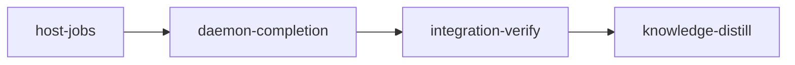

# Plan: Host Verification

## Overview

Every confined command a loom session triggers moves out of the session and onto the host:

- `loom check <stage>`, which the `loom-verifier` and every judge run;
- `loom stage complete <stage>`, from a stage or knowledge session;
- `loom stage contracts freeze <stage>`, from a contract session.

Each becomes a request the session relays. The loom daemon runs it as a child process on the host, under loom's own confinement: bubblewrap on Linux, `sandbox-exec` on macOS, never nested. The session reads per-criterion progress and the result from the state directory. The daemon completes a stage, or freezes its contracts, only from its own run. No pass or fail reported by a session reaches a stage transition any more.

The change applies to every project loom runs, on both platforms:

- Claude Code 2.1.306 refuses user namespaces inside its Linux sandbox, so in-session completion's nested bubblewrap fails every criterion before its command runs.
- Commit `d7ef6a8e` keeps loom working by emitting `sandbox.allowNestedUserNamespaces: true` in every Linux capsule. Claude Code documents that key as letting a sandboxed command bypass write, read and credential denies in any folder it may write. This plan removes it.
- On macOS, in-session criteria run unconfined inside the session's own Seatbelt, behind a daemon-socket grant and the `ValidateInheritedConfinement` RPC. This plan removes both, so the two platforms take one path.
- The completion broker (the PostToolUse hook, the `LOOM_CONTROL_EVIDENCE_V1` record, the `RecordCompletionEvidence` and `CompleteStage` RPCs) existed to carry a session's own verdict to the daemon. The daemon no longer needs that verdict, so the broker goes.

**Run order (operator decision, 2026-10-21).** This plan runs as soon as `PLAN-03-usage-evidence` completes, before plans 4-6 of the token-optimization programme. Its first stage's `before_stage` checks fail until plan 3 has completed and the interim opt-out is in the tree. Every session of this plan runs under the installed binary, which still nests with the opt-out, so the plan completes through today's in-session path. The new path takes effect after `./dev-install.sh`.

**Lanes (operator decision, 2026-10-21).** Claude only. The work is cross-cutting and security-sensitive (completion authority, the daemon's job lifecycle, deletion of the broker and of macOS-only code this machine cannot compile) and converges by running tests.

**Briefs** live under `doc/plans/briefs/host-verification/`: `common.md` (shared facts in section 2, pinned interfaces in section 3, the stage-2 additions in section 4, conduct and test guards in section 5) and one file per worker. Workers read `common.md` first. The section "Protocol decisions" below states every decision the briefs implement. YAML is authoritative where it and the prose differ.

## Goals

- In a session, `loom check`, `loom stage complete` and `loom stage contracts freeze` run no confined command. They relay a request, and the daemon runs the job on the host. Outside a session, `loom check` and `loom stage complete` keep their local behaviour; the freeze queues a host job from the operator shell too (over the socket or the spool), because the freeze transition is the daemon's either way. A session that cannot relay (`Legacy` mode: a session id without a relay scratch directory) is refused all three, since a local run there would nest.
- The daemon completes a stage only from a passing host job bound to the stage's committed content and policy and to the completion gates (integrity, review). A failing job leaves the stage `Executing` and writes the completion checkpoint that block refusal and the blocker watch already read.
- One host job per stage at a time:
  - A request the running job covers (same head and tree; a Complete job covers a Check) joins it.
  - A Check never cancels a running completion or freeze; it is refused.
  - Any other request supersedes the running job.
  - Takedown, handoff, hung recovery, reset, retry and worktree removal cancel it, and cancelling kills every criterion it started.
  - A daemon restart marks a running job interrupted, and the daemon applies it.
  - Every job has a deadline counted from the stage's own criterion timeouts.
- Sessions on Linux and macOS lose every capability that existed only for nested confinement: the user-namespace opt-out, the macOS daemon socket, inherited confinement.
- The codex lane falls back to `codex exec --sandbox danger-full-access` on Linux when its nested sandbox is refused, as it already does on macOS.
- Doctrine, signals, skills, agent definitions, the judge prompt and the README describe the new flow.
- Non-goals:
  - an adjudication verdict for environment faults;
  - an opt-in to nested user namespaces for projects whose own in-session work needs them (rootless podman, `unshare`), to be added as a stage sandbox field when such a project appears;
  - per-plan host-job concurrency;
  - making the resolver's in-daemon `verify_resolved_completion` asynchronous;
  - changes to how `provision` and `before_stage` run (already on the host);
  - registering loom's hooks on Claude Code's `PostToolUseFailure` event (the exit-code protocol below makes it unnecessary).

### Capability, owner and proof

| Capability | Owner (stage / worker) | Executable proof |
| --- | --- | --- |
| In-session `loom check` relays and runs nothing | host-jobs / W3 | contract `in-session-check-relays-and-runs-nothing`; wiring `session_relay::`, `wait::wait_or_request(` |
| The hook derives `check` (main agent and subagents) and `complete` (main agent only) | W3 / W4 | `loom-relay-kinds.sh` in acceptance; after_stage greps on `relay_kind_at`; contract `subagents-cannot-relay-completion` |
| Join, refuse, supersede | host-jobs / W1 | contracts `same-request-joins-one-job`, `a-new-head-supersedes-the-queued-job`, `a-check-never-cancels-a-completion` |
| Cancel kills the child and every criterion it started | W1, W2 | contracts `cancel-kills-the-running-child`, `cancel-stops-the-criteria-of-a-running-job`; W1's listed-group test |
| Six cancellation sites | W1 | wiring `submit::cancel(` per site; one W1 test per site driving the site's own function |
| Deadline, restart recovery | W1 | contracts `a-job-past-its-deadline-is-failed-and-killed`, `restart-interrupts-a-running-job`; wiring `recover_after_restart(` |
| The child runs on the host with its own state root, refuses sessions, rechecks HEAD and digest | W2 | contracts `verify-host-records-each-criterion`, `verify-host-refuses-inside-a-session`; W2's HEAD-move and knowledge tests |
| Judges and knowledge sessions may check | W3 | contract `adjudication-sessions-may-relay-check` |
| The tick runs, reaps and applies jobs | W1, W5 | `tests/host_verification_e2e.rs` through `Orchestrator::tick_host_jobs`; wiring `self.tick_host_jobs(`, `apply_finished(`; reachable `apply_finished` from `run_tick` |
| Completion only from a passing job bound to head, policy and gates | daemon-completion / W4 | contracts `a-failed-complete-job-leaves-the-stage-executing`, `a-passing-job-for-the-current-head-completes`, `a-passing-job-for-a-moved-head-is-not-completed`; wiring `check_completion_gates(` |
| Durable, idempotent apply with retry | W4, W5 | W4's crash-window and transient-failure tests; W5's retry-list test; wiring `unapplied_terminal_records(` |
| Freeze bound to head, bytes and definitions | W5 | contract `freeze-request-carries-no-reports`; W5's moved-HEAD, edited-file and amended-definition tests; wiring `freeze::run_freeze_job(`, `freeze::apply_freeze_result(` |
| Stall hold during a job | W5 | wiring `host_verify::store::load_current(` in `hung_latch.rs`; W5's held and released tests |
| No opt-out, no macOS socket, no broker, no inherited confinement | W6 | contract `capsules-carry-no-nested-userns-opt-out`; stage-2 acceptance greps and `test ! -e` checks |
| Codex direct mode on Linux | W6 | acceptance `rg -q bwrap` on `codex-forward.sh` and `codex-forward-direct.sh`; `codex-forward-direct.sh` in the hook suite |
| Doctrine states the `Host job:` first line and exit codes | W7 | acceptance `rg -qF 'Host job:'` on `../CLAUDE.md.template` and `../agents/loom-verifier.md`, and `rg -qF 'exit 4'` on `../CLAUDE.md.template`; the `tests_doctrine*` pins |

## What the tree shows (verified 2026-10-21 at `7aa927ac`)

| Claim | Evidence | Consequence |
| --- | --- | --- |
| Claude Code 2.1.306 adds `--disable-userns` to its bubblewrap argv; 2.1.302 does not | `~/.local/share/claude/versions/2.1.306` holds `--disable-userns` three times, 2.1.302 none; the schema text of `sandbox.allowNestedUserNamespaces` names "a nested bubblewrap" | Nesting is refused by default from 2.1.306 |
| With the opt-out a sandboxed `bwrap --ro-bind / / --dev /dev true` exits 0; without it, 1 | measured with `claude -p --settings` on 2.1.306 (control and opt-out settings files) | `d7ef6a8e` works, at the documented cost |
| Claude Code runs PostToolUse hooks only for a Bash call that exits 0 | the 2.1.306 binary turns a non-zero exit into a shell error and raises `PostToolUseFailure` (with `error`, no `tool_response`); across session transcripts 1,403 Bash results carrying `LOOM_RELAY_V1` that exited 0 all have a `loom-relay.sh` PostToolUse row, the 15 that exited non-zero none; loom registers PostToolUse only (`session_settings/contents.rs`); `relay_commit` exits 0 | Every call that emits a relay line exits 0; so does every waiting call, which keeps the PostToolUse heartbeat |
| The relay hook allows only the kinds it derives from the command | `loom-hooks/loom-relay.sh::relay_kind_at` has no `check` or `stage:complete` case; `commands/hook/relay.rs::admit` refuses a kind outside `--allowed-kinds` | Each stage adds its kind to the hook and to `loom-hooks/tests/loom-relay-kinds.sh` |
| Every confined command funnels into one wrapper | `verify/criteria/confine.rs::prepare` → `confine_host.rs::wrap` (sole caller `confine.rs`) | Moving the callers moves all confinement |
| In-session callers | `commands/stage/complete.rs::complete` (acceptance, goal checks, after_stage, contracts, impact), `knowledge_complete.rs::verify_knowledge_for_broker`, `commands/verify.rs::execute` (`loom check`), `commands/stage/contracts/freeze.rs::checked_reports` and `check_formatting` | The three commands this plan reroutes |
| Judges run `loom check` in a sandboxed session | `orchestrator/adjudication/prompt/criterion.rs` step 1 (`loom check <stage> --no-cache`); every session kind gets the stage capsule (`orchestrator/terminal/native/launch.rs::write_capsule`); dispute 2 of `usage-accounting` failed this way | `check` must be admitted for adjudication sessions; a judge's checkout is the stage worktree, not its cwd |
| The daemon trusts the session's criterion verdicts | `daemon/server/completion_evidence.rs::verify_evidence_bindings` checks identity, commit, policy and nonce; `passed` comes from the record the session printed | The broker path is the trust gap this plan closes |
| macOS in-session criteria run unwrapped | `confine_host.rs` inherits when `daemon::inherited::available`; `daemon/inherited.rs` returns false off macOS; the capsule grants the daemon socket on macOS only (`session_settings/contents.rs`, `#[cfg(target_os = "macos")]` block) | Both go once nothing confined runs in a session |
| Loom's own bubblewrap allows the confined command a user namespace | `confine_host.rs` builds `--unshare-all` with no `--disable-userns`; a loom-style argv nested three deep exits 0 on this host | Contract tests and the e2e that start the host child run inside acceptance during this plan's own run |
| The tick is single-threaded and relayed requests must settle in one pass | `orchestrator/core/run.rs::run_tick`; `inbox_drain/session_pass.rs::load_ledger` turns a lingering `Applying` into `UnknownAfterRestart` | Jobs run as children; a drain handler settles `Applied` when it queues |
| `commit` is the relay precedent; `freeze-contracts` already relays | `commands/stage/commit.rs::relay_commit`, `relay/kind.rs` (ten kinds, `all()` returns `[RequestKind; 10]`), `inbox_drain/apply.rs::apply`; the drain's module root is `orchestrator/core/inbox_drain.rs` (no `mod.rs`) | Two new kinds, `check` (subagents allowed) and `complete` (control) |
| Exhaustive kind matches outside the relay module | `inbox_drain/test_support.rs::payload_for`, `inbox_drain/tests_matrix.rs::classify_applied` (no `_` arm); `relay/matrix.rs::verdict` panics on a missing row; `relay/matrix.rs` is 350 lines | Each new kind is appended last and gets an arm in both; its rows live in a new `relay/matrix_host.rs` |
| `StageCommands` is matched in its own file | `cli/dispatch_stage.rs::dispatch_stage` (49 lines); `cli/dispatch.rs` forwards to it | `verify-host`'s arm goes in `dispatch_stage.rs` |
| Daemon-side verification without cwd exists | `commands/stage/complete_resolved.rs::verify_resolved_completion` | The host child follows it |
| `work_dir_path()` reads the current directory only | `commands/common/mod.rs::resolve_work_dir` | The child takes its state root from `LOOM_WORK_DIR`; the runner sets it and `current_dir` |
| A session's git sees what the host's does not | `verify/tool_artifacts.rs` (`/dev/null` mount points listed as untracked inside the sandbox); `handoff/completion/content.rs::completion_scaffold` discounts them and loom scaffold, and `committed_content` scopes a knowledge stage to its knowledge directory | The tree digest and the "Commit first" check use those rules, never raw `git status` |
| Claude Code's default Bash timeout is 120 s | `BASH_DEFAULT_TIMEOUT_MS` resolver in 2.1.306; the session wrapper raises only `BASH_MAX_TIMEOUT_MS` (`orchestrator/terminal/native/wrapper.rs`) | A waiting call returns within 100 s |
| A failed completion must leave a checkpoint | `stage_service/control_block.rs` refuses a block while the latest checkpoint is `ToolFailed` with a failing `acceptance-<i>`; `orchestrator/monitor/completion_blockers.rs` reads the same | The daemon writes `ToolFailed` checkpoints from failed job results, none for cancelled ones (`MAX_EVIDENCE_NONCES` is 32) |
| An accepted receipt needs a recorded attempt | `handoff/completion/record.rs::record_accepted_handoff` fails without a checkpoint; `checkpoint.rs::record_accepted` refuses a nonce no observation carries | Apply records a `VerifiedPendingAck` attempt before the receipt |
| The completion gates are private to the daemon server | `daemon/server/observer.rs::check_completion_gates` is `pub(super)` in a private module | Stage 2 re-exports it as `crate::daemon::check_completion_gates` |
| The job deadline cannot reuse the stall line | `stall_line::completion_line_secs` counts every command at 300 s and ignores `timeout_secs`, contracts and after_stage | `runner::job_deadline_secs` sums the real timeouts |
| The codex lane nests on Linux | `codex.rs` (workspace-write "brings its own nested bubblewrap sandbox"); `../loom-hooks/codex-forward.sh` falls back to direct mode only when `sandbox-exec` is refused; the `mode: direct (...)` line is matched byte for byte by `codex-forward-result.sh` and `agents/loom-codex-forwarder.md` | A Linux probe joins the fallback; the mode line stays identical |
| Sessions keep running as native processes on the host | the container backend is removed (`doc/loom/knowledge/entry-points/remote-control.md`, note) | Host jobs see the toolchain sessions see |
| Files at the 400-line limit, and an exact ledger | `orchestrator/core/orchestrator.rs` 399, `event_handler/stage_takedown.rs` 400, `commands/stage/control_session.rs` 393, `event_handler.rs` 385, `commands/stage/skip_retry.rs` 379, `cli/dispatch.rs` 375; `maintainability-baseline.txt` fails a ledgered item that grows or shrinks (`tests/maintainability/baseline.rs`), with rows on `commands/verify.rs::execute` 63, `skip_retry.rs::retry` 209, `event_handler.rs::handle_one_event` 116, `sandbox/settings.rs` 438, `sandbox/settings/tests.rs` 1565 and the signal files W7 edits; no file this plan deletes has a row | New logic goes in new files; every edit to a ledgered item is line-neutral; the ledger does not change |
| The loom repository's own confinement tests need user namespaces | `bwrap --dev-bind / / --unshare-user --disable-userns -- cargo test --all-targets` at `85ed9b2c`: 128 failures (list: `doc/plans/briefs/host-verification/daemon-completion/no-userns-failures.txt`) | Loom-repo hygiene, not this plan's mechanism: these tests run where criteria run (the host). The new tests that start confinement skip where it cannot start (common.md section 5) |

## Protocol decisions

These were settled by the 2026-10-21 pressure test. The briefs implement them; each is restated here so the plan stands alone.

1. **Exit codes and first line.** Every in-session `loom check` and `loom stage complete` call prints `Host job: <state> (<kind>, <short head>)` as its first stdout line. `requested`, `pending`, `passed` (check) and `completed` (complete) exit 0; `failed`, `rejected` and `refused` exit 1; `stopped` exits 4. `requested` and `pending` are not results: the agent runs the same command again. A call that emits a ticket prints its text first and the `LOOM_RELAY_V1` line last, and exits 0, because Claude Code runs the relay hook and the heartbeat only after a call that exits 0. Doctrine tells agents to read the first line, never the exit code alone.
2. **Hook kinds.** Stage 1 adds `check:*) echo check ;;` to `loom-relay.sh::relay_kind_at`; stage 2 adds `stage:complete) echo complete ;;` and `complete` to `drop_control_kinds`. `loom-hooks/tests/loom-relay-kinds.sh` pins both.
3. **Wait budget.** `min(100, 3 × effective subagent timeout − 60)` seconds per call, at least 30: inside Claude Code's 120 s default Bash timeout.
4. **Which tree.** The checkout is the stage worktree (`git::worktree::stage_worktree_path`) for every session type, judges included, or the repository root for a knowledge stage. The tree digest runs `git --no-optional-locks status --porcelain=v2 -z --untracked-files=all --no-renames` with fixed git config, drops what `completion_scaffold` discounts, scopes a knowledge stage to its knowledge directory, and hashes length-framed content (common.md 3.5). "Commit first" is `committed_content` failing.
5. **Join, refuse, supersede.** Under the stage lock: a request the current job covers joins it (same head, tree and kind, a Complete also the same session, or a Complete covering a Check, and `no_cache` no weaker); a Check against a running Complete or Freeze it is not covered by is refused; anything else supersedes.
6. **Record writes** are compare-and-set under the stage lock; the runner writes `Running` before it spawns and reaps what it kills in the same tick. Every job directory keeps a `record.json`, so a waiter follows a job that is no longer current; refusals reach the waiter through the session's inbox ledger. The session's scratch state is written atomically and deleted only by a call that still holds its `request_id`, so two verifier subagents of one session never discard each other's request.
7. **Deadline.** `runner::job_deadline_secs(&stage)` sums each acceptance criterion's effective timeout and 300 s per wiring test, dead-code check, regression test, contract, impact selection and after_stage command, plus the 1,800 s margin. The stall monitor holds escalation until the job is terminal or past that deadline.
8. **State root.** The runner spawns the child with `LOOM_WORK_DIR` and `current_dir(<repo root>)`; the child refuses without `LOOM_WORK_DIR` and never resolves the state root from its cwd. The store canonicalizes the state root (it may be a symlink) and opens everything beneath it through `fs::safe_fs`.
9. **Apply.** Failed Complete jobs write `ToolFailed` while their session still owns the stage, nothing otherwise; cancelled and interrupted ones write nothing. A passing one records a `VerifiedPendingAck` attempt, then the receipt. Rejections use today's `daemon_rejected` boundary failure. Every applied job gets an `applied` marker; at startup the daemon applies interrupted and unmarked terminal jobs. Binding failures are outcomes, never errors; an apply that errors (I/O) is retried on later ticks, ten attempts, then marked `apply failed`. Every step is safe to repeat: a stage already `Completed` at the job's head only gets its missing receipt and session retirement; an already frozen stage is never parked. A cancelled freeze job parks nothing (its canceller owns the stage's next state); a failed or interrupted one parks.
10. **Freeze from the operator shell** queues a host job over the socket or the spool; no CLI path runs contracts.
11. **Ledger and integrity.** Neither stage changes `maintainability-baseline.txt`. Each stage's expected integrity events are stated as a rule (below); any `TI-ratchet` event is a defect.
12. **Test guards and literals.** Tests that start loom's confinement skip where it cannot start (`process::sandbox_probe::skip_unless(confined_commands_runnable(), ..)`). After stage 2 no file under `src/` or `loom-hooks/` spells `allowNestedUserNamespaces` or `LOOM_CONTROL_EVIDENCE`; absence tests build them with `concat!`.
13. **Freeze binding.** A freeze job checks HEAD and the tree digest before and after the run, hashes the contract and harness files it will freeze and the stage's contract definitions (`contracts_digest`) before and after, and stores all four in `contract-reports.json`. At apply, HEAD, digest and `contracts_digest` must still match, and `freeze_with_reports` refuses unless the files it reads hash to the verified values, so the freeze record holds exactly the bytes the run verified; the writer's ownership is revalidated there.
14. **HEAD after a run.** Every job kind re-reads HEAD after its run as well as the digest: a clean commit leaves the digest unchanged.
15. **Criteria die with their job.** Each confined command is its own process group, and macOS `sandbox-exec` is not tied to its parent. The host child records every confined spawn's group in `<job dir>/groups` through a spawn observer in `verify/criteria/confine.rs`; cancelling, the deadline, the output cap and shutdown kill those groups after the child's own, and restart recovery kills the ones whose leader still leads them.
16. **Gates.** Each code stage's verifier runs the pre-push steps a session can run (the full suite, doc tests, clippy, fmt, rustdoc, hook syntax, both hook suites, markdownlint over changed markdown in stage 2, and `scripts/flake-check.sh` on `host_verify::`, whose tests assert on process death). `cargo audit` is the one excluded step: it fetches the advisory database from github.com, which the sandbox does not allow, and this plan changes no dependency (`Cargo.lock` is untouched), so the operator's pre-push and CI's `audit` job cover it. Worker proofs run under `set -o pipefail` and confirm a non-zero test count.

## Execution Diagram



## Stages

### 1. host-jobs (standard)

Builds the daemon's host-job machinery and routes the first caller through it: in-session `loom check`.

- **Records and store:** `src/host_verify/{mod,store}.rs`.
- **Submit/join/refuse/supersede/cancel:** `submit.rs`.
- **Runner:** `runner.rs`, holding children, deadlines and restart recovery.
- **Daemon glue:** the tick, the cancellation call sites and startup recovery.
- **Host child:** `loom stage verify-host`, with per-criterion progress, and the spawn observer in `verify/criteria/` that records each confined command's process group so cancelling a job kills its criteria.
- **Tree digest and session wait protocol:** `digest.rs`, `wait.rs`.
- **Relay:** the `check` relay kind, its matrix rows, its drain handler and its hook mapping.
- **Session read access:** `verification` in `STATE_READ_DIRS`.

Stage Necessity Test:

- Q1: no merge-order need inside the plan.
- Q2: no file is shared with stage 2 that the two would edit at once (stage 2 edits `host_verify` after this stage merges).
- Q3: yes. The job lifecycle (join, supersede, cancel, restart, deadline) is verified on `check` jobs, which change no stage state, before stage 2 lets the same runner decide completion. A lifecycle defect found here costs a check. Found in stage 2, it could complete a stage wrongly or strand every stage.
- Q4: yes. With stage 2's completion rewiring, broker deletion and doctrine, one session would pass 500,000 tokens.

| Worker | Role | Tier | Files owned | Shared context | Brief path |
| --- | --- | --- | --- | --- | --- |
| W1 | Runner and lifecycle | opus/xhigh | src/lib.rs; src/host_verify/mod.rs; src/host_verify/store.rs; src/host_verify/submit.rs; src/host_verify/runner.rs; src/host_verify/tests_store.rs; src/host_verify/tests_submit.rs; src/host_verify/tests_runner.rs; src/orchestrator/core/host_jobs.rs; src/orchestrator/core/mod.rs; src/orchestrator/core/run.rs; src/orchestrator/core/orchestrator.rs; src/orchestrator/core/event_handler.rs; src/orchestrator/core/event_handler/stage_takedown.rs; src/orchestrator/core/event_handler/recover_hung.rs; src/orchestrator/monitor/stall_line.rs; src/commands/stage/state.rs; src/commands/stage/skip_retry.rs; src/git/cleanup/batch.rs | common.md | doc/plans/briefs/host-verification/host-jobs/w1-runner.md |
| W2 | Host child | opus | src/host_verify/child.rs; src/host_verify/tests_child.rs; src/commands/stage/verify_host.rs; src/commands/stage/mod.rs; src/commands/stage/criterion_output.rs; src/commands/mod.rs; src/cli/types_stage.rs; src/cli/dispatch_stage.rs; src/verify/criteria/config.rs; src/verify/criteria/runner.rs; src/verify/criteria/confine.rs; src/verify/criteria/spawn_observer.rs; src/verify/criteria/mod.rs | common.md | doc/plans/briefs/host-verification/host-jobs/w2-child.md |
| W3 | Session check | sonnet | src/host_verify/digest.rs; src/host_verify/wait.rs; src/host_verify/tests_digest.rs; src/host_verify/tests_wait.rs; src/relay/kind.rs; src/relay/payload.rs; src/relay/matrix.rs; src/relay/matrix_host.rs; src/relay/tests_matrix.rs; src/relay/mod.rs; src/orchestrator/core/inbox_drain.rs; src/orchestrator/core/inbox_drain/apply.rs; src/orchestrator/core/inbox_drain/check.rs; src/orchestrator/core/inbox_drain/test_support.rs; src/orchestrator/core/inbox_drain/tests_matrix.rs; src/commands/verify.rs; src/commands/verify_relay.rs; src/sandbox/settings.rs; src/sandbox/settings/tests.rs; src/handoff/completion/content.rs; ../loom-hooks/loom-relay.sh; ../loom-hooks/tests/loom-relay-kinds.sh | common.md | doc/plans/briefs/host-verification/host-jobs/w3-session-check.md |

Order:

1. Spawn W1, W2 and W3 in one message. Their interfaces are pinned in `common.md` section 3, so they write in parallel; the crate compiles once all three return (W1 declares every module of `src/host_verify/` from the start).
2. Then `cargo fmt --all`, `cargo build`, and the module tests.
3. One `loom-verifier` round, review rounds, test integrity, commit, complete.

**Risk checklist walk.**

| Area | Applies | Covered by |
| --- | --- | --- |
| 1 Untrusted input | stage and job ids from relay payloads and from files a session can read but not write; the relay payload | `job-paths-refuse-traversal-and-symlinks`; W3's `HostJobRequest` unknown-key decode test |
| 2 Filesystem paths and symlinks | the `verification/` tree under a state root that may itself be a symlink | `job-paths-refuse-traversal-and-symlinks` (both cases) |
| 3 Process I/O volume and scale | child output, progress lines, a criterion that never ends | progress and log caps (W1 `tests_store.rs`), the `child.log` cap (W1 `tests_runner.rs`); `a-job-past-its-deadline-is-failed-and-killed` |
| 4 Configuration propagation | `no_cache` from the request to the child; the state root from the runner to the child | W2's `no_cache` test and W3's new-request-on-`no_cache` test; `verify-host-records-each-criterion` (the child reads `LOOM_WORK_DIR`) |
| 5 Lifecycle and concurrency | join, supersede, cancel, restart, deadline, a cancel racing a reap, criteria in their own process groups, HEAD moved by a clean commit during a run, two waiters sharing one scratch state | `same-request-joins-one-job`, `a-new-head-supersedes-the-queued-job`, `cancel-kills-the-running-child`, `cancel-stops-the-criteria-of-a-running-job`, `restart-interrupts-a-running-job`, `a-job-past-its-deadline-is-failed-and-killed`; W1's CAS and listed-group tests; W2's HEAD-move test; W3's shared-state test |
| 6 Reachability | the session command must reach the daemon through the hook; the child must run the criteria; judges must be admitted | `in-session-check-relays-and-runs-nothing`, `verify-host-records-each-criterion`, `adjudication-sessions-may-relay-check`; `after_stage` hook mapping; `loom-relay-kinds.sh` in acceptance; the `wiring` and `reachable` entries |
| 7 External data correctness | git porcelain v2 for the digest; sandbox mount points | W3 digest tests on real repositories (a tracked edit, an untracked file, a rename, an empty `.bashrc`, the knowledge scope) |

**Expected integrity events.** Exactly one: `TI-edit-loom/src/sandbox/settings/tests.rs` (the state-read allow count goes from 15 to 17 and `verification/**` joins the pinned list). `relay/kind.rs` raises none: `Check` is not a control kind and no assertion counts kinds. File one `dispute-integrity` after the final review round, reason "verification joins the session state-read directories; every existing entry keeps its assertion". An event on another test file this stage lists in `files:`, where an existing assertion was kept and extended for the new kind, joins that one filing and is named in its reason. An event on a file outside `files:`, a weakened or deleted assertion, or any `TI-ratchet` event is a defect to fix before the commit.

### 2. daemon-completion (standard)

Routes `loom stage complete` (stage and knowledge sessions) and the contract freeze through host jobs. The daemon applies finished jobs: it completes, records a failure checkpoint, freezes, or parks. Then the stage removes what existed only for nested or session-trusted verification:

- the completion broker and its evidence record;
- the `RecordCompletionEvidence` and `CompleteStage` RPCs;
- the PostToolUse broker hook half;
- macOS inherited confinement and the macOS daemon-socket grant;
- the user-namespace opt-out.

It also adds the Linux codex direct mode, holds stall escalation while a host job runs, and rewrites the doctrine. Stage Necessity Test: Q1 yes (it builds on stage 1's merged runner); Q4 as above.

| Worker | Role | Tier | Files owned | Shared context | Brief path |
| --- | --- | --- | --- | --- | --- |
| W4 | Completion | opus/xhigh | src/host_verify/mod.rs; src/host_verify/store.rs; src/host_verify/wait.rs; src/host_verify/child.rs; src/host_verify/apply.rs; src/host_verify/apply_rejection.rs; src/host_verify/tests_apply.rs; src/host_verify/tests_child.rs; src/commands/stage/complete.rs; src/commands/stage/complete_pipeline.rs; src/commands/stage/complete_verification.rs; src/commands/stage/complete_verification_v2.rs; src/commands/stage/complete_verification_v2_tests.rs; src/commands/stage/complete_impact.rs; src/commands/stage/complete_relay.rs; src/commands/stage/knowledge_complete.rs; src/commands/stage/control_session.rs; src/commands/stage/complete_resolved.rs; src/commands/stage/tests/complete.rs; src/commands/stage/tests/complete_knowledge_tests.rs; src/relay/kind.rs; src/relay/payload.rs; src/relay/matrix.rs; src/relay/matrix_host.rs; src/relay/tests_matrix.rs; src/relay/mod.rs; src/relay/emit.rs; src/relay/emit/**; src/orchestrator/core/inbox_drain.rs; src/orchestrator/core/inbox_drain/apply.rs; src/orchestrator/core/inbox_drain/complete.rs; src/orchestrator/core/inbox_drain/test_support.rs; src/orchestrator/core/inbox_drain/tests_matrix.rs; ../loom-hooks/loom-relay.sh; ../loom-hooks/tests/loom-relay-kinds.sh | common.md | doc/plans/briefs/host-verification/daemon-completion/w4-completion.md |
| W5 | Freeze, apply glue, stall | opus | src/host_verify/freeze.rs; src/host_verify/tests_freeze.rs; src/commands/stage/contracts.rs; src/commands/stage/contracts/freeze.rs; src/commands/stage/contracts/freeze_tests.rs; src/stage_service/types.rs; src/stage_service/contracts.rs; src/stage_service/mod.rs; src/daemon/server/contracts.rs; src/daemon/server/contracts_tests.rs; src/daemon/server/stage_control.rs; src/fs/stage_request/apply.rs; src/fs/stage_request/tests/replay.rs; src/orchestrator/core/host_jobs.rs; src/orchestrator/core/event_handler/recover_hung.rs; src/orchestrator/monitor/stall_line.rs; src/orchestrator/monitor/hung_latch.rs; src/orchestrator/monitor/never_worked.rs; tests/host_verification_e2e.rs | common.md | doc/plans/briefs/host-verification/daemon-completion/w5-freeze-glue.md |
| W6 | Retire nested and session-trusted paths | sonnet | src/commands/stage/completion_evidence.rs; src/commands/stage/completion_evidence/**; src/commands/stage/control_complete.rs; src/commands/stage/tests/control_complete.rs; src/commands/stage/mod.rs; src/daemon/mod.rs; src/daemon/inherited.rs; src/daemon/inherited/**; src/daemon/protocol.rs; src/daemon/protocol_debug.rs; src/daemon/server/mod.rs; src/daemon/server/observer.rs; src/daemon/server/peer_identity.rs; src/daemon/server/client.rs; src/daemon/server/client_tests.rs; src/daemon/server/client_dispatch.rs; src/daemon/server/self_service.rs; src/daemon/server/self_service_tests.rs; src/daemon/server/tests/self_service_client.rs; src/daemon/server/completion_evidence.rs; src/daemon/server/completion_content_tests.rs; src/daemon/server/completion_dispatch.rs; src/daemon/server/completion_dispatch/**; src/daemon/server/control_complete.rs; src/daemon/server/control_complete_tests.rs; src/verify/criteria/confine_host.rs; src/verify/impact_tests/report_tests.rs; src/verify/impact_tests/observed.rs; src/orchestrator/terminal/native/session_settings/contents.rs; src/orchestrator/terminal/native/tests_capsule_contents.rs; src/orchestrator/terminal/native/tests_session_settings.rs; src/orchestrator/terminal/native/wrapper.rs; src/orchestrator/core/knowledge_completion_tests.rs; src/sandbox/settings/policy.rs; src/sandbox/settings/policy/tests.rs; src/fs/permissions/hooks/config.rs; src/fs/permissions/hooks/registration_tests.rs; src/fs/permissions/tests/hooks_tests.rs; src/codex.rs; tests/completion_replay.rs; tests/completion_replay/**; tests/integration/binary_spawn_guard.rs; ../loom-hooks/loom-control-complete.sh; ../loom-hooks/codex-forward.sh; ../loom-hooks/tests/loom-control-complete*.sh; ../loom-hooks/tests/loom-control-tokenized-prefilter.sh; ../loom-hooks/tests/codex-forward-direct.sh; ../loom-hooks/tests/codex-forward-wrapper.sh; ../loom-hooks/tests/run-all.sh | common.md | doc/plans/briefs/host-verification/daemon-completion/w6-retire.md |
| W7 | Doctrine | sonnet | ../CLAUDE.md.template; ../AGENTS.md.template; ../README.md; ../agents/loom-verifier.md; ../agents/loom-software-engineer.md; ../skills/loom-orchestration/SKILL.md; ../skills/loom-plan-writer/SKILL.md; ../skills/loom-plan-writer/references/*.md; ../skills/loom-usage/SKILL.md; ../loom-hooks/_subagent-preamble.txt; ../loom-hooks/commit-guard.sh; src/orchestrator/signals/helpers.rs; src/orchestrator/signals/cache/blocks.rs; src/orchestrator/signals/format/**; src/orchestrator/signals/knowledge.rs; src/orchestrator/signals/cache.rs; src/orchestrator/signals/contract.rs; src/orchestrator/signals/contract_tests.rs; src/orchestrator/signals/v2_section.rs; src/orchestrator/signals/v2_section_review.rs; src/orchestrator/signals/v2_section_tests.rs; src/orchestrator/signals/tests_doctrine*.rs; src/orchestrator/adjudication/prompt/** | common.md | doc/plans/briefs/host-verification/daemon-completion/w7-doctrine.md |

Order:

1. Spawn W4, W5, W6 and W7 in one message. W4 and W5 meet at the pinned `host_verify::freeze::{run_freeze_job, apply_freeze_result}` and `host_verify::apply::{apply_finished, unapplied_terminal_records}` (common.md 4.4, 4.6). W4 removes every call into the broker modules from the files it owns, and W6 deletes those modules; W4 reads what it ports from them with `git show HEAD:loom/<path>`, so the two never race. W7 writes from common.md 3.7 and 4.5.
2. Then `cargo fmt --all`, the build, the module tests, and the hook suites.
3. One `loom-verifier` round, review rounds, test integrity, commit, complete.

**Risk checklist walk.**

| Area | Applies | Covered by |
| --- | --- | --- |
| 1 Untrusted input | the `complete` and `freeze-contracts` payloads; a session can no longer supply reports | `freeze-request-carries-no-reports` (including a payload with reports beside the new keys) |
| 2 Filesystem paths | unchanged from stage 1 | stage 1 contracts |
| 3 Process I/O | contract runs and full completion runs on the host | the stage 1 deadline; W5 freeze test with a contract that never ends |
| 4 Configuration propagation | the capsule must stop carrying the opt-out on every enabled config | `capsules-carry-no-nested-userns-opt-out`; the `after_stage` greps |
| 5 Lifecycle and concurrency | the head moves between run and apply; a job ends after the session was retired; a check arrives during a completion; a restart or an I/O failure between run and apply; contract files, HEAD or contract definitions changed during or after a freeze run; a superseded freeze job | `a-passing-job-for-a-moved-head-is-not-completed`, `a-check-never-cancels-a-completion`; W4 apply tests (session no longer owner, applied twice, cancelled job, crash window, transient failure); W5 freeze tests (edited during the run, files changed, HEAD moved and definitions amended after a passing run, verified-hash mismatch, superseded and already-frozen jobs not parked) and retry-list test |
| 6 Reachability | the session command reaches the daemon through the hook; the daemon applies on its tick and at startup | `in-session-complete-relays-and-runs-nothing`; `tests/host_verification_e2e.rs`; the `wiring` and `reachable` entries; `loom-relay-kinds.sh` in the hook suite |
| 7 External data | none new | n/a |
| Authority (the plan's purpose) | a failed run must not complete; a passing run must complete only for the current head and policy and with the completion gates passing; a subagent must not request completion | `a-failed-complete-job-leaves-the-stage-executing`, `a-passing-job-for-the-current-head-completes`, `a-passing-job-for-a-moved-head-is-not-completed`, `subagents-cannot-relay-completion`; W4's gate test (a v2 stage with no review round is rejected); wiring on `check_completion_gates(` |

**Expected integrity events.** The stage deletes the broker, the evidence protocol, the daemon completion RPCs, macOS inheritance and `tests/completion_replay*`. Their tests go with them: `TI-decl-rust` and `TI-assert-rust`. The stage changes assertions, each re-pointed at the new flow and none weakened, in test files it lists in `files:`:

- `src/sandbox/settings/policy/tests.rs` (the opt-out test now asserts the key is absent);
- `src/relay/kind.rs` (one more control kind), `src/relay/payload.rs` (the freeze payload), `src/orchestrator/core/inbox_drain/tests_matrix.rs` (the freeze cell now asserts a queued Freeze job);
- the three hook-registration tests and `tests_session_settings.rs` (no PostToolUse broker registration, no daemon socket);
- `contracts_tests.rs`, `freeze_tests.rs`, `fs/stage_request/tests/replay.rs`, `self_service_tests.rs`, `complete_verification_v2_tests.rs`, `commands/stage/tests/complete*.rs`, `verify/impact_tests/report_tests.rs`;
- the signal and doctrine pins in `src/orchestrator/signals/tests_doctrine*.rs`, `contract_tests.rs` and `v2_section_tests.rs`, and the adjudicator golden prompt;
- the hook tests `loom-control-complete-heredoc.sh`, `loom-control-tokenized-prefilter.sh` and `codex-forward-wrapper.sh`.

`maintainability-baseline.txt` does not change: no deleted file has a row, and every ledgered item W7 edits stays line-neutral. File one `dispute-integrity` naming every event `loom stage review integrity daemon-completion` lists, after the final review round. Reason: "the session-evidence completion path and macOS inherited confinement are removed with their tests; pins follow the new completion flow; the freeze request carries a head and tree digest instead of reports". An event on a file outside `files:`, a weakened assertion, or any `TI-ratchet` event is a defect.

### 3. integration-verify

Runs the full gate on the merged tree; `--all-targets` includes `tests/host_verification_e2e.rs` and both contract targets. Then:

- **Functional checks with the built binary:**
  - `loom stage verify-host` refuses inside a session environment;
  - the e2e prints its relayed completion queued, run by the child and applied;
  - the contract targets that pin the session relay (`in_session_check_relays_and_runs_nothing`) and the capsule (`capsules_carry_no_nested_userns_opt_out`) pass by name, and the capsule source holds no daemon-socket grant;
  - nothing in the source, hooks, skills or doctrine names the removed paths.
- **Review:** security (completion authority, the job store, the child's environment), lifecycle (cancel paths, restart, apply at startup), architecture (nothing orphaned) and doctrine accuracy.

The live proof is the next plan run after `./dev-install.sh`: every session of this plan still runs the installed binary.

### 4. knowledge-distill

Applies every `stale-knowledge:` memory first. Then it rewrites the knowledge this plan makes untrue, and records what the stages learned:

- execution containment;
- the completion broker and recovery;
- stage-daemon channels, including the exit-0 relay rule;
- verification v2 gates;
- the sandbox concerns about the opt-out and nested runners;
- the in-session completion gaps;
- the broker mentions in security-and-isolation, adjudication-lifecycle, memory-spool, merge-flow and the merge-and-recovery concern about the broker's nonce burn.

## Environment inventory

| Need | Stage | State |
| --- | --- | --- |
| crates.io (cargo builds; no new dependency is planned: `sha2`, `uuid`, `chrono`, `serde_json`, `libc`, `nix` are present) | all | allowed |
| `registry.npmjs.org` (the pre-commit hook's markdownlint on every commit) | all | allowed |
| `web/node_modules` for the repository's JS provision lint and markdownlint | all | provisioned |
| `bwrap` on the host (criteria, and the tests that start the host child; loom's bwrap lets its confined command nest) | 1, 2 | host tool, checked by `before_stage` |
| Nested user namespaces for this plan's own sessions | 1, 2, IV | provided by the installed binary's opt-out (`d7ef6a8e`); this plan removes it from the source only |
| Unix sockets | none: the e2e test drains in-process like `tests/integration/relay_commit_e2e.rs`, and the child skips the socket-backed gates (`daemon_gates`) | n/a |
| macOS compilation of the code W6 deletes | 2, IV | not available here (`rustup target list --installed` has no Apple target); CI's `test-macos` and `lint-macos` jobs (`.github/workflows/ci.yml`) compile it. The operator runs CI before installing (After the plan) |
| Credentials | none | n/a |

## Shared files and sibling plans

This plan runs before plans 4-6, all re-committed on 2026-10-21 (`7759eda5`, `179de11b`, `be79fcc5`) to run on host verification. Their line citations and size baselines in the files below will be out of date once this plan merges. Refresh each before its `loom init`:

| Sibling | Shared files | What changes here |
| --- | --- | --- |
| `PLAN-04-dependency-findings` | `src/orchestrator/signals/format/**` (its YAML `files:`; this plan's W7 owns the same glob), `../README.md` | W7 edits only the completion text under `format/` (`sections.rs`, and `helpers.rs` if a completion sentence lives there), every edit line-neutral. After the one completion sentence in `sections.rs` changes, the file stays at 569 lines and `format_dynamic_section` at 205, which plan 4's brief relies on. Plan 4's acceptance needles in other paragraphs are untouched |
| `PLAN-05-guidance-and-gate-output` | `../agents/loom-verifier.md`, `../CLAUDE.md.template`, `../skills/loom-orchestration/SKILL.md`, `src/orchestrator/signals/helpers.rs`, `src/orchestrator/signals/cache/blocks.rs` (`VERIFIER_GATE`), `tests_doctrine_v2.rs`, `tests_doctrine_prefixes.rs`, `../loom-hooks/loom-control-complete.sh`, `../loom-hooks/tests/loom-control-complete-heredoc.sh`, `../loom-hooks/_subagent-preamble.txt`, `../README.md` | W7 rewrites the completion and verifier text under the constraints in its brief ("What plan 5 builds on"): no frozen template line touched, no fenced block in the verifier definition, the `VERIFIER_GATE` and completion phrases plan 5 uses as needles kept (including `**When the stage cannot finish.**` and `one commit per concern`), no net growth. W6 removes the hook's PostToolUse half and keeps the PreToolUse heredoc functions and every heredoc test case label plan 5 edits. The host job writes each criterion's full log, which plan 5's verifier recipe relies on. Plan 5's verifier recipe expects `loom check` to exit 3 while pending: refresh it to the `Host job: <state>` first line (requested and pending exit 0). Plan 5 measures its baselines at its own base |
| `PLAN-06-sandbox-route-closure` | `session_settings/contents.rs`, `sandbox/settings/policy.rs`, `sandbox/settings/policy/tests.rs`, `src/orchestrator/core/mod.rs`, `src/sandbox/settings/tests.rs`, `src/orchestrator/terminal/native/tests_capsule_contents.rs`, `../README.md` | W6 removes the macOS socket block and the opt-out with its test, and one array line of `tests_capsule_contents.rs`; W1 adds `mod host_jobs;` to `orchestrator/core/mod.rs`; W3 changes `sandbox/settings/tests.rs` line-neutrally (15 → 17). Plan 6's own shared-file list misses the last two test files |
| Unscheduled: `PLAN-web-host-graft-followthrough`, `PLAN-loom-ui-mods`, `PLAN-model-router-hooks` | `PLAN-loom-ui-mods`: `src/cli/dispatch*.rs`, `maintainability-baseline.txt`, `../README.md` (its knowledge stage). `PLAN-model-router-hooks`: `src/cli/dispatch.rs`, `../README.md` (later stages). `PLAN-web-host-graft-followthrough`: `src/cli/**`, `signals/cache.rs`, `signals/cache/**`, `signals/tests_doctrine.rs`, `maintainability-baseline.txt`, `../loom-hooks/**` | None runs while this plan runs (one checkout runs one plan), and none is ordered against it: each runs only after this plan completes, refreshed against the merged `dispatch_stage.rs`, `VERIFIER_GATE`, signal text and ledger before its `loom init`. `PLAN-web-host-graft-followthrough`'s YAML still claims those paths although much of its work is already in the tree: the operator decides whether it still runs (and trims its `files:`) or is retired before any `loom init` that follows this plan |

## Deviations from the earlier proposal (the tree wins)

1. **Every confined in-session command moves, not only completion.** `loom check` (the verifier's gate and every judge's first step) and the contract freeze nested the same way; moving completion alone would leave both broken once the opt-out goes.
2. **The broker is removed rather than adapted.** With the daemon running the criteria, the session's evidence record carries nothing the daemon needs, and leaving its RPCs in place would keep a second, weaker completion route.
3. **Completion becomes "request, then wait" on the same pinned command.** `loom stage complete <stage>` stays the one command the PreToolUse hook pins and heartbeats. Repeated calls wait. Requested and pending calls exit 0 under a `Host job:` first line (Protocol decision 1), because a non-zero exit loses the relay hook.

## Before `loom run` (operator)

- `PLAN-03-usage-evidence` has completed. Its stages ran on `d7ef6a8e` or later, so the installed binary carries the opt-out these sessions need.
- `git log -1 --oneline -- doc/plans/token-optim/DONE-PLAN-03-usage-evidence.md` prints the `chore(loom): mark plan complete` commit: the rename is committed only when the post-completion commit succeeds, and a stage worktree sees only committed content.
- Commit this plan and every file under `doc/plans/briefs/host-verification/`.

## After the plan (operator)

- Push and let CI's `test-macos` and `lint-macos` jobs compile and test the macOS paths. Nothing in this plan's sessions compiles them.
- Run `./dev-install.sh`, then confirm the next plan's first `loom stage complete` prints `Host job: requested`, relays, and completes through the daemon.
- Refresh plans 4-6 (Shared files above), and give each a `before_stage` check `test -f ../doc/plans/DONE-PLAN-host-verification.md`: their source probes (`pub mod host_verify;`, the opt-out absent) turn true once stage 2 merges, before this plan finishes and before the binary is installed.
- Decide on this repository's own confinement tests: 128 fail in a session that cannot nest (`daemon-completion/no-userns-failures.txt`; the 16 `completion_replay` lines are deleted by this plan). They pass on the host, where criteria now run. A self-skip guard (`process::sandbox_probe::confined_commands_runnable`) would keep in-session runs in this repository quiet; this plan's new tests already carry it.

---

<!-- loom METADATA -->

```yaml
loom:
  version: 2
  ratchet_files:
    - loom/maintainability-baseline.txt
    - doc/loom/knowledge/check-baseline.txt
  provision:
    - working_dir: "web"
      command: "test ! -e .npmrc && test ! -L .npmrc && bun install --frozen-lockfile --ignore-scripts --backend=copyfile --config=/dev/null"
  sandbox:
    enabled: true
    auto_allow: true
    filesystem:
      deny_read: ["~/.ssh/**", "~/.aws/**", "~/.config/gcloud/**", "~/.gnupg/**"]
    network:
      allowed_domains: ["crates.io", "index.crates.io", "static.crates.io", "registry.npmjs.org"]
      allow_local_binding: true
      allow_unix_sockets: []
  stages:
    - id: host-jobs
      name: "Host jobs: daemon-run verification, first caller loom check"
      summary: "Gives the daemon a host-job runner (one job per stage, join, refuse, supersede, cancel, restart recovery, deadlines), a host child that runs a stage's criteria with per-criterion progress, and routes in-session loom check through it, hook mapping included."
      stage_type: standard
      skills: ["loom-rust"]
      implementers: ["claude"]
      subagent_timeout_secs: 900
      working_dir: "loom"
      dependencies: []
      description: |
        Implement stage 1 of doc/plans/PLAN-host-verification.md (renamed IN_PROGRESS-PLAN-host-verification.md once loom run starts).
        Use parallel subagents and skills to maximize performance.
        PATHS: working_dir is loom/; YAML and worker-table paths are package-relative (../ for files outside the crate); brief paths are repo-relative from the worktree root.
        Every worker reads doc/plans/briefs/host-verification/common.md first (section 2 facts, section 3 pinned interfaces, section 5 conduct), then its own brief. The plan's "Protocol decisions" section states what the briefs implement: in-session calls print a `Host job: <state>` first line and exit 0 for requested and pending (Claude Code runs no PostToolUse hook after a non-zero exit, so a relay line printed by a failing call is never relayed); the hook maps `loom check` to kind check; waits return within 100 s.

        MAIN AGENT, IN ORDER:
        1. SPAWN W1, W2 and W3 in ONE message, background, BY AGENT TYPE (W1: loom-senior-software-engineer with effort xhigh; W2: loom-senior-software-engineer; W3: loom-software-engineer), each with a short fixed prompt plus "Your brief: <path>. Read it in full before anything else." Wait with one background loom subagents watch. Territories are DISJOINT; workers never spawn subagents and never run git.
        2. AFTER ALL THREE RETURN: rustfmt --check --edition 2021 tests/host_verification_contracts.rs tests/host_verification_contracts/*.rs (a frozen file the formatter would rewrite fails completion; a failure is a dispute-contract, never an edit); cargo fmt --all; cargo build; cargo test --lib host_verify::; cd .. && bash loom-hooks/tests/loom-relay-kinds.sh; route any failure to a fresh worker of the owning territory with the failed report quoted.
        3. One loom-verifier round, briefed from loom/: cargo build; env -u GIT_INDEX_FILE -u GIT_DIR -u GIT_WORK_TREE cargo test --all-targets --no-fail-fast; cargo test --doc --workspace --all-features -- --test-threads=1; cargo clippy --all-targets -- -D warnings; cargo fmt --check; RUSTDOCFLAGS='-D warnings' cargo doc --workspace --all-features --no-deps; ../scripts/check-hook-syntax.sh; bash ../loom-hooks/tests/run-all.sh; LOOM_HOOK_TEST_BSD=1 bash ../loom-hooks/tests/run-all.sh; ../scripts/flake-check.sh host_verify:: (the new tests assert on process death); every acceptance and after_stage command below verbatim through loom check host-jobs; git diff --quiet -- maintainability-baseline.txt (the ledger is exact both ways and this stage changes no row: every ledgered item it edits stays line-neutral); git diff --quiet -- Cargo.lock. This is the pre-push gate minus markdownlint (the stage changes no markdown) and cargo audit (it fetches the advisory database from github.com, which the sandbox refuses; Cargo.lock is unchanged, so the operator's pre-push and CI's audit job cover it): Protocol decision 16. Every command's exit status is read directly, never through a pipe. Each FAIL becomes a fix brief to a fresh worker; then a FRESH verifier.
        4. REVIEW rounds per the signal (security: id validation, symlinks under a symlinked state root, the child's environment, its LOOM_WORK_DIR requirement and its refusal inside a session, judge admission; lifecycle: join, refuse, supersede, cancel, restart, deadline, compare-and-set record writes, a tick that never blocks; protocol: every relaying call exits 0 with the relay line last); fix every finding through a fresh worker; edit nothing after the final round.
        5. TEST INTEGRITY after the final review round and before the commit: loom stage review integrity host-jobs. Expect exactly TI-edit-loom/src/sandbox/settings/tests.rs (the state-read allow count goes 15 to 17). Commit first, then file ONE loom stage dispute-integrity host-jobs --event <the id verbatim> --reason "verification joins the session state-read directories; every existing entry keeps its assertion". An event on another test file listed in files: whose assertion was kept and extended for the new kind joins that filing and is named in the reason. An event on a file outside files:, a weakened assertion, or any TI-ratchet event is a defect to fix before the commit.

          | Worker | Role | Tier | Files owned | Shared context | Brief path |
          | W1 | Runner and lifecycle | opus/xhigh | src/lib.rs; src/host_verify/mod.rs; src/host_verify/store.rs; src/host_verify/submit.rs; src/host_verify/runner.rs; src/host_verify/tests_store.rs; src/host_verify/tests_submit.rs; src/host_verify/tests_runner.rs; src/orchestrator/core/host_jobs.rs; src/orchestrator/core/mod.rs; src/orchestrator/core/run.rs; src/orchestrator/core/orchestrator.rs; src/orchestrator/core/event_handler.rs; src/orchestrator/core/event_handler/stage_takedown.rs; src/orchestrator/core/event_handler/recover_hung.rs; src/orchestrator/monitor/stall_line.rs; src/commands/stage/state.rs; src/commands/stage/skip_retry.rs; src/git/cleanup/batch.rs | common.md | doc/plans/briefs/host-verification/host-jobs/w1-runner.md |
          | W2 | Host child | opus | src/host_verify/child.rs; src/host_verify/tests_child.rs; src/commands/stage/verify_host.rs; src/commands/stage/mod.rs; src/commands/stage/criterion_output.rs; src/commands/mod.rs; src/cli/types_stage.rs; src/cli/dispatch_stage.rs; src/verify/criteria/config.rs; src/verify/criteria/runner.rs; src/verify/criteria/confine.rs; src/verify/criteria/spawn_observer.rs; src/verify/criteria/mod.rs | common.md | doc/plans/briefs/host-verification/host-jobs/w2-child.md |
          | W3 | Session check | sonnet | src/host_verify/digest.rs; src/host_verify/wait.rs; src/host_verify/tests_digest.rs; src/host_verify/tests_wait.rs; src/relay/kind.rs; src/relay/payload.rs; src/relay/matrix.rs; src/relay/matrix_host.rs; src/relay/tests_matrix.rs; src/relay/mod.rs; src/orchestrator/core/inbox_drain.rs; src/orchestrator/core/inbox_drain/apply.rs; src/orchestrator/core/inbox_drain/check.rs; src/orchestrator/core/inbox_drain/test_support.rs; src/orchestrator/core/inbox_drain/tests_matrix.rs; src/commands/verify.rs; src/commands/verify_relay.rs; src/sandbox/settings.rs; src/sandbox/settings/tests.rs; src/handoff/completion/content.rs; ../loom-hooks/loom-relay.sh; ../loom-hooks/tests/loom-relay-kinds.sh | common.md | doc/plans/briefs/host-verification/host-jobs/w3-session-check.md |

        CONTRACT SURFACE (the contract session writes tests/host_verification_contracts.rs and tests/host_verification_contracts/support.rs from this text before any code). Each contract is a top-level #[test] fn named after its id with underscores; every fn under 50 lines, every file under 400 lines, rustfmt-clean. The file declares `#[path = "integration/helpers.rs"] #[allow(dead_code)] mod helpers;` and `#[path = "host_verification_contracts/support.rs"] mod support;` (support.rs may include tests/integration/relay_scratch.rs the same way), and spawns the loom binary only through helpers::loom_cmd(), which clears the relay environment (tests/integration/binary_spawn_guard.rs fails a direct loom-binary spawn); the one exception is cancel_stops_the_criteria_of_a_running_job, which hands env!("CARGO_BIN_EXE_loom") to RunnerConfig.program as a value and lets the runner spawn it with session variables stripped.
        - Fixture (support.rs): copy the shape of tests/integration/relay_commit_e2e.rs (build_fixture, init_repo_with_worktree, write_session_and_stage, Fixture::session_loom): a TempDir repository with one commit, a worktree .worktrees/stage-a on branch loom/stage-a, a state root <repo>/.loom/work holding stage-a (status executing, plan_version 1, session session-a, working_dir ".", acceptance given per test) and a running stage session record session-a whose worktree is the stage worktree, a <state root>/config.toml naming a plan file (the key fs::resolve_source_path reads) whose YAML defines stage-a with the same acceptance and no goal checks, and a scratch dir accepted by relay::emit's validate_session_dir. session_loom() runs the binary from the worktree with LOOM_SESSION_ID, LOOM_STAGE_ID, LOOM_SCRATCH_DIR, LOOM_SESSION_TYPE=stage, LOOM_WORKTREE_PATH and LOOM_WORK_DIR set. A ticket is a <id>.req file directly in the scratch dir.
        - Library calls use loom::host_verify::{JobKind, JobState, JobRecord}, loom::host_verify::store::{stage_dir, job_dir, load_current, save_current, load_groups}, loom::host_verify::submit::{submit, cancel, SubmitRequest, Submission}, loom::host_verify::runner::{HostJobRunner, RunnerConfig, recover_after_restart}, loom::host_verify::digest::tree_digest, loom::relay::{verdict, MatrixVerdict, RequestKind}, loom::models::session::SessionType, exactly as common.md section 3 pins them. A stage file for runner tests is written with the same helper (the runner reads the stage for its deadline). verify_host_records_each_criterion and cancel_stops_the_criteria_of_a_running_job open with the confinement guard of common.md section 5.
        - Every contract fails at the base: host_verify does not exist (a build failure counts as red), and at the base in-session loom check runs the criteria in the session.

        MEMORY: record mistakes, decisions and surprises via loom memory immediately (subagents too), including any knowledge the tree contradicts as loom memory note "stale-knowledge: <file>#<heading> claims X; the tree does Y (file:line). Correction: <text>". NEVER loom knowledge (implementation stage); NEVER Claude Code auto-memory.
      files:
        - "src/lib.rs"
        - "src/host_verify/**"
        - "src/orchestrator/core/host_jobs.rs"
        - "src/orchestrator/core/mod.rs"
        - "src/orchestrator/core/run.rs"
        - "src/orchestrator/core/orchestrator.rs"
        - "src/orchestrator/core/event_handler.rs"
        - "src/orchestrator/core/event_handler/stage_takedown.rs"
        - "src/orchestrator/core/event_handler/recover_hung.rs"
        - "src/orchestrator/core/inbox_drain.rs"
        - "src/orchestrator/core/inbox_drain/apply.rs"
        - "src/orchestrator/core/inbox_drain/check.rs"
        - "src/orchestrator/core/inbox_drain/test_support.rs"
        - "src/orchestrator/core/inbox_drain/tests_matrix.rs"
        - "src/orchestrator/monitor/stall_line.rs"
        - "src/commands/stage/state.rs"
        - "src/commands/stage/skip_retry.rs"
        - "src/commands/stage/verify_host.rs"
        - "src/commands/stage/mod.rs"
        - "src/commands/stage/criterion_output.rs"
        - "src/commands/mod.rs"
        - "src/commands/verify.rs"
        - "src/commands/verify_relay.rs"
        - "src/cli/types_stage.rs"
        - "src/cli/dispatch_stage.rs"
        - "src/git/cleanup/batch.rs"
        - "src/relay/kind.rs"
        - "src/relay/payload.rs"
        - "src/relay/matrix.rs"
        - "src/relay/matrix_host.rs"
        - "src/relay/tests_matrix.rs"
        - "src/relay/mod.rs"
        - "src/sandbox/settings.rs"
        - "src/sandbox/settings/tests.rs"
        - "src/handoff/completion/content.rs"
        - "src/verify/criteria/config.rs"
        - "src/verify/criteria/runner.rs"
        - "src/verify/criteria/confine.rs"
        - "src/verify/criteria/spawn_observer.rs"
        - "src/verify/criteria/mod.rs"
        - "tests/host_verification_contracts.rs"
        - "tests/host_verification_contracts/**"
        - "../loom-hooks/loom-relay.sh"
        - "../loom-hooks/tests/loom-relay-kinds.sh"
      before_stage:
        - command: "cargo --version"
          description: "cargo on PATH"
        - command: "bwrap --version"
          description: "bubblewrap on the host for the child's confined criteria"
        - command: "test -f ../doc/plans/token-optim/DONE-PLAN-03-usage-evidence.md"
          description: "plan 3 (usage evidence) completed"
        - command: "rg -qF 'allowNestedUserNamespaces' src/sandbox/settings/policy.rs"
          description: "the interim opt-out (d7ef6a8e) is in the tree"
      after_stage:
        - command: "rg -qF 'pub mod host_verify;' src/lib.rs"
          description: "the host_verify module is part of the crate"
        - command: "rg -qF '\"verification\"' src/sandbox/settings.rs"
          description: "sessions may read the verification state directory"
        - command: "rg -qF 'check:*) echo check' ../loom-hooks/loom-relay.sh"
          description: "the relay hook lets loom check write check requests"
      acceptance:
        - "cargo build"
        - "cargo test --test host_verification_contracts"
        - "cargo test --lib host_verify::"
        - "cargo test --lib relay::"
        - "cargo test --lib orchestrator::core::"
        - "cargo test --lib orchestrator::monitor::"
        - "cargo test --lib commands::verify"
        - "cargo test --lib commands::stage::"
        - "cargo test --lib verify::criteria::"
        - "cargo test --lib git::cleanup::"
        - "cargo test --lib cli::"
        - "cargo test --lib sandbox::settings"
        - "cargo test --lib handoff::completion::"
        - "cargo test --test maintainability"
        - "cargo test --doc --workspace --all-features -- --test-threads=1"
        - "cargo clippy --all-targets -- -D warnings"
        - "cargo fmt --check"
        - "RUSTDOCFLAGS='-D warnings' cargo doc --workspace --all-features --no-deps"
        - "cd .. && ./scripts/check-hook-syntax.sh"
        - "cd .. && bash loom-hooks/tests/loom-relay-kinds.sh"
        - command: "cd .. && bash loom-hooks/tests/run-all.sh"
          timeout_secs: 600
        - command: "cd .. && LOOM_HOOK_TEST_BSD=1 bash loom-hooks/tests/run-all.sh"
          timeout_secs: 900
      artifacts:
        - "src/host_verify/store.rs"
        - "src/host_verify/submit.rs"
        - "src/host_verify/runner.rs"
        - "src/host_verify/child.rs"
        - "src/host_verify/digest.rs"
        - "src/host_verify/wait.rs"
        - "src/orchestrator/core/host_jobs.rs"
        - "src/orchestrator/core/inbox_drain/check.rs"
        - "src/commands/stage/verify_host.rs"
        - "src/commands/verify_relay.rs"
        - "src/relay/matrix_host.rs"
      wiring:
        - source: "src/orchestrator/core/run.rs"
          pattern: "self.tick_host_jobs("
          literal: true
          description: "the orchestrator tick drives the host-job runner"
        - source: "src/orchestrator/core/run.rs"
          pattern: "recover_after_restart("
          literal: true
          description: "daemon startup marks interrupted jobs"
        - source: "src/orchestrator/core/host_jobs.rs"
          pattern: "RunnerConfig::daemon_default("
          literal: true
          description: "the runner spawns the loom binary's verify-host"
        - source: "src/orchestrator/core/inbox_drain/apply.rs"
          pattern: "RequestPayload::Check("
          literal: true
          description: "a relayed check reaches its drain handler"
        - source: "src/commands/verify.rs"
          pattern: "session_relay::"
          literal: true
          description: "loom check delegates its session branch"
        - source: "src/commands/verify_relay.rs"
          pattern: "wait::wait_or_request("
          literal: true
          description: "in-session loom check follows the session wait protocol"
        - source: "src/cli/dispatch_stage.rs"
          pattern: "StageCommands::VerifyHost"
          literal: true
          description: "the CLI dispatches loom stage verify-host"
        - source: "src/commands/stage/verify_host.rs"
          pattern: "run_job("
          literal: true
          description: "loom stage verify-host runs the host child"
        - source: "src/host_verify/child.rs"
          pattern: "set_spawn_observer("
          literal: true
          description: "the host child records the process group of every confined command it starts"
        - source: "src/verify/criteria/confine.rs"
          pattern: "spawn_observer::notify_spawned("
          literal: true
          description: "every confined spawn reports its process group to the observer"
        - source: "src/orchestrator/core/event_handler/stage_takedown.rs"
          pattern: "submit::cancel("
          literal: true
          description: "taking a stage's agents down cancels its host job"
        - source: "src/commands/stage/state.rs"
          pattern: "submit::cancel("
          literal: true
          description: "loom stage reset cancels the host job"
        - source: "src/commands/stage/skip_retry.rs"
          pattern: "submit::cancel("
          literal: true
          description: "loom stage retry cancels the host job"
        - source: "src/git/cleanup/batch.rs"
          pattern: "submit::cancel("
          literal: true
          description: "worktree removal cancels the host job"
      reachable:
        - symbol: "submit"
          from: "apply_check"
          description: "the drain submits a relayed check as a host job"
      contracts:
        - id: in-session-check-relays-and-runs-nothing
          file: tests/host_verification_contracts.rs
          test: in_session_check_relays_and_runs_nothing
          scenario: "the support fixture with stage-a's acceptance ['touch ran-in-session']; runs `loom check stage-a` through session_loom(); asserts exit code 0, the first stdout line starts with `Host job: requested (check, `, the last stdout line starts with LOOM_RELAY_V1, exactly one *.req file directly in the scratch dir and its JSON kind is \"check\", the worktree holds no ran-in-session file, and the state root holds no verification/ and no acceptance-cache/ entry"
          rejects: "a loom check that still runs the criteria inside the session (at the base, with the fixture's plan, it creates ran-in-session), one that relays and then also runs them locally, or one whose requesting call exits non-zero (Claude Code then runs no PostToolUse hook and the ticket is never relayed)"
        - id: same-request-joins-one-job
          file: tests/host_verification_contracts.rs
          test: same_request_joins_one_job
          scenario: "a TempDir state root; submit() twice for stage-a, session session-a, kind Check, the same head (40 x 'a'), tree_digest (64 x 'b') and no_cache false, request ids r1 then r2; asserts the first is Submission::Queued, the second Submission::Joined with the same id and requests == [r1, r2], load_current returns that record Queued, and stage_dir holds exactly one job directory"
          rejects: "a submit that queues a second job for an identical request, so the gate runs twice and two waiters read different results"
        - id: a-new-head-supersedes-the-queued-job
          file: tests/host_verification_contracts.rs
          test: a_new_head_supersedes_the_queued_job
          scenario: "submit() for head A (40 x 'a') then for head B (40 x 'c'), same stage, session, kind Check and digest; asserts Submission::Superseded whose cancelled record has state Cancelled, the first job's id and a detail containing the new job's id, and load_current returns the new job Queued with head B"
          rejects: "a submit that keeps the old job current, or queues the new one beside it so both run"
        - id: cancel-kills-the-running-child
          file: tests/host_verification_contracts.rs
          test: cancel_kills_the_running_child
          scenario: "a state root with stage-a's stage file; HostJobRunner::new with RunnerConfig { program: /bin/sh, args_prefix: [\"-c\", \"sleep 600\", \"sh\"], slots: 1 }; submit one Check job; tick() until load_current shows Running with a pid; cancel(work_dir, \"stage-a\", \"takedown\"); tick() once; asserts that within 5 s kill(pid, 0) reports no such process (the runner reaps what it kills, so no zombie answers) and the record is Cancelled with detail \"takedown\", and that this tick returned the record"
          rejects: "a cancel that only rewrites the record and leaves the child running until its deadline, or a reap that overwrites the cancellation"
        - id: cancel-stops-the-criteria-of-a-running-job
          file: tests/host_verification_contracts.rs
          test: cancel_stops_the_criteria_of_a_running_job
          scenario: "opens with the confinement guard of common.md section 5; the support fixture with a clean committed worktree and stage-a's acceptance ['while :; do date >> beat.txt; sleep 0.2; done']; submit() one Check job with head = the worktree HEAD and tree_digest = tree_digest(worktree); HostJobRunner::new(work_dir, RunnerConfig { program: env!(\"CARGO_BIN_EXE_loom\").into(), args_prefix: [\"stage\", \"verify-host\"], slots: 1 }) (the binary path as a value; binary_spawn_guard forbids only Command::new around it, and the runner strips session variables); tick() every 200 ms until <worktree>/beat.txt exists, at most 60 s; asserts the job's groups file (store::load_groups) is non-empty; cancel(work_dir, \"stage-a\", \"takedown\"); tick() once; asserts the record is Cancelled, then that within 5 s two reads of beat.txt's size 1 s apart are equal"
          rejects: "a cancel that kills only verify-host's own process group: each criterion leads its own group, and on macOS sandbox-exec is not tied to its parent, so the criterion keeps running and writing after the job is cancelled or its worktree removed"
        - id: a-job-past-its-deadline-is-failed-and-killed
          file: tests/host_verification_contracts.rs
          test: a_job_past_its_deadline_is_failed_and_killed
          scenario: "a state root with stage-a's stage file; HostJobRunner::new(work_dir, RunnerConfig { program: /bin/sh, args_prefix: [\"-c\", \"sleep 600\", \"sh\"], slots: 1 }).with_deadline_override(Duration::from_secs(1)); submit one Check job; tick() until Running with a pid; sleep 2 s; tick(); asserts the returned records include the job with state Failed and a detail starting with \"deadline of\", load_current agrees, and within 5 s kill(pid, 0) reports no such process"
          rejects: "a runner with no deadline, or one that marks the job failed and leaves its child running"
        - id: restart-interrupts-a-running-job
          file: tests/host_verification_contracts.rs
          test: restart_interrupts_a_running_job
          scenario: "save_current writes a Running Check record for stage-a whose pid is that of an already-reaped `true` process, and a Queued record for stage-b; recover_after_restart(work_dir); asserts stage-a's record is Interrupted with a detail containing \"restart\", the returned records include it, and stage-b's stays Queued"
          rejects: "a recovery that leaves the record Running, so every waiter waits for a child that no longer exists, or that drops queued work"
        - id: job-paths-refuse-traversal-and-symlinks
          file: tests/host_verification_contracts.rs
          test: job_paths_refuse_traversal_and_symlinks
          scenario: "store::stage_dir(w, \"../x\") and store::job_dir(w, \"stage-a\", \"../../x\") and job_dir(w, \"stage-a\", \"ABC\") all return Err; then <w>/verification is created as a symlink to a second TempDir and save_current of a valid record returns Err with the second TempDir left empty; finally a state root that is itself a symlink to a real directory accepts save_current and load_current returns the record"
          rejects: "a store that joins unvalidated ids into paths, follows a symlinked verification directory out of the state root, or refuses the symlinked .loom/work every worktree session has"
        - id: verify-host-records-each-criterion
          file: tests/host_verification_contracts.rs
          test: verify_host_records_each_criterion
          scenario: "the support fixture with stage-a's acceptance ['true', 'false']; save_current writes a Running Check record with head = the worktree HEAD and tree_digest = tree_digest(worktree); runs `loom stage verify-host stage-a --job <id>` through helpers::loom_cmd() with LOOM_WORK_DIR set to the state root and no session variables; asserts exit code 1, result.json has passed false and criteria labels [acceptance-0, acceptance-1] with passed [true, false], progress.jsonl has two lines, and the acceptance-1 outcome names a log file that exists in the job directory"
          rejects: "a child that writes only an overall verdict, reads the criteria from anywhere but the stage file, or resolves its state root from its working directory"
        - id: verify-host-refuses-inside-a-session
          file: tests/host_verification_contracts.rs
          test: verify_host_refuses_inside_a_session
          scenario: "the same fixture and record; runs `loom stage verify-host stage-a --job <id>` twice with LOOM_WORK_DIR set, once adding only LOOM_SESSION_ID=session-a and once adding only LOOM_STAGE_ID=stage-a; asserts each exits 2, no result.json exists, and the record is still Running"
          rejects: "a child a session can run itself to produce a result the daemon then trusts"
        - id: adjudication-sessions-may-relay-check
          file: tests/host_verification_contracts.rs
          test: adjudication_sessions_may_relay_check
          scenario: "asserts verdict(SessionType::Adjudication, RequestKind::Check), verdict(SessionType::Stage, RequestKind::Check) and verdict(SessionType::Knowledge, RequestKind::Check) are MatrixVerdict::Apply, verdict(SessionType::Contract, RequestKind::Check) and verdict(SessionType::Merge, RequestKind::Check) are MatrixVerdict::Refuse, !RequestKind::Check.is_control(), and \"check\".parse::<RequestKind>() succeeds and displays back as \"check\""
          rejects: "a check kind judges cannot relay (dispute 2 of usage-accounting failed on the judge's loom check), or a check made a control kind so the verifier subagent's gate is dropped"
      harness:
        - "tests/host_verification_contracts/**"

    - id: daemon-completion
      name: "Daemon completion: complete and freeze as host jobs; retire nested and session-trusted paths"
      summary: "Routes loom stage complete and the contract freeze through host jobs, lets the daemon complete or freeze only from its own run, removes the completion broker, macOS inherited confinement and the user-namespace opt-out, holds stall escalation during a job, and adds the Linux codex direct mode."
      stage_type: standard
      skills: ["loom-rust"]
      implementers: ["claude"]
      subagent_timeout_secs: 900
      working_dir: "loom"
      dependencies: ["host-jobs"]
      description: |
        Implement stage 2 of doc/plans/PLAN-host-verification.md (IN_PROGRESS- once running).
        Use parallel subagents and skills to maximize performance.
        PATHS: as stage 1. Every worker reads doc/plans/briefs/host-verification/common.md first (sections 2, 3, 4 and 5), then its own brief. The plan's "Protocol decisions" section states what the briefs implement.

        MAIN AGENT, IN ORDER:
        1. RE-READ src/host_verify/ as stage 1 merged it. If any pinned name in common.md section 3 differs in the tree, tell every worker in its spawn prompt which name the tree uses.
        2. SPAWN W4, W5, W6 and W7 in ONE message, background, BY AGENT TYPE (W4: loom-senior-software-engineer with effort xhigh; W5: loom-senior-software-engineer; W6 and W7: loom-software-engineer), each with "Your brief: <path>. Read it in full before anything else." Wait with one background loom subagents watch. Territories are DISJOINT; workers never spawn subagents and never run git commands that change state (W4 reads the files W6 deletes with git show HEAD:loom/<path>).
        3. AFTER ALL FOUR RETURN: rustfmt --check --edition 2021 tests/daemon_completion_contracts.rs tests/daemon_completion_contracts/*.rs; cargo fmt --all; cargo build; cargo test --lib host_verify::; cd .. && bash loom-hooks/tests/run-all.sh; route failures to a fresh worker of the owning territory.
        4. One loom-verifier round, briefed as in stage 1 (hook steps included) plus markdownlint over every tracked markdown file this stage changed, from the repository root (list them with git diff --name-only against the stage's merge base, which loom stage review status daemon-completion prints, minus doc/plans/), through web/node_modules/.bin/markdownlint-cli2, ../scripts/flake-check.sh host_verify::, git diff --quiet -- Cargo.lock, and git diff --quiet -- maintainability-baseline.txt (no row changes: no deleted file has a row, and every ledgered item W7 edits stays line-neutral). cargo audit is excluded for the reason Protocol decision 16 gives. Every command's exit status is read directly, never through a pipe.
        5. REVIEW rounds (security: completion authority, nothing a session supplies reaches a transition, the removed RPCs leave no route, the completion gates run at apply, the child's environment; lifecycle: apply after session retirement, a moved head, a policy amendment mid-run, a check during a completion, a restart or an I/O failure between run and apply, the applied marker, the retry list, idempotent re-application, contract files, HEAD or contract definitions changed during or after the run, a superseded freeze job, the criteria groups the complete and freeze jobs start; protocol: every relaying call exits 0 with the relay line last, the hook derives complete and drops it for subagents; architecture: nothing orphaned, every reference to the broker, the evidence protocol, LOOM_CONTROL_BROKER and inherited confinement gone from code, hooks and doctrine, macOS cfg items left with no dangling use). Fix every finding through a fresh worker; edit nothing after the final round.
        6. TEST INTEGRITY after the final review round: loom stage review integrity daemon-completion; commit first; file ONE dispute-integrity naming every listed event, with the reason given in the plan's "Expected integrity events" for this stage. An event on a file outside files:, a weakened assertion, or any TI-ratchet event is a defect to fix before the commit.

          | Worker | Role | Tier | Files owned | Shared context | Brief path |
          | W4 | Completion | opus/xhigh | src/host_verify/mod.rs; src/host_verify/store.rs; src/host_verify/wait.rs; src/host_verify/child.rs; src/host_verify/apply.rs; src/host_verify/apply_rejection.rs; src/host_verify/tests_apply.rs; src/host_verify/tests_child.rs; src/commands/stage/complete.rs; src/commands/stage/complete_pipeline.rs; src/commands/stage/complete_verification.rs; src/commands/stage/complete_verification_v2.rs; src/commands/stage/complete_verification_v2_tests.rs; src/commands/stage/complete_impact.rs; src/commands/stage/complete_relay.rs; src/commands/stage/knowledge_complete.rs; src/commands/stage/control_session.rs; src/commands/stage/complete_resolved.rs; src/commands/stage/tests/complete.rs; src/commands/stage/tests/complete_knowledge_tests.rs; src/relay/kind.rs; src/relay/payload.rs; src/relay/matrix.rs; src/relay/matrix_host.rs; src/relay/tests_matrix.rs; src/relay/mod.rs; src/relay/emit.rs; src/relay/emit/**; src/orchestrator/core/inbox_drain.rs; src/orchestrator/core/inbox_drain/apply.rs; src/orchestrator/core/inbox_drain/complete.rs; src/orchestrator/core/inbox_drain/test_support.rs; src/orchestrator/core/inbox_drain/tests_matrix.rs; ../loom-hooks/loom-relay.sh; ../loom-hooks/tests/loom-relay-kinds.sh | common.md | doc/plans/briefs/host-verification/daemon-completion/w4-completion.md |
          | W5 | Freeze, apply glue, stall | opus | src/host_verify/freeze.rs; src/host_verify/tests_freeze.rs; src/commands/stage/contracts.rs; src/commands/stage/contracts/freeze.rs; src/commands/stage/contracts/freeze_tests.rs; src/stage_service/types.rs; src/stage_service/contracts.rs; src/stage_service/mod.rs; src/daemon/server/contracts.rs; src/daemon/server/contracts_tests.rs; src/daemon/server/stage_control.rs; src/fs/stage_request/apply.rs; src/fs/stage_request/tests/replay.rs; src/orchestrator/core/host_jobs.rs; src/orchestrator/core/event_handler/recover_hung.rs; src/orchestrator/monitor/stall_line.rs; src/orchestrator/monitor/hung_latch.rs; src/orchestrator/monitor/never_worked.rs; tests/host_verification_e2e.rs | common.md | doc/plans/briefs/host-verification/daemon-completion/w5-freeze-glue.md |
          | W6 | Retire nested and session-trusted paths | sonnet | src/commands/stage/completion_evidence.rs; src/commands/stage/completion_evidence/**; src/commands/stage/control_complete.rs; src/commands/stage/tests/control_complete.rs; src/commands/stage/mod.rs; src/daemon/mod.rs; src/daemon/inherited.rs; src/daemon/inherited/**; src/daemon/protocol.rs; src/daemon/protocol_debug.rs; src/daemon/server/mod.rs; src/daemon/server/observer.rs; src/daemon/server/peer_identity.rs; src/daemon/server/client.rs; src/daemon/server/client_tests.rs; src/daemon/server/client_dispatch.rs; src/daemon/server/self_service.rs; src/daemon/server/self_service_tests.rs; src/daemon/server/tests/self_service_client.rs; src/daemon/server/completion_evidence.rs; src/daemon/server/completion_content_tests.rs; src/daemon/server/completion_dispatch.rs; src/daemon/server/completion_dispatch/**; src/daemon/server/control_complete.rs; src/daemon/server/control_complete_tests.rs; src/verify/criteria/confine_host.rs; src/verify/impact_tests/report_tests.rs; src/verify/impact_tests/observed.rs; src/orchestrator/terminal/native/session_settings/contents.rs; src/orchestrator/terminal/native/tests_capsule_contents.rs; src/orchestrator/terminal/native/tests_session_settings.rs; src/orchestrator/terminal/native/wrapper.rs; src/orchestrator/core/knowledge_completion_tests.rs; src/sandbox/settings/policy.rs; src/sandbox/settings/policy/tests.rs; src/fs/permissions/hooks/config.rs; src/fs/permissions/hooks/registration_tests.rs; src/fs/permissions/tests/hooks_tests.rs; src/codex.rs; tests/completion_replay.rs; tests/completion_replay/**; tests/integration/binary_spawn_guard.rs; ../loom-hooks/loom-control-complete.sh; ../loom-hooks/codex-forward.sh; ../loom-hooks/tests/loom-control-complete*.sh; ../loom-hooks/tests/loom-control-tokenized-prefilter.sh; ../loom-hooks/tests/codex-forward-direct.sh; ../loom-hooks/tests/codex-forward-wrapper.sh; ../loom-hooks/tests/run-all.sh | common.md | doc/plans/briefs/host-verification/daemon-completion/w6-retire.md |
          | W7 | Doctrine | sonnet | ../CLAUDE.md.template; ../AGENTS.md.template; ../README.md; ../agents/loom-verifier.md; ../agents/loom-software-engineer.md; ../skills/loom-orchestration/SKILL.md; ../skills/loom-plan-writer/SKILL.md; ../skills/loom-plan-writer/references/*.md; ../skills/loom-usage/SKILL.md; ../loom-hooks/_subagent-preamble.txt; ../loom-hooks/commit-guard.sh; src/orchestrator/signals/helpers.rs; src/orchestrator/signals/cache/blocks.rs; src/orchestrator/signals/format/**; src/orchestrator/signals/knowledge.rs; src/orchestrator/signals/cache.rs; src/orchestrator/signals/contract.rs; src/orchestrator/signals/contract_tests.rs; src/orchestrator/signals/v2_section.rs; src/orchestrator/signals/v2_section_review.rs; src/orchestrator/signals/v2_section_tests.rs; src/orchestrator/signals/tests_doctrine*.rs; src/orchestrator/adjudication/prompt/** | common.md | doc/plans/briefs/host-verification/daemon-completion/w7-doctrine.md |

        CONTRACT SURFACE (tests/daemon_completion_contracts.rs and tests/daemon_completion_contracts/support.rs, same rules and fixture shape as stage 1's contract file, config.toml and plan included; stage 1's support.rs may be copied, not shared).
        - Library calls use loom::host_verify::{JobKind, JobState, JobRecord, JobResult, CriterionOutcome}, loom::host_verify::store::{save_current, save_result, load_current}, loom::host_verify::submit::{submit, SubmitRequest, Submission}, loom::host_verify::apply::{apply_finished, Applied}, loom::relay::{RequestKind, decode_payload}, loom::handoff::generator::load_trusted_session_checkpoint, loom::handoff::schema::CompletionPhase, loom::handoff::completion::policy::effective_policy_hash, loom::verify::transitions::load_stage, loom::sandbox::generate_settings_json and the config type it takes, exactly as common.md sections 3 and 4 pin them.
        - Every contract fails at the base: JobKind::Complete, apply, RequestKind::Complete and the payload shapes do not exist (a build failure counts as red), the base capsule carries the opt-out, and at the base in-session completion runs the criteria in the session.

        MEMORY: as stage 1.
      files:
        - "src/host_verify/**"
        - "src/commands/stage/complete.rs"
        - "src/commands/stage/complete_pipeline.rs"
        - "src/commands/stage/complete_verification.rs"
        - "src/commands/stage/complete_verification_v2.rs"
        - "src/commands/stage/complete_verification_v2_tests.rs"
        - "src/commands/stage/complete_impact.rs"
        - "src/commands/stage/complete_relay.rs"
        - "src/commands/stage/knowledge_complete.rs"
        - "src/commands/stage/control_session.rs"
        - "src/commands/stage/complete_resolved.rs"
        - "src/commands/stage/tests/complete.rs"
        - "src/commands/stage/tests/complete_knowledge_tests.rs"
        - "src/commands/stage/completion_evidence.rs"
        - "src/commands/stage/completion_evidence/**"
        - "src/commands/stage/control_complete.rs"
        - "src/commands/stage/tests/control_complete.rs"
        - "src/commands/stage/mod.rs"
        - "src/commands/stage/contracts.rs"
        - "src/commands/stage/contracts/freeze.rs"
        - "src/commands/stage/contracts/freeze_tests.rs"
        - "src/stage_service/types.rs"
        - "src/stage_service/contracts.rs"
        - "src/stage_service/mod.rs"
        - "src/fs/stage_request/apply.rs"
        - "src/fs/stage_request/tests/replay.rs"
        - "src/relay/kind.rs"
        - "src/relay/payload.rs"
        - "src/relay/matrix.rs"
        - "src/relay/matrix_host.rs"
        - "src/relay/tests_matrix.rs"
        - "src/relay/mod.rs"
        - "src/relay/emit.rs"
        - "src/relay/emit/**"
        - "src/orchestrator/core/inbox_drain.rs"
        - "src/orchestrator/core/inbox_drain/apply.rs"
        - "src/orchestrator/core/inbox_drain/complete.rs"
        - "src/orchestrator/core/inbox_drain/test_support.rs"
        - "src/orchestrator/core/inbox_drain/tests_matrix.rs"
        - "src/orchestrator/core/host_jobs.rs"
        - "src/orchestrator/core/event_handler/recover_hung.rs"
        - "src/orchestrator/core/knowledge_completion_tests.rs"
        - "src/orchestrator/monitor/stall_line.rs"
        - "src/orchestrator/monitor/hung_latch.rs"
        - "src/orchestrator/monitor/never_worked.rs"
        - "src/orchestrator/signals/**"
        - "src/orchestrator/adjudication/prompt/**"
        - "src/orchestrator/terminal/native/session_settings/contents.rs"
        - "src/orchestrator/terminal/native/tests_capsule_contents.rs"
        - "src/orchestrator/terminal/native/tests_session_settings.rs"
        - "src/orchestrator/terminal/native/wrapper.rs"
        - "src/daemon/**"
        - "src/verify/criteria/confine_host.rs"
        - "src/verify/impact_tests/report_tests.rs"
        - "src/verify/impact_tests/observed.rs"
        - "src/sandbox/settings/policy.rs"
        - "src/sandbox/settings/policy/tests.rs"
        - "src/fs/permissions/hooks/config.rs"
        - "src/fs/permissions/hooks/registration_tests.rs"
        - "src/fs/permissions/tests/hooks_tests.rs"
        - "src/codex.rs"
        - "tests/daemon_completion_contracts.rs"
        - "tests/daemon_completion_contracts/**"
        - "tests/host_verification_e2e.rs"
        - "tests/completion_replay.rs"
        - "tests/completion_replay/**"
        - "tests/integration/binary_spawn_guard.rs"
        - "../loom-hooks/loom-relay.sh"
        - "../loom-hooks/loom-control-complete.sh"
        - "../loom-hooks/codex-forward.sh"
        - "../loom-hooks/_subagent-preamble.txt"
        - "../loom-hooks/commit-guard.sh"
        - "../loom-hooks/tests/**"
        - "../CLAUDE.md.template"
        - "../AGENTS.md.template"
        - "../README.md"
        - "../agents/loom-verifier.md"
        - "../agents/loom-software-engineer.md"
        - "../skills/loom-orchestration/SKILL.md"
        - "../skills/loom-plan-writer/**"
        - "../skills/loom-usage/SKILL.md"
      before_stage:
        - command: "cargo --version"
          description: "cargo on PATH"
        - command: "bwrap --version"
          description: "bubblewrap on the host"
        - command: "test -f src/host_verify/runner.rs"
          description: "stage host-jobs has merged"
      after_stage:
        - command: "! rg -qF 'allowNestedUserNamespaces' src ../loom-hooks"
          description: "no capsule carries the user-namespace opt-out (absence tests build the key with concat!)"
        - command: "! rg -qF 'LOOM_CONTROL_EVIDENCE' src ../loom-hooks"
          description: "the session evidence protocol is gone"
        - command: "! rg -q 'LOOM_CONTROL_BROKER|control_broker' src ../loom-hooks"
          description: "the broker's relay-mode override is gone"
        - command: "rg -qF 'stage:complete) echo complete' ../loom-hooks/loom-relay.sh"
          description: "the relay hook lets loom stage complete write complete requests"
      acceptance:
        - "cargo build"
        - "cargo test --test daemon_completion_contracts"
        - "cargo test --test host_verification_contracts"
        - "cargo test --test host_verification_e2e"
        - command: "cargo test --test integration"
          timeout_secs: 900
        - "cargo test --lib host_verify::"
        - "cargo test --lib commands::stage::"
        - "cargo test --lib relay::"
        - "cargo test --lib orchestrator::core::"
        - "cargo test --lib orchestrator::monitor::"
        - "cargo test --lib orchestrator::signals::"
        - "cargo test --lib orchestrator::adjudication::"
        - "cargo test --lib orchestrator::terminal::native::"
        - "cargo test --lib stage_service::"
        - "cargo test --lib daemon::"
        - "cargo test --lib sandbox::settings"
        - "cargo test --lib verify::"
        - "cargo test --lib fs::permissions::"
        - "cargo test --lib fs::stage_request::"
        - "cargo test --lib codex::"
        - "cargo test --test maintainability"
        - "cargo test --doc --workspace --all-features -- --test-threads=1"
        - "cargo clippy --all-targets -- -D warnings"
        - "cargo fmt --check"
        - "RUSTDOCFLAGS='-D warnings' cargo doc --workspace --all-features --no-deps"
        - "cd .. && ./scripts/check-hook-syntax.sh"
        - command: "cd .. && bash loom-hooks/tests/run-all.sh"
          timeout_secs: 600
        - command: "cd .. && LOOM_HOOK_TEST_BSD=1 bash loom-hooks/tests/run-all.sh"
          timeout_secs: 900
        - "! rg -q 'ValidateInheritedConfinement|RecordCompletionEvidence|CompleteStage \\{' src"
        - "! rg -q 'daemon::socket_path|Seatbelt cannot nest' src/orchestrator/terminal/native/session_settings/contents.rs"
        - "rg -q bwrap ../loom-hooks/codex-forward.sh"
        - "rg -q bwrap ../loom-hooks/tests/codex-forward-direct.sh"
        - "rg -qF 'nested Seatbelt refused)' ../loom-hooks/codex-forward.sh"
        - "cd .. && ! rg -n -i 'inside the stage.s sandbox|completion broker|not completed yet|ValidateInherited' CLAUDE.md.template AGENTS.md.template README.md agents skills loom-hooks"
        - "cd .. && rg -qF 'Host job:' CLAUDE.md.template && rg -qF 'Host job:' agents/loom-verifier.md && rg -qF 'exit 4' CLAUDE.md.template"
        - "test ! -e src/daemon/inherited.rs"
        - "test ! -e src/commands/stage/completion_evidence.rs"
        - "test ! -e src/commands/stage/control_complete.rs"
        - "test ! -e src/daemon/server/completion_evidence.rs"
        - "test ! -e src/daemon/server/completion_dispatch.rs"
        - "test ! -e src/daemon/server/control_complete.rs"
        - "test ! -e tests/completion_replay.rs"
      artifacts:
        - "src/host_verify/apply.rs"
        - "src/host_verify/freeze.rs"
        - "src/orchestrator/core/inbox_drain/complete.rs"
        - "src/commands/stage/complete_impact.rs"
        - "src/commands/stage/complete_relay.rs"
        - "tests/host_verification_e2e.rs"
      wiring:
        - source: "src/orchestrator/core/host_jobs.rs"
          pattern: "apply_finished("
          literal: true
          description: "the tick applies every job that turned terminal"
        - source: "src/orchestrator/core/host_jobs.rs"
          pattern: "unapplied_terminal_records("
          literal: true
          description: "startup applies jobs a restart left unapplied"
        - source: "src/orchestrator/core/inbox_drain/apply.rs"
          pattern: "RequestPayload::Complete("
          literal: true
          description: "a relayed completion reaches its drain handler"
        - source: "src/orchestrator/core/inbox_drain/apply.rs"
          pattern: "handle_freeze_contracts("
          literal: true
          description: "a relayed freeze queues a freeze job"
        - source: "src/host_verify/child.rs"
          pattern: "freeze::run_freeze_job("
          literal: true
          description: "the host child runs a freeze job's contracts"
        - source: "src/host_verify/apply.rs"
          pattern: "check_completion_gates("
          literal: true
          description: "apply runs the completion gates the child skips"
        - source: "src/host_verify/apply.rs"
          pattern: "freeze::apply_freeze_result("
          literal: true
          description: "apply freezes or parks from a freeze job"
        - source: "src/host_verify/freeze.rs"
          pattern: "contracts_digest"
          literal: true
          description: "a freeze binds its run to the stage's contract definitions"
        - source: "src/host_verify/freeze.rs"
          pattern: "freeze_with_reports("
          literal: true
          description: "apply hands the verified file hashes to the freeze"
        - source: "src/commands/stage/complete.rs"
          pattern: "complete_relay::"
          literal: true
          description: "loom stage complete delegates its session branch"
        - source: "src/commands/stage/complete_relay.rs"
          pattern: "wait::wait_or_request("
          literal: true
          description: "in-session loom stage complete follows the session wait protocol"
        - source: "src/orchestrator/monitor/hung_latch.rs"
          pattern: "host_verify::store::load_current("
          literal: true
          description: "the stall monitor holds escalation while a host job runs"
      reachable:
        - symbol: "apply_finished"
          from: "run_tick"
          description: "finished host jobs are applied from the orchestrator tick"
        - symbol: "run_freeze_job"
          from: "run_job"
          description: "the host child runs the contracts of a freeze job"
      contracts:
        - id: in-session-complete-relays-and-runs-nothing
          file: tests/daemon_completion_contracts.rs
          test: in_session_complete_relays_and_runs_nothing
          scenario: "the support fixture with a clean committed worktree and stage-a's acceptance ['touch ran-in-session']; runs `loom stage complete stage-a` through session_loom(); asserts exit code 0, the first stdout line starts with `Host job: requested (complete, `, the last stdout line starts with LOOM_RELAY_V1, exactly one *.req file directly in the scratch dir whose kind is \"complete\", no ran-in-session file, and no LOOM_CONTROL_EVIDENCE_V1 anywhere in stdout"
          rejects: "an in-session completion that still runs the criteria and prints an evidence record for a broker (the base does both), or one whose requesting call exits non-zero so the ticket is never relayed"
        - id: a-failed-complete-job-leaves-the-stage-executing
          file: tests/daemon_completion_contracts.rs
          test: a_failed_complete_job_leaves_the_stage_executing
          scenario: "the support fixture; save_current writes a Failed Complete record for stage-a (session session-a, head = worktree HEAD) and save_result a result with passed false and criteria acceptance-0 passed, acceptance-1 failed; apply_finished(work_dir, &record); asserts Applied::Recorded, load_stage(stage-a) still Executing with no completed_commit, and load_trusted_session_checkpoint(stage-a, session-a) latest attempt has phase CompletionPhase::ToolFailed and a criterion acceptance-1 with passed false"
          rejects: "an apply that completes on any terminal job, or records no checkpoint so a later block is accepted while a criterion fails"
        - id: a-passing-job-for-the-current-head-completes
          file: tests/daemon_completion_contracts.rs
          test: a_passing_job_for_the_current_head_completes
          scenario: "the support fixture (stage-a plan_version 1, so the review gates do not cover it); save_current writes a Passed Complete record for stage-a (session session-a, head H = worktree HEAD) and save_result a passing result for H with policy_hash = effective_policy_hash(&stage, work_dir) and criterion acceptance-0 passed; apply_finished; asserts Applied::Completed with commit H, load_stage(stage-a) Completed with completed_commit H, and a second apply_finished of the same record returns Applied::Ignored"
          rejects: "an apply that never completes, so every in-session completion waits forever, or one that applies the same job twice"
        - id: a-passing-job-for-a-moved-head-is-not-completed
          file: tests/daemon_completion_contracts.rs
          test: a_passing_job_for_a_moved_head_is_not_completed
          scenario: "the support fixture; records a Passed Complete job and a passing result for head H with policy_hash = effective_policy_hash(&stage, work_dir); then commits one more change on loom/stage-a in the worktree; apply_finished; asserts Applied::Recorded, the stage still Executing, and the latest checkpoint phase CompletionPhase::DaemonRejected"
          rejects: "an apply that trusts the result's head instead of re-deriving the stage's committed content at apply time"
        - id: a-check-never-cancels-a-completion
          file: tests/daemon_completion_contracts.rs
          test: a_check_never_cancels_a_completion
          scenario: "a TempDir state root; submit() a Complete request for stage-a, session session-a, head A (40 x 'a'), digest D (64 x 'b'), request r1; then a Check request with head B (40 x 'c'), request r2; asserts the second is Submission::Refused and load_current is still the Complete job, Queued; then a Check request with head A, digest D, no_cache false, request r3 returns Submission::Joined with the Complete job's id"
          rejects: "a submit that lets a verifier's or judge's check cancel a running completion, or queues it beside the completion"
        - id: subagents-cannot-relay-completion
          file: tests/daemon_completion_contracts.rs
          test: subagents_cannot_relay_completion
          scenario: "asserts RequestKind::Complete.is_control(), !RequestKind::Check.is_control(), and that \"complete\".parse::<RequestKind>() and \"check\".parse::<RequestKind>() succeed and display back unchanged"
          rejects: "a complete kind left out of is_control, which the relay hook and the drain's admit would then accept from a subagent"
        - id: freeze-request-carries-no-reports
          file: tests/daemon_completion_contracts.rs
          test: freeze_request_carries_no_reports
          scenario: "decode_payload(RequestKind::FreezeContracts, &json!({\"request\": \"freeze_contracts\", \"reports\": []})) is Err; decode_payload(RequestKind::FreezeContracts, &json!({\"request\": \"freeze_contracts\", \"head\": <40 x 'a'>, \"tree_digest\": <64 x 'b'>, \"reports\": []})) is Err; and decode_payload(RequestKind::FreezeContracts, &json!({\"request\": \"freeze_contracts\", \"head\": <40 x 'a'>, \"tree_digest\": <64 x 'b'>})) is Ok (StageRequest is #[serde(tag = \"request\", rename_all = \"snake_case\")], stage_service/types.rs)"
          rejects: "a freeze request that still lets the session hand the daemon its own contract run reports, alone or beside the new keys"
        - id: capsules-carry-no-nested-userns-opt-out
          file: tests/daemon_completion_contracts.rs
          test: capsules_carry_no_nested_userns_opt_out
          scenario: "builds an enabled sandbox config through loom::sandbox's public API (as tests/integration/capsule.rs does) and calls generate_settings_json; asserts json[\"sandbox\"][\"allowNestedUserNamespaces\"] is null"
          rejects: "a capsule that keeps the opt-out, so every Linux session can create a user namespace and bypass its write and read denies"
      harness:
        - "tests/daemon_completion_contracts/**"

    - id: integration-verify
      name: "Integration Verification"
      summary: "Confirms on the merged tree that the full suite and hook suites pass, that sessions relay check, complete and freeze to daemon-run host jobs, and that no nested or session-trusted verification path remains."
      stage_type: integration-verify
      skills: ["loom-rust", "loom-security-audit"]
      working_dir: "."
      dependencies: ["daemon-completion"]
      description: |
        Final verification of doc/plans/IN_PROGRESS-PLAN-host-verification.md. Verify FUNCTIONAL INTEGRATION, not only tests passing. NEVER Claude Code auto-memory.
        Use parallel subagents and skills to maximize performance.
        CONTEXT: read the plan (its "Protocol decisions" section first), doc/plans/briefs/host-verification/common.md, loom memory show --all, doc/loom/knowledge/INDEX.md and only the sections the plan cites.
        BUILD AND TEST (zero tolerance; nothing is pre-existing): every acceptance command below, through the canonical verifier the signal names.
        FUNCTIONAL (this session's own shell; build first with cargo build --manifest-path loom/Cargo.toml and use bin=$PWD/loom/target/debug/loom, NOT the loom on PATH, which predates this plan):
        - LOOM_SESSION_ID=x LOOM_STAGE_ID=y LOOM_WORK_DIR=$PWD/.loom/work "$bin" stage verify-host y --job 0123456789abcdef0123456789abcdef exits 2.
        - cargo test --manifest-path loom/Cargo.toml --test host_verification_e2e -- --nocapture passes and its output shows the e2e: queued, e2e: ran and e2e: applied lines of a relayed completion.
        - cargo test --manifest-path loom/Cargo.toml --test host_verification_contracts in_session_check_relays_and_runs_nothing and cargo test --manifest-path loom/Cargo.toml --test daemon_completion_contracts capsules_carry_no_nested_userns_opt_out each run one test and pass.
        - rg -n 'allowNestedUserNamespaces|LOOM_CONTROL_EVIDENCE|LOOM_CONTROL_BROKER|ValidateInheritedConfinement|loom-control-complete.sh.*PostToolUse' loom/src loom-hooks skills agents CLAUDE.md.template README.md finds nothing, and rg -n 'socket_path|Seatbelt cannot nest' loom/src/orchestrator/terminal/native/session_settings/contents.rs finds nothing.
        - From the repository root, the pre-push steps confined acceptance cannot run: git ls-files '*.md' | rg -v '^doc/plans/|^loom/tests/fixtures/' | xargs web/node_modules/.bin/markdownlint-cli2, and ./scripts/flake-check.sh; both exit 0. git diff --quiet <base> -- loom/Cargo.lock, with <base> the merge base loom stage review status integration-verify prints, confirms no dependency changed; cargo audit is the operator's (Protocol decision 16).
        CODE REVIEW: parallel loom-code-reviewer subagents. Security: no session-supplied value reaches a stage transition or a freeze; the completion gates run at apply; the child refuses session environments and requires LOOM_WORK_DIR; the job store's id validation and symlink refusal under a symlinked state root; the child's environment strips session variables; the removed RPCs leave no route and self_service lists none. Lifecycle: every cancel path (takedown, handoff, hung recovery, reset, retry, worktree removal) and the criterion process groups each one kills, restart recovery and the startup apply, the applied marker and the apply retry list, the freeze bound to HEAD, file bytes and contract definitions, deadlines from job_deadline_secs, the stall hold, two stages at once, a check during a completion, a job applied after its session was retired or the policy amended, contract files changed between the run and the freeze. Protocol: every in-session call that prints a relay line exits 0 with the line last; the hook derives check and complete and drops complete for subagents. Architecture: nothing orphaned; every Rust file at or under 400 lines; maintainability-baseline.txt unchanged since the plan's base. Doctrine: every completion, check, freeze and verifier text matches the shipped first line, states and exit codes (common.md 3.7, 4.5).
        SUGGESTIONS: weigh every pending reviewer suggestion the signal lists; resolve each one implemented with loom memory resolve <id> --outcome implemented --reason <what changed>.
        Record discoveries to loom memory for knowledge-distill, including any knowledge file the tree contradicts: loom memory note "stale-knowledge: ...".
      acceptance:
        - "cargo build --manifest-path loom/Cargo.toml"
        - command: "cargo test --manifest-path loom/Cargo.toml --all-targets --no-fail-fast"
          timeout_secs: 1800
        - "cargo test --manifest-path loom/Cargo.toml --doc --workspace --all-features -- --test-threads=1"
        - "cargo clippy --manifest-path loom/Cargo.toml --all-targets -- -D warnings"
        - "cargo fmt --manifest-path loom/Cargo.toml --check"
        - "RUSTDOCFLAGS='-D warnings' cargo doc --manifest-path loom/Cargo.toml --workspace --all-features --no-deps"
        - "./scripts/check-hook-syntax.sh"
        - command: "bash loom-hooks/tests/run-all.sh"
          timeout_secs: 600
        - command: "LOOM_HOOK_TEST_BSD=1 bash loom-hooks/tests/run-all.sh"
          timeout_secs: 900
      wiring:
        - source: "loom/src/orchestrator/core/run.rs"
          pattern: "self.tick_host_jobs("
          literal: true
          description: "the tick drives host jobs on the merged tree"
        - source: "loom/src/commands/verify_relay.rs"
          pattern: "wait::wait_or_request("
          literal: true
          description: "in-session loom check waits on a host job"
        - source: "loom/src/commands/stage/complete_relay.rs"
          pattern: "wait::wait_or_request("
          literal: true
          description: "in-session loom stage complete waits on a host job"

    - id: knowledge-distill
      name: "Knowledge Distillation"
      summary: "Rewrites the knowledge on containment, completion and session-to-daemon channels to the host-job flow, and records the opt-out episode and what the stages learned."
      stage_type: knowledge-distill
      working_dir: "."
      dependencies: ["integration-verify"]
      description: |
        Curate all stage memories into permanent knowledge. NEVER Claude Code auto-memory.
        SINGLE-AGENT: do NOT spawn subagents; memories are compact summaries; keep code spot-reads narrow.
        START with loom memory pending --group; read the plan (its "Protocol decisions" section first) and the knowledge sections it touches.
        CORRECTIONS FIRST: apply every stale-knowledge memory in place with loom knowledge replace-section <file> "<heading>" "<body>", never loom knowledge update; read each replace-section result line (a non-matching heading appends and says so). Rewrite to current truth (history goes only to mistakes topics):
        - architecture/execution-containment.md: where confined commands run (the host child, never a session), macOS inheritance gone, the session sandbox needs no nested user namespaces.
        - architecture/verification-v2-gates.md and architecture/completion-recovery.md: completion is a host job the daemon applies; failure checkpoints come from failed job results; the completion gates run at apply; the broker, the evidence record and the completion RPCs are gone.
        - patterns/stage-daemon-channels.md: the check and complete relay kinds and their hook mapping, the rule that a Bash call printing a relay line exits 0 (Claude Code runs no PostToolUse hook after a non-zero exit), the `Host job:` first line and exit codes, the verification/ state directory; drop the stale LOOM_CONTROL_VERIFICATION_PASSED and PINNED_COMMAND line citations.
        - concerns/sandbox-and-confinement-gaps.md: the "Claude Code 2.1.306+ Refuses the Nested Criteria Runner on Linux" section (the opt-out is gone; record the trade-off and the non-goal for projects whose own in-session work needs user namespaces) and "Tests and Criteria That Pass in a Session Fail Under the Confined Runner".
        - concerns/verification-v2-followups.md "In-Session Completion Gaps": resolved items go; keep what remains.
        - The broker mentions in architecture/security-and-isolation.md, architecture/adjudication-lifecycle.md, architecture/memory-spool.md and architecture/merge-flow.md become the host-job flow; concerns/merge-and-recovery-edge-cases.md loses its concern about the broker's nonce burn.
        - mistakes: add the episode (Claude Code's refusal, the interim opt-out, why the session-trusted path was replaced, and the exit-3 relay design the pressure test caught before it shipped) to the completion-runner-blocks topic.
        Then curate every mistake and decision the stages recorded. TIER ROUTING: about 40 lines or fewer inline in the tier-1 file; larger via loom knowledge update <category>/<slug> with a 2-4 line tier-1 summary and link.
        README: stage 2 updated the confinement and completion text; confirm it matches the merged behaviour and record that with loom memory note.
        SUGGESTIONS: record every unimplemented reviewer suggestion in concerns or its topic, then resolve it promoted, merged or discarded.
        RECEIPTS: every memory taken into knowledge gets loom memory resolve <id> --outcome promoted|merged|discarded|deferred right after the write that used it; finish with loom memory pending --strict and resolve whatever it lists.
        LAST, if this stage removed structural issues: loom knowledge check --write-baseline doc/loom/knowledge/check-baseline.txt
      acceptance:
        - "loom knowledge check --strict --baseline doc/loom/knowledge/check-baseline.txt"
        - "loom memory pending --strict"
        - "! rg -q -i 'completion broker|LOOM_CONTROL_EVIDENCE|RecordCompletionEvidence|ValidateInheritedConfinement' doc/loom/knowledge --glob '!**/mistakes/**' --glob '!**/mistakes.md'"
      files: ["doc/loom/knowledge/**"]
```

<!-- END loom METADATA -->
