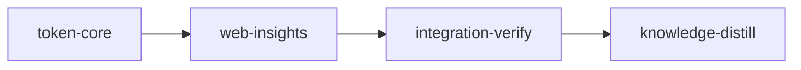

# Plan: Live Token Insights

## Overview

The token flow surfaces in `loom status --web` and `loom status --live` gain plan-wide totals per model and reasoning effort (a table plus a pie chart by model on the web, a table with share bars in the TUI `t` pane), refresh every 5 s instead of every 30 s with a cheaper tracker pass, and the web stage dialog's token chips each get a sparkline. Three web touch-ups ride along: the header TOKENS rail drops its sparkline (the Token flow chart shows the same data larger), the "uncached input" mix row explains why it is tiny, and the terminal and terminal-history views in the stage dialog get a back-arrow button that returns to the details as Esc does.

## Goals

- Totals per (model, effort) from the transcripts themselves: Claude assistant lines carry `perTurnEffort`/`effort`, Codex `turn_context` carries `effort` (verified on real files; recorded in `doc/loom/knowledge/architecture/token-flow-sources.md`).
- Token statistics on the main page and in the stage dialog update every 5 s; an idle plan costs one stat per file and no writes for most passes.
- Non-goals: per-model sparklines; changing the 30 s bucket or the 180 s quota poll; any migration of old checkpoints (the version bump makes the tracker read transcripts from the start once).

## Questions answered while planning

- **"Uncached input is 35/m at 81.5k fresh/min. Is this correct?"** Yes. Claude Code puts a cache breakpoint at the end of every prompt, so `input_tokens` counts only the couple of tokens after it: 2 per API call on all three transcripts measured (one main session, two subagents). 35/m is about 17 API calls a minute. Fresh tokens are mostly cache writes and output. The row stays and gets a hint.
- **"What is the point of the header sparkline?"** On `/` and `/ledger` none: it shows the plan's last 15 minutes, which the Token flow chart shows over 30 minutes. It goes (owner's choice: remove everywhere).

## Execution Diagram



No knowledge-bootstrap: the knowledge base already maps the token flow (`architecture/token-flow-sources.md`, `architecture/web-dashboard.md`, `architecture/web-terminal.md`), `loom knowledge check --strict --baseline` passes, and the facts verified while planning were written there before this plan.

## Stages

### 1. token-core (`working_dir: loom`)

Rust tracker and wire changes, the TUI by-model block, and the wire fixture and zod schema the web reads (the Rust fixture test pins them together).

- **Wire:** `ModelUsage`, `TokenFlow.models`, `StageFlow.hit_series` (shared brief section 2).
- **Accounting:** effort from transcript lines, per-agent (model, effort) keys capped at 8, checkpoint version 2, smoothed rate (section 3).
- **Cadence:** 5 s passes with a thread-local pass memo that reuses the checkpoint in memory, skips identical checkpoint saves and flow writes (one heartbeat write a minute while idle) and recomputes quota time left at most every 30 s (section 4).
- **TUI:** a "by model" block under the live rows of the `t` pane: model rows with a share bar, effort rows under each.

Stage Necessity: Q1. web-insights needs the wire fields, the fixture and the zod schema merged before its components can read them; the two stages also run in different packages.

Risk walk: untrusted input (effort strings from transcripts) → `effort-label-is-sanitized`; external data (real `perTurnEffort` and Codex `turn_context.effort` shapes) → `claude-usage-split-by-turn-effort`, `codex-usage-carries-turn-context-effort`; scale (a transcript naming many models) → `model-keys-capped-per-agent`; lifecycle (pass memo across passes and work roots, idle rewrites) → `tracker-memo-keeps-work-roots-apart`, `idle-flow-not-rewritten-within-heartbeat`; reachability (TUI block) → `pane-shows-model-breakdown` plus `reachable`; the added behaviour → `rate-steady-across-bucket-boundary`, `hit-series-tracks-bucket-cache-hit`. Configuration propagation and filesystem paths do not apply (no setting; no new path is opened: the memo stats the two files the tracker already writes).

### 2. web-insights (`working_dir: web`)

Token flow panel: the model pie, legend and totals table replace the per-model rate list; the uncached-input hint goes on the mix row; the header rail loses its sparkline. Stage dialog: a trend sparkline under each token chip. Terminal and history dialog views: the back button. Then the stage rebuilds `web/dist`.

Stage Necessity: Q1 (needs token-core merged, see above).

Risk walk: reachability (the panel, the dialog and the terminal view are reached through routes) → `panel-totals-table-splits-efforts`, `panel-pie-sums-efforts-per-model`, `stage-chips-carry-trends`, `terminal-back-returns-to-details`, each rendering a route or the dialog; the added behaviour → `header-rail-drops-sparkline`. Untrusted input: model and effort strings are flattened by the collector and rendered as React text, so no new contract. Other areas do not apply.

### 3. Integration Verification

Full Rust and web suites, lint and format at zero tolerance, `web/dist` freshness, parallel code review, and a smoke of the web dashboard built from the merged tree.

### 4. Knowledge Distillation

Curates stage memories; rewrites `architecture/token-flow-sources.md` sections that this plan changes (Data Flow, Units, Tracker Pass, Surfaces) to the new truth; updates the README token flow paragraph (5 s refresh, by-model totals).

## Decisions

- Effort: `perTurnEffort`, else `effort` (Claude); `turn_context.payload.effort` (Codex). Usage is booked per line to the model and effort current at that line, so an agent that changes effort mid-session splits correctly.
- Totals are fresh tokens (input + cache write + output), as everywhere else in these surfaces; the table adds cache reads as a column.
- The pie aggregates efforts per model, as asked; the table keeps them apart.
- Rate smoothing: dividing the window sum by its real span (271 to 300 s) instead of a fixed 5 minutes removes the boundary dip that a 5 s refresh would show; at a bucket's last second the value is unchanged.
- Web performance: no client memoization. Frames carrying a new flow arrive at most every 5 s and only when it changed; every derived series is linear in at most 120 values (shared brief section 6).
- Codex lane: the TUI block renderer (one file plus its test) in token-core and the series and model helpers in web-insights. The line parsers and the sanitizer stay with the Claude accounting worker: their type changes must land with `accumulate.rs` for the crate to compile.

Briefs: `doc/plans/briefs/live-token-insights/` (`common.md` first, then one file per worker). YAML is authoritative where prose and YAML differ.

---

<!-- loom METADATA -->

```yaml
loom:
  version: 2
  auto_merge: null
  sandbox:
    enabled: true
    auto_allow: true
    allow_unsandboxed_escape: false
    excluded_commands: []
    filesystem:
      deny_read:
      - ~/.ssh/**
      - ~/.aws/**
      - ~/.config/gcloud/**
      - ~/.gnupg/**
      deny_write:
      - ../../**
      allow_write: []
    network:
      allowed_domains:
      - "*"
      additional_domains: []
      allow_local_binding: true
      allow_unix_sockets: []
      allow_all_unix_sockets: false
    linux:
      enable_weaker_nested: false
    command_confinement: confined
  ratchet_files:
  - loom/maintainability-baseline.txt
  - doc/loom/knowledge/check-baseline.txt
  provision:
  - working_dir: web
    command: >-
      test ! -e .npmrc && test ! -L .npmrc && bun install --frozen-lockfile
      --ignore-scripts --backend=copyfile --config=/dev/null
  stages:
  - id: token-core
    name: Model and effort totals, 5 s tracker, TUI by-model block
    description: |
      Build stage 1 of doc/plans/PLAN-live-token-insights.md (renamed IN_PROGRESS-PLAN-live-token-insights.md once loom run starts).
      Use parallel subagents and skills to maximize performance.
      PATHS: working_dir is loom/ because loom runs each contract as `cargo test <name> -- --exact` from it. YAML paths and the worker table are package-relative (../ for files outside the crate); brief paths are repo-relative from the worktree root.
      Every worker reads doc/plans/briefs/live-token-insights/common.md first, then its own brief. common.md is authoritative for the wire model, constants, accounting rules, the pass memo and the fixture values.
      WARM-UP (you, first): cargo test --lib --no-run, so the worktree's empty target/ is built before workers queue on cargo's build lock.
      FOUNDATION (you, before any spawn): add `mod tokens_models;` to src/commands/status/ui/tui/ledger/mod.rs beside `mod tokens_pane;`, and create src/commands/status/ui/tui/ledger/tokens_models.rs holding only the doc line `//! The by-model block of the t pane: plan-wide token totals per model and effort.` C2 fills it and W3 calls it; until W3 lands, clippy reports model_lines as dead code, which the gate after the waves no longer sees. Run cargo build.
      WAVE 1 (Claude lane): spawn W1 (loom-software-engineer, sonnet) and W2 (loom-senior-software-engineer, effort high) in the background in ONE message, each with "Your brief: <path>. Read it in full before anything else." W1 changes the wire types every other worker compiles against; W2's territory (tracker.rs, pass_memo.rs, quota_points.rs, tokens/mod.rs) constructs none of them, so the two run side by side. Wait with one background loom subagents watch.
      WAVE 2 (codex lane, after W1 returns): spawn C2 as one loom-codex-forwarder subagent in the FOREGROUND with `--model gpt-5.6-terra --effort xhigh`, an explicit Bash timeout of 600000 ms, and "Your brief: <path>. Read it in full before anything else."; tell it not to run git, not to touch .loom paths, and that its only check is `cargo test --lib --no-run`. Then run `git status --short` (only C2's two files may be new or changed by it) and cargo test --lib commands::status::ui::tui::ledger::tokens_models yourself.
      WAVE 3 (Claude lane): spawn W3 (loom-software-engineer, model haiku) in the background; wait with one background loom subagents watch (W2 may still be running; one watch covers both).
      AFTER THE WAVES: rustfmt --check --edition 2021 tests/token_insights_contracts.rs src/commands/status/ui/tui/ledger/tests_models_contracts.rs src/commands/status/ui/tui/ledger/tests_completion.rs (frozen files the formatter would rewrite fail completion; a failure here is a dispute-contract, never an edit); cargo fmt --all; cargo test --test maintainability; route any failure to a fresh worker of the owning territory; then one loom-verifier round over the acceptance list below; then the review rounds. Commit only after the gate and the final review are green.
      MUTATION: before the final review round, for each contract apply the wrong implementation its rejects text describes (or revert the line it guards), confirm the contract fails, restore from a saved copy kept under $LOOM_SCRATCH_DIR (never git checkout), and record loom memory note "mutation: <contract id> red under <mutation>".
      TEST INTEGRITY: W1 moves `now` in tests/token_flow_contracts.rs rate_is_five_minute_average to the last second of its bucket and `NOW` in src/tokens/flow_build_tests.rs to 1_788_523_229 (same bucket, last second), so the existing rate assertions keep their values under the new span formula; existing StageFlow/TokenFlow literals in test files gain the new fields. If any assertion line of a test file that existed at base still changes, list the events after the final review round with `loom stage review integrity token-core` and file ONE `loom stage dispute-integrity` naming every event, each with the reason.
      | Worker | Role | Tier | Files owned | Shared context | Brief path |
      | ------ | ---- | ---- | ----------- | -------------- | ---------- |
      | W1 | Wire types, effort accounting, flow build, sanitize, fixture and schema | sonnet | src/tokens/model.rs; src/tokens/model_tests.rs; src/tokens/claude_line.rs; src/tokens/claude_line_tests.rs; src/tokens/codex_line.rs; src/tokens/codex_line_tests.rs; src/tokens/accumulate.rs; src/tokens/accumulate_tests.rs; src/tokens/checkpoint.rs; src/tokens/checkpoint_tests.rs; src/tokens/flow_build.rs; src/tokens/flow_build_tests.rs; src/tokens/tests_fixture.rs; src/commands/status/data/sanitize_token_flow.rs; src/commands/status/data/sanitize_token_flow_tests.rs; src/commands/status/web/model_tests.rs; src/commands/status/ui/tui/ledger/tokens_pane_tests.rs; src/commands/status/ui/tui/ledger/tests_tokens.rs; src/commands/status/ui/tui/ledger/tests_tokens_contracts.rs; tests/token_flow_contracts.rs; ../web/src/api/schema.ts; ../web/src/api/schema.test.ts; ../web/src/api/fixtures/snapshot.json; ../web/src/lib/tokens.test.ts | common.md | doc/plans/briefs/live-token-insights/token-core/w1-accounting.md |
      | W2 | Tracker cadence and pass memo | opus | src/tokens/mod.rs; src/tokens/tracker.rs; src/tokens/tracker_tests.rs; src/tokens/pass_memo.rs; src/tokens/pass_memo_tests.rs; src/tokens/quota_points.rs; src/tokens/quota_points_tests.rs | common.md | doc/plans/briefs/live-token-insights/token-core/w2-tracker.md |
      | C2 | TUI by-model block renderer | codex terra | src/commands/status/ui/tui/ledger/tokens_models.rs; src/commands/status/ui/tui/ledger/tokens_models_tests.rs | common.md | doc/plans/briefs/live-token-insights/token-core/c2-model-block.md |
      | W3 | TUI pane wiring | haiku | src/commands/status/ui/tui/ledger/tokens_pane.rs; src/commands/status/ui/tui/ledger/tokens_pane_models_tests.rs | common.md | doc/plans/briefs/live-token-insights/token-core/w3-pane-wiring.md |
      CONTRACT SURFACE (the contract session writes these from this text before any code):
      - Integration contracts: every one is a top-level #[test] fn in tests/token_insights_contracts.rs named after its id with underscores, so `cargo test <name> -- --exact` selects it. Reuse the fixture builders of tests/token_flow_contracts/support.rs by declaring `#[allow(dead_code)]` then `#[path = "token_flow_contracts/support.rs"]` then `mod support;` at the top of the contract file (Fx::new, Fx::add_stage(stage_id, session_uuid, text), Fx::add_forward_receipt, Fx::scan(now), Fx::tokens_dir, usage, iso, uuid, unix_now, BAD). Transcript lines with model and effort keys, Codex rollouts with turn_context effort, and any other new builders go in tests/token_insights_contracts/lines.rs (declared the same way); shape them from the real line formats in doc/loom/knowledge/architecture/token-flow-sources.md "Token Usage Sources": a Claude assistant line is {"type":"assistant","timestamp":<RFC 3339>,"effort":<str>,"perTurnEffort":<str>,"message":{"id":<str>,"model":<str>,"usage":{"input_tokens":n,"cache_creation_input_tokens":n,"cache_read_input_tokens":n,"output_tokens":n}}}; a Codex turn_context line is {"type":"turn_context","timestamp":..,"payload":{"model":<str>,"effort":<str>}}. Keep every fn under 50 lines and each file under 400 lines.
      - API: loom::tokens::{scan_pass, read_flow, TokenFlow, ModelUsage, TokenUsage, MAX_MODEL_KEYS, BUCKET_SECS, STAGE_SERIES_LEN}. scan_pass(work_root: &Path, codex_sessions_root: Option<&Path>, now: i64) -> anyhow::Result<TokenFlow>; read_flow(work_root: &Path) -> Option<TokenFlow>. TokenFlow.models: Vec<ModelUsage>; ModelUsage { model: String, effort: Option<String>, total: TokenUsage }; StageFlow.hit_series: Vec<Option<u8>>. Wire semantics are in doc/plans/briefs/live-token-insights/common.md sections 2 to 4.
      - TUI contract: src/commands/status/ui/tui/ledger/tests_models_contracts.rs, declared by adding exactly two lines, `#[path = "tests_models_contracts.rs"]` and on the next line `mod models_contracts;`, at the top level of src/commands/status/ui/tui/ledger/tests_completion.rs after the existing tokens_contracts declaration (a test-only file no worker edits). Build the LedgerView and the TokenFlow the way src/commands/status/ui/tui/ledger/tests_tokens_contracts.rs does (helpers screen, contains, fixture from ledger/tests.rs; fixture()'s executing stage is "s-executing"), with show_tokens true, one active main agent on "s-executing", and TokenFlow.models set to the four entries of common.md section 5.
      - Every contract is red at freeze because ModelUsage, the models and hit_series fields and MAX_MODEL_KEYS do not exist (BuildFailed counts as red).
      MEMORY: record mistakes, decisions and surprises via loom memory immediately (subagents too); NEVER loom knowledge (implementation stage); NEVER Claude Code auto-memory.
    summary: >-
      Counts tokens per model and reasoning effort, refreshes the token flow every 5
      s with a cheaper tracker pass, adds a per-bucket cache hit series, and shows a
      by-model block in the TUI t pane.
    dependencies: []
    parallel_group: null
    acceptance:
    - cargo build
    - "cargo test --lib tokens::"
    - "cargo test --lib commands::status:: -- --skip commands::status::web::terminal::"
    - cargo test --test token_insights_contracts
    - cargo test --test token_flow_contracts
    - cargo test --test token_flow_bounds_contracts
    - cargo test --test maintainability
    - cargo clippy --all-targets -- -D warnings
    - cargo fmt --check
    - RUSTDOCFLAGS='-D warnings' cargo doc --workspace --all-features --no-deps
    - cd ../web && bunx tsc -b --noEmit
    - cd ../web && bunx vitest run src/api src/lib
    - >-
      cd ../web && bunx oxfmt --check src/api/fixtures/snapshot.json
      src/api/schema.ts src/api/schema.test.ts src/lib/tokens.test.ts
    setup: []
    files:
    - src/tokens/**
    - src/commands/status/data/sanitize_token_flow.rs
    - src/commands/status/data/sanitize_token_flow_tests.rs
    - src/commands/status/web/model_tests.rs
    - src/commands/status/ui/tui/ledger/**
    - tests/token_flow_contracts.rs
    - tests/token_insights_contracts.rs
    - tests/token_insights_contracts/**
    - ../web/src/api/schema.ts
    - ../web/src/api/schema.test.ts
    - ../web/src/api/fixtures/snapshot.json
    - ../web/src/lib/tokens.test.ts
    auto_merge: null
    working_dir: loom
    stage_type: standard
    artifacts:
    - src/tokens/pass_memo.rs
    - src/commands/status/ui/tui/ledger/tokens_models.rs
    wiring:
    - source: src/tokens/tracker.rs
      pattern: Duration::from_secs(TRACKER_INTERVAL_SECS)
      description: the tracker passes every TRACKER_INTERVAL_SECS (5 s)
      literal: true
    - source: src/commands/status/ui/tui/ledger/tokens_pane.rs
      pattern: model_lines(
      description: the t pane appends the by-model block
      literal: true
    before_stage:
    - command: cargo --version
      description: cargo on PATH
    - command: codex --version
      description: codex CLI on PATH (codex lane)
    after_stage:
    - command: rg -qF "model_lines(" src/commands/status/ui/tui/ledger/tokens_pane.rs
      description: the t pane calls the by-model block renderer
    context_ceiling_tokens: null
    sandbox: {}
    ultracode: false
    implementers:
    - claude
    - codex
    subagent_timeout_secs: 900
    skills:
    - loom-rust
    - loom-typescript
    contracts:
    - id: claude-usage-split-by-turn-effort
      file: tests/token_insights_contracts.rs
      test: claude_usage_split_by_turn_effort
      scenario: >-
        one stage session transcript with msg_1 (model claude-opus-5-5, perTurnEffort
        xhigh, effort xhigh, usage input 2 cache_write 1000 cache_read 5000 output 100),
        msg_2 (claude-opus-5-5, perTurnEffort high, effort xhigh, usage 2/400/3000/50) and
        msg_3 (model <synthetic>, no effort keys, all-zero usage); one scan_pass
      rejects: >-
        last-wins attribution that books both messages under one effort (a single opus
        entry of 1554 fresh), or reading effort instead of perTurnEffort (a single
        opus/xhigh entry); expected models [(opus, xhigh, 2/1000/5000/100), (opus, high,
        2/400/3000/50)] summing to plan.total
    - id: codex-usage-carries-turn-context-effort
      file: tests/token_insights_contracts.rs
      test: codex_usage_carries_turn_context_effort
      scenario: >-
        a stage with a forward receipt naming a Codex thread whose rollout has
        session_meta, turn_context {model gpt-6.1-sol, effort xhigh} and one token_count with
        total_token_usage input 1000, cached_input 600, cache_write 0, output 50; one
        scan_pass with that codex sessions root
      rejects: >-
        a Codex parser that reads only payload.model, so the entry is (gpt-6.1-sol,
        null); expected (gpt-6.1-sol, xhigh) with total input 400, cache_read 600, output 50
    - id: effort-label-is-sanitized
      file: tests/token_insights_contracts.rs
      test: effort_label_is_sanitized
      scenario: >-
        one assistant line whose perTurnEffort is x followed by each character of
        support::BAD (escape, right-to-left override, newline) and then high; one scan_pass,
        then read_flow
      rejects: >-
        an accumulator that copies perTurnEffort into the flow verbatim, so a terminal
        escape reaches the TUI and the dashboard; no character of BAD may appear in any
        models entry's effort, and the effort must be non-empty
    - id: model-keys-capped-per-agent
      file: tests/token_insights_contracts.rs
      test: model_keys_capped_per_agent
      scenario: >-
        one transcript of 20 assistant lines with distinct ids, models m-01 to m-20,
        perTurnEffort xhigh, each usage cache_write 10; one scan_pass
      rejects: >-
        one key per distinct model string, letting a transcript grow the checkpoint and
        the flow without bound; expected at most MAX_MODEL_KEYS + 1 models entries, one
        of them model other, and entries summing to cache_write 200
    - id: idle-flow-not-rewritten-within-heartbeat
      file: tests/token_insights_contracts.rs
      test: idle_flow_not_rewritten_within_heartbeat
      scenario: >-
        one transcript whose only usage line is 7200 s before now (totals only,
        all-zero series), now the first second of a bucket; scan_pass at now, now + 5 and now +
        30, reading read_flow(work_root).observed_at after each; then scan_pass at now +
        65
      rejects: >-
        a tracker that rewrites flow.json every pass although only observed_at changed
        (observed_at now + 5 after the second pass), or one that never refreshes it
        (still now after the pass at now + 65); expected now, now, now, then now + 65
    - id: tracker-memo-keeps-work-roots-apart
      file: tests/token_insights_contracts.rs
      test: tracker_memo_keeps_work_roots_apart
      scenario: "two Fx work roots on the test thread: A with one usage line of cache_write 100, B with one of cache_write 7; scan A at now, B at now, A at now + 5; compare each returned flow's plan total and read_flow of each root"
      rejects: >-
        a pass memo keyed by nothing, which reuses A's checkpoint for B (B reports 100)
        or writes A's flow into B's tokens directory; expected A 100 and B 7 in both the
        returned flows and the files
    - id: rate-steady-across-bucket-boundary
      file: tests/token_insights_contracts.rs
      test: rate_steady_across_bucket_boundary
      scenario: >-
        T is a bucket boundary (multiple of BUCKET_SECS); a transcript with one line
        every 10 s carrying cache_write 1000 from T - 300 to T - 10; scan_pass at T - 1;
        append a line at T; scan_pass at T + 1; compare the stage's rate.cache_write
      rejects: >-
        a rate that divides the window sum by a fixed 5 minutes, which reads 6000 then
        5600 (a 7% drop as a bucket starts); expected the two rates within 5% of each
        other
    - id: hit-series-tracks-bucket-cache-hit
      file: tests/token_insights_contracts.rs
      test: hit_series_tracks_bucket_cache_hit
      scenario: >-
        now in bucket k; one line in bucket k - 2 with usage input 0, cache_write 100,
        cache_read 300, output 5 and one in bucket k - 1 with cache_write 300, cache_read
        100, output 5; nothing in bucket k; one scan_pass
      rejects: >-
        a hit series filled from the stage's cumulative cache hit (every value 50), or
        0 for an empty bucket; expected hit_series of length STAGE_SERIES_LEN ending
        [Some(75), Some(25), None]
    - id: pane-shows-model-breakdown
      file: src/commands/status/ui/tui/ledger/tests_models_contracts.rs
      test: >-
        commands::status::ui::tui::ledger::tests_completion::models_contracts::pane_shows_model_breakdown
      scenario: >-
        renders the ledger at 132x60 with fixture(), show_tokens true and a TokenFlow
        whose stage s-executing has one active main agent and whose models are the four
        entries of common.md section 5
      rejects: >-
        a model block that is built and unit-tested but never appended to the t pane,
        or one that lists model/effort rows without summing a model's efforts into its
        share (opus at 25% and 8%); expected one row containing claude-sonnet-5-5, 50% and
        1.11M, one containing claude-opus-5-5 and 33%, and effort rows containing xhigh
        and high
    harness:
    - tests/token_insights_contracts/**
    - src/commands/status/ui/tui/ledger/tests_completion.rs
    reachable:
    - symbol: model_totals
      from: scan_pass
      description: every pass builds the plan-wide model totals
    - symbol: hit_series
      from: scan_pass
      description: every pass builds each stage's cache hit series
    - symbol: model_lines
      from: render_dashboard
      description: the TUI dashboard renders the by-model block
  - id: web-insights
    name: Web model breakdown, chip trends, header rail, terminal back button
    description: |
      Build stage 2 of doc/plans/PLAN-live-token-insights.md (renamed IN_PROGRESS-PLAN-live-token-insights.md once loom run starts).
      Use parallel subagents and skills to maximize performance.
      PATHS: working_dir is web/; YAML paths are package-relative; brief paths are repo-relative.
      Every worker reads doc/plans/briefs/live-token-insights/common.md and doc/loom/knowledge/conventions/web-dashboard-typography.md first, then its brief. token-core already changed src/api/schema.ts (ModelUsage, TokenFlow.models, StageFlow.hit_series) and src/api/fixtures/snapshot.json (common.md section 5).
      WAVE 1 (codex lane): spawn C1 as one loom-codex-forwarder subagent in the FOREGROUND with `--model gpt-5.6-terra --effort xhigh`, an explicit Bash timeout of 600000 ms, and "Your brief: <path>. Read it in full before anything else."; tell it not to run git, not to touch .loom paths, not to run oxfmt, and to write erasable TypeScript only. Then run `git status --short` (only C1's two files) and bunx vitest run src/lib yourself.
      WAVE 2 (Claude lane): spawn W1 (loom-software-engineer, sonnet) and W2 (loom-software-engineer, model haiku) in the background in ONE message; wait with one background loom subagents watch.
      AFTER THE WAVES: bun run format; then bun run build, so the rebuilt dist/ is in the tree the gate and the final review see (web/dist is committed and embedded by loom/build/assets.rs); then one loom-verifier round over the acceptance list; then the review rounds. Commit only after the gate and the final review are green.
      TEST INTEGRITY: removing the header sparkline deletes the test "left-pads a short plan series to the sparkline's 30 points" in src/components/header-lines.test.tsx, and the model legend plus table make `getByText("claude-opus-5-5")` in src/components/token-flow-panel.test.tsx ambiguous, so that assertion is scoped to the legend. After the final review round, list the events with `loom stage review integrity web-insights` and file ONE `loom stage dispute-integrity` naming every event, with the reason (the owner asked to remove the sparkline; the model name now appears in the legend and the table).
      MUTATION: before the final review round, for each contract apply the wrong implementation its rejects text describes, confirm the contract fails, restore from a saved copy kept under $LOOM_SCRATCH_DIR (never git checkout), and record loom memory note "mutation: <contract id> red under <mutation>".
      | Worker | Role | Tier | Files owned | Shared context | Brief path |
      | ------ | ---- | ---- | ----------- | -------------- | ---------- |
      | C1 | Series and model helpers | codex terra | src/lib/tokens.ts; src/lib/tokens.test.ts | common.md | doc/plans/briefs/live-token-insights/web-insights/c1-helpers.md |
      | W1 | Token flow panel, model breakdown, header rail | sonnet | src/components/token-flow-panel.tsx; src/components/token-flow-panel.test.tsx; src/components/token-models.tsx; src/components/token-models.test.tsx; src/components/header-lines.tsx; src/components/header-lines.test.tsx | common.md | doc/plans/briefs/live-token-insights/web-insights/w1-panel.md |
      | W2 | Chip trends and terminal back button | haiku | src/components/stage-tokens.tsx; src/components/stage-tokens.test.tsx; src/components/terminal/terminal-view.tsx; src/components/terminal/terminal-view.test.tsx; src/components/terminal/history-view.tsx; src/components/terminal/history-view.test.tsx; src/components/stage-modal.tsx; src/components/stage-modal.test.tsx | common.md | doc/plans/briefs/live-token-insights/web-insights/w2-dialog.md |
      CONTRACT SURFACE (the contract session writes src/token-insights.contracts.test.tsx before any code):
      - Every contract is one TOP-LEVEL it() (no describe) whose title is exactly the contract's test string: loom runs `bunx vitest run <file> -t '<regex-escaped test string>'` and vitest matches -t against the full name, which joins describe and it titles with " > ".
      - Route rendering: copy the renderAt helper of src/token-flow.contracts.test.tsx (snapshotSchema.parse + applySnapshot into a jotai store + createMemoryRouter(routes) from @/router), seeded from src/api/fixtures/snapshot.json, which carries status.tokens.models and hit_series per common.md section 5. The Token flow panel is `<section aria-label="Token flow">` (getByRole("region", { name: "Token flow" })); the stage dialog's tokens section is `<section aria-label="stage tokens">`; the header rail is `<section aria-label="tokens">` inside the banner (getByRole("banner")).
      - Names the components will carry (common.md section 6): table aria-label "token totals by model and effort"; pie svg role img, aria-label "fresh tokens by model", one slice element per model with data-model; legend list aria-label "models"; chip sparklines role img with aria-labels "fresh rate, last 30 min", "fresh so far, last 30 min", "cache hit per 30 s, last 30 min", "agents live, last 30 min"; terminal back button role button, name "Back to details".
      - The back-button contract renders StageModal the way renderModal in src/components/stage-modal.test.tsx does (createMemoryRouter with a route whose element is <StageModal terminalFactory={pendingFactory()} />, a store seeded with a stage whose session_backend is tmux and session_alive true and with terminals enabled), at /?stage=<id>&view=terminal, then fireEvent.click on the "Back to details" button.
      - Import only modules that exist at the stage base; reach new behaviour through rendered output only. The file must be oxfmt- and oxlint-clean as written (run `bunx oxfmt src/token-insights.contracts.test.tsx` and `bun run lint` before freezing).
      - Every contract is red at freeze: the table, pie, chip sparklines and back button do not exist, and the header rail still draws its sparkline.
      MEMORY: record mistakes, decisions and surprises via loom memory immediately (subagents too); NEVER loom knowledge; NEVER Claude Code auto-memory.
    summary: >-
      Adds the by-model pie, legend and totals table to the Token flow panel, a hint
      on uncached input, trend sparklines under the stage dialog's token chips, removes
      the header rail sparkline, adds a back button to the dialog's terminal views,
      and rebuilds the embedded bundle.
    dependencies:
    - token-core
    parallel_group: null
    acceptance:
    - bun run typecheck
    - bun run lint
    - bun run format:check
    - >-
      bunx vitest run src/components src/lib src/token-insights.contracts.test.tsx
      src/token-flow.contracts.test.tsx
    - >-
      d=$(mktemp -d "${TMPDIR:-/tmp}/insdist.XXXXXX") && bunx vite build --outDir
      "$d" --emptyOutDir --logLevel error && diff -r "$d" dist
    setup: []
    files:
    - src/components/**
    - src/lib/**
    - src/token-insights.contracts.test.tsx
    - dist/**
    auto_merge: null
    working_dir: web
    stage_type: standard
    artifacts:
    - src/components/token-models.tsx
    wiring:
    - source: src/components/token-flow-panel.tsx
      pattern: <TokenModels
      description: the Token flow panel mounts the model breakdown
      literal: true
    - source: src/components/stage-modal.tsx
      pattern: onBack={toDetails}
      description: the stage dialog hands its details transition to the terminal views
      literal: true
    - source: src/components/stage-tokens.tsx
      pattern: rollingRate(
      description: the stage chips draw their trends from the series helpers
      literal: true
    before_stage:
    - command: bun --version
      description: bun on PATH
    - command: codex --version
      description: codex CLI on PATH (codex lane)
    after_stage:
    - command: rg -qF "token totals by model and effort" dist/assets/index.js
      description: the embedded bundle carries the model totals table
    context_ceiling_tokens: null
    sandbox: {}
    ultracode: false
    implementers:
    - claude
    - codex
    subagent_timeout_secs: 900
    skills:
    - loom-react
    - loom-typescript
    contracts:
    - id: panel-totals-table-splits-efforts
      file: src/token-insights.contracts.test.tsx
      test: token insights panel table lists totals per model and effort
      scenario: >-
        renders / with the fixture snapshot; within the Token flow region, the table
        named token totals by model and effort has a row containing high and 180k, a row
        containing xhigh and 560k, and a row containing medium, 1.11M and 13.00M
      rejects: >-
        a table keyed by model only (one opus row with 740k), or one showing per-minute
        rates instead of totals
    - id: panel-pie-sums-efforts-per-model
      file: src/token-insights.contracts.test.tsx
      test: token insights panel pie has one slice per model
      scenario: >-
        renders / with the fixture snapshot; the img named fresh tokens by model holds
        exactly 3 elements with a data-model attribute; in the list named models, the
        item containing claude-opus-5-5 contains 33% and the item containing
        claude-sonnet-5-5 contains 50%
      rejects: a pie with one slice per model and effort (4 slices, opus split into 25% and 8%)
    - id: stage-chips-carry-trends
      file: src/token-insights.contracts.test.tsx
      test: token insights stage dialog draws a trend under each chip
      scenario: >-
        renders /?stage=server with the fixture snapshot; within the region named stage
        tokens, each of the images named fresh rate, last 30 min; fresh so far, last 30
        min; cache hit per 30 s, last 30 min; agents live, last 30 min is found exactly
        once
      rejects: >-
        trends on some chips only, or one shared sparkline of the stage series under
        every chip
    - id: header-rail-drops-sparkline
      file: src/token-insights.contracts.test.tsx
      test: token insights header rail shows numbers without a sparkline
      scenario: >-
        renders / with the fixture snapshot; within the banner, the region named tokens
        contains 43.2k, 2.23M and 93% and no element with role img
      rejects: >-
        a header rail that still draws the 15 minute sparkline the Token flow chart
        duplicates
    - id: terminal-back-returns-to-details
      file: src/token-insights.contracts.test.tsx
      test: token insights terminal back button returns to the stage details
      scenario: >-
        renders StageModal at /?stage=<id>&view=terminal as renderModal in
        stage-modal.test.tsx does, clicks the button named Back to details, then reads the router
        location and the dialog
      rejects: >-
        a back button that closes the whole dialog (deleting stage from the URL)
        instead of leaving only the terminal view; expected stage=<id> kept, no view parameter,
        and no element labelled Agent terminal
  - id: integration-verify
    name: Integration Verification
    description: |
      Final verification of doc/plans/PLAN-live-token-insights.md (IN_PROGRESS- prefix once running). Verify FUNCTIONAL INTEGRATION, not only tests passing. NEVER Claude Code auto-memory.
      Use parallel subagents and skills to maximize performance.
      CONTEXT: read the plan, doc/plans/briefs/live-token-insights/common.md, loom memory show --all, and doc/loom/knowledge/architecture/token-flow-sources.md. This stage runs at the repository root; token-core ran in loom/, web-insights in web/.
      BUILD AND TEST (zero tolerance; nothing is pre-existing): every acceptance command below.
      FUNCTIONAL (from this session's own shell, in ONE Bash invocation, because each Bash call gets its own network namespace): cargo build --manifest-path loom/Cargo.toml, then scripts/smoke-web-dashboard.sh loom/target/debug/loom (the sanctioned exception to "loom from PATH": the installed binary predates this plan). Then confirm with rg over web/dist/assets that the bundle carries "token totals by model and effort", "fresh tokens by model", "Back to details" and "agents live, last 30 min", and that loom/src/tokens/tracker.rs sets TRACKER_INTERVAL_SECS to 5.
      CODE REVIEW: spawn parallel loom-code-reviewer subagents: security (inline_safe on every effort and model string from transcripts and rollouts; the pass memo never serving one work root's state to another; checkpoint version refusal), correctness (per-line attribution, the MAX_MODEL_KEYS and MAX_MODEL_ROWS folds keeping sums equal to totals, the span formula, hit_series rounding, the memo's stamp and hash checks and heartbeat, quota reuse window), and web (zod strictness against the Rust serializer, the pie arithmetic and rounding, chip trend helpers, the back button in view and control mode, a11y names). Fix every finding with an engineer agent or dispute it; never defer one.
      SUGGESTIONS: weigh every pending reviewer suggestion the signal lists; resolve each one implemented with loom memory resolve <id> --outcome implemented --reason <what changed>.
      Record discoveries to loom memory for knowledge-distill, including any knowledge file the tree contradicts: loom memory note "stale-knowledge: ...".
    summary: >-
      Confirms the tracker, the TUI and the web dashboard work together on the merged
      tree, the embedded bundle is current, and the full suites pass.
    dependencies:
    - web-insights
    parallel_group: null
    acceptance:
    - cargo test --manifest-path loom/Cargo.toml --all-targets --no-fail-fast
    - cargo clippy --manifest-path loom/Cargo.toml --all-targets -- -D warnings
    - cargo fmt --manifest-path loom/Cargo.toml --check
    - >-
      RUSTDOCFLAGS='-D warnings' cargo doc --manifest-path loom/Cargo.toml
      --workspace --all-features --no-deps
    - >-
      cd web && bunx tsc -b --noEmit && bunx oxlint --deny-warnings && bunx oxfmt
      --check && bunx vitest run
    - >-
      cd web && d=$(mktemp -d "${TMPDIR:-/tmp}/insdist.XXXXXX") && bunx vite build
      --outDir "$d" --emptyOutDir --logLevel error && diff -r "$d" dist
    - rg -qF 'token totals by model and effort' web/dist/assets/index.js
    - rg -qF 'Back to details' web/dist/assets/index.js
    setup: []
    files: []
    auto_merge: null
    working_dir: '.'
    stage_type: integration-verify
    artifacts: []
    wiring:
    - source: loom/src/commands/status/ui/tui/ledger/tokens_pane.rs
      pattern: model_lines(
      description: the t pane appends the by-model block
      literal: true
    - source: web/src/components/token-flow-panel.tsx
      pattern: <TokenModels
      description: the Token flow panel mounts the model breakdown
      literal: true
    context_ceiling_tokens: null
    sandbox: {}
    ultracode: false
    implementers:
    - claude
    skills:
    - loom-rust
    - loom-react
    - loom-typescript
    - loom-security-audit
  - id: knowledge-distill
    name: Knowledge Distillation
    description: |
      Curate all stage memories into permanent knowledge; update user docs. NEVER Claude Code auto-memory.
      SINGLE-AGENT: do NOT spawn subagents; memories are compact summaries; keep code spot-reads narrow.
      START with loom memory pending --group (corrections, mistakes, decisions, other); read the plan and the knowledge sections it touches.
      CORRECTIONS FIRST: apply every stale-knowledge memory in place with loom knowledge replace-section <file> "<heading>" "<body>" (or "-" and the body on stdin when it starts with "-"), never loom knowledge update. Known candidates in architecture/token-flow-sources.md, each rewritten to the current truth: "Data Flow" (TRACKER_INTERVAL_SECS 5, the pass memo), "Units" (the span-based rate; ModelUsage, models and hit_series), "Tracker Pass" (memo reuse, skipped identical saves and writes, 60 s heartbeat, quota reuse; checkpoint version 2; per-agent model keys), "Surfaces" (the by-model table and pie, chip trends, header rail without sparkline, uncached hint, TUI by-model block). Also concerns/token-accounting-and-proof-defects.md, whose note that checkpoint.save runs every pass even when nothing advanced is no longer true, and architecture/web-terminal.md for the back button.
      Then curate mistakes, patterns, decisions and conventions the stages recorded. TIER ROUTING: findings ~40 lines or fewer go inline in the tier-1 file; larger findings go via loom knowledge update <category>/<slug> with a 2-4 line tier-1 summary plus link. INDEX.md regenerates on every knowledge write.
      DOCS: README.md's token flow paragraph says the thread reads transcripts "every 30 seconds": change it to every 5 seconds, and mention the per-model and effort totals (web table and pie, TUI t pane), the stage dialog chip trends, and that the header rail no longer carries a sparkline. Relevant paragraph only.
      SUGGESTIONS: record every unimplemented reviewer suggestion in concerns or the topic it belongs to, then resolve it promoted, merged or discarded.
      RECEIPTS: every memory taken into knowledge gets loom memory resolve <id> --outcome promoted|merged|discarded|deferred right after the write that used it; finish with loom memory pending --strict and resolve whatever it lists.
      LAST, if this stage removed structural issues, ratchet the baseline: loom knowledge check --write-baseline doc/loom/knowledge/check-baseline.txt
    summary: >-
      Records the per-model accounting, the 5 s tracker and its pass memo, and the
      new web surfaces in the knowledge base, and updates the README token flow paragraph.
    dependencies:
    - integration-verify
    parallel_group: null
    acceptance:
    - loom knowledge check --strict --baseline doc/loom/knowledge/check-baseline.txt
    - loom memory pending --strict
    - rg -qF 'every 5 seconds' README.md
    setup: []
    files:
    - doc/loom/knowledge/**
    - README.md
    auto_merge: null
    working_dir: '.'
    stage_type: knowledge-distill
    artifacts: []
    wiring: []
    context_ceiling_tokens: null
    sandbox: {}
    ultracode: false
    implementers:
    - claude
```

<!-- END loom METADATA -->
