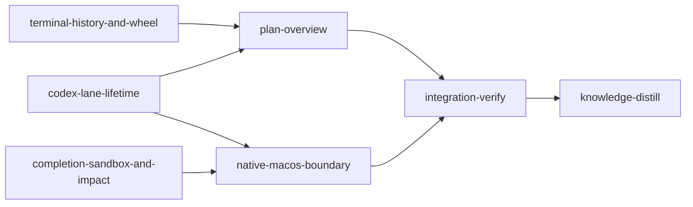

# Plan: Open GitHub Issues #30, #35, #36, #40, #41 and Native Codex on macOS

Implements: none

## Overview

| Work | Observable result | Stage |
| --- | --- | --- |
| #35, #41 | A gentle trackpad swipe pages View mode; an ended fullscreen tmux session offers its last observed screen. | `terminal-history-and-wheel` |
| #36 | A finished plan shows a persistent overview in both interfaces and writes one statistics record per run. | `plan-overview` |
| #40 | macOS completion jobs can listen locally and enumerate required ancestor directories. Reports distinguish environmental failures and recognize an accepted full impact selection. | `completion-sandbox-and-impact` |
| #30 | Bounded Codex exploration is briefable, a stalled handshake expires, and a live watch reports provider progress. | `codex-lane-lifetime` |
| Operator request | A qualified macOS host runs native Codex inside Loom's filesystem and network boundary. | `native-macos-boundary` |

Issue #29, Codex stage orchestration and a global statistics dashboard are outside scope.

## Decisions

1. Use layout A in `doc/plans/briefs/open-github-issues/plan-overview/mockup.html`. The locked web dialog shows wall time, execution time, fresh tokens, cache hit, all tokens, a token mix, timeline, model rows with a colour key, archive filename and Copy summary. The TUI replaces its ledger and stays open until `q`.
2. Draw each started stage from first work to completion. Distinguish contract writing, execution, dispute/adjudication, retry and waiting/merge. Label skipped stages.
3. Publish when the nonempty plan reaches Completed or Skipped for every stage. Bare `loom clean` preserves run state. State cleanup and `loom init <plan> --clean` remove the local overview (`commands/clean/mod.rs:42`, `commands/init/execute.rs:139`).
4. Save one versioned record under the parent of `user_config::config_path()` in `stats/plans/`, and identical data in the run's `plan-stats.json`. The archive survives state cleanup. Recovery reuses the first completed archive for that run.
5. Keep the existing same-sandbox signal rule and its kernel tests. Add localhost bind/inbound and literal directory-listing grants while preserving the outbound restrictions for each network mode and Cargo-file denies above the tree.
6. Provision disposable base checkouts with the plan's provision snapshot. A proven environmental impediment produces a reasoned note. Ordinary failures retain their evidence and the merged full suite still runs.
7. Match accepted impact failures by selection ID, failure kind (including failure details used by today's equality), and digest of the full normalized selection. Keep at most 64 names for display.
8. The macOS profile wraps the entire worker. Allow writes to the worktree, private temp and private sessions, while protecting Loom, Git and agent configuration. Commands share the outer boundary and access to the worker's private auth copy. Network access goes through the existing proxy, restricted to port 443 and the host patterns in `CODEX_SANDBOX_DOMAINS` (`loom/src/codex.rs:140`). The loopback allowance identifies a port. Keep its listener reserved until verified release. After loss of that listener the rule cannot attest its replacement.
9. Use a fresh macOS session plus group, process identity and invocation marker to check release. A detached process that has lost all identifying evidence may escape observation while remaining filesystem-confined. Linux retains its PID-namespace proof.
10. All five implementation stages use Claude workers. Use sonnet for ordinary implementation, haiku for the pinned doctrine edits and opus for sandbox and teardown work per the worker assignments. First reviews use opus; set `models.code_reviewer_followup_model` to opus for the same tier on later rounds. The existing 1500-second Codex unit deadline stays in place.

## Stages and verification

The YAML defines worker assignments, scope and contracts. The plan has no separate migration stage. Supply the YAML ownership and corrected public interfaces directly to each worker alongside its brief. Reinstall Loom from the reviewed baseline before starting this plan. Worker tests exercise checkout code; a running daemon keeps its installed binary. Workers run focused tests; orchestration owns the stage gate and the final review. Keep changed files within the maintainability ledger and new files within 400 lines. Only integration verification may lower ledger rows. Record implementation decisions and stale knowledge through stage memory.

`terminal-history-and-wheel`, `completion-sandbox-and-impact` and `codex-lane-lifetime` can start together. Overview follows terminal work and lane doctrine because they share status fixtures and `models/stage/defaults.rs`. Native macOS follows the completion and lifetime stages. Both feed integration verification and then knowledge distillation.



**Host verification.** Run the kernel checks on the merged code from a plain macOS shell with native Codex installed. Use fixture credentials and local endpoints. First list the selected tests and confirm that **both** the completion kernel fixture and the native worker lifecycle fixture appear. Then run the complete selection with strict probes; record the executed counts and results. A missing test, skipped prerequisite in strict mode or failed assertion leaves host qualification unverified.

```sh
cargo test --manifest-path loom/Cargo.toml --lib -- --include-ignored --list open_issues_macos_completion_kernel native_macos_
LOOM_TEST_REQUIRE_SANDBOX_FREE=1 cargo test --manifest-path loom/Cargo.toml --lib -- --include-ignored open_issues_macos_completion_kernel native_macos_
```

<!-- loom METADATA -->

```yaml
loom:
  version: 2
  auto_merge: null
  sandbox:
    enabled: true
    auto_allow: true
    allow_unsandboxed_escape: false
    excluded_commands: []
    filesystem:
      deny_read:
      - ~/.ssh/**
      - ~/.aws/**
      - ~/.config/gcloud/**
      - ~/.gnupg/**
      deny_write:
      - ../../**
      allow_write: []
    network:
      allowed_domains:
      - crates.io
      - index.crates.io
      - static.crates.io
      - registry.npmjs.org
      additional_domains: []
      allow_local_binding: false
      allow_unix_sockets: []
      allow_all_unix_sockets: false
    linux:
      enable_weaker_nested: false
    command_confinement: confined
  ratchet_files:
  - loom/maintainability-baseline.txt
  - doc/loom/knowledge/check-baseline.txt
  provision:
  - working_dir: web
    command: >-
      test ! -e .npmrc && test ! -L .npmrc && bun install --frozen-lockfile
      --ignore-scripts --backend=copyfile --config=/dev/null
  stages:
  - id: terminal-history-and-wheel
    name: Trackpad paging and fullscreen last screen
    description: |
      Issues #41 and #35. Run the independent assignments in parallel. Spawn all three workers in one message. Give each worker its brief, exact ownership from the table, and its named shared context; those assignments supersede conflicting brief instructions.
      WHEEL: Keep installViewerWheel(terminal, host, scroll). For non-ctrl View/alternate wheel events cancel even deltaY=0. Reset on an event.timeStamp gap >250 ms. The first page needs max(3, ceil(rows/4)) lines, later pages need rows; max three pages per gesture and one per event. Reversal drops accumulated distance but keeps the page count. Keep existing wheel line conversion, normal-buffer scrolling and Control behavior. Apply the new policy only to wheel calls; viewer-touch.ts:18 and viewer-touch.test.ts:64–69 pin the existing touch policy.
      CAPTURE: Sample live Running tmux sessions from Monitor::poll (monitor/core.rs:145–150); keep sampling best-effort with bounded aggregate latency and fair progress past a stuck server (tmux/mod.rs:103 permits 5 s per old probe). Query the exact target and capture visible bytes only if it is still alternate in the same server operation; discard an alternate capture if the pane has restored its main screen (capture.rs:64–94). Use bounded bytes and atomic writes. Keep Session.fullscreen_seen sticky and serde-defaulted, omitting false, via an exact locked update (fs/session_files/exact.rs:88–120); re-export it from fs/session_files.rs:16–23.
      TEARDOWN: Keep history::CaptureMode { Full, Visible } and capture_mode(bool, Option<bool>) -> Option<CaptureMode>. Some(true) => Visible; otherwise seen => None (preserve bytes) and unseen => Full (ordinary scrollback). Read the latest persisted flag; if teardown first sees the alternate screen, persist true there too, including when normal close has already set a terminal status (monitor/session_events.rs:335–345). A failed/empty capture preserves the previous valid file. Polling can recover only frames it observed, so report the last observed alternate screen.
      STATUS: HistoryKind { History, LastScreen } serializes to history/last_screen. Resolve StageSummary.terminal_history_session and terminal_history_kind together for the newest ended tmux session, when it has a saved capture (status/data/stopped.rs:49–63, collector.rs:231). Carry kind only when the attention entry carries the saved session. Update all Rust literals and the serialized blocked fixture (status/web/model_tests_stages.rs:10, model_tests_blocked.rs:57; status/ui/tui/ledger/tests_attention.rs:13). Keep both web fields optional for old payloads and existing schemas strict.
      UI: terminalHistory(terminals, stage) returns { session, kind } or null; missing kind defaults to history. Export HistoryKind and historyLabels(kind) with button, aria, screenAria, eyebrow, footer, link, missing, failed and title. Preserve all existing history strings. Last screen values respectively are "Last screen", "open last screen", "Saved last screen", "Last screen", "read-only · the session ended · this is its last screen", "View last screen", "This session left no saved screen.", "The saved screen could not be loaded.", and "The session ended; its last screen opens read-only". Render these on stage actions, the modal, the saved-screen host/page, and blocked attention; retain the existing endpoint/path and allow no attach. Use stage kind on both route and modal (routes/terminal.tsx:36–57, stage-modal.tsx:205–221). CLI attention labels LastScreen "last screen of its last session".
      BEHAVIOR: Rust contracts exercise the file-writing teardown and real status collector with injected tmux responses so they run without sockets. Add real tmux coverage using tests_history.rs's host guards for main -> alternate -> main -> teardown, and first alternate capture during teardown; The confined contracts carry the required proof when a host cannot bind a socket. Keep implementation module declarations in mod.rs; frozen contracts are read-only. Preserve existing test assertions except wheel thresholds intentionally replaced by the lead.
      | Worker | Role | Tier | Files owned | Shared context | Brief path |
      | --- | --- | --- | --- | --- | --- |
      | wheel | #41 gesture paging | loom-software-engineer | web/src/components/terminal/viewer-wheel.ts, web/src/components/terminal/viewer-wheel.test.ts | WHEEL | doc/plans/briefs/open-github-issues/terminal-history-and-wheel/wheel.md |
      | fullscreen-rust | #35 capture and status | loom-software-engineer | loom/src/models/session/types.rs, loom/src/models/session/methods.rs, loom/src/fs/session_files.rs, loom/src/fs/session_files/exact.rs, loom/src/orchestrator/terminal/tmux/capture.rs, loom/src/orchestrator/terminal/tmux/history.rs, loom/src/orchestrator/terminal/tmux/fullscreen.rs, loom/src/orchestrator/terminal/tmux/mod.rs, loom/src/orchestrator/terminal/tmux/tests_history.rs, loom/src/orchestrator/monitor/core.rs, loom/src/status/data/stopped.rs, loom/src/status/data/collector.rs, loom/src/status/data/mod.rs, loom/src/status/attention_model.rs, loom/src/commands/status/ui/tui/ledger/tests_attention.rs, loom/src/commands/status/web/model.rs, loom/src/commands/status/web/model_tests.rs, loom/src/commands/status/web/model_tests_stages.rs, loom/src/commands/status/web/model_tests_blocked.rs, web/src/api/fixtures/snapshot.json, web/src/api/fixtures/statuses.json | CAPTURE, TEARDOWN, STATUS, BEHAVIOR | doc/plans/briefs/open-github-issues/terminal-history-and-wheel/fullscreen-rust.md |
      | fullscreen-web | #35 labels | loom-software-engineer | web/src/components/terminal/history-labels.ts, web/src/components/terminal/terminal-glyph.tsx, web/src/routes/stage.tsx, web/src/components/stage-modal.tsx, web/src/components/terminal/history-view.tsx, web/src/components/attention-blocked.tsx, web/src/routes/terminal.tsx, web/src/api/schema.ts, web/src/components/terminal/terminal-glyph.test.tsx, web/src/components/stage-modal-history.test.tsx, web/src/components/terminal/history-view.test.tsx, web/src/components/attention-panel.test.tsx, web/src/api/schema.test.ts, web/src/routes/terminal.test.tsx | STATUS, UI | doc/plans/briefs/open-github-issues/terminal-history-and-wheel/fullscreen-web.md |
      Run oxfmt on touched files after web workers return and loom check terminal-history-and-wheel alongside final review. Record corrections with loom memory.
    summary: >-
      Gentle trackpad swipes page the View-mode terminal. Ended fullscreen sessions
      show their last recorded alternate screen.
    dependencies: []
    parallel_group: null
    acceptance:
    - cargo fmt --manifest-path loom/Cargo.toml --all -- --check
    - cargo clippy --manifest-path loom/Cargo.toml --all-targets -- -D warnings
    - command: "cargo test --manifest-path loom/Cargo.toml --lib orchestrator::terminal::tmux::"
      timeout_secs: 900
    - command: "cargo test --manifest-path loom/Cargo.toml --lib commands::status::web::"
      timeout_secs: 900
    - command: >-
        cd web && VITEST_SKIP_INSTALL_CHECKS=1 ./node_modules/.bin/vitest run
        src/components/terminal src/components/stage-modal-history.test.tsx
        src/components/attention-panel.test.tsx src/api/schema.test.ts src/routes
      timeout_secs: 900
    - command: >-
        cd web && ./node_modules/.bin/tsc -b --noEmit && ./node_modules/.bin/oxlint
        --deny-warnings && ./node_modules/.bin/oxfmt --check
      timeout_secs: 600
    setup: []
    files:
    - web/src/components/terminal/**
    - web/src/components/stage-modal.tsx
    - web/src/components/stage-modal-history.test.tsx
    - web/src/components/attention-blocked.tsx
    - web/src/components/attention-panel.test.tsx
    - web/src/routes/stage.tsx
    - web/src/routes/terminal.tsx
    - web/src/routes/terminal.test.tsx
    - web/src/routes/terminal.contract.test.tsx
    - web/src/api/schema.ts
    - web/src/api/schema.test.ts
    - web/src/api/fixtures/**
    - loom/src/models/session/**
    - loom/src/fs/session_files.rs
    - loom/src/fs/session_files/**
    - loom/src/orchestrator/terminal/tmux/**
    - loom/src/orchestrator/monitor/core.rs
    - loom/src/status/data/**
    - loom/src/status/attention_model.rs
    - loom/src/commands/status/web/**
    - loom/src/commands/status/ui/tui/ledger/tests_attention.rs
    auto_merge: null
    working_dir: '.'
    stage_type: standard
    artifacts:
    - web/src/components/terminal/viewer-wheel.ts
    - web/src/components/terminal/history-labels.ts
    - loom/src/orchestrator/terminal/tmux/fullscreen.rs
    wiring:
    - source: loom/src/orchestrator/monitor/core.rs
      pattern: sample_fullscreen(
      description: The monitor observes active tmux panes
      literal: true
    - source: web/src/routes/stage.tsx
      pattern: historyLabels(
      description: Stage actions use the saved-screen kind
      literal: true
    - source: web/src/components/attention-blocked.tsx
      pattern: historyLabels(
      description: Blocked attention uses the saved-screen kind
      literal: true
    before_stage:
    - command: >-
        test -f web/src/components/terminal/viewer-touch.test.ts && test -f
        loom/src/orchestrator/terminal/tmux/history.rs
      description: The touch baseline and saved-capture implementation are available.
    after_stage:
    - command: >-
        cargo test --manifest-path loom/Cargo.toml --lib -- --exact
        orchestrator::terminal::tmux::history_contract_tests::a_fullscreen_session_keeps_its_last_screen_at_teardown
      stdout_contains:
      - 1 passed
      description: Saved alternate-screen bytes survive real teardown.
    context_ceiling_tokens: null
    sandbox: {}
    ultracode: false
    implementers:
    - claude
    skills:
    - loom-rust
    - loom-react
    - loom-typescript
    contracts:
    - id: gentle-swipe-pages-once
      file: web/src/components/terminal/viewer-wheel.contract.test.ts
      test: viewer wheel gestures > a gentle trackpad swipe sends one page
      runner: vitest
      cwd: web
      scenario: >-
        View/alternate, 45 rows, 18 px fallback. Drive 20 pixel-mode events of deltaY
        15 at 16 ms intervals; assert exactly one forward page.
      rejects: A pager that still needs a full viewport, or pages on each short moved distance.
    - id: slow-notch-sends-no-page
      file: web/src/components/terminal/viewer-wheel.contract.test.ts
      test: viewer wheel gestures > a single slow mouse notch sends no page
      runner: vitest
      cwd: web
      scenario: >-
        At 45 rows assert a 40 px notch sends no page. In a fresh viewer compare two
        120 px movements separated by exactly 250 ms (one page) and by 251 ms (zero pages).
      rejects: >-
        A lead that pages on a notch, fails to reset after idle, or resets at the wrong
        boundary.
    - id: flick-is-bounded
      file: web/src/components/terminal/viewer-wheel.contract.test.ts
      test: viewer wheel gestures > a hard flick sends at most three pages one per event
      runner: vitest
      cwd: web
      scenario: >-
        At 45 rows dispatch a >3-viewport event, then enough same-direction travel for
        the second and third pages. Assert one send at most per dispatch, exactly three
        before idle, none on immediate reversal, and one at the next gesture's lead. Check
        a second page needs 45 lines after the first 12; use a fresh viewer for the
        distance check.
      rejects: >-
        An implementation that queues multiple pages per event, reuses the lead for
        subsequent pages, or resets the three-page budget on a directional change.
    - id: zero-delta-stays-in-view
      file: web/src/components/terminal/viewer-wheel.contract.test.ts
      test: viewer wheel gestures > a wheel with no vertical movement stays in the viewer
      runner: vitest
      cwd: web
      scenario: >-
        Dispatch cancelable horizontal-only wheel events in View/alternate, with
        ctrlKey, and in Control. The first is stopped and prevented without paging; the last
        two propagate.
      rejects: >-
        Delegating zero vertical movement to xterm in View or canceling pinch/Control
        events.
    - id: fullscreen-keeps-visible-capture
      file: loom/src/orchestrator/terminal/tmux/history_contract_tests.rs
      test: >-
        orchestrator::terminal::tmux::history_contract_tests::a_fullscreen_session_keeps_its_last_screen_at_teardown
      cwd: loom
      scenario: >-
        Seed persisted fullscreen_seen=true with ALT bytes and pass a stale false
        Session to the production save path. Inject separate MAIN bytes after an
        alternate-to-main transition and a failed capture. Assert the old bytes and stored flag
        survive. Also inject a first alternate observation during teardown and assert visible
        bytes plus the sticky flag. Exercise the capture_mode table as a supplementary
        assertion.
      rejects: >-
        A correct decision helper paired with a writer that reads stale state, replaces
        saved bytes with restored main output, or never records a first detection at
        kill.
    - id: fullscreen-monitor-refreshes-alternate
      file: loom/src/orchestrator/terminal/tmux/history_contract_tests.rs
      cwd: loom
      scenario: >-
        Drive the production sampler with injected tmux responses for a live tracked
        pane. Two alternate observations save successive ALT markers; a main observation
        leaves the second ALT marker and sticky flag in place.
      rejects: >-
        The monitor only detects fullscreen, keeps its first frame, or overwrites the
        last alternate frame when the pane returns to main.
    - id: fullscreen-session-names-last-screen
      file: loom/src/status/data/stopped_contract_tests.rs
      test: >-
        status::data::stopped_contract_tests::a_fullscreen_session_is_named_as_its_last_screen
      cwd: loom
      scenario: >-
        Collect and serialize the real status from two ended stage tmux sessions with
        distinct captures. Assert the chosen newest session and its last_screen kind in
        the stage and blocked attention wire. Remove that capture, keep the older one, and
        assert both fields are omitted.
      rejects: >-
        A helper classifies LastScreen but the production collector/wire drops the
        kind, or chooses a kind from a different session.
    - id: last-screen-labels
      file: web/src/components/terminal/history-labels.contract.test.ts
      test: history labels > a last screen never mentions history
      runner: vitest
      cwd: web
      scenario: >-
        Assert all historyLabels values, including distinct button and saved-screen
        ARIA labels, for both kinds.
      rejects: >-
        Last screen copy says history anywhere, or existing history labels are
        repurposed.
    - id: last-screen-route-replays-capture
      file: web/src/routes/terminal.contract.test.tsx
      test: >-
        terminal route last screen > replays the saved capture read only under last
        screen labels
      runner: vitest
      cwd: web
      scenario: >-
        Render the real /terminal/:stageId route for an ended tmux stage via its
        snapshot with terminal_history_kind=last_screen. Inject a loader and emulator; assert
        the requested saved session, read-only replay, Last screen eyebrow and Saved last
        screen accessible name.
      rejects: >-
        The label helper passes but the route drops kind, falls back to history, or
        attaches to a terminal.
    reachable:
    - symbol: sample_fullscreen
      from: poll
      description: The running monitor invokes alternate-screen sampling
    - symbol: capture_mode
      from: kill_session
      description: Teardown chooses the kind of capture before the tmux server exits
  - id: plan-overview
    name: Plan overview dialog, TUI screen and saved statistics
    description: |
      Read Decisions 1–4 and doc/plans/briefs/open-github-issues/common.md. Use parallel subagents with the listed briefs, then run the stage gate. Mockup layout A and its TUI tab at doc/plans/briefs/open-github-issues/plan-overview/mockup.html are visual references.

      Persist Stage.phases as a serde-defaulted Vec<PhaseSpan>, skipped when empty. The public models::stage::phases types are Phase { Contract, Executing, Adjudication, Retry, Waiting } with snake_case serde names and PhaseSpan { phase: Phase, started_at: DateTime<Utc>, ended_at: Option<DateTime<Utc>> }. The public phase_for(StageStatus, Option<SessionType>, u32, bool) -> Option<Phase> takes retry count and whether history exists. record(&mut Vec<PhaseSpan>, Option<Phase>, DateTime<Utc>) closes and opens spans on phase changes and closes without reopening for None. Executing is Contract for a Contract session, Adjudication for an Adjudication session, and Executing or Retry for Stage and Knowledge sessions according to retry_count (orchestrator/core/inbox_drain/complete.rs:69). Merge and BaseConflict are Waiting after first start. A missing session never erases recorded work. NeedsAdjudication is Adjudication. Completed and Skipped close the span. Before the first work phase, pending/queued states add no span. Waiting covers intervening inactive and merge/recovery states. Classify the new state before the atomic stage write in verify/transitions/persistence.rs:152–179; read the actual session record without reacquiring the sessions lock (196–203, stage_spawn.rs:122–156). Terminal close uses persisted completion/transition time and clamps clock regressions. At 512 spans preserve the first start and close a bounded overflow Waiting span at the terminal transition. Add the field to the canonical Stage default (models/stage/defaults.rs:9). Keep existing ledger limits.

      plan_stats::PlanStatsRecord has SCHEMA_VERSION = 1, with schema_version: u32, plan_id: String, plan_name: String, started_at and ended_at: DateTime<Utc>, wall_secs and execution_secs: i64, totals: TokenUsage, stages: Vec<StageStats>, models: Vec<ModelStats>. StageStats has id, name, stage_type and status: String, started_at and completed_at: Option<DateTime<Utc>>, execution_secs: i64, model and effort: Option<String>, phases: Vec<PhaseSpan>, tokens: TokenUsage. ModelStats has model: String, effort: Option<String>, lane: String ("claude" or "codex"), agents: u32, tokens: TokenUsage. All fields are public and serialize with their pinned names; nullable values are explicit null. Use TokenUsage::fresh and saturating addition for all tokens (fresh + cache_read). For cache hit reuse the live ledger's input-side denominator and empty-denominator display (tokens/flow_build.rs:184–196). Prove computed totals, cache hit, per-stage durations, distinct agents and copied summary from a populated two-lane fixture.
      build(work_dir: &Path) -> Result<PlanStatsRecord> uses the initialized plan config (commands/init/plan_setup.rs:198–205) and canonical persisted terminal stages. Init records immutable UTC initialization time, source slug and a fresh stats run UUID in the plan table. For an already initialized run missing the key, assign it once under the config lock and reuse it on retry. Wall time starts with the earliest work span or persisted started_at and ends at the latest completion or skipped transition (skip does not set completed_at, models/stage/methods.rs:269–273); for all-skipped or preexisting states use deterministic persisted fallback times and zero duration when no work occurred. execution_secs sums stage execution counters. Keep option fields faithful to stage state, and timelines readable with missing timing data.
      Add a token-owned aggregate API, deriving lane from AgentKind and counting each agent per model/effort/lane in which it used tokens. Use per-agent by_model and total directly, including unknown and other buckets (tokens/accumulate.rs:34–54,229–258); retain only this plan's stage IDs. Finish consumes in-memory aggregates from a final scan, including when the rolling checkpoint cannot fit on disk (tokens/pass_memo.rs:133–158); use bounded checkpoint loading for offline build fixtures. The daemon starts and owns the tracker before scheduler readiness, ends and joins it before the scheduler's final synchronous scan, and preserves ordinary shutdown and failed-start cleanup; foreground runs the final scan directly (daemon/server/lifecycle.rs:173–218,303–316; tokens/tracker.rs:42–48,98–134,251–266). Cover last-line capture and tracker shutdown with fixture transcripts, never the real home.
      Keep file_name(&PlanStatsRecord) -> String, publish(&PlanStatsRecord, &Path) -> Result<Published>, Published::{Written, AlreadyPublished}(PathBuf), loom_home() -> Result<PathBuf>, write_current(&Path, &PlanStatsRecord) -> Result<()>, read_current(&Path) -> Option<PlanStatsRecord> and finish_plan(&Path) -> Result<Published>. Use config_path's parent for home. Set plan_id to <init UTC %Y%m%dT%H%M%SZ>-<bounded source-stem slug>-<run UUID>. Capture the slug at init (strip IN_PROGRESS-/DONE-, reduce to [a-z0-9-]). file_name derives <plan_id>.json from a bounded safe identifier, and the footer uses the same derivation. The path survives a plan rename or changed observed timestamps on restart, and two initializations cannot collide. Use private, no-follow stats/plans directories and an fsynced unique temp installed by an atomic no-replace operation, following fs/inbox/write.rs:65–83,110–137. An existing matching complete record wins and is used verbatim to repair the current copy on retry; report an invalid or unrelated existing file. cache_io's overwrite helper is only for the current copy (fs/cache_io.rs:25–50). Publish the home copy before exposing current, with bounded, no-follow, schema-checked reads. Size the complete IPC response against daemon/wire.rs:16 (2 MiB); omit the optional inline report when the combined frame would overflow, while keeping the full record readable locally. The web collector can still read it on disk (commands/status/web/broadcast.rs:166,281), as can the TUI on local completion. Test the byte boundary and ensure other status fields keep flowing. Neutralize record display strings and clamp to existing JS-safe numeric limits at the shared read/projection boundary.
      Call finish_plan from daemon/server/orchestrator.rs:174–205 after successful scheduler completion from daemon or foreground. Use the identical run work root, log stats errors, and preserve TerminalOutcome. Account for the active initialized run identity and terminal stage state when reading current, so stale data cannot lock a reset or new initialization. Clean with state removal and a fresh init remove the local record; bare clean leaves state intact (commands/clean/mod.rs:42–55). The home copy survives both. Verify all-skipped, incomplete, foreground, retry after interruption between the two writes, duplicate concurrent publishers, and same-named distinct initializations.

      StatusData.plan_stats is an optional serde-defaulted whole-snapshot field from plan_stats::read_current, with no age gate. Keep stage phases in the report only. Whole-snapshot detection sees status.plan_stats in commands/status/web/feed_split.rs:185–192; prove both appearance and removal cause full frames. Keep the exhaustive StatusData Rust fixtures compiling, and round-trip one populated Rust serde fixture through WebSocket/full state and strict TS parsing.
      Web exports PlanOverviewDialog({ record }) in web/src/components/plan-overview/plan-overview-dialog.tsx. Mount from routes/shell.tsx when the full snapshot contains plan_stats. Use the layout A header and lock note, wall/execution/fresh/cache-hit/all totals, token mix, timeline with skipped rows, lane-labelled model table and colour key, saved file and Copy summary. Constrain it to the viewport with scrollable content. Make it an accessible alertdialog with the plan name and visible focus, no close affordance, and prevent Escape/outside events. Give it sole modal ownership while open, including when a help/settings/stage dialog was already open or a shortcut is pressed. Keep schema_version literal 1 and mirror nullable Rust fields in the strict planStatsSchema.
      TUI renders the same report in place of the ledger and successful legacy completion view. On successful completion or daemon EOF, load the current report from disk; daemon shutdown may send only completion (daemon/server/broadcast.rs:194–207). Render in a local key/resize loop until q, even after the socket closes. Keep overflow rows reachable with scroll keys and preserve active-run controls. Allow status --live to open an existing finished report after daemon exit (commands/status.rs:54–65); preserve legacy failure/no-record behavior. Use a backend-independent frame/view selection seam for TestBackend plus the app's socket harness (tui/app_tests.rs:99–130).

      Wave 1: phases and web-dialog. Wave 2: plan-stats after phases. Wave 3: wire and tui-overview after plan-stats. The contract writer registers frozen tests via the derived scaffold. The integrator checks the combined stage.
      | Worker | Role | Tier | Files owned | Shared context | Brief path |
      | --- | --- | --- | --- | --- | --- |
      | phases | persisted phase history | loom-software-engineer | loom/src/models/stage/phases.rs, loom/src/models/stage/phases_tests.rs, loom/src/models/stage/mod.rs, loom/src/models/stage/types.rs, loom/src/models/stage/defaults.rs, loom/src/verify/transitions/persistence.rs | phase model above | doc/plans/briefs/open-github-issues/plan-overview/phases.md |
      | web-dialog | accessible overview and schema | loom-software-engineer | web/src/components/plan-overview/**, web/src/routes/shell*.tsx, web/src/api/schema.ts, web/src/api/schema.test.ts | mockup and record above | doc/plans/briefs/open-github-issues/plan-overview/web-dialog.md |
      | plan-stats | final token capture and archive | loom-software-engineer | loom/src/tokens/**, loom/src/plan_stats/**, loom/src/daemon/server/lifecycle.rs, loom/src/daemon/server/orchestrator.rs, loom/src/daemon/server/orchestrator_tests.rs, loom/src/commands/init/plan_setup.rs, loom/src/fs/safe_replace.rs, loom/src/fs/safe_replace/**, loom/src/lib.rs | phase model and finish above | doc/plans/briefs/open-github-issues/plan-overview/plan-stats.md |
      | wire | snapshot and fixture parity | loom-software-engineer | loom/src/daemon/wire.rs, loom/src/daemon/wire_tests.rs, loom/src/status/data/mod.rs, loom/src/status/data/collector_snapshot.rs, loom/src/commands/status/web/feed_split_tests.rs, loom/src/commands/status/web/model_tests.rs, loom/src/commands/status/web/tests/**, loom/src/commands/status/render/graph_tests.rs, loom/src/commands/status/ui/tui/ledger/header.rs, loom/src/commands/status/ui/tui/ledger/tests.rs, loom/src/commands/status/ui/tui/ledger/tests_viewport.rs, web/src/api/fixtures/** | whole-frame and record above | doc/plans/briefs/open-github-issues/plan-overview/wire.md |
      | tui-overview | persistent TUI statistics | loom-software-engineer | loom/src/commands/status.rs, loom/src/commands/status/ui/tui/mod.rs, loom/src/commands/status/ui/tui/app.rs, loom/src/commands/status/ui/tui/app_tests.rs, loom/src/commands/status/ui/tui/plan_overview*.rs | report and TUI mockup | doc/plans/briefs/open-github-issues/plan-overview/tui-overview.md |
    summary: >-
      Show a locked overview with plan totals, stage phases and model usage after
      every stage is Completed or Skipped. Save the same record locally and under the loom
      home.
    dependencies:
    - terminal-history-and-wheel
    - codex-lane-lifetime
    parallel_group: null
    acceptance:
    - cargo fmt --manifest-path loom/Cargo.toml --all -- --check
    - cargo clippy --manifest-path loom/Cargo.toml --all-targets -- -D warnings
    - command: "cargo test --manifest-path loom/Cargo.toml --lib -- models::stage:: plan_stats:: tokens:: status::data:: commands::status:: verify::transitions:: daemon::server::"
      timeout_secs: 900
    - command: >-
        cd web && ./node_modules/.bin/vitest run src/components/plan-overview src/api
        src/routes
      timeout_secs: 900
    - command: >-
        cd web && ./node_modules/.bin/tsc -b --noEmit && ./node_modules/.bin/oxlint
        --deny-warnings && ./node_modules/.bin/oxfmt --check
      timeout_secs: 900
    setup: []
    files:
    - loom/src/models/stage/phases*.rs
    - loom/src/models/stage/mod.rs
    - loom/src/models/stage/types.rs
    - loom/src/models/stage/defaults.rs
    - loom/src/verify/transitions/persistence.rs
    - loom/src/tokens/**
    - loom/src/plan_stats/**
    - loom/src/lib.rs
    - loom/src/daemon/wire.rs
    - loom/src/daemon/wire_tests.rs
    - loom/src/daemon/server/lifecycle.rs
    - loom/src/daemon/server/orchestrator*.rs
    - loom/src/commands/init/plan_setup.rs
    - loom/src/fs/safe_replace.rs
    - loom/src/fs/safe_replace/**
    - loom/src/status/data/mod.rs
    - loom/src/status/data/collector_snapshot.rs
    - loom/src/commands/status/web/feed_split_tests.rs
    - loom/src/commands/status/web/model_tests.rs
    - loom/src/commands/status/web/tests/**
    - loom/src/commands/status/render/graph_tests.rs
    - loom/src/commands/status.rs
    - loom/src/commands/status/ui/tui/**
    - web/src/components/plan-overview/**
    - web/src/routes/shell*.tsx
    - web/src/api/schema.ts
    - web/src/api/schema.test.ts
    - web/src/api/fixtures/**
    auto_merge: null
    working_dir: '.'
    stage_type: standard
    artifacts:
    - loom/src/tokens/tracker.rs
    - loom/src/status/data/collector_snapshot.rs
    - loom/src/plan_stats/build.rs
    - loom/src/models/stage/phases.rs
    - loom/src/plan_stats/publish.rs
    - loom/src/commands/status/ui/tui/plan_overview.rs
    - web/src/components/plan-overview/plan-overview-dialog.tsx
    wiring:
    - source: web/src/routes/shell.tsx
      pattern: <PlanOverviewDialog
      description: The completed web snapshot mounts the overview
      literal: true
    before_stage:
    - command: >-
        test -f loom/src/orchestrator/terminal/tmux/fullscreen.rs && test -f
        web/src/components/terminal/history-labels.ts
      description: The shared status and terminal surfaces are available from the preceding stage.
    after_stage:
    - command: >-
        cargo test --manifest-path loom/Cargo.toml --lib -- --exact
        commands::status::ui::tui::plan_overview_contract_tests::a_finished_plan_replaces_the_ledger_with_its_overview
      stdout_contains:
      - 1 passed
      description: The completed UI stays open after daemon EOF until the user quits.
    context_ceiling_tokens: null
    sandbox: {}
    ultracode: false
    implementers:
    - claude
    skills:
    - loom-rust
    - loom-react
    - loom-typescript
    contracts:
    - id: plan-stats-published-once
      file: loom/src/plan_stats/contract_tests.rs
      test: plan_stats::contract_tests::a_second_publish_keeps_the_first_record
      cwd: loom
      scenario: >-
        Two publishers race with changed data for the same run, then repeat finish
        after removing the current copy
      rejects: >-
        Overwriting, a partial final file, a duplicate archive or a repaired current
        copy different from the first archive
    - id: plan-stats-under-loom-home
      file: loom/src/plan_stats/contract_tests.rs
      test: plan_stats::contract_tests::the_loom_home_follows_the_user_config_location
      cwd: loom
      scenario: >-
        Redirect user config to a TempDir, publish and verify the path, then test
        refusing symlinked stats and plans directories
      rejects: >-
        Publishing into the ambient home or outside the configured home via a directory
        link
    - id: phase-spans-follow-session-type
      file: loom/src/models/stage/phases_contract_tests.rs
      test: >-
        models::stage::phases_contract_tests::contract_writing_and_adjudication_get_their_own_spans
      cwd: loom
      scenario: >-
        Create real persisted session records and update stage from queued to Contract,
        switch to Stage while still Executing, adjudicate, retry and complete; reload
        spans from disk
      rejects: >-
        Lost same-status session handover, initial pending inflation, mislabelled retry
        or an unclosed terminal span
    - id: plan-overview-dialog-stays-open
      file: web/src/components/plan-overview/plan-overview.contract.test.tsx
      test: >-
        plan overview dialog stays open on escape and outside clicks and offers no
        close control
      runner: vitest
      cwd: web
      scenario: >-
        Load a finished full frame into the shell after another modal opened, send
        Escape, a real outside interaction and the help shortcut
      rejects: >-
        A dismissible overview, multiple active modals or keyboard focus leaving the
        overview
    - id: tui-shows-plan-overview
      file: loom/src/commands/status/ui/tui/plan_overview_contract_tests.rs
      test: >-
        commands::status::ui::tui::plan_overview_contract_tests::a_finished_plan_replaces_the_ledger_with_its_overview
      cwd: loom
      scenario: >-
        Send successful completion then socket EOF with a saved record and no final
        status update, render more rows than fit in a 70x24 TestBackend, scroll to the end,
        advance beyond the legacy exit delay and send q
      rejects: >-
        Losing the report, drawing the legacy summary or ledger, auto-exiting or
        ignoring q
    reachable:
    - symbol: finish_plan
      from: finish_orchestration
      description: Successful orchestration archives and exposes the overview
    - symbol: read_current
      from: collect_status_data
      description: Status exposes the saved overview
  - id: completion-sandbox-and-impact
    name: Completion sandbox grants and impact-test disputes that hold
    description: |
      Issue #40. Read Decisions 5–7 and the common brief. The ownership table and requirements below supersede the worker briefs where they differ. Start the four workers in parallel.
      seatbelt-grants (loom-senior-software-engineer, seatbelt-grants.md): own the Seatbelt renderer, ancestor rules, host dispatch and tests listed below. Preserve the existing scoped signal grant (confine_seatbelt.rs:273–278). Add (allow network-bind network-inbound (local ip "localhost:*")) in Denied and Provision and literal file-read rules for canonical ancestor directory spellings, before the existing Cargo file denies (confine_seatbelt.rs:45–77, confine_ancestors.rs:32–93). Keep the current denied TCP-outbound policy and Provision's existing outbound policy. The Denied-mode runtime proof binds/listens on 127.0.0.1 without a client connect; a remote localhost outbound grant would also reach unrelated host listeners. Check both modes' generated profiles, Cargo.toml and .cargo/config.toml denial, and negative bind on wildcard. Keep the existing signal kernel tests. Add open_issues_macos_completion_kernel_binds_loopback_and_keeps_ancestor_cargo_files_hidden: in one confined fixture a 127.0.0.1 port 0 listener and parent listing succeed, while wildcard bind and reads of both ancestor Cargo files are refused. Verify localhost bind/connect under Linux's default private network namespace (confine_host.rs:284–301). Extract the production profile rendering from the launcher existence check (confine_seatbelt.rs:265–283); expose the same pure builder to unit tests on macOS and Linux. Platform-specific discovery supplies inputs. Freeze the policy contracts against that seam on either host, and have macOS tests exercise the actual launcher. Keep runtime probes guarded and use the strict hosted macOS/Linux CI suites (.github/workflows/ci.yml:265–272,454–461) for non-skipped kernel evidence.
      denial-classification (loom-software-engineer, denial-classification.md): own the environment files, criteria diagnostics, impact runs and dry-run classifier below. Expose crate::verify::environment::sandbox_denial(&str) -> Option<String>, returning the first trimmed diagnostic line, bounded to 300 UTF-8 bytes. Reuse the existing marker owner (criteria/environment.rs:3–22 and dry_run_classify.rs:43–61); preserve ordinary network/disk dry-run classification and existing freeze callers. Match EPERM as a token and diagnostic-shaped permission/launcher lines. Positive test cases include bun CouldntReadCurrentDirectory, Node kill EPERM, sandbox_apply, and bwrap startup denials. A parsed failed-test summary, real build failure, timeout or incomplete output keeps its own verdict, even when assertion or fixture text contains those words (impact_tests/runs.rs:69–131,136–146). Represent a confirmed impact denial as an environment-specific inconclusive reason; append the full-suite hint once in Selection::run_group. In acceptance retain a failed verdict and attach the diagnostic where both the host job and landing render it (criteria/runner.rs:44–59,120–159; host_verify/child_progress.rs:50–61; completion/resolved.rs:110–128). The hint uses the original index even for a filtered check, with loom stage dispute-criteria <stage> --criterion-index <n>. Prove the actual rendered diagnostic, a failed counted assertion that mentions EPERM, and the pass/no-note case.
      impact-acceptance (loom-software-engineer, impact-acceptance.md): own the digest record and service fixture files below. Pin a shared selection_digest(&[TestTarget]) -> String. Before reducing targets to display names (runs.rs:273–277), hash sorted, deduplicated tuples of package-relative file and optional test name with length-prefixed fields and lowercase SHA-256; scoped Rust binaries may share a libtest name (scoped.rs:39–55). Have the base-provision worker call the shared digest in base.rs::stands before dropping target identity or bounding (base.rs:267–276, failure.rs:114–132). Use that same function in report.rs when checking a later run. Keep the 64 display names. AcceptedFailure::of preserves the digest and standing matches id, kind and digest (accepted.rs:58–105); an absent digest loads as empty and cannot authorize a later failure, so existing accepted/observed JSON does not break completion or filing. Do not label a bounded display count as the original selection size. Update every ImpactFailure/AcceptedFailure literal, including the host, daemon and adjudication fixtures listed below. Prove the normal record/filing/apply/reload/report path retains the digest for 721 tests; change only a test beyond the first 64 and prove it stands again. Cover reordered/duplicate targets, equal names in different binaries and differing failure kinds. Keep truncated commands explicitly marked as display excerpts. In prompt/impact.rs:32–41, render a complete, independently reconstructed replay command for the disputed selection. Factor the existing graph selection and scoped command builder from impact_tests.rs:219–247 and scoped.rs:39–55 into a read-only lookup by selection id on the pinned checkout. Compare the recomputed digest before presenting that command. On mismatch or missing evidence request fresh evidence. Cover the 721-test prompt, runner/package identity and a changed checkout. Keep stage-controlled output as display text.
      base-provision (loom-software-engineer, base-provision.md): own base.rs, base_tests.rs, child_base.rs and tests_child_base.rs. The impact-acceptance worker owns module registration and the shared read-only selection lookup in impact_tests.rs. Read the provision snapshot from work_dir, use provision_with(entries, root, run) -> Result<(), String> with a per-entry runner delegating to run_provision_in_stage, and stop at the first error (orchestrator/provision.rs:47–55,87–97). Compare only after checkout and provision; use an isolated base build cache for both provision and base selection, and no pass cache (base.rs:58–76,188–230). Give the scratch comparison a fresh StageCache::resolve root inside its outer TempDir, alongside its checkout, removed with it (stage_cache/mod.rs:77–119); do not reuse the mutable worktree cache or prune the explicit at-base job's kept directories (stage_cache/base_checkout.rs:83–115). Distinguish the selected runner's missing dependencies and confirmed sandbox denial from generic Inconclusive (impact_tests/runs.rs:58–78,101–131). Provision failure or that typed base environment error produces a single base-not-runnable note, with the reason and full-suite hint. Unknown base, checkout failure, real build failure, unreadable output, no tests and timeout still stand. A malformed snapshot is surfaced as a configuration error. Keep the base count comparison. The explicit --at-base job provisions the kept checkout with dirs.cache before its criterion run and evidence recording (host_verify/child_base.rs:60–81,107–125); failed setup stops that job and creates no criterion evidence. Exercise compare itself with a fixture checkout, injected provision runner and selection runner; assert call order, exact checkout root, isolation, no rerun on setup failure and no masking of a real build failure. Exercise --at-base through the host job fixture with a provision-created sentinel and with failed provision.
      | Worker | Files owned |
      | --- | --- |
      | seatbelt-grants | loom/src/verify/criteria/confine_host.rs, loom/src/verify/criteria/confine_policy.rs, loom/src/verify/criteria/confine_seatbelt.rs, loom/src/verify/criteria/confine_seatbelt_tests.rs, loom/src/verify/criteria/confine_ancestors.rs, loom/src/verify/criteria/confine_host_tests.rs |
      | denial-classification | loom/src/verify/environment.rs, loom/src/verify/environment_tests.rs, loom/src/verify/mod.rs, loom/src/verify/criteria/criterion_eval.rs, loom/src/verify/criteria/environment.rs, loom/src/verify/criteria/output.rs, loom/src/verify/criteria/result.rs, loom/src/verify/criteria/runner.rs, loom/src/verify/impact_tests/runs.rs, loom/src/verify/impact_tests/runs_tests.rs, loom/src/verify/completion/resolved.rs, loom/src/host_verify/child_progress.rs, loom/src/commands/plan/verify/dry_run_classify.rs |
      | impact-acceptance | loom/src/verify/impact_tests.rs, loom/src/verify/impact_tests/replay.rs, loom/src/verify/impact_tests/failure.rs, loom/src/verify/impact_tests/accepted.rs, loom/src/verify/impact_tests/observed.rs, loom/src/verify/impact_tests/observed_tests.rs, loom/src/verify/impact_tests/report.rs, loom/src/verify/impact_tests/report_tests.rs, loom/src/orchestrator/adjudication/apply_impact.rs, loom/src/orchestrator/adjudication/apply_impact_tests.rs, loom/src/orchestrator/adjudication/prompt/impact.rs, loom/src/orchestrator/adjudication/prompt/impact_prompt_tests.rs, loom/src/orchestrator/adjudication/verdict_hold_tests.rs, loom/src/daemon/server/dispute_impact_tests.rs, loom/src/host_verify/tests_child_impact.rs |
      | base-provision | loom/src/verify/impact_tests/base.rs, loom/src/verify/impact_tests/base_tests.rs, loom/src/host_verify/child_base.rs, loom/src/host_verify/tests_child_base.rs |
      Each assignment's brief is under doc/plans/briefs/open-github-issues/completion-sandbox-and-impact/. The contract phase owns the new contract files and their normal module declarations; implementation preserves them. Use fixed assertion messages without the fixture's literal denial markers so freeze can distinguish a real red from its outer environment (contracts/freeze.rs:121–144). Expect test-integrity edits for existing digest literals. Run loom check completion-sandbox-and-impact after the workers' changes are together and record any skipped runtime probes in loom memory.
    summary: >-
      macOS completion can run local test listeners, environmental denials are
      identified, base comparisons provision their checkouts, and accepted impact disputes
      match the same selection.
    dependencies: []
    parallel_group: null
    acceptance:
    - cargo fmt --manifest-path loom/Cargo.toml --all -- --check
    - "cargo test --manifest-path loom/Cargo.toml --lib -- verify::impact_tests:: verify::criteria:: verify::environment commands::plan::verify:: apply_impact tests_child_base tests_child_impact dispute_impact_tests impact_prompt_tests verdict_hold_tests"
    - cargo clippy --manifest-path loom/Cargo.toml --all-targets -- -D warnings
    setup: []
    files:
    - loom/src/verify/criteria/confine*.rs
    - loom/src/verify/criteria/seatbelt_grant_contract_tests.rs
    - loom/src/verify/criteria/criterion_eval.rs
    - loom/src/verify/criteria/environment.rs
    - loom/src/verify/criteria/mod.rs
    - loom/src/verify/criteria/output.rs
    - loom/src/verify/criteria/result.rs
    - loom/src/verify/criteria/runner.rs
    - loom/src/verify/impact_tests/**
    - loom/src/verify/impact_tests.rs
    - loom/src/verify/environment*.rs
    - loom/src/verify/mod.rs
    - loom/src/verify/completion/resolved.rs
    - loom/src/commands/plan/verify/dry_run_classify.rs
    - loom/src/orchestrator/adjudication/apply_impact*.rs
    - loom/src/orchestrator/adjudication/prompt/impact_prompt_tests.rs
    - loom/src/orchestrator/adjudication/verdict_hold_tests.rs
    - loom/src/daemon/server/dispute_impact_tests.rs
    - loom/src/host_verify/child_progress.rs
    - loom/src/host_verify/child_base.rs
    - loom/src/host_verify/tests_child_base.rs
    - loom/src/host_verify/tests_child_impact.rs
    - loom/src/orchestrator/adjudication/prompt/impact.rs
    auto_merge: null
    working_dir: '.'
    stage_type: standard
    artifacts:
    - loom/src/verify/impact_tests/replay.rs
    - loom/src/verify/environment.rs
    - loom/src/verify/criteria/confine_seatbelt.rs
    - loom/src/verify/criteria/confine_ancestors.rs
    - loom/src/verify/criteria/runner.rs
    - loom/src/verify/criteria/output.rs
    - loom/src/verify/impact_tests/runs.rs
    - loom/src/verify/impact_tests/failure.rs
    - loom/src/verify/impact_tests/accepted.rs
    - loom/src/verify/impact_tests/base.rs
    - loom/src/orchestrator/adjudication/apply_impact.rs
    - loom/src/host_verify/child_base.rs
    wiring: []
    before_stage:
    - command: >-
        test -f loom/src/host_verify/child_base.rs && test -f
        loom/src/stage_cache/base_checkout.rs
      description: Both the explicit base host job and its isolated cache are present.
    after_stage:
    - command: >-
        cargo test --manifest-path loom/Cargo.toml --lib -- --exact
        verify::impact_tests::accepted_contract_tests::an_accepted_failure_over_721_tests_covers_the_same_failure_next_run
      stdout_contains:
      - 1 passed
      description: >-
        Acceptance survives a real record round trip and distinguishes a changed
        selection.
    context_ceiling_tokens: null
    sandbox: {}
    ultracode: false
    implementers:
    - claude
    skills:
    - loom-rust
    contracts:
    - id: signals-only-own-sandbox
      file: loom/src/verify/criteria/seatbelt_grant_contract_tests.rs
      test: >-
        verify::criteria::seatbelt_grant_contract_tests::a_confined_command_may_signal_only_its_own_sandbox
      cwd: loom
      scenario: >-
        Check the real generated policy for scoped signals and the new localhost
        listener grant together through the production profile builder; the conjunction fails
        on the pre-stage profile.
      rejects: A missing own-sandbox or localhost grant, or an unqualified signal grant.
    - id: binds-only-localhost
      file: loom/src/verify/criteria/seatbelt_grant_contract_tests.rs
      test: >-
        verify::criteria::seatbelt_grant_contract_tests::a_confined_command_may_bind_only_localhost
      cwd: loom
      scenario: >-
        Check the actual Denied profile for localhost TCP bind/inbound in the macOS
        profile from the portable builder.
      rejects: >-
        Missing loopback listener access, wildcard bind, or a newly allowed denied-mode
        TCP outbound path.
    - id: ancestors-listed-not-read
      file: loom/src/verify/criteria/seatbelt_grant_contract_tests.rs
      test: >-
        verify::criteria::seatbelt_grant_contract_tests::ancestor_directories_are_listed_but_cargo_files_above_stay_hidden
      cwd: loom
      scenario: >-
        Use a nested tree with an ancestor manifest and .cargo/config.toml; inspect
        literal directory grants and file denies in the macOS profile.
      rejects: >-
        An ancestor subpath read grant or ancestor Cargo file read/metadata/existence
        visibility.
    - id: sandbox-denial-is-environment
      file: loom/src/verify/environment_contract_tests.rs
      test: >-
        verify::environment_contract_tests::sandbox_denials_are_named_and_assertion_failures_are_not
      cwd: loom
      scenario: >-
        Send representative nonzero captured runner output through the shared
        classifier, acceptance presentation and impact judge. Compare an actual launcher denial, a
        counted assertion mentioning EPERM, a build failure and a passing run.
      rejects: >-
        The benign assertion being excused, a failed criterion losing its original
        index or verdict, or a denied selection becoming an impact-test failure.
    - id: accepted-impact-matches-full-selection
      file: loom/src/verify/impact_tests/accepted_contract_tests.rs
      test: >-
        verify::impact_tests::accepted_contract_tests::an_accepted_failure_over_721_tests_covers_the_same_failure_next_run
      cwd: loom
      scenario: >-
        Round-trip bounded observed evidence and the resulting accepted record, then
        judge the same 721-test selection and a selection that differs beyond the 64th name.
      rejects: >-
        Dropping the digest in serialization or applying a verdict, re-judging the
        identical failure, or excusing the changed selection.
    - id: base-provision-failure-is-note
      file: loom/src/verify/impact_tests/base_contract_tests.rs
      test: >-
        verify::impact_tests::base_contract_tests::a_base_whose_provision_fails_is_noted_not_failed
      cwd: loom
      scenario: >-
        Run the base compare path using a fixture whose first provision entry returns a
        lockfile mismatch. Observe the attempted checkout root, report note and absence
        of a base test invocation; exercise a real failed build after successful
        provision too.
      rejects: >-
        Skipping provision, judging a selection in a failed setup, retaining an
        environment-only standing failure, or excusing a real build failure.
    reachable:
    - symbol: sandbox_denial
      from: run_impact_tests
      description: impact selections classify actual sandbox denials
    - symbol: provision_with
      from: run_impact_tests
      description: the base comparison provisions its isolated checkout
  - id: codex-lane-lifetime
    name: Codex exploration doctrine and native worker lifetime
    description: |
      Read Overview and Decision 10 from the plan path in the stage signal and doc/plans/briefs/open-github-issues/common.md. This stage's YAML takes precedence over its briefs. Run the independent assignments in parallel.
      Doctrine: use the bounded-exploration wording below. Codex may use the navigation kit to explore an unfamiliar path within a briefed, owned file set with pinned interfaces, equivalent sandbox and mechanical acceptance. Open-ended exploration, unknown-cause debugging, failing-test convergence, verification, review and planning stay with Claude. Apply this to both eligibility and lane-list recommendations in the planner skill and reference, byte-identical Rule 7/BLOCK_B, and the live shared Codex introduction for native and legacy signals (format/codex.rs:61–88); align template, agent and model comments. Preserve quota, tier, model, effort and deadline rules.
      Startup: arm a single monotonic STARTUP_DEADLINE_SECS = 120 at Input::Start before sending initialize. It spans initialize and thread/start. The supervisor checks expiry before accepting a late handshake frame (supervisor/mod.rs:112–126,152–165); on time, a valid thread/start response disarms startup and arms the existing 1500 s unit timer. Before thread start, expiry calls the reducer's existing end/teardown path with Outcome::TimedOut and reason "startup deadline (120 s) passed before the Codex thread started"; a prior cancel retains Cancelled and its reason (machine/mod.rs:129–147, turns.rs:145–161). Production flows through supervise_boundary teardown and settlement (supervisor/mod.rs:323–348).
      Watch: own_wait currently emits only initial and terminal records (wait/mod.rs:145–172). Observe continuing polls from the same evidence read used by engine.rs:75–85. Use wait-local optional progress time for Active native Codex workers; preserve WorkerOutcome, the existing stall clock, and binding to the original invocation on restart. Return the validated state and events from one index snapshot (native_worker/index.rs:186–209,271–282). Use the newest ThreadStarted, TurnStarted or Progress event as provider progress; admission, boundary creation and control events do not reset the display age. Clamp future times to 0. Emit human lines for the named worker ending in "progress <n>s ago" or "no progress yet" on the first continuing poll, then at most once per existing 30 s progress interval while active. Preserve the existing --json stream, lease, stall and terminal results.
      | Worker | Tier | Files owned | Brief under doc/plans/briefs/open-github-issues/codex-lane-lifetime/ |
      | --- | --- | --- | --- |
      | doctrine | loom-software-developer | loom/src/orchestrator/signals/tests_doctrine.rs, loom/src/orchestrator/signals/tests_doctrine_blocks.rs, loom/src/orchestrator/signals/format/codex.rs, skills/loom-orchestration/SKILL.md, skills/loom-plan-writer/SKILL.md, skills/loom-plan-writer/references/codex-implementers.md, loom/src/models/stage/implementers.rs, loom/src/models/stage/defaults.rs, CLAUDE.md.template, agents/loom-software-engineer.md | doctrine.md |
      | startup-deadline | loom-software-engineer | loom/src/native_worker/machine/mod.rs, loom/src/native_worker/machine/turns.rs, loom/src/native_worker/machine/tests_cancel.rs, loom/src/native_worker/machine/tests.rs, loom/src/native_worker/supervisor/mod.rs, loom/src/native_worker/supervisor/startup_tests.rs | startup-deadline.md |
      | watch-progress | loom-software-engineer | loom/src/native_worker/index.rs, loom/src/commands/subagents/wait/mod.rs, loom/src/commands/subagents/wait/native.rs, loom/src/commands/subagents/wait/engine.rs, loom/src/commands/subagents/wait/evidence.rs, loom/src/commands/subagents/wait/output.rs, loom/src/commands/subagents/wait/native_tests.rs, loom/src/commands/subagents/wait/engine_tests.rs, loom/src/commands/subagents/wait/tests.rs, loom/tests/subagent_owned_wait.rs, loom/tests/subagent_owned_wait/native_progress.rs | watch-progress.md |
      The contract session owns new contract files and scaffold declarations. Add startup unit tests in supervisor/startup_tests.rs (supervisor/tests.rs is 399 lines). Keep the existing unit-deadline pre-thread test and add startup cases alongside it. Record stale-knowledge for doc/loom/knowledge/patterns/subagent-hierarchy.md:18 and any integrity events with loom memory. Run loom check codex-lane-lifetime beside final review.
    summary: >-
      License bounded Codex exploration, time out a hung app-server handshake, and
      show native worker progress while a watch is live.
    dependencies: []
    parallel_group: null
    acceptance:
    - cargo fmt --manifest-path loom/Cargo.toml --all -- --check
    - cargo clippy --manifest-path loom/Cargo.toml --all-targets -- -D warnings
    - "cargo test --manifest-path loom/Cargo.toml --lib -- orchestrator::signals:: models::stage:: native_worker::machine:: native_worker::supervisor:: commands::subagents::wait::"
    - cargo test --manifest-path loom/Cargo.toml --test subagent_owned_wait
    setup: []
    files:
    - loom/src/orchestrator/signals/**
    - skills/loom-orchestration/SKILL.md
    - skills/loom-plan-writer/**
    - loom/src/models/stage/implementers.rs
    - loom/src/models/stage/defaults.rs
    - CLAUDE.md.template
    - agents/loom-software-engineer.md
    - loom/src/native_worker/machine/**
    - loom/src/native_worker/supervisor/**
    - loom/src/native_worker/index.rs
    - loom/src/commands/subagents/wait/**
    - loom/tests/subagent_owned_wait.rs
    - loom/tests/subagent_owned_wait/native_progress.rs
    auto_merge: null
    working_dir: '.'
    stage_type: standard
    artifacts:
    - skills/loom-orchestration/SKILL.md
    - loom/src/native_worker/supervisor/mod.rs
    - loom/src/commands/subagents/wait/output.rs
    wiring: []
    before_stage:
    - command: >-
        test -f loom/src/native_worker/supervisor/mod.rs && test -f
        loom/tests/subagent_owned_wait.rs
      description: The native supervisor and real owning-wait CLI harness are available.
    after_stage:
    - command: >-
        cargo test --manifest-path loom/Cargo.toml --lib -- --exact
        commands::subagents::wait::progress_contract_tests::an_active_codex_worker_reports_its_progress_age
      stdout_contains:
      - 1 passed
      description: The owning watch emits progress before termination.
    context_ceiling_tokens: null
    sandbox: {}
    ultracode: false
    implementers:
    - claude
    skills:
    - loom-rust
    contracts:
    - id: doctrine-licenses-bounded-exploration
      file: loom/src/orchestrator/signals/exploration_doctrine_contract_tests.rs
      test: >-
        orchestrator::signals::exploration_doctrine_contract_tests::codex_may_take_bounded_exploration_and_debugging_stays_with_claude
      cwd: loom
      scenario: >-
        Check Rule 7/BLOCK_B, planner lane eligibility and recommendation, and
        generated native and legacy mixed-lane signals for bounded exploration and Claude's
        reserved work.
      rejects: >-
        A routing surface sends all exploration to Claude or permits Codex to take
        unknown-cause debugging.
    - id: startup-hang-times-out
      file: loom/src/native_worker/machine/startup_contract_tests.rs
      test: >-
        native_worker::machine::startup_contract_tests::a_worker_whose_thread_never_starts_times_out_at_the_startup_deadline
      cwd: loom
      scenario: >-
        Run the real supervisor session with a recorded invocation, fake monotonic
        clock and scripted transport. Prove both silent handshake phases stay live before 120
        s and time out at 120 s, a late response loses, and an on-time thread start
        retains the unit deadline.
      rejects: >-
        Only the reducer has a timeout, the supervisor resets startup on initialize, or
        a late handshake bypasses the startup timer.
    - id: watch-reports-progress
      file: loom/src/commands/subagents/wait/progress_contract_tests.rs
      test: >-
        commands::subagents::wait::progress_contract_tests::an_active_codex_worker_reports_its_progress_age
      cwd: loom
      scenario: >-
        Drive the production wait observation and output path with bound native records
        and deterministic time. Observe 42 s since provider progress and a worker with
        admission or boundary events only. The subagent_owned_wait CLI case asserts both
        human lines arrive before termination.
      rejects: >-
        A rendering helper stays unwired, infrastructure activity counts as provider
        progress, or progress changes wait statuses.
    reachable:
    - symbol: emit_active_native_progress
      from: own_wait
      description: The owning wait emits live progress from its continuing polls.
  - id: native-macos-boundary
    name: Native Codex workers on macOS
    description: |
      Read Decisions 8–9 and the three briefs under doc/plans/briefs/open-github-issues/native-macos-boundary/. This YAML overrides their launch, policy, qualification and cleanup instructions. Use parallel subagents with disjoint ownership. Keep Linux's bubblewrap, namespace proof, proxy launcher, wire messages and existing boundary.json serialization.
      PUBLIC SURFACE (pure and platform independent for the frozen tests):
        seatbelt_profile::SeatbeltBoundarySpec { worktree: PathBuf, tmp: PathBuf, codex_home: PathBuf, read_roots: Vec<PathBuf>, protected: Vec<PathBuf>, hidden: Vec<PathBuf>, proxy_socket: PathBuf, bridge_port: u16 }; profile(&SeatbeltBoundarySpec) -> anyhow::Result<String>.
        quiescence_scan::ProcEntry { pid: u32, ppid: u32, pgid: u32, sid: u32, marker: Option<String> }; BoundaryMark { sid: u32, pgid: u32, marker: String }; survivors(&[ProcEntry], &BoundaryMark) -> Vec<u32> returns sorted unique matches by session, group or exact environment entry and their transitive descendants.
        probe::MacHostProbes has sandbox_exec(), payload_boundary(), codex_home_honoured(), each returning Result<(), String>; qualify_macos_from(&impl MacHostProbes) -> Result<(), String> runs them in order and stops on failure. macOS qualify() calls it with the real host; unsupported platforms still refuse.
      LAUNCH (native_worker/bridge.rs:30–43,77–91; commands/subagents/native_hidden.rs:30–38; native_worker/supervisor/mod.rs:220–255). Prebind one loopback listener at an OS-assigned port and hold it while generating the profile; pass the same already-bound listener to the trusted worker-exec bridge inside Seatbelt via an explicitly inherited descriptor. There the bridge applies proxy_environment for that exact port and starts Codex. The sandbox grants outbound to that exact loopback endpoint and the exact proxy Unix socket in all applicable path spellings, plus only the inbound permission needed by the prebound listener. No arbitrary bind, direct external outbound, or whole-loopback grant. Close supervisor-only descriptors before Codex starts. Keep the port reserved through teardown while the supervisor is live. The bridge exits when its supervisor control channel closes and closes its child input. No bare app-server launch or free-port check followed by rebinding.
      PROFILE (verify/criteria/confine_seatbelt.rs:259–287; native_worker/boundary/mounts.rs:122–174,194–259). Default deny; reuse escaping and both /var spellings, minimal runtime read/metadata access including dyld's root literal, necessary process/sysctl access and same-sandbox signals. Grant only needed Mach service access. Writable roots are canonical worktree, private temp and private Codex sessions. Protect .git, .loom, .claude and .codex after allows, including canonical targets; refuse unsafe symlinks and overlapping roots. Hide .loom/work and its target except trusted read-only map roots, hide system Codex configuration and the real Codex home even under an installation root, and keep Git metadata necessary for normal reads read-only. Allow only the real Loom and Codex binaries or the validated Codex release package, plus bounded installation/toolchain roots. Use a clean environment with actual LOOM_BIN and TMPDIR/TMP/TEMP, without forwarding ambient credentials. Under the stage cache create an exclusive 0700 per-invocation root by a trusted no-follow path walk; copy only allowed regular auth files and AGENTS.md, with private permissions, and create sessions. Use fixture credentials exclusively in tests; never log or copy secrets into test output.
      POLICY (native_worker/protocol/wire.rs:58–88). Both thread/start and turn/start consume an explicit launch-confirmed boundary mode. Use danger-full-access and dangerFullAccess respectively only after the trusted bridge confirms entering the Seatbelt profile; preserve Linux's workspace-write and workspaceWrite messages and approvalPolicy never. Keep the existing 120 s startup deadline and bound the bridge handshake too. Test both messages, including refusal to start the protocol on an unconfirmed launch.
      LIFECYCLE (native_worker/model.rs:131–139; boundary/mod.rs:121–132; boundary/quiescence.rs:7–47; supervisor/teardown.rs:42–55,94–108). Carry the validated invocation id and boot id into the Mac launch, start a fresh session, and record a Mac identity containing the exact marker and process/session/group identity with start times before allowing the bridge to start Codex. A failed or interrupted spawn that may have started a process remains Unverified unless cleanup proves release. On teardown send TERM then KILL after 5 s to the owned group when identity still matches; rescan matched session members, markers and descendants, revalidate candidate start times and membership before any further signalling, and stop within 30 s. Numeric identity reuse, an incomplete/racing process census, or uninspectable candidate metadata yields Unverified when membership is uncertain. System processes with reliably excluded ownership can be ignored. Do not treat a permission failure or unreadable environment as absence. Keep the documented session/marker limitations in Decisions 9; bound pipe drains even when the table appears empty.
      RECOVERY (native_worker/runner_recover.rs:135–160; commands/subagents/native_control.rs:195–224). Use the same read-only proof for daemon recovery and operator release, including explicit refusal when a begun Mac spawn has no usable identity. Release on trusted boot change or adequate empty scan; keep state and scratch on uncertainty. Delete the private invocation root by a safe no-follow path only after proof, including after supervisor loss and operator release; keep cleanup retryable. Test legacy Linux JSON, Mac round-trip, lost supervisor before/after identity publication, scan/permission ambiguity, stale PID, and retained versus removed private scratch.
      QUALIFICATION (native_worker/boundary/probe.rs:28–41; process/sandbox_probe.rs:184–193,221–233; codex_backend.rs:64–70). Use the bounded existing Seatbelt availability probe and report inner sandbox refusal. Exercise the production profile and bridge in a hermetic scratch fixture; use an offline app-server initialize and thread/session operation with the resolved Codex executable and a controlled home fixture that demonstrably observes CODEX_HOME. Both successful use of scratch and denial of a fixture host home are required. A version command does not qualify it. Honor timeouts, reap subprocesses, never touch operator credentials, and classify failure through real lane selection.
      WORKERS (ownership is complete here; frozen contract files are read-only):
      | Worker | Role | Files owned | Brief path |
      | --- | --- | --- | --- |
      | macos-profile | loom-senior-software-engineer | loom/src/native_worker/boundary/seatbelt_profile.rs, loom/src/native_worker/boundary/seatbelt_profile_tests.rs, loom/src/native_worker/boundary/macos.rs, loom/src/native_worker/boundary/mod.rs, loom/src/native_worker/boundary/environment.rs, loom/src/native_worker/boundary/launch.rs, loom/src/native_worker/boundary/mounts.rs, loom/src/native_worker/bridge.rs, loom/src/native_worker/bridge_tests.rs, loom/src/native_worker/protocol/wire.rs, loom/src/native_worker/protocol/wire_tests.rs, loom/src/native_worker/machine/**, loom/src/commands/subagents/mod.rs, loom/src/commands/subagents/native_hidden.rs, loom/src/verify/criteria/mod.rs, loom/src/verify/criteria/confine.rs, loom/src/verify/criteria/confine_host.rs, loom/src/verify/criteria/confine_read_roots.rs, loom/src/verify/criteria/confine_ancestors.rs, loom/src/verify/criteria/confine_seatbelt.rs | doc/plans/briefs/open-github-issues/native-macos-boundary/macos-profile.md |
      | macos-quiescence | loom-senior-software-engineer | loom/src/native_worker/boundary/quiescence_scan.rs, loom/src/native_worker/boundary/quiescence_scan_tests.rs, loom/src/native_worker/boundary/quiescence.rs, loom/src/native_worker/boundary/tests.rs, loom/src/process/macos_procs.rs, loom/src/process/mod.rs, loom/src/native_worker/supervisor/teardown.rs, loom/src/native_worker/supervisor/mod.rs, loom/src/native_worker/supervisor/io.rs, loom/src/native_worker/model.rs, loom/src/native_worker/runner_recover.rs, loom/src/native_worker/runner_recover_tests.rs, loom/src/native_worker/runner_tests.rs, loom/src/native_worker/store.rs, loom/src/native_worker/store_tests.rs, loom/src/native_worker/ingress_contract_tests.rs, loom/src/commands/subagents/native_control.rs, loom/src/commands/subagents/native_cli_control_tests.rs | doc/plans/briefs/open-github-issues/native-macos-boundary/macos-quiescence.md |
      | macos-qualify | loom-software-engineer | loom/src/native_worker/boundary/probe.rs, loom/src/native_worker/boundary/probe_host.rs, loom/src/native_worker/boundary/probe_host_tests.rs, loom/src/native_worker/boundary/probe_tests.rs, loom/src/native_worker/supervisor/preflight.rs, loom/src/native_worker/supervisor/preflight_tests.rs, loom/src/codex_backend.rs | doc/plans/briefs/open-github-issues/native-macos-boundary/macos-qualify.md |
      The profile worker registers profile and scan contract modules; the qualify worker registers the probe contract module. The profile and quiescence workers agree on the launch/activation API and persisted identity before edits.
      KERNEL GATE: native_worker::boundary::seatbelt_profile_tests::native_macos_worker_lifecycle (seatbelt_profile_tests.rs, macos-profile with lifecycle fixture from macos-quiescence). Use the production launch, supervisor/bridge activation and teardown with installed Codex, fixture credentials and an offline initialize/session operation; assert bounded exit, recorded ownership release and private scratch removal. Additional native_macos_* tests use an offline stand-in and local fixtures to prove an exact proxy tunnel round-trip, protected paths, allowed writes, read-only Git/map access and denial of other writes and socket access. macOS tests use confined_commands_runnable and require the real profiles under LOOM_TEST_REQUIRE_SANDBOX_FREE=1. Mark only this installed-Codex test ignored by default; hosted macOS CI sets the strict sandbox variable but does not install Codex. The explicit operator run includes ignored tests and must fail for missing Codex. Keep the local-fixture profile and proxy kernel tests enabled in ordinary macOS CI. The operator runs them from a plain macOS shell.
      Record knowledge drift through loom memory. Run loom check native-macos-boundary once beside final review.
    summary: >-
      Runs the native Codex app-server under a Loom Seatbelt profile with a fixed
      allowlist proxy route and bounded ownership checks.
    dependencies:
    - completion-sandbox-and-impact
    - codex-lane-lifetime
    parallel_group: null
    acceptance:
    - cargo fmt --manifest-path loom/Cargo.toml --all -- --check
    - cargo clippy --manifest-path loom/Cargo.toml --all-targets -- -D warnings
    - command: "cargo test --manifest-path loom/Cargo.toml --lib -- native_worker:: process:: codex_backend commands::subagents::"
      timeout_secs: 900
    setup: []
    files:
    - loom/src/native_worker/**
    - loom/src/process/**
    - loom/src/commands/subagents/mod.rs
    - loom/src/commands/subagents/native_hidden.rs
    - loom/src/commands/subagents/native_control.rs
    - loom/src/commands/subagents/native_cli_control_tests.rs
    - loom/src/verify/criteria/mod.rs
    - loom/src/verify/criteria/confine.rs
    - loom/src/verify/criteria/confine_host.rs
    - loom/src/verify/criteria/confine_read_roots.rs
    - loom/src/verify/criteria/confine_ancestors.rs
    - loom/src/verify/criteria/confine_seatbelt.rs
    - loom/src/codex_backend.rs
    auto_merge: null
    working_dir: '.'
    stage_type: standard
    artifacts:
    - loom/src/native_worker/bridge.rs
    - loom/src/native_worker/boundary/probe.rs
    - loom/src/native_worker/boundary/seatbelt_profile.rs
    - loom/src/native_worker/boundary/macos.rs
    - loom/src/native_worker/boundary/quiescence_scan.rs
    - loom/src/process/macos_procs.rs
    wiring: []
    before_stage:
    - command: >-
        test -f loom/src/verify/environment.rs && test -f
        loom/src/native_worker/machine/startup_contract_tests.rs
      description: Completion-policy and startup lifecycle dependencies have landed.
    after_stage:
    - command: >-
        cargo test --manifest-path loom/Cargo.toml --lib -- --exact
        native_worker::boundary::quiescence_scan_contract_tests::a_member_that_left_the_process_group_is_still_a_survivor
      stdout_contains:
      - 1 passed
      description: Process ownership survives a group change.
    context_ceiling_tokens: null
    sandbox: {}
    ultracode: false
    implementers:
    - claude
    skills:
    - loom-rust
    contracts:
    - id: macos-profile-confines-writes
      file: loom/src/native_worker/boundary/seatbelt_profile_contract_tests.rs
      test: >-
        native_worker::boundary::seatbelt_profile_contract_tests::writes_reach_only_the_worktree_tmp_and_codex_sessions
      cwd: loom
      scenario: >-
        Builds the profile for a TempDir tree with protected .git, .loom, .claude and
        .codex paths.
      rejects: >-
        Missing a protected deny after the worktree allow, or granting writes beyond
        the worktree, private temp and private Codex sessions.
    - id: macos-profile-network-only-proxy
      file: loom/src/native_worker/boundary/seatbelt_profile_contract_tests.rs
      test: >-
        native_worker::boundary::seatbelt_profile_contract_tests::network_reaches_only_the_bridge_and_the_proxy_socket
      cwd: loom
      scenario: Builds a profile with bridge port 43117 and a proxy socket under /var/folders.
      rejects: >-
        A broad network rule, an outbound or inbound grant to another loopback port, or
        a missing filesystem spelling of the proxy socket.
    - id: quiescence-scan-finds-session-members
      file: loom/src/native_worker/boundary/quiescence_scan_contract_tests.rs
      test: >-
        native_worker::boundary::quiescence_scan_contract_tests::a_member_that_left_the_process_group_is_still_a_survivor
      cwd: loom
      scenario: >-
        One child changes group but keeps the session; another keeps only the marker; a
        grandchild has only a matched parent; an unrelated process shares nothing.
      rejects: >-
        Matching only the original group, missing the marked member or descendant, or
        including the unrelated process.
    - id: macos-qualifies
      file: loom/src/native_worker/boundary/probe_contract_tests.rs
      test: >-
        native_worker::boundary::probe_contract_tests::a_macos_host_whose_probes_pass_qualifies
      cwd: loom
      scenario: >-
        Uses fake hosts for all-pass and for each failing probe, verifying execution
        order and short-circuiting.
      rejects: >-
        Refusing a fully qualified Mac host, proceeding after a probe fails, or
        accepting any failed probe.
    reachable:
    - symbol: qualify_macos_from
      from: native_backend_qualified
      description: The production qualification dispatch uses the Mac probe sequence
    - symbol: survivors
      from: verify_quiescent
      description: Ownership verification evaluates process-table membership
  - id: integration-verify
    name: Integration Verification
    description: |
      Build web/dist once from the final web sources and include its changed tracked assets, manifest, new assets and removals in this stage. Cargo embeds this directory (loom/build/assets.rs:124–152). Run the web checks, then compare a fresh Vite build in private scratch with the deliverable before building/testing Rust. The first acceptance entry expands the four steps of web/package.json's check script from the web package directory. The semantic UI proof is the populated serde fixture flowing through the full frame into Shell plus the TUI completion/EOF/q test. The embedded route tests check the index and an asset actually served. The native wait CLI case checks output before termination. Exercise both history and last screen, both token lanes and a base run with failed provisioning.
      On the hosted browser CI lane run the repository browser regressions with Chrome (web/package.json, .github/workflows/ci.yml:764–766). Run loom check integration-verify beside the final review. Assign parallel Claude reviews for macOS isolation and cleanup, token accounting and publication, impact selection and base provisioning, and terminal/dashboard behavior and accessibility. Send findings to one fix worker per round; use a senior engineer for boundary, sandbox or quiescence fixes. Resolve implemented suggestions, record remaining suggestions and knowledge corrections through stage memory, and record which strict host checks still need the operator.
    summary: >-
      Verify the merged features at their user-facing entry points and ship the
      dashboard bundle embedded by Cargo.
    dependencies:
    - plan-overview
    - native-macos-boundary
    parallel_group: null
    acceptance:
    - command: >-
        cd web && ./node_modules/.bin/tsc -b --noEmit && ./node_modules/.bin/oxlint
        --deny-warnings && ./node_modules/.bin/oxfmt --check && ./node_modules/.bin/vitest
        run
      timeout_secs: 1200
    - command: >-
        cd web && out=$(mktemp -d "${TMPDIR:-/tmp}/loom-overview-dist.XXXXXX") && trap
        'rm -rf "$out"' EXIT && ./node_modules/.bin/tsc -b && ./node_modules/.bin/vite
        build --outDir "$out" && diff -qr dist "$out"
      timeout_secs: 600
    - cargo fmt --manifest-path loom/Cargo.toml --all -- --check
    - cargo clippy --manifest-path loom/Cargo.toml --all-targets -- -D warnings
    - command: cargo test --manifest-path loom/Cargo.toml --all-targets --no-fail-fast
      timeout_secs: 3600
    setup: []
    files:
    - loom/src/**
    - loom/tests/**
    - loom/maintainability-baseline.txt
    - web/src/**
    - web/dist/**
    - skills/**
    - agents/**
    - CLAUDE.md.template
    auto_merge: null
    working_dir: '.'
    stage_type: integration-verify
    artifacts: []
    wiring: []
    context_ceiling_tokens: null
    sandbox: {}
    ultracode: false
    implementers:
    - claude
    skills:
    - loom-rust
    - loom-react
    - loom-typescript
  - id: knowledge-distill
    name: Knowledge Distillation
    description: |
      Work as one agent. Start with loom memory pending --group, the knowledge index and the affected sections. Replace stale sections first. Update native-codex-workers, native-codex-qualification, execution-containment, verification-v2-gates, subagent-hierarchy, terminal-backends, web-terminal, status-data-model and token-flow-sources where behavior changed. Record the limits of the macOS process census and any kernel probes still awaiting a real host run. Update the relevant README sections for lane doctrine, native macOS, terminal replay and the finished-plan overview.
      Use loom knowledge replace-section for changed claims, update for new entries, and resolve every promoted, merged, discarded or deferred memory by id. File remaining reviewer suggestions in the relevant concerns topic. Ratchet the knowledge baseline only if issues were removed. Finish with both acceptance checks.
    summary: >-
      Bring the README and knowledge into line with the features and the recorded
      host evidence.
    dependencies:
    - integration-verify
    parallel_group: null
    acceptance:
    - loom knowledge check --strict --baseline doc/loom/knowledge/check-baseline.txt
    - loom memory pending --strict
    setup: []
    files:
    - doc/loom/knowledge/**
    - README.md
    - CONTRIBUTING.md
    auto_merge: null
    working_dir: '.'
    stage_type: knowledge-distill
    artifacts: []
    wiring: []
    context_ceiling_tokens: null
    sandbox: {}
    ultracode: false
    implementers:
    - claude
```

<!-- END loom METADATA -->
