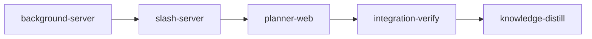

# Plan: background activity and slash commands in the planner chat

Implements: none

The planner chat falls short of Claude Code in a terminal in two ways:

1. **(A)** The user cannot tell an idle chat from one waiting on background work (subagents, background shell tasks).
2. **(B)** The user cannot see or run the skills and commands the terminal's `/` menu offers.

## Before `loom run`

1. **The loom YAML is at the end of this file** (`version: 2`, `ratchet_files`, one web `provision` entry, the sandbox allow-list, the stages of "Stages" below and the integration-verify and knowledge-distill bookends). The YAML is authoritative where it and the prose differ. Worker briefs are under `doc/plans/briefs/planner-background-activity-and-skills/<stage-id>/`; every worker reads its stage's `common.md` first. Commit the plan, the briefs and the probe evidence (item 2) before `loom run`: `loom run` refuses an uncommitted plan or brief, and a stage worktree is cut from `HEAD`. After `loom run` starts, the plan is `doc/plans/IN_PROGRESS-PLAN-planner-background-activity-and-skills.md`; the stage descriptions name both spellings.

   **No knowledge-bootstrap stage.** The tier-1 knowledge already describes this codebase: `doc/loom/knowledge/INDEX.md` maps the session bridge (`architecture/planning-session-bridge.md`), the plan server, the planner web shell and the token-flow sources, and `loom knowledge check --strict --baseline doc/loom/knowledge/check-baseline.txt` reported 0 issues on 2026-11-10. The facts this plan adds come from Claude Code 2.1.321 and live in `loom/tests/fixtures/plan_session/probe-notes.md`, which every brief cites; copying them into the knowledge base before the run would keep two versions of one fact. The knowledge-distill stage writes the new truth after the code exists ("Knowledge (both parts)").

   **Deliverables.** Every row of "Deliverable inventory" is an `acceptance:`, `artifacts:`, `reachable:` or contract entry of the stage that owns its step (the "Stage" column of that table).

   **Working tree.** While this plan was written (2026-11-10) the main checkout held uncommitted work in progress in about seventy files, still changing, several of which this plan's stages edit: `loom/src/plan_session/bridge/flow.rs` (a `background_prompt` filter in `confirm_prompt`) with an untracked `bridge/tests_background_prompt.rs`, `bridge/mod.rs`, `bridge/tests_queue.rs`, `plan_server/summaries/rebuilds/session.rs`, `planning/guidance/text/common_brief.md`, `web/src/plan/chat/{transcript,composer,panel}.tsx` and the chat stylesheets. The operator commits or reverts it before `loom run`; every `file:line` in this plan and its briefs is advisory, and workers anchor by symbol. Whatever is committed, `background-server` owns `confirm_prompt` and leaves the A-D3 rule live and tested, and `slash-server` rewrites only the `common_brief.md` sentence B-D6 names.
2. **The probe evidence is committed with the plan.** P1 and P2 ran on Claude Code 2.1.321 through the `#[ignore]` harness `loom/tests/plan_session_bridge_e2e/probes.rs` and its modules under `probes/`. The fixtures are the `p1-*` and `p2-*` files under `loom/tests/fixtures/plan_session/transcripts/` and `spool/`, the raw notes are under `probe-notes/`, and `loom/tests/fixtures/plan_session/probe-notes.md` gives each answer with its evidence. Stages read these files and edit none of them. A stage that needs a field the fixtures lack blocks with `loom stage block`; it never invents a record shape.

   After each Claude Code upgrade the operator reruns the probes as a conformance check, on the host, outside any sandbox (they need the login and the network). The second line runs one probe; the third reapplies the redaction and scrubbing to the committed fixtures and fails on a line that is not JSON or still holds a forbidden string. A rerun that contradicts a decision below amends this plan first.

   ```bash
   cd loom && cargo test --test plan_session_bridge_e2e probes:: -- --ignored --test-threads=1
   cd loom && cargo test --test plan_session_bridge_e2e probes::p1_status::p1_failed_and_stopped_task_statuses -- --ignored --exact
   cd loom && cargo test --test plan_session_bridge_e2e probes::rescrub::rescrub_existing_fixtures -- --ignored --exact
   ```

## A. Background activity

### What exists, and what can be reused

The stage modal on the dashboard already monitors a stage's agents. Its token lanes (`web/src/components/stage-token-lanes.tsx`, `TokenLanes` L150-179) show:

- one lane per agent (main, each subagent, each codex job; a codex job is grouped with its forwarder in `CodexCluster`);
- each agent's type, model and short id, and a live or idle dot;
- each agent's token total, tokens per minute and a series of 30 s buckets;
- idle agents folded into "N earlier agents" (`EarlierAgents`).

Transcript content is not shown. The CLI `loom subagents list|harvest|watch|wait` adds a per-agent state classification. Nothing tracks background shell tasks.

**The token pipeline.** The reader and the flow builder work on any `Source`. The module is closed to outside callers, though.

- **Public surface.** It exposes only `scan_pass(work_root, codex_root, now)` and `spawn_token_tracker(work_root, shutdown)` (`loom/src/tokens/mod.rs:21`). `Source`, `discover`, `read_sources`, `run_pass`, `build_flow` and `Checkpoint` are private or `pub(super)` (`tokens/mod.rs:5-18`).
- **`run_pass`.** It calls `discover(work_root, …)` directly (`tokens/tracker.rs:123`), writes `flow.json` and computes `quota_left`. Its memo is a thread-local `TRACKER` keyed by work root (`tracker.rs:42,104-107`).
- **Checkpoint.** The API takes a directory and a fixed file name (`checkpoint.rs:62,104`, `CHECKPOINT_FILE`).
- **Cadence.** It is `TRACKER_INTERVAL_SECS` = 5 s (`tracker.rs:26`), looped in `run_tracker`, which the daemon starts (`daemon/server/lifecycle.rs:306`). The plan server has no such thread.
- **Discovery.** `claude_sources` (`tokens/discover.rs:107-122`) walks loom `Session` records that have a `stage_id`. `session_sources` (`discover.rs:127-165`) adds `subagents/agent-*.jsonl`, with three quirks:
  - it takes `agent_type` from the stage `starts.jsonl` ledgers (`discover.rs:108,153-155`, `provider_data/ledger.rs:88-98`), which plan sessions do not write;
  - it lists teammate files too (`discover.rs:148`);
  - it skips ids that fail `is_safe_id` (`discover.rs:150`).
- **Codex rows.** They come from forward receipts under `.loom/work/subagents/<stage>/` (`discover.rs:173-194`). Plan sessions write none, for three reasons:
  - the receipt hook needs `LOOM_STAGE_ID`, `LOOM_SESSION_ID` and `LOOM_WORK_DIR` (`commands/hook/forward_receipt.rs:61-66`);
  - the plan-session launch strips all three (`plan_session/launch/script.rs:76-78`);
  - plan sessions register spool hooks only.

  A `codex:codex-rescue` subagent in a plan session is an ordinary Claude subagent.
- **`AgentFlow`.** The wire shape is `AgentFlow` (`tokens/model.rs:71-82`: `id`, `kind`, `agent_type`, `forwarder`, `model`, `active`, `total`, `rate`, and a 120-bucket `series`), checked by the strict `agentFlowSchema` (`web/src/api/schema.ts:221-235`). "Active" means tokens drawn in the last 4 buckets of 30 s (`model.rs:9,13`). That signals activity; it does not prove the agent is alive.
- **Join key.** A subagent's `AgentFlow.id` is `agent_id_from_path` (`discover.rs:158`), the same function the bridge's `AgentFeed` uses (`plan_session/bridge/agents.rs:24`). `SubagentStart` carries `agent_id` (`bridge/driver.rs:139`).
- **The bridge's own token reading.** It reads per-turn token usage through the transcript mapper, keyed by message id. Teammate files join it through `add_token_transcript` (`plan_server/pressure/teammates.rs`, `bridge/driver.rs:77-82`). That reading is neither per agent nor bucketed, and A-D1c builds nothing on it.

| Piece | Where | Keyed to | Use |
| --- | --- | --- | --- |
| Token-flow pipeline: reader, flow builder, checkpoint | `tokens/tracker.rs` `read_sources`/`read_source` (L139-200), `tokens/flow_build.rs`, `tokens/checkpoint.rs` | Stages, through private discovery and a work-root memo | **Refactor** so a pass takes its sources and checkpoint dir (A-D1c) |
| Lane helpers | `web/src/lib/tokens.ts`: `codexPairs` (:23), `compactTokens` (:67), `agentLabel` (:113), `liveCounts` (:249) | `AgentFlow` | **Reuse.** `isIdleRow` (`stage-token-lanes.tsx:15`) folds on a zero series. `EarlierAgents` (:109), `CodexCluster` (:91) and `LaneIdentity` (:19) are private components. The planner writes its own fold, keyed on task state (A-D5) |
| Subagent classifier | `commands/subagents/classify.rs` `analyze_with_evidence_at_ceiling` (:231-239, `pub(super)`, seven parameters, reads the whole file through `classify/entry.rs:26-52` `read_entries`); `resolve_state` and `final_report_for` private (:323-339) | A transcript path | **Factor** the per-entry rules into a fold (A-D2) |
| Stall rule | `commands/subagents/wait/stall.rs` `stall_reason` (:121-147, already pure; Agent/Task exempt :153; Bash floor 1800 s :45,155); stage default budget 600 s (`wait/mod.rs:39`) | A budget argument | **Move** and make visible |
| Subagent discovery | `plan_session/bridge/registry.rs:143-149,307-342` (teammates split out of the agent batch at :331-335); `bridge/agents.rs:33-65` (reads the meta file once, keeps only `toolUseId`, `taskKind`, `name`, :51-62); `driver.rs:273-291` (tails every subagent line, but `ingest_agent` returns early when the mapper yields nothing, :281-283) | Plan session | **Reuse, extended**: keep the meta's `agentType`, `description` and `finished` (present in `transcripts/subagent-agent.meta.json` and the `transcripts/p1-*-agent-1.meta.json` fixtures) |
| Background shell task id | `models/forward_receipt/transcript.rs:198-206` (`toolUseResult.backgroundTaskId`, also `background_task_id`, filtered by `is_safe_id`); the mapper already keeps `toolUseResult` (`transcript/records.rs:177-183`) | Codex receipts | **Lift the id extraction only.** The output-path check (`forward_receipt/locator.rs:70-108`, root hard-coded to `/tmp/claude-<uid>`, :66-68) has no consumer here, and plan sessions do not pin `TMPDIR` |
| Push and replay pattern | `plan_server/chat/team.rs` `snapshots()` (:135-144); between-turn path `BridgeEvent::Team` → `follow_sessions` (`plan_server/chat/mod.rs:258,276-278`) → hub broadcast. Rust builds the draft-team message inline (`wire/message.rs:308-327`) and only `web/src/plan/api/schema.test.ts:41` reads `draft-team.json`, so that path has no Rust parity test; the parity pattern is `plan_server/wire/tests_chat.rs:14-24` (`include_str!` round trip) | Draft team | **Reuse the pattern** for new messages, with the `tests_chat.rs` parity |
| Planner UI primitives | `StateMark`, `ActivityGlyph`, `ActivityTile` (`web/src/plan/ui/activity-glyphs.tsx`); `LiveElapsed` (`chat/pressure/elapsed.tsx:11`, one 1 s interval each, `components/hooks/use-now.ts`); `Untrusted` (`chat/visible-controls.ts:19`); `plural` (`ui/plural.ts:2`); `compactTokens` (`@/lib/tokens`); header `useActivities` | — | **Reuse** |
| `subagent_lifecycle`, `codex_lifecycle`, `loom subagents watch`, `DraftTeamPanel` | — | Stage env or draft scope | **Do not reuse**: they need the stage env, the hook-written stage journal or the draft scope |

Gaps in the planner today:

- **`SessionView.subagents_running` is a bare count with two readers.** One is Restore (`web/src/plan/chat/restore.tsx:40`). The other is the bridge's close gate, `stop && self.machine.subagents_running() == 0 && self.closes_at_stop()` (`bridge/driver.rs:194`), which gates a summary session's close and the authoring final write.
- **The count resets on the wrong events.** It resets on a startup `SessionStart`, and on compact only after a delivered `/compact` (`plan_session/state.rs:199-215`). It also resets on `Interrupted` and `AgentsKilled`.
- **The `<task-notification>` body is thrown away** (`transcript/records.rs:188-192`). The record still opens a turn as `SelfStarted` (`records.rs:190`, `driver.rs:241-245`).
- **The agent hand-back is skipped.** Its user record has `origin.kind: "peer"`, so the mapper drops it as foreign (`records.rs:194-197`). Its `UserPromptSubmit` opens the turn.
- **Any `UserPromptSubmit` confirms the pending delivery** (`bridge/flow.rs:240-249`), a notification's or a hand-back's too, although their `prompt` is the `<task-notification>` or `<agent-message>` XML.
- **Agent and Bash rows read Done on any tool result** (`records.rs:368-372`), so a background launch reads Done at once.
- **Running tool rows fold away.** `groupToolRows` (`web/src/plan/chat/tool-group.ts:44-60`) folds every plain tool row into "Used N tools · edited M files". That fold is a `<details open={turn.open}>` (`chat/transcript.tsx:88`), closed while the chat is idle.
- **An idle chat shows nothing** (`chat/state-line.tsx:12-24`). Tests pin it: `hearth.contracts.test.tsx:94,230` (frozen) and `state-line.test.tsx:39,55,65,190`.
- **A synthetic `SubagentStop` stands in for the real one, and never fires on 2.1.321.** It fires on a `SubagentFinal` mark plus 30 s of quiet (`driver.rs:312-329`, `SUBAGENT_STALL` at `bridge/session.rs:26`). The mark comes only from a subagent record with `stop_reason: "end_turn"` (`transcript/mod.rs:313-317`), which 2.1.321 never writes. It feeds `BridgeEvent::SubagentStopped`, which releases summary claims and costs the agent (`plan_server/summaries/rebuilds/session.rs:33` → `plan_server/summaries/attribution.rs:169-187`).

### What Claude Code 2.1.321 does

P1 settles the record shapes (`loom/tests/fixtures/plan_session/probe-notes.md`, "P1. Background tasks"):

- **Every Agent call is a background launch.** Its result carries `toolUseResult.{agentId, isAsync: true, status: "async_launched", canContinueAgent: false, outputFile}`, whatever `run_in_background` says, and the model may send that flag as a string. There are no foreground agents. The meta's `requestShape` is always `"background"`.
- **Only a Bash launch carries `backgroundTaskId`.** The same id is the notification's `<task-id>` and the `background_tasks[].id` of a `type: "shell"` entry. Shells have no transcript and no meta file.
- **The toolset.** A plan session has no `SendMessage`, so the main agent resumes no agent. It has `TaskStop`, whose result is `toolUseResult.{message, task_id, task_type, command}`.
- **Notifications.**
  - The status is `completed` for agents and shells, and `failed` for a shell that exits non-zero (`Background command "…" failed with exit code N`).
  - A shell stopped with `TaskStop` sends no notification. An agent stopped with `TaskStop` sends status `killed` (`Agent "…" was stopped by Claude`).
  - Agents also send an interim variant, `Agent "…" is waiting on its own background work`, when they stop while a task of their own runs.
  - The user record carries `origin.kind: "task-notification"`, and a fork skill's notification has no `<tool-use-id>`.
  - An idle notification opens a turn. One that arrives while the main agent works is queued, and becomes its own turn after that turn's `Stop`.
- **The hand-back.** A finished agent's report arrives first as an `<agent-message>` user record (`origin.kind: "peer"`, `handback: true`, `senderTaskId`, `handbackReportText`), whose `UserPromptSubmit` opens a turn.
- **Agent end records.** `end_turn` is never written. The last assistant record is a `SubagentHandback` `tool_use`, then a `tool_result` with `toolEndsTurn: true`. The meta file gains `finished: true`.
- **`SubagentStart` and `SubagentStop`.** `SubagentStart` carries `agent_type`, and has no `tool_use_id` and no description. `SubagentStop` also fires for internal forks, with `agent_type: ""` and no `SubagentStart`.
- **`background_tasks`.** `Stop` and `SubagentStop` payloads carry `background_tasks: [{id, type: subagent|shell, status: "running", description, agent_type|command}]`.
  - The list is session-wide and includes shells launched inside subagents, with no owner field.
  - A finished task drops out.
  - There are no timestamps and no `tool_use_id`.
  - A stopping agent's own `SubagentStop` still lists it as running.
- **Interrupt and compact.** An interrupt ends no background task. On compact Claude Code sends `PreCompact`, then `SessionStart` with `source: "compact"`, and writes a `compact_boundary` record and a `task_status` attachment; tasks survive.

### Decisions

- **A-D1.** `Idle` keeps its meaning: the main agent waits for input. Delivery gating, Stop, the composer gate and the frozen idle contracts depend on it. Background work is a separate model.
- **A-D1b. Two sources, joined by agent id.** The token pipeline gives each agent's model, totals and rate, the same numbers the stage modal shows. The bridge table (A-D2) gives lifecycle: running, done, stalled?, and which call launched the task, when one did. Neither source alone answers "is the chat still waiting on something". The table drives the join. A flow row with no table entry is dropped: a teammate, or an id the bridge holds that discovery skipped. A table row with no flow row shows no token figures.
- **A-D1c. Token flow for the chat session.**
  - **Refactor.** Step A2 refactors `tokens/` so a pass takes its sources and its checkpoint directory as arguments. `run_pass` keeps today's daemon behaviour (`discover(work_root)`, `flow.json`, `quota_left`).
  - **Entry point.** A new public entry, `planner_pass(tokens_dir: &Path, groups: &[PlannerGroup], now: i64) -> anyhow::Result<Vec<(String, Vec<AgentFlow>)>>`, shares `read_sources`/`read_source`, `build_flow`/`agent_flow` and `Checkpoint`. It writes no `flow.json` and computes no quota, and it fails only as `run_pass` does, when the checkpoint cannot be written. The `TRACKER` memo is keyed by the tokens dir.
  - **Groups.** `PlannerGroup { id: String, main: PathBuf, subagents: Vec<(String, PathBuf, Option<String>)> }` (agent id, transcript path, agent type) is built from `Bridge::chat_session_id()` and `Bridge::transcripts(id)` (`plan_session/bridge/mod.rs`). Only the chat session gets a group, because A-D4 publishes only its table.
  - **Location.** The code lives in a new `loom/src/tokens/planner.rs`; `discover.rs` already has 299 lines.
  - **What a group holds.** `agent_type` comes from each subagent's `agent-<id>.meta.json` `agentType`, read size-bounded as in `bridge/agents.rs`. Meta files with `taskKind: in_process_teammate` are skipped. There are no codex sources.
  - **Dashboard wire unchanged.** `StageFlow`, `stage_id`, `TokenFlow`, `flow.json`, the `Checkpoint` format and `CHECKPOINT_VERSION` (4, `checkpoint.rs:14`) are not renamed. So step A2 touches no web file and needs no `web/dist` rebuild. A rename would reach about 30 Rust and TS files, the strict zod schema (`web/src/api/schema.ts:241-249,270`) and the shared fixture `web/src/api/fixtures/snapshot.json:446`. The private `Source.stage_id` may become `group` inside `tokens/`.
  - **Checkpoint.** It lives at `<RuntimePaths.dir>/tokens/` (`loom/src/planning/runtime.rs:30-45`) under the standard `CHECKPOINT_FILE`, keyed by plan session id in its `stages` map. When the chat session changes or ends, its group is removed from the checkpoint. `Checkpoint` never drops agents today, and the file has an 8 MB cap (`checkpoint.rs:15`).
  - **Thread.** `spawn_planner_tokens(tokens_dir, groups, sink, stop) -> JoinHandle<()>` runs a named `planner-tokens` thread every `TRACKER_INTERVAL_SECS`. It follows the chat driver's ownership model: `install_with` (`plan_server/chat/mod.rs:126-158`) calls one function in a new directory module `plan_server/chat/background/mod.rs`, which spawns the thread and hands it to `ctx.own_worker("planner tokens", handle, Some(stop))`, so shutdown sets the stop flag and joins it (`chat/mod.rs` has 395 lines, so it gains only that call). It takes the bridge lock only for the two lookups, and hands each result to the chat state (A-D4).
  - **Join key.** A subagent's `AgentFlow.id` is its full agent id: `short_id` shortens only main and codex ids (`tokens/flow_build.rs:144-152`). The main agent's row has no table entry and is dropped; plan sessions have no codex rows, so the forwarder-to-job pairing (`codexPairs`) does not arise.
- **A-D2. The `BackgroundTasks` table.** The bridge keeps one table per session, in a new `loom/src/plan_session/bridge/background.rs`.
  - **Entry fields:**
    - `id`: the agent id, or the shell task id;
    - `kind`: `agent` | `shell`;
    - `label`: the launching call's `description`, else the meta `description`, else the `Stop` list entry's `description`;
    - `agent_type`: the `SubagentStart` `agent_type`, else the meta `agentType`;
    - `tool_use_id: Option`: the launch result's, else the meta `toolUseId`, else the notification's `<tool-use-id>`; none for a fork skill or an adopted shell;
    - `started_at`, `last_activity_at`;
    - `state`, and a "stopped once" flag (A-D3).

    Agents also carry `steps`, the last tool and a report preview from the hand-back's `handbackReportText`. `steps` counts assistant entries, and Claude Code writes one entry per content block (`classify.rs:33-36`), so the column is "steps", never "turns".
  - **Launch evidence creates an entry.** Each of these creates the entry or fills the fields it lacks, keeping the earliest `started_at`. The same evidence read twice changes nothing, so a replay adds nothing.
    - An `Agent` or `Task` `tool_result` whose `toolUseResult.status` is `async_launched`: id `agentId`, with the result's `tool_use_id`. Every Agent call launches this way, so there is no foreground agent case.
    - A `SubagentStart`: id `agent_id`, with its `agent_type`.
    - A `<forked-skill-launch>` system record: id `agentId`, label `description`.
    - A `Bash` `tool_result` with `toolUseResult.backgroundTaskId` (A3's extraction), with the result's `tool_use_id` and the call's `description`.
    - A `Stop` list entry of `type: "shell"` with an unknown id: an adopted shell (below).
  - **Shells launched inside subagents become session-level shell entries.** They are adopted from the first `Stop` list that names them. An adopted entry has no `tool_use_id`, takes the list entry's `description` as its label, and starts at that `Stop`'s `received_at`. The reasons:
    - such a shell keeps running after its agent ends and can still write files, so Restore must wait for it;
    - the `Stop` list is the only main-session source for it: the launch is in the subagent's transcript, and the list names no owner;
    - the terminal counts it as well (the pane's "1 shell still running").

    Subagent transcripts are not parsed for shell launches: the list already names every such shell, and its tool row lives in the subagent, which the main transcript does not draw. A `type: "subagent"` list entry with an unknown id is not adopted: every observed subagent had a `SubagentStart` first.
  - **States.** `running`, `tool-wait` and `stalled?` are unended; `done`, `failed` and `stopped` are ended (A-D3). For agents, the fold's `Generating` and `Unknown` map to `running`, and `ToolWait` to `tool-wait`. A shell is `running` until it ends.
  - **One classifier.** A new library module `loom/src/agent_state/` holds `AgentProgress { last, last_at, assistant_entries, last_tool }`, with `observe(&Value)` and `state(now, debounce)` built on `classify_last` (`classify/entry.rs:119`) and `resolve_state` (`classify.rs:332`). `analyze_with_evidence_at_ceiling` becomes a loop over `observe`. The bridge calls `observe` on every raw subagent line in `ingest_agent`, before its early return (`driver.rs:281-283`). No transcript is re-read.
  - **Times.** They come from record timestamps and the spool's `received_at`, never `Instant::now()` at ingest (today `driver.rs:290`). State and stall are evaluated against a `now: DateTime<Utc>` argument, never read inside the fold.
  - **Quiet-time transitions.** A state can change with no new bytes (the done debounce, the stall budget). The driver's existing `tick_session` (`driver.rs:38`) calls `BackgroundTasks::reevaluate(now)` for its session; it recomputes every unended agent entry and emits `Background` only when a state changed. The debounce is `DEFAULT_DONE_DEBOUNCE_SECS` (180 s, `classify.rs:97`) and the stall budget 600 s, both passed as arguments. Recovery (`resume`, `bridge/recovery.rs:175-201`) re-reads the spool and the transcript from offset 0 (`Tail::new`, `plan_session/spool.rs:160-169`), so a replay rebuilds the same table. The table is never persisted.
  - **Not tracked.** Teammates are not entries; `DraftTeamPanel` shows them. A notification in a subagent transcript is dropped today (`transcript/mod.rs:320-325`) and stays dropped.
  - **Stall.** `stall_reason` with a fixed plan-session budget of 600 s (the stage default, `wait/mod.rs:39`) marks an agent entry `stalled?`. The entry stays in the table, and later evidence ends it. Shell entries are never `stalled?`: they have no transcript to measure, and the `Stop` list ends them.
- **A-D3. A task ends only on evidence.**
  - **The `Stop` list ends a known entry it omits.** Each `Stop` payload's `background_tasks` lists every running task of the session. The table keeps the latest list and its `received_at`. An unended entry whose `started_at` precedes that `received_at`, and which the list omits, ends `done`. The rule holds in either read order: an entry created after the bridge read a later list is checked against that list when it is created. Only `Stop` lists count. A `SubagentStop` list lags (the stopping agent still lists itself), so it is never read.
  - **The notification gives the outcome and the join.** A notification names its task by `<task-id>`, and its `<tool-use-id>` fills the entry's `tool_use_id`. Status `completed` gives `done`, `failed` gives `failed`, and `killed` or any other status gives `stopped`. A notification for an entry the `Stop` list already ended still sets the outcome (`done` becomes `failed`), and sends no second `SubagentStopped`. The interim agent variant (`… is waiting on its own background work`) ends the agent like `finished`. Its own shells stay as adopted shell entries, and records that follow reopen it.
  - **`TaskStop` ends a known entry `stopped`.** A `TaskStop` `tool_result` whose `toolUseResult.task_id` names a known entry ends it. A stopped shell sends no notification, so this result and the next `Stop` list are its only end evidence.
  - **Agent evidence, for known ids only.** Each of these ends an agent entry `done`:
    - the hand-back record (`origin.kind: "peer"`, `handback: true`, `senderTaskId` the agent id);
    - the `tool_result` with `toolEndsTurn: true` in the agent's transcript;
    - meta `finished: true`, which `AgentFeed::classify` reads once (`bridge/agents.rs:33-65`), so it counts after a bridge restart;
    - a `SubagentStop` whose `agent_id` is in the table.

    A `SubagentStop` for an unknown id (an internal fork, `agent_type: ""`) is ignored.
  - **The stall rule covers the rest.** An agent with none of this evidence goes `stalled?` (A-D2) and stops blocking the close gate.
  - **`SubagentStopped`.** When an agent entry first ends, the table emits `BridgeEvent::SubagentStopped` exactly once per agent id, so summary claim release and costing keep working. Once per id, because `Attribution::on_subagent_stopped` (`plan_server/summaries/attribution.rs:169-187`) scans the whole transcript and costs it; a second call would cost it twice. The tokens of an agent that resumes after its interim notification stay uncosted. A late or duplicate end (a notification after `SubagentStop`) emits nothing. The synthetic stop (`driver.rs:312-329`), `SUBAGENT_STALL` and the bridge's `stall_after` go.
  - **Reopening.** New transcript records for an ended agent entry reopen it to `running`, and no second `SubagentStopped` is sent. Ended shell entries never reopen. A `Stop` list never reopens or re-creates an ended entry. Today's stopped latch at `driver.rs:215-219` goes; the per-id "stopped once" flag lives in the table entry.
  - **Notification and hand-back turns.** A `<task-notification>` record both ends its task and still opens the main agent's turn as `SelfStarted` (`records.rs:190`, `driver.rs:241-245`). The table call is added beside that path, never in place of it. The hand-back record stays skipped (`records.rs:194-197`); the table reads it before the skip, and its `UserPromptSubmit` opens the turn. Neither prompt confirms a delivery: `confirm_prompt` (`flow.rs:240-254`) ignores a `prompt` that starts with `<task-notification>` or `<agent-message`.
  - **Unknown ids.** A notification naming an unknown id adds an ended entry, so the list can show it.
  - **Clearing:**
    - Interrupt (one Escape, `bridge/commands.rs:307`) proves nothing about any task: background agents and shells survive it.
    - `agents_killed` clears every entry.
    - `SessionStart` with source `startup`, `resume` or `clear` clears the table; `compact` keeps it, and the `task_status` attachment adds nothing the table lacks.
    - `SessionEnd` clears it.
  - **Close gate.** `driver.rs:194` reads `BackgroundTasks::blocking()`: agent entries in `running` or `tool-wait`. Shell, `stalled?` and ended entries do not block a close. A test fails when the check is dropped; today's check is a known mutation survivor (`doc/loom/knowledge/concerns/planning-session-sandbox-limits.md:105`).
  - **Restore** (`restore.tsx:40`) is blocked while any entry is unended, adopted shells and `stalled?` included, because a background task can still write files.
- **A-D4. Transport.**
  - **Bridge event.** The bridge publishes lifecycle only: `BridgeEvent::Background { id, tasks }`, sent when the table changes. Each task carries its `id`, `kind` and, when it has one, its `tool_use_id`. The exhaustive match in `plan_server/summaries/rebuilds/session.rs:21-40` gains the arm.
  - **Plan server.** `plan_server/chat/background/mod.rs` registers its own bridge listener and its own hub `on_open` hook (both take several callers, `ws/hub.rs` `on_open`, `Bridge::subscribe`), so `chat/mod.rs` (395 lines) gains only the `mod` line and the `background::install(ctx, &bridge)` call in `install_with`, and `follow_sessions` is unchanged. The listener handles the event for `chat_session_id()` only. The module's own state keeps `background: Option<(session, tasks)>` and the latest `planner_pass` result for that session, and joins the two outside the bridge mutex.
  - **Message.** It broadcasts `PlanMessage::Background { session, tasks }` when the table changes, or when a pass changes an active agent's total or rate, at most once per 5 s pass. Each task carries `{model, total, tokens_per_min, active}` from its `AgentFlow` (`total` and `tokens_per_min` are the fresh-token figures the dashboard lane shows). The series and the codex fields stay off this wire. A task's `state` is one of `running`, `tool-wait`, `stalled`, `done`, `failed`, `stopped` on the wire; the UI word for `stalled` is "stalled?".
  - **Replay and clearing.** `snapshots()` replays the latest frame. `Ended` clears it and broadcasts `Background { session, tasks: [] }`, and an emptied table broadcasts the empty frame too.
  - **Sanitizing.** Strings from transcripts, meta files and `Stop` lists (label, agent type, model, last tool, report preview) go through the same flattening as `status/data/sanitize_token_flow.rs:30-54` before publishing.
  - **`SessionView` change.** `SessionView` loses `subagents_running` (`plan_session/model/mod.rs:44`, `bridge/publish.rs:30`). `ChatSnapshot`, `ChatDelta` and `EndedChat` keep their variants, but the `SessionView` inside them changes shape. So these change in the same stage: the chat fixtures (`web/src/plan/api/fixtures/chat-snapshot.json:15,487`, six places in `chat-deltas.json`, `chat-frames.json:17`), `schema-chat.ts:99`, and the parity test `wire/tests_chat.rs:14-17` that loads them. Restore reads the background atom's unended count.
  - **Fixtures and schema lists.**
    - New `web/src/plan/api/fixtures/background.json`; Rust round-trips it with `include_str!`.
    - The variant joins `all_plan_messages()` and the exhaustive match (`wire/tests_schema.rs:200-228`).
    - `"background"` joins `PLAN_MESSAGE_TYPES` (`web/src/plan/api/schema.ts:31-54`, checked against the enum at `tests_schema.rs:322`).
  - **Web.** A zod union member, an `apply` case in `web/src/plan/api/socket.ts`, and a `backgroundAtom` reset on hello beside `draftTeamAtom` (`socket.ts:134`). The chat-layer selectors in `web/src/plan/chat/background-tasks.ts` read it, and a frame whose `session` differs from `sessionAtom`'s id is ignored there.
- **A-D5. The idle sign.**
  - **The line.** In `.chat-head-sub` (`chat/panel-head.tsx:61-64`), an idle chat with at least one unended task shows one nowrap span, "Waiting on 2 background tasks", with a disclosure button. The `:has()` selector at `chat/chat-surface.css:122` and `hasStateWords` count the span.
  - **Frozen contracts hold.** Idle with an empty table draws nothing, so `hearth.contracts.test.tsx:94,230` and `state-line.test.tsx:39,55,65` stay green unchanged. The new element avoids `.chat-state-row`, `.aurora-roundel` and the text "Waiting for you".
  - **A user rule reversed.** This reverses the user's "idle says nothing" rule (`doc/loom/knowledge/mistakes/planner-visual-feedback-shortfall.md`, contract `idle-state-line-is-empty`) only while tasks exist. `web/src/plan/ui/DESIGN.md:51` and `:124` are rewritten to say so.
  - **The list.** The disclosure opens a list rendered as a sibling below `.chat-head-sub`, which clips its content (`overflow: hidden`, `nowrap`, `chat-surface.css:112-124`).
    - Each row shows a glyph, a state word, the label (through `Untrusted`) and the elapsed time from one shared `useNow` for the list. Agents add the model, `compactTokens(total)` and the rate.
    - Ended agents fold into "N earlier agents" through a planner fold keyed on table state.
    - Rows use the planner's list and glyph styles. The dashboard's heat strip and cluster box break `DESIGN.md:38` (no box in a box), and Radix Popover takes focus, so neither is used.
  - **Kickoff head.** `new/kickoff-head.tsx:28-48`, which keeps its own `STATE_WORDS`, renders the same line component. `DraftTeamPanel` stays the teammates' view, and teammates are not table entries, so nothing shows twice.
  - **Live region.** The line is announced once when the first task starts while idle, and once when the last one ends ("Background tasks finished"). Per-row changes are not announced.
  - **Header.** Each session with at least one unended task gets one `background` `ActivityKind` row, in any session state. It is labelled "N background tasks" and draws a dot `ActivityGlyph` in the waiting tone.
    - It is neither a progress kind (`PillGlyph` draws the roundel for progress kinds, `header/activity.tsx:44-52`) nor a state-word kind.
    - It is not counted in "N in progress" (`activity.tsx:103`).
    - It joins `ActivityKind`, `ACTIVITY_LABELS`, `ACTIVITY_TONES` and `ACTIVITY_KINDS` (`ui/activity-glyphs.tsx:9-77,147`), ordered after `waiting`.
  - **Tool rows.** A row whose `tool_use_id` has an unended entry shows the entry's state word over `item.status`: `running` (also for `tool-wait`) or `stalled?`. Once the entry ends, the row shows `done`, `failed` or `stopped`. Every Agent row launches a background task, so every Agent row reads its entry.
    - `ToolStatus` and `STATUS_WORD` (`tool-row.tsx:36-53`) gain those words.
    - `groupToolRows` (`tool-group.ts:44-60`) keeps such a row outside the fold until its entry ends.
    - Each row reads its entry through a per-`tool_use_id` selector atom, so a 5 s refresh re-renders only the rows that changed.
  - **`Task` rows nest like `Agent` rows.** `Task` is the legacy name of the Agent tool, which the server already treats alike (`plan_session/transcript/tools.rs:24`).
    - One helper, `isSpawnTool(name)`, replaces the literal `"Agent"` at `transcript.tsx:36` and `tool-row.tsx:177,201`.
    - `TOOL_GLYPHS` (`tool-row.tsx:21-30`) gains `Task`.
    - `transcript.tsx` has 395 lines, so the edit is net-neutral or moves code out.

### Steps

1. **A1. Fixtures.** The P1 fixtures are committed before `loom run` ("Before `loom run`"): `p1-background-agent`, `p1-background-bash`, `p1-interrupt`, `p1-resume`, `p1-compact` and `p1-status` under `transcripts/` and `spool/`, with their agent transcripts and meta files. `probe-notes.md` names the fixture behind each fact in "What Claude Code 2.1.321 does". The A4 tests read them, and `p2-skills` adds the fork-skill launch.
2. **A2. Token flow (Rust).** Implements A-D1c.
   - **Files:** `tokens/{mod,tracker,discover,checkpoint,pass_memo}.rs` and the new `tokens/planner.rs`.
   - **Test (a), a fixture group:** `loom/tests/fixtures/plan_session/transcripts/subagent-main.jsonl`, `subagent-agent.jsonl` and `.meta.json`, plus a teammate meta and transcript. It yields two agents with model and total, the subagent with `agent_type` "Explore", and no teammate row.
   - **Test (b):** a second pass over unchanged files adds nothing.
   - **Test (c):** a removed group leaves the checkpoint.
   - **Test (c2), restart:** a pass with a fresh memo over an existing checkpoint gives the same totals as before the restart, and a stage checkpoint in the daemon's work root is untouched by planner passes.
   - **Test (d):** the dashboard flow tests (`tokens/model_tests.rs`, `loom/tests/token_flow_contracts.rs`) pass unchanged.
   - **No call site yet.** The composition-root call goes in A5, with its wiring proof.
3. **A3. Shared classifiers (Rust).**
   - **New module** `loom/src/agent_state/` (`mod.rs`, `progress.rs`, `stall.rs`, `background_id.rs`) holds:
     - the `AgentProgress` fold;
     - `stall_reason`, moved and public, with a budget argument;
     - the `backgroundTaskId` extraction lifted from `forward_receipt/transcript.rs:198-206`.
   - **Old modules keep compiling unchanged.** `classify.rs` and `wait/stall.rs` import the moved items under their current names. `READ_COUNT` stays with `read_entries`, and `classify::read_count` stays reachable for `forward_jobs_tests.rs:52,65`. `classify_tests.rs` and `stall_tests.rs` still reach the items through `use super::*`. `forward_receipt` calls the lifted extraction. The output-path check stays in `locator.rs`.
   - **Tests:** the `loom subagents` and forward-receipt tests pass unchanged. A new test inside `classify` shows that `observe` over a fixture transcript's lines gives the same state as `analyze_with_evidence_at_ceiling` over the file. A test of the lifted extraction reads the Bash launch results of `transcripts/p1-status.jsonl`.
4. **A4. Bridge (Rust).** Implements A-D2 and A-D3.
   - **Parsing.** A new `plan_session/transcript/notification.rs` parses the `<task-notification>` body (task id, tool-use id, status, summary, interim variant), the launch results (`async_launched`, `backgroundTaskId`), the `TaskStop` result, the hand-back origin and the `<forked-skill-launch>` record. `records.rs` (388 lines) only calls it.
   - **Table.** It goes in the new `bridge/background.rs`. `Session::apply_event` (`driver.rs:110-155`, 46 lines against the 50-line cap) hands `SubagentStart`, `SubagentStop`, `Stop`, `SessionStart` and the notification to one `background` call, so it gains no lines.
   - **Other changes:**
     - `StateMachine` loses its `subagents` counter (`plan_session/state.rs`);
     - `AgentFeed::classify` keeps `agentType`, `description` and `finished`;
     - `driver.rs:194` reads `blocking()`;
     - the synthetic stop and `stall_after` are removed;
     - `confirm_prompt` ignores notification and hand-back prompts (A-D3).
   - **Tests, from the fixtures:**
     - `p1-background-bash`: idle with an agent and a shell; the shell's notification ends it `done`;
     - `p1-status`: the shell that exits 7 ends `failed`; the `TaskStop` result ends the other shell `stopped`, and the next `Stop` list changes nothing; the stopped agent ends `stopped` on its `TaskStop` result, and its `killed` notification sends no second `SubagentStopped`;
     - `p1-background-agent`: the hand-back, the `toolEndsTurn` result and `SubagentStop` each end the agent when fed alone, and each run emits one `SubagentStopped`; the notification after them emits nothing;
     - `p1-interrupt`: the interrupt keeps all entries; the shell launched inside the subagent is adopted from the `Stop` list with no `tool_use_id`; the `Stop` that omits the agent ends it before its queued notification arrives; a later `Stop` built without the two shells ends both;
     - a `failed` notification after a `Stop` list ended its shell turns `done` into `failed` and emits nothing else;
     - the interim notification ends the agent, and a record that follows reopens it to `running` with no second `SubagentStopped`;
     - `p1-compact`: compact keeps the table, and the `SubagentStop` events with `agent_type: ""` change nothing; a startup `SessionStart` clears it;
     - `p2-skills`: the fork skill's `SubagentStart` and `<forked-skill-launch>` give one agent entry with no `tool_use_id`, ended by its notification;
     - a notification ends its task and still opens a `SelfStarted` turn; neither its `UserPromptSubmit` nor a hand-back's confirms a pending delivery;
     - a quiet agent turns `stalled?` on a `reevaluate(now)` tick with no new bytes, then a notification ends it;
     - `agents_killed` clears all;
     - a replay from offset 0 gives the same table, times and `SubagentStopped` count as the live run, also when the spool is read before the transcript;
     - the close gate holds a summary session open while an agent runs and closes it afterwards.
5. **A5. Wire (Rust and `web/src/plan/api`).** Implements A-D4.
   - **Rust side.** `BridgeEvent::Background`, the plan-server join and its cadence, `PlanMessage::Background`, the replay from the module's own `on_open` hook (the `team.rs` `snapshots()` pattern) and the empty frame on `Ended`. The `planner-tokens` thread is started from `install_with` through `plan_server/chat/background/mod.rs` and owned by `ctx.own_worker` (A-D1c).
   - **Removing `subagents_running`, Rust sites.** Besides the frozen-test table below:
     - `bridge/publish.rs:30`, `plan_session/model/mod.rs:44`, `plan_session/model/tests.rs:43`;
     - `plan_server/pressure/tests/fake.rs:357`;
     - `bridge/tests_end.rs:70`.
   - **Web sites.**
     - `schema-chat.ts:99` and the three chat fixtures;
     - `restore.tsx:40` and `restore.test.tsx:50,154`;
     - the typed `SessionView` literals: `chat/state-line-kit.tsx:27`, `header/use-activities-test-kit.ts:22`, `help/chat-scene.tsx:54`, `help/getting-around-scene.tsx:58`, `help/pressure-scene.tsx:27`.
   - **CI filter.** `.github/workflows/ci.yml` adds `web/src/plan/api/**` to the Rust path filter. Today it lists only `web/dist/**` and `web/src/api/**` (`ci.yml:46-47`), so a fixture-only change skips the Rust parity tests.
   - **Rust tests:**
     - the parity round trip of `background.json`;
     - a new connection gets the replay;
     - nothing is broadcast when nothing changed;
     - an `Ended` session broadcasts the empty frame;
     - a pass that changes only an active agent's total broadcasts a frame with an unchanged table;
     - a new chat session replaces the group: the old session's frame is emptied and its checkpoint group removed;
     - shutdown joins the `planner-tokens` thread.
   - **Wiring proof.** A plan-server test through `install_with`, with a fake bridge session and fixture transcripts, receives a `Background` frame whose agent carries a non-zero total. That proves `install_with` starts the thread and the join runs.
   - **Web tests:** `schema.test.ts` rows. A socket test shows that a frame for another session is ignored and that hello resets the atom. A second socket test feeds `background.json` through the socket's message handler (not an atom write) and sees the atom hold its tasks.
   - **Bundle.** Rebuild and commit `web/dist`.
6. **A6. Web UI.** Implements A-D5.
   - **New files:** `chat/background-line.tsx`, `chat/background-list.tsx`, `chat/background-fold.ts`.
   - **Edits:**
     - `panel-head.tsx`, `chat-surface.css`, `state-line.tsx` (`hasStateWords`);
     - `new/kickoff-head.tsx`;
     - `header/use-activities.ts`, `ui/activity-glyphs.tsx`, `header/activity.tsx`;
     - `chat/tool-group.ts`, `chat/tool-row.tsx`, `chat/transcript.tsx`;
     - the help scenes (`help/chat-scene.tsx` including :241, `help/getting-around-scene.tsx`, `help/pressure-scene.tsx`, `CHAT_TIPS`, `legend-entries.tsx`);
     - `ui/DESIGN.md:51,124`.
   - **Design skill.** Visual work loads `frontend-design:frontend-design` first (`doc/loom/knowledge/conventions/plan-web.md`).
   - **Tests, in new files** (a frozen contract file holds contracts only):
     - idle with an empty table draws nothing and announces nothing;
     - idle with tasks shows the line and the list, fed through the socket handler with `background.json`;
     - a background row goes from running to done and stays out of the fold while it runs;
     - a `stopped` and a `failed` shell row show their words;
     - ended agents fold into "N earlier agents";
     - a `Task` row nests under its parent;
     - the header `background` row appears and clears and is not counted as progress;
     - the kickoff head shows the line.
   - **Real browser.** No script feeds chat frames today, so the stage adds one driver, `web/scripts/plan-chat-screens.mjs`, which stubs `WebSocket` in `addInitScript` and replays hello, the chat snapshot (idle), `background.json` and a `commands` frame, and `scripts/plan-screens.sh` gains `--driver=<path>` to run it around its server. It shoots the idle line, the open list, a running tool row and the open command menu at 1440x900 and 390x844; integration-verify runs it again on the merged tree. A subagent cannot run `bun run build`, `cargo build` or `tsc`, so the main agent builds and shoots.
   - **Bundle.** Rebuild and commit `web/dist` before the final review round.

## B. Slash commands and skills

### Why `/` is refused today

The rationale is one note in `doc/product/feat-planner/section_07.md:292-294`. `/clear` and `/exit` change or end the session outside the bridge, and other commands open terminal dialogs the browser cannot see.

The same rule is repeated in these places:

- `section_08.md:345`: the "until `UserPromptSubmit`" row;
- `section_08.md:351-352`: only `/compact` is allowed;
- `section_09.md:115-116`: never suggest a slash command;
- `section_09.md:552-553`: one session keeps one model;
- `section_12.md:443`: only `/compact` is allowed.

The code supports that concern:

- `/clear` writes a new transcript under a new session id. The bridge accepts only `<session id>.jsonl` (`driver.rs:153-168`), so it would go blind.
- A dialog left open captures the next pasted Enter.

What a pasted slash line does on 2.1.321 (P2, `probe-notes.md`, "P2. Slash commands and skills"):

- **The confirmation evidence differs per class.**
  - Prompt-type commands (personal, project, plugin and bundled skills, custom commands, fork skills) fire `UserPromptSubmit` about 0.17 s after the paste, with the typed line as its `prompt`. Today's confirmation (`bridge/flow.rs:240-293`) sees it.
  - Local commands fire no hook. `/context` writes `system` `local_command` records within 0.83 s; `/effort` and `/compact` write indented `<command-name>` user records; an unknown name writes a `system` `informational` warning, with no model call. The mapper skips all of them (`records.rs:28-34,193-198`). So today such a paste times out as undelivered at 10 s (`plan_server/chat/mod.rs:178`) and pauses the queue (`flow.rs:215-237`).
  - `/compact` writes its first transcript record 9.94 s after the paste, against that 10 s timeout. Its `PreCompact` spool event arrives at once.
  - Dialog commands (`/usage` and its aliases, `/model`, `/model <name>`, `/help`, `/status`) write nothing until the dialog closes, and it never closes by itself.
  - The existing `/compact` tests feed a synthetic `UserPromptSubmit` (`state_tests.rs:268-281`, `bridge/tests_queue.rs:343-345`); 2.1.321 sends none.
- **Hidden output.** A local command's output (`<local-command-stdout>`, `<local-command-stderr>`, or a `system` record of subtype `local_command` or `informational`) is dropped. `/context` and `/compact` output holds ANSI escapes.
- **Pasting works as is.** `paste-buffer -p` (`plan_session/tmux_io.rs:42`) plus Enter dispatched every slash line from 21 to 300 characters, unwrapped and with all its arguments. The suggestion menu is open at Enter for a bare name; its first row was the typed name every time, and Enter ran it.
- **Fork skills.** `UserPromptSubmit` fires, but that prompt never gets a `Stop`. The skill runs as a background agent, and its result returns as a notification turn.
- **Settings writes.** `/effort <level>` prints `Set effort level to high (saved as your default for new sessions)`, and the `/model` picker says the pick becomes the default for new sessions. Plan sessions run under the real `HOME` (`plan_server/chat/mod.rs:173`), so both would change the user's later sessions.
- **Hooks.** `UserPromptExpansion` fires for exactly the pastes `UserPromptSubmit` fires for, with `command_name`, `command_args`, `command_source` and the same `prompt_id`. `PostModelSwitch` never fired; `/model haiku` opened a confirm dialog and switched nothing.

### What the terminal menu lists, and how to get that list

The menu is the union of:

- built-in commands (filtered by platform, plan and environment);
- bundled skills (compiled into the binary, so not discoverable from files);
- enterprise, personal and project skills;
- legacy `.claude/commands` files;
- plugin skills and commands as `plugin:name`, from `enabledPlugins` and `--plugin-dir`;
- claude.ai account skills;
- MCP prompts as `/mcp__server__prompt`.

Collision rules apply: enterprise beats personal, personal beats project, and a skill beats a command. `user-invocable: false` hides a skill from the menu, and so does `skillOverrides: "off"`. `disable-model-invocation` does not hide it. `HOME`, `--setting-sources user,project`, `--plugin-dir`, `--strict-mcp-config` and `--settings` all change the list.

**MCP prompts never appear.** A plan session starts with `--strict-mcp-config` and no `--mcp-config` (`plan_session/launch/script.rs:34`), so it loads no MCP servers. If the planner ever loads MCP servers, this changes.

**Every user-scope plugin loads.** Plan sessions run under the server's real `HOME` (`plan_server/chat/mod.rs:173`) with `--setting-sources user,project` (`script.rs:24-25`), and the session settings carry no `enabledPlugins` key (`plan_session/sandbox/mod.rs:144-165`). That includes `loom-ui` from `PLAN-loom-ui-mods.md` once it is installed; its `/loom` and `/loom-agents` open terminal panes.

No documented call returns the menu of a running interactive session. A headless side process does (P2):

- **`initialize`.** The control `initialize` request answers in about 0.4 s, before any user message. Its `commands` rows are `{name, description, argumentHint, aliases?, builtin?}`. No row carries a source or a command type. `builtin: true` marks native commands and bundled skills alike.
- **Source markers.** A row's description shows where it comes from: a `(<plugin>)` prefix on plugin rows (named `plugin:name`), a `(user)` suffix on personal skills and commands, `(claude.ai sync)` on account skills, `(dynamic workflow)` on one bundled skill. Project skills were not installed, so their marker is unknown.
- **`system/commands_changed`.** It arrives about 3 s after a skill file changes, with the full list.
- **`system/init`.** It never arrives without a turn, with or without `--max-turns 0`.

The headless list differs from the pane's in three ways:

- **Dialog commands are missing.** `/help`, `/status`, `/hooks`, `/theme`, `/login`, `/logout`, `/resume`, `/memory`, `/ide`, `/cd`, `/branch`, `/fork`, `/background`, `/add-dir`, `/permissions`, `/plugin`, `/exit`, `/rewind`, `/restart`, `/remote-control` and `/statusline` appear in neither name nor alias.
- **Some descriptions differ.** `/context`, `/usage` and `/model` have headless descriptions that differ from the pane's.
- **Some listed commands are dialogs in the pane.** `/usage` (aliases `cost`, `stats`) and `/model` open dialogs there.

### Decisions

- **B-D1. The list is a checked-in table of native commands plus a side process.**
  - **Native table.** One server-side table (new `loom/src/plan_session/commands/builtins.rs`) holds the full row for every native command of 2.1.321: name, aliases, description, class and reason. Its names are the 36 native rows of the headless list and the 21 commands missing from it (`probe-notes.md`, "Built-in rows"). It is the only source for native rows, because headless mode omits the dialog commands and some of its descriptions differ from the pane's.
  - **Side process.** It supplies every other entry from the `initialize` response: names, descriptions, argument hints and aliases of personal, project, plugin and account skills, custom commands and bundled skills. A `builtin: true` row that is not in the native table is a bundled skill.
  - **Side-process launch:**
    - **Argv.** The session's argv, minus `--session-id`, `--name` and `--append-system-prompt-file`, plus `-p --input-format stream-json --output-format stream-json --verbose --no-session-persistence`. 2.1.321 refuses a session id that already has a transcript ("Session ID … is already in use").
    - **Settings.** `--settings` names a sibling file: the session settings with `hooks` removed and `"disableAllHooks": true`. The spool does not filter by session id (`plan_session/hook_cli.rs:66-76`, and `apply_event` has no id check). Without this, the side process's startup `SessionStart` would reset the live session to Idle mid-turn (`plan_session/state.rs:199-203`), and its `SessionEnd` would end the session (`state.rs:194`).
    - **Env.** It drops `LOOM_PLAN_SESSION` and `LOOM_PLAN_STATE`.
    - **Kept and dropped.** There is no `OwnerWatch` job (`script.rs:44-47`). `HOME`, cwd, the sandbox block, `--plugin-dir` and `--setting-sources` are the session's own.
  - **Argv builder.** `launch_script` renders a shell string (`script.rs:12-49`). Step B2 factors the claude argv and env out of it into a shared `Vec<OsString>` builder. The bridge holds the `LaunchSpec` (`bridge/start.rs:285-300`), so the plan server asks the bridge for a session's argv.
  - **Lifetime.** The side process gets one `initialize` request and never a user message, so it makes no model request (P2 saw none). It lives as long as its session and replaces the cache on each `system/commands_changed`. It runs off the bridge driver thread, on a thread owned by `ctx.own_worker`.
  - **Bounds.**
    - Startup: the `initialize` response must arrive within 20 s, else the process is killed and the catalogue goes `Unavailable`. P2 measured 0.4 s.
    - Output: stdout lines over 1 MiB, or 8 MiB in total before `initialize` answers, kill it.
    - Retries: none within one session start; the next session start launches a new one.
    - Teardown: on success-then-session-end, timeout, an output cap, server shutdown, and a session replaced before startup finished, the process is killed and `wait`ed (no zombie), and its sibling settings file is deleted.
  - **Catalogue states.** Per session: `Loading` (no list yet, also before any session exists), `Ready { generation, entries }` (the generation counts replacements), and `Unavailable { reason }` (the side process failed or missed its deadline). In `Loading` and `Unavailable` the table holds only the native rows. Plain chat input is never affected by the catalogue state.
  - **Source.** The server derives each entry's `source`: `built-in` (in the native table), `bundled` (any other `builtin: true` row), `plugin` (a `(<plugin>)` description prefix and a `plugin:name` name), `personal` (a `(user)` suffix), `account` (a `(claude.ai sync)` suffix), or `skill` (no marker: project skills and project commands). The marker is stripped from the description the menu shows.
  - **Delivery to the web.** `GET /api/session/commands?session=<id>` serves the list. With no session yet, or an unknown id, it answers 200 with `{state: "loading", entries: <native rows>}`, never 404. `PlanMessage::Commands { session, state, generation, entries }` is sent when the state or the list changes and replayed by `snapshots()`.
  - **Parity limit.** The native table is pinned to the Claude Code version in `probe-notes.md`. A native command added by a later version reads as a bundled skill when the headless list marks it `builtin: true`, and as unlisted when the list omits it. The menu matches the terminal for that version only; the conformance rerun of `p2_side_process_initialize_and_commands_changed` shows the new rows.
- **B-D2. Every entry carries a class.**
  - **Run:** every side-process entry: skills, bundled skills, plugin and custom commands. They are prompt-type (`UserPromptSubmit` fires for them), fork skills included. The class follows how the command runs, never where it comes from. The `initialize` rows carry no command type, and `system/init` never arrives to give one, so a non-native row is Run by default. A plugin command that opens a terminal pane would be misclassed. The one known case, `loom-ui`, is disabled in planner sessions (below).
  - **Run with handling:** `/compact` and `/context`. `/context` returns in under 1 s with no dialog, and its output is recorded.
  - **Terminal only:** every other native row, listed but disabled, with one reason each:
    - "Changes the session outside the planner": `/clear` (`/reset`, `/new`), `/resume`, `/exit`, `/rewind`, `/branch`, `/fork`, `/background`, `/restart`, `/cd`, `/add-dir`, `/rename`, `/login`, `/logout`;
    - "Opens a terminal dialog": `/usage` (`/cost`, `/stats`), `/model`, `/help`, `/status`, `/permissions`, `/config`, `/hooks`, `/plugin`, `/mcp`, `/agents`, `/memory`, `/ide`, `/theme`;
    - "Saves your default for new sessions": `/effort`;
    - "Not verified in the planner": every remaining native row (`/init`, `/security-review`, `/recap`, `/goal` and the rest of the list).

    `/model` and `/effort` are Terminal only with or without an argument, so no row depends on its argument.
  - **Shared vectors.** `web/src/plan/api/fixtures/slash-vectors.json` lists `{text, table, expect}` cases (`expect` is `ok` or the refusal reason). The Rust `check_send` test reads it with `include_str!` and the web `messageProblem` test imports it, so both gates answer every case alike.
  - **Unlisted names are refused** with "Not in this session's command list". The server cannot tell an unlisted name from a dialog command missing from the table, and a dialog left open in the pane captures the next pasted Enter.
  - **`loom-ui`.** The session settings set `"enabledPlugins": {"loom-ui@skills-dir": false}` in `build_settings` (`sandbox/mod.rs:144-165`), because the planner shows background work itself (part A). P2 could not check the installed case: `loom-ui` was not in the probe HOME. The conformance probe `p2_side_process_max_turns_and_loom_ui` checks it on a host that has it; a rerun that lists `/loom` or `/loom-agents` despite the setting adds them to the native table as Terminal only.
  - **`check_send`.** It becomes `check_send(text: &str, table: &CommandTable)` (`plan_session/input.rs:58`; caller `plan_server/chat/dispatch.rs:337`). It keeps the control-character and leading-whitespace stripping (`input.rs`; web `message-problem.ts:11-13`) before it reads the first token. So the disguise cases (`\u{1}/clear`, `\u{feff}/exit`, `\u0085/clear`) stay refused, now with the class reason. In `Loading` the table holds only the native rows, and every other slash name is refused with "Commands are still loading"; in `Unavailable`, with "This session's command list is unavailable".
  - **Before a session exists.** `start` checks its text before `launch` (`plan_server/chat/dispatch.rs:142`), with the `Loading` table. A first message naming a skill is refused with "Commands are still loading"; the session opening the server pastes itself does not go through `check_send`.
  - **Checked again at delivery.** A queued slash message can outlive the list it was checked against. The bridge session holds the catalogue as a shared `Arc<RwLock<Arc<CommandTable>>>` (std only; a replacement swaps the inner `Arc`), and `flow.rs` re-runs the class check just before it pastes a slash item. A now-refused item is not pasted: it leaves the queue, a notice in the chat names it and the reason ("Not sent (<reason>): <first line>"), and the queue moves on.
  - **Length.** `MAX_SLASH_LEN` is 300, the longest single-line slash paste P2 showed dispatching unwrapped with every argument intact. A longer slash message is refused with "Too long for a command".
  - **Web gate.** `messageProblem(text, attachments, commands)` reads the same list, passed as a third argument at both call sites (`chat/composer.tsx:80`, `chat/composer-hooks.ts:131`). While the list loads, it blocks slash messages with the same note. The server `check_send` stays authoritative.
- **B-D3. Slash messages are pasted as typed**, so the terminal's behaviour (argument substitution, `context: fork`, `allowed-tools`) is preserved.
  - **Paste shape.** Slash messages carry no attachments and one line, and go through `paste-buffer -p` (`tmux_io.rs:42`) like any message.
  - **Confirmation, per class:**
    - **Run:** the `UserPromptSubmit` of the paste, through today's `confirm_prompt` (`flow.rs:240-254`), or the prompt-type `<command-name>` user record.
    - **`/context`:** the first `system` `local_command` record whose `commandRun.command`, or else whose trimmed `<command-name>`, is the delivery's canonical name.
    - **`/compact`:** `PreCompact` with `trigger: "manual"`, or the compact boundary or a `SessionStart` with source `compact` (`driver.rs:169-172,253-257`).
    - **A name that left the list after the delivery check:** the `Unknown command: /x` `informational` record confirms a delivery of `/x` as a local one.
  - **Matching.** A record is matched by canonical name through the list's `aliases`. The element text is trimmed, because the local shapes indent with 12 spaces, and args are compared trimmed. If the args differ, the match falls back to name plus order.
  - **Record shapes (2.1.321, `probe-notes.md` "Record shapes per class").**
    - Prompt-type: a user record, `origin.kind: "human"`, `<command-message>n</command-message>\n<command-name>/n</command-name>[\n<command-args>a</command-args>]`, the args element left out when empty.
    - Local, as user records (`/compact`, `/effort`): no `origin`, `<command-name>/n</command-name>\n            <command-message>n</command-message>\n            <command-args>a</command-args>`, the args element always present, then a `<local-command-stdout>` user record.
    - Local, as system records (`/context`): the same content in a `system` `local_command` record, then a `local_command` stdout record with `commandRun: {command, args}`.
    - Fork skill: a plain user record `/n`, then a `system` `local_command` record holding `Running in the background as @n` and `<forked-skill-launch>{agentId, skillName, description}</forked-skill-launch>`.
    - Unknown name: a `system` `informational` record, `Unknown command: /x`.
  - **Chat item.** The mapper turns the prompt-type record into the user's chat item with a new optional `command: {name, args}` field on the user item (`plan_session/model/mod.rs`, `schema-chat.ts`), which the web renders as the command chip.
  - **Fork skills.** The `UserPromptSubmit` confirms the paste and sets busy (`state.rs:181`). The fork's prompt never gets a `Stop`, so the `<forked-skill-launch>` record turns the delivery into a local one (B-D4): it settles 2 s later and the state goes Idle. The fork's agent is a background entry (A-D2), so the idle line shows it, and its notification opens the next turn.
  - **No new spool events.** `UserPromptExpansion` is not added to `SPOOL_EVENTS`: `UserPromptSubmit` fires for exactly the same pastes, earlier, with the typed line and the same `prompt_id`. Its one extra field, `command_source`, is what the description markers already give. `PostModelSwitch` is not added either: `/model` is Terminal only, and the hook never fired. `SPOOL_EVENTS` stays `[HookSpec; 11]` (`spool.rs:22`).
- **B-D4. Local output reaches the chat.**
  - **Notice items.** `<local-command-stdout>` and `<local-command-stderr>`, in user or `system` `local_command` records, and `system` `informational` records become a notice item under the command. ANSI escapes are stripped and whitespace trimmed. The `isMeta` markdown copy `/context` writes for the model stays skipped.
  - **`local` delivery.** `Delivering` gains `local: Option<LocalSettle>`, where `LocalSettle { delivery_id, confirmed_at: Option<Instant> }`. The `delivery_id` is the queue item id.
    - **Confirmation** is the record B-D3 names for the class, matched by canonical name and args. It sets `confirmed_at`; output records that follow attach to that delivery's notice item.
    - **Barrier.** The delivering slot stays held from paste until the delivery settles, so the next queue item is not eligible while a local command runs (today `confirm_text` frees the slot at once, `flow.rs:270`).
    - **Settle.** The delivery settles 2 s after its last command or output record (the `COMPACT_SETTLE` rule, `driver.rs:21`). If the paste set busy (a fork skill), only then does the state go Idle. Any newer main-turn evidence (another `UserPromptSubmit`, `SelfStarted`, an assistant record, a Stop) settles the delivery at once and cancels the Idle: the timer never closes a turn it did not start.
    - **Timeout.** The local window is the standard 10 s delivery timeout (`plan_server/chat/mod.rs:178`): `/context` writes its first record within 0.83 s, and `/compact` confirms on `PreCompact` at once. With no confirming record by then, the queue pauses as for any undelivered item, and the item is never resent automatically. A record arriving later is confirmed through `late_confirm` (`flow.rs:283`), matched by name and args.
  - **`/compact`.** It is confirmed per B-D3, and its settle is measured from the boundary record. It shares the barrier and the 10 s window.
- **B-D5. Composer.** A `/` typed as the first character opens a combobox listing every entry.
  - **Roles.** The textarea is `role="combobox"`, the list is `role="listbox"`, and focus stays in the textarea.
  - **Placement.** The list is anchored with `attachments/floating-position.ts` `useFloatingPlacement(rect) -> {ref, placement}` (:44), not Radix Popover, which takes focus. It renders inline in the composer subtree with `position: fixed`, so it stays inside the Radix Dialog sheet used below 1280px (`chat/panel.tsx:225-231`). It flips above at the panel foot.
  - **Gaps to fill.** The list sets its own max-height and overflow. It recomputes on scroll and resize, because `useFloatingPlacement` recomputes only on render. Mouse-down calls `preventDefault`, as in `add-to-chat.tsx:93`.
  - **Keys.** Up and Down move. While the list is open, Enter and Tab insert the highlighted entry; otherwise the textarea's Enter sends (`composer.tsx:118-122`). Escape closes the list.
  - **Columns.** Each entry shows name, source (built-in, bundled, plugin, personal, account or skill), description and argument hint. Disabled entries show their reason.
  - **Button.** A "Commands" button in `ComposerActions` (`composer.tsx:158`) opens the same list. Picking an entry inserts `/name` and a space, with the argument hint as placeholder text.
  - **New files.** `chat/command-menu.tsx`, and `state/commands-atom.ts`, keyed by session id. The atom has three states (loading, ready, unavailable), refetches on `connectionEpochAtom` and on a session change, and takes `PlanMessage::Commands`. `composer.tsx` (332 lines) and `composer-hooks.ts` (317) gain only the wiring.
- **B-D6. Agent guidance.** `loom/src/planning/guidance/text/common_brief.md:5` and spec `section_09.md:115-116` currently say "Never suggest a typed slash command". They change to "Slash commands run as in the terminal, except those the planner marks terminal only".

### Steps

1. **B1. Fixtures.** The P2 fixtures are committed before `loom run` ("Before `loom run`"): `p2-skills`, `p2-shell-webfetch`, `p2-usage-context`, `p2-effort-model`, `p2-dialogs`, `p2-unlisted-lengths`, `p2-compact` and `p2-side-*` under `transcripts/` and `spool/`, with the `spool/p2-*.extra.jsonl` recording-hook files and the side-process stdout in `probe-notes/p2-side-initialize.side-loom-ui-disabled.jsonl`. The B2 and B4 tests read them.
2. **B2. Command list (Rust and `web/src/plan/api`).**
   - **Module.** A new directory `loom/src/plan_session/commands/` holds `builtins.rs` (the native table), `side.rs` (the process) and `list.rs` (the merge, the source markers and the cache). The argv builder is factored out of `launch/script.rs`.
   - **Route.** `GET /api/session/commands?session=` is a Viewer route modelled on `plan_server/guidance/brief_route.rs:20-42`. It returns `{state, generation, entries}`, each entry `{name, aliases, description, argument_hint, source, class, reason}` (B-D1 states, B-D2 rows).
   - **Wire.** `PlanMessage::Commands`. The fixture `web/src/plan/api/fixtures/session-commands.json` is round-tripped by Rust with `include_str!` (pattern: `brief_route.rs:51`), with a zod schema modelled on `schema-session-brief.ts`.
   - **Tests, with a fake `claude` script** that answers `initialize` with the `control_response` line of `probe-notes/p2-side-initialize.side-loom-ui-disabled.jsonl`, then emits its `commands_changed` line:
     - every `builtin: true` row of the fixture is in the native table or reads as `bundled`;
     - `/clear` is Terminal only, `/context` and `/compact` are Run with handling, `simplify` is `bundled` and Run;
     - `loom-plan:args` is `plugin`, `probe-personal` is `personal`, `docs` is `account`, each Run, with its marker stripped;
     - the fake process receives one `initialize` request and no user message, and is killed and reaped when the session ends, on its 20 s startup deadline, on the output cap, and at shutdown;
     - its argv has no `--session-id`, `--name` or `--append-system-prompt-file`, its settings file has no `hooks` and `"disableAllHooks": true`, and after it runs the live session's spool and transcript are byte-identical;
     - the route answers `loading` with native rows for an unknown session, never 404;
     - a `commands_changed` replaces the list and broadcasts `Commands`;
     - a process that never answers gives `Unavailable` after 20 s, with native rows only.
   - **Bundle.** Rebuild and commit `web/dist`.
3. **B3. Gate.** The server half goes in the `slash-server` stage, the web half in `planner-web` (B-D2).
   - **Server tests:**
     - `/clear` is refused with its reason;
     - `/model`, `/model opus`, `/effort high` and `/usage` are refused as Terminal only, and an alias (`/cost`) gets its canonical row's class;
     - `/context` and `/compact` are accepted;
     - `/loom-plan:kickoff x` and a bundled skill (`/simplify`) are accepted when listed;
     - an unlisted name is refused;
     - the disguise cases are still refused;
     - attachments or more than one line are refused;
     - a 300-character slash line is accepted and a 301-character one refused;
     - "Commands are still loading" is answered before the list arrives, including for `start` with no session;
     - `Unavailable` refuses non-native slash names and accepts plain text;
     - every case in `slash-vectors.json`, on server and web.
   - **Pinned tests.** The pinned-test edits are in the table under "Stages".
4. **B4. Bridge (Rust).**
   - **No new spool events.** `SPOOL_EVENTS` stays as it is (B-D3), so `hook_cli.rs` and the registration tests are untouched.
   - **`apply_event`.** Its `PreCompact` arm calls one function for the notice and the confirmation, so the function gains no lines.
   - **Other changes:**
     - the `local` delivery (B-D4): identity, barrier, settle cancelled by newer turn evidence, the 10 s window;
     - `/compact` confirmed on `PreCompact`, and the fork skill's switch to a local settle (B-D3);
     - the delivery-time class re-check and `MAX_SLASH_LEN` (B-D2);
     - the record mapping, in a new `transcript/commands.rs` (`records.rs` has 388 lines): the per-class shapes, trimmed, `commandRun` where present, and the ANSI-stripped notices;
     - the command chip field;
     - in `build_settings`: `enabledPlugins`.
   - **Tests, per class, from the P2 fixtures:**
     - `p2-skills`: the `UserPromptSubmit` confirms `/loom-plan:args alpha beta` once, and its record gives the chip; the `/probe-fork` paste confirms, settles to Idle after its `<forked-skill-launch>` record, and its notification opens the next turn;
     - `p2-usage-context`: `/context` confirms on its `system` record and leaves a notice with no ANSI escapes;
     - `p2-compact`: `/compact` confirms on `PreCompact` before the 10 s timeout and settles from its boundary; the `state_tests.rs:268-281` and `tests_queue.rs:343-345` cases are rebuilt from it;
     - `p2-unlisted-lengths`: a name that left the list confirms on its `informational` record and leaves a notice; the 300-character line is pasted and confirmed;
     - `p2-dialogs`: a paste that leaves no record times out at 10 s, pauses the queue and is never resent.
   - **Tests, behaviour:**
     - a local command followed by a queued message: the message waits for the settle;
     - output arriving after the 10 s window attaches to its command through the late confirm;
     - a task notification during a settle cancels the Idle and opens the main turn;
     - two identical `/context` in the queue confirm one each, in order;
     - a queued skill whose row vanished in a `commands_changed` is refused at delivery, not pasted.
5. **B5. Composer (web).** Implements B-D5, the chip rendering and the `messageProblem` wiring.
   - **Tests:**
     - `/` opens the list;
     - filtering;
     - keyboard selection with Enter, Tab and Escape;
     - focus stays in the textarea;
     - disabled entries show their reason;
     - each source word shows;
     - Send emits the literal `/name args`;
     - a `Commands` frame replaces the list;
     - `Unavailable` keeps plain-text Send enabled.
   - **Real browser.** The same driver (`scripts/plan-screens.sh --driver=web/scripts/plan-chat-screens.mjs`) shows the open list.
   - **Help.** The help text lists the combobox keys.
   - **Bundle.** Rebuild and commit `web/dist` before the final review round.
6. **B6. Guidance and spec.** Apply B-D6, and rewrite each passage below to the new rules. Find them by the quoted text, not the line numbers (the sections are under `doc/product/feat-planner/`):
   - `loom/src/planning/guidance/text/common_brief.md`: "Never suggest a typed slash command: the app refuses them.";
   - `section_07.md`: "Chat messages that start with `/` are refused with a note, except `/compact`." and the "(My call: `/clear` …)" note after it;
   - `section_08.md`: the table row "until `UserPromptSubmit`", and "`/` other than `/compact` disables Send with the note";
   - `section_09.md`: "slash commands typed by the user are refused by the app, so never suggest one." and "One session keeps one model: the bridge refuses `/model`". The second stays true; only its reason changes: `/model` and `/effort` are listed as Terminal only, because they open a dialog or save the user's default;
   - `section_12.md`: "refuses slash commands other than `/compact` (section 07)."

## Stages

Three implementation stages run in a chain, then the two bookends. Implementation lanes are Claude only: codex is not a lane in this run.



| Stage | Steps | `working_dir` | Depends on | Forced by |
| --- | --- | --- | --- | --- |
| `background-server` | A2, A3, A4, A5 | `loom`; web files as `../web/...` | none | Q4, Q3 |
| `slash-server` | B2, B3 (server), B4, B6 | `loom`; web and spec files as `../...` | `background-server` | Q4, Q3, Q2 |
| `planner-web` | A6, B3 (web), B5 | `web` | `slash-server` | Q1 |
| `integration-verify` | full suites, reviews, screens | `.` | `planner-web` | bookend |
| `knowledge-distill` | "Knowledge (both parts)" | `.` | `integration-verify` | bookend |

Why each stage exists (the Stage Necessity Test):

- **`background-server`.** A2 (`tokens/`) and A3 (`agent_state/`) are compile-order foundations of A4 and A5 and touch none of their files, so they are its first wave, never stages of their own (Q1 and Q2 are no). The stage is split from `slash-server` by Q4: parts A and B are two redesigns of the same driver, delivery flow and record mapper (`bridge/driver.rs`, `flow.rs`, `session.rs`, `transcript/records.rs`, `wire/message.rs`, `schema-chat.ts`), and one session holding both would carry nine worker reports, two contract sets and two review rounds over about ninety files, past the 500,000-token budget. Q3 adds to it: B4's fork-skill settle and "a task notification during a settle cancels the Idle" build on A4's notification turns, and without a merged, reviewed A4 a failure there could not be told from a B4 defect.
- **`slash-server`.** The second half of the Q4 split. Q2 then orders it after `background-server`: both write the files listed above and `web/dist`.
- **`planner-web`.** Q1: it renders the `background` frame (`background-server`) and the `commands` frame, the command chip field and `slash-vectors.json` (`slash-server`), so both must be merged before it starts. Its contracts are web tests, which need `working_dir: "web"` (a contract `file` rejects `..`). A6 and B5 together are five workers in one web package, inside one session, so Q4 does not split them; they share the help scenes and `web/dist`, which one stage owns more cheaply than two.

**Risk-checklist walk.** The areas each standard stage's change touches, and the contract (YAML `contracts:`) that rejects the plausible wrong implementation there. An area marked "none" does not apply.

| Stage | Area | Applies because | Contract or proof |
| --- | --- | --- | --- |
| `background-server` | Untrusted input | labels, agent types, models, last tools and report previews come from transcripts, meta files and `Stop` lists | `the-background-frame-flattens-transcript-text` |
| `background-server` | Filesystem paths | the pass opens transcripts and writes a checkpoint under the runtime directory | no contract: the reused readers keep their own tests (`read_bounded` no-follow, the tokens-dir symlink refusal); W2's test (c2) keeps the daemon's checkpoint untouched |
| `background-server` | Lifecycle and concurrency | restart, replay, once-only `SubagentStopped`, state changes with no new bytes | `a-restarted-planner-pass-does-not-double-count`, `an-agent-ends-once-across-every-end-evidence`, `a-quiet-agent-turns-stalled-on-a-tick` |
| `background-server` | Reachability | the pass thread and the frame are reached only through `install_with` | `install-with-publishes-background-token-totals`, plus `reachable` |
| `background-server` | External data | Claude Code 2.1.321's undocumented records | `notification-status-comes-from-the-status-element`, `a-stop-list-adopts-and-ends-a-subagent-shell`, `a-summary-session-waits-for-a-launched-agent` (the close gate, a known mutation survivor) |
| `background-server` | Process I/O, configuration | none: no process is spawned and no setting is added | none |
| `slash-server` | Untrusted input | typed text with controls before the slash; `initialize` rows; ANSI in local output | `disguised-and-aliased-terminal-commands-are-refused`, `local-command-output-becomes-a-clean-notice` |
| `slash-server` | Process I/O volume and lifecycle | a side process per chat session, its stdout and its sibling settings file | `a-side-process-that-never-answers-is-reaped`; W1's output-cap and reap tests |
| `slash-server` | Configuration propagation | `enabledPlugins`; the hookless side settings | `every-planner-session-disables-loom-ui`, `the-side-argv-drops-the-session-identity-and-hooks` |
| `slash-server` | Lifecycle and concurrency | the local barrier and the delivery-time re-check | `a-local-command-holds-the-queue-until-it-settles`, `a-queued-skill-whose-row-vanished-is-not-pasted` |
| `slash-server` | Reachability | the route is registered by string in `all_routes()` | `the-commands-route-answers-loading-for-an-unknown-session`, plus `wiring` and `reachable` |
| `slash-server` | External data | the 117 real `initialize` rows and the per-class record shapes | `every-builtin-row-is-native-or-bundled`, `local-command-output-becomes-a-clean-notice` |
| `planner-web` | Untrusted input | task labels from the server | `background-list-rows-show-label-controls-as-visible-marks` |
| `planner-web` | Reachability | the line is fed by the socket; the menu lives in the composer | `idle-chat-shows-the-background-line-from-a-socket-frame`, `typing-a-slash-opens-the-command-list-and-keeps-focus`, plus `wiring` |
| `planner-web` | Lifecycle | a row leaves the fold only once its task ends | `a-running-background-row-stays-outside-the-tool-fold` |
| `planner-web` | External data | the server's refusal answers | `slash-vectors-get-the-server-answers-in-the-composer-gate` |
| `planner-web` | Filesystem, process, configuration | none | none |

**Working directories.** A Rust stage with contracts runs from `loom/`, because loom runs each contract as `cargo test <name> -- --exact` from the stage working directory. The repository root has no `Cargo.toml` (`PLAN-loom-ui-mods.md` Decision 8). Every YAML path of a stage is relative to its `working_dir`, `files:` and the worker tables' Files owned cells included; a path outside the package takes `../`. `artifacts`, `wiring.source`, `harness` and contract `file` reject `..`, so the web deliverables of a `loom` stage are proven by acceptance commands. Integration-verify and knowledge-distill use `working_dir: "."`. Brief paths stay repository-relative.

**Gate.** Each standard stage runs the canonical gate without its full test run, plus module-filtered tests of its own code; the full Rust and web suites run once, in integration-verify (`loom plan verify` warns on a full-suite run in any other stage, and `--strict` fails on that warning). Workers never run a suite.

The Rust gate (`loom/.githooks/pre-push`, `.github/workflows/ci.yml`), from `loom`; standard stages replace the fourth line with `cargo test --lib <module>::`, `cargo test --test <target>` and `cargo test --test maintainability`:

```bash
cargo fmt --check
cargo clippy --all-targets -- -D warnings
RUSTDOCFLAGS='-D warnings' cargo doc --workspace --all-features --no-deps
cargo test --all-targets --no-fail-fast
cargo build && ./target/debug/loom --version && ./target/debug/loom --help >/dev/null
```

The web gate is the scripts of `web/package.json`'s `check` and `build`, called through the provisioned binaries, because a criterion runs with no network and `bunx` would fetch. Standard stages give `vitest run` the directories they change; integration-verify runs it whole. The dist check builds into a scratch directory and diffs it against the committed `web/dist`, so a criterion never rewrites the tree it checks (the form `DONE-PLAN-token-flow.md` proved):

```bash
node_modules/.bin/tsc -b --noEmit
node_modules/.bin/oxlint --deny-warnings
node_modules/.bin/oxfmt --check
node_modules/.bin/vitest run
d=$(mktemp -d "${TMPDIR:-/tmp}/planner-dist.XXXXXX") && node_modules/.bin/vite build --outDir "$d" --emptyOutDir --logLevel error && diff -r "$d" dist
```

Markdown is linted with the provisioned `web/node_modules/.bin/markdownlint-cli2` from the repository root, so `.markdownlint.json` applies; the knowledge stage runs `loom knowledge check --strict --baseline doc/loom/knowledge/check-baseline.txt`.

- **Outside stage criteria.** `bun run test:browser` needs Chrome, and so do `scripts/plan-screens.sh` and `scripts/plan-journeys.sh`; the main agent of `planner-web` and of integration-verify runs them from its own shell where Chrome exists and says so in the review. `cargo audit` and `scripts/flake-check.sh` stay out of stage criteria: this plan adds no dependency and touches no timing-sensitive test those scripts rerun. The `#[ignore]` probes need a logged-in Claude Code and stay out of every stage.
- **Where commands write.** `loom/target`, `web/node_modules` and `web/dist` are in the worktree; the scratch dist build and every other temporary write go under `${TMPDIR:-/tmp}`, which is private to the criterion run. Package-manager caches are pre-granted by loom's sandbox.
- **Size limits.** Files are capped at 400 lines and functions at 50, and these files are near the cap (counted on 2026-11-10): `records.rs` 388, `bridge/mod.rs` 372, `driver.rs` 367, `registry.rs` 364, `flow.rs` 376, `plan_server/chat/mod.rs` 395, `wire/tests_chat.rs` 397, `transcript.tsx` 398, `restore.tsx` 383, `schema-chat.ts` 347. `Session::apply_event` has 46 lines. New code goes in the new modules named above; no `maintainability-baseline.txt` row covers any of these files, and no stage may add one.

### Planned edits of frozen and pinned tests

Rewritten pinned tests raise test-integrity events. Each owner stage's description carries an INTEGRITY line naming the events it expects and why, so its final reviewer can judge each changed statement against that reason; the stage does not plan a dispute in advance (`doc/loom/knowledge/conventions/dispute-and-adjudication.md`, "A Dispute Answers a Wrong Check, Never a Planned Step"). A frozen file of an earlier plan is edited only by the stage named here. Anchors are advisory: find each test by its name.

| File and lines | What it pins | Edit | Owner stage |
| --- | --- | --- | --- |
| `loom/tests/plan_session_bridge_core_contracts.rs:240-260` (`subagent_events_and_records_never_move_the_state`) | `StateMachine::subagents_running()` | Keep the state assertions; assert the table's `blocking()` count instead of the counter | `background-server` |
| same file `:288-303` (`an_interrupt_or_agents_killed_resets_the_running_subagent_count`) | Both reset the count | Interrupt keeps every entry; `agents_killed` clears all | `background-server` |
| same file `:150-170` (`noise_records_and_repeated_uuids_produce_no_items`, fixture `plan_session_bridge_core_contracts/records.rs:101-130`) | Exactly one item from the noise lines | The `task-notification` line updates the table and adds no item (no edit for A); the `local_command` line now yields a notice item, so the expected items change | `slash-server` |
| same file `:92-116` (`check_send_refuses_slash_commands_except_compact`) | The slash rule | Rewrite to the class table; `/compactx` is refused as unlisted | `slash-server` |
| `loom/src/plan_session/state_tests.rs`, `state_tests_more.rs` (subagent counter cases) | The counter | Remove, or move the case into the table's tests | `background-server` |
| `loom/src/plan_session/bridge/tests_end.rs:54-76` (`two_subagent_starts_in_one_millisecond_both_count`) | `SessionView.subagents_running` reaches 2 | Assert the table holds both agents once | `background-server` |
| same file `:153-171` (`an_interrupt_resets_the_subagents_so_the_final_write_ends_at_the_next_stop`) | An interrupt resets the count, so the final write closes at the next Stop | An interrupt keeps both agents (P1); the final write closes only after their end evidence | `background-server` |
| same file `:173-195` (`a_stalled_finished_subagent_is_stopped_once`) | The synthetic stop | The hand-back, `toolEndsTurn` and `SubagentStop` paths, one `SubagentStopped` | `background-server` |
| `web/src/plan/chat/restore.test.tsx:50,154` | `subagents_running` | The background atom | `background-server` |
| `loom/src/plan_session/input.rs:103-149` | `/model opus` and `\n/compactx` refused; the disguise cases | `/model opus` refused as Terminal only, `/compactx` as unlisted; the disguise cases kept | `slash-server` |
| `loom/src/plan_server/chat/tests_dispatch.rs:147`, `tests_dispatch/start.rs:71` | `InputRefusal::SlashCommand` | The class refusal and its reason | `slash-server` |
| `loom/src/plan_session/state_tests.rs:268-281`, `bridge/tests_queue.rs:340-347` | A synthetic `UserPromptSubmit` for `/compact` | Rebuild from `p2-compact`: confirmation on `PreCompact` | `slash-server` |
| `loom/src/plan_session/sandbox/tests.rs` (`authoring_settings_match_whole_json_snapshot`), `sandbox/tests_kinds_fixture.rs` (`expected_common_for`) | The whole settings JSON | The expected JSON gains `"enabledPlugins": {"loom-ui@skills-dir": false}` | `slash-server` |
| `web/src/plan/chat/chat.contracts.test.tsx:262-270` (frozen) | The note "Slash commands are not available here; `/compact` is." | The class reason note | `planner-web` |
| `web/src/plan/chat/composer-delivery.test.tsx:212-222` | `/compactly` and disguised `/clear` refused, the old note | `/compactly` refused as unlisted; disguise cases kept; new wording | `planner-web` |
| `web/src/plan/chat/hearth.contracts.test.tsx:94,230` (frozen), `state-line.test.tsx:39,55,65,190` | Idle draws nothing, no roundel, nothing announced | No edit: an empty table draws nothing; the new tests go in new files | `planner-web` |

### Cross-plan ownership

| Sibling | What its YAML owns | Rule for this plan |
| --- | --- | --- |
| `PLAN-live-test-lane.md` H4, H5 | `loom/tests/plan_session_bridge_e2e/operator.rs`, `tests/plan_chat_operator.rs`, `tests/plan_session_bridge_e2e.rs`, `src/plan_server/ws/tests.rs` (live-test-lane:707-735) | No stage edits those files, and the parity tests go in new files. The probe harness adds two lines to `tests/plan_session_bridge_e2e.rs` (the `probes` module), committed with this plan before `loom run`; whichever plan merges second re-reads that file. Its `live:` entries and `loom check --live` exist only in its prose, so this plan consumes neither |
| `PLAN-live-test-lane.md` H1 | `src/plan_session/sandbox/tests.rs`, `tests_kinds_fixture.rs` | `slash-server` adds `enabledPlugins` to `build_settings` and the key to both expected settings snapshots ("Planned edits" above). Whichever plan merges second re-reads those tests |
| `PLAN-loom-ui-mods.md` | The plugin at `~/.claude/skills/loom-ui` (source `../claude-plugins/**`), `loom hook ui-snapshot`, `cli/dispatch*.rs` | No shared file. The `enabledPlugins` entry `{"loom-ui@skills-dir": false}` (B-D2; that plan's verified knowledge-bootstrap facts name it the one switch that disables the plugin; its Decision 4 gives the `<name>@skills-dir` id) keeps its panes out of planner sessions. **Blocking sibling amendment:** that plan's W2 brief registers `/loom-agents` "in every session"; it must state that planner sessions disable `loom-ui`, and must keep the plugin id `loom-ui@skills-dir`, or this plan's `build_settings` entry and the conformance probe `p2_side_process_max_turns_and_loom_ui` change with it |
| `PLAN-model-router-hooks.md` | `cli/dispatch*.rs`, `fs/permissions/{constants,hooks}.rs`, `maintainability-baseline.txt`; its integration-verify lists `loom/src/**` | No shared file with its implementation stages, but its integration-verify write scope covers every Rust file here: the two plans' runs are serialized, never concurrent. Its user-scope hooks would also fire in planner sessions (real `HOME`); unverified, and outside this plan |
| `doc/plans/optim-token/index.md` plan 2 (not yet authored) | `commands/hook/forward_receipt.rs:62-70` | A3 lifts code from `models/forward_receipt/transcript.rs`. Whichever merges second re-reads it |
| `PLAN-autonomous-recovery.md` | `fs/jsonl_spool.rs`, `fs/safe_fs.rs`, `fs/locking.rs`; its knowledge-distill writes `doc/loom/knowledge/**` | No code conflict. The two knowledge-distill stages never run concurrently |
| `DONE-PLAN-scheduler-busy-status.md` | Merged: `web/src/api/schema.ts`, `web/src/api/fixtures/snapshot.json` | This plan does not edit the dashboard schema or snapshot (A-D1c keeps the dashboard wire) |

No sibling touches `commands/subagents/classify.rs`, `wait/stall.rs` or `tokens/`. Both this plan and `PLAN-loom-ui-mods.md` forbid raising a `maintainability-baseline.txt` row.

### Deliverable inventory

The probe harness (`loom/tests/plan_session_bridge_e2e/probes.rs`, `probes/`), the `p1-*` and `p2-*` fixtures, the raw notes and `probe-notes.md` are committed with the plan before `loom run`. They are read-only inputs to every stage, so they have no row.

| Promise | Step | Stage | Behavioural proof | YAML entries |
| --- | --- | --- | --- | --- |
| A-D1c token flow for the chat session | A2, A5 | `background-server` | Fixture group gives two agents and no teammate row; restart over an existing checkpoint keeps totals; the A5 wiring test through `install_with` sees a non-zero total in a `Background` frame; shutdown joins the thread | contracts `a-restarted-planner-pass-does-not-double-count`, `install-with-publishes-background-token-totals`; `reachable` `spawn_planner_tokens` and `planner_pass` from `install_with`; acceptance `cargo test --lib tokens::`, `--test token_flow_contracts`, `--lib plan_server::chat::`; artifact `src/tokens/planner.rs` |
| A-D2 table, launch evidence, adopted subagent shells, one classifier, quiet-time re-evaluation | A3, A4 | `background-server` | `observe` equals the file classifier on a fixture; the lifted extraction reads the `p1-status` launches; each launch source creates one entry; the `p1-interrupt` shell is adopted; the fork entry from `p2-skills`; the `reevaluate(now)` tick | contracts `a-stop-list-adopts-and-ends-a-subagent-shell`, `a-quiet-agent-turns-stalled-on-a-tick`; `reachable` `reevaluate` from `tick_session`; acceptance `cargo test --lib agent_state::`, `--lib commands::subagents::`, `--lib models::forward_receipt::`, `--lib plan_session::`; artifacts `src/agent_state/*.rs`, `src/plan_session/bridge/background.rs` |
| A-D3 end on evidence (`Stop` list, notification outcome, `TaskStop`, agent evidence for known ids), close gate, Restore, notification prompts never confirm a delivery | A4, A5 | `background-server` | The A4 fixture cases (`completed`, `failed`, `stopped`, list omission, interim and reopen, unknown `SubagentStop`); one `SubagentStopped` per id, also on replay in either read order; a notification still opens a `SelfStarted` turn; the close-gate test fails when the check is dropped; Restore blocked while an adopted shell runs | contracts `notification-status-comes-from-the-status-element`, `an-agent-ends-once-across-every-end-evidence`, `a-summary-session-waits-for-a-launched-agent`; `reachable` `parse_task_notification` from `tick_session`; acceptance `cargo test --lib plan_session::`, `--test plan_session_bridge_core_contracts`, the web `vitest run src/plan/chat`, no `subagents_running` left; artifact `src/plan_session/transcript/notification.rs` |
| A-D4 `PlanMessage::Background` | A5 | `background-server` | Rust `include_str!` round trip; replay; empty frame on `Ended`; no broadcast when unchanged; a token-only change broadcasts; session replacement; the web socket handler fed `background.json` fills the atom | contract `the-background-frame-flattens-transcript-text`; acceptance `cargo test --lib plan_server::wire::`, `--lib plan_server::chat::`, the web typecheck and `vitest run src/plan/api src/plan/state`, the dist diff, the CI filter line; artifacts `src/plan_server/chat/background/mod.rs`, `src/plan_server/wire/background.rs`; `after_stage` join check |
| A-D5 idle line, list, fold, header kind, tool rows, `Task` nesting, kickoff head, help, `DESIGN.md` | A6 | `planner-web` | The A6 tests and the browser screens | contracts `idle-chat-shows-the-background-line-from-a-socket-frame`, `background-list-rows-show-label-controls-as-visible-marks`, `a-running-background-row-stays-outside-the-tool-fold`; `wiring` `<BackgroundLine` in `panel-head.tsx` and `kickoff-head.tsx`; acceptance `vitest run src/plan`, the dist diff, markdownlint of `DESIGN.md`; artifacts `background-line.tsx`, `background-list.tsx`, `background-fold.ts`; screens in the stage's and integration-verify's own shells |
| B-D1 native table, side process, bounds, states, source markers, push | B2 | `slash-server` | Fake-`claude` tests over the real `initialize` rows: every `builtin: true` row classed, each source marker read and stripped; isolation (argv, hookless settings); kill and reap on every exit path; `loading` route answer; `Unavailable` on the 20 s deadline; `Commands` broadcast on `commands_changed` | contracts `the-side-argv-drops-the-session-identity-and-hooks`, `a-side-process-that-never-answers-is-reaped`, `every-builtin-row-is-native-or-bundled`, `the-commands-route-answers-loading-for-an-unknown-session`; `reachable` `side_argv` and `from_initialize` from `install_with`; `wiring` `super::commands::routes()` in `routes.rs`; acceptance `cargo test --lib plan_session::commands::`, `--lib plan_server::commands::`, `--test plan_session_bridge_runtime_contracts`; artifacts `src/plan_session/commands/*.rs`, `src/plan_server/commands/mod.rs` |
| B-D2 classes, vectors, gate, delivery re-check, `MAX_SLASH_LEN` 300, `loom-ui` disabled | B3, B4 | `slash-server` (server), `planner-web` (web) | The B3 cases on server and web, all `slash-vectors.json` cases on both; the delivery re-check test in B4 | contracts `disguised-and-aliased-terminal-commands-are-refused`, `a-queued-skill-whose-row-vanished-is-not-pasted`, `every-planner-session-disables-loom-ui` (`slash-server`), `slash-vectors-get-the-server-answers-in-the-composer-gate` (`planner-web`); acceptance `cargo test --lib plan_server::chat::`, `--test plan_session_bridge_core_contracts`, `--test plan_session_sandbox_contracts`; `after_stage` `loom-ui@skills-dir` check |
| B-D3 per-class confirmation, matching, chip, fork settle, no new spool events | B4, B5 | `slash-server`, `planner-web` | The per-class `p2-*` fixture tests; a confirmed slash paste is never sent twice; `spool_tests.rs` and `hook_cli.rs` pass unchanged | `reachable` `command_record` from `tick_session`; acceptance `cargo test --lib plan_session::`; artifact `src/plan_session/transcript/commands.rs`; the chip in `planner-web`'s `vitest run src/plan` |
| B-D4 notices, barrier, settle, 10 s window, `/compact` | B4 | `slash-server` | `/context` leaves an ANSI-free notice; a queued message waits for the settle; newer turn evidence cancels the Idle; late output attaches; identical commands confirm in order; `/compact` confirms on `PreCompact` and settles from its boundary | contracts `a-local-command-holds-the-queue-until-it-settles`, `local-command-output-becomes-a-clean-notice`; acceptance `cargo test --lib plan_session::` |
| B-D5 composer | B5 | `planner-web` | The B5 tests and screens | contract `typing-a-slash-opens-the-command-list-and-keeps-focus`; `wiring` `<CommandMenu` in `composer.tsx`; acceptance `vitest run src/plan`, the old note gone from `src/plan`; artifacts `command-menu.tsx`, `commands-atom.ts` |
| B-D6 guidance and spec | B6 | `slash-server` | Markdown lint; `rg` of the old sentence finds nothing | acceptance: six negated `rg -qF` checks of the old sentences and markdownlint of the five files |

## Knowledge (both parts)

The knowledge-distill stage rewrites these to the new truth (Rule 12: a code stage records `loom memory` notes and edits no knowledge file):

- `architecture/planning-session-bridge.md`: the background table and its end evidence, slash delivery per class, and the "Verification" section to the 2.1.321 probe facts, pointing at `loom/tests/fixtures/plan_session/probe-notes.md` and the conformance rerun;
- `architecture/planner-web-shell.md`: the idle sign, the command menu;
- `architecture/token-flow-sources.md`: `planner_pass`, the chat-session group, its checkpoint dir; the dashboard wire is unchanged;
- `concerns/planning-session-sandbox-limits.md`: the paste, slash and `!` lines (146-148), the close-gate mutation survivor (:105), and the inline skill shell, which runs as sandboxed Bash calls.

## Risks

- **Record shapes.** Claude Code's record shapes for background tasks and slash commands are undocumented. The fixtures pin them for 2.1.321, but a checked-in fixture never sees a new Claude Code. `probes.rs` stays as an `#[ignore]` conformance test that the operator reruns after each upgrade ("Before `loom run`"). When the live lane exists, it becomes a `live:` entry.
- **The side process.** It costs one extra Claude Code process for each session's life. P2 saw no model request from it. In the run that added a skill file, the live session's transcript changed while the side process ran, and the writer is not established: the live session itself sees the new skill. The B2 isolation test proves loom's side; a rerun that shows the side process writing the live transcript blocks B-D1 until the plan is amended.
- **Native and bundled rows.** Nothing on a `builtin: true` row separates a native command from a bundled skill, so the native table pins the 2.1.321 names. A native command added later reads as a bundled skill and is classed Run until the table learns it. If it opens a dialog, that dialog captures the next pasted Enter.
- **The suggestion menu.** For a bare name the menu is open at Enter, and the first row was the typed name in every P2 case. A name that is a prefix of another, with the longer one ranked first, was not observed; Enter would run the highlighted row.
- **What a skill's `allowed-tools` widens.** The scope guard binds file tools only: its matcher is `Read|Edit|Write|MultiEdit|NotebookEdit|Grep|Glob` (`plan_session/sandbox/mod.rs:51`). Bash is bound by the OS sandbox (`sandbox/mod.rs:144-157`: `enabled`, `failIfUnavailable`, `allowUnsandboxedCommands: false`, write lists).
  - In the 2.1.321 bundle, a skill's `allowed-tools` become allow rules of source `command`, which skip the auto classifier and the chat's permission card.
  - In P2 the session's `ask` rule for WebFetch (`sandbox/permissions.rs:119`) still fired: the `allowed-tools: WebFetch` skill's fetch raised a `PermissionRequest`. The fetch ran in a `web-fetch` subagent, though, and a WebFetch by the main agent under the skill was not observed. The kickoff writer's asks (`:128`) were not exercised.
  - If a rerun shows such a call skipping the ask, skills naming an asked-for tool become Terminal only.
- **Inline shell in skills.** Claude Code hands a skill's inline shell to the model, which runs it as ordinary sandboxed `Bash` calls (P2: a write outside the project failed with `Read-only file system`). The session's sandbox binds it, so the session settings leave inline shell enabled.
- **`Stop` lists carry no timestamps.** A-D3 orders an entry against a list by comparing the entry's launch record time with the list's `received_at`; both come from the host clock. A task that starts and ends inside one turn never shows in a list, so that turn's `Stop` ends it `done` until its notification gives the outcome.
- **The driver thread.** The bridge's single driver thread must not block. The side process, the command listing and the `planner-tokens` pass all run off the driver.

## Pressure tests

- 2026-11-09: Claude opus, Codex gpt-6-astra; 1 round, review addressed

---

<!-- loom METADATA -->

```yaml
loom:
  version: 2
  ratchet_files:
    - loom/maintainability-baseline.txt
    - doc/loom/knowledge/check-baseline.txt
  provision:
    - working_dir: "web"
      command: "test ! -e .npmrc && test ! -L .npmrc && bun install --frozen-lockfile --ignore-scripts --backend=copyfile --config=/dev/null"
  sandbox:
    enabled: true
    auto_allow: true
    filesystem:
      deny_read: ["~/.ssh/**", "~/.aws/**", "~/.config/gcloud/**", "~/.gnupg/**"]
    network:
      allowed_domains: ["crates.io", "index.crates.io", "static.crates.io", "registry.npmjs.org"]
      allow_local_binding: false
      allow_unix_sockets: []
  stages:
    - id: background-server
      name: "Background tasks: table, token flow and wire"
      summary: "Tracks the planner chat's background agents and shells in the session bridge, joins them with per-agent token flow, and sends them to the browser as a background frame; Restore waits for them."
      stage_type: standard
      skills: ["loom-rust", "loom-typescript", "loom-react"]
      implementers: ["claude"]
      subagent_timeout_secs: 1200
      working_dir: "loom"
      dependencies: []
      description: |
        Build part A's server side and its wire: steps A2, A3, A4 and A5 of the plan (doc/plans/IN_PROGRESS-PLAN-planner-background-activity-and-skills.md once loom run has started, doc/plans/PLAN-planner-background-activity-and-skills.md before). The plan's Decisions A-D1 to A-D4 are authoritative for behaviour; doc/plans/briefs/planner-background-activity-and-skills/background-server/common.md settles every interface and is read by every worker before its own brief.
        Use parallel subagents and skills to maximize performance.
        PATHS: working_dir is loom/, because loom runs each contract as cargo test <name> -- --exact from it and the repository root has no Cargo.toml. YAML paths and the worker table are package-relative (../ for files outside the crate); brief paths are repo-relative. Every command below runs from loom/.
        EVIDENCE: tests/fixtures/plan_session/probe-notes.md and the p1-* and p2-* files under tests/fixtures/plan_session/{transcripts,spool,probe-notes}/ are read-only. A record shape the fixtures lack is a block (loom stage block), never an invented shape.
        WORKERS. Territories are DISJOINT. Workers NEVER spawn subagents. Spawn every worker BY AGENT TYPE in the background with the fixed prompt plus "Your brief: <path>. Read it in full before anything else." W1, W2, W4 and W5 are loom-software-engineer (sonnet); W3 is loom-senior-software-engineer spawned with effort xhigh (an event-sourced table with ordering, replay and once-only rules over undocumented record shapes). Wait with one background loom subagents watch per wave.
        WAVE 1: W1 and W2 in ONE message. WAVE 2: W3, after both returned (it builds on agent_state, and the crate is shared, so no worker builds against another's half-written module). WAVE 3: W4. WAVE 4: W5 (it reads the background.json fixture W4 serializes).

        | Worker | Role | Tier | Files owned | Shared context | Brief path |
        | ------ | ---- | ---- | ----------- | -------------- | ---------- |
        | W1 | agent_state module (A3) | sonnet | src/agent_state/**; src/lib.rs; src/commands/subagents/classify.rs; src/commands/subagents/classify_progress_tests.rs; src/commands/subagents/classify/entry.rs; src/commands/subagents/wait/stall.rs; src/models/forward_receipt/transcript.rs; src/models/forward_receipt/payload.rs | common.md | doc/plans/briefs/planner-background-activity-and-skills/background-server/w1-agent-state.md |
        | W2 | planner token pass (A2) | sonnet | src/tokens/** | common.md | doc/plans/briefs/planner-background-activity-and-skills/background-server/w2-token-flow.md |
        | W3 | background table in the bridge (A4) | opus | src/plan_session/bridge/**; src/plan_session/transcript/**; src/plan_session/model/**; src/plan_session/state.rs; src/plan_session/state_tests.rs; src/plan_session/state_tests_more.rs; src/plan_server/summaries/rebuilds/session.rs; src/plan_server/pressure/tests/fake.rs; tests/plan_session_bridge_core_contracts.rs; ../web/src/plan/api/fixtures/chat-snapshot.json; ../web/src/plan/api/fixtures/chat-deltas.json; ../web/src/plan/api/fixtures/chat-frames.json | common.md | doc/plans/briefs/planner-background-activity-and-skills/background-server/w3-bridge-table.md |
        | W4 | plan-server join, thread and wire (A5 Rust) | sonnet | src/plan_server/chat/mod.rs; src/plan_server/chat/background/**; src/plan_server/wire/**; ../web/src/plan/api/fixtures/background.json; ../.github/workflows/ci.yml | common.md | doc/plans/briefs/planner-background-activity-and-skills/background-server/w4-wire.md |
        | W5 | web wire and the SessionView change (A5 web) | sonnet | ../web/src/plan/api/schema.ts; ../web/src/plan/api/schema-chat.ts; ../web/src/plan/api/schema-background.ts; ../web/src/plan/api/schema.test.ts; ../web/src/plan/api/socket.ts; ../web/src/plan/api/socket-background.test.ts; ../web/src/plan/state/atoms.ts; ../web/src/plan/chat/background-tasks.ts; ../web/src/plan/chat/background-tasks.test.ts; ../web/src/plan/chat/restore.tsx; ../web/src/plan/chat/restore.test.tsx; ../web/src/plan/chat/state-line-kit.tsx; ../web/src/plan/header/use-activities-test-kit.ts; ../web/src/plan/help/chat-scene.tsx; ../web/src/plan/help/getting-around-scene.tsx; ../web/src/plan/help/pressure-scene.tsx | common.md | doc/plans/briefs/planner-background-activity-and-skills/background-server/w5-web-api.md |

        AFTER THE WAVES (main agent, in this order): rustfmt --edition 2021 --check on every frozen contract file (a frozen file the formatter would rewrite fails completion's frozen-hash check: dispute the contract, never edit it); cargo fmt --all; cargo test --test maintainability; cd ../web && bun run format && bun run build, so the rebuilt web/dist is in the tree the gate and the final review see; one loom check beside the final review round. Route each failure to a fresh worker of the owning territory with the failing output. Never rebuild dist after the final review round. Tell every reviewer that web/dist is build output and is not reviewed line by line.
        MUTATION: every contract freezes red only because its module does not exist yet, which proves nothing about its assertions. Before the final review round, for each contract apply the implementation its rejects text describes (or revert the line it guards), confirm the contract fails, restore from a saved copy (never git checkout), and record loom memory note "mutation: <contract id> red under <mutation>".
        INTEGRITY (expected events; tell the final reviewer): TI-edit on tests/plan_session_bridge_core_contracts.rs, because subagent_events_and_records_never_move_the_state and an_interrupt_or_agents_killed_resets_the_running_subagent_count assert the background table instead of StateMachine::subagents_running, which no longer exists, and an interrupt now keeps every task (P1: an interrupt ends no background task). TI-edit on src/plan_session/bridge/tests_end.rs, because two_subagent_starts_in_one_millisecond_both_count reads the table, a_stalled_finished_subagent_is_stopped_once becomes the hand-back, toolEndsTurn and SubagentStop cases (2.1.321 never writes end_turn), and an_interrupt_resets_the_subagents_so_the_final_write_ends_at_the_next_stop becomes an interrupt that keeps both agents so the final write closes after their end evidence. TI-edit and TI-decl-rust on src/plan_session/state_tests.rs and state_tests_more.rs, because the subagent counter cases go with the counter. TI-edit on ../web/src/plan/chat/restore.test.tsx, because Restore reads the background atom. No other event is expected.
        MEMORY: record mistakes, decisions and surprises via loom memory immediately, subagents too; NEVER loom knowledge (implementation stage); NEVER Claude Code auto-memory.

        CONTRACT SURFACE (the contract session writes the eight contracts from this text before any code; a contract file holds only contract tests; each test fn is at most 50 lines and each file at most 400 lines and rustfmt-clean, because cargo test --test maintainability scans src/ and a frozen file cannot be edited; copy record shapes from tests/fixtures/plan_session/probe-notes.md, never from memory):
        - Token pass, src/tokens/planner.rs, re-exported from loom::tokens: pub struct PlannerGroup { pub id: String, pub main: PathBuf, pub subagents: Vec<(String, PathBuf, Option<String>)> } (agent id, transcript path, agent type) and pub fn planner_pass(tokens_dir: &Path, groups: &[PlannerGroup], now: i64) -> anyhow::Result<Vec<(String, Vec<AgentFlow>)>>. It reads each group's main and subagent transcripts from the offsets kept in <tokens_dir>/checkpoint.json (standard CHECKPOINT_FILE, the group id as the stages-map key), saves the checkpoint, drops every group not passed, and returns each group's AgentFlow rows; a subagent row's AgentFlow.id is its full agent id. The memo is thread-local, so a pass on a new std::thread starts with a fresh memo and loads the checkpoint from disk. tests/fixtures/plan_session/transcripts/subagent-main.jsonl and subagent-agent.jsonl (agent a7f3, meta agentType Explore) carry usage.
        - Notification parser, src/plan_session/transcript/notification.rs (pub mod notification in transcript/mod.rs): pub fn parse_task_notification(text: &str) -> Option<TaskNotification> over a <task-notification> body; pub struct TaskNotification { pub task_id: String, pub tool_use_id: Option<String>, pub status: NotificationStatus, pub summary: Option<String>, pub interim: bool }; pub enum NotificationStatus { Completed, Failed, Killed, Other(String) }, read from the <status> element; interim is true when the summary ends with "is waiting on its own background work". It never reads the outcome from the summary wording.
        - Bridge table, src/plan_session/bridge/background.rs (pub mod background in bridge/mod.rs): pub struct BackgroundTask { pub id: String, pub kind: TaskKind, pub label: Option<String>, pub agent_type: Option<String>, pub tool_use_id: Option<String>, pub state: TaskState, pub started_at: DateTime<Utc>, pub last_activity_at: DateTime<Utc>, pub steps: Option<u64>, pub last_tool: Option<String>, pub report_preview: Option<String> }; pub enum TaskKind { Agent, Shell }; pub enum TaskState { Running, ToolWait, Stalled, Done, Failed, Stopped } (serde kebab-case: running, tool-wait, stalled, done, failed, stopped). BridgeEvent::Background { id: String, tasks: Vec<background::BackgroundTask> } is emitted after every change of a session's table, tasks in started_at order. The Inner field stall_budget: Duration (default 600 s) replaces stall_after and SUBAGENT_STALL; a test lowers it with h.bridge.lock().stall_budget = ..., as tests_end.rs lowers stall_after today. The close gate (driver.rs on_idle) reads the table's agent entries in running or tool-wait.
        - Bridge contracts drive the existing harness: use super::fake_host::{Harness, settle, wait_until, append_record, record_line, assistant_tools, tool_result} (fake_host.rs re-exports them; closing_contract_tests.rs is the model); main records through h.record(&s, json), spool events through h.spool(&s, event, json); a subagent transcript is <s.transcript with the extension removed>/subagents/agent-<id>.jsonl beside agent-<id>.meta.json, created as tests_end.rs:177-182 does, with the meta file written before the transcript line. Count events through h.count_events and read the last BridgeEvent::Background from h.events.
        - Plan server, directory module src/plan_server/chat/background/mod.rs: pub(crate) fn frame(session: &str, tasks: &[BackgroundTask], flows: &[AgentFlow]) -> PlanMessage joins by AgentFlow.id == BackgroundTask.id and flattens every string with crate::context::untrusted::inline_safe, the flattening status/data/sanitize.rs and sanitize_token_flow.rs use. PlanMessage::Background { session: String, tasks: Vec<BackgroundTaskView> } (tag "background"), BackgroundTaskView in src/plan_server/wire/background.rs: every BackgroundTask field plus model: Option<String>, total: Option<u64>, tokens_per_min: Option<u64>, active: Option<bool>, where total = TokenUsage::fresh(&flow.total) and tokens_per_min = fresh(&flow.rate), all four null for a task with no flow row. install_with calls background::install(ctx, &bridge), which starts the planner-tokens thread (a pass every TRACKER_INTERVAL_SECS, 5 s) owned by ctx.own_worker. The chat fixture is src/plan_server/chat/tests.rs Fixture (new(false), connect, idle_chat, spool); f.bridge.transcripts(&id) gives the main transcript path; tab.frames() returns the frames a tab received.
        The contracts are red at freeze because notification.rs, background.rs, planner.rs and chat/background/ do not exist (a build failure counts as red).
      files:
        - "src/lib.rs"
        - "src/agent_state/**"
        - "src/commands/subagents/classify.rs"
        - "src/commands/subagents/classify_progress_tests.rs"
        - "src/commands/subagents/classify/entry.rs"
        - "src/commands/subagents/wait/stall.rs"
        - "src/models/forward_receipt/transcript.rs"
        - "src/models/forward_receipt/payload.rs"
        - "src/tokens/**"
        - "src/plan_session/bridge/**"
        - "src/plan_session/transcript/**"
        - "src/plan_session/model/**"
        - "src/plan_session/state.rs"
        - "src/plan_session/state_tests.rs"
        - "src/plan_session/state_tests_more.rs"
        - "src/plan_server/chat/mod.rs"
        - "src/plan_server/chat/background/**"
        - "src/plan_server/wire/**"
        - "src/plan_server/summaries/rebuilds/session.rs"
        - "src/plan_server/pressure/tests/fake.rs"
        - "tests/plan_session_bridge_core_contracts.rs"
        - "../web/src/plan/api/**"
        - "../web/src/plan/state/atoms.ts"
        - "../web/src/plan/chat/background-tasks.ts"
        - "../web/src/plan/chat/background-tasks.test.ts"
        - "../web/src/plan/chat/restore.tsx"
        - "../web/src/plan/chat/restore.test.tsx"
        - "../web/src/plan/chat/state-line-kit.tsx"
        - "../web/src/plan/header/use-activities-test-kit.ts"
        - "../web/src/plan/help/chat-scene.tsx"
        - "../web/src/plan/help/getting-around-scene.tsx"
        - "../web/src/plan/help/pressure-scene.tsx"
        - "../web/dist/**"
        - "../.github/workflows/ci.yml"
      acceptance:
        - command: "cargo build && ./target/debug/loom --version && ./target/debug/loom --help >/dev/null"
          timeout_secs: 1800
        - command: "cargo clippy --all-targets -- -D warnings"
          timeout_secs: 1800
        - "cargo fmt --check"
        - command: "RUSTDOCFLAGS='-D warnings' cargo doc --workspace --all-features --no-deps"
          timeout_secs: 1800
        - command: "cargo test --lib agent_state::"
          timeout_secs: 1800
        - "cargo test --lib commands::subagents::"
        - "cargo test --lib models::forward_receipt::"
        - "cargo test --lib tokens::"
        - command: "cargo test --test token_flow_contracts"
          timeout_secs: 1200
        - command: "cargo test --lib plan_session::"
          timeout_secs: 1200
        - command: "cargo test --lib plan_server::chat::"
          timeout_secs: 1200
        - "cargo test --lib plan_server::wire::"
        - "cargo test --lib plan_server::summaries::"
        - "cargo test --lib plan_server::pressure::"
        - command: "cargo test --test plan_session_bridge_core_contracts"
          timeout_secs: 1200
        - command: "cargo test --test maintainability"
          timeout_secs: 1200
        - "! rg -q 'subagents_running' src ../web/src"
        - 'rg -qF ''"web/src/plan/api/**"'' ../.github/workflows/ci.yml'
        - command: "cd ../web && node_modules/.bin/tsc -b --noEmit"
          timeout_secs: 900
        - "cd ../web && node_modules/.bin/oxlint --deny-warnings"
        - "cd ../web && node_modules/.bin/oxfmt --check"
        - command: "cd ../web && node_modules/.bin/vitest run src/plan/api src/plan/state src/plan/chat src/plan/header src/plan/help"
          timeout_secs: 1200
        - command: 'cd ../web && d=$(mktemp -d "${TMPDIR:-/tmp}/planner-dist.XXXXXX") && node_modules/.bin/vite build --outDir "$d" --emptyOutDir --logLevel error && diff -r "$d" dist'
          timeout_secs: 900
      before_stage:
        - command: "test -f tests/fixtures/plan_session/probe-notes.md && test -f tests/fixtures/plan_session/transcripts/p1-status.jsonl && test -f tests/fixtures/plan_session/spool/p1-interrupt.jsonl"
          description: "the P1 probe evidence is committed (the stage reads it and invents no record shape)"
      after_stage:
        - command: "rg -qF 'BridgeEvent::Background' src/plan_server/chat/background/mod.rs"
          description: "the plan-server join consumes the bridge's background event"
      artifacts:
        - "src/agent_state/mod.rs"
        - "src/agent_state/progress.rs"
        - "src/agent_state/stall.rs"
        - "src/agent_state/background_id.rs"
        - "src/tokens/planner.rs"
        - "src/plan_session/transcript/notification.rs"
        - "src/plan_session/bridge/background.rs"
        - "src/plan_server/chat/background/mod.rs"
        - "src/plan_server/wire/background.rs"
      reachable:
        - symbol: reevaluate
          from: tick_session
          description: "the driver's tick re-evaluates the background table when no new bytes arrive"
        - symbol: parse_task_notification
          from: tick_session
          description: "main transcript records reach the notification parser through the driver"
        - symbol: spawn_planner_tokens
          from: install_with
          description: "install_with starts the planner-tokens thread"
        - symbol: planner_pass
          from: install_with
          description: "the planner-tokens thread runs the token pass"
      contracts:
        - id: notification-status-comes-from-the-status-element
          file: src/plan_session/transcript/notification_contract_tests.rs
          test: plan_session::transcript::notification_contract_tests::notification_status_comes_from_the_status_element
          scenario: "include_str! tests/fixtures/plan_session/transcripts/p1-status.jsonl, p1-background-bash.jsonl and p1-interrupt.jsonl; for every user record whose origin.kind is task-notification, pass its message.content text to notification::parse_task_notification; the p1-status shell whose summary says it failed with exit code 7 parses status Failed with its task id and tool-use id, the agent stopped with TaskStop parses Killed, the p1-background-bash shell parses Completed with tool-use id toolu_01DfQmxWFkRxjV3MGY5sKeAx, and the p1-interrupt summary ending in is waiting on its own background work parses interim true and status Completed"
          rejects: "a parser that reads the outcome from the summary wording or returns Completed for every notification, or that drops the tool-use id"
        - id: an-agent-ends-once-across-every-end-evidence
          file: src/plan_session/bridge/background_contract_tests.rs
          test: plan_session::bridge::background_contract_tests::an_agent_ends_once_across_every_end_evidence
          scenario: "an idle Authoring session gets an assistant record with an Agent tool_use toolu_c2 and its tool_result user record whose toolUseResult is {agentId: a1, isAsync: true, status: async_launched}; then a SubagentStart spool event for a1; then the hand-back user record (origin {kind: peer, from: a1, senderTaskId: a1, handback: true, handbackReportText: DONE}); then a SubagentStop for a1 with background_tasks []; then a task-notification user record for task a1, tool-use id toolu_c2, status completed; after settle exactly one BridgeEvent::SubagentStopped names a1, and the last BridgeEvent::Background lists a1 as an agent in state Done"
          rejects: "a table that emits SubagentStopped for each end evidence it reads (hand-back, SubagentStop, notification), so Attribution::on_subagent_stopped costs the agent more than once"
        - id: a-summary-session-waits-for-a-launched-agent
          file: src/plan_session/bridge/background_contract_tests.rs
          test: plan_session::bridge::background_contract_tests::a_summary_session_waits_for_a_launched_agent
          scenario: "a Summary session opened as tests_end.rs a_summary_session_ends_at_its_first_stop does (SessionStart startup, the opening delivered, UserPromptSubmit of it); before its Stop the transcript gets the Agent tool_use and its async_launched tool_result for agent a1, with no SubagentStart; after the Stop and settle the session has not ended; then the hand-back record for a1 and a second Stop; the session ends Closed"
          rejects: "a close gate that ignores the background table (driver.rs on_idle's running check dropped, a known mutation survivor) or that counts only SubagentStart events, so a summary session closes while its launched agent still writes"
        - id: a-stop-list-adopts-and-ends-a-subagent-shell
          file: src/plan_session/bridge/background_contract_tests.rs
          test: plan_session::bridge::background_contract_tests::a_stop_list_adopts_and_ends_a_subagent_shell
          scenario: "an idle Authoring session; a working turn ends with a Stop whose background_tasks is [{id: bhupkzrs5, type: shell, status: running, description: Run sleep in background, command: sleep 45}] for a shell no main record launched; the last Background event lists bhupkzrs5 as a Shell with tool_use_id None, label Run sleep in background and state Running; a second working turn ends with a Stop whose background_tasks is []; bhupkzrs5 is now Done"
          rejects: "a table that never adopts a shell it saw no launch record for, so a shell launched inside a subagent stays invisible, or one that never ends an entry the next Stop list omits"
        - id: a-quiet-agent-turns-stalled-on-a-tick
          file: src/plan_session/bridge/background_contract_tests.rs
          test: plan_session::bridge::background_contract_tests::a_quiet_agent_turns_stalled_on_a_tick
          scenario: "a Harness whose bridge stall_budget is set to 1 s; an idle Authoring session; agent a1 launched by an Agent tool_use and async_launched tool_result plus a SubagentStart; its meta file agent-a1.meta.json {agentType: general-purpose, toolUseId: the tool_use id}, then one subagent line, an assistant record whose content is a tool_use Read block, stamped now; nothing more is written; within 6 s a Background event lists a1 in state Stalled; then a task-notification record for a1 with status completed ends it Done"
          rejects: "a table that re-evaluates states only when a transcript line arrives, so a silent agent never turns stalled and holds the close gate forever"
        - id: a-restarted-planner-pass-does-not-double-count
          file: src/tokens/planner_contract_tests.rs
          test: tokens::planner_contract_tests::a_restarted_planner_pass_does_not_double_count
          scenario: "a TempDir holds a tokens dir and copies of tests/fixtures/plan_session/transcripts/subagent-main.jsonl as <tmp>/s1.jsonl and subagent-agent.jsonl as <tmp>/s1/subagents/agent-a7f3.jsonl; planner_pass(tokens, [PlannerGroup { id: s1, main, subagents: [(a7f3, path, Some(Explore))] }], now) gives totals per agent id; the same call made on a new std::thread at now + 5 gives the same totals, and checkpoint.json holds the s1 group"
          rejects: "a planner pass that keeps its read offsets only in the thread memo or never saves the group into checkpoint.json, so a restarted pass reads the transcripts from offset 0 and doubles the totals"
        - id: the-background-frame-flattens-transcript-text
          file: src/plan_server/chat/background/contract_tests.rs
          test: plan_server::chat::background::contract_tests::the_background_frame_flattens_transcript_text
          scenario: "frame(s1, tasks, flows) over one agent BackgroundTask whose label is evil\\u{1b}[31m\\u{202e}x\\ny, agent_type Ex\\u{7}plore, last_tool Re\\u{200b}ad and report_preview ok\\u{1b}]0;t\\u{7}, and one AgentFlow with the same id whose model is claude\\u{1b}[2J; serde_json::to_value of the frame; every string value in it is free of C0 and C1 controls, U+202E, U+200B and newlines"
          rejects: "a join that copies transcript, meta-file or Stop-list strings onto the wire raw"
        - id: install-with-publishes-background-token-totals
          file: src/plan_server/chat/background/contract_tests.rs
          test: plan_server::chat::background::contract_tests::install_with_publishes_background_token_totals
          scenario: "the chat Fixture (src/plan_server/chat/tests.rs) with an idle chat and a connected tab; next to the chat's main transcript (f.bridge.transcripts(&id).main) the test writes subagents/agent-a1.meta.json {agentType: Explore, toolUseId: toolu_w1} and then agent-a1.jsonl with one assistant record stamped now carrying message.id, message.model and message.usage {input_tokens: 1200, cache_creation_input_tokens: 0, cache_read_input_tokens: 0, output_tokens: 300}; it spools SubagentStart for a1; within 20 s the tab receives a frame of type background for the chat id whose a1 task has a total above 0"
          rejects: "a planner-tokens thread that install_with never starts, or a background frame that never joins the token pass, so every agent's total stays null"

    - id: slash-server
      name: "Slash commands: catalogue, gate and delivery"
      summary: "Lists the session's skills and commands through a hookless headless side process, classes every entry, refuses terminal-only and unlisted commands, delivers slash messages per class with their output shown in the chat, and updates the agent guidance and the spec."
      stage_type: standard
      skills: ["loom-rust", "loom-typescript", "loom-react"]
      implementers: ["claude"]
      subagent_timeout_secs: 1200
      working_dir: "loom"
      dependencies: ["background-server"]
      description: |
        Build part B's server side: steps B2, B3 (server half), B4 and B6 of the plan (doc/plans/IN_PROGRESS-PLAN-planner-background-activity-and-skills.md once loom run has started, doc/plans/PLAN-planner-background-activity-and-skills.md before). Decisions B-D1 to B-D4 and B-D6 are authoritative for behaviour; doc/plans/briefs/planner-background-activity-and-skills/slash-server/common.md settles every interface and the exact refusal texts, and every worker reads it before its own brief. The background table from background-server is merged; its notification and hand-back turns are inputs here.
        Use parallel subagents and skills to maximize performance.
        PATHS: working_dir is loom/ (contracts run as cargo test <name> -- --exact from it). YAML paths and the worker table are package-relative (../ outside the crate); brief paths are repo-relative. Every command below runs from loom/.
        EVIDENCE: the p2-* fixtures under tests/fixtures/plan_session/{transcripts,spool}/, probe-notes/p2-side-initialize.side-loom-ui-disabled.jsonl (the real initialize answer, 117 rows, then a commands_changed line with 118) and probe-notes.md "P2. Slash commands and skills" are read-only. A record shape they lack is a block, never an invented shape.
        WORKERS. Territories are DISJOINT. Workers NEVER spawn subagents. Spawn every worker BY AGENT TYPE in the background with the fixed prompt plus "Your brief: <path>. Read it in full before anything else." W1 is loom-senior-software-engineer (process lifecycle: deadline, output caps, kill and reap on every path); W2 is loom-senior-software-engineer spawned with effort xhigh (the delivery state machine: barrier, settle, cancellation by newer turn evidence, late confirmation); W3 and W4 are loom-software-engineer; W5 is loom-software-developer (haiku: sentence rewrites at named places). Wait with one background loom subagents watch per wave.
        WAVE 1: W1 and W5 in ONE message. WAVE 2: W2, after W1 returned (it builds on CommandTable and CommandCell). WAVE 3: W3, after W2 returned (it uses the bridge accessors W2 adds and rewrites the core-contract tests whose expected items W2's notices change). WAVE 4: W4 (it mirrors the fixtures W2 and W3 serialize).

        | Worker | Role | Tier | Files owned | Shared context | Brief path |
        | ------ | ---- | ---- | ----------- | -------------- | ---------- |
        | W1 | catalogue: native table, side process, argv builder, enabledPlugins (B2) | opus | src/plan_session/commands/**; src/plan_session/mod.rs; src/plan_session/launch/script.rs; src/plan_session/sandbox/mod.rs; src/plan_session/sandbox/tests.rs; src/plan_session/sandbox/tests_kinds_fixture.rs | common.md | doc/plans/briefs/planner-background-activity-and-skills/slash-server/w1-catalogue.md |
        | W2 | per-class delivery, records and notices (B4) | opus | src/plan_session/bridge/**; src/plan_session/transcript/**; src/plan_session/model/**; src/plan_session/state.rs; src/plan_session/state_tests.rs; src/plan_session/state_tests_more.rs; ../web/src/plan/api/fixtures/chat-snapshot.json; ../web/src/plan/api/fixtures/chat-deltas.json | common.md | doc/plans/briefs/planner-background-activity-and-skills/slash-server/w2-bridge-delivery.md |
        | W3 | send gate, commands route and catalogue owner (B2 server, B3 server) | sonnet | src/plan_session/input.rs; src/plan_server/commands/**; src/plan_server/mod.rs; src/plan_server/routes.rs; src/plan_server/chat/mod.rs; src/plan_server/chat/dispatch.rs; src/plan_server/chat/tests_dispatch.rs; src/plan_server/chat/tests_dispatch/**; src/plan_server/wire/**; tests/plan_session_bridge_core_contracts.rs; tests/plan_session_bridge_core_contracts/records.rs; ../web/src/plan/api/fixtures/session-commands.json; ../web/src/plan/api/fixtures/slash-vectors.json | common.md | doc/plans/briefs/planner-background-activity-and-skills/slash-server/w3-server-gate.md |
        | W4 | web wire for commands and the chip field | sonnet | ../web/src/plan/api/schema.ts; ../web/src/plan/api/schema-chat.ts; ../web/src/plan/api/schema-session-commands.ts; ../web/src/plan/api/schema.test.ts; ../web/src/plan/api/schema-chat.test.ts; ../web/src/plan/chat/**; ../web/src/plan/help/chat-scene.tsx | common.md | doc/plans/briefs/planner-background-activity-and-skills/slash-server/w4-web-api.md |
        | W5 | guidance and spec text (B6) | haiku | src/planning/guidance/text/common_brief.md; ../doc/product/feat-planner/section_07.md; ../doc/product/feat-planner/section_08.md; ../doc/product/feat-planner/section_09.md; ../doc/product/feat-planner/section_12.md | common.md | doc/plans/briefs/planner-background-activity-and-skills/slash-server/w5-docs.md |

        AFTER THE WAVES (main agent, in this order): rustfmt --edition 2021 --check on every frozen contract file (dispute a contract the formatter would rewrite, never edit it); cargo fmt --all; cargo test --test maintainability; cd ../web && bun run format && bun run build, so the rebuilt web/dist is in the tree the gate and the final review see; one loom check beside the final review round. Route each failure to a fresh worker of the owning territory. Never rebuild dist after the final review round; tell every reviewer that web/dist is build output.
        MUTATION: before the final review round, for each contract apply the implementation its rejects text describes, confirm the contract fails, restore from a saved copy (never git checkout), and record loom memory note "mutation: <contract id> red under <mutation>".
        INTEGRITY (expected events; tell the final reviewer): TI-edit on tests/plan_session_bridge_core_contracts.rs, because check_send_refuses_slash_commands_except_compact is rewritten to the class table (/compactx is refused as unlisted) and noise_records_and_repeated_uuids_produce_no_items expects the local_command line's notice item. TI-edit on src/plan_session/input.rs, because /model opus is refused as Terminal only and /compactx as unlisted (the disguise cases keep their assertions). TI-edit on src/plan_server/chat/tests_dispatch.rs and tests_dispatch/start.rs, because InputRefusal::SlashCommand gives way to the class refusal and its reason. TI-edit on src/plan_session/state_tests.rs and src/plan_session/bridge/tests_queue.rs, because their /compact cases fed a synthetic UserPromptSubmit that 2.1.321 never sends and are rebuilt from p2-compact (confirmation on PreCompact). TI-edit on src/plan_session/sandbox/tests.rs and tests_kinds_fixture.rs, because the expected settings JSON gains enabledPlugins. TI-edit on ../web/src/plan/** tests whose user-item literals gain command: null (no assertion changes value). No other event is expected.
        MEMORY: record mistakes, decisions and surprises via loom memory immediately, subagents too; NEVER loom knowledge (implementation stage); NEVER Claude Code auto-memory.

        CONTRACT SURFACE (the contract session writes the nine contracts from this text before any code; a contract file holds only contract tests; each test fn is at most 50 lines and each file at most 400 lines and rustfmt-clean; copy shapes from the fixtures named, never from memory):
        - Catalogue, src/plan_session/commands/ (pub mod commands in src/plan_session/mod.rs; files mod.rs, builtins.rs, list.rs, side.rs). list.rs: pub struct CommandTable; pub struct CommandEntry { pub name: String, pub aliases: Vec<String>, pub description: String, pub argument_hint: String, pub source: CommandSource, pub class: CommandClass, pub reason: Option<String> }; pub enum CommandSource { BuiltIn, Bundled, Plugin, Personal, Account, Skill } (serde kebab-case: built-in, bundled, plugin, personal, account, skill); pub enum CommandClass { Run, RunWithHandling, TerminalOnly } (serde kebab-case); pub enum CatalogueState { Loading, Ready { generation: u64 }, Unavailable { reason: String } }; impl CommandTable { pub fn loading() -> Self; pub fn unavailable(reason: &str) -> Self; pub fn from_initialize(commands: &[serde_json::Value], generation: u64) -> Self; pub fn state(&self) -> &CatalogueState; pub fn entries(&self) -> &[CommandEntry]; pub fn lookup(&self, name: &str) -> Option<&CommandEntry> } where lookup takes a name without its slash and matches a name or an alias; loading() and unavailable() hold the native rows only. pub type CommandCell = Arc<RwLock<Arc<CommandTable>>>. The rows of an initialize answer are at .response.response.commands of the control_response line of tests/fixtures/plan_session/probe-notes/p2-side-initialize.side-loom-ui-disabled.jsonl.
        - Side process, side.rs: pub fn side_argv(session_argv: &[OsString], side_settings: &Path) -> Vec<OsString> (drops --session-id, --name, --append-system-prompt-file and their values, replaces the --settings value, appends -p --input-format stream-json --output-format stream-json --verbose --no-session-persistence); pub fn side_settings(session_settings: &serde_json::Value) -> serde_json::Value (hooks removed, "disableAllHooks": true, every other key kept); pub struct SideSpec { pub program: PathBuf, pub args: Vec<OsString>, pub env: Vec<(OsString, OsString)>, pub cwd: PathBuf, pub settings_path: PathBuf, pub settings: serde_json::Value }; pub struct SideProcess with pub fn start(spec: SideSpec, deadline: Duration, on_table: Box<dyn Fn(Arc<CommandTable>) + Send>) -> std::io::Result<SideProcess>, pub fn pid(&self) -> u32 and pub fn stop(self). start writes spec.settings to spec.settings_path, spawns the program with exactly spec.env, writes one initialize control_request line to its stdin and never a user message, and reads its stdout off the calling thread; no answer within deadline kills the process, waits for it and deletes the settings file, then calls on_table with an Unavailable table. The production deadline is the pub const STARTUP_DEADLINE: Duration = 20 s.
        - Argv builder, src/plan_session/launch/script.rs: pub fn claude_argv(spec: &LaunchSpec, settings: &Path) -> Vec<OsString>, the flag words launch_script renders after env -i and the environment, without the argv opening, which launch_script appends itself; pub fn claude_env(spec: &LaunchSpec, env: &[(OsString, OsString)]) -> Vec<(OsString, OsString)>, the environment it sets. launch_script's output is unchanged. The test spec() in script.rs builds a LaunchSpec.
        - Sandbox: build_settings (src/plan_session/sandbox/mod.rs) writes the top-level key "enabledPlugins": {"loom-ui@skills-dir": false} for every SessionKind. Its tests build inputs as src/plan_session/sandbox/tests.rs Fixture does.
        - Send gate, src/plan_session/input.rs: pub fn check_send(text: &str, table: &CommandTable) -> Result<(), InputRefusal>; InputRefusal::Command(String) replaces InputRefusal::SlashCommand and displays its reason; pub const MAX_SLASH_LEN: usize = 300 (characters). It strips controls and leading whitespace and U+FEFF as today before it reads the first token. Reasons, exact: "Changes the session outside the planner", "Opens a terminal dialog", "Saves your default for new sessions", "Not verified in the planner", "Not in this session's command list", "Commands are still loading", "This session's command list is unavailable", "Too long for a command", "Send a command alone, on one line".
        - Bridge: Bridge::command_cell(&self, id: &str) -> Option<CommandCell> (every session's cell starts as CommandTable::loading()) and Bridge::launch_spec(&self, id: &str) -> Option<LaunchSpec> (the spec the live session was spawned with); the delivery path reads the cell just before it pastes a slash item; a now-refused item is never pasted: it leaves the queue and the chat gets Item::Notice { kind: NoticeKind::Info, text: "Not sent (<reason>): <first line of the message>" }, and the next queued item is eligible in the same step. Bridge contracts drive the existing harness (super::fake_host re-exports Harness, settle, wait_until, append_record, record_line; closing_contract_tests.rs is the model): h.bridge.send(&s.id, text, Vec::new()) sends, h.sent(&s) lists pastes, h.record and h.spool feed evidence.
        - Mapper: src/plan_session/transcript/commands.rs holds pub(super) fn command_record(record: &serde_json::Value) -> Option<CommandRecord>, which records.rs calls; local command output (<local-command-stdout>, <local-command-stderr>, system local_command and informational records) becomes Item::Notice { kind: NoticeKind::Info, text } with ANSI escapes stripped, controls other than newline and tab removed and whitespace trimmed, capped at ITEM_CHARS (transcript/records.rs). transcript::Mapper::new(root) and ingest_main(line) return the deltas; transcript/tests.rs shows how items are read back.
        - Route: GET /api/session/commands?session=<id>, Role::Viewer, in src/plan_server/commands/mod.rs, whose routes() is added to all_routes() in src/plan_server/routes.rs; it answers 200 with {state: loading|ready|unavailable, generation: number|null, reason: string|null, entries: [CommandEntry]}, and {state: loading, entries: native rows} for no session or an unknown one, never 404. src/plan_server/guidance/tests.rs brief_route_unknown_session_returns_404 shows how a route handler is called in a test.
        The contracts are red at freeze because the commands modules, check_send's new signature and command_cell do not exist yet (a build failure counts as red).
      files:
        - "src/plan_session/commands/**"
        - "src/plan_session/mod.rs"
        - "src/plan_session/launch/script.rs"
        - "src/plan_session/sandbox/mod.rs"
        - "src/plan_session/sandbox/tests.rs"
        - "src/plan_session/sandbox/tests_kinds_fixture.rs"
        - "src/plan_session/sandbox/plugins_contract_tests.rs"
        - "src/plan_session/bridge/**"
        - "src/plan_session/transcript/**"
        - "src/plan_session/model/**"
        - "src/plan_session/state.rs"
        - "src/plan_session/state_tests.rs"
        - "src/plan_session/state_tests_more.rs"
        - "src/plan_session/input.rs"
        - "src/plan_session/input_contract_tests.rs"
        - "src/plan_server/commands/**"
        - "src/plan_server/mod.rs"
        - "src/plan_server/routes.rs"
        - "src/plan_server/chat/mod.rs"
        - "src/plan_server/chat/dispatch.rs"
        - "src/plan_server/chat/tests_dispatch.rs"
        - "src/plan_server/chat/tests_dispatch/**"
        - "src/plan_server/wire/**"
        - "src/planning/guidance/text/common_brief.md"
        - "tests/plan_session_bridge_core_contracts.rs"
        - "tests/plan_session_bridge_core_contracts/records.rs"
        - "../doc/product/feat-planner/section_07.md"
        - "../doc/product/feat-planner/section_08.md"
        - "../doc/product/feat-planner/section_09.md"
        - "../doc/product/feat-planner/section_12.md"
        - "../web/src/plan/api/**"
        - "../web/src/plan/chat/**"
        - "../web/src/plan/help/chat-scene.tsx"
        - "../web/dist/**"
      acceptance:
        - command: "cargo build && ./target/debug/loom --version && ./target/debug/loom --help >/dev/null"
          timeout_secs: 1800
        - command: "cargo clippy --all-targets -- -D warnings"
          timeout_secs: 1800
        - "cargo fmt --check"
        - command: "RUSTDOCFLAGS='-D warnings' cargo doc --workspace --all-features --no-deps"
          timeout_secs: 1800
        - command: "cargo test --lib plan_session::commands::"
          timeout_secs: 1800
        - command: "cargo test --lib plan_session::"
          timeout_secs: 1200
        - command: "cargo test --lib plan_server::commands::"
          timeout_secs: 1200
        - command: "cargo test --lib plan_server::chat::"
          timeout_secs: 1200
        - "cargo test --lib plan_server::wire::"
        - "cargo test --lib planning::guidance::"
        - command: "cargo test --test plan_session_bridge_core_contracts"
          timeout_secs: 1200
        - command: "cargo test --test plan_session_bridge_runtime_contracts"
          timeout_secs: 1200
        - command: "cargo test --test plan_session_sandbox_contracts"
          timeout_secs: 1200
        - command: "cargo test --test maintainability"
          timeout_secs: 1200
        - "! rg -qF 'Never suggest a typed slash command' src/planning/guidance/text/common_brief.md"
        - "! rg -qF 'are refused with a note, except `/compact`' ../doc/product/feat-planner/section_07.md"
        - "! rg -qF 'other than `/compact` disables Send' ../doc/product/feat-planner/section_08.md"
        - "! rg -qF 'slash commands typed by the user are refused' ../doc/product/feat-planner/section_09.md"
        - "! rg -qF 'with every other slash command' ../doc/product/feat-planner/section_09.md"
        - "! rg -qF 'refuses slash commands other than `/compact`' ../doc/product/feat-planner/section_12.md"
        - "cd .. && ./web/node_modules/.bin/markdownlint-cli2 ./loom/src/planning/guidance/text/common_brief.md ./doc/product/feat-planner/section_07.md ./doc/product/feat-planner/section_08.md ./doc/product/feat-planner/section_09.md ./doc/product/feat-planner/section_12.md"
        - command: "cd ../web && node_modules/.bin/tsc -b --noEmit"
          timeout_secs: 900
        - "cd ../web && node_modules/.bin/oxlint --deny-warnings"
        - "cd ../web && node_modules/.bin/oxfmt --check"
        - command: "cd ../web && node_modules/.bin/vitest run src/plan/api src/plan/chat src/plan/help"
          timeout_secs: 1200
        - command: 'cd ../web && d=$(mktemp -d "${TMPDIR:-/tmp}/planner-dist.XXXXXX") && node_modules/.bin/vite build --outDir "$d" --emptyOutDir --logLevel error && diff -r "$d" dist'
          timeout_secs: 900
      before_stage:
        - command: "test -f src/plan_session/bridge/background.rs && test -f ../web/src/plan/api/fixtures/background.json && test -f tests/fixtures/plan_session/probe-notes/p2-side-initialize.side-loom-ui-disabled.jsonl"
          description: "background-server is merged and the P2 probe evidence is committed"
      after_stage:
        - command: "rg -qF 'loom-ui@skills-dir' src/plan_session/sandbox/mod.rs"
          description: "planner sessions disable the loom-ui plugin"
      artifacts:
        - "src/plan_session/commands/mod.rs"
        - "src/plan_session/commands/builtins.rs"
        - "src/plan_session/commands/list.rs"
        - "src/plan_session/commands/side.rs"
        - "src/plan_session/transcript/commands.rs"
        - "src/plan_server/commands/mod.rs"
      wiring:
        - source: "src/plan_server/routes.rs"
          pattern: "super::commands::routes()"
          literal: true
          description: "the commands route module is in all_routes()"
      reachable:
        - symbol: command_record
          from: tick_session
          description: "main transcript records reach the per-class command record mapping through the driver"
        - symbol: side_argv
          from: install_with
          description: "the catalogue owner launches the side process from the chat install"
        - symbol: from_initialize
          from: install_with
          description: "the side process answer becomes the session's command table"
      contracts:
        - id: the-side-argv-drops-the-session-identity-and-hooks
          file: src/plan_session/commands/contract_tests.rs
          test: plan_session::commands::contract_tests::the_side_argv_drops_the_session_identity_and_hooks
          scenario: "a LaunchSpec built as src/plan_session/launch/script.rs's test spec() builds one (session id, display name, brief path, plugin dir); session_argv = launch::script::claude_argv(&spec, settings_path); side = side_argv(&session_argv, sibling_path); side holds none of --session-id, the session id, --name, the display name, --append-system-prompt-file, the brief path; it holds --settings followed by sibling_path, and -p --input-format stream-json --output-format stream-json --verbose --no-session-persistence; side_settings(&build_settings(..)) for an Authoring session has no hooks key, has disableAllHooks true and keeps sandbox and enabledPlugins unchanged"
          rejects: "a side process launched with the session's own argv or settings: a second writer on the session id whose hooks spool a SessionStart and a SessionEnd into the live session"
        - id: a-side-process-that-never-answers-is-reaped
          file: src/plan_session/commands/contract_tests.rs
          test: plan_session::commands::contract_tests::a_side_process_that_never_answers_is_reaped
          scenario: "a fake claude, an executable sh script in a TempDir that records its stdin to a file and then sleeps 30; SideProcess::start with that program, settings_path <tmp>/side.json and a 300 ms deadline; within 5 s on_table receives a table whose state is Unavailable and whose entries are only native rows; the pid is gone (kill(pid, 0) fails with ESRCH, the child reaped) and <tmp>/side.json no longer exists; the recorded stdin is exactly one line, an initialize control_request"
          rejects: "a deadline that marks the catalogue unavailable but leaves the child running or unreaped, or leaves its hookless settings file behind"
        - id: every-builtin-row-is-native-or-bundled
          file: src/plan_session/commands/contract_tests.rs
          test: plan_session::commands::contract_tests::every_builtin_row_is_native_or_bundled
          scenario: "CommandTable::from_initialize over the commands rows of probe-notes/p2-side-initialize.side-loom-ui-disabled.jsonl (include_str!); every row with builtin true yields an entry whose source is BuiltIn or Bundled; clear is TerminalOnly with reason Changes the session outside the planner and alias reset; usage is TerminalOnly with reason Opens a terminal dialog, found by lookup(cost); context and compact are RunWithHandling; simplify is Bundled and Run; loom-plan:args is Plugin, probe-personal Personal and docs Account, each Run, with its description marker stripped"
          rejects: "a classifier that takes builtin true as native, which disables every bundled skill, or one that leaves the source markers in the menu text"
        - id: disguised-and-aliased-terminal-commands-are-refused
          file: src/plan_session/input_contract_tests.rs
          test: plan_session::input_contract_tests::disguised_and_aliased_terminal_commands_are_refused
          scenario: "a Ready table from CommandTable::from_initialize over the probe initialize rows; check_send refuses \\u{1}/clear, \\u{feff}/exit and \\u{85}/clear with Changes the session outside the planner, /cost and /stats with Opens a terminal dialog, /effort high with Saves your default for new sessions, and /compactx with Not in this session's command list; it accepts /simplify and /loom-plan:args x; with CommandTable::loading() it refuses /simplify with Commands are still loading and accepts plain text"
          rejects: "a gate that reads the first token before it strips controls and leading whitespace, or that looks names up without their aliases"
        - id: a-queued-skill-whose-row-vanished-is-not-pasted
          file: src/plan_session/bridge/slash_contract_tests.rs
          test: plan_session::bridge::slash_contract_tests::a_queued_skill_whose_row_vanished_is_not_pasted
          scenario: "an idle Authoring session whose command_cell holds a Ready table with probe-personal; a working turn (h.working) so sends queue; send /probe-personal hi, then send plain later; replace the cell's table with one built from the same rows minus probe-personal; spool Stop; h.sent never contains /probe-personal hi, the queue moves on and later is pasted, and a notice item in the chat holds both /probe-personal hi and the reason Not in this session's command list"
          rejects: "a delivery path that pastes a queued slash item checked only when it was sent"
        - id: a-local-command-holds-the-queue-until-it-settles
          file: src/plan_session/bridge/slash_contract_tests.rs
          test: plan_session::bridge::slash_contract_tests::a_local_command_holds_the_queue_until_it_settles
          scenario: "an idle Authoring session with a Ready table from the probe rows; send /context, then send hello; once /context is pasted, write its two system local_command records (the shapes in transcripts/p2-usage-context.jsonl: the indented command-name record, then the local-command-stdout record with commandRun {command: context, args: empty}); hello is not pasted within 1 s of the last record and is pasted within 4 s of it"
          rejects: "today's confirmation path that frees the delivering slot at once (flow.rs confirm_text), so the next queued message is pasted while the local command still prints"
        - id: local-command-output-becomes-a-clean-notice
          file: src/plan_session/transcript/commands_contract_tests.rs
          test: plan_session::transcript::commands_contract_tests::local_command_output_becomes_a_clean_notice
          scenario: "a Mapper over the main records of tests/fixtures/plan_session/transcripts/p2-usage-context.jsonl fed in order through ingest_main; the /context stdout record (ANSI escapes inside) yields an Item::Notice whose text contains Context Usage, holds no ESC and no control character other than newline and tab, and does not start or end with whitespace"
          rejects: "a mapper that still drops local command output, or that passes its ANSI escapes into the notice"
        - id: every-planner-session-disables-loom-ui
          file: src/plan_session/sandbox/plugins_contract_tests.rs
          test: plan_session::sandbox::plugins_contract_tests::every_planner_session_disables_loom_ui
          scenario: "build_settings for an Authoring, a Summary and a Pressure session (inputs as sandbox/tests.rs Fixture builds them); each settings value has enabledPlugins exactly {loom-ui@skills-dir: false} at the top level"
          rejects: "an entry written under another key, nested under permissions, keyed by another plugin id, or written for authoring sessions only"
        - id: the-commands-route-answers-loading-for-an-unknown-session
          file: src/plan_server/commands/contract_tests.rs
          test: plan_server::commands::contract_tests::the_commands_route_answers_loading_for_an_unknown_session
          scenario: "routes::all_routes() holds a GET route for /api/session/commands with Role::Viewer; its handler called for session=nope on a plan context built as guidance tests build one answers 200 with state loading and entries holding the native row clear and no bundled row"
          rejects: "a route never added to all_routes(), or one that answers 404 for a session it does not know"

    - id: planner-web
      name: "Planner chat: background sign, tool rows and command menu"
      summary: "Shows an idle chat's background tasks in its head with a list, keeps running background rows out of the tool fold, adds a header background row, and adds the slash command menu and gate to the composer."
      stage_type: standard
      skills: ["loom-react", "loom-typescript"]
      implementers: ["claude"]
      subagent_timeout_secs: 1200
      working_dir: "web"
      dependencies: ["slash-server"]
      description: |
        Build the planner web of both parts: steps A6, B3 (web half) and B5 of the plan (doc/plans/IN_PROGRESS-PLAN-planner-background-activity-and-skills.md once loom run has started, doc/plans/PLAN-planner-background-activity-and-skills.md before). Decisions A-D5, B-D2 (web gate) and B-D5 are authoritative; doc/plans/briefs/planner-background-activity-and-skills/planner-web/common.md settles the shared atoms, the fixtures and the test rules, and every worker reads it before its own brief. The background frame (src/plan/api/fixtures/background.json, backgroundAtom in src/plan/state/atoms.ts), the commands wire (src/plan/api/fixtures/session-commands.json, slash-vectors.json, the commands frame) and the user item's command field are merged from the server stages.
        Use parallel subagents and skills to maximize performance.
        PATHS: working_dir is web/. YAML paths and the worker table are package-relative; brief paths are repo-relative. Every command below runs from web/.
        DESIGN: web/src/plan/ui/DESIGN.md is the design source (one surface level, no box in a box, the state-word and item marks rule, the tone tokens). V1 and V3 load the frontend-design:frontend-design skill before any visual edit; the brief's values and DESIGN.md win over the skill's defaults.
        WORKERS. Territories are DISJOINT. Workers NEVER spawn subagents. Spawn every worker BY AGENT TYPE in the background with the fixed prompt plus "Your brief: <path>. Read it in full before anything else." V1 and V3 are loom-senior-software-engineer spawned with the model override fable (new visual surfaces: the doctrine's visual and UI design tier); V2 and V4 are loom-software-engineer. Wait with one background loom subagents watch per wave.
        WAVE 1: V1 and V3 in ONE message (disjoint files). WAVE 2: V2, after V1 returned (its rows import V1's backgroundWord). WAVE 3: V4, after V2 returned (the help scenes render all three).

        | Worker | Role | Tier | Files owned | Shared context | Brief path |
        | ------ | ---- | ---- | ----------- | -------------- | ---------- |
        | V1 | idle line, task list, fold, kickoff head, DESIGN.md, screens driver (A-D5) | fable | src/plan/chat/background-line.tsx; src/plan/chat/background-list.tsx; src/plan/chat/background-fold.ts; src/plan/chat/background-line.test.tsx; src/plan/chat/background-list.test.tsx; src/plan/chat/background.css; src/plan/chat/panel-head.tsx; src/plan/chat/chat-surface.css; src/plan/chat/state-line.tsx; src/plan/new/kickoff-head.tsx; src/plan/new/kickoff-head-background.test.tsx; src/plan/ui/DESIGN.md; scripts/plan-chat-screens.mjs; ../scripts/plan-screens.sh | common.md | doc/plans/briefs/planner-background-activity-and-skills/planner-web/v1-background-surfaces.md |
        | V2 | tool rows, Task nesting, header background kind (A-D5) | sonnet | src/plan/chat/tool-group.ts; src/plan/chat/tool-row.tsx; src/plan/chat/transcript.tsx; src/plan/chat/spawn-tool.ts; src/plan/chat/tool-background.test.tsx; src/plan/header/use-activities.ts; src/plan/header/activity.tsx; src/plan/header/activity-background.test.tsx; src/plan/ui/activity-glyphs.tsx | common.md | doc/plans/briefs/planner-background-activity-and-skills/planner-web/v2-tool-rows-and-header.md |
        | V3 | command menu, commands atom, chip, web gate (B-D2 web, B-D5) | fable | src/plan/chat/command-menu.tsx; src/plan/chat/command-menu.css; src/plan/chat/command-menu.test.tsx; src/plan/chat/command-chip.tsx; src/plan/state/commands-atom.ts; src/plan/state/commands-atom.test.ts; src/plan/api/socket.ts; src/plan/api/socket-commands.test.ts; src/plan/chat/composer.tsx; src/plan/chat/composer-hooks.ts; src/plan/chat/message-problem.ts; src/plan/chat/message-problem-commands.test.ts; src/plan/chat/items.tsx; src/plan/chat/chat.contracts.test.tsx; src/plan/chat/composer-delivery.test.tsx | common.md | doc/plans/briefs/planner-background-activity-and-skills/planner-web/v3-command-menu.md |
        | V4 | help scenes, tips and legend | sonnet | src/plan/help/chat-scene.tsx; src/plan/help/getting-around-scene.tsx; src/plan/help/pressure-scene.tsx; src/plan/help/topics.ts; src/plan/help/legend-entries.tsx; src/plan/help/chat-scene.test.tsx | common.md | doc/plans/briefs/planner-background-activity-and-skills/planner-web/v4-help.md |

        AFTER THE WAVES (main agent, in this order): bun run format; bun run typecheck; then the browser check from its own shell (a subagent's Bash hook blocks bun run build and cargo build): cd web && bun run build, cd ../loom && cargo build, then run scripts/plan-screens.sh --driver=web/scripts/plan-chat-screens.mjs from the worktree root (V1 writes the driver and the flag), shooting the idle line, the open list, a running tool row and the open command menu at 1440x900 and 390x844 in Ledger and Walnut, and compare each shot with DESIGN.md; a visual defect goes to a fresh fable worker of the owning territory with the shot. Then bun run build once more if anything changed, so the rebuilt dist is in the tree the gate and the final review see; one loom check beside the final review round. Never rebuild dist after the final review round; tell every reviewer that dist is build output. Say in the review which screens the stage sandbox could not show (no Claude login, no tmux socket).
        MUTATION: before the final review round, for each contract apply the implementation its rejects text describes, confirm the contract fails, restore from a saved copy (never git checkout), and record loom memory note "mutation: <contract id> red under <mutation>".
        INTEGRITY (expected events; tell the final reviewer): TI-edit on src/plan/chat/chat.contracts.test.tsx (frozen by an earlier plan), because its slash test expects the class reason note in place of "Slash commands are not available here; `/compact` is."; TI-edit on src/plan/chat/composer-delivery.test.tsx, because /compactly is refused as unlisted with the new wording while the disguise cases keep their assertions. hearth.contracts.test.tsx and state-line.test.tsx stay unchanged: an empty table draws nothing. No other event is expected.
        MEMORY: record mistakes, decisions and surprises via loom memory immediately, subagents too; NEVER loom knowledge (implementation stage); NEVER Claude Code auto-memory.

        CONTRACT SURFACE (the contract session writes the five contracts from this text before any code; each is a top-level it() whose title equals the contract's test value, with no describe wrapper; a contract file holds only contract tests; a module the stage creates is loaded through a namespace import or a variable-specifier dynamic import so the file collects and fails red, as web/src/plan/concept/concept.contracts.test.tsx does; follow the Chat Panel and Review UI rules in doc/loom/knowledge/conventions/plan-web.md: FakeSocket seam in planSocketAtom, raw { type: "chat", frame } frames, matchMedia stubbed so min-width queries match, invisible characters built with String.fromCodePoint):
        - The idle line is a span inside .chat-head-sub reading "Waiting on N background tasks" (N the count of unended tasks, task singular for 1) with a disclosure button named "Background tasks"; the list opens as a sibling below .chat-head-sub; rows render labels through Untrusted (src/plan/chat/visible-controls.ts), which shows a Cf character as ⟨U+202E⟩.
        - A background frame is applied by the socket's message handler (src/plan/api/socket.ts) into backgroundAtom; a frame whose session differs from the chat session's id is ignored.
        - groupToolRows(items, background) in src/plan/chat/tool-group.ts keeps a tool row outside the fold while the background entry of its tool_use_id is unended.
        - messageProblem(text, attachments, commands) in src/plan/chat/message-problem.ts, commands being the commands atom's value for the session ({state, generation, reason, entries}, the route body); src/plan/api/fixtures/slash-vectors.json is {tables: {<name>: <route body>}, cases: [{text, table, expect}]}, expect "ok" or the refusal reason.
        - The composer textarea has role combobox with aria-expanded and aria-controls naming the listbox; typing "/" as the first character opens a role listbox; focus stays in the textarea; ArrowDown moves the highlight, Enter and Tab insert "/<name> " for the highlighted entry, Escape closes the list.
      files:
        - "src/plan/chat/**"
        - "src/plan/new/kickoff-head.tsx"
        - "src/plan/new/kickoff-head-background.test.tsx"
        - "src/plan/header/use-activities.ts"
        - "src/plan/header/activity.tsx"
        - "src/plan/header/activity-background.test.tsx"
        - "src/plan/ui/activity-glyphs.tsx"
        - "src/plan/ui/DESIGN.md"
        - "src/plan/state/commands-atom.ts"
        - "src/plan/state/commands-atom.test.ts"
        - "src/plan/help/chat-scene.tsx"
        - "src/plan/help/getting-around-scene.tsx"
        - "src/plan/help/pressure-scene.tsx"
        - "src/plan/help/topics.ts"
        - "src/plan/help/legend-entries.tsx"
        - "src/plan/help/chat-scene.test.tsx"
        - "src/plan/api/socket.ts"
        - "src/plan/api/socket-commands.test.ts"
        - "scripts/plan-chat-screens.mjs"
        - "../scripts/plan-screens.sh"
        - "dist/**"
      acceptance:
        - command: "node_modules/.bin/tsc -b --noEmit"
          timeout_secs: 900
        - "node_modules/.bin/oxlint --deny-warnings"
        - "node_modules/.bin/oxfmt --check"
        - command: "node_modules/.bin/vitest run src/plan"
          timeout_secs: 1800
        - command: 'd=$(mktemp -d "${TMPDIR:-/tmp}/planner-dist.XXXXXX") && node_modules/.bin/vite build --outDir "$d" --emptyOutDir --logLevel error && diff -r "$d" dist'
          timeout_secs: 900
        - "cd .. && ./web/node_modules/.bin/markdownlint-cli2 ./web/src/plan/ui/DESIGN.md"
        - "! rg -qF 'Slash commands are not available here' src/plan"
      before_stage:
        - command: "test -f src/plan/api/fixtures/background.json && test -f src/plan/api/fixtures/session-commands.json && test -f src/plan/api/fixtures/slash-vectors.json && test -f src/plan/chat/background-tasks.ts"
          description: "both server stages are merged: the background and commands wire this stage renders"
      after_stage:
        - command: "rg -qF -- '--driver=' ../scripts/plan-screens.sh"
          description: "the screen script takes the chat-frames driver"
      artifacts:
        - "src/plan/chat/background-line.tsx"
        - "src/plan/chat/background-list.tsx"
        - "src/plan/chat/background-fold.ts"
        - "src/plan/chat/command-menu.tsx"
        - "src/plan/state/commands-atom.ts"
      wiring:
        - source: "src/plan/chat/panel-head.tsx"
          pattern: "<BackgroundLine"
          literal: true
          description: "the chat head renders the background line"
        - source: "src/plan/new/kickoff-head.tsx"
          pattern: "<BackgroundLine"
          literal: true
          description: "the kickoff head renders the same background line"
        - source: "src/plan/chat/composer.tsx"
          pattern: "<CommandMenu"
          literal: true
          description: "the composer renders the command menu"
      contracts:
        - id: idle-chat-shows-the-background-line-from-a-socket-frame
          file: src/plan/chat/background.contracts.test.tsx
          test: "idle chat shows the background line from a socket frame"
          scenario: "the chat panel rendered with the FakeSocket seam; hello, then a chat snapshot frame whose session is idle with the id of src/plan/api/fixtures/chat-snapshot.json, then the frame of src/plan/api/fixtures/background.json delivered through the socket handler; .chat-head-sub holds Waiting on N background tasks with N the fixture's unended tasks; a second background frame for another session id leaves the line unchanged"
          rejects: "a line fed only by a direct atom write and never wired to the socket handler, or one that shows another session's tasks"
        - id: background-list-rows-show-label-controls-as-visible-marks
          file: src/plan/chat/background.contracts.test.tsx
          test: "background list rows show label controls as visible marks"
          scenario: "the same idle chat with a background frame whose running agent's label is built with String.fromCodePoint as run 0x202E evil; the disclosure named Background tasks is pressed; the list row's text holds ⟨U+202E⟩ and no raw U+202E"
          rejects: "a row that renders the transcript's label as plain text, so a bidi override reorders the list"
        - id: a-running-background-row-stays-outside-the-tool-fold
          file: src/plan/chat/background.contracts.test.tsx
          test: "a running background row stays outside the tool fold"
          scenario: "a closed turn with two done Read rows and an Agent row whose tool_use_id has a running entry in the background frame; the Agent row is not inside details.chat-tool-fold and shows the word running; after a frame that ends the entry done, the Agent row is inside the fold"
          rejects: "today's groupToolRows, which folds every plain tool row, so a background task's row hides in a closed fold and reads Done at launch"
        - id: slash-vectors-get-the-server-answers-in-the-composer-gate
          file: src/plan/chat/commands.contracts.test.tsx
          test: "slash vectors get the server answers in the composer gate"
          scenario: "imports src/plan/api/fixtures/slash-vectors.json; for every case, messageProblem(case.text, [], tables[case.table]) is null when expect is ok and equals expect otherwise"
          rejects: "a web gate that keeps the old compact-only rule, or matches names without stripping controls or reading aliases, so it disagrees with the server's check_send"
        - id: typing-a-slash-opens-the-command-list-and-keeps-focus
          file: src/plan/chat/commands.contracts.test.tsx
          test: "typing a slash opens the command list and keeps focus"
          scenario: "the holder's composer of an idle chat whose commands atom holds the ready body of src/plan/api/fixtures/session-commands.json; typing / opens a role listbox; the textarea has role combobox, aria-expanded true and aria-controls naming the listbox, and is document.activeElement; ArrowDown then Enter leaves the textarea value equal to / plus the second entry's name plus a space and sends nothing; Escape closes the list"
          rejects: "a menu that takes focus away from the textarea (a Radix Popover), or an Enter that sends the message instead of inserting the highlighted entry"

    - id: integration-verify
      name: "Integration Verification"
      summary: "Runs the full Rust and web suites on the merged tree, reviews security, architecture, tests and the screens, and proves the background sign and the command menu work through the real server."
      stage_type: integration-verify
      skills: ["loom-rust", "loom-typescript", "loom-react", "loom-security-audit"]
      working_dir: "."
      dependencies: ["planner-web"]
      description: |
        Final verification of the plan (doc/plans/IN_PROGRESS-PLAN-planner-background-activity-and-skills.md). Verify FUNCTIONAL INTEGRATION, not only tests passing. NEVER Claude Code auto-memory.
        Use parallel subagents and skills to maximize performance.
        CONTEXT: read the plan's Decisions, "Stages" and "Deliverable inventory", the three stages' common.md under doc/plans/briefs/planner-background-activity-and-skills/, loom memory show --all, and the knowledge sections the plan cites. working_dir is the repository root; the implementation stages ran in loom/ and web/.
        BUILD AND TEST (zero tolerance; nothing is pre-existing): run loom check integration-verify once; a specific test's proof goes in the full-suite criterion's output, never a second filtered run.
        FUNCTIONAL (from this session's own shell, after cargo build in loom/ and bun run build in web/):
        - Start a read-only loom plan server on a scratch clone the way scripts/plan-screens.sh does, and request /api/session/commands?session=nope in the same Bash call: 200, state loading, entries holding the native row clear and no bundled row. Record the answer in loom memory.
        - Run scripts/plan-screens.sh --driver=web/scripts/plan-chat-screens.mjs (planner-web's driver, which stubs WebSocket and replays background.json, the chat snapshot and the commands frame): the idle line Waiting on N background tasks, the open list, a running Agent row outside the tool fold, the header background row, and the open command menu with a disabled row showing its reason, at 1440x900 and 390x844 in Ledger and Walnut. Compare each shot with web/src/plan/ui/DESIGN.md.
        - Run scripts/plan-journeys.sh without --strict and report which journeys print PENDING in this sandbox (J4, J5 and J8 need tmux sockets; J3 hits the /tmp plan lock).
        - The #[ignore] probes need a logged-in Claude Code: do not run them; record that the operator reruns them after each Claude Code upgrade (the plan's "Before loom run" item 2).
        CODE REVIEW: parallel loom-code-reviewer subagents. Security: the side process's isolation (argv without --session-id, --name and --append-system-prompt-file; the hookless sibling settings with disableAllHooks; LOOM_PLAN_SESSION and LOOM_PLAN_STATE dropped; no user message sent), its kill and reap on every exit path and its output caps; every string from transcripts, meta files, Stop lists and initialize rows flattened before the background and commands frames; check_send's control and whitespace stripping and alias lookup; the delivery-time re-check; the route's Viewer role and its answer for unknown sessions; enabledPlugins disabling loom-ui@skills-dir. Architecture: agent_state as a leaf module both callers import; the daemon's token pass unchanged (flow.json, quota, Checkpoint format version 4) beside planner_pass; the bridge table owned by its session and never persisted; the driver thread never blocking (side process, command listing and planner-tokens pass all off it); chat/mod.rs, bridge/mod.rs, transcript.tsx and the other near-cap files under 400 lines. Test coverage: every contract of the three stages and its mutation note, the A4 and B4 fixture cases of the plan, the close gate, replay in either read order, the shared slash vectors on both sides. UI: the screens against DESIGN.md (one surface level, the state-word and item marks rule, the idle sign only while tasks exist). Fix or dispute every finding; never defer one.
        SUGGESTIONS: weigh every pending reviewer suggestion the signal lists; resolve each one implemented with loom memory resolve <id> --outcome implemented --reason <what changed>.
        Record discoveries to loom memory for knowledge-distill, including any knowledge file the tree contradicts: loom memory note "stale-knowledge: ...".
      acceptance:
        - command: "cargo test --manifest-path loom/Cargo.toml --all-targets --no-fail-fast"
          timeout_secs: 3600
        - command: "cargo clippy --manifest-path loom/Cargo.toml --all-targets -- -D warnings"
          timeout_secs: 1800
        - "cargo fmt --manifest-path loom/Cargo.toml --check"
        - command: "RUSTDOCFLAGS='-D warnings' cargo doc --manifest-path loom/Cargo.toml --workspace --all-features --no-deps"
          timeout_secs: 1800
        - command: "cargo build --manifest-path loom/Cargo.toml && loom/target/debug/loom --version && loom/target/debug/loom --help >/dev/null"
          timeout_secs: 1800
        - command: "cd web && node_modules/.bin/tsc -b --noEmit"
          timeout_secs: 900
        - "cd web && node_modules/.bin/oxlint --deny-warnings"
        - "cd web && node_modules/.bin/oxfmt --check"
        - command: "cd web && node_modules/.bin/vitest run"
          timeout_secs: 2400
        - command: 'cd web && d=$(mktemp -d "${TMPDIR:-/tmp}/planner-dist.XXXXXX") && node_modules/.bin/vite build --outDir "$d" --emptyOutDir --logLevel error && diff -r "$d" dist'
          timeout_secs: 900
        - "git ls-files '*.md' | rg -v '^doc/plans/' | rg -v '^loom/tests/fixtures/' | xargs web/node_modules/.bin/markdownlint-cli2"
      wiring:
        - source: "loom/src/plan_server/routes.rs"
          pattern: "super::commands::routes()"
          literal: true
          description: "the commands route module is in all_routes()"
        - source: "web/src/plan/chat/panel-head.tsx"
          pattern: "<BackgroundLine"
          literal: true
          description: "the chat head renders the background line"
        - source: "web/src/plan/chat/composer.tsx"
          pattern: "<CommandMenu"
          literal: true
          description: "the composer renders the command menu"

    - id: knowledge-distill
      name: "Knowledge Distillation"
      summary: "Records the background table, slash delivery per class, the command menu and the planner token pass in the knowledge base, and documents both features in the README's chat section."
      stage_type: knowledge-distill
      working_dir: "."
      dependencies: ["integration-verify"]
      description: |
        Curate all stage memories into permanent knowledge; update user docs. NEVER Claude Code auto-memory.
        SINGLE-AGENT: do NOT spawn subagents; memories are compact summaries; keep code spot-reads narrow.
        START with loom memory pending --group (corrections, mistakes, decisions, suggestions, other); read the plan (doc/plans/IN_PROGRESS-PLAN-planner-background-activity-and-skills.md) "Knowledge (both parts)" and the knowledge sections it names.
        CORRECTIONS FIRST: apply every stale-knowledge memory in place with loom knowledge replace-section <file> "<heading>" "<body>", never loom knowledge update; read the line it prints, because a heading that does not match appends instead.
        Then rewrite to the new truth, with replace-section where a section exists: architecture/planning-session-bridge.md (the background table and its end evidence, the close gate, slash delivery per class with the local barrier and settle, and the Verification section pointing at loom/tests/fixtures/plan_session/probe-notes.md and the conformance rerun of the #[ignore] probes); architecture/planner-web-shell.md (the idle sign, the task list, the command menu and the web gate); architecture/token-flow-sources.md (planner_pass, the chat-session group, its checkpoint under the runtime directory; the dashboard wire unchanged); concerns/planning-session-sandbox-limits.md (the paste, slash and ! lines, the close-gate mutation survivor now covered by a contract, the inline skill shell running as sandboxed Bash calls). Record as concerns: the native table is pinned to Claude Code 2.1.321 and a later native command reads as a bundled skill; the suggestion-menu prefix case was not observed; a skill's allowed-tools under the main agent was not observed asking for WebFetch. TIER ROUTING: findings of about 40 lines or fewer go inline in the tier-1 file; larger ones go via loom knowledge update <category>/<slug> with a 2-4 line tier-1 summary and link, plus loom knowledge annotate --blurb for a new topic. INDEX.md regenerates on every knowledge write.
        DOCS: in README.md "### The chat" and the chat panel paragraph, say that an idle chat shows the background tasks it waits on, and that / opens a list of the session's skills and commands with the terminal-only ones disabled and the reason shown. Relevant sections only. Lint with web/node_modules/.bin/markdownlint-cli2 README.md, without --fix.
        SUGGESTIONS: record every unimplemented reviewer suggestion (listed under suggestions) in concerns or the topic it belongs to, then resolve it promoted, merged or discarded.
        RECEIPTS: every memory taken into knowledge gets loom memory resolve <id> --outcome promoted|merged|discarded|deferred right after the write that used it; finish with loom memory pending --strict and resolve whatever it lists.
        LAST, if this stage removed structural issues, ratchet the baseline: loom knowledge check --write-baseline doc/loom/knowledge/check-baseline.txt
      acceptance:
        - "loom knowledge check --strict --baseline doc/loom/knowledge/check-baseline.txt"
        - "loom memory pending --strict"
        - "rg -qF 'probe-notes.md' doc/loom/knowledge/architecture/planning-session-bridge.md"
        - "rg -q 'planner_pass' doc/loom/knowledge/architecture/token-flow-sources.md"
        - "web/node_modules/.bin/markdownlint-cli2 README.md"
      files: ["doc/loom/knowledge/**", "README.md"]
```

<!-- END loom METADATA -->
