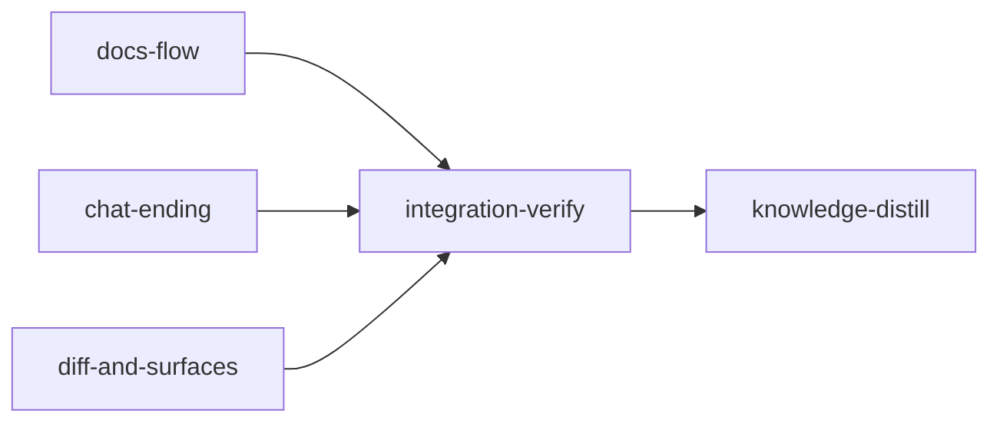

# Plan: Planner feedback fixes

Implements: none

## Overview

This plan fixes fourteen issues the operator reported in the feature planner. Issue 5 of the
report is dropped: it was unreadable dictation, and the operator chose to drop it. The fixes fall
into three groups. **Documents flow:** plans wait for a settled metaplan; the engineering overview
page is removed and the metaplan page takes its place; the spine marks unsettled specs and plans;
there is Settle all; and running plans get a pulsing dot. **Chat:** a quieter transcript, and the
agent ends the chat itself when the work is done. **Surfaces:** a rendered, scrolled and redesigned
diff view, and popups that stand out from the page. Most of the implementation goes to the codex
lane: gpt-6.1-terra at high effort for mechanical fixes, gpt-6.1-sol at high effort for harder
ones, and gpt-6-astra at xhigh for the hardest. Visual work goes to fable with
`/frontend-design:frontend-design`. Opus reviews every stage and runs integration-verify.

**Sequencing.** This plan runs after `IN_PROGRESS-PLAN-planner-background-activity-and-skills.md`
has merged. That plan rewrites the chat close gate (`driver.rs` `on_idle`, replacing
`subagents_running` with the background table) and several chat web files. Every stage's
`before_stage` check refuses to start until that plan's `loom/src/plan_session/bridge/background.rs`
exists.

## Issues and where each is fixed

| # | Issue | Stage | Worker | Lane |
| --- | --- | --- | --- | --- |
| 1 | Plans wait for a settled metaplan | docs-flow | W3 | codex sol/high |
| 2 | Remove the engineering overview; the metaplan page is home | docs-flow | W1, W2, W6a, W6b, W6c | codex sol/high (W6b, W6c terra/high) |
| 3 | "changed during this turn" river | chat-ending | W2 | codex terra/high |
| 4 | Tool uses collapsed by default, expandable | chat-ending | W2 | codex terra/high |
| 5 | (dropped by the operator: unreadable dictation) | — | — | — |
| 6 | Running plan on the spine: pulsing green dot | docs-flow | W5 | codex sol/high |
| 7 | Roundel only on the header activity pill | docs-flow | W5 | codex sol/high |
| 8 | Product spec spine head amber when any spec is unsettled | docs-flow | W5 | codex sol/high |
| 9 | Plans spine head amber when any plan is unsettled | docs-flow | W5 | codex sol/high |
| 10 | Settle all, for product specs and for plans | docs-flow | W4 (server, button), W6a (mount) | codex sol/high |
| 11 | Diff view renders markdown | diff-and-surfaces | W1 (block diff), W3 (view) | codex sol/high, fable |
| 12 | A better-looking diff view | diff-and-surfaces | W3 | fable + frontend-design |
| 13 | Diff view opens scrolled to the first change, centred | diff-and-surfaces | W3 | fable + frontend-design |
| 14 | The agent ends a finished chat itself; a user end writes decisions | chat-ending | W1 (bridge), W2 (web) | codex astra/xhigh, terra/high |
| 15 | Popups stand out from the page in every theme | diff-and-surfaces | W2 | fable + frontend-design |

## Decisions (authoritative; the YAML and briefs follow them)

- **D1 Metaplan gate (issue 1).** A feature's metaplan counts as settled when its trace document's
  settle state is `settled`, or when the document is not settleable because every plan is done
  (`loom/src/planning/trace/build/docs.rs` sets `settleable` false then). The states `draft`,
  `revised`, `stub_changed` and `upstream_changed` all block. The gate holds in two places: the
  wire, where each `write-plan:<slug>` and `draft-all-plans` offer carries
  `blocked_reason: "Settle the metaplan first"`, and the start path, where
  `AuthoringStart::from_offer_id` refuses those offers with the new `StartError::MetaplanUnsettled`.
  The plan skill tells a free chat to stop and ask the user to settle the metaplan first.
  `plan-follow-ups` is not gated.
- **D2 Engineering overview (issue 2).** The summary `overview/<f>/engineering` and the page
  `/f/<f>/engineering` are removed: the summary store, the overview agent prompt, the summaries
  skill and the two committed summary files. `/f/<f>/engineering` and `/f/<f>/run` redirect to
  `metaplan`. The metaplan page gains what the overview carried: the Run panel, the plan-scope gaps,
  the pace cards and the plan queue. `landingPath` sends a feature with a metaplan to `metaplan`.
  The Plans spine group's head links to the metaplan page and has no Overview child.
  `Scope::Engineering` stays as the scope of the per-plan pages at `engineering/:doc`. The product
  overview is unchanged.
- **D3 Spine heads (issues 8, 9).** The Product spec and Plans group heads keep the server mark,
  with one change. When that mark is `done` and any child's glyph is not `settled`, `done` or
  `retired`, the head shows the amber attention glyph, kind `attention`, with the word "Not all
  settled". Unsettled children include draft, revised, moved, and written but never settled.
  The Home cards and the queue are out of scope. The operator named the spine only; the gap is
  recorded for the run review.
- **D4 Running plan dot (issues 6, 7).** A running plan's spine row draws `LiveDot`
  (`web/src/plan/ui/activity-glyphs.tsx`), as it did before commit 6482c5842. `BusyRoundel` stays
  only in the header activity pill (`header/activity.tsx` `PillGlyph`), where it already marks every
  progress activity. `DESIGN.md` signs 1 and 3 change to match.
- **D5 Settle all (issue 10).** A new route, `POST /api/settle-all?feature=<f>&role=section|plan[&confirm=1]`,
  with `Role::HolderOrTake` and an empty body. It walks the feature's trace documents of that role
  that are settleable and not `settled`, and runs on each the same refusal, mark, save and
  commit-queue path as `POST /api/settle`, which is factored into one shared function. Without
  `confirm=1` a document with unresolved calls or open questions is skipped as `unresolved`.
  The answer is 200 `{"settled": [rel...], "skipped": [{"path": rel, "reason": "unresolved"|"stale"|"stub"}]}`.
  The web button `SettleAllButton({ feature, role })` (`web/src/plan/trace/settle-all.tsx`) sits on
  the product overview and on the metaplan page. When the server reports unresolved documents, it
  offers a second, confirming press.
- **D6 Chat ending (issue 14), as the operator set it.** The agent ends the chat itself when it
  judges the work done. It first writes every settled decision into the documents and every open
  point under `## Open questions`. It then ends its reply with a fenced block whose info string is
  exactly `loom-done`, holding `{"decisions": [...], "questions": [...]}`, the same shape as
  `loom-closing`. At that turn's Stop the bridge plans an end with `Closing::Skip` (no closing
  message is sent) and `EndCause::Agent`, and the chat closes through the existing close gate:
  - immediately when no background agent is running;
  - otherwise when the background table drains, re-checked on the driver's tick, with no further
    main Stop needed.
  A user message queued or being delivered at that Stop cancels the agent end. Only the final block
  of the turn's last assistant text counts. A user message, a quoted fence, or another info string
  never ends a chat. When the user ends a chat (New chat, End, the planner stopping or the holder
  leaving), the closing write runs as today. The web shows an agent-ended chat's decisions and
  questions in the same left-behind card and hides the raw fence. New chat after an agent end starts
  at once, with no wrap-up card.
- **D7 Transcript noise (issues 3, 4).** The per-file "changed during this turn" label is deleted. A
  turn's changed-file list folds into one closed `<details>` summary ("Changed N files"). The tool
  fold group is uncontrolled and closed by default, also while the turn runs; the reader opens it.
  Error and denied rows stay outside the fold, visible as today. The wire field `by_tool` stays.
- **D8 Diff view (issues 11 to 13).** `DiffView` keeps its props, so its four callers do not change.
  It opens on a rendered view: block-level, through `diffBlocks` and the planner's `Markdown`
  renderer. A Source toggle shows the CodeMirror merge view, which keeps Add to chat.
  - The rendered view scrolls its first changed block to the vertical centre on open.
  - The source view scrolls to the first merge chunk on open (`getChunks`, then the handle's
    `scrollToLine`).
  - The fable designer sets the look. It records its choices in `web/src/plan/ui/DESIGN.md` and the
    tokens it adds.
- **D9 Popups (issue 15).** Fable, with `/frontend-design:frontend-design`, gives every popover and
  dialog surface a visible edge in all nine themes: an elevated surface token distinct from
  `--card`, a clear border, and a soft glow or shadow. It also chooses a backdrop. Modal dialogs
  already have one; for popovers the designer decides between a light scrim with blur and none. The
  Findings fold picker (`trace/findings-fold.tsx` `FoldPicker`, styled in
  `trace/maps-findings-forms.css`) is an inline fieldset, not a popup. It gets the same raised
  surface.
- **D10 Build output.** No standard stage rebuilds `web/dist`, because parallel stages would
  conflict on hashed asset names. Integration-verify rebuilds it once and proves it fresh.

## Execution Diagram



`docs-flow & chat-ending & diff-and-surfaces` run concurrently; their file sets are disjoint.

Knowledge bootstrap is skipped. The tier-1 files and the tier-2 topics on the planner describe this
codebase (`architecture/planner-feature-screens.md`, `architecture/planner-web-shell.md`,
`architecture/plan-server.md`, `conventions/plan-web.md`). The previous plan's distill stage ended
with a clean knowledge check.

## Stages

### 1. docs-flow: documents flow (issues 1, 2, 6 to 10)

Stage necessity: **Q4**. Combined with diff-and-surfaces, the removal sweep (about 60 test files)
plus two fable design passes and their review rounds would push one session past 500,000 tokens.
It also differs in working directory: it spans `loom/` and `web/`, while diff-and-surfaces is
`web/` only.

Workers (common context: `doc/plans/briefs/planner-feedback-fixes/docs-flow/common.md`):

| Worker | Role | Tier | Files owned | Shared context | Brief path |
| --- | --- | --- | --- | --- | --- |
| W1 | summary store: remove the engineering overview | codex sol | loom/src/planning/summary/**; loom/src/plan_server/summaries/**; loom/tests/planning_summary_contracts.rs; loom/tests/plan_summary_rebuild_contracts.rs; plan-plugin/agents/overview.md; plan-plugin/skills/summaries/SKILL.md; loom/src/planning/guidance/text/summary_codex.md; doc/loom/summaries/overview/**; README.md | common.md | doc/plans/briefs/planner-feedback-fixes/docs-flow/w1-summary-store.md |
| W2 | concept page layer: remove the overview page | codex sol | loom/src/plan_server/concept/**; loom/src/plan_server/wire/fixtures/concept-overview.json; loom/tests/plan_concept_contracts.rs | common.md | doc/plans/briefs/planner-feedback-fixes/docs-flow/w2-concept-pages.md |
| W3 | metaplan gate | codex sol | loom/src/planning/trace/gate.rs; loom/src/planning/trace/mod.rs; loom/src/planning/guidance/start.rs; loom/src/planning/guidance/start/**; loom/src/planning/guidance/opening.rs; loom/src/plan_server/wire/checklist.rs; loom/src/plan_server/wire/checklist_card.rs; loom/src/plan_server/wire/fixtures/checklist.json; plan-plugin/skills/plan/SKILL.md; plan-plugin/skills/metaplan/SKILL.md; web/src/plan/api/schema.ts; web/src/plan/api/schema.test.ts; web/src/plan/api/fixtures/checklist.json; web/src/plan/offers/** | common.md | doc/plans/briefs/planner-feedback-fixes/docs-flow/w3-metaplan-gate.md |
| W4 | settle all: route and button | codex sol | loom/src/plan_server/trace/mod.rs; loom/src/plan_server/trace/settle_route.rs; loom/src/plan_server/trace/settle_all.rs; loom/src/plan_server/trace/settle_all_tests.rs; loom/src/plan_server/wire/trace.rs; web/src/plan/api/schema-trace.ts; web/src/plan/trace/settle-all.tsx; web/src/plan/trace/settle-all.test.tsx; web/src/plan/trace/settle-flow.ts | common.md | doc/plans/briefs/planner-feedback-fixes/docs-flow/w4-settle-all.md |
| W5 | spine: heads, running dot, design record | codex sol | web/src/plan/feature/spine-model.ts; web/src/plan/feature/spine-row.tsx; web/src/plan/feature/spine.css; web/src/plan/feature/spine.tsx; web/src/plan/feature/spine.test.tsx; web/src/plan/feature/spine-groups.test.tsx; web/src/plan/feature/spine.contracts.test.tsx; web/src/plan/feature/spine-model.test.ts; web/src/plan/trace/spine-marks.test.tsx; web/src/plan/trace/trace-ui.contracts.test.tsx; web/src/plan/ui/DESIGN.md; web/src/plan/ui/activity-glyphs.css; web/src/plan/ui/activity-glyphs.tsx; web/src/plan/help/legend-entries.tsx | common.md | doc/plans/briefs/planner-feedback-fixes/docs-flow/w5-spine.md |
| W6a | metaplan page as the plans home | codex sol | web/src/plan/router.tsx; web/src/plan/router.test.tsx; web/src/plan/feature/landing.ts; web/src/plan/feature/landing.test.ts; web/src/plan/feature/document-page.tsx; web/src/plan/feature/page-offer.ts; web/src/plan/feature/gaps.tsx; web/src/plan/feature/gaps.test.tsx; web/src/plan/feature/queue.tsx; web/src/plan/feature/run-panel.test.tsx; web/src/plan/feature/run-start-control.test.tsx | common.md | doc/plans/briefs/planner-feedback-fixes/docs-flow/w6a-metaplan-home.md |
| W6b | web sweep of overview references | codex terra | web/src/plan/api/page-key.ts; web/src/plan/api/page-key.test.ts; web/src/plan/api/schema-concept.test.ts; web/src/plan/concept/**; web/src/plan/files/doc-heading-view.tsx; web/src/plan/chat/viewed-document.ts; web/src/plan/chat/viewed-document.test.ts; web/src/plan/chat/chip-label.ts; web/src/plan/chat/context-prompts.tsx; web/src/plan/help/shortcuts.tsx | common.md | doc/plans/briefs/planner-feedback-fixes/docs-flow/w6b-web-sweep.md |
| W6c | web sweep: remaining modules and tests | codex terra | web/src/plan/chat/chips-labels.test.tsx; web/src/plan/chat/chips.test.tsx; web/src/plan/chat/composer-context.test.tsx; web/src/plan/chat/context-line.test.tsx; web/src/plan/chat/session-home.test.tsx; web/src/plan/chat/summary-link.test.ts; web/src/plan/files/doc-heading-view-summary.test.tsx; web/src/plan/files/heading-parts.tsx; web/src/plan/files/section-chips.ts; web/src/plan/header/feature-switcher.test.tsx; web/src/plan/header/header.test.tsx; web/src/plan/header/tabs.test.tsx; web/src/plan/home/features.contracts.test.tsx; web/src/plan/home/plan-href.ts; web/src/plan/review/review.test.tsx; web/src/plan/tabs.test.ts; web/src/plan/trace/coverage-model.test.ts; web/src/plan/trace/coverage-page.test.tsx; web/src/plan/trace/doc-model.test.ts; web/src/plan/trace/doc-parts.test.tsx; web/src/plan/trace/map-page.tsx; web/src/plan/trace/model.test.ts | common.md | doc/plans/briefs/planner-feedback-fixes/docs-flow/w6c-web-sweep-rest.md |
| W7 | product spec text for D1 to D9 | codex terra | doc/product/feat-planner/index.md; doc/product/feat-planner/section_01.md; doc/product/feat-planner/section_03.md; doc/product/feat-planner/section_04.md; doc/product/feat-planner/section_05.md; doc/product/feat-planner/section_06.md; doc/product/feat-planner/section_08.md; doc/product/feat-planner/section_09.md; doc/product/feat-planner/section_10.md; doc/product/feat-planner/section_11.md | common.md | doc/plans/briefs/planner-feedback-fixes/docs-flow/w7-spec.md |

Waves:

- **Wave 1:** W1, W3, W4, W5, W6b and W6c, in one message.
- **Wave 2:** W2, W6a and W7, after wave 1 returns.
  - W2 builds on W1's store.
  - W6a mounts W4's `SettleAllButton`.
  - W7 describes what landed.

Risk checklist:

- *Reachability:* contract `the-metaplan-page-is-the-plans-home` renders the router at
  `/f/<f>/engineering` and finds the Run panel on the metaplan page.
- *Untrusted input:* contract `settle-all-settles-only-the-named-role` covers a role value outside
  the allowed two, which is refused with 400.
- *Lifecycle:* contract `settle-all-skips-unresolved-without-confirm`.
- *The behaviour added:* `write-plan-waits-for-a-settled-metaplan` (a stale `Settled:` line still
  blocks) and `spine-product-head-is-amber-while-a-section-is-unsettled`.
- Not applicable: filesystem paths (settle writes go through the existing `save_document`), process
  I/O, configuration and external data.

### 2. chat-ending: chat transcript and agent-ended chats (issues 3, 4, 14)

Stage necessity: **Q1**. Its bridge work needs the background plan's close gate merged; the
`before_stage` check enforces this. It also cites **Q4**: folded into docs-flow, the stage would
pass 500,000 tokens.

| Worker | Role | Tier | Files owned | Shared context | Brief path |
| --- | --- | --- | --- | --- | --- |
| W1 | bridge: agent end, close re-check, guidance | codex astra | loom/src/plan_session/bridge/**; loom/src/plan_session/transcript/**; loom/src/plan_session/model/**; loom/src/planning/guidance/text/common_brief.md; loom/src/planning/guidance/mod.rs | common.md | doc/plans/briefs/planner-feedback-fixes/chat-ending/w1-bridge-agent-end.md |
| W2 | chat web: footer, tool fold, agent-ended card | codex terra | web/src/plan/chat/turn-footer.tsx; web/src/plan/chat/turn-footer.test.tsx; web/src/plan/chat/transcript.tsx; web/src/plan/chat/transcript.test.tsx; web/src/plan/chat/chat.contracts.test.tsx; web/src/plan/chat/closing.ts; web/src/plan/chat/closing.test.ts; web/src/plan/chat/kickoff-fence.ts; web/src/plan/chat/wrap-up.tsx; web/src/plan/chat/state-line.tsx; web/src/plan/chat/chat-tools.css | common.md | doc/plans/briefs/planner-feedback-fixes/chat-ending/w2-chat-web.md |

Waves: W1, then W2. W2 reads W1's pinned fence rule from common.md and needs no Rust from it, but
the stage runs W1 first so a W1 re-split cannot race W2's review.

**Escalation.** W1's Rust converges only by running the fake-host bridge tests, which codex cannot
run. The orchestrator runs them after W1 returns. A failure goes to one fresh astra job with the
failing output. A second failure goes to `loom-senior-software-engineer` at effort xhigh, briefed
with both attempts.

Risk checklist:

- *Untrusted input:* `a-user-or-quoted-fence-never-ends-the-chat`.
- *Lifecycle and concurrency:* `a-queued-message-cancels-the-agent-end` and
  `an-agent-end-waits-for-running-background-agents`.
- *The behaviour added:* `a-done-turn-ends-the-chat-without-a-closing-write`.
- Not applicable: filesystem, process I/O, configuration and external data. The record shapes come
  from the merged background plan's fixtures.

### 3. diff-and-surfaces: diff view and popups (issues 11, 12, 13, 15)

Stage necessity: **Q4** (see docs-flow). It is web-only, so its working directory is `web`.

| Worker | Role | Tier | Files owned | Shared context | Brief path |
| --- | --- | --- | --- | --- | --- |
| W1 | block diff model | codex sol | src/plan/diff/block-diff.ts; src/plan/diff/block-diff.test.ts | common.md | doc/plans/briefs/planner-feedback-fixes/diff-and-surfaces/w1-block-diff.md |
| W2 | popups and surfaces design | fable | src/plan/header/popover.tsx; src/components/ui/dialog.tsx; src/aurora-ui/shared/styles/tokens-light.css; src/aurora-ui/shared/styles/tokens-dark.css; src/index.css; src/plan/plan.css; src/plan/header/activity.tsx; src/plan/trace/maps-findings-forms.css | common.md | doc/plans/briefs/planner-feedback-fixes/diff-and-surfaces/w2-popups.md |
| W3 | rendered diff view design | fable | src/plan/diff/diff-view.tsx; src/plan/diff/rendered-diff.tsx; src/plan/diff/diff.css; src/plan/diff/diff-view.test.tsx; src/plan/diff/rendered-diff.test.tsx; src/plan/editor/codemirror.ts; src/plan/editor/codemirror.test.ts | common.md | doc/plans/briefs/planner-feedback-fixes/diff-and-surfaces/w3-diff-view.md |

Waves:

- **Wave 1:** W1 (codex) in the foreground, then W2 (fable) in the background.
- **Wave 2:** W3, after W1 returns.

`web/src/plan/ui/DESIGN.md` belongs to docs-flow (W5, the sign section). W2 and W3 do not edit it.
They record their design choices as `loom memory decision` entries prefixed `design-record:`, and
integration-verify writes them into `DESIGN.md` as `## Diff view` and `## Floating surfaces`
sections.

Risk checklist:

- *Reachability:* `the-diff-view-opens-rendered`, through `DiffView`, the component every caller
  mounts.
- *The behaviour added:* `an-inserted-paragraph-marks-only-itself` and
  `the-first-change-is-scrolled-to-centre`.
- *Untrusted input:* rendered markdown goes through the existing safe `Markdown` renderer. No new
  sink is added, so no further contract is needed.

### 4. Integration verification

Rebuilds `web/dist` once (D10). Runs the full Rust and web suites, lint, format and docs. Opus
reviewers cover security, architecture, test coverage and the screens; every finding is fixed or
disputed. Functional proof uses the screen and journey scripts and screenshots of the diff view and
of a popover in a light and a dark theme.

### 5. Knowledge distillation

Curates the stage memories. It rewrites, as current truth:

- `architecture/planner-feature-screens.md`: the landing, the Run panel and the spine heads.
- `architecture/plan-server.md`: the settle-all route and the agent end.
- `conventions/plan-web.md`.

It records the scope gaps from D3.

---

<!-- loom METADATA -->

```yaml
loom:
  version: 2
  ratchet_files:
    - loom/maintainability-baseline.txt
    - doc/loom/knowledge/check-baseline.txt
  provision:
    - working_dir: "web"
      command: "test ! -e .npmrc && test ! -L .npmrc && bun install --frozen-lockfile --ignore-scripts --backend=copyfile --config=/dev/null"
  sandbox:
    enabled: true
    auto_allow: true
    filesystem:
      deny_read: ["~/.ssh/**", "~/.aws/**", "~/.config/gcloud/**", "~/.gnupg/**"]
    network:
      allowed_domains: ["crates.io", "index.crates.io", "static.crates.io", "registry.npmjs.org"]
      allow_local_binding: false
      allow_unix_sockets: []
  stages:
    - id: docs-flow
      name: "Documents flow: metaplan gate, overview removal, spine, settle all"
      summary: "Plans wait for a settled metaplan, the engineering overview gives way to the metaplan page, the spine marks unsettled specs and plans and shows a pulsing dot for running plans, and Settle all settles every spec or every plan at once."
      stage_type: standard
      skills: ["loom-rust", "loom-typescript", "loom-react"]
      implementers: ["codex", "claude"]
      subagent_timeout_secs: 1800
      working_dir: "."
      dependencies: []
      description: |
        Fix issues 1, 2, 6, 7, 8, 9 and 10 of the plan (doc/plans/IN_PROGRESS-PLAN-planner-feedback-fixes.md once loom run has started, doc/plans/PLAN-planner-feedback-fixes.md before). Decisions D1 to D5 are authoritative; doc/plans/briefs/planner-feedback-fixes/docs-flow/common.md pins every shared interface and every worker reads it before its own brief.
        Use parallel subagents and skills to maximize performance.
        PATHS: working_dir is the repository root; Rust runs through --manifest-path loom/Cargo.toml, web commands through cd web.
        LANES (operator's allocation): every worker is a codex job through loom-codex-forwarder, spawned in the FOREGROUND with an explicit Bash timeout of 1560000 ms and a one-line prompt naming its absolute brief path. W1, W2, W3, W4, W5 and W6a use --model gpt-6.1-sol --effort high; W6b, W6c and W7 use --model gpt-6.1-terra --effort high. The operator set effort high for these tiers, which overrides the xhigh default. Never spawn codex:codex-rescue. Codex runs no git and touches no .loom/ path: after each job run git status --short and revert anything outside the job's files. A job that times out (exit 124) is re-split against its partial tree, never re-forwarded as is. Codex cannot run fixture-backed tests: after each job the orchestrator runs that territory's tests (cargo test --manifest-path loom/Cargo.toml --lib <module>:: and cd web && node_modules/.bin/vitest run <dir>) and sends failures to one fresh job of the same tier with the failing output; a second failure goes to loom-software-engineer (sonnet) with both attempts, a third to loom-senior-software-engineer.
        WAVE 1 (one message): W1, W3, W4, W5, W6b, W6c. WAVE 2 (one message, after wave 1): W2 (builds on W1's store), W6a (mounts W4's SettleAllButton), W7 (describes what landed).

        | Worker | Role | Tier | Files owned | Shared context | Brief path |
        | ------ | ---- | ---- | ----------- | -------------- | ---------- |
        | W1 | summary store: remove the engineering overview | codex sol | loom/src/planning/summary/**; loom/src/plan_server/summaries/**; loom/tests/planning_summary_contracts.rs; loom/tests/plan_summary_rebuild_contracts.rs; plan-plugin/agents/overview.md; plan-plugin/skills/summaries/SKILL.md; loom/src/planning/guidance/text/summary_codex.md; doc/loom/summaries/overview/**; README.md | common.md | doc/plans/briefs/planner-feedback-fixes/docs-flow/w1-summary-store.md |
        | W2 | concept page layer: remove the overview page | codex sol | loom/src/plan_server/concept/**; loom/src/plan_server/wire/fixtures/concept-overview.json; loom/tests/plan_concept_contracts.rs | common.md | doc/plans/briefs/planner-feedback-fixes/docs-flow/w2-concept-pages.md |
        | W3 | metaplan gate | codex sol | loom/src/planning/trace/gate.rs; loom/src/planning/trace/mod.rs; loom/src/planning/guidance/start.rs; loom/src/planning/guidance/start/**; loom/src/planning/guidance/opening.rs; loom/src/plan_server/wire/checklist.rs; loom/src/plan_server/wire/checklist_card.rs; loom/src/plan_server/wire/fixtures/checklist.json; plan-plugin/skills/plan/SKILL.md; plan-plugin/skills/metaplan/SKILL.md; web/src/plan/api/schema.ts; web/src/plan/api/schema.test.ts; web/src/plan/api/fixtures/checklist.json; web/src/plan/offers/** | common.md | doc/plans/briefs/planner-feedback-fixes/docs-flow/w3-metaplan-gate.md |
        | W4 | settle all: route and button | codex sol | loom/src/plan_server/trace/mod.rs; loom/src/plan_server/trace/settle_route.rs; loom/src/plan_server/trace/settle_all.rs; loom/src/plan_server/trace/settle_all_tests.rs; loom/src/plan_server/wire/trace.rs; web/src/plan/api/schema-trace.ts; web/src/plan/trace/settle-all.tsx; web/src/plan/trace/settle-all.test.tsx; web/src/plan/trace/settle-flow.ts | common.md | doc/plans/briefs/planner-feedback-fixes/docs-flow/w4-settle-all.md |
        | W5 | spine: heads, running dot, design record | codex sol | web/src/plan/feature/spine-model.ts; web/src/plan/feature/spine-row.tsx; web/src/plan/feature/spine.css; web/src/plan/feature/spine.tsx; web/src/plan/feature/spine.test.tsx; web/src/plan/feature/spine-groups.test.tsx; web/src/plan/feature/spine.contracts.test.tsx; web/src/plan/feature/spine-model.test.ts; web/src/plan/trace/spine-marks.test.tsx; web/src/plan/trace/trace-ui.contracts.test.tsx; web/src/plan/ui/DESIGN.md; web/src/plan/ui/activity-glyphs.css; web/src/plan/ui/activity-glyphs.tsx; web/src/plan/help/legend-entries.tsx | common.md | doc/plans/briefs/planner-feedback-fixes/docs-flow/w5-spine.md |
        | W6a | metaplan page as the plans home | codex sol | web/src/plan/router.tsx; web/src/plan/router.test.tsx; web/src/plan/feature/landing.ts; web/src/plan/feature/landing.test.ts; web/src/plan/feature/document-page.tsx; web/src/plan/feature/page-offer.ts; web/src/plan/feature/gaps.tsx; web/src/plan/feature/gaps.test.tsx; web/src/plan/feature/queue.tsx; web/src/plan/feature/run-panel.test.tsx; web/src/plan/feature/run-start-control.test.tsx | common.md | doc/plans/briefs/planner-feedback-fixes/docs-flow/w6a-metaplan-home.md |
        | W6b | web sweep of overview references | codex terra | web/src/plan/api/page-key.ts; web/src/plan/api/page-key.test.ts; web/src/plan/api/schema-concept.test.ts; web/src/plan/concept/**; web/src/plan/files/doc-heading-view.tsx; web/src/plan/chat/viewed-document.ts; web/src/plan/chat/viewed-document.test.ts; web/src/plan/chat/chip-label.ts; web/src/plan/chat/context-prompts.tsx; web/src/plan/help/shortcuts.tsx | common.md | doc/plans/briefs/planner-feedback-fixes/docs-flow/w6b-web-sweep.md |
        | W6c | web sweep: remaining modules and tests | codex terra | web/src/plan/chat/chips-labels.test.tsx; web/src/plan/chat/chips.test.tsx; web/src/plan/chat/composer-context.test.tsx; web/src/plan/chat/context-line.test.tsx; web/src/plan/chat/session-home.test.tsx; web/src/plan/chat/summary-link.test.ts; web/src/plan/files/doc-heading-view-summary.test.tsx; web/src/plan/files/heading-parts.tsx; web/src/plan/files/section-chips.ts; web/src/plan/header/feature-switcher.test.tsx; web/src/plan/header/header.test.tsx; web/src/plan/header/tabs.test.tsx; web/src/plan/home/features.contracts.test.tsx; web/src/plan/home/plan-href.ts; web/src/plan/review/review.test.tsx; web/src/plan/tabs.test.ts; web/src/plan/trace/coverage-model.test.ts; web/src/plan/trace/coverage-page.test.tsx; web/src/plan/trace/doc-model.test.ts; web/src/plan/trace/doc-parts.test.tsx; web/src/plan/trace/map-page.tsx; web/src/plan/trace/model.test.ts | common.md | doc/plans/briefs/planner-feedback-fixes/docs-flow/w6c-web-sweep-rest.md |
        | W7 | product spec text for D1 to D9 | codex terra | doc/product/feat-planner/index.md; doc/product/feat-planner/section_01.md; doc/product/feat-planner/section_03.md; doc/product/feat-planner/section_04.md; doc/product/feat-planner/section_05.md; doc/product/feat-planner/section_06.md; doc/product/feat-planner/section_08.md; doc/product/feat-planner/section_09.md; doc/product/feat-planner/section_10.md; doc/product/feat-planner/section_11.md | common.md | doc/plans/briefs/planner-feedback-fixes/docs-flow/w7-spec.md |

        After wave 2, rg -n 'overview/[^/"]+/engineering|Engineering overview' web/src/plan must print nothing; a hit in a file outside this stage's files is reported to integration-verify through loom memory, never edited here.
        AFTER THE WAVES (main agent, in order): rustfmt --edition 2021 --check on every frozen contract file (dispute a contract the formatter would rewrite, never edit it); cargo fmt --manifest-path loom/Cargo.toml --all; cd web && bun run format; cargo test --manifest-path loom/Cargo.toml --test maintainability; one loom check beside the final review round (loom-code-reviewer, opus). Do NOT rebuild web/dist (Decision D10). Tell every reviewer that web/dist is build output and is not part of this stage.
        MUTATION: before the final review round, for each contract apply the implementation its rejects text describes, confirm the contract fails, restore from a saved copy (never git checkout), and record loom memory note "mutation: <contract id> red under <mutation>".
        INTEGRITY (expected events; paste this line into every reviewer prompt): TI-edit and TI-decl on loom/src/planning/summary/**/tests*.rs, loom/src/plan_server/concept/*tests*.rs, loom/src/plan_server/summaries/**/tests*.rs, loom/tests/planning_summary_contracts.rs, loom/tests/plan_summary_rebuild_contracts.rs and loom/tests/plan_concept_contracts.rs, because cases that build or assert the overview/<f>/engineering summary or page go with it (Decision D2); TI-edit on web/src/plan/feature/*.test.tsx, web/src/plan/concept/*.test.tsx, web/src/plan/api/page-key.test.ts, web/src/plan/chat/viewed-document.test.ts, web/src/plan/trace/trace-ui.contracts.test.tsx and the test files in W6c's row for the same reason; TI-edit on web/src/plan/trace/spine-marks.test.tsx and trace-ui.contracts.test.tsx because a running plan row now draws LiveDot, not the roundel (Decision D4); TI-edit on web/src/plan/feature/landing.test.ts because a feature with a metaplan lands on metaplan. No other event is expected.
        MEMORY: record mistakes, decisions and surprises via loom memory immediately, subagents too; NEVER loom knowledge (implementation stage); NEVER Claude Code auto-memory.

        CONTRACT SURFACE (the contract session writes the five contracts from this text before any code; a contract file holds only contract tests; each Rust test fn at most 50 lines, each file at most 400 lines and rustfmt-clean):
        - Gate: crate::planning::trace::gate::metaplan_settled(feature: &crate::planning::project::Feature) -> bool (pub fn in the new loom/src/planning/trace/gate.rs, pub mod gate in planning/trace/mod.rs). StartError gains the unit variant MetaplanUnsettled, displayed as "Settle the metaplan first". AuthoringStart::from_offer_id(id, &project, Some(feature)) returns Err(StartError::MetaplanUnsettled) for write-plan:<slug> and draft-all-plans while metaplan_settled is false. Build the project as loom/src/planning/guidance/start/follow_up_contract_tests.rs does (files in a TempDir, Project::load). A settled Settled line is made with crate::planning::trace::settle::mark(text, &line) using the metaplan trace document's current line from project.feature(f).trace; a stale one by editing the metaplan body after marking and reloading.
        - Settle all: POST /api/settle-all?feature=<f>&role=section|plan[&confirm=1], Role::HolderOrTake, empty body; 200 {"settled": [rel], "skipped": [{"path": rel, "reason": "unresolved"|"stale"|"stub"}]}; 400 bad_request for a missing feature or a role other than section or plan. Tests run the server as loom/src/plan_server/trace/route_tests.rs does (demo(extra) builds and commits a two-section feature with a metaplan and PLAN-first.md; post_json and the session cookies from crate::plan_server::tests::support); an open question is an item under "## Open questions" in the section.
        - Spine: spineGroups(checklist, trace) in web/src/plan/feature/spine-model.ts; for the product and plans groups, when the server mark is done and any child glyph kind is not settled, done or retired, the group's glyph is { kind: "attention", word: "Not all settled" }; otherwise the product and plans glyph stays null. Checklist and trace fixtures: web/src/plan/api/fixtures/checklist.json and trace.json, parsed with their schemas as spine-model.test.ts does.
        - Metaplan home: under the planner router (render the app routes at an initial entry as web/src/plan/feature/run-panel.test.tsx does), /f/<f>/engineering redirects to /f/<f>/metaplan and that page renders the Run panel (the element run-panel.test.tsx already locates it by).
        The contracts are red at freeze because gate.rs, settle_all.rs, the attention head and the redirect do not exist (a build failure counts as red).
      files:
        - "loom/src/planning/summary/**"
        - "loom/src/plan_server/summaries/**"
        - "loom/src/plan_server/concept/**"
        - "loom/src/plan_server/trace/**"
        - "loom/src/plan_server/wire/checklist.rs"
        - "loom/src/plan_server/wire/checklist_card.rs"
        - "loom/src/plan_server/wire/trace.rs"
        - "loom/src/plan_server/wire/fixtures/**"
        - "loom/src/planning/trace/gate.rs"
        - "loom/src/planning/trace/mod.rs"
        - "loom/src/planning/guidance/start.rs"
        - "loom/src/planning/guidance/start/**"
        - "loom/src/planning/guidance/opening.rs"
        - "loom/src/planning/guidance/text/summary_codex.md"
        - "loom/tests/planning_summary_contracts.rs"
        - "loom/tests/plan_summary_rebuild_contracts.rs"
        - "loom/tests/plan_concept_contracts.rs"
        - "plan-plugin/agents/overview.md"
        - "plan-plugin/skills/summaries/SKILL.md"
        - "plan-plugin/skills/plan/SKILL.md"
        - "plan-plugin/skills/metaplan/SKILL.md"
        - "doc/loom/summaries/overview/**"
        - "doc/product/feat-planner/**"
        - "README.md"
        - "web/src/plan/router.tsx"
        - "web/src/plan/feature/**"
        - "web/src/plan/concept/**"
        - "web/src/plan/api/**"
        - "web/src/plan/offers/**"
        - "web/src/plan/trace/settle-all.tsx"
        - "web/src/plan/trace/settle-all.test.tsx"
        - "web/src/plan/trace/settle-flow.ts"
        - "web/src/plan/trace/spine-marks.test.tsx"
        - "web/src/plan/trace/trace-ui.contracts.test.tsx"
        - "web/src/plan/files/doc-heading-view.tsx"
        - "web/src/plan/chat/viewed-document.ts"
        - "web/src/plan/chat/viewed-document.test.ts"
        - "web/src/plan/chat/chip-label.ts"
        - "web/src/plan/chat/context-prompts.tsx"
        - "web/src/plan/help/**"
        - "web/src/plan/ui/DESIGN.md"
        - "web/src/plan/ui/activity-glyphs.css"
        - "web/src/plan/ui/activity-glyphs.tsx"
        - "web/src/plan/router.test.tsx"
        - "web/src/plan/chat/chips-labels.test.tsx"
        - "web/src/plan/chat/chips.test.tsx"
        - "web/src/plan/chat/composer-context.test.tsx"
        - "web/src/plan/chat/context-line.test.tsx"
        - "web/src/plan/chat/session-home.test.tsx"
        - "web/src/plan/chat/summary-link.test.ts"
        - "web/src/plan/files/doc-heading-view-summary.test.tsx"
        - "web/src/plan/files/heading-parts.tsx"
        - "web/src/plan/files/section-chips.ts"
        - "web/src/plan/header/feature-switcher.test.tsx"
        - "web/src/plan/header/header.test.tsx"
        - "web/src/plan/header/tabs.test.tsx"
        - "web/src/plan/home/features.contracts.test.tsx"
        - "web/src/plan/home/plan-href.ts"
        - "web/src/plan/review/review.test.tsx"
        - "web/src/plan/tabs.test.ts"
        - "web/src/plan/trace/coverage-model.test.ts"
        - "web/src/plan/trace/coverage-page.test.tsx"
        - "web/src/plan/trace/doc-model.test.ts"
        - "web/src/plan/trace/doc-parts.test.tsx"
        - "web/src/plan/trace/map-page.tsx"
        - "web/src/plan/trace/model.test.ts"
      acceptance:
        - command: "cargo build --manifest-path loom/Cargo.toml"
          timeout_secs: 1800
        - command: "cargo clippy --manifest-path loom/Cargo.toml --all-targets -- -D warnings"
          timeout_secs: 1800
        - "cargo fmt --manifest-path loom/Cargo.toml --check"
        - command: "cargo test --manifest-path loom/Cargo.toml --lib planning::"
          timeout_secs: 1800
        - command: "cargo test --manifest-path loom/Cargo.toml --lib plan_server::"
          timeout_secs: 1800
        - command: "cargo test --manifest-path loom/Cargo.toml --test planning_summary_contracts --test plan_summary_rebuild_contracts --test plan_concept_contracts"
          timeout_secs: 1800
        - command: "cargo test --manifest-path loom/Cargo.toml --test maintainability"
          timeout_secs: 1200
        - command: "cd web && node_modules/.bin/tsc -b --noEmit"
          timeout_secs: 900
        - "cd web && node_modules/.bin/oxlint --deny-warnings"
        - "cd web && node_modules/.bin/oxfmt --check"
        - command: "cd web && node_modules/.bin/vitest run src/plan"
          timeout_secs: 2400
        - "! test -e doc/loom/summaries/overview/feat-planner/engineering.md"
        - "! rg -q 'overview/[^/\"]+/engineering|Engineering overview' loom/src web/src/plan plan-plugin"
        - "rg -qF '/api/settle-all' loom/src/plan_server/trace/mod.rs"
        - "rg -qF 'MetaplanUnsettled' loom/src/planning/guidance/start.rs"
        - "git ls-files 'doc/product/feat-planner/*.md' | xargs web/node_modules/.bin/markdownlint-cli2"
      before_stage:
        - command: "test -f loom/src/plan_session/bridge/background.rs"
          description: "the planner background-activity plan has merged (this plan runs after it)"
      after_stage:
        - command: "rg -qF 'SettleAllButton' web/src/plan/feature/document-page.tsx"
          description: "the metaplan page mounts Settle all plans"
      artifacts:
        - "loom/src/planning/trace/gate.rs"
        - "loom/src/plan_server/trace/settle_all.rs"
        - "web/src/plan/trace/settle-all.tsx"
      reachable:
        - symbol: metaplan_settled
          from: from_offer_id
          description: "the start path consults the metaplan gate"
        - symbol: settle_all_route
          from: routes
          description: "the settle-all handler is registered in the trace routes"
      wiring:
        - source: "web/src/plan/feature/document-page.tsx"
          pattern: "<RunPanel"
          literal: true
          description: "the metaplan page renders the Run panel"
        - source: "web/src/plan/**/*.tsx"
          pattern: "<SettleAllButton"
          literal: true
          description: "a page mounts the Settle all button"
        - source: "web/src/plan/feature/spine-row.tsx"
          pattern: "<LiveDot"
          literal: true
          description: "a running plan's spine row draws the pulsing dot"
      contracts:
        - id: write-plan-waits-for-a-settled-metaplan
          file: loom/src/planning/guidance/start/gate_contract_tests.rs
          test: planning::guidance::start::gate_contract_tests::write_plan_waits_for_a_settled_metaplan
          scenario: "a TempDir feature f with a vision listing section 05, section_05.md, and a metaplan doc/plans/f/index.md naming PLAN-f-01.md and PLAN-f-02.md with only PLAN-f-01.md written; the metaplan is marked settled with settle::mark, then its body is edited and the project reloaded; AuthoringStart::from_offer_id(write-plan:f-02, &project, Some(f)) and from_offer_id(draft-all-plans, ...) both return Err(StartError::MetaplanUnsettled); after marking the edited metaplan settled again and reloading, write-plan:f-02 starts Ok"
          rejects: "a gate that checks only whether a Settled line is present, so a metaplan edited after settling still lets plans be written, or a gate applied only to the wire offers so the start path accepts the offer"
        - id: settle-all-settles-only-the-named-role
          file: loom/src/plan_server/trace/settle_all_contract_tests.rs
          test: plan_server::trace::settle_all_contract_tests::settle_all_settles_only_the_named_role
          scenario: "demo(&[]) served as route_tests.rs serves it, holder cookies taken; POST /api/settle-all?feature=demo&role=section answers 200 with settled holding doc/product/demo/section_01.md and doc/product/demo/section_02.md; both files now carry a Settled line while doc/plans/demo/PLAN-first.md and doc/plans/demo/index.md do not; POST /api/settle-all?feature=demo&role=../x answers 400"
          rejects: "a settle-all that settles every trace document of the feature regardless of role, or that passes an unknown role through as a filter matching nothing and answers 200"
        - id: settle-all-skips-unresolved-without-confirm
          file: loom/src/plan_server/trace/settle_all_contract_tests.rs
          test: plan_server::trace::settle_all_contract_tests::settle_all_skips_unresolved_without_confirm
          scenario: "demo with section_02.md holding an item under ## Open questions; POST /api/settle-all?feature=demo&role=section settles section_01.md and lists section_02.md under skipped with reason unresolved, leaving its file without a Settled line; the same POST with confirm=1 then settles section_02.md"
          rejects: "a settle-all that skips the per-document refusal checks and settles a document with open questions without confirm, or one that stops at the first refusal instead of settling the rest"
        - id: spine-product-head-is-amber-while-a-section-is-unsettled
          file: web/src/plan/feature/spine-settle.contracts.test.ts
          scenario: "the checklist fixture with the product step mark set to done and every section written; a trace whose section documents are all settleable with settle settled except one with settle revised; spineGroups(checklist, trace) gives the product group glyph { kind: attention, word: Not all settled }; with every section settled the product glyph is null and the mark stays done"
          rejects: "a spine head that keeps reading only the server step mark, so a written but unsettled spec still draws the green check"
        - id: the-metaplan-page-is-the-plans-home
          file: web/src/plan/feature/metaplan-home.contracts.test.tsx
          scenario: "the planner routes rendered at /f/<feature>/engineering for a feature with a metaplan, with the fetch mocks run-panel.test.tsx uses; the location becomes /f/<feature>/metaplan and the Run panel is in the page"
          rejects: "a removal that deletes the engineering overview route but leaves the Run panel unmounted, or keeps /engineering rendering a page of its own"

    - id: chat-ending
      name: "Chat: quieter transcript and agent-ended chats"
      summary: "The chat stops repeating 'changed during this turn', folds tool use by default, and lets the agent end a finished chat itself with no closing write, while a chat the user ends still writes its decisions."
      stage_type: standard
      skills: ["loom-rust", "loom-typescript", "loom-react"]
      implementers: ["codex", "claude"]
      subagent_timeout_secs: 1800
      working_dir: "."
      dependencies: []
      description: |
        Fix issues 3, 4 and 14 of the plan (doc/plans/IN_PROGRESS-PLAN-planner-feedback-fixes.md once loom run has started, doc/plans/PLAN-planner-feedback-fixes.md before). Decisions D6 and D7 are authoritative; doc/plans/briefs/planner-feedback-fixes/chat-ending/common.md pins the fence rule and the end path, and both workers read it first. The background-activity plan is merged: the close gate in loom/src/plan_session/bridge/driver.rs on_idle reads the background table (bridge/background.rs), not a subagent counter.
        Use parallel subagents and skills to maximize performance.
        PATHS: working_dir is the repository root; Rust through --manifest-path loom/Cargo.toml, web through cd web.
        LANES (operator's allocation): W1 is a codex job with --model gpt-6-astra --effort xhigh (the hardest piece: an end path through the bridge state machine); W2 is a codex job with --model gpt-6.1-terra --effort high. Both through loom-codex-forwarder in the FOREGROUND, explicit Bash timeout 1560000 ms, a one-line prompt naming the absolute brief path. Never spawn codex:codex-rescue. Codex runs no git and touches no .loom/ path: after each job run git status --short and revert anything outside its files. A timeout (exit 124) is re-split against the partial tree. W1 first, then W2.
        ESCALATION: W1 converges only through the fake-host bridge tests, which codex cannot run. After W1 the orchestrator runs cargo test --manifest-path loom/Cargo.toml --lib plan_session:: and the contracts; a failure goes to one fresh astra job with the failing output; a second failure to loom-senior-software-engineer spawned with effort xhigh, briefed with both attempts and their output (loom-advisor first if the cause is unclear).

        | Worker | Role | Tier | Files owned | Shared context | Brief path |
        | ------ | ---- | ---- | ----------- | -------------- | ---------- |
        | W1 | bridge: agent end, close re-check, guidance | codex astra | loom/src/plan_session/bridge/**; loom/src/plan_session/transcript/**; loom/src/plan_session/model/**; loom/src/planning/guidance/text/common_brief.md; loom/src/planning/guidance/mod.rs | common.md | doc/plans/briefs/planner-feedback-fixes/chat-ending/w1-bridge-agent-end.md |
        | W2 | chat web: footer, tool fold, agent-ended card | codex terra | web/src/plan/chat/turn-footer.tsx; web/src/plan/chat/turn-footer.test.tsx; web/src/plan/chat/transcript.tsx; web/src/plan/chat/transcript.test.tsx; web/src/plan/chat/chat.contracts.test.tsx; web/src/plan/chat/closing.ts; web/src/plan/chat/closing.test.ts; web/src/plan/chat/kickoff-fence.ts; web/src/plan/chat/wrap-up.tsx; web/src/plan/chat/state-line.tsx; web/src/plan/chat/chat-tools.css | common.md | doc/plans/briefs/planner-feedback-fixes/chat-ending/w2-chat-web.md |

        AFTER THE WORKERS (main agent, in order): rustfmt --edition 2021 --check on every frozen contract file; cargo fmt --manifest-path loom/Cargo.toml --all; cd web && bun run format; cargo test --manifest-path loom/Cargo.toml --test maintainability; one loom check beside the final review round (loom-code-reviewer, opus). Do NOT rebuild web/dist (Decision D10).
        MUTATION: before the final review round, for each contract apply the implementation its rejects text describes, confirm the contract fails, restore from a saved copy (never git checkout), and record loom memory note "mutation: <contract id> red under <mutation>".
        INTEGRITY (expected events; paste into every reviewer prompt): TI-edit on web/src/plan/chat/turn-footer.test.tsx, because the per-file "changed during this turn" label is deleted and the file list folds (Decision D7); TI-edit on web/src/plan/chat/transcript.test.tsx and chat.contracts.test.tsx, because a running turn's tool fold is now closed by default (Decision D7). No other event is expected.
        MEMORY: record mistakes, decisions and surprises via loom memory immediately, subagents too; NEVER loom knowledge (implementation stage); NEVER Claude Code auto-memory.

        CONTRACT SURFACE (the contract session writes the four contracts from this text before any code; a contract file holds only contract tests; each test fn at most 50 lines, each file at most 400 lines and rustfmt-clean; copy record shapes from the merged background plan's fixtures under loom/tests/fixtures/plan_session/ and from closing_contract_tests.rs, never from memory):
        - The contracts live in loom/src/plan_session/bridge/agent_end_contract_tests.rs and drive the existing fake-host harness exactly as loom/src/plan_session/bridge/closing_contract_tests.rs does (super::fake_host re-exports Harness, settle, wait_until, append_record, record_line, assistant_tools, tool_result; h.record(&s, json) appends a main transcript record, h.spool(&s, event, json) a hook event, h.bridge.send(&s.id, text, Vec::new()) sends a user message, h.sent(&s) lists every paste; read the session's end the way closing_contract_tests.rs reads a Closed end).
        - The done fence: the last assistant text of a turn ends with a fenced block whose info string is exactly loom-done and whose body is a JSON object {"decisions": [string], "questions": [string]}; only that final block counts.
        - Agent end: at that turn's Stop, with no user message queued or in delivery, the bridge ends the session with no closing paste (the CLOSING_MESSAGE text from loom/src/planning/guidance/mod.rs never appears in h.sent) under the new EndCause::Agent; while a background agent is running the end waits and closes once the background table holds no running agent, re-checked on the driver tick without another main Stop.
        The contracts are red at freeze because no done-fence detection or EndCause::Agent exists (a build failure counts as red).
      files:
        - "loom/src/plan_session/bridge/**"
        - "loom/src/plan_session/transcript/**"
        - "loom/src/plan_session/model/**"
        - "loom/src/planning/guidance/text/common_brief.md"
        - "loom/src/planning/guidance/mod.rs"
        - "web/src/plan/chat/turn-footer.tsx"
        - "web/src/plan/chat/turn-footer.test.tsx"
        - "web/src/plan/chat/transcript.tsx"
        - "web/src/plan/chat/transcript.test.tsx"
        - "web/src/plan/chat/chat.contracts.test.tsx"
        - "web/src/plan/chat/closing.ts"
        - "web/src/plan/chat/closing.test.ts"
        - "web/src/plan/chat/kickoff-fence.ts"
        - "web/src/plan/chat/wrap-up.tsx"
        - "web/src/plan/chat/state-line.tsx"
        - "web/src/plan/chat/chat-tools.css"
      acceptance:
        - command: "cargo build --manifest-path loom/Cargo.toml"
          timeout_secs: 1800
        - command: "cargo clippy --manifest-path loom/Cargo.toml --all-targets -- -D warnings"
          timeout_secs: 1800
        - "cargo fmt --manifest-path loom/Cargo.toml --check"
        - command: "cargo test --manifest-path loom/Cargo.toml --lib plan_session::"
          timeout_secs: 1800
        - command: "cargo test --manifest-path loom/Cargo.toml --lib planning::guidance::"
          timeout_secs: 1200
        - command: "cargo test --manifest-path loom/Cargo.toml --lib plan_server::chat::"
          timeout_secs: 1800
        - command: "cargo test --manifest-path loom/Cargo.toml --test plan_session_bridge_core_contracts"
          timeout_secs: 1200
        - command: "cargo test --manifest-path loom/Cargo.toml --test maintainability"
          timeout_secs: 1200
        - command: "cd web && node_modules/.bin/tsc -b --noEmit"
          timeout_secs: 900
        - "cd web && node_modules/.bin/oxlint --deny-warnings"
        - "cd web && node_modules/.bin/oxfmt --check"
        - command: "cd web && node_modules/.bin/vitest run src/plan/chat"
          timeout_secs: 1200
        - "! rg -qF 'changed during this turn' web/src/plan/chat"
        - "rg -qF 'loom-done' loom/src/planning/guidance/text/common_brief.md"
      before_stage:
        - command: "test -f loom/src/plan_session/bridge/background.rs && test -f loom/src/plan_session/bridge/closing_contract_tests.rs"
          description: "the planner background-activity plan has merged and the closing harness exists"
      after_stage:
        - command: "rg -qF 'EndCause::Agent' loom/src/plan_session/bridge"
          description: "the bridge plans an agent end"
      wiring:
        - source: "loom/src/plan_session/bridge/**/*.rs"
          pattern: "EndCause::Agent"
          literal: true
          description: "the bridge requests an agent end"
        - source: "web/src/plan/chat/closing.ts"
          pattern: "loom-done"
          literal: true
          description: "the web reads the done fence for the left-behind card"
      contracts:
        - id: a-done-turn-ends-the-chat-without-a-closing-write
          file: loom/src/plan_session/bridge/agent_end_contract_tests.rs
          test: plan_session::bridge::agent_end_contract_tests::a_done_turn_ends_the_chat_without_a_closing_write
          scenario: "an idle Authoring session the user wrote in (one delivered user message); the model's turn records an assistant text ending in a loom-done fence with {decisions: [one], questions: []}; then the main Stop; after settle the session has ended, and no paste in h.sent contains the closing message"
          rejects: "an end that routes through the user End path, so the closing message is pasted and the agent is asked to write again"
        - id: a-queued-message-cancels-the-agent-end
          file: loom/src/plan_session/bridge/agent_end_contract_tests.rs
          test: plan_session::bridge::agent_end_contract_tests::a_queued_message_cancels_the_agent_end
          scenario: "as above, but while the turn runs the user sends a second message, which is queued; then the assistant text with the loom-done fence and the Stop; after settle the session is still live and the queued message has been pasted"
          rejects: "an agent end that ignores the queue, tearing the chat down and denying the user's queued message"
        - id: an-agent-end-waits-for-running-background-agents
          file: loom/src/plan_session/bridge/agent_end_contract_tests.rs
          test: plan_session::bridge::agent_end_contract_tests::an_agent_end_waits_for_running_background_agents
          scenario: "an Authoring session the user wrote in; the turn launches agent a1 (Agent tool_use, async_launched tool_result, SubagentStart, as the background plan's contracts do); the assistant text ends with the loom-done fence; the main Stop; after settle the session has not ended; then a1's hand-back record and its SubagentStop with no further main Stop; within 10 s the session has ended"
          rejects: "an end decided only at the Stop edge, so a chat whose agents finish after its Stop stays open until the final-write bound, or an end that tears down while a1 still writes"
        - id: a-user-or-quoted-fence-never-ends-the-chat
          file: loom/src/plan_session/bridge/agent_end_contract_tests.rs
          test: plan_session::bridge::agent_end_contract_tests::a_user_or_quoted_fence_never_ends_the_chat
          scenario: "three turns in one Authoring session, each followed by a Stop and settle: a user message whose text is a loom-done fence answered by plain assistant text; an assistant text holding a loom-done fence followed by a further paragraph; an assistant text ending in a fence whose info string is loom-done-later; the session is live after all three"
          rejects: "a detector that matches the loom-done string anywhere in the turn, in user text, mid-reply or as a prefix of another info string"

    - id: diff-and-surfaces
      name: "Diff view and popups"
      summary: "The diff view opens on rendered markdown scrolled to the first change and gets a new look, and popovers and dialogs stand out from the page in every theme."
      stage_type: standard
      skills: ["loom-typescript", "loom-react"]
      implementers: ["claude", "codex"]
      subagent_timeout_secs: 1800
      working_dir: "web"
      dependencies: []
      description: |
        Fix issues 11, 12, 13 and 15 of the plan (doc/plans/IN_PROGRESS-PLAN-planner-feedback-fixes.md once loom run has started, doc/plans/PLAN-planner-feedback-fixes.md before). Decisions D8 and D9 are authoritative; doc/plans/briefs/planner-feedback-fixes/diff-and-surfaces/common.md pins diffBlocks and the DiffView contract, and every worker reads it first.
        Use parallel subagents and skills to maximize performance.
        PATHS: working_dir is web/; paths below are relative to it; brief paths are repo-relative.
        LANES (operator's allocation): W1 is a codex job (loom-codex-forwarder, FOREGROUND, explicit Bash timeout 1560000 ms, one-line prompt naming the absolute brief path, --model gpt-6.1-sol --effort high). W2 and W3 are visual design: spawn each as loom-senior-software-engineer with the model override fable, in the background; each loads the frontend-design:frontend-design skill through the Skill tool before designing, and drives the real screens with the run skill (scripts/plan-screens.sh) to screenshot every theme it changes. Codex runs no git and touches no .loom/ path: after the job run git status --short.
        WAVE 1: W1 in the foreground, and W2 in the background in the same message. WAVE 2: W3 once W1 returned (it renders diffBlocks output). Wait for the fable workers with one background loom subagents watch.

        | Worker | Role | Tier | Files owned | Shared context | Brief path |
        | ------ | ---- | ---- | ----------- | -------------- | ---------- |
        | W1 | block diff model | codex sol | src/plan/diff/block-diff.ts; src/plan/diff/block-diff.test.ts | common.md | doc/plans/briefs/planner-feedback-fixes/diff-and-surfaces/w1-block-diff.md |
        | W2 | popups and surfaces design | fable | src/plan/header/popover.tsx; src/components/ui/dialog.tsx; src/aurora-ui/shared/styles/tokens-light.css; src/aurora-ui/shared/styles/tokens-dark.css; src/index.css; src/plan/plan.css; src/plan/header/activity.tsx; src/plan/trace/maps-findings-forms.css | common.md | doc/plans/briefs/planner-feedback-fixes/diff-and-surfaces/w2-popups.md |
        | W3 | rendered diff view design | fable | src/plan/diff/diff-view.tsx; src/plan/diff/rendered-diff.tsx; src/plan/diff/diff.css; src/plan/diff/diff-view.test.tsx; src/plan/diff/rendered-diff.test.tsx; src/plan/editor/codemirror.ts; src/plan/editor/codemirror.test.ts | common.md | doc/plans/briefs/planner-feedback-fixes/diff-and-surfaces/w3-diff-view.md |

        DESIGN RECORD: web/src/plan/ui/DESIGN.md belongs to the docs-flow stage; nobody here edits it. W2 and W3 record each design choice (tokens per theme, backdrop decision, diff colours, layout) as loom memory decision "design-record: ..." entries; integration-verify writes them into DESIGN.md.

        AFTER THE WORKERS (main agent): bun run format; one loom check beside the final review round (loom-code-reviewer, opus; one reviewer also opens the screenshots the designers saved under the stage scratch directory). Do NOT rebuild dist (Decision D10).
        MUTATION: before the final review round, for each contract apply the implementation its rejects text describes, confirm the contract fails, restore from a saved copy (never git checkout), and record loom memory note "mutation: <contract id> red under <mutation>".
        INTEGRITY (expected events; paste into every reviewer prompt): TI-edit on src/plan/diff/diff-view.test.tsx, because DiffView opens on the rendered view and its CodeMirror cases now press Source first (Decision D8). No other event is expected.
        MEMORY: record mistakes, decisions and surprises via loom memory immediately, subagents too; NEVER loom knowledge (implementation stage); NEVER Claude Code auto-memory.

        CONTRACT SURFACE (the contract session writes the three contracts from this text before any code; vitest, contract files hold only contract tests):
        - src/plan/diff/block-diff.ts exports type DiffBlock = { kind: "same" | "added" | "removed" | "changed"; before: string | null; after: string | null } (each string is one top-level markdown block's source text, sliced by the mdast position from parseMarkdown in src/plan/markdown/markdown.tsx; same and changed carry both, added only after, removed only before) and function diffBlocks(before: string, after: string): DiffBlock[], in document order; an adjacent removed and added pair becomes one changed.
        - src/plan/diff/diff-view.tsx keeps export function DiffView({ before, after, path, sections? }); it opens on the rendered view: each block rendered through the planner Markdown component inside an element carrying data-diff-block set to its kind; a button named Source switches to the CodeMirror merge view and one named Rendered switches back.
        - On open, the first element with data-diff-block other than same has scrollIntoView called with { block: "center" } (jsdom: stub Element.prototype.scrollIntoView with vi.fn before render).
        The contracts are red at freeze because block-diff.ts does not exist and DiffView opens on CodeMirror.
      files:
        - "src/plan/diff/**"
        - "src/plan/editor/codemirror.ts"
        - "src/plan/editor/codemirror.test.ts"
        - "src/plan/header/popover.tsx"
        - "src/plan/header/activity.tsx"
        - "src/components/ui/dialog.tsx"
        - "src/aurora-ui/shared/styles/tokens-light.css"
        - "src/aurora-ui/shared/styles/tokens-dark.css"
        - "src/index.css"
        - "src/plan/plan.css"
        - "src/plan/trace/maps-findings-forms.css"
      acceptance:
        - command: "node_modules/.bin/tsc -b --noEmit"
          timeout_secs: 900
        - "node_modules/.bin/oxlint --deny-warnings"
        - "node_modules/.bin/oxfmt --check"
        - command: "node_modules/.bin/vitest run src/plan/diff src/plan/editor src/plan/review src/plan/trace src/plan/header src/plan/ui src/components"
          timeout_secs: 1800
        - command: "node_modules/.bin/vitest run src/plan/diff/block-diff.test.ts src/plan/diff/rendered-diff.test.tsx"
          timeout_secs: 600
      before_stage:
        - command: "test -f ../loom/src/plan_session/bridge/background.rs"
          description: "the planner background-activity plan has merged (this plan runs after it)"
      after_stage:
        - command: "rg -qF 'diffBlocks' src/plan/diff/rendered-diff.tsx"
          description: "the rendered diff consumes the block diff"
      artifacts:
        - "src/plan/diff/block-diff.ts"
        - "src/plan/diff/rendered-diff.tsx"
      reachable:
        - symbol: diffBlocks
          from: DiffView
          description: "the diff view renders through the block diff"
      contracts:
        - id: an-inserted-paragraph-marks-only-itself
          file: src/plan/diff/block-diff.contracts.test.ts
          scenario: "before is a heading and four paragraphs; after inserts a new paragraph after the heading and rewords the last paragraph; diffBlocks(before, after) gives same (heading), added (new paragraph), same, same, same, changed (last paragraph with both sides)"
          rejects: "a positional comparison of block i with block i, which marks every block after the insertion as changed"
        - id: the-diff-view-opens-rendered
          file: src/plan/diff/diff-view.contracts.test.tsx
          scenario: "DiffView rendered with before ## Old title and after ## New title plus a paragraph; the document holds an h2 element with text New title, no text node holding the literal ## , an element with data-diff-block changed, and a button named Source; pressing Source shows the CodeMirror view (.cm-editor)"
          rejects: "a view that still opens on the CodeMirror markup diff, or renders markdown source as text"
        - id: the-first-change-is-scrolled-to-centre
          file: src/plan/diff/diff-view.contracts.test.tsx
          scenario: "DiffView with twenty unchanged paragraphs then one changed; with Element.prototype.scrollIntoView stubbed, after render the stub was called on the element with data-diff-block changed with argument { block: center }"
          rejects: "a view that opens at the top, or scrolls the container to a fixed offset instead of the first change"

    - id: integration-verify
      name: "Integration Verification"
      summary: "Rebuilds the web bundle, runs the full Rust and web suites on the merged tree, reviews the three stages, and proves the planner screens work: metaplan home, settle all, the spine marks, agent-ended chats, the rendered diff and the popups."
      stage_type: integration-verify
      skills: ["loom-rust", "loom-typescript", "loom-react", "loom-security-audit"]
      working_dir: "."
      dependencies: ["docs-flow", "chat-ending", "diff-and-surfaces"]
      description: |
        Final verification of the plan (doc/plans/IN_PROGRESS-PLAN-planner-feedback-fixes.md). Verify FUNCTIONAL INTEGRATION, not only tests passing. NEVER Claude Code auto-memory.
        Use parallel subagents and skills to maximize performance.
        CONTEXT: read the plan's Decisions and Stages, the three stages' common.md under doc/plans/briefs/planner-feedback-fixes/, loom memory show --all, doc/loom/knowledge/INDEX.md and only the planner sections it points to.
        FIRST: cd web && bun run build, so web/dist matches the merged sources (Decision D10); then run loom check integration-verify once. Zero tolerance; nothing is pre-existing.
        CODE REVIEW: spawn parallel loom-code-reviewer subagents (opus): security (the settle-all route, the done-fence detector, markdown rendering in the diff), architecture (the overview removal left no dead summary path; the end path keeps one owner), test coverage, and the screens. Fix every finding with an engineer agent of the tier the fix needs; every finding is fixed or disputed, never deferred. Weigh every pending reviewer suggestion; resolve each implemented one with loom memory resolve <id> --outcome implemented --reason <what changed>.
        FUNCTIONAL (from this session's shell, after the builds): run scripts/plan-screens.sh and check the metaplan page carries the Run panel and the Settle all button, /f/<f>/engineering redirects to metaplan, the product spec spine head is amber while a section is unsettled, a running plan row pulses a green dot, and the header pill alone shows the roundel; open a diff (the Changes page) and confirm it renders markdown, is scrolled to the first change, and that Source shows the merge view; screenshot one popover and one dialog in a light and a dark theme and confirm a visible edge; run scripts/plan-journeys.sh without --strict and report which journeys print PENDING in this sandbox.
        SPEC: confirm doc/product/feat-planner/ states D1 to D9 (W7 of docs-flow wrote it); fix any gap in the text.
        DESIGN RECORD: write every loom memory decision prefixed design-record: (from diff-and-surfaces) into web/src/plan/ui/DESIGN.md as a ## Diff view and a ## Floating surfaces section, current truth only, before the final review round.
        Record discoveries to loom memory for knowledge-distill, including every knowledge file contradicted by the tree: loom memory note "stale-knowledge: <file>#<heading> claims X; the tree does Y (file:line). Correction: <text>".
      acceptance:
        - command: "cargo test --manifest-path loom/Cargo.toml --all-targets --no-fail-fast"
          timeout_secs: 3600
        - command: "cargo clippy --manifest-path loom/Cargo.toml --all-targets -- -D warnings"
          timeout_secs: 1800
        - "cargo fmt --manifest-path loom/Cargo.toml --check"
        - command: "RUSTDOCFLAGS='-D warnings' cargo doc --manifest-path loom/Cargo.toml --workspace --all-features --no-deps"
          timeout_secs: 1800
        - command: "cargo build --manifest-path loom/Cargo.toml && loom/target/debug/loom --version && loom/target/debug/loom --help >/dev/null"
          timeout_secs: 1800
        - command: "cd web && node_modules/.bin/tsc -b --noEmit"
          timeout_secs: 900
        - "cd web && node_modules/.bin/oxlint --deny-warnings"
        - "cd web && node_modules/.bin/oxfmt --check"
        - command: "cd web && node_modules/.bin/vitest run"
          timeout_secs: 2400
        - command: 'cd web && d=$(mktemp -d "${TMPDIR:-/tmp}/planner-dist.XXXXXX") && node_modules/.bin/vite build --outDir "$d" --emptyOutDir --logLevel error && diff -r "$d" dist'
          timeout_secs: 900
        - "git ls-files '*.md' | rg -v '^doc/plans/' | rg -v '^loom/tests/fixtures/' | xargs web/node_modules/.bin/markdownlint-cli2"
      wiring:
        - source: "web/src/plan/router.tsx"
          pattern: "../metaplan"
          literal: true
          description: "the router sends the removed engineering overview address to the metaplan page"
      files:
        - "web/dist/**"
        - "loom/**"
        - "web/src/**"
        - "doc/product/feat-planner/**"
        - "plan-plugin/**"

    - id: knowledge-distill
      name: "Knowledge Distillation"
      summary: "Records what this plan changed and learned in the planner knowledge: the metaplan home, settle all, the spine heads, agent-ended chats and the diff view."
      stage_type: knowledge-distill
      working_dir: "."
      dependencies: ["integration-verify"]
      description: |
        Curate all stage memories into permanent knowledge; update user docs. NEVER Claude Code auto-memory.
        SINGLE-AGENT: do NOT spawn subagents; memories are compact summaries; lean on them and keep code spot-reads narrow.
        START with loom memory pending --group; read the plan's Decisions and the knowledge sections they touch: architecture/planner-feature-screens.md (Layout route and landing, Run panel, spine), architecture/plan-server.md, architecture/planning-session-bridge.md (ending), architecture/summary-store.md, conventions/plan-web.md.
        CORRECTIONS FIRST: apply every stale-knowledge memory in place with loom knowledge replace-section <file> "<heading>" "<body>", never loom knowledge update; confirm no heading got duplicated. The engineering overview, its landing rule and the Run panel's home are the expected corrections (Decision D2): state the metaplan page as current truth, no history outside the mistakes files.
        Then curate mistakes (prevention rules), patterns, decisions and conventions via loom knowledge update. TIER ROUTING: about 40 lines or fewer inline in the tier-1 file; larger via loom knowledge update <category>/<slug> with a 2-4 line tier-1 summary plus link.
        Record in concerns the scope gap of Decision D3 (Home cards, the queue and progress strip still read only the server step mark).
        Update README sections for changed behaviour (the engineering overview summary is gone); if nothing user-facing changed elsewhere, record why in memory.
        SUGGESTIONS: record every unimplemented reviewer suggestion in concerns or its topic, then resolve it promoted, merged or discarded.
        RECEIPTS: every memory taken into knowledge gets loom memory resolve <id> --outcome promoted|merged|discarded|deferred right after the write that used it; finish with loom memory pending --strict.
        LAST, if this stage removed structural issues: loom knowledge check --write-baseline doc/loom/knowledge/check-baseline.txt
      acceptance:
        - "loom knowledge check --strict --baseline doc/loom/knowledge/check-baseline.txt"
        - "loom memory pending --strict"
      files: ["doc/loom/knowledge/**", "README.md", "CONTRIBUTING.md"]
```

<!-- END loom METADATA -->
