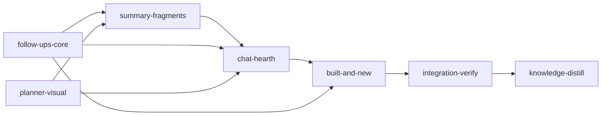

# Plan: Feature follow-ups, and a planner polish round

Implements: none

## Overview

The planner offers two done-state buttons the vision never asked for: **Compare spec with build** (`Offer::RefineSpec`, the `loom-plan:retro` skill) and **New metaplan round** (`Offer::NewMetaplanRound`, a second metaplan file `doc/plans/<f>/metaplan-<nn>.md`). See `doc/loom/knowledge/mistakes/spec-scope-invention.md`. This plan removes both and makes the work they stood for part of the normal flow:

- **Spec and build stay aligned during the run.** Integration-verify reads the product sections the plan's `Implements:` line names, fixes the code or corrects the spec, and records the outcome in the run review.
- **One metaplan per feature, `doc/plans/<f>/index.md`.** Follow-up work is new entries under `## Follow-ups` in that index, started from a finished feature's Built page or from `/new`.
- **Follow-ups come from the runs.** The run review gains `## Spec Conformance` and `## Open Findings`; the Built page lists the open findings and questions as candidate follow-ups.

It also carries the user's polish review of the planner: green spine glyphs, one-unit summary fragments and two-level plan summaries, the Ledger/Walnut/Graphite themes, a redesigned Settings dialog, bare fold chevrons, a new Add to chat control, the Hearth chat (`doc/plans/mockups/chat/alt-d-hearth.html`) and the Threshold `/new` page (`doc/plans/mockups/new/alt-a-threshold.html`).

`doc/plans/briefs/planner-follow-ups/common.md` holds the user's requests and decisions, the design rules and the frozen contracts; the per-stage worker briefs sit beside it. The requirements R1-R13 below are the user's intent. Where a stage settled a detail differently (listed under "Settled during planning"), the stage description, its briefs and the YAML win; the YAML is authoritative for gates and file ownership. Inside the requirements, "stage N" means requirement RN.

## Goals

- Every requirement R1-R13 is checked in the running app by integration-verify, one line each with evidence.
- Behaviour changes ship with a test that fails on the old behaviour; visual changes are proven by screenshots compared with the brief's targets and the mockups.
- Non-goals: rebuilding stored summaries (an operator step after the run), restyling the existing segmented switches outside Settings, and a duration on the last summary rebuild.

## User decisions (2026-11-05, do not reopen)

- Integration-verify may edit the product spec when the build is right and the spec is wrong.
- One metaplan per feature; follow-ups append to `index.md`; no rounds. The run reviews' open findings are the default suggested follow-ups.
- Plan summaries have two levels before the source. Adjacent summary content that brings in the same passage is one fragment, with a subtle marker at rest and one chevron.
- Themes: Ledger (amber accent), Walnut (orange, default dark), Graphite (orange). Dark-theme warnings move to amber so they never read as the accent.
- Chat: Hearth. At most one busy roundel per pane, on what is working now. No ⋯ menu, no idle line, no closing prompt or token counts in view; ending writes the decisions only after the user sent a message.
- `/new`: Threshold. After Send the doodle is removed. A follow-up sent from `/new` continues on the feature's metaplan page with the chat panel holding the session.
- The last-rebuild row has no duration.
- Lanes: Claude only. Fable for visual work with `frontend-design:frontend-design`; sonnet and haiku for behaviour; opus for the summary generator and the integration-verify spec check.

## Settled during planning

- **Open findings** are the reviewer suggestions not marked implemented or discarded, plus notes and decisions marked deferred (the run review is written after knowledge-distill resolved every memory, so "pending at completion" would be empty). The run review also gets `## Spec Conformance`, and its three item sections share the bullet `- **<stage name>** (`<stage-id>`): <text>`, read by one parser, `planning::run_review::review_items`.
- **The spec-conformance duty** lives in the integration-verify signal's `## Product Sections` block, emitted only when the plan names sections (`orchestrator/signals/cache.rs` sits at its maintainability ceiling).
- **Fragments are computed on the client** as merged runs of sentences (R8 said server-side groups with a `group` wire field; the server cannot know adjacency inside an opened run). Plan summaries keep one file per plan: an opening level citing detail paragraphs, then the detail level citing the plan; the seal enforces the two levels.
- **Run reviews** stay where `fs::plan_review::generate` writes them, at the top of `doc/plans/`; built-and-new widens the readers (`doc/loom/knowledge/mistakes/run-review-location.md`).
- **Chat ending** asks the session to end its closing reply with a `loom-closing` JSON block that the browser parses for the ended card and never shows. A round New chat button sits in the head while a chat is live. Permission buttons keep "Allow" and "Deny" (a frozen contract pins them).
- **Graphite** keeps its internal theme id `gray` (a frozen contract reads that selector). Walnut becomes the plain `.dark` block, so a stored `aubergine` or `blue` preference draws Walnut without migration code.
- **Multi-metaplan web handling** (spine children, per-file metaplan routes) is removed in built-and-new, since one metaplan per feature leaves it orphaned.

## Before `loom run`

- Commit `doc/plans/PLAN-planner-follow-ups.md`, `doc/plans/briefs/planner-follow-ups/**` and `doc/plans/mockups/**` on `feat-planner-ui`. `loom run` refuses an uncommitted plan or brief bundle, and stage worktrees are cut from `HEAD`.
- Optional: commit `doc/loom/summaries/**` (untracked today), so summary pages in a worktree render instead of "not built yet" and the R8 checks run on real summaries.

## Sibling plans

Never run this plan at the same time as another plan that writes `web/src/plan/**` or `loom/src/planning/**`. Whichever runs second starts from the merged tree.

## Paths

- Implementation stages run with `working_dir: .` (the worktree root); every path is repository-relative. Acceptance commands enter `web/` with `cd web`; cargo uses `--manifest-path loom/Cargo.toml`. Web contracts set `cwd: web`; Rust contracts set `cwd: loom`.
- Integration-verify keeps `working_dir: loom`.

## Gate scope

- Each implementation stage runs its own vitest directories and module-filtered Rust tests, plus `cargo test --test maintainability` (the 400/50 line ratchet against `loom/maintainability-baseline.txt`, a `ratchet_files` entry). Integration-verify runs the full suites.
- Stages that change frozen contract tests on purpose list each edit in `common.md` "Planned edits of frozen tests" and file one `dispute-integrity` after their commit.

## Execution Diagram



`follow-ups-core` and `planner-visual` run concurrently on disjoint files. `summary-fragments` follows both (it builds on the one-metaplan summary id and shares `web/src/plan/concept/` test files with planner-visual). `chat-hearth` follows `summary-fragments` because both write `loom/src/planning/guidance/text/summary_codex.md`. `built-and-new` follows `chat-hearth` (it reuses the Hearth transcript and composer after Send) and also writes `doc/product/feat-planner/section_05.md` after `summary-fragments`.

## Stages

There is no knowledge-bootstrap stage: `architecture/planner-web-shell.md`, `planner-feature-screens.md`, `summary-store.md` and `conventions/plan-web.md` already cover this area.

### 1. follow-ups-core

Requirements R1, R2, R3, R4.

### 1. follow-ups-core

The plan's Part 1 behaviour stage (R1-R4): the product spec rewritten to the new truth, "Compare spec with build" and the `loom-plan:retro` skill removed, one metaplan per feature (`doc/plans/<f>/index.md`; any other `*metaplan*.md` is `Other`, and the metaplan summary id is `<f>/metaplan/index` only), `Offer::NewMetaplanRound` renamed `Offer::PlanFollowUps` (the sole secondary of a finished feature, opening `Append follow-up entries under "## Follow-ups" in doc/plans/<f>/index.md.`), the integration-verify signal's `## Product Sections` block with the spec-conformance duty, and the run review's `## Spec Conformance` and `## Open Findings` sections with one parser in `planning::run_review`. `fd -g '*metaplan*.md' doc/plans -E briefs` lists nothing at the base, so there is nothing to fold.

It exists by Q1 and Q4. Q1: summary-fragments needs the one-metaplan summary id merged, chat-hearth and built-and-new need the `PlanFollowUps` offer, and built-and-new needs `planning::run_review` and the review sections merged. Q4: with built-and-new's Built state and `/new` page added, the stage would pass the context ceiling.

Workers, one wave, disjoint files:

- R1 (sonnet): the offer removal and rename through checklist, wire, guidance, plugin skills and `schema.ts`.
- R2 (sonnet): the one-metaplan classifier, the summary id, the checklist tests and every multi-metaplan fixture.
- S1 (opus, common.md): the integration-verify `## Product Sections` block and the run review sections with their parser.
- W1 (sonnet): the web offer kinds, the Run page without follow-ups, the changed-file metaplan mark.
- D1 (sonnet): the product spec and the plan-writer references.

Risk walk:

- **Behaviour.** `finished-feature-offers-only-plan-follow-ups`, `plan-follow-ups-opening-appends-to-the-index`, `plan-follow-ups-is-an-authoring-offer`.
- **Untrusted input.** Stage names and memory text flow into the run review and back through the parser: `run-review-round-trips-open-findings` rejects a parser that splits a name at `**` or `: ` and a generator that writes multi-line text.
- **Filesystem paths.** Section paths are built from the plan's feature directory: `feature-plan-lists-its-sections` and `unmapped-or-standalone-plan-lists-no-sections` reject a path without the feature and a block for a standalone or `Implements: none` plan. Feature names are validated by `kinds::classify`, numbers are `u32`.
- **Lifecycle.** The review is written after knowledge-distill resolves every memory entry: `run-review-lists-unimplemented-findings` rejects a selection of receipt-less entries, which is always empty at plan completion.
- **Reachability.** Wiring checks pin the `append_product_sections(` call in `generate.rs`, `append_open_findings(` in `plan_review/mod.rs`, the `ReadyAllDone` arm and the web handler registration. The web contract drives `runOffer` through the registered handlers.
- **External data.** The classifier change is pinned by `second-metaplan-file-is-another-document` (a classifier still accepting `*metaplan*.md`, or one that offers to move it).
- **Planned frozen edits** (table below): R1's two Rust contract files, R2's five, W1's four web contract files.
- **Deviation from the plan text, recorded.** The spec-conformance duty lives in the dynamic `## Product Sections` block, emitted only when the plan names sections, not in `cache.rs`'s stable prefix: `cache.rs` is pinned at exactly 511 lines in the ratchet file `loom/maintainability-baseline.txt`, and the duty has nothing to act on without sections.

Observed baseline at `73cb9ced` (main checkout): `cargo test --manifest-path loom/Cargo.toml --lib -- planning:: plan_server:: orchestrator::signals:: assets:: fs::plan_review::` 1999 passed, 0 failed, 3 ignored; `--test planning_guidance_contracts --test plan_redesign_contracts --test planning_checklist_contracts --test planning_documents_contracts --test planning_summary_contracts --test plan_review_contracts` 105 passed, 0 failed. The web gates were not re-run; the precedent plan's stages used the same commands.

### 2. planner-visual

Requirements R7, R9, R10, R11.

### planner-visual

Builds the user's visual polish items that need no server change: the Walnut and Graphite dark themes with an orange accent in place of Aubergine and Pacific (R9, shared with the dashboard), the spine's done and pressure-tested glyphs in green (R7), the Settings dialog's size pictures, preview specimen and statistics panel (R10), and bare fold chevrons with a floating Add to chat pill (R11). It also moves `scripts/plan-screens.sh` to the new theme ids and is the only editor of `web/src/plan/ui/DESIGN.md` while it runs.

It exists by Q1 and Q4. Q1: summary-fragments, chat-hearth and built-and-new build on its merged Walnut tokens, `--accent-ink`, the `walnut` screenshot id and the DESIGN.md colour rules. Q4: folded into chat-hearth, two fable redesigns and two shot rounds would pass the context budget. It has no merge dependency, so it runs beside follow-ups-core.

R7 diagnosis, settled while planning: the tested-flask rule already matches. The glyph span is the badge's direct child, React writes `data-tested="true"`, and the built bundle carries the rule. No plan of this repository's `feat-planner` feature has a `## Pressure tests` record, so every row shows the muted untested gauge. The missing piece was the done glyph, which had no tone.

Workers, in one wave:

- V1 (fable): themes, spine glyphs, fold chevrons, Add to chat, DESIGN.md.
- V2 (fable): the Settings reading controls and the statistics panel.
- M1 (haiku): theme ids in the screenshot scripts, the browser theme check, the dashboard search keywords and README.

Risk walk:

- **Configuration propagation.** The stored theme preference must take effect, and a non-default choice (Graphite) must persist and apply. `theme-list-is-ledger-walnut-graphite` covers the default and the persistence. `reading-preview-is-a-specimen-above-the-choices` covers the reading size reaching the preview.
- **Reachability.** `reading-sizes-are-pictured` and `reading-preview-is-a-specimen-above-the-choices` render the real `SettingsDialog`. `done-and-tested-glyphs-light-up` renders the real `Spine` route. `reachable` checks find `SizePicture` and `TokenBar` from `SettingsDialog`.
- **External data correctness.** The statistics read the wire `TokenVector` (absent and zero components). `token-bars-label-each-recorded-component` uses the captured fixture `web/src/plan/api/fixtures/summary-panel.json`. `reduced-motion-skips-the-count-up` pins the motion preference.
- **The behaviour the stage exists for.** `theme-tokens-match-the-approved-palette` pins the user's values, the accent, the 0.015 chroma cap, the amber dark warnings (hue at least 70) and the contrast floors in `tokens.css` and `index.css`.
- **Not applicable.** Untrusted input: no new server string is rendered; `data-state` carries only known plan states. Paths, process I/O and lifecycle are not touched.

The look is not proven by contracts. The stage's screenshot pass against the briefs' fixed targets proves it, in Ledger, Walnut and Graphite at 1440 and 390.

### 3. summary-fragments

Requirements R8.

**summary-fragments (R8).** Plan summaries gain the depth overviews have, and summary text that would bring in the same passage reads and opens as one fragment. A plan summary stays one file, `plans/<slug>`: an opening level whose sentences cite whole paragraphs of a detail level in the same file (`[d](#s-…)`, which the parser already resolves as a sentence of its own summary), then the detail level citing the plan. The seal enforces the two levels for plan ids and its refusal lists the detail sentence ids, which is how the summary agent learns them; parse and evaluation stay generic, so stored one-level plan summaries keep loading until the operator rebuilds them after the run. The concept page carries the opening level in `blocks` and the detail level in a new optional `detail` array; the web client looks detail sentences up as it looks up an overview's member sentences, so the plan page reuses the overview's nested run. Fragments are computed on the client (the server cannot know adjacency inside an opened run): adjacent sentences whose open keys meet merge into one sentence object, so the existing run, carry, focus and Open all machinery handles a fragment as one sentence; a passage repeated by a later fragment in the same view shows as one "Same passage as above" line.

Why a stage: Q2 (it writes `loom/src/planning/summary/store.rs` and the summary contract fixtures after follow-ups-core collapses metaplan ids there) and Q4 (the store, seal, evaluation, concept page and the web column redesign together are too large to add to follow-ups-core).

Workers: S1 (opus) the store, seal, evaluation, brief, prompts, concept page, wire field and section 04; W1 (sonnet, wave 1) fragments and the two-level client; W2 (sonnet, wave 2, after W1) the repeated-passage reference and section 05; V1 (fable, wave 2 beside W2) the fragment's marker at rest and its hover in `concept.css` (user decision), proven by screenshots at rest and on hover in Ledger and Walnut.

Risk walk: (1) untrusted input, the agent-written draft's self-links (a link to an opening sentence, to itself, to part of a paragraph, mixed with source links): `opening-cites-whole-detail-paragraphs`. (5) lifecycle, a self-link evaluation that never holds would leave every plan summary stale and the scheduler rebuilding it forever: `two-level-plan-summary-stays-current`. (6) reachability from the entry point, a detail level the page or the route never shows: `plan-page-carries-two-levels` (drives `load_page`) and `plan-page-opens-two-levels-then-source` (drives the `/f/demo/engineering/x` route). (7) external data, the summary agent's output format: `plan-summary-needs-an-opening-level` (a one-level draft is refused and the refusal names the detail ids the agent needs). The stage's purpose: `shared-passage-sentences-are-one-fragment`, `repeated-passage-shows-a-reference`. Areas 2, 3 and 4 do not apply (no new path, process or setting).

### 4. chat-hearth

Requirements R13.

### chat-hearth

The Hearth chat (`doc/plans/mockups/chat/alt-d-hearth.html`) with the user's overrides, and the behaviour behind it. New chat clears the panel and starts nothing: the first Send starts the session with the user's words as its opening (the existing message start), and the server refuses a start that carries neither an offer nor a message, so `AuthoringStart::NoStep` and `Origin::Start` go. The ⋯ menu and End chat go; a chat ends when the user starts a new one (New chat is the head's round button while a chat is live), opens another offer, or leaves the planner. The closing write runs only when the user sent a message, and is never shown: its turn becomes the wrap-up card while it runs and "Here's what this chat left behind" when done, read from a `loom-closing` block the closing message now asks for. No idle state line, no run line, no token counts, no "Thought for", and at most one roundel per pane.

It exists by Q1, Q2 and Q4. Q1: built-and-new builds `/new` into the Hearth chat after Send and reuses its components, `ui/hearth.css` and `DisabledReason shape`. Q2: it rewrites `guidance/opening.rs`, `start.rs`, `section_09.md` and `planning_guidance_contracts.rs` after follow-ups-core, and `ui/DESIGN.md` after planner-visual. Q4: a whole-panel redesign plus a server change, beside planner-visual's themes and Settings, would pass the stage budget.

Workers, in three waves:

- Wave 1: B1 (sonnet) the server start refusal, `NoStep` and `Origin::Start` removed, the closing write only after a user message, the `loom-closing` closing message, spec sections 07 and 09; N1 (sonnet) lazy New chat, the head without a menu, the state line as the head's sub-line with nothing for idle, the empty state, the composer's ending and ended views; T1 (sonnet) the closing turn as cards, the closing data parser, one roundel per pane, no tokens or "Thought for".
- Wave 2: V1 (fable) the transcript look: bubbles, reply face, working card, HazardRail permission card, wrap-up and left-behind cards; V2 (fable) the panel frame, head, empty state, composer, `ui/hearth.css`, `DisabledReason shape`, DESIGN.md Chat, the help scene.
- Wave 3: D1 (sonnet) `section_08.md` and help topics.

Risk walk:

- **Behaviour.** `new-chat-starts-no-session`, `new-chat-ends-a-live-chat-and-starts-nothing`, `live-chat-has-no-menu`, `idle-state-line-is-empty`, `one-roundel-per-pane`, `closing-needs-a-user-message`, `a-start-needs-a-message-or-an-offer`.
- **Untrusted input.** The `loom-closing` block is model output parsed in the browser: `ended-chat-hides-the-closing-prompt` feeds a decision holding markup and rejects one rendered as HTML; T1's unit tests cover a malformed and a missing block.
- **Lifecycle.** New chat on a live chat waits for the end (`new-chat-ends-a-live-chat-and-starts-nothing`). A session recovered after a restart keeps its closing write (its mapper is empty when `plan_end` runs): B1 exempts recovered sessions, and the existing `bridge/tests_recovery.rs` test asserting `h.sent(&alive) == [CLOSING]` keeps that pinned.
- **Reachability.** The new-chat contracts drive the real routes and socket; the ended-card contract renders `Transcript`; the refusal contract goes through `dispatch`.
- **Frozen contracts that must hold.** `polish.contracts` mocks `./start-chat`, `./end-chat`, `./run-header`, `./transcript`, `./attention` and `@/plan/review/changed-since` with fixed names, so the panel, head and composer import only those names from them. `chat.contracts` keeps the fold label, the "Turn N changes" group, "Allow"/"Deny", Stop and Send. `context.contracts` needs exactly one button matching /new chat/i on a concluded chat. `chat-fixes` keeps the composer border rule.

### 5. built-and-new

Requirements R5, R12.

### built-and-new

The feature's Built state and the `/new` Threshold page with its follow-up kind. Every checklist on the wire gains `built` (the done plans' newest run reviews, their `## Spec Conformance` items, and their open findings and open questions as candidate follow-ups, all read with follow-ups-core's `planning::run_review::review_items`); an all-done feature lands on `/f/<feature>/built`, whose `Plan this` and free text start Plan follow-ups seeded through the typed first message; the Run page loses its follow-up section, and the web drops its now-unreachable multi-metaplan handling (one metaplan per feature, `/f/<f>/metaplan` its one address). `/new` becomes the approved Threshold (one field, a three-way kind switch, pill starters, the doodle above the heading, no doodle after Send, one roundel per pane), and its Follow-up kind picks a feature with a metaplan, done or not, offers that feature's candidates, and starts Plan follow-ups for it, which the server now admits outside the checklist.

It exists by Q1 and Q2. Q1: it needs follow-ups-core's `Offer::PlanFollowUps`, the run review's sections and their parser, the one-metaplan rule, and chat-hearth's Hearth transcript merged first. Q2: it writes `run-page.tsx`, `offer-handlers.ts`, `offer-flow.ts` and `panel.tsx` (follow-ups-core and chat-hearth write them), `guidance/start.rs` and `chat/guidance.rs` (follow-ups-core), and `ui/DESIGN.md` (planner-visual and chat-hearth).

Workers, in two waves:

- Wave 1, in parallel: S1 (sonnet) the Rust wire field over follow-ups-core's parser, the run review paths, the follow-up start mapping and the spec text; S2 (sonnet) the web schema, the Built model, landing, the Run page, offer seeds, and the `/new` start hook and feature model; S3 (sonnet) the one-metaplan web cleanup and the Built page's spine group.
- Wave 2, in parallel: F1 (fable) the Threshold page, the picker and suggestions, the live kickoff head, DESIGN.md; F2 (fable) the Built page, its route, and the removal of the `metaplan/:file` route.

Risk walk:

- **Untrusted input.** Run review text is agent-written memory, parsed in Rust and drawn on two pages: `finding-markup-renders-as-text`. Parsing is follow-ups-core's `review_items`, with its own edge tests.
- **Reachability.** `all-done-feature-lands-on-built` drives the feature index route; the `/new` contracts mount `EmptyKickoff`; wiring entries pin the route, the picker mount, the start hook and the server call sites.
- **External data correctness.** The run review is `fs::plan_review`'s output: `built-view-reads-the-newest-run-review-of-each-done-plan` uses a fixture in follow-ups-core's bullet format and rejects a reader that looks only in the feature's home (the generator writes `doc/plans/REVIEW-<stem>.md`); S1 adds a round trip through `review_item_line` and the heading consts.
- **Behaviour.** `follow-up-starts-for-any-feature-with-a-metaplan`, `plan-this-seeds-the-follow-up-offer`, `follow-up-needs-a-picked-feature`, `feature-picker-works-from-the-keyboard`.
- Not applicable: filesystem writes (none; reviews are read from the cached project), process I/O, configuration, lifecycle beyond the existing start guards (S2's tests).

### Integration Verification

Opus by default (the stage type's default). It builds `web/dist` and the binary, runs a diagnostic check and the browser preflight, the journeys and the screens, compares the chat and `/new` with their mockups, and walks R1-R13 with evidence (`loom memory note "req-walk R<n>: ..."`). It fixes what fails: visual misses go to fable, everything else to the cheapest capable tier. It re-runs the final full check against the rebuilt bytes, then the final review round (a) to (e), and commits the bundle last. See `doc/plans/briefs/planner-follow-ups/integration-verify.md`.

### Knowledge Distillation

It rewrites to the new truth every section the stages name in their seams: `architecture/summary-store.md` (file format, seal, states: two-level plan summaries, one metaplan id), `architecture/planner-web-shell.md` (reading column fragments, chat home and panel as Hearth, home and kickoff as Threshold, header and Settings), `architecture/planner-feature-screens.md` (landing on the Built page, offers' owners, Run page, spine glyphs), the theme and colour rules, and the topics that describe retro or metaplan rounds (`rg -n -i 'retro|metaplan round|metaplan-' doc/loom/knowledge`). It updates the Fix lines of `mistakes/spec-scope-invention.md`, `mistakes/planner-visual-feedback-shortfall.md` and `mistakes/run-review-location.md`, carries the walk's "could not check here" and "open" lines into `concerns/`, then curates the rest.

## Environment inventory

| Need | State |
| --- | --- |
| crates.io, npm registry | `allowed_domains` |
| `web/node_modules` | provisioned by `loom.provision` |
| Chromium for screens | `~/.cache/ms-playwright` on the host, as earlier planner plans used it. Each stage that shoots runs the browser preflight first: `scripts/plan-screens.sh loom/target/debug/loom "$LOOM_SCRATCH_DIR/preflight" /` after the build, from the worktree root. A failing preflight is filed with `loom stage block <stage-id> "<preflight output>"`. |
| Local servers and Playwright | the `loom plan` server start, a static server for `doc/plans/mockups` (`python3 -m http.server --bind 127.0.0.1`), the URL waits and the browser run share one Bash call. A throwaway driver under `$LOOM_SCRATCH_DIR` imports `playwright-core` by absolute path (`<worktree>/web/node_modules/playwright-core/index.mjs`) and launches with `args: ["--no-sandbox"]`. Session states are fed by stubbing `WebSocket` in `addInitScript` with frames from `web/src/plan/api/fixtures/chat-snapshot.json`. `file://` pages are blocked. |
| Mockup fonts | Google Fonts are unreachable under the network policy, so mockup shots render in fallback faces; compare layout, colour and spacing. |
| Shot fixtures | planner-visual inits a scratch spine fixture repo under `$LOOM_SCRATCH_DIR` (needs `git` in the session). built-and-new writes gitignored `DONE-*` plan and run-review fixtures before its shots and deletes them after. |
| `doc/loom/summaries/` | untracked on `feat-planner-ui`; without the optional pre-run commit, summary pages show "not built yet" and the fold caps are shot from the Help reading scene. |
| tmux in a stage session | not granted. `scripts/plan-journeys.sh` runs WITHOUT `--strict`, and PENDING journeys are reported. |
| Host platform | Linux. On macOS the operator sets `allow_local_binding: true` first. |
| Claude login in a stage | none. A real chat, a real closing write, a real summary rebuild and a real follow-up session are operator checks after the run. |
| `web/scripts/theme-preview-test.mjs` | needs `/usr/bin/google-chrome`; edited but not run in a stage. The dashboard's theme cards are an operator check. |
| `web/dist` | visual stages build the bundle to shoot, then restore it before their final review round: `git restore web/dist`, then `git clean -fdq -- web/dist`, then `git status --short --untracked-files=all web/dist` prints nothing. Only integration-verify commits a bundle. |
| Throwaway drivers | every throwaway script and its output live under `$LOOM_SCRATCH_DIR`, never in the worktree. |

## After the run (operator checks)

- Rebuild summaries, then open a plan summary: opening level, detail level, source passage with its link; a fragment marked at rest.
- Start a real chat with New chat: no tokens before the first message; end a conversation and see the designed ending.
- Start a follow-up from the Built page and from `/new`; see the entry appended under `## Follow-ups` in the feature's `index.md`.
- Run a plan whose `Implements:` names sections and read the spec-conformance lines in its run review.
- The dashboard's theme picker in Walnut and Graphite.

## Requirement to gate map

| Requirements | Stage | Executable proof (contracts) |
| --- | --- | --- |
| R1, R2, R3, R4 | follow-ups-core | `finished-feature-offers-only-plan-follow-ups`, `plan-follow-ups-opening-appends-to-the-index`, `second-metaplan-file-is-another-document`, `feature-plan-lists-its-sections`, `unmapped-or-standalone-plan-lists-no-sections`, `run-review-round-trips-open-findings`, `run-review-lists-unimplemented-findings`, `plan-follow-ups-is-an-authoring-offer`; the stage's wiring and after_stage checks; screenshots where visual |
| R7, R9, R10, R11 | planner-visual | `theme-list-is-ledger-walnut-graphite`, `theme-tokens-match-the-approved-palette`, `done-and-tested-glyphs-light-up`, `reading-sizes-are-pictured`, `reading-preview-is-a-specimen-above-the-choices`, `token-bars-label-each-recorded-component`, `reduced-motion-skips-the-count-up`; the stage's wiring and after_stage checks; screenshots where visual |
| R8 | summary-fragments | `plan-summary-needs-an-opening-level`, `opening-cites-whole-detail-paragraphs`, `two-level-plan-summary-stays-current`, `plan-page-carries-two-levels`, `plan-page-opens-two-levels-then-source`, `shared-passage-sentences-are-one-fragment`, `repeated-passage-shows-a-reference`; the stage's wiring and after_stage checks; screenshots where visual |
| R13 | chat-hearth | `new-chat-starts-no-session`, `new-chat-ends-a-live-chat-and-starts-nothing`, `live-chat-has-no-menu`, `idle-state-line-is-empty`, `ended-chat-hides-the-closing-prompt`, `one-roundel-per-pane`, `closing-needs-a-user-message`, `a-start-needs-a-message-or-an-offer`; the stage's wiring and after_stage checks; screenshots where visual |
| R5, R12 | built-and-new | `follow-up-starts-for-any-feature-with-a-metaplan`, `built-view-reads-the-newest-run-review-of-each-done-plan`, `all-done-feature-lands-on-built`, `plan-this-seeds-the-follow-up-offer`, `finding-markup-renders-as-text`, `follow-up-needs-a-picked-feature`, `feature-picker-works-from-the-keyboard`; the stage's wiring and after_stage checks; screenshots where visual |
| R6 | knowledge-distill | after_stage knowledge checks |
| R1-R13 | integration-verify | the requirement walk with evidence, mockup comparisons, final review (a)-(e) |

## Requirements, part 1: feature follow-ups

### R1. Spec

Rewrite the product spec to the new truth before any code changes.

- `doc/product/feat-planner/section_01.md`: remove `Compare spec with what was built` and
  `Start a new metaplan round` from the offer label table (around line 204). Replace the
  "finished feature" paragraph (around line 187) with: a finished feature has no primary offer; its
  view shows the Built state (stage 5) with the `Plan follow-ups` offer. Add `Plan follow-ups` to
  the label table.
- `doc/product/feat-planner/section_03.md`, Document kinds: the metaplan row becomes
  `doc/plans/<f>/index.md` only. A `*metaplan*.md` file elsewhere in a feature is an `Other` document.
- `doc/product/feat-planner/section_09.md` (around lines 358-359): drop the retro row and the
  `loom-plan:retro` skill everywhere in the section; replace the new-round row with
  `Plan follow-ups | done | doc/plans/<f>/index.md and the done plans' run reviews | loom-plan:metaplan`.
- `doc/product/feat-planner/section_11.md`, "After plans complete": rewrite. State that
  integration-verify checks the build against the `Implements:` sections and may correct the spec;
  that the run review lists open findings; that the Built state offers follow-ups which append
  entries to `index.md`, after which the checklist's step 4 gap ("Write plan <slug>") drives the
  rest. Remove the stale root path `doc/plans/metaplan-<nn>.md`.
- Search all of `doc/product/feat-planner/` for `retro`, `metaplan round`, `metaplan-<nn>`,
  `Compare spec`, `RefineSpec`, `NewMetaplanRound` and fix every hit.

Brief files under `doc/plans/feat-planner/briefs/` are records of finished plans: leave them.

### R2. Remove Compare spec with build

- `loom/src/planning/checklist/offers.rs`: delete `Offer::RefineSpec`, its id, label and the two
  places it is offered (lines ~239-240: `Ready` offers only `StartRun`).
- `loom/src/plan_server/wire/checklist.rs`: delete `OfferKind::RefineSpec`; update
  `wire/tests_schema.rs` and `wire/checklist_tests.rs`.
- `loom/src/planning/guidance/opening.rs:114` and `start.rs`: delete the retro arms.
- `loom/src/plan_server/features.rs:207`: delete the `refine-spec` entry.
- Delete `plan-plugin/skills/retro/` and its embed in `loom/src/assets/mod.rs:67`.
- Web: delete `refine_spec` from `web/src/plan/api/schema.ts`, `chat/offer-handlers.ts`,
  `chat/offer-flow.ts`, `feature/next-action-copy.ts`, `feature/run-page.tsx`, and every test that
  names it (`rg -l 'refine_spec|Compare spec with build' web/src loom`).
- `loom/tests/planning_guidance_contracts.rs:248`: delete the retro contract.

Done when `rg -n -i 'refine_spec|RefineSpec|refine-spec|Compare spec|retro' loom/src web/src
plan-plugin loom/tests` finds nothing besides unrelated words (`retroactively`).

### R3. One metaplan per feature, and the follow-up offer

**One metaplan.**

- `loom/src/planning/kinds.rs:218` and `loom/src/planning/metaplan.rs:25` (`is_metaplan`): only
  `doc/plans/<f>/index.md` is a metaplan.
- `loom/src/planning/summary/store.rs:75` (`is_metaplan` for summary ids): one metaplan id per
  feature; drop the `<f>/metaplan/metaplan-<nn>` id form and its fixtures in `store/tests.rs`.
- `loom/src/planning/guidance/opening.rs:279`: delete the next-free-number helper.
- Tests that build `metaplan-02.md` fixtures (`planning/paths/tests/feature.rs:80`,
  `planning/summary/store/tests.rs`) are rewritten for the single-index rule, with one regression
  test that a `doc/plans/<f>/metaplan-02.md` is classified as `Other` and creates no checklist
  entries.
- `plan-plugin/skills/metaplan/SKILL.md`: remove rounds (lines ~10-35). The skill writes
  `index.md` or appends entries under `## Follow-ups` in it; finished entries stay unchanged.
- Run `fd -g '*metaplan*.md' doc/plans` and fold any hit into its feature's `index.md`.

**Follow-up offer.** Rename `Offer::NewMetaplanRound` to `Offer::PlanFollowUps` (id
`plan-follow-ups`, wire kind `plan_follow_ups`, label `Plan follow-ups`).

- Offered only in `CurrentStep::ReadyAllDone`, as the feature's sole secondary offer.
- Opening message (`guidance/opening.rs`): `Append follow-up entries under "## Follow-ups" in
  doc/plans/<f>/index.md.` When the session is started from a candidate (stage 5), the message
  continues with the finding's text and its source (`REVIEW-<stem>.md`, stage id).
- Skill: `metaplan`. Section: Plan.
- After a new entry is written, the existing checklist logic finds an entry with no plan and
  offers `Write plan <slug>`; add a test proving this, using a done feature plus one appended
  follow-up entry.

### R4. Spec check in integration-verify, open findings in the run review

**Spec check.**

- The integration-verify signal (`loom/src/orchestrator/signals/generate.rs` and
  `signals/generate/enrichment.rs`) gains a `## Product Sections` block when the plan's source file
  has an `Implements:` line naming sections. Parse it with `loom/src/planning/implements.rs::parse`;
  list each section as a repository path `doc/product/<f>/section_<nn>.md`, where `<f>` is the
  plan's feature directory. `Implements: none` and standalone plans emit nothing.
- `loom/src/orchestrator/signals/cache.rs:129` (`generate_integration_verify_stable_prefix`): add a
  "Spec conformance" duty: read every listed section; for each behavior the section states that
  the build lacks or contradicts, fix the code, or, when the build is right and the spec is wrong,
  edit the section to match the build and record a `loom memory decision` naming the section and
  the change. A gap neither fixed nor corrected becomes a `loom memory question`.
- The integration-verify stage needs write access to `doc/product/<f>/` in its sandbox; confirm
  the stage's permissions allow it (`loom/src/sandbox/config.rs`) and add the path if not.
- `skills/loom-plan-writer/references/bookend-stages.md` and `v2-contracts.md`: describe the duty.
- Tests: a signal-generation test with a plan declaring `Implements: section_02` asserts the block
  and path; one with `Implements: none` asserts no block.

**Open findings.** `loom/src/fs/plan_review/mod.rs`: add `## Open Findings` after
`## Open Questions`, listing every memory entry still pending at plan completion that is a deferred
finding or a pending `suggestion` (the entries knowledge-distill records but no stage
implemented), each as `- **<stage name>**: <text>`. "No open findings." when empty. The planner
parses this section for stage 5; give the bullet format one parser in
`loom/src/planning/` with a round-trip test against the generator.

### R5. Web Built state

- Remove `Followups` ("Next round") from `web/src/plan/feature/run-page.tsx` and the comment at
  `web/src/plan/run/plan-run-actions.tsx:13`.
- When every plan is done, the feature's landing view (`web/src/plan/feature/landing.ts` routes
  to it) shows a Built state:
  - the done plans with their run-review links;
  - spec-conformance outcomes from the run reviews (decisions and questions from
    integration-verify);
  - **Candidate follow-ups**: every open finding and open question across the done plans' run
    reviews, each with a `Plan this` button that starts the `plan_follow_ups` session seeded with
    that item;
  - a free-text box ("What else needs doing?") whose submit starts the same session with the text.
- The server serves the parsed findings with the checklist or feature view (wire field on the
  feature payload, schema in `web/src/plan/api/schema.ts`).
- Visual design follows `DESIGN.md`; the user will give further feedback on styling and placement
  before this stage is built.
- Tests: Built state renders only for an all-done feature; a candidate's button posts the seeded
  offer; the Run page no longer renders any follow-up section.

### R6. Knowledge

Done by the knowledge-distill stage.

- Rewrite the planner topics in `doc/loom/knowledge/` that describe retro, metaplan rounds or
  `metaplan-<nn>.md` (`rg -n -i 'retro|metaplan round|metaplan-' doc/loom/knowledge`) to the new
  truth with `loom knowledge replace-section`.
- Rewrite the theme, settings, spine, summary-passage and /new sections of
  `architecture/planner-feature-screens.md` and `planner-web-shell.md` to match Part 2.
- Update the Fix lines of `mistakes/spec-scope-invention.md` and
  `mistakes/planner-visual-feedback-shortfall.md` to name what replaced each defect.
- `loom knowledge check`.

## Requirements, part 2: the polish review

Every visual stage in this part ends with a screenshot check: start `loom plan` against this
repository, open the screen in light (Ledger) and in every dark theme, capture it with Playwright,
and compare it with the treatment stated here. A stage whose screenshots do not show the stated
treatment is not done, whatever its tests say (`mistakes/planner-visual-feedback-shortfall.md`).
`web/src/plan/ui/DESIGN.md` is updated in the same stage as each rule it states changes.

### R7. Spine plan glyphs light up

User item 1: on the spine's Plans section, the done glyph and the pressure-tested glyph turn green.

- `web/src/plan/feature/spine-row.tsx` `Note` (lines 50-56): mark the state glyph with
  `data-state={state}`.
- `web/src/plan/feature/spine.css` (lines 229-253): `.plan-spine__glyph[data-state="done"]` takes
  `color: var(--tone-completed)`. The tested flask already has a rule
  (`.plan-spine__badge[data-tested="true"] > .plan-spine__glyph`), yet the user sees it unlit:
  confirm in the browser whether `Glyph` renders the `.plan-spine__glyph` element as the badge's
  direct child; if not, fix the selector (use a descendant selector).
- Running stays muted; retired stays muted. The untested gauge stays muted.
- `--tone-completed` must read as green with at least 3:1 contrast against the spine background in
  every theme of stage 9; adjust per theme if not.
- `DESIGN.md`, Status: replace "only the tested flask takes a tone" with the new rule.
- Test: `spine-row` renders `data-state="done"` on a done plan's glyph.

### R8. Summary sentences that share a passage open as one unit

User item 2: two adjacent sentences of a plan summary each expanded into the same long table, so
the table showed twice. A source passage must appear at most once in an opened summary.

Today a sentence's `rests_on` anchors name whole heading sections (`plan/concept/passages.ts`
`passageOf`), and every sentence opens its own run (`plan/concept/run.tsx` `PassageRun`), so
sentences that cite the same section repeat it.

- **Grouping rule.** Within one paragraph, consecutive sentences whose `rests_on` sets share at
  least one `path#anchor` form one group. Grouping is transitive across the run of consecutive
  sentences. A group is one expandable unit: one hover target, one chevron (after its last
  sentence), one `aria-expanded`, and opening it shows the union of its sentences' anchors in
  source order, each passage once.
- **Where.** Compute groups on the server when the concept body is assembled
  (`loom/src/plan_server/concept/body.rs`, beside `push_anchor` at line 186), so the wire carries
  them: add `group: string` to `Sentence` (equal for sentences in one group; a sentence alone has
  its own id) in `body.rs` and `web/src/plan/api/schema-concept.ts`. The client
  (`plan/concept/sentence.tsx`, `open-state.ts`, `column-model.ts`) opens and closes by group.
- **Across groups.** When two separate groups in one opened view would show the same passage
  (non-adjacent sentences), the second shows a one-line reference ("Same passage as above", a link
  that scrolls to the first) instead of the passage body. `column-model.ts`'s `overlap` check
  (line 93) is the place.
- Tests:
  - Rust: a paragraph of three sentences, the first two citing `PLAN-x.md#stages`, gets two groups.
  - Rust: transitive case, A cites s1, B cites s1 and s2, C cites s2: one group.
  - Web: opening the grouped sentences renders the table once; opening two non-adjacent sentences
    citing one section renders one body and one reference.

**Highlighted summary fragment.** The group above is drawn as one highlighted fragment: all
adjacent summary content that would bring in the same passage (a table, a section) is merged and
highlighted together, so the fragment reads as one unit and opens as one.

**Two summary levels for plans (user decision).** Plan summaries get the depth feature overviews
have:

1. **Initial summary**: about one sentence per topic, what the plan page shows first.
2. **Expanded summary**: opening a fragment of the initial summary shows a short paragraph that
   explains it in more detail, itself made of sentences with `rests_on` anchors.
3. **Source passage and link**: opening a fragment of the expanded summary shows the source
   passage(s), each once, with a link that opens the source document at that anchor.

- The summary generator (`loom/src/planning/summary/`, the plan summary format and sealing in
  `format/body.rs` and `seal/links.rs`) produces both levels for plan documents, the expanded level
  citing source anchors and the initial level citing expanded-level sentences
  (`Citation::sentence`). Follow how overview pages build their levels
  (`loom/src/plan_server/concept/body.rs` `overview_level`, line 155) rather than adding a second
  mechanism.
- Grouping applies at both levels: adjacent initial sentences that open the same expanded
  paragraph form one fragment; adjacent expanded sentences that bring in the same passage form one
  fragment.
- The client already renders nested runs for overviews; the plan page reuses that path.
- Tests: a plan summary fixture with both levels renders initial, then expanded on open, then
  passages on the second open; the source link targets `path#anchor`. Summary validation rejects
  a plan summary missing the expanded level.

### R9. Planner themes

User item 3: Aubergine and Pacific are too intense for a writing tool. Ledger stays as the light
theme. The dark themes become subdued, with an orange accent in every one.

**Direction.** A dark writing room: near-neutral backgrounds that recede, text that stays warm and
readable for long sessions, and one lamp of colour, the orange accent. Chroma on surfaces stays at
or under 0.015 in OKLCH, so the only saturated colour on screen is the accent and the status tones.

**Accent, all dark themes:** `--primary` and `--ring` `oklch(0.74 0.15 55)` (orange),
`--primary-foreground` the theme's background. The accent marks the primary button, focus ring,
current spine row, selection, and the active option in segmented controls; nothing else.

**Themes (user decision): Ledger (light), Walnut (dark, the default dark theme) and Graphite
(dark).** Walnut replaces both `aubergine` and `blue` (Pacific); `graphite` is retuned. Walnut's
values are the ones the user approved in the chat mockups (`doc/plans/mockups/chat/`):

| Theme    | Character                         | `--background`        | `--card`               | `--border`            | `--foreground`        | `--muted-foreground`  |
| -------- | --------------------------------- | --------------------- | ---------------------- | --------------------- | --------------------- | --------------------- |
| Walnut   | warm brown-black, lamplit desk    | `oklch(0.19 0.014 55)`  | `oklch(0.22 0.015 55)`  | `oklch(0.31 0.014 55)`  | `oklch(0.92 0.012 80)` | `oklch(0.71 0.014 60)`  |
| Graphite | neutral charcoal, no hue          | `oklch(0.20 0.003 270)` | `oklch(0.23 0.003 270)` | `oklch(0.32 0.004 270)` | `oklch(0.93 0.004 80)` | `oklch(0.71 0.005 270)` |

Accent-coloured text uses an `--accent-ink` token (Walnut and Graphite: `--primary`; Ledger:
`--ring`) so it meets contrast on the light theme, as the mockups do.

Derive `--muted`, `--accent`, `--secondary`, `--popover`, `--input` and the sidebar tokens from
these with the same lightness offsets the existing dark block uses (`tokens.css` line 144).
Status tones (`--tone-*`) keep their hues, with lightness tuned so each meets 3:1 on `--card`.

- `web/src/aurora-ui/shared/styles/tokens.css` and `tokens-dark-variants.css`: replace the default
  dark block (aubergine) with Walnut; delete `blue`; retune `gray` as Graphite. Delete the dark
  variants nothing else selects (green, slate, sand) if `rg` finds no other user.
- `web/src/aurora-ui/shared/atoms/theme.ts`: the `DarkVariant` union and the
  `loom:dark-variant` default (`walnut`).
- `web/src/components/theme-picker.tsx` `THEME_OPTIONS`: Ledger, Walnut, Graphite, with
  captions naming their character; preview cards (`.theme-preview[...]`) use the new tokens.
- `DESIGN.md`, Colour: rewrite to the new palette and the accent rule (remove the Pacific
  paragraph).
- Contrast test: for each theme, `--foreground` on `--background` is at least 7:1 and
  `--muted-foreground` on `--card` at least 4.5:1, computed from the OKLCH values in a unit test.

Ledger keeps its amber accent (hue 80); orange is for the dark themes only (user decision).

### R10. Settings dialog

User items 4, 5 and 6. Files: `web/src/plan/settings/settings-sections.tsx`, `settings.css`,
`preferences.ts`, `web/src/plan/summaries/summary-panel.tsx` (move its Tailwind into a new
`summary-panel.css`).

**Reading size with pictures (item 4).** `ReadingSizeGroup` (lines 98-120) becomes three tiles in a
row, each a `label` holding the hidden radio, a 40x32 inline SVG, the label and the px value. The
SVG is a small page: a rounded rect outline with text lines drawn as rounded bars, all
`currentColor`:

- Compact: five thin lines, tight spacing.
- Comfortable: four lines, medium spacing.
- Large: three thick lines, wide spacing, the first bar shorter (a heading).

Unchecked tiles are muted with a hairline border; the checked tile takes the orange accent on its
border and drawing, and the label in `--foreground`. Hover lifts the drawing to `--foreground`.
Keyboard behaviour of the radio group is unchanged.

**Preview as a specimen (item 6).** `ReadingPreview` (lines 85-96) moves above the size and face
controls it reflects, inside the Reading group, and becomes a sunken specimen card:

- a surface one step below the dialog (`--background` on a `--card` dialog), 1px `--border`,
  8px radius, `--space-4` padding, and a 3px orange rule on its left edge;
- an eyebrow "Preview" in small caps, `--muted-foreground`, above the text, so it reads as a sample;
- `role="figure"` with `aria-label="Reading preview"`;
- the text keeps the selected face and size; the Greek line stays muted.

Remove `.ps-preview`'s hairline treatment.

**Summary statistics (item 5).** Rework `SummaryPanel`'s `TokenStatistics` and `RebuildActivity`
as an instrument panel in keeping with the theme:

- **Totals:** two figure cards side by side, Today and 7 days. Each shows the total in large
  tabular numerals (the mono face, `font-variant-numeric: tabular-nums`, 1.75rem), the unit in
  small caps below, and a single stacked bar under it splitting the total into the
  `TokenVector` components (input, output, cache read, cache write, as the vector holds them),
  each segment a distinct muted tone with a legend line of figures. Today's bar is drawn to the
  same scale as the 7-day bar's daily average, marked by a thin tick, so the user sees whether
  today runs above or below the week.
- **Last rebuild:** one row: a status dot (green ok, red failed), relative time ("12 min ago")
  with the absolute time in the tooltip, duration, documents rebuilt, tokens spent.
- **Activity:** while a rebuild runs, a slim progress line (queue done / total) with a gentle
  pulse on the dot; when idle, a single quiet line "Idle · last run 12 min ago". Failures list
  as compact rows with the Retry action.
- **Terminal claims** stay as they are, styled as compact rows.
- Numbers count up once from 0 when the group first opens (CSS or a 400ms rAF tween; respect
  `prefers-reduced-motion`).

Keep the existing accessible names (`region "Token totals"` etc.) so the existing tests still
find them. Add tests: the stacked bar renders one segment per non-zero vector component with an
accessible label giving its figure; reduced motion skips the count-up.

### R11. Fold chevrons and Add to chat

**Chevrons (item 7).** `FoldCap` (`web/src/plan/concept/fold-handle.tsx`,
`concept-runs.css` lines 53-79) loses its square: no background, no border, no radius box. The
chevron itself is the control, 1.1em, in `--run-colour` at 70% opacity; hover and focus raise it to
full opacity and nudge it 2px toward the fold direction. The hit area stays at least 24x24 through
padding. Focus-visible draws a circular ring (`border-radius: 999px`, the orange `--ring`). Apply
the same treatment to any other boxed chevron in summaries (`rg -n 'concept-run-cap|chevron'
web/src/plan/concept/*.css`).

**Add to chat (item 8).** `web/src/plan/attachments/add-to-chat.tsx` `FloatingControl` and
`AddToChat`, styles moved to a new `add-to-chat.css`:

- The control is a floating pill: `--popover` surface, 1px `--border`, full radius, a soft
  two-layer shadow, 4px padding.
- The primary action is an orange pill button with a `MessageSquarePlus` icon and the words
  "Add to chat"; secondaries follow as ghost text buttons, divided from it by a 1px vertical rule.
- The oversize-selection note becomes a small red-toned line under the pill instead of inline.
- It enters with a 120ms rise and fade from 4px below the selection (none under reduced motion).
- Tests: the button keeps its name "Add to chat"; the oversize note still renders over 16 KiB.

### R12. The /new page

Follows stage 3. Files: `web/src/plan/new/empty-kickoff.tsx`, `kickoff.css`, `kind-control.tsx`,
`kind-control.css`, `loom/src/planning/guidance/start.rs`, `loom/src/plan_server/chat/guidance.rs`.

**Look: the approved Threshold design.** The user chose
`doc/plans/mockups/new/alt-a-threshold.html`; it is the visual specification for the empty page
and its four states, built in Walnut and Ledger and compared by screenshot with the mockup. The
one-roundel-per-pane rule of stage 13 applies. In outline:

- **Doodle above the heading (item 9).** `<LoomDoodle/>` moves out of the `kickoff-side--art`
  column into the single main column, above the "New work" eyebrow and "What do you want to
  build?", shown at every width, and draws its thread on entrance (off under reduced motion).
  Delete the third grid column and its `display:none` rule.
- **One field.** A single large rounded field holds everything: the kind of work is a three-way
  switch on its top edge (Feature · Standalone plan · Follow-up) with a one-line hint beside it;
  the textarea; and a foot with "Attach a document", the reason Start is disabled, and a round
  primary Start.
- **Starters** sit under the field as Hearth pills: "A new feature for this project", "A small fix
  or improvement", "Grow standalone plans into a feature", "New plans for a feature that is
  already built", "Start from a document I have". A quiet note: "Nothing runs until you send."
- **After Send** the field drops to the foot, the doodle is removed (user decision: the mockup's
  shrunken corner doodle that animates on hover is not built), the heading gives way to the chat
  head, and the column becomes the Hearth chat (stage 13): the user's words as the
  first bubble with its attachment, the single roundel beside "Starting the session".
- Documents attached show as chips inside the field.

**Follow-up for an existing feature (item 10).**

- The kind switch's third option is "Follow-up" (hint "New plans for a feature that is already
  built"). Choosing it opens a feature picker floating off the switch: a listbox of the project's
  features (from the features view the home page uses), each with a done check or a progress
  ring and its plan count ("done · 13 plans", "in progress · 4 of 6 plans"). It is a working,
  keyboard-operable listbox (the mockup only draws it).
- The picked feature becomes a chip on the field with a Change button; the placeholder becomes
  "What should change in <feature>?".
- Under the field, the feature's open findings from its run reviews (stage 4's `## Open
  Findings`, the same source as stage 5) appear as selectable suggestions; picking one adds it
  to the text.
- The "New plans for a feature that is already built" starter preselects this kind.
- Starting from a feature's Built view (stage 5) arrives with the feature already picked.
- Submitting starts the stage 3 follow-up session for the chosen feature, with the user's text as
  the request: `AuthoringStart::Offer(Offer::PlanFollowUps)` scoped to that feature, its opening
  message being stage 3's plus the user's text. The session appends `## Follow-ups` entries to
  `doc/plans/<f>/index.md`.
- The option is offered for any feature that has a metaplan, done or not.
- Tests: the kind control renders three options; choosing the follow-up kind requires a feature
  before submit is enabled; the server maps the request to a feature-scoped follow-up session
  whose opening message names `doc/plans/<f>/index.md`.

### R13. Chat start, end, and redesign

User feedback: New chat spent 51.8k tokens before the user typed; the ⋯ menu's End chat is
pointless; "Waiting for you" takes space; the earlier fable redesign (planner-polish V3) made no
visible difference; starting and ending a chat look poor (screenshot in the conversation: a
three-line header, a quoted "New chat" opening with Show, "Thought for 0.9s", a token footer, and
the full closing prompt from loom plan rendered as a block, followed by "0 fresh tokens").

**Behaviour.**

- **New chat starts nothing.** Clicking New chat clears the panel and focuses an empty composer;
  no session is created. The session starts when the user sends the first message, and that
  message is its opening. Delete the `AuthoringStart::NoStep` opening
  ("loom plan: no step chosen. Ask me what I want to work on.",
  `loom/src/planning/guidance/opening.rs:78`) and its caller in
  `web/src/plan/chat/start-chat.tsx` (`beginChat` calls `startChat(store, null, null, ...)`).
  Offers that carry a real opening (Write section NN, Write plan, Plan follow-ups) still start
  at once.
- **Ending.** Remove the ⋯ menu and `ChatMenu` (`web/src/plan/chat/panel-head.tsx` line ~70) and
  `end-chat.tsx`'s menu entry. A chat ends when the user starts a new one, opens another offer,
  or leaves the planner. The closing write ("Write into the documents every decision ...") runs
  only when the session had at least one user turn; a session with none stops without a model
  turn.
- **The closing prompt is never shown.** Ending still writes the conversation's settled decisions
  into the documents (user decision), but the user sees an ending experience designed in the
  mockup round, never the closing prompt, token counts or other internal detail. The prompt text
  stays in the server log. What the ending shows (progress while the decisions are written, the
  documents changed, open questions added) is decided by the approved mockup.
- **No idle state line.** `state-line.tsx` returns nothing for `idle`: the focused composer is
  the cue. The activity pill keeps its count. `starting`, `working`, `permission` and `ending`
  keep their lines.

**Look: the approved Hearth design.** The user chose alternative D,
`doc/plans/mockups/chat/alt-d-hearth.html`. That file is the visual specification: build the
panel to match it in all five states (empty after New chat, mid-turn, permission decision,
ending in progress, ended) in Walnut and Ledger, and compare screenshots side by side with the
mockup before completion. In outline:

- **Header:** the chat's title with a sub-line naming its live state ("Writing in the plan",
  "Needs your answer", "Wrapping up") and the document it concerns. No relative time, no
  read-only/author/watcher line in view, no ⋯ menu.
- **Transcript:** the user's messages as bubbles on the right; the assistant's replies on the
  left in the reading face selected in Settings (Literata in the mockup). No quoted opening
  block, no "Thought for", no token lines.
- **One roundel per pane (user decision, departs from the mockup).** The busy roundel is an
  activity signal, never a per-message avatar: at most one is drawn in the chat pane at a time,
  on the turn that is currently working (or the ending card while the closing write runs), and it
  disappears when the turn ends. Finished assistant turns carry no avatar; drop the mockup's 42px
  avatar column and give the reply that width. Test: a transcript of ten finished turns plus one
  working turn renders exactly one roundel; with no working turn it renders none.
- **Tool use:** a working card with a soft shimmer summarising the turn's reads and edits.
- **Permission:** a card with an aurora-ui hazard rail (`web/src/aurora-ui/feedback/hazard.css`,
  `HazardPanel.tsx`) and allow/deny actions.
- **Ending:** a wrap-up card that draws its checks as decisions are written, then the result
  (documents changed as chips, decisions recorded, open questions added), and "Start a new chat"
  as a round primary over a faint warm glow.
- **Motion:** staggered entrances, the roundel's spin, the shimmer and drawn checks, all off
  under `prefers-reduced-motion`.
- **DESIGN.md exceptions:** add a Chat section allowing the bubbles, pill buttons and the glow
  that the rest of the planner does not use, and the one-roundel-per-pane rule.
- Reuse the real aurora-ui components (busy roundel, `HazardRail`/`HazardPanel`), not copies of
  their CSS; the mockup's JetBrains Mono stands in for the planner's mono face.

Files: `web/src/plan/chat/**` (CSS and the components V3 listed), `web/src/plan/help/chat-scene.tsx`,
`loom/src/planning/guidance/opening.rs`, `loom/src/plan_session/state.rs` (skip the closing write
when no user turn).

Tests:

- New chat creates no session (no `startChat` request) until the first send; the first send's text
  is the session's opening.
- No ⋯ menu renders for a live chat.
- `state-line` renders nothing for `idle`.
- The ended divider renders without the closing prompt text.
- Rust: ending a session with zero user turns sends no closing message.

---

<!-- loom METADATA -->

```yaml
loom:
  version: 2
  auto_merge: null
  sandbox:
    enabled: true
    auto_allow: true
    allow_unsandboxed_escape: false
    excluded_commands: []
    filesystem:
      deny_read:
      - ~/.ssh/**
      - ~/.aws/**
      - ~/.config/gcloud/**
      - ~/.gnupg/**
      deny_write:
      - ../../**
      allow_write: []
    network:
      allowed_domains:
      - crates.io
      - index.crates.io
      - static.crates.io
      - registry.npmjs.org
      additional_domains: []
      allow_local_binding: false
      allow_unix_sockets: []
      allow_all_unix_sockets: false
    linux:
      enable_weaker_nested: false
    command_confinement: confined
  ratchet_files:
  - loom/maintainability-baseline.txt
  - doc/loom/knowledge/check-baseline.txt
  provision:
  - working_dir: web
    command: >-
      test ! -e .npmrc && test ! -L .npmrc && bun install --frozen-lockfile
      --ignore-scripts --backend=copyfile --config=/dev/null
  stages:
  - id: follow-ups-core
    name: Follow-ups replace the retro and metaplan rounds; spec check in integration-verify; open findings in the run review
    description: |
      Read doc/plans/briefs/planner-follow-ups/common.md, then the five briefs in doc/plans/briefs/planner-follow-ups/follow-ups-core/, before dispatch. Pass common.md and each worker's brief path to that worker.
      PATHS: working_dir is the worktree root. Every path in this stage is repository-relative; acceptance commands enter web/ with cd web, and cargo uses --manifest-path loom/Cargo.toml.
      KNOWLEDGE: architecture/planning-document-model.md (Kinds, Ids and Slugs; Project View and Checklist), architecture/summary-store.md (Store Layout and Ids), architecture/signal-generation.md (Signal Sections), conventions/plan-web.md. Their multi-metaplan claims become stale here: record each with loom memory note "stale-knowledge: ...".
      PUBLIC SURFACE for the contract session (write only these; each Rust file is its own test target and needs no scaffold; build fixtures by writing files into a tempfile::TempDir):
      - Rust loom/tests/follow_ups_contracts.rs. The done fixture is the tree of finished_feature_uses_its_slug_and_has_no_primary_offer in loom/src/plan_server/features.rs (~168-190): doc/product/demo/index.md "# Demo\n\nA demo.\n\n## Specification sections\n\n| # | Section |\n| --- | --- |\n| 01 | Alpha |\n", doc/product/demo/section_01.md "# Alpha\n\nBody.\n", doc/plans/demo/index.md "# Engineering\n\n## 1. Done (`PLAN-fix.md`)\n", doc/plans/demo/archive/DONE-PLAN-fix.md "# Finished\n"; load with loom::planning::project::Project::load(root) and read project.feature("demo").unwrap().checklist (fields current, primary, secondary; loom::planning::checklist::{CurrentStep, Offer}; Offer::id(), Offer::label()).
        - finished_feature_offers_only_plan_follow_ups: on the done fixture current is CurrentStep::ReadyAllDone, primary is None, the secondary ids are exactly ["plan-follow-ups"] and its label is "Plan follow-ups". Then a ready fixture (the done fixture with doc/plans/demo/PLAN-fix.md "# Fix\n\nImplements: section_01\n\n## Pressure tests\n\n- 2026-10-26: Claude opus; 1 round\n" in place of the archived plan): current is CurrentStep::Ready, the primary id is "start-run", and no primary or secondary id is "refine-spec" or "plan-follow-ups". At base the secondaries are refine-spec and new-metaplan-round, so it fails.
        - plan_follow_ups_opening_appends_to_the_index: loom::planning::guidance::opening_message(&AuthoringStart::Offer(Offer::PlanFollowUps), &project, Some("demo")) on the done fixture; its first three lines joined by "\n" equal "loom plan: done, Plan follow-ups.\nAppend follow-up entries under \"## Follow-ups\" in doc/plans/demo/index.md.\nLoad the skill loom-plan:metaplan, then begin by telling me what you read and what you plan to ask." At base Offer::PlanFollowUps does not exist, so it fails to build.
        - a_second_metaplan_file_is_another_document: the done fixture plus doc/plans/demo/metaplan-02.md "# Round two\n\n## 1. Extra (`PLAN-extra.md`)\n" and doc/plans/optim-metaplan.md "# Misplaced\n". loom::planning::kinds::classify(Path::new(p)) is DocKind::Other for both paths; the feature's metaplans list (project.feature("demo").unwrap().metaplans, Vec<(PathBuf, _)>) holds only doc/plans/demo/index.md; no checklist item, primary or secondary offer has an id containing "extra"; project.moves holds no offer whose target is doc/plans/optim-metaplan.md. At base both files classify as metaplans, so it fails.
      - Rust loom/tests/spec_check_contracts.rs:
        - a_feature_plan_lists_its_implemented_sections: loom::planning::implements::implemented_section_paths(Path::new("doc/plans/alpha/IN_PROGRESS-PLAN-x.md"), "# X\n\nImplements: section_02, section_10, section_02\n") equals [PathBuf::from("doc/product/alpha/section_02.md"), PathBuf::from("doc/product/alpha/section_10.md")]; for Path::new("doc/plans/alpha/archive/DONE-PLAN-x.md") and "# X\n\nImplements: section_03\n" it equals [doc/product/alpha/section_03.md].
        - an_unmapped_or_standalone_plan_lists_no_sections: implemented_section_paths returns an empty Vec for doc/plans/alpha/PLAN-x.md with "Implements: none", for doc/plans/alpha/PLAN-x.md with no Implements line, for the standalone doc/plans/PLAN-x.md with "Implements: section_02", and for doc/plans/Bad/PLAN-x.md with "Implements: section_02".
        - the_run_review_round_trips_its_open_findings: a work dir <tmp>/work holding config.toml "[plan]\nplan_id = \"PLAN-x\"\nplan_name = \"X\"\n" and stages/01-build.md "---\nid: build\nname: \"Build **it**: part (one)\"\nstatus: Completed\n---\n"; loom::fs::memory::append_entry(&work, "build", &MemoryEntry::new(MemoryEntryType::Suggestion, "Rename the flag\nand its `**` docs: soon".into())); call loom::fs::plan_review::generate(&work, tmp, tmp, false) and read the path it returns. loom::planning::run_review::review_items(&text, ReviewSection::OpenFindings) equals [ReviewItem { stage_name: "Build **it**: part (one)", stage_id: "build", text: "Rename the flag and its `**` docs: soon" }] (fields are pub Strings). A second work dir with the same stage and no memory entry: the review contains "## Open Findings\n\nNo open findings." and review_items returns an empty Vec.
        - the_run_review_lists_unimplemented_suggestions_and_deferred_entries: stages/01-build.md (id build, name Build) and stages/02-knowledge-distill.md (id knowledge-distill). The build journal holds, in order, Suggestion "pending one", Suggestion "promoted one", Suggestion "implemented one", Suggestion "discarded one", Note "deferred note", Note "promoted note", Question "a question". The knowledge-distill journal holds receipts (MemoryEntry::receipt(Receipt { event_id, outcome, target }, reason), loom::fs::memory::{Receipt, ReceiptOutcome}; give Promoted a target such as "concerns.md#x") settling promoted one as Promoted, implemented one as Implemented, discarded one as Discarded, deferred note as Deferred, promoted note as Promoted. The texts of review_items(&text, ReviewSection::OpenFindings) are exactly ["pending one", "promoted one", "deferred note"], each with stage_id "build" and stage_name "Build".
      - Web web/src/plan/chat/follow-ups.contracts.test.tsx, one top-level it(): "the Plan follow-ups offer starts an authoring chat": registerAuthoringOffers(send) from ./offer-handlers with send = vi.fn(); const offer: OfferView = { id: "plan-follow-ups", kind: "plan_follow_ups", label: "Plan follow-ups", target: null }; runOffer(offer) from @/plan/offers/actions returns true and send was called with { offer: "plan-follow-ups" }; unregister afterwards. At base no handler is registered for the kind, so runOffer returns false.
      - Write no other contract. Do not import from a frozen or non-contract test file.
      Frozen and binding: every *.contracts.test.tsx, *_contracts.rs and *contract_tests.rs file. The planned edits are R1's, R2's and W1's rows of the plan's "Planned edits of frozen tests" table; no other frozen file changes.
      WORKERS (one message, all five in parallel):
      | Worker | Role | Tier | Files owned | Shared context | Brief path |
      | ------ | ---- | ---- | ----------- | -------------- | ---------- |
      | R1 | Remove Compare spec with build and the retro skill; rename the round offer to Plan follow-ups (R2, R3) | sonnet | loom/src/planning/checklist/offers.rs; loom/src/plan_server/wire/checklist.rs; loom/src/plan_server/wire/checklist_tests.rs; loom/src/plan_server/wire/tests_schema.rs; loom/src/plan_server/features.rs; loom/src/planning/guidance/opening.rs; loom/src/planning/guidance/opening/tests.rs; loom/src/planning/guidance/opening/tests/names.rs; loom/src/planning/guidance/opening/tests/features.rs; loom/src/planning/guidance/start.rs; loom/src/planning/guidance/start/tests/labels.rs; loom/src/planning/guidance/start/tests/classification.rs; loom/src/planning/guidance/tests.rs; loom/src/planning/guidance/tests/starting.rs; loom/src/planning/guidance/tests/drafting.rs; loom/src/planning/guidance/team/tests.rs; loom/src/assets/mod.rs; plan-plugin/skills/retro/SKILL.md; plan-plugin/skills/metaplan/SKILL.md; web/src/plan/api/schema.ts; loom/tests/planning_guidance_contracts.rs; loom/tests/plan_redesign_contracts.rs | common.md | doc/plans/briefs/planner-follow-ups/follow-ups-core/r1-offers.md |
      | R2 | One metaplan per feature, the summary id, the checklist and fixture tests (R3) | sonnet | loom/src/planning/kinds.rs; loom/src/planning/summary/store.rs; loom/src/planning/summary/store/tests.rs; loom/src/planning/summary/store/metaplan_id_tests.rs; loom/src/planning/summary/store/metaplan_contract_tests.rs; plan-plugin/agents/summary.md; loom/src/planning/guidance/text/summary_codex.md; loom/src/planning/checklist/tests.rs; loom/src/planning/checklist/order_tests.rs; loom/src/planning/checklist/offers_tests.rs; loom/src/planning/paths/tests/feature.rs; loom/src/planning/tests/kinds_tests.rs; loom/src/planning/tests/kinds_tests/**; loom/src/planning/tests/metaplan_tests.rs; loom/src/planning/tests/problems_tests.rs; loom/src/planning/tests/problems_tests/**; loom/src/planning/tests/project_tests.rs; loom/src/plan_server/wire/checklist_rows.rs; loom/src/plan_server/wire/checklist_card.rs; loom/src/plan_server/concept/tests.rs; loom/src/plan_server/pressure/options/tests.rs; loom/tests/planning_checklist_contracts.rs; loom/tests/planning_checklist_contracts/features.rs; loom/tests/planning_documents_contracts/kinds.rs; loom/tests/planning_documents_contracts/features.rs | common.md | doc/plans/briefs/planner-follow-ups/follow-ups-core/r2-one-metaplan.md |
      | S1 | Integration-verify Product Sections block; run review Spec Conformance and Open Findings and their parser (R4) | opus | loom/src/planning/implements.rs; loom/src/planning/tests/implements_tests.rs; loom/src/planning/run_review.rs; loom/src/planning/run_review/**; loom/src/planning/mod.rs; loom/src/orchestrator/signals/generate.rs; loom/src/orchestrator/signals/generate/product_sections.rs; loom/src/fs/plan_review/** | common.md | doc/plans/briefs/planner-follow-ups/follow-ups-core/s1-spec-check.md |
      | W1 | Web offer kinds, the Run page without follow-ups, the changed-file metaplan mark (R2, R3) | sonnet | web/src/plan/chat/offer-handlers.ts; web/src/plan/chat/offer-handlers.test.ts; web/src/plan/chat/offer-flow.ts; web/src/plan/chat/session-home.test.tsx; web/src/plan/chat/turn-footer.tsx; web/src/plan/chat/turn-footer.test.tsx; web/src/plan/feature/next-action-copy.ts; web/src/plan/feature/run-page.tsx; web/src/plan/feature/run-page.test.tsx; web/src/plan/feature/pages.contracts.test.tsx; web/src/plan/feature/polish.contracts.test.tsx; web/src/plan/feature/spine.contracts.test.tsx; web/src/plan/feature/review-fixes.contracts.test.tsx; web/src/plan/run/plan-run-actions.tsx; web/src/plan/run/plan-run-actions.test.tsx; web/src/plan/files/doc-heading-view-parts.test.tsx; web/src/plan/files/plan/plan-actions-extras.test.tsx | common.md | doc/plans/briefs/planner-follow-ups/follow-ups-core/w1-web-offers.md |
      | D1 | Product spec and plan-writer references to the new truth (R1, R4) | sonnet | doc/product/feat-planner/index.md; doc/product/feat-planner/section_01.md; doc/product/feat-planner/section_03.md; doc/product/feat-planner/section_09.md; doc/product/feat-planner/section_10.md; doc/product/feat-planner/section_11.md; skills/loom-plan-writer/references/bookend-stages.md; skills/loom-plan-writer/references/v2-contracts.md | common.md | doc/plans/briefs/planner-follow-ups/follow-ups-core/d1-spec-docs.md |
      Spawn R1, R2, W1 and D1 as loom-software-engineer and S1 as loom-senior-software-engineer. Each prompt says: Your brief: <path>. Read it and common.md in full before anything else.
      Seams: R1 renames Offer::NewMetaplanRound to Offer::PlanFollowUps (id plan-follow-ups, wire kind plan_follow_ups, label Plan follow-ups) and edits schema.ts first; R2's checklist tests and W1's web tests use those names. R2 changes the classifier; R1 rewrites the multi-metaplan fixtures in its own guidance tests to the same rule (entries folded into index.md under ## Follow-ups). R1 replaces the line-number pins on section_03.md and section_09.md in planning/guidance/tests.rs with marker-based extraction, because D1's edits move those lines; D1 keeps the pinned text itself unchanged. S1's block text and D1's skill references state the same duty; S1 reports any wording change.
      Parallel Rust workers share one crate: a worker's compile error in another worker's file is reported, not fixed. A worker that reports a needed change outside its files: you make it if it passes the small-change rule, else spawn a fresh worker of the same tier after the wave.
      FIX ROUNDS: a failure goes to a fresh worker one tier above the one that failed (haiku to sonnet, sonnet to opus); after a second failure on one item, loom-advisor diagnoses first.
      AFTER THE WORKERS: (cd web && node_modules/.bin/oxfmt); (cd loom && cargo fmt --all). Run wc -l over every web file the stage changed and split any above 400; loom/src/orchestrator/signals/generate.rs must stay under 400 lines. The gate is one loom check follow-ups-core beside the final loom-code-reviewer round. After the commit, file one dispute-integrity naming every planned frozen edit (the plan table's R1, R2 and W1 rows by file and test), the deleted retro skill and its tests (TI-decl and TI-assert), and every pinned test the workers reported changing.
      LEDGER: no file this stage edits may cross 400 lines, a function over 50 lines is split, and loom/maintainability-baseline.txt does not change.
      Use parallel subagents and skills to maximize performance.
      MEMORY: record mistakes, decisions and surprises with loom memory immediately, subagents too; NEVER Claude Code auto-memory.
    summary: >-
      Removes the Compare spec offer and metaplan rounds: a feature keeps one
      metaplan and a finished feature offers Plan follow-ups. Integration-verify now
      checks the build against the product sections a plan implements, and run
      reviews list the open findings later work can pick up.
    dependencies: []
    parallel_group: null
    acceptance:
    - cd web && node_modules/.bin/tsc -b --noEmit
    - cd web && node_modules/.bin/oxlint --deny-warnings
    - cd web && node_modules/.bin/oxfmt --check
    - cd web && node_modules/.bin/vitest run src/plan
    - cargo clippy --manifest-path loom/Cargo.toml --all-targets -- -D warnings
    - cargo fmt --manifest-path loom/Cargo.toml --check
    - command: "cargo test --manifest-path loom/Cargo.toml --lib -- planning:: plan_server:: orchestrator::signals:: assets:: fs::plan_review::"
      timeout_secs: 1800
    - command: >-
        cargo test --manifest-path loom/Cargo.toml --test follow_ups_contracts
        --test spec_check_contracts --test planning_guidance_contracts --test
        plan_redesign_contracts --test planning_checklist_contracts --test
        planning_documents_contracts --test planning_summary_contracts --test
        plan_review_contracts
      timeout_secs: 1800
    - cargo test --manifest-path loom/Cargo.toml --test maintainability
    - >-
      RUSTDOCFLAGS="-D warnings" cargo doc --manifest-path loom/Cargo.toml
      --workspace --all-features --no-deps
    setup: []
    files:
    - loom/src/planning/checklist/offers.rs
    - loom/src/planning/checklist/tests.rs
    - loom/src/planning/checklist/order_tests.rs
    - loom/src/planning/checklist/offers_tests.rs
    - loom/src/plan_server/wire/checklist.rs
    - loom/src/plan_server/wire/checklist_tests.rs
    - loom/src/plan_server/wire/tests_schema.rs
    - loom/src/plan_server/wire/checklist_rows.rs
    - loom/src/plan_server/wire/checklist_card.rs
    - loom/src/plan_server/features.rs
    - loom/src/plan_server/concept/tests.rs
    - loom/src/plan_server/pressure/options/tests.rs
    - loom/src/planning/guidance/opening.rs
    - loom/src/planning/guidance/opening/tests.rs
    - loom/src/planning/guidance/opening/tests/names.rs
    - loom/src/planning/guidance/opening/tests/features.rs
    - loom/src/planning/guidance/start.rs
    - loom/src/planning/guidance/start/tests/labels.rs
    - loom/src/planning/guidance/start/tests/classification.rs
    - loom/src/planning/guidance/tests.rs
    - loom/src/planning/guidance/tests/starting.rs
    - loom/src/planning/guidance/tests/drafting.rs
    - loom/src/planning/guidance/team/tests.rs
    - loom/src/planning/guidance/text/summary_codex.md
    - loom/src/assets/mod.rs
    - loom/src/planning/kinds.rs
    - loom/src/planning/implements.rs
    - loom/src/planning/mod.rs
    - loom/src/planning/run_review.rs
    - loom/src/planning/run_review/**
    - loom/src/planning/summary/store.rs
    - loom/src/planning/summary/store/tests.rs
    - loom/src/planning/summary/store/metaplan_id_tests.rs
    - loom/src/planning/summary/store/metaplan_contract_tests.rs
    - loom/src/planning/paths/tests/feature.rs
    - loom/src/planning/tests/kinds_tests.rs
    - loom/src/planning/tests/kinds_tests/**
    - loom/src/planning/tests/metaplan_tests.rs
    - loom/src/planning/tests/problems_tests.rs
    - loom/src/planning/tests/problems_tests/**
    - loom/src/planning/tests/project_tests.rs
    - loom/src/planning/tests/implements_tests.rs
    - loom/src/orchestrator/signals/generate.rs
    - loom/src/orchestrator/signals/generate/product_sections.rs
    - loom/src/fs/plan_review/**
    - loom/tests/follow_ups_contracts.rs
    - loom/tests/spec_check_contracts.rs
    - loom/tests/planning_guidance_contracts.rs
    - loom/tests/plan_redesign_contracts.rs
    - loom/tests/planning_checklist_contracts.rs
    - loom/tests/planning_checklist_contracts/features.rs
    - loom/tests/planning_documents_contracts/kinds.rs
    - loom/tests/planning_documents_contracts/features.rs
    - plan-plugin/skills/retro/SKILL.md
    - plan-plugin/skills/metaplan/SKILL.md
    - plan-plugin/agents/summary.md
    - web/src/plan/api/schema.ts
    - web/src/plan/chat/offer-handlers.ts
    - web/src/plan/chat/offer-handlers.test.ts
    - web/src/plan/chat/offer-flow.ts
    - web/src/plan/chat/session-home.test.tsx
    - web/src/plan/chat/turn-footer.tsx
    - web/src/plan/chat/turn-footer.test.tsx
    - web/src/plan/chat/follow-ups.contracts.test.tsx
    - web/src/plan/feature/next-action-copy.ts
    - web/src/plan/feature/run-page.tsx
    - web/src/plan/feature/run-page.test.tsx
    - web/src/plan/feature/pages.contracts.test.tsx
    - web/src/plan/feature/polish.contracts.test.tsx
    - web/src/plan/feature/spine.contracts.test.tsx
    - web/src/plan/feature/review-fixes.contracts.test.tsx
    - web/src/plan/run/plan-run-actions.tsx
    - web/src/plan/run/plan-run-actions.test.tsx
    - web/src/plan/files/doc-heading-view-parts.test.tsx
    - web/src/plan/files/plan/plan-actions-extras.test.tsx
    - doc/product/feat-planner/index.md
    - doc/product/feat-planner/section_01.md
    - doc/product/feat-planner/section_03.md
    - doc/product/feat-planner/section_09.md
    - doc/product/feat-planner/section_10.md
    - doc/product/feat-planner/section_11.md
    - skills/loom-plan-writer/references/bookend-stages.md
    - skills/loom-plan-writer/references/v2-contracts.md
    auto_merge: null
    working_dir: '.'
    stage_type: standard
    artifacts:
    - loom/src/planning/run_review.rs
    - loom/src/orchestrator/signals/generate/product_sections.rs
    wiring:
    - source: loom/src/planning/checklist/offers.rs
      pattern: CurrentStep::ReadyAllDone => vec![Offer::PlanFollowUps]
      description: a finished feature's sole secondary offer is Plan follow-ups (R3)
      literal: true
    - source: loom/src/orchestrator/signals/generate.rs
      pattern: product_sections::append_product_sections(
      description: every signal build passes through the Product Sections block (R4)
      literal: true
    - source: loom/src/orchestrator/signals/generate/product_sections.rs
      pattern: implemented_section_paths(
      description: the block lists the sections the plan's Implements line names (R4)
      literal: true
    - source: loom/src/fs/plan_review/mod.rs
      pattern: append_open_findings(
      description: the run review renders the Open Findings section (R4)
      literal: true
    - source: web/src/plan/chat/offer-handlers.ts
      pattern: '"plan_follow_ups"'
      description: the Plan follow-ups offer starts an authoring chat (R3)
      literal: true
    before_stage:
    - command: rg -qF 'Offer::RefineSpec' loom/src/planning/checklist/offers.rs
      description: the Compare spec offer exists (R2)
    - command: test -e plan-plugin/skills/retro/SKILL.md
      description: the retro skill exists (R2)
    - command: rg -qF 'name.contains("metaplan")' loom/src/planning/kinds.rs
      description: any *metaplan*.md is a metaplan (R3)
    - command: "! rg -q 'Open Findings' loom/src/fs/plan_review"
      description: the run review has no Open Findings section (R4)
    after_stage:
    - command: >-
        ! rg -q -i 'refine_spec|RefineSpec|refine-spec|Compare spec|new_metaplan_round|NewMetaplanRound|new-metaplan-round'
        loom/src loom/tests web/src plan-plugin doc/product
      description: no trace of the Compare spec or round offers in code, tests or spec (R1, R2)
    - command: "! rg -q -i -w retro loom/src loom/tests web/src plan-plugin doc/product/feat-planner"
      description: the retro skill is gone from code, plugin and spec (R1, R2)
    - command: "! test -e plan-plugin/skills/retro"
      description: the retro skill directory is deleted (R2)
    - command: "! rg -qF 'name.contains(\"metaplan\")' loom/src/planning/kinds.rs"
      description: only index.md is a metaplan (R3)
    - command: "! rg -q 'fn next_round' loom/src/planning/guidance/opening.rs"
      description: the next-free-round helper is gone (R3)
    - command: "! rg -q 'metaplan-<nn>|metaplan-NN' doc/product/feat-planner plan-plugin"
      description: neither spec nor skills name round metaplans (R1, R3)
    - command: rg -qF 'Plan follow-ups' doc/product/feat-planner/section_01.md
      description: the spec's label table lists Plan follow-ups (R1)
    - command: "! rg -qF 'Next round' web/src/plan/feature/run-page.tsx"
      description: the Run page has no follow-ups section (R2)
    - command: rg -q 'Open Findings' loom/src/fs/plan_review
      description: the run review renders Open Findings (R4)
    - command: rg -qF '## Product Sections' loom/src/orchestrator/signals/generate
      description: the integration-verify signal carries Product Sections (R4)
    - command: rg -q -i 'spec conformance' skills/loom-plan-writer/references/bookend-stages.md
      description: the bookend reference states the spec-conformance duty (R4)
    - command: rg -q -i 'spec conformance' skills/loom-plan-writer/references/v2-contracts.md
      description: the v2 reference states the spec-conformance duty (R4)
    context_ceiling_tokens: null
    sandbox: {}
    ultracode: false
    implementers:
    - claude
    subagent_timeout_secs: 900
    skills:
    - loom-rust
    - loom-react
    - loom-typescript
    contracts:
    - id: finished-feature-offers-only-plan-follow-ups
      file: loom/tests/follow_ups_contracts.rs
      test: finished_feature_offers_only_plan_follow_ups
      cwd: loom
      scenario: >-
        a feature whose one plan is archived done, then the same feature with the plan
        written and pressure tested
      rejects: >-
        a checklist that still offers Compare spec with build, or one that offers Plan
        follow-ups before every plan is done
    - id: plan-follow-ups-opening-appends-to-the-index
      file: loom/tests/follow_ups_contracts.rs
      test: plan_follow_ups_opening_appends_to_the_index
      cwd: loom
      scenario: opening_message for Offer::PlanFollowUps on a finished feature named demo
      rejects: >-
        an opening that writes a new metaplan file, as the round offer did, or one that
        loads a skill other than loom-plan:metaplan
    - id: second-metaplan-file-is-another-document
      file: loom/tests/follow_ups_contracts.rs
      test: a_second_metaplan_file_is_another_document
      cwd: loom
      scenario: >-
        a finished feature with doc/plans/demo/metaplan-02.md naming PLAN-extra.md and a
        top-level doc/plans/optim-metaplan.md
      rejects: >-
        a classifier that still accepts *metaplan*.md beside index.md, so the extra file
        adds a Write plan offer, or one that offers to move the top-level file
    - id: feature-plan-lists-its-sections
      file: loom/tests/spec_check_contracts.rs
      test: a_feature_plan_lists_its_implemented_sections
      cwd: loom
      scenario: >-
        implemented_section_paths for running and archived plans of feature alpha whose
        Implements line names section_02, section_10 and section_02 again, or section_03
      rejects: >-
        section paths built without the feature directory, a list that keeps the
        duplicate, or one that reads only the first token
    - id: unmapped-or-standalone-plan-lists-no-sections
      file: loom/tests/spec_check_contracts.rs
      test: an_unmapped_or_standalone_plan_lists_no_sections
      cwd: loom
      scenario: >-
        implemented_section_paths for an Implements none plan, a plan with no Implements
        line, a standalone plan and a plan under an invalid feature name
      rejects: >-
        a list for a standalone plan under doc/product/section_NN.md, or one that reads
        none as a section list
    - id: run-review-round-trips-open-findings
      file: loom/tests/spec_check_contracts.rs
      test: the_run_review_round_trips_its_open_findings
      cwd: loom
      scenario: >-
        fs::plan_review::generate over a stage named Build **it**: part (one) whose
        pending suggestion spans two lines and holds ** and a colon, then over a stage
        with no entries
      rejects: >-
        a parser that ends the stage name at the first ** or colon, a generator that
        writes the multi-line text so the bullet breaks, or a parser that reads the
        empty-section line as an item
    - id: run-review-lists-unimplemented-findings
      file: loom/tests/spec_check_contracts.rs
      test: the_run_review_lists_unimplemented_suggestions_and_deferred_entries
      cwd: loom
      scenario: >-
        a build journal of four suggestions, two notes and a question, settled by
        knowledge-distill receipts as promoted, implemented, discarded and deferred
      rejects: >-
        a selection of receipt-less entries only, which is always empty once
        knowledge-distill has run, or one that lists implemented or discarded
        suggestions or the question
    - id: plan-follow-ups-is-an-authoring-offer
      file: web/src/plan/chat/follow-ups.contracts.test.tsx
      test: the Plan follow-ups offer starts an authoring chat
      cwd: web
      scenario: registerAuthoringOffers, then runOffer with a plan_follow_ups offer view
      rejects: >-
        a wire kind added to the schema with no registered handler, so a Plan follow-ups
        button would start nothing
  - id: planner-visual
    name: Walnut and Graphite themes, lit spine glyphs, Settings redesign, bare fold chevrons, Add to chat pill
    description: |
      Read doc/plans/briefs/planner-follow-ups/common.md, then the three briefs in doc/plans/briefs/planner-follow-ups/planner-visual/, and web/src/plan/ui/DESIGN.md, before dispatch. Pass common.md and each worker's brief path to that worker.
      PATHS: working_dir is the worktree root. Every path in this stage is repository-relative; acceptance commands enter web/ with cd web. No Rust changes in this stage.
      KNOWLEDGE: architecture/planner-web-shell.md (Header and dock), architecture/planner-feature-screens.md (Spine), conventions/plan-web.md (Visual Stages and the Screenshot Script, UI Repair Test Rules, Planner Polish Rules), mistakes/planner-visual-feedback-shortfall.md.
      PUBLIC SURFACE for the contract session (web, top-level it() calls, cwd web; copy any helper you need, never import from a test file):
      - web/src/components/themes.contracts.test.tsx. beforeEach and afterEach: localStorage.clear(), document.documentElement.className = "", remove the html element's data-light-theme and data-dark-theme attributes (as web/src/components/theme-picker.test.tsx afterEach does).
        - "the theme picker offers Ledger Walnut and Graphite with Walnut as the dark default": import { darkVariantAtom, themeAtom } from "@/aurora-ui/shared/atoms/theme", { ThemeProvider } from "@/aurora-ui/theme/ThemeProvider", { ThemePicker } from "@/components/theme-picker". const store = createStore(); expect(store.get(darkVariantAtom)).toBe("walnut"); store.set(themeAtom, "dark"); render <Provider store={store}><ThemeProvider><ThemePicker /></ThemeProvider></Provider>. The buttons inside getByRole("group", { name: "theme" }) have aria-labels exactly ["Ledger theme", "Walnut theme", "Graphite theme"] in order; "Walnut theme" has aria-pressed "true"; waitFor document.documentElement.dataset.darkTheme === "walnut". fireEvent.click the "Graphite theme" button; waitFor dataset.darkTheme === "gray" and localStorage.getItem("loom:dark-variant") === JSON.stringify("gray"); Graphite pressed and Walnut not. At base the default is "aubergine" and four buttons render, so it fails.
        - "the theme tokens give each theme readable text and the dark themes quiet surfaces and an orange accent": import tokensCss from "@/aurora-ui/shared/styles/tokens.css?raw" and indexCss from "@/index.css?raw". Strip comments, split blocks with /([^{}]+)\{([^{}]*)\}/g, split each prelude on commas and trim. A theme's chain of exact selectors: Ledger [":root"], Walnut [".dark", ":root"], Graphite ['.dark[data-dark-theme="gray"]', ".dark", ":root"]. value(theme, token) = for the first selector in the chain that declares it, its last declaration across tokensCss + "\n" + indexCss. Parse "oklch(L C H)" into numbers; contrast by WCAG relative luminance computed from OKLCH exactly as web/src/plan/concept/doc-tokens.test.ts luminance() does (copy it). Assert: (a) every theme: --foreground on --background at least 7, --muted-foreground on --card at least 4.5; (b) every theme: each of --tone-executing, --tone-completed, --tone-blocked, --tone-pending, --tone-queued, --tone-warning, --tone-merged, --tone-dimmed, --tone-control, --tone-contract at least 3 on --card; (c) Walnut and Graphite: --primary and --ring parse to L 0.74, C 0.15, H 55; --primary-foreground parses equal to --background; each of --background, --card, --popover, --secondary, --muted, --accent, --border, --input, --sidebar, --sidebar-accent, --sidebar-border has chroma at most 0.015; (d) Walnut --background 0.19 0.014 55, --card 0.22 0.015 55, --border 0.31 0.014 55, --foreground 0.92 0.012 80, --muted-foreground 0.71 0.014 60; Graphite --background 0.20 0.003 270, --card 0.23 0.003 270, --border 0.32 0.004 270, --foreground 0.93 0.004 80, --muted-foreground 0.71 0.005 270 (compare parsed numbers); (e) the ":root" rule of indexCss declares --accent-ink with the trimmed value var(--ring), and its ".dark" rule declares it with var(--primary); (f) no prelude in either sheet contains data-dark-theme="blue", "green", "slate" or "sand"; (g) Walnut and Graphite: --tone-warning and --hazard-warning each parse to a hue of at least 70 (amber, clear of the orange accent at 55), while Ledger's --tone-warning keeps its value oklch(0.55 0.15 50). At base the .dark surfaces have chroma 0.035 to 0.05, so it fails.
      - web/src/plan/feature/spine-tone.contracts.test.tsx, "a done plan glyph and a tested plan glyph take the completed tone": copy section(), plan(), atlas() and renderSpine() from web/src/plan/feature/spine.test.tsx lines 1-55, rendering the RouterProvider inside <div data-loom-plan="">. plan_rows: atlas-01 done with pressure_date "2026-10-20", atlas-02 running, atlas-03 written, atlas-04 done (pressure_date null). Render "/f/atlas/engineering". In getByRole("navigation", { name: "Feature documents" }), find each plan's link by a name starting with its slug; its state glyph is link.querySelector(".plan-spine__glyph") (the first). Assert data-state is "done", "running", "written", "done" for atlas-01..04. Import spineSheet from "@/plan/feature/spine.css?raw"; strip comments; collect every rule whose body declares "color: var(--tone-completed)"; lit(el) is true when some comma-split selector of those rules matches el (element.matches inside try/catch, a throw counts as no match). lit is true for the state glyphs of atlas-01 and atlas-04 and for atlas-01's link.querySelector(".plan-spine__badge .plan-spine__glyph"); false for the state glyphs of atlas-02 and atlas-03 and for atlas-02's badge glyph. At base no glyph has data-state, so it fails.
      - web/src/plan/settings/reading.contracts.test.tsx. Copy stubNotifications(), renderSettings() and the beforeEach and afterEach from web/src/plan/settings/settings-dialog.test.tsx lines 25-71.
        - "each reading size option draws its own page picture": renderSettings(). Inside getByRole("radiogroup", { name: "Reading size" }), the radios have accessible names ["Compact 17px", "Comfortable 19px", "Large 21px"] in order. For each, radio.closest("label") holds exactly one svg; it has aria-hidden "true", width "40" and height "32"; it holds exactly one [data-page] element; its [data-line] counts are 5, 4 and 3 for the three options; in the Large svg the first [data-line] element's width attribute is a smaller number than the second's. At base no svg exists, so it fails.
        - "the reading preview is a figure set above the face and size choices": renderSettings(). const figure = getByRole("figure", { name: "Reading preview" }); its textContent contains "Preview" and the English line "The app stores no workflow state and works out the current step from the earliest gap in the doc/ tree."; figure.compareDocumentPosition(getByRole("radiogroup", { name: "Reading face" })) & Node.DOCUMENT_POSITION_FOLLOWING is non-zero, and the same for the "Reading size" radiogroup. fireEvent.click the radio named "Large 21px"; within(figure).getByText(<the English line>).parentElement.style.fontSize is "21px". At base there is no figure, so it fails.
      - web/src/plan/summaries/statistics.contracts.test.tsx. Copy show() and its constants from web/src/plan/summaries/summary-panel.test.tsx lines 1-40; afterEach cleanup and vi.unstubAllGlobals(). Import { SummaryPanel } from "@/plan/summaries/summary-panel".
        - "the token bars draw one labelled segment per recorded component": show(). const totals = getByRole("region", { name: "Token totals" }); within it, getByRole("group", { name: "Today" }) and getByRole("group", { name: "7 days" }). The aria-label values of the role img elements inside Today, sorted, equal ["cache reads 68,000", "cache writes 3,200", "fresh 12,400", "output 4,800"]; inside 7 days, sorted, equal ["cache reads 412,000", "cache writes 18,200", "fresh 74,600", "output 29,600"]. cleanup(); show({ today: { fresh_input: 500, output: 0 } }); the Today group's role img aria-labels equal ["fresh 500"]. At base there is no group named Today, so it fails.
        - "reduced motion shows the token totals without counting up": vi.stubGlobal("matchMedia", (query: string) => ({ matches: query.includes("reduce"), media: query, onchange: null, addEventListener() {}, removeEventListener() {}, addListener() {}, removeListener() {}, dispatchEvent: () => false })); show(); right after render, the Today group's textContent contains "88,400" and the 7 days group's contains "534,400" (the sums of the fixture's four components). At base no total is drawn, so it fails.
      - Do not write web contracts for this stage beyond these seven. Never write the words aubergine or pacific (any case) in a contract file: an after_stage check greps web/src for them.
      Frozen and binding (must stay green, unedited): web/src/plan/ui/polish.contracts.test.tsx ("the Graphite accent is a bright colour" reads the block whose selector contains [data-dark-theme="gray"]: Graphite keeps the id gray), web/src/plan/summaries/contracts.test.tsx, web/src/plan/settings/polish.contracts.test.tsx, web/src/plan/header/popover-stats.contracts.test.tsx, web/src/plan/files/files.contracts.test.tsx, web/src/plan/concept/reading-fixes.contracts.test.tsx, web/src/plan/feature/spine.contracts.test.tsx, web/src/plan/feature/polish.contracts.test.tsx. No frozen test needs an edit in this stage.
      BEFORE SPAWNING: cd "$(git rev-parse --show-toplevel)" && (cd web && bun run build) && (cd loom && cargo build). Run the browser preflight (plan Environment inventory); on failure spawn no worker and file loom stage block planner-visual "<preflight output>". Shoot the base with the base script's ids: scripts/plan-screens.sh --worktree-doc --themes=ledger,aubergine,graphite loom/target/debug/loom "$LOOM_SCRATCH_DIR/before" / /f/feat-planner/product, and pass the shot paths to V1 and V2.
      WORKERS (one message, all three in parallel):
      | Worker | Role | Tier | Files owned | Shared context | Brief path |
      | ------ | ---- | ---- | ----------- | -------------- | ---------- |
      | V1 | Themes, spine glyphs, fold chevrons, Add to chat, DESIGN.md (R9, R7, R11) | fable | web/src/aurora-ui/shared/styles/tokens.css; web/src/aurora-ui/shared/styles/tokens-dark-variants.css (delete); web/src/aurora-ui/shared/atoms/theme.ts; web/src/index.css; web/src/components/theme-picker.tsx; web/src/components/theme-picker.test.tsx; web/src/components/theme-picker-palette.test.tsx; web/src/plan/ui/pacific-accent.test.tsx (delete); web/src/plan/ui/DESIGN.md; web/src/plan/feature/spine-row.tsx; web/src/plan/feature/spine.css; web/src/plan/feature/spine.test.tsx; web/src/plan/concept/fold-handle.tsx; web/src/plan/concept/fold-handle.test.tsx; web/src/plan/concept/concept-runs.css; web/src/plan/attachments/add-to-chat.tsx; web/src/plan/attachments/add-to-chat.css; web/src/plan/attachments/add-to-chat.test.tsx; web/src/plan/attachments/add-to-chat.placement.test.tsx; web/src/plan/review/send-to-author.tsx | common.md, DESIGN.md | doc/plans/briefs/planner-follow-ups/planner-visual/v1-themes-spine-controls.md |
      | V2 | Settings: size pictures, preview specimen, statistics panel (R10) | fable | web/src/plan/settings/settings-sections.tsx; web/src/plan/settings/reading-sections.tsx; web/src/plan/settings/size-picture.tsx; web/src/plan/settings/settings.css; web/src/plan/settings/reading.css; web/src/plan/settings/settings-dialog.tsx; web/src/plan/settings/settings-dialog.test.tsx; web/src/plan/settings/planner-swatch.test.tsx; web/src/plan/summaries/summary-panel.tsx; web/src/plan/summaries/summary-panel.css; web/src/plan/summaries/token-figures.tsx; web/src/plan/summaries/token-figures.test.tsx; web/src/plan/summaries/summary-panel.test.tsx | common.md, DESIGN.md | doc/plans/briefs/planner-follow-ups/planner-visual/v2-settings.md |
      | M1 | Theme ids in the screenshot scripts, the browser theme check, dashboard keywords, README (R9) | haiku | web/scripts/plan-screens.mjs; scripts/plan-screens.sh; web/scripts/theme-preview-test.mjs; web/src/components/settings-webui.tsx; README.md | common.md | doc/plans/briefs/planner-follow-ups/planner-visual/m1-theme-ids.md |
      Spawn V1 and V2 as loom-senior-software-engineer with the model override fable; spawn M1 as loom-mechanical-engineer. V1's and V2's prompts say: First invoke the frontend-design:frontend-design skill with the Skill tool. Then read your brief <path>, common.md and web/src/plan/ui/DESIGN.md in full before anything else. M1's prompt says: Your brief: <path>. Read it and common.md in full before anything else.
      Seams: V1 adds --accent-ink to web/src/index.css; V2's tiles and specimen use it (it resolves at run time, so neither waits for the other). V1's theme ids are "walnut" and "gray"; M1's scripts use the same ids, and V2 updates the theme labels in settings-dialog.test.tsx. V1 is the only editor of ui/DESIGN.md and its brief already lists V2's exceptions; any further exception V2 reports, you add after the wave (small-change rule).
      A worker that reports a needed change outside its files: you make it if it passes the small-change rule, else spawn a fresh worker of the same tier after the wave. Any file in the stage's files list not in the table belongs to that follow-up worker only.
      VISUAL CHECK after the wave: (cd web && node_modules/.bin/oxfmt), rebuild the bundle and the binary, then:
      - scripts/plan-screens.sh --worktree-doc --themes=ledger,walnut,graphite loom/target/debug/loom "$LOOM_SCRATCH_DIR/screens" / /f/feat-planner/product
      - SPINE FIXTURE (R7): this repository's feat-planner plans carry no pressure record and the worktree has no DONE-* plan files (gitignored), so build a scratch repository at "$LOOM_SCRATCH_DIR/spine-fixture" with the Write tool and git init, add and commit there: doc/product/demo/index.md and doc/product/demo/section_01.md (a title and a sentence each), doc/plans/demo/index.md (a metaplan listing demo-01..03 in the entry form doc/plans/feat-planner/index.md uses), doc/plans/demo/DONE-PLAN-demo-01.md ending in "## Pressure tests", a blank line and "- 2026-11-04: Claude opus, Codex gpt-6-astra; 1 round, review addressed", doc/plans/demo/DONE-PLAN-demo-02.md (no record) and doc/plans/demo/PLAN-demo-03.md. From inside that directory run <worktree>/scripts/plan-screens.sh --themes=ledger,walnut,graphite <worktree>/loom/target/debug/loom "$LOOM_SCRATCH_DIR/spine" /f/demo/engineering. Plan rows come from the feature's plan files (loom/src/plan_server/wire/checklist_rows.rs plan_rows); if none show, read the server log the script prints and fix the fixture.
      - One throwaway Playwright driver under $LOOM_SCRATCH_DIR, with its server start in the same Bash call (copy the server start of scripts/plan-screens.sh), at 1440x900 and 390x844 in ledger, walnut and graphite. In addInitScript, wrap window.WebSocket so every frame passes through, except that a hello frame gets server.read_only = [] and authoring.holder = null (so the page may author) and a summary_panel frame gets the fields of web/src/plan/api/fixtures/summary-panel.json; serve that fixture for GET /api/summaries/panel with page.route. Shoot: the Settings dialog (header button "Settings") at its top and scrolled to Summaries; the Help dialog's reading topic with its sample runs (fold caps at rest, hovered, and focused by Tab); a text selection on a feature document's Source page (the Add to chat pill).
      Judge every item of V1's and V2's "Shots" fixed targets against the shots and the base shots, and run common.md's refinement loop for each miss (a fresh fable worker for the area). The dashboard (not served by loom plan) is an operator check after the run.
      FIX ROUNDS (non-visual): a failure goes to a fresh worker one tier above the one that failed; after a second failure on one item, loom-advisor diagnoses first.
      AFTER ALL WORKERS: (cd web && node_modules/.bin/oxfmt). Restore web/dist before the final review round (plan Environment inventory). Run wc -l over every web file the stage changed and split any above 400. The gate is one loom check planner-visual beside the final loom-code-reviewer round. After the commit, file one dispute-integrity naming every pinned test the workers reported changing, by file (theme-picker.test.tsx, theme-picker-palette.test.tsx, the deleted pacific-accent.test.tsx, settings-dialog.test.tsx, summary-panel.test.tsx at least).
      LEDGER: no file this stage edits may cross 400 lines, and a function over 50 lines is split.
      Use parallel subagents and skills to maximize performance.
      MEMORY: record mistakes, decisions and surprises with loom memory immediately, subagents too; NEVER Claude Code auto-memory. Record loom memory note "stale-knowledge: conventions/plan-web.md#Visual Stages and the Screenshot Script claims plan-screens shoots Ledger and Aubergine and takes ledger, aubergine, pacific, graphite; the tree takes ledger, walnut, graphite with Ledger and Walnut by default (web/scripts/plan-screens.mjs THEMES). Correction: name the new ids." once M1's change is in.
    summary: >-
      Replaces the Aubergine and Pacific themes with a subdued Walnut (the new dark
      default) and a retuned Graphite, both lit by one orange accent; turns the spine's
      done and pressure-tested glyphs green; gives Settings pictured reading sizes, a
      framed preview and an instrument-panel statistics block; and draws the fold
      chevrons bare and Add to chat as a floating pill.
    dependencies: []
    parallel_group: null
    acceptance:
    - cd web && node_modules/.bin/tsc -b --noEmit
    - cd web && node_modules/.bin/oxlint --deny-warnings
    - cd web && node_modules/.bin/oxfmt --check
    - cd web && node_modules/.bin/vitest run src/plan src/components
    setup: []
    files:
    - web/src/aurora-ui/shared/styles/tokens.css
    - web/src/aurora-ui/shared/styles/tokens-dark-variants.css
    - web/src/aurora-ui/shared/atoms/theme.ts
    - web/src/index.css
    - web/src/components/theme-picker.tsx
    - web/src/components/theme-picker.test.tsx
    - web/src/components/theme-picker-palette.test.tsx
    - web/src/components/settings-webui.tsx
    - web/src/components/themes.contracts.test.tsx
    - web/src/plan/ui/pacific-accent.test.tsx
    - web/src/plan/ui/DESIGN.md
    - web/src/plan/feature/spine-row.tsx
    - web/src/plan/feature/spine.css
    - web/src/plan/feature/spine.test.tsx
    - web/src/plan/feature/spine-tone.contracts.test.tsx
    - web/src/plan/concept/fold-handle.tsx
    - web/src/plan/concept/fold-handle.test.tsx
    - web/src/plan/concept/concept-runs.css
    - web/src/plan/attachments/add-to-chat.tsx
    - web/src/plan/attachments/add-to-chat.css
    - web/src/plan/attachments/add-to-chat.test.tsx
    - web/src/plan/attachments/add-to-chat.placement.test.tsx
    - web/src/plan/review/send-to-author.tsx
    - web/src/plan/settings/settings-sections.tsx
    - web/src/plan/settings/reading-sections.tsx
    - web/src/plan/settings/size-picture.tsx
    - web/src/plan/settings/settings.css
    - web/src/plan/settings/reading.css
    - web/src/plan/settings/settings-dialog.tsx
    - web/src/plan/settings/settings-dialog.test.tsx
    - web/src/plan/settings/planner-swatch.test.tsx
    - web/src/plan/settings/reading.contracts.test.tsx
    - web/src/plan/summaries/summary-panel.tsx
    - web/src/plan/summaries/summary-panel.css
    - web/src/plan/summaries/token-figures.tsx
    - web/src/plan/summaries/token-figures.test.tsx
    - web/src/plan/summaries/summary-panel.test.tsx
    - web/src/plan/summaries/statistics.contracts.test.tsx
    - web/scripts/plan-screens.mjs
    - web/scripts/theme-preview-test.mjs
    - scripts/plan-screens.sh
    - README.md
    auto_merge: null
    working_dir: '.'
    stage_type: standard
    artifacts:
    - web/src/plan/summaries/summary-panel.css
    - web/src/plan/attachments/add-to-chat.css
    - web/src/plan/settings/size-picture.tsx
    - web/src/plan/summaries/token-figures.tsx
    wiring:
    - source: web/src/plan/feature/spine-row.tsx
      pattern: data-state=
      description: a plan row's state glyph carries its state, so the done glyph can take the completed tone (R7)
      literal: true
    - source: web/src/plan/summaries/summary-panel.tsx
      pattern: import "./summary-panel.css";
      description: the statistics panel's styles moved out of Tailwind into its own sheet (R10)
      literal: true
    - source: web/src/plan/attachments/add-to-chat.tsx
      pattern: import "./add-to-chat.css";
      description: the Add to chat pill's styles live in their own sheet (R11)
      literal: true
    reachable:
    - symbol: SizePicture
      from: SettingsDialog
      description: the reading-size pictures render in the Settings dialog (R10)
    - symbol: TokenBar
      from: SettingsDialog
      description: the stacked token bars render in the Settings dialog's statistics (R10)
    before_stage:
    - command: rg -qF 'aubergine' web/src/aurora-ui/shared/atoms/theme.ts
      description: Aubergine is the dark default (R9)
    - command: test -e web/src/aurora-ui/shared/styles/tokens-dark-variants.css
      description: the unused green, slate and sand variants exist (R9)
    - command: "rg -qU '\\.concept-run-cap \\{[^}]*background: var\\(--muted\\)' web/src/plan/concept/concept-runs.css"
      description: the fold cap sits on a muted square (R11)
    - command: rg -qF 'fixed z-50' web/src/plan/attachments/add-to-chat.tsx
      description: the selection actions are a Tailwind box (R11)
    after_stage:
    - command: "! rg -qi 'aubergine|pacific' web/src web/scripts scripts README.md"
      description: Aubergine and Pacific are gone from code, tests, scripts and docs (R9)
    - command: "! test -e web/src/aurora-ui/shared/styles/tokens-dark-variants.css"
      description: the dark variants nothing selects are deleted (R9)
    - command: rg -qF 'walnut' web/scripts/plan-screens.mjs
      description: the screenshot script shoots Walnut (R9)
    - command: "rg -qF '.plan-spine__glyph[data-state=\"done\"]' web/src/plan/feature/spine.css"
      description: the done state glyph has its tone rule (R7)
    - command: "! rg -qF 'space-y-' web/src/plan/summaries/summary-panel.tsx"
      description: the statistics panel's Tailwind moved into summary-panel.css (R10)
    - command: "! rg -qU '\\.concept-run-cap \\{[^}]*background: var\\(--muted\\)' web/src/plan/concept/concept-runs.css"
      description: the fold cap lost its square (R11)
    - command: "! rg -qF 'fixed z-50' web/src/plan/attachments/add-to-chat.tsx"
      description: the selection actions are styled by add-to-chat.css (R11)
    - command: rg -qF 'Walnut' web/src/plan/ui/DESIGN.md
      description: DESIGN.md states the new palette (R9)
    context_ceiling_tokens: null
    sandbox: {}
    ultracode: false
    implementers:
    - claude
    subagent_timeout_secs: 1200
    skills:
    - loom-react
    - loom-typescript
    contracts:
    - id: theme-list-is-ledger-walnut-graphite
      file: web/src/components/themes.contracts.test.tsx
      test: the theme picker offers Ledger Walnut and Graphite with Walnut as the dark default
      cwd: web
      scenario: >-
        a fresh jotai store with an empty localStorage, the theme picker under the theme
        provider in the dark scheme, then a click on Graphite
      rejects: >-
        a picker that still offers Aubergine or Pacific, a dark default left at aubergine,
        or a Graphite choice that is not applied to the html element and persisted as gray
    - id: theme-tokens-match-the-approved-palette
      file: web/src/components/themes.contracts.test.tsx
      test: the theme tokens give each theme readable text and the dark themes quiet surfaces and an orange accent
      cwd: web
      scenario: >-
        tokens.css and index.css read raw, each theme resolved through its selector chain
        (Ledger :root, Walnut .dark, Graphite .dark[data-dark-theme="gray"])
      rejects: >-
        a dark theme that keeps Aubergine's tinted surfaces (chroma above 0.015), an accent
        other than oklch(0.74 0.15 55), values other than the user's approved Walnut and
        Graphite rows, muted text under 4.5:1, a status tone under 3:1, a missing
        --accent-ink, a dark warning tone left at the accent's orange hue (under 70), or a
        Pacific, green, slate or sand rule left behind
    - id: done-and-tested-glyphs-light-up
      file: web/src/plan/feature/spine-tone.contracts.test.tsx
      test: a done plan glyph and a tested plan glyph take the completed tone
      cwd: web
      scenario: >-
        the feature spine on /f/atlas/engineering over four plans (done and tested, running,
        written, done and untested), matched against the rules of spine.css
      rejects: >-
        a done glyph with no state marker or no completed-tone rule, a tone rule that also
        lights the running or written glyph, or one that lights the untested gauge
    - id: reading-sizes-are-pictured
      file: web/src/plan/settings/reading.contracts.test.tsx
      test: each reading size option draws its own page picture
      cwd: web
      scenario: the open Settings dialog's Reading size radiogroup
      rejects: >-
        size options without a picture, one picture repeated for every size, or pictures
        that do not follow the size (more lines on Large than on Compact)
    - id: reading-preview-is-a-specimen-above-the-choices
      file: web/src/plan/settings/reading.contracts.test.tsx
      test: the reading preview is a figure set above the face and size choices
      cwd: web
      scenario: the open Settings dialog, then Large 21px chosen
      rejects: >-
        a preview left under the size control, a preview that is not a labelled figure,
        or one that stops following the chosen size
    - id: token-bars-label-each-recorded-component
      file: web/src/plan/summaries/statistics.contracts.test.tsx
      test: the token bars draw one labelled segment per recorded component
      cwd: web
      scenario: >-
        SummaryPanel over the captured summary-panel.json fixture, then over a Today vector
        holding only fresh_input 500 and output 0
      rejects: >-
        a bar that draws a segment for an absent or zero component, unlabelled segments, or
        a single undivided bar
    - id: reduced-motion-skips-the-count-up
      file: web/src/plan/summaries/statistics.contracts.test.tsx
      test: reduced motion shows the token totals without counting up
      cwd: web
      scenario: matchMedia answering prefers-reduced-motion reduce, SummaryPanel over the fixture
      rejects: a count-up that ignores reduced motion and paints 0 or a partial total first
  - id: summary-fragments
    name: Two-level plan summaries and one fragment per shared passage
    description: |
      Read doc/plans/briefs/planner-follow-ups/common.md, then the four briefs in doc/plans/briefs/planner-follow-ups/summary-fragments/, before dispatch. Pass common.md and each worker's brief path to that worker.
      PATHS: working_dir is the worktree root. Every path in this stage is repository-relative; acceptance commands enter web/ with cd web, and cargo uses --manifest-path loom/Cargo.toml.
      KNOWLEDGE: architecture/summary-store.md (File Format, States, Seal), architecture/planner-web-shell.md (Reading column), conventions/plan-web.md (Concept Mode Test Rules, Visual Stages and the Screenshot Script).
      DESIGN (settled in the briefs; do not reopen): a plan summary is one file whose opening level cites whole paragraphs of its detail level as [d](#s-xxxxxxxx) and whose detail level cites the plan; the seal enforces it for plan ids and lists the detail ids in its refusal; parse and evaluation stay generic (no migration); ConceptPage gains an optional detail array; fragments are computed on the client as merged sentences.
      PUBLIC SURFACE for the contract session:
      - Plan fixture shared by the Rust contracts: files [(META, metaplan(&["PLAN-x.md"])), (PX, "# Plan: X\n\n## Stages\n\nParse first.\n\n## Risks\n\nSchema drift.\n")] with PX = "doc/plans/demo/PLAN-x.md", built with crate::planning::summary::evaluate::fixtures::{fixture, metaplan, put, load, META} (Fixture has root and paths). D1 = "Parsing runs first." cited as [s](../../../plans/demo/PLAN-x.md#stages); D2 = "The schema may drift." cited as [s](../../../plans/demo/PLAN-x.md#risks); O1 = "X parses first and watches the schema." cited as [d](#<sentence_id(D1)>) [d](#<sentence_id(D2)>), sentence_id from crate::planning::summary::format. One-level draft: "# X\n\n<D1 line>\n<D2 line>\n". Two-level draft: "# X\n\n<O1 line>\n\n<D1 line>\n<D2 line>\n". A draft is written to f.paths.drafts.join("plans/x.md") and sealed with crate::planning::summary::seal::seal(&f.root, &f.paths, "plans/x", false), which returns Result<SealOutcome, SealError> with SealError::Rejected(Vec<FormatError>) (FormatError displays as "line: message").
      - Rust loom/src/planning/summary/seal/levels_contract_tests.rs; register it with `#[cfg(test)] mod levels_contract_tests;` after `mod tests;` in loom/src/planning/summary/seal.rs (workers do not touch that line). Three tests:
        - a_plan_summary_seals_only_with_an_opening_level: seal the one-level draft: Err(Rejected) whose joined messages contain sentence_id(D1) and sentence_id(D2), and no file at f.root.join(store::summary_path("plans/x")). Then seal the two-level draft: Ok, and the file exists. At base the one-level draft seals, so it fails.
        - an_opening_sentence_cites_whole_detail_paragraphs: each of three drafts is Err(Rejected) and writes no file: (a) the two-level draft with O1 citing only D1; (b) the two-level draft with a second opening line after O1, "X keeps a single parser. [d](#<sentence_id(O1)>)", in the same paragraph; (c) the two-level draft with " [s](../../../plans/demo/PLAN-x.md#stages)" appended to the O1 line. Finally the two-level draft seals Ok. At base the final seal is refused (a document summary cites only its source), so it fails.
        - a_sealed_two_level_plan_summary_is_current_and_stales_through_its_detail: seal the two-level draft; crate::planning::summary::evaluate::evaluate(&load(&f.root), &[]).summaries["plans/x"] has state SummaryState::Current and every sentence SentenceState::Current. Then put(&f.root, PX, the plan text with "Parse first." replaced by "Parse second."); evaluate again: the sentences with text O1 and D1 are Stale and D2 is Current. At base the seal fails, so it fails.
      - Rust loom/src/plan_server/concept/levels_contract_tests.rs; register it with `#[cfg(test)] mod levels_contract_tests;` after `mod key_tests;` in loom/src/plan_server/concept/mod.rs (workers do not touch that line). Test a_plan_page_shows_its_opening_level_and_carries_its_detail: the plan fixture through super::fixtures::{fixture, load, metaplan, META}; seal the two-level draft as above; page = super::page::load_page(&project, &evaluate(&project, &[]), &PageKey::Summary { feature: Some("demo".into()), scope: Scope::Engineering, doc: "x".into() }, &PageContext::default()).unwrap(). Assert: the sentences of the page's Block::Paragraph blocks are exactly one, id sentence_id(O1), whose citations equal [Citation::Sentence { summary: "plans/x", id: sentence_id(D1) }, Citation::Sentence { summary: "plans/x", id: sentence_id(D2) }], whose rests_on paths and anchors are [(PX, "stages"), (PX, "risks")], and whose marks[0].doc.page is "demo/engineering/x"; page.detail (a new pub field Vec<crate::plan_server::wire::concept::Sentence> on ConceptPage) holds ids [sentence_id(D1), sentence_id(D2)], the first with citations [Citation::Source { path: PX, anchor: "stages" }]; serde_json::to_value(&page)["detail"] is an array of length 2. At base the field does not exist, so it does not compile.
      - Web web/src/plan/concept/levels.contracts.test.tsx (top-level it() calls). Stub fetch as web/src/plan/concept/review-fixes.contracts.test.tsx does (vi.stubGlobal("fetch", vi.fn(makeStubFetch(() => ({ pages, docs, failing: false }), fetched))), window.sessionStorage.clear() in beforeEach, cleanup and vi.unstubAllGlobals in afterEach), importing clone, makeStubFetch, planPage, readingColumn and renderAt from ./concept-route-support. Build doc views as concept.contracts.test.tsx section01Doc() does ({ ...clone(filesDoc), path, title, text, sections, size: text.length } from @/plan/api/fixtures/files-doc.json). Write local sentence helpers; do not import from a frozen contract file or kit. A source-citing sentence is { id, text, marks: [], citations: [{ kind: "source", path, anchor }...], rests_on: [{ path, anchor }...], plans: [] }.
        - "a two level plan summary opens to its detail sentences and then to the source": PX doc text "# Plan: X\n\n## Stages\n\nThe parser runs first.\n\n## Risks\n\nThe schema may drift.\n" with sections Stages (anchor stages, lines 3-6) and Risks (anchor risks, lines 7-9), served at docs["plans/demo/PLAN-x.md"]. MARK = { doc: { id: "plans/x", title: "Plan x", path: PX, page: "demo/engineering/x" }, colour: 1, out_of_date: null }. pages["demo/engineering/x"] = { ...planPage({}), key: "demo/engineering/x", title: "Plan x", path: PX, blocks: [{ kind: "heading", level: 1, text: "Plan x" }, { kind: "paragraph", sentences: [O] }], detail: [D1, D2] } where O = { id: "o1", text: "Plan x builds the review flow in two stages.", marks: [MARK], citations: [{ kind: "sentence", summary: "plans/x", id: "d1" }, { kind: "sentence", summary: "plans/x", id: "d2" }], rests_on: [{ path: PX, anchor: "stages" }, { path: PX, anchor: "risks" }], plans: [] }, D1 = { id: "d1", text: "Stages run the parser first.", marks: [MARK], citations: [{ kind: "source", path: PX, anchor: "stages" }], rests_on: [{ path: PX, anchor: "stages" }], plans: [] }, and D2 the same shape with id "d2", text "Risks stay with the schema." and anchor "risks". renderAt("/f/demo/engineering/x"); the column's text lacks "Stages run the parser first."; click the button named /^Plan x builds the review flow/; the group named "Detail of Plan x builds the review" holds buttons named /^Stages run the parser first/ and /^Risks stay with the schema/; click the first; a link named /PLAN-x\.md.*Stages/ appears whose href starts with "/f/demo/source/plans/demo/PLAN-x.md" and contains "stages"; the column then contains "The parser runs first." and not "The schema may drift.". At base the strict schema rejects the detail key, so it fails.
        - "adjacent sentences that share a passage open as one fragment": section doc S = "doc/product/demo/section_01.md" with text "# Planning\n\n## Intent\n\nA plan begins with intent.\n\n## Stages\n\nStages list their files.\n\n## Risks\n\nRisks are named.\n" and sections Intent (intent, 3-6), Stages (stages, 7-10), Risks (risks, 11-13), served at docs["product/demo/section_01.md"]. pages["demo/product/section_01"] = { ...clone(summaryFixture), key: "demo/product/section_01", blocks: [{ kind: "heading", level: 1, text: "Planning" }, { kind: "paragraph", sentences: [A, B, C, D] }] } with A "Intent comes first in every plan." citing S#intent, B "Intent shapes the stages." citing S#intent and S#stages, C "Stages carry the file lists." citing S#stages, D "Risks are listed last." citing S#risks. renderAt("/f/demo/product/section_01"); the column holds exactly 2 elements with an aria-expanded attribute; click the button named /^Intent comes first in every plan/; await the group named "Detail of Intent comes first in every"; the column has exactly one text match each for "A plan begins with intent." and "Stages list their files." and none for "Risks are named.". At base there are four buttons, so it fails.
        - "a passage shown twice in one view shows a reference the second time": the same doc and page key with paragraph [A2, B2, C2]: A2 "Stages carry the file lists." citing S#stages, B2 "Intent comes first in every plan." citing S#intent, C2 "Every stage names its files." citing S#stages. Click the buttons named /^Stages carry the file lists/ and /^Every stage names its files/; await both "Detail of ..." groups; the column has exactly one text match for "Stages list their files." and a button named /^Same passage as above/. At base the body renders twice, so it fails.
      - Do not write contracts beyond these seven.
      Frozen and binding: every existing *.contracts.test.tsx, contracts kit and loom/tests/*_contracts.rs. The seal change forces four planned edits of frozen contract fixtures, all S1's (table in S1's brief): loom/tests/planning_summary_support/fixtures.rs DRAFT_X; loom/tests/planning_summary_contracts.rs plan_summary_cites_stage_anchor and deleted_source_deletes_summary; loom/tests/plan_concept_contracts/support.rs plan_draft. The web contracts need no edit.
      WORKERS, wave 1 (one message, both in parallel):
      | Worker | Role | Tier | Files owned | Shared context | Brief path |
      | ------ | ---- | ---- | ----------- | -------------- | ---------- |
      | S1 | Two-level plan summaries: format, seal, evaluation, brief, prompts, concept page, wire field, section 04 | opus | loom/src/planning/summary/**; loom/src/plan_server/concept/**; loom/src/plan_server/wire/concept.rs; loom/tests/planning_summary_support/fixtures.rs; loom/tests/planning_summary_contracts.rs; loom/tests/plan_concept_contracts/support.rs; plan-plugin/agents/summary.md; plan-plugin/agents/overview.md; loom/src/planning/guidance/text/summary_codex.md; doc/product/feat-planner/section_04.md | common.md | doc/plans/briefs/planner-follow-ups/summary-fragments/s1-two-level-plan-summaries.md |
      | W1 | Fragments as merged sentences, detail lookups, the two-level plan page | sonnet | web/src/plan/api/schema-concept.ts; web/src/plan/concept/fragments.ts; web/src/plan/concept/fragments.test.ts; web/src/plan/concept/open-state.ts; web/src/plan/concept/cited-pages.ts; web/src/plan/concept/page-state.ts; web/src/plan/concept/concept-route.tsx; web/src/plan/concept/column-context.ts; web/src/plan/concept/column-model.ts; web/src/plan/concept/reading-order.ts; web/src/plan/concept/reading-column.tsx; web/src/plan/concept/paragraph.tsx; web/src/plan/concept/sentence.tsx; web/src/plan/concept/run.tsx; web/src/plan/concept/column-keys.ts; web/src/plan/concept/open-all.ts; web/src/plan/concept/*.test.ts; web/src/plan/concept/*.test.tsx (non-contract files the change breaks) | common.md | doc/plans/briefs/planner-follow-ups/summary-fragments/w1-fragments-client.md |
      Spawn S1 as loom-senior-software-engineer and W1 as loom-software-engineer. Each prompt says: Your brief: <path>. Read it and common.md in full before anything else.
      WORKERS, wave 2 (after W1 returns; one message, W2 and V1 in parallel; S1 may still run):
      | Worker | Role | Tier | Files owned | Shared context | Brief path |
      | ------ | ---- | ---- | ----------- | -------------- | ---------- |
      | V1 | The fragment's marker at rest and its hover (user decision) | fable | web/src/plan/concept/concept.css; web/src/plan/concept/fragment-marker.test.ts | DESIGN.md, common.md | doc/plans/briefs/planner-follow-ups/summary-fragments/v1-fragment-marker.md |
      | W2 | Repeated passage as a reference line; section 05 | sonnet | web/src/plan/concept/same-passage.ts; web/src/plan/concept/same-passage.test.ts; web/src/plan/concept/passage.tsx; web/src/plan/concept/reading-column.tsx (the provider only); one new or extended column test; doc/product/feat-planner/section_05.md | common.md | doc/plans/briefs/planner-follow-ups/summary-fragments/w2-same-passage.md |
      Spawn W2 as loom-software-engineer with the same prompt line, adding a summary of W1's report. Spawn V1 as loom-senior-software-engineer with the model override fable; its prompt says: First invoke the frontend-design:frontend-design skill with the Skill tool. Then read your brief <path>, common.md and web/src/plan/ui/DESIGN.md in full before anything else.
      Seams: S1 serializes ConceptPage.detail as "detail", omitted when empty; W1's schema reads it as optional. An opening sentence cites { kind: "sentence", summary: "plans/<slug>", id } (the page's own summary id) and carries the plan's own mark. W1 deletes runAt from column-context.ts and exports it from fragments.ts; W2 reads model.order and model.roving.move in reading-column.tsx. W1 puts data-fragment="<member count>" on the .concept-sentence-wrap of a fragment of two or more sentences (never on a single sentence); V1 styles that attribute in concept.css and writes no markup.
      A worker that reports a needed change outside its files: you make it if it passes the small-change rule, else spawn a fresh worker of the same tier after the wave. Any file in the stage's files list not in the tables belongs to that follow-up worker only. concept.css is V1's alone; no worker edits fold-handle.tsx, concept-runs.css or web/src/plan/ui/DESIGN.md (none needs to).
      FIX ROUNDS: a failure goes to a fresh worker one tier above the one that failed (sonnet to opus); after a second failure on one item, loom-advisor diagnoses first.
      VISUAL CHECK after wave 2: (cd web && node_modules/.bin/oxfmt), (cd web && bun run build), (cd loom && cargo build). Find a summary under doc/loom/summaries/ whose source is tracked in the worktree (not a DONE plan: conventions/plan-web.md, Visual Stages) with two consecutive sentence lines citing one #anchor, and one with two non-adjacent sentences citing one #anchor if any exists (a small rg or scratch script). With a throwaway Playwright driver under $LOOM_SCRATCH_DIR around the same server start as scripts/plan-screens.sh, shoot that page at 1440x900 and 390x844 in ledger and walnut (and graphite): the fragment at rest, the fragment hovered, the fragment opened, and two fragments sharing a passage both opened. Targets: (T0) at rest a fragment of two or more sentences reads as one unit (V1's marker runs unbroken across its sentences and the gaps between them), a single sentence carries no marker, and the marker is quieter than the hover wash; (T1) hovering any member washes every member's text as one band, with one chevron after the fragment's last mark and none between members; (T2) the opened fragment shows each shared passage once (a shared table appears once); (T3) a passage a later fragment repeats is one muted line, its file › heading chip and "Same passage as above", with no body; (T4) 390px does not scroll sideways. A T0, T1 or T4 miss goes to one fresh loom-senior-software-engineer with the model override fable that loads frontend-design:frontend-design first (common.md refinement loop); a T2 or T3 miss is behaviour and goes to a fresh sonnet worker. Restore web/dist and remove the driver's output from the worktree before the final review round.
      AFTER THE WORKERS: (cd web && node_modules/.bin/oxfmt); (cd loom && cargo fmt --all). Run wc -l over every file the stage changed and split any above 400. The gate is one loom check summary-fragments beside the final loom-code-reviewer round. After the commit, file one dispute-integrity naming S1's four planned frozen edits (by file and test) and every pinned test the workers reported changing.
      LEDGER: no file this stage edits may cross 400 lines, a function over 50 lines is split, and loom/maintainability-baseline.txt is never raised.
      Use parallel subagents and skills to maximize performance.
      MEMORY: record mistakes, decisions and surprises with loom memory immediately, subagents too; NEVER Claude Code auto-memory.
    summary: >-
      Gives plan summaries an opening level over a detail level, shown as an opening
      sentence that opens to its detail sentences and then to the source, and makes
      adjacent summary text that brings in the same passage one fragment that opens once,
      with a one-line reference where a later fragment repeats a passage.
    dependencies:
    - follow-ups-core
    - planner-visual
    parallel_group: null
    acceptance:
    - cd web && node_modules/.bin/tsc -b --noEmit
    - cd web && node_modules/.bin/oxlint --deny-warnings
    - cd web && node_modules/.bin/oxfmt --check
    - cd web && node_modules/.bin/vitest run src/plan
    - cargo clippy --manifest-path loom/Cargo.toml --all-targets -- -D warnings
    - cargo fmt --manifest-path loom/Cargo.toml --check
    - command: >-
        cargo test --manifest-path loom/Cargo.toml --lib -- planning::summary::
        planning::guidance:: plan_server::concept:: plan_server::wire::
        plan_server::summaries::
      timeout_secs: 1800
    - command: >-
        cargo test --manifest-path loom/Cargo.toml --test planning_summary_contracts
        --test planning_summary_cli_contracts --test plan_concept_contracts --test
        planning_summary_session_cli --test summary_engine_contracts --test
        plan_summary_rebuild_contracts --test planning_guidance_contracts
      timeout_secs: 1800
    - cargo test --manifest-path loom/Cargo.toml --test maintainability
    - >-
      RUSTDOCFLAGS="-D warnings" cargo doc --manifest-path loom/Cargo.toml
      --workspace --all-features --no-deps
    setup: []
    files:
    - loom/src/planning/summary/**
    - loom/src/plan_server/concept/**
    - loom/src/plan_server/wire/concept.rs
    - loom/tests/planning_summary_support/fixtures.rs
    - loom/tests/planning_summary_contracts.rs
    - loom/tests/plan_concept_contracts/support.rs
    - plan-plugin/agents/summary.md
    - plan-plugin/agents/overview.md
    - loom/src/planning/guidance/text/summary_codex.md
    - doc/product/feat-planner/section_04.md
    - doc/product/feat-planner/section_05.md
    - web/src/plan/api/schema-concept.ts
    - web/src/plan/concept/fragments.ts
    - web/src/plan/concept/fragments.test.ts
    - web/src/plan/concept/same-passage.ts
    - web/src/plan/concept/same-passage.test.ts
    - web/src/plan/concept/levels.contracts.test.tsx
    - web/src/plan/concept/open-state.ts
    - web/src/plan/concept/cited-pages.ts
    - web/src/plan/concept/page-state.ts
    - web/src/plan/concept/concept-route.tsx
    - web/src/plan/concept/column-context.ts
    - web/src/plan/concept/column-model.ts
    - web/src/plan/concept/reading-order.ts
    - web/src/plan/concept/reading-column.tsx
    - web/src/plan/concept/paragraph.tsx
    - web/src/plan/concept/sentence.tsx
    - web/src/plan/concept/run.tsx
    - web/src/plan/concept/passage.tsx
    - web/src/plan/concept/column-keys.ts
    - web/src/plan/concept/open-all.ts
    - web/src/plan/concept/concept.css
    - web/src/plan/concept/*.test.ts
    - web/src/plan/concept/*.test.tsx
    auto_merge: null
    working_dir: '.'
    stage_type: standard
    artifacts:
    - loom/src/planning/summary/format/levels.rs
    - loom/src/planning/summary/seal/levels.rs
    - web/src/plan/concept/fragments.ts
    - web/src/plan/concept/same-passage.ts
    wiring:
    - source: loom/src/planning/summary/seal.rs
      pattern: levels::check(
      description: the seal applies the two-level plan rules
      literal: true
    - source: loom/src/plan_server/concept/body.rs
      pattern: split_levels(
      description: the concept page splits a summary into its opening and detail levels
      literal: true
    - source: loom/src/plan_server/concept/page.rs
      pattern: page.detail =
      description: the plan page carries its detail level on the wire
      literal: true
    - source: web/src/plan/concept/reading-column.tsx
      pattern: columnPage(
      description: the reading column renders and opens merged fragments
      literal: true
    - source: web/src/plan/concept/cited-pages.ts
      pattern: citableSentences(
      description: cited lookups reach a two-level page's detail sentences
      literal: true
    - source: web/src/plan/concept/concept.css
      pattern: data-fragment
      description: a fragment of two or more sentences is marked at rest (user decision)
      literal: true
    - source: web/src/plan/concept/passage.tsx
      pattern: useSamePassage(
      description: a repeated passage renders as a reference line
      literal: true
    before_stage:
    - command: "! rg -qF 'detail: z.array(sentenceSchema)' web/src/plan/api/schema-concept.ts"
      description: the concept page has no detail level (R8)
    - command: rg -qF 'a document summary cites only its source document' loom/src/planning/summary/seal/links.rs
      description: a document summary cannot cite its own sentences (R8)
    after_stage:
    - command: "rg -qF 'detail: z.array(sentenceSchema)' web/src/plan/api/schema-concept.ts"
      description: the web schema reads the detail level (R8)
    - command: rg -qF 'MAX_PLAN_SENTENCES' loom/src/planning/summary/format.rs
      description: plan summaries have a two-level sentence limit (R8)
    - command: rg -qF 'opening level' plan-plugin/agents/summary.md
      description: the summary agent writes two levels for a plan (R8)
    - command: rg -qF 'opening level' loom/src/planning/guidance/text/summary_codex.md
      description: the codex summary prompt writes two levels for a plan (R8)
    - command: rg -qF 'A plan summary has two levels' doc/product/feat-planner/section_04.md
      description: section 04 states the two-level plan summary (R8)
    - command: rg -qF 'Same passage as above' doc/product/feat-planner/section_05.md
      description: section 05 states the repeated-passage reference (R8)
    context_ceiling_tokens: null
    sandbox: {}
    ultracode: false
    implementers:
    - claude
    subagent_timeout_secs: 1200
    skills:
    - loom-rust
    - loom-react
    - loom-typescript
    contracts:
    - id: plan-summary-needs-an-opening-level
      file: loom/src/planning/summary/seal/levels_contract_tests.rs
      test: planning::summary::seal::levels_contract_tests::a_plan_summary_seals_only_with_an_opening_level
      cwd: loom
      scenario: >-
        a feature plan PLAN-x.md with Stages and Risks sections; a one-level draft of
        plans/x (two detail sentences) is sealed, then the two-level draft with one opening
        sentence citing both
      rejects: >-
        a seal that still accepts a one-level plan summary, or one whose refusal does not
        name the detail sentence ids the agent must cite
    - id: opening-cites-whole-detail-paragraphs
      file: loom/src/planning/summary/seal/levels_contract_tests.rs
      test: planning::summary::seal::levels_contract_tests::an_opening_sentence_cites_whole_detail_paragraphs
      cwd: loom
      scenario: >-
        three drafts of plans/x: an opening sentence citing half a detail paragraph, a
        second opening sentence citing the first, an opening sentence that also cites a plan
        section; then the valid two-level draft
      rejects: >-
        a seal that only checks that a self-link names some sentence of the draft, so an
        opening sentence may cite an opening sentence, part of a paragraph or the source
    - id: two-level-plan-summary-stays-current
      file: loom/src/planning/summary/seal/levels_contract_tests.rs
      test: planning::summary::seal::levels_contract_tests::a_sealed_two_level_plan_summary_is_current_and_stales_through_its_detail
      cwd: loom
      scenario: >-
        the sealed two-level plans/x evaluated, then evaluated again after the Stages
        section's text changes
      rejects: >-
        an evaluation that never lets a self-link hold (every plan summary stale and rebuilt
        forever), or one that keeps an opening sentence current after its detail sentence
        went stale
    - id: plan-page-carries-two-levels
      file: loom/src/plan_server/concept/levels_contract_tests.rs
      test: plan_server::concept::levels_contract_tests::a_plan_page_shows_its_opening_level_and_carries_its_detail
      cwd: loom
      scenario: >-
        load_page for demo/engineering/x after the two-level plans/x is sealed
      rejects: >-
        a page that lists the detail sentences among its blocks, one that drops them, or one
        that loses the opening sentence's self-citations as unresolved links
    - id: plan-page-opens-two-levels-then-source
      file: web/src/plan/concept/levels.contracts.test.tsx
      test: a two level plan summary opens to its detail sentences and then to the source
      cwd: web
      scenario: >-
        the /f/demo/engineering/x route over a stubbed plan page with one opening sentence
        and two detail sentences, and the plan document
      rejects: >-
        a client that cannot resolve the page's own detail sentences (the run reads Loading
        or the summary no longer exists), or one that shows the detail level up front
    - id: shared-passage-sentences-are-one-fragment
      file: web/src/plan/concept/levels.contracts.test.tsx
      test: adjacent sentences that share a passage open as one fragment
      cwd: web
      scenario: >-
        a section summary paragraph A{intent}, B{intent, stages}, C{stages}, D{risks}
      rejects: >-
        per-sentence runs that show the Stages passage twice, grouping only identical
        anchor sets, or a group that swallows the unrelated D
    - id: repeated-passage-shows-a-reference
      file: web/src/plan/concept/levels.contracts.test.tsx
      test: a passage shown twice in one view shows a reference the second time
      cwd: web
      scenario: >-
        a section summary paragraph whose first and third sentences cite Stages and are
        both opened, with an unrelated sentence between them
      rejects: >-
        a column that renders the passage body twice, or one that suppresses the second
        run altogether
  - id: chat-hearth
    name: The Hearth chat, lazy New chat, no menu, a designed ending
    description: |
      Read doc/plans/briefs/planner-follow-ups/common.md, then the six briefs in doc/plans/briefs/planner-follow-ups/chat-hearth/, web/src/plan/ui/DESIGN.md and the mockup doc/plans/mockups/chat/alt-d-hearth.html, before dispatch. Pass common.md and each worker's brief path to that worker.
      PATHS: working_dir is the worktree root. Every path in this stage is repository-relative; acceptance commands enter web/ with cd web, and cargo uses --manifest-path loom/Cargo.toml.
      KNOWLEDGE: architecture/planner-web-shell.md (Chat home and the chat panel, Roundel and busy text), architecture/planning-session-bridge.md (Interrupt, end, teardown; Recovery and its do-not-destroy rule; Guidance slot and dispatch), conventions/plan-web.md (Chat Panel and Review UI Rules, Visual Stages and the Screenshot Script, UI Repair Test Rules, Planner Polish Rules), mistakes/planner-visual-feedback-shortfall.md.
      PUBLIC SURFACE for the contract session (web contracts are top-level it() calls; no new production module is imported, every import exists at base):
      - Web web/src/plan/chat/new-chat.contracts.test.tsx. Copy (do not import from a frozen file) FakeSocket, json, docAt, stubServer, atlasChecklist, hello, snapshot, atlasSession, seed, mount, panel, composer, text, disabled, commandsNamed, settle, typeAndSend, sentCommand, the constants they use and the beforeEach/afterEach from web/src/plan/chat/context.contracts.test.tsx. Add endedChat(): { session: atlasSession("ended"), turns: [earlier] }, where earlier is { ...structuredClone(snapshotFixture.turns[0]), id: "t1", open: false, changed_files: [], items: [question, answer] }, question is the fixture's first user item with text "Earlier question", attachments [], origin null and delivery "delivered", and answer is the fixture's first text item with id "a-earlier" and markdown "Earlier answer".
        - "New chat on an ended chat starts no session until the first send": mount(SECTION_PAGE); seed({ ...snapshot(null), previous: endedChat() }); await within(chat).findByText("Earlier answer"); click within(chat).getByRole("button", { name: /new chat/i }); await settle(); commandsNamed("start") has length 0; waitFor text(chat) not containing "Earlier answer"; the Message textbox is document.activeElement (waitFor) and its value is ""; typeAndSend(chat, "Plan the rollout"); sentCommand("start") has text "Plan the rollout" and offer null. At base New chat sends a start with text null, so it fails.
        - "New chat on a live chat ends it and starts nothing": mount(SECTION_PAGE); seed(snapshot(atlasSession("idle"), [endedChat().turns[0]])); await findByText("Earlier answer"); vi.spyOn(window, "confirm").mockReturnValue(true); click within(chat).getByRole("button", { name: "New chat" }); const end = await sentCommand("end"); seed({ type: "chat", frame: "result", client_id: end.client_id, ok: true, error: null }, { ...snapshot(null), previous: endedChat() }); waitFor text(chat) not containing "Earlier answer"; the Message textbox is document.activeElement (waitFor); await settle(); commandsNamed("start") has length 0. At base a live chat has no New chat button, so it fails.
      - Web web/src/plan/chat/hearth.contracts.test.tsx. Call installPanelLifecycle() from ./panel-test-kit; a beforeEach stubs fetch with a promise that never settles (as chat-fixes.contracts does); copy wideViewport() and the vi.mock calls for "./attention", "./suggestion-cards", "@/plan/review/live" and "./model" (useChatSocket) from web/src/plan/chat/polish.contracts.test.tsx, and mock nothing else. Build sessions from fixture.session of ./transcript-test-kit with kind "authoring", failure null, feature null, plan null, and turns with its item() and turn() helpers; stores come from storeFor() of ./panel-test-kit; render inside Provider and MemoryRouter.
        - "a live chat head has no menu and no End chat": snapshotAtom holds an idle session, no turns, no queue, no previous; render PanelHead sheet={false}; queryByLabelText("Chat menu") is null, container.querySelector("details") is null, queryByRole("button", { name: "End chat", hidden: true }) is null, getByRole("button", { name: "New chat" }) exists.
        - "the state line draws nothing for an idle chat": with the idle session render StateLine; the trimmed textContent of container.querySelector(".chat-state-line") (empty string when absent) is "" and container.textContent does not contain "Waiting for you"; cleanup, then with a working session whose one open turn holds a pending Read tool item, container.textContent contains "Working".
        - "an ended chat shows what it left behind and never the closing prompt": mount([], { session: null, turns: [], previous: { session: <ended session>, turns: [talk, closing] } }) from ./transcript-test-kit. talk (id "t1", open false, started_at "2026-11-05T10:00:00Z", changed_files []) holds a user item (id "u1", text "Settle how a chat ends.", origin null, attachments [], delivery "delivered") and a text item (id "a1", markdown "Noted, the removal stays a step in the plan."). closing (id "t2", open false, started_at "2026-11-05T10:05:00Z", changed_files [{ path: "doc/product/demo/section_04.md", before_hash: "h1", by_tool: true }]) holds a user item (id "u2", origin "closing", text "loom plan is ending this session; nobody will answer further questions." plus a newline and "1. Write into the documents every decision this conversation settled that is not in them yet."), a done Edit tool item (id "a2-tool", tool_use_id "tu2", summary "doc/product/demo/section_04.md", added 9, removed 2) and a text item (id "a2") whose markdown is "Closing write done.", a blank line, then a fenced block opened by three backticks with the info string loom-closing, holding {"decisions": ["A chat ends when a new chat starts or another task opens.", "<b>Bold</b> stays text."], "questions": ["Should an ended chat fold to its card?"]}, closed by three backticks. The log's text contains "Settle how a chat ends.", "Noted, the removal stays a step in the plan.", a match of /what this chat left behind/, "A chat ends when a new chat starts or another task opens.", "<b>Bold</b> stays text.", "Should an ended chat fold to its card?" and "section_04.md"; it contains none of "loom plan is ending this session", "Closing message from loom plan", "Closing write done", "loom-closing", "fresh tokens"; log.querySelector("b") is null; within(log).queryByRole("button", { name: "Show" }) is null.
        - "a working chat draws one roundel and an idle chat none": wideViewport(); a store from storeFor() whose snapshotAtom holds a working session and eleven turns: ten closed turns t1..t10 (open false, ascending started_at, changed_files []), each a user item, a text item and a done Edit tool item with distinct ids, and an open turn t11 holding a user item and a pending Read tool item; render ChatRegistrations and ChatPanel; within getByRole("complementary", { name: "Chat" }) exactly one element matches ".aurora-roundel". cleanup, then a fresh store with the same turns all closed and an idle session: none matches.
      - Rust loom/src/plan_session/bridge/closing_contract_tests.rs (test path plan_session::bridge::closing_contract_tests::an_offer_chat_the_user_never_wrote_in_ends_without_a_closing_message). use super::fake_host::* (Harness, OPENING, wait_until, settle), super::{EndCause, EndMode, EndOutcome}, crate::plan_session::kind::SessionKind::Authoring, crate::plan_session::model::{Origin, SessionState}, serde_json::json. Harness::ready(|_| {}); let mut request = h.request(Authoring, OPENING, false); request.opening_origin = Some(Origin::Offer); start_session; h.sess(&id); spool SessionStart {"source": "startup"}; wait_until the host delivered [OPENING]; h.working(&s); spool Stop; h.wait_state(&s, SessionState::Idle); h.bridge.end(&s.id, EndMode::FinalWrite, EndCause::Holder); wait_until h.ended(&s.id) is some; settle(); assert h.sent(&s) is empty and h.ended(&s.id) == Some(EndOutcome::TornDown). At base the closing message is pasted and the end waits for its Stop, so it fails. Register with #[cfg(test)] mod closing_contract_tests; after mod tests_team; in loom/src/plan_session/bridge/mod.rs; workers do not touch that line.
      - Rust loom/src/plan_server/chat/start_contract_tests.rs (test path plan_server::chat::start_contract_tests::a_start_with_no_offer_and_no_text_launches_nothing). use super::tests::{browser, Fixture} and crate::plan_server::wire::chat::ChatCommand. Fixture::new(false); let tab = f.connect(&browser()); let result = f.command(&tab, ChatCommand::Start { client_id: Some("c1".into()), offer: None, feature: None, plan: None, text: None, attachments: Vec::new() }); assert result["ok"] == false, f.bridge.chat_session_id() is None and f.ctx.authoring().holder() is None. Build the command inline: the shared start() helper changes in this stage. At base the start launches a session, so it fails. Register with #[cfg(test)] mod start_contract_tests; after mod tests_drafts; in loom/src/plan_server/chat/mod.rs; workers do not touch that line.
      - Do not write contracts beyond these eight.
      Frozen and binding: the stage prose's frozen list. Planned edits of frozen tests: chat-fixes.contracts (N1: delete "a live chat's menu offers End chat and not New chat" and its now-unused imports; change origin "start" to "offer" in "an opening shows its label and hides the prompt until Show"), transcript/paste_contract_tests.rs (B1: Origin::Start to Origin::Offer), loom/tests/planning_guidance_contracts.rs (B1: NoStep to Message { paths: Vec::new() }), loom/tests/plan_session_bridge_runtime_contracts/support.rs (B1: opening_origin None).
      BEFORE SPAWNING: cd "$(git rev-parse --show-toplevel)" && (cd web && bun run build) && (cd loom && cargo build). Run the browser preflight (plan Environment inventory); on failure spawn no worker and file loom stage block chat-hearth "<preflight output>". Shoot the targets: in one Bash call serve doc/plans/mockups/chat over loopback (python3 -m http.server --bind 127.0.0.1 <port> --directory doc/plans/mockups/chat) and drive a throwaway Playwright script under $LOOM_SCRATCH_DIR that opens alt-d-hearth.html with localStorage loom-mock-theme set to walnut, then ledger, and screenshots each section.state .panel to $LOOM_SCRATCH_DIR/mockup/state-<n>-<theme>.png (n 1 to 5). Google Fonts are unreachable there, so the mockup falls back to system faces; judge layout, colour and spacing, not the exact face.
      WORKERS, wave 1 (one message, all three in parallel):
      | Worker | Role | Tier | Files owned | Shared context | Brief path |
      | ------ | ---- | ---- | ----------- | -------------- | ---------- |
      | B1 | Server: start refusal, NoStep and Origin::Start removed, closing write only after a user message, loom-closing closing message, spec 07 and 09 | sonnet | loom/src/planning/guidance/**; loom/src/plan_server/guidance/provider.rs; loom/src/plan_server/chat/dispatch.rs; loom/src/plan_server/chat/tests.rs; loom/src/plan_server/chat/tests_dispatch.rs; loom/src/plan_server/chat/tests_dispatch/**; loom/src/plan_server/wire/tests_chat.rs; loom/src/plan_session/model/mod.rs; loom/src/plan_session/model/tests.rs; loom/src/plan_session/bridge/commands.rs; loom/src/plan_session/bridge/session.rs; loom/src/plan_session/bridge/ending.rs; loom/src/plan_session/bridge/harness.rs; loom/src/plan_session/bridge/tests_opening.rs; loom/src/plan_session/bridge/tests_end.rs; loom/src/plan_session/transcript/paste_contract_tests.rs; loom/src/plan_session/transcript/tests_server.rs; loom/tests/planning_guidance_contracts.rs; loom/tests/plan_session_bridge_e2e.rs; loom/tests/plan_session_bridge_runtime_contracts/support.rs; plan-plugin/skills/section/SKILL.md; plan-plugin/skills/brainstorming/SKILL.md; plan-plugin/skills/vision/SKILL.md; doc/product/feat-planner/section_07.md; doc/product/feat-planner/section_09.md; web/src/plan/api/schema-chat.ts; web/src/plan/api/schema-chat.test.ts; web/src/plan/api/fixtures/chat-snapshot.json | common.md | doc/plans/briefs/planner-follow-ups/chat-hearth/b1-server-start-and-closing.md |
      | N1 | Lazy New chat, head without a menu, state line as the sub-line, empty state, composer ending and ended views | sonnet | web/src/plan/chat/start-chat.tsx; web/src/plan/chat/start-chat.test.tsx; web/src/plan/chat/start-chat-brief.test.tsx; web/src/plan/chat/start-chat-test-kit.tsx; web/src/plan/chat/end-chat.tsx; web/src/plan/chat/panel-head.tsx; web/src/plan/chat/panel-header.test.tsx; web/src/plan/chat/panel-head-menu.test.tsx; web/src/plan/chat/panel.tsx; web/src/plan/chat/panel.test.tsx; web/src/plan/chat/panel-a11y.test.tsx; web/src/plan/chat/panel-offers.test.tsx; web/src/plan/chat/empty-chat.tsx; web/src/plan/chat/failure-notice.tsx; web/src/plan/chat/state-line.tsx; web/src/plan/chat/state-line.test.tsx; web/src/plan/chat/state-line-header.test.tsx; web/src/plan/chat/state-line-kit.tsx; web/src/plan/chat/run-header.tsx; web/src/plan/chat/pressure/seams.test.tsx; web/src/plan/chat/composer.tsx; web/src/plan/chat/composer-concluded.tsx; web/src/plan/chat/composer.test.tsx; web/src/plan/chat/composer-concluded.test.tsx; web/src/plan/chat/composer-delivery.test.tsx; web/src/plan/chat/session-home.test.tsx; web/src/plan/chat/stop-control.tsx; web/src/plan/chat/chat-fixes.contracts.test.tsx; web/src/plan/help/chat-scene.test.tsx | common.md | doc/plans/briefs/planner-follow-ups/chat-hearth/n1-new-chat-head-state.md |
      | T1 | The closing turn as cards, closing data, one roundel per pane, no tokens or Thought for | sonnet | web/src/plan/chat/shown-session.ts; web/src/plan/chat/transcript.tsx; web/src/plan/chat/transcript.test.tsx; web/src/plan/chat/transcript-test-kit.tsx; web/src/plan/chat/items.tsx; web/src/plan/chat/items.test.tsx; web/src/plan/chat/tool-row.tsx; web/src/plan/chat/tool-row.test.tsx; web/src/plan/chat/turn-footer.tsx; web/src/plan/chat/turn-footer.test.tsx; web/src/plan/chat/turn-footer-rebuilt.tsx; web/src/plan/chat/rebuilt-summary-extras.tsx; web/src/plan/chat/rebuilt-summary-extras.test.tsx; web/src/plan/chat/kickoff-fence.ts; web/src/plan/chat/kickoff-fence.test.ts; web/src/plan/chat/closing.ts; web/src/plan/chat/closing.test.ts; web/src/plan/chat/wrap-up.tsx; web/src/plan/chat/wrap-up.test.tsx; web/src/plan/chat/replay.test.tsx; web/src/plan/summaries/state.ts; web/src/plan/summaries/state.test.tsx | common.md | doc/plans/briefs/planner-follow-ups/chat-hearth/t1-transcript-ending-roundel.md |
      Spawn B1, N1 and T1 as loom-software-engineer. Each prompt says: Your brief: <path>. Read it and common.md in full before anything else.
      Seams: T1 writes clearedChatAtom in shown-session.ts first and N1 imports it; N1 writes failure-notice.tsx (FailureNotice) and keeps StartingBrief exported from start-chat.tsx, and T1 renders both; B1's closing message and T1's parser share the loom-closing block format in b1's brief. If a seam is missing when its consumer needs it, the consumer reports it and you wire it after the wave (small-change rule) or give it to a fresh sonnet worker.
      AFTER WAVE 1: (cd web && node_modules/.bin/oxfmt); (cd loom && cargo fmt --all); rebuild web/dist and the binary; shoot the current panel in the five states with the visual driver (VISUAL CHECK below) to $LOOM_SCRATCH_DIR/wave1, and pass the mockup shots, these shots and the N1 and T1 reports to V1 and V2.
      WORKERS, wave 2 (one message, both in parallel):
      | Worker | Role | Tier | Files owned | Shared context | Brief path |
      | ------ | ---- | ---- | ----------- | -------------- | ---------- |
      | V1 | The Hearth transcript: bubbles, reply face, working card, permission card, wrap-up and left-behind cards | fable | web/src/plan/chat/chat-transcript.css; web/src/plan/chat/chat-decision.css; web/src/plan/chat/chat-notices.css; web/src/plan/chat/items.tsx; web/src/plan/chat/items.test.tsx; web/src/plan/chat/tool-row.tsx; web/src/plan/chat/tool-row.test.tsx; web/src/plan/chat/permission-card.tsx; web/src/plan/chat/permission-card.test.tsx; web/src/plan/chat/permission-card-keys.test.tsx; web/src/plan/chat/transcript.tsx; web/src/plan/chat/transcript.test.tsx; web/src/plan/chat/wrap-up.tsx; web/src/plan/chat/wrap-up.test.tsx; web/src/plan/chat/session-divider.tsx; web/src/plan/chat/turn-footer.tsx; web/src/plan/chat/turn-footer.test.tsx | DESIGN.md, the mockup | doc/plans/briefs/planner-follow-ups/chat-hearth/v1-transcript-look.md |
      | V2 | The panel frame, head, empty state, composer, hearth.css, DisabledReason shape, DESIGN.md Chat, the help scene | fable | web/src/plan/chat/chat.css; web/src/plan/chat/chat-surface.css; web/src/plan/chat/chat-composer.css; web/src/plan/chat/chat-chips.css; web/src/plan/chat/panel-head.tsx; web/src/plan/chat/panel-header.test.tsx; web/src/plan/chat/panel.tsx; web/src/plan/chat/empty-chat.tsx; web/src/plan/chat/state-line.tsx; web/src/plan/chat/state-line.test.tsx; web/src/plan/chat/composer.tsx; web/src/plan/chat/composer-concluded.tsx; web/src/plan/chat/composer.test.tsx; web/src/plan/chat/composer-concluded.test.tsx; web/src/plan/chat/stop-control.tsx; web/src/plan/chat/attach-document.tsx; web/src/plan/chat/context-prompts.tsx; web/src/plan/chat/context-prompts.test.tsx; web/src/plan/ui/hearth.css; web/src/plan/ui/disabled-reason.tsx; web/src/plan/ui/disabled-reason.test.tsx; web/src/plan/ui/DESIGN.md; web/src/plan/help/chat-scene.tsx; web/src/plan/help/chat-scene.test.tsx | DESIGN.md, the mockup | doc/plans/briefs/planner-follow-ups/chat-hearth/v2-frame-composer-look.md |
      Spawn V1 and V2 as loom-senior-software-engineer with the model override fable. Each prompt says: First invoke the frontend-design:frontend-design skill with the Skill tool. Then read your brief <path>, common.md, web/src/plan/ui/DESIGN.md and the mockup in full before anything else. Pass each the shot paths and the wave-1 reports.
      Seams: V2 adds DisabledReason shape and ui/hearth.css; V1 uses shape="pill" on the permission card and reports if it was not there yet (you wire it after the wave). V2 is the only editor of ui/DESIGN.md: V1's exception lines go to V2 if running, else you add them.
      VISUAL CHECK after wave 2: (cd web && node_modules/.bin/oxfmt), rebuild web/dist and the binary. In one Bash call start the server as scripts/plan-screens.sh does on a --worktree-doc scratch clone and drive a throwaway Playwright script under $LOOM_SCRATCH_DIR (playwright-core by absolute path, --no-sandbox; plan Environment inventory). Its init script sets the theme keys as web/scripts/plan-screens.mjs themeInitScript does (walnut, then ledger) and wraps WebSocket: the real socket stays underneath; the hello frame is patched to server.read_only [] and authoring.holder the frame's own you; every real chat frame is dropped; after hello the state's chat snapshot frame is delivered, built from web/src/plan/api/fixtures/chat-snapshot.json; chat commands the page sends are swallowed. The five states, matching the mockup: 1 empty (session null, previous null); 2 mid-turn (a working authoring session; a closed turn and an open turn with a user message, assistant text, two done Read rows and a pending Edit row); 3 permission (a permission session with a pending Edit outside doc/plans); 4 ending (an ending session; a closed turn, then an open closing turn with one done and one pending Edit); 5 ended (session null; previous an ended chat with a closed closing turn whose last text carries a loom-closing block of three decisions and one question, and two changed files with counts). Open /f/feat-planner/product with the panel width preference set to 28.75rem (localStorage loom-plan:<project_key>:panel-width), press Escape once to close the activity popover, and screenshot aside[aria-label="Chat"] at 1440x900 for every state and theme to $LOOM_SCRATCH_DIR/screens/state-<n>-<theme>.png; at 390x844 shoot states 2 and 5 with the sheet open and check that document.scrollingElement.scrollWidth equals the viewport width. Read each pair beside $LOOM_SCRATCH_DIR/mockup/state-<n>-<theme>.png and judge every fixed target of V1's and V2's briefs; run common.md's refinement loop for each miss (one fresh fable worker per area, V1's or V2's files). Record each target still missed with loom memory note "visual-miss: ...".
      WORKERS, wave 3 (after the visual check):
      | Worker | Role | Tier | Files owned | Shared context | Brief path |
      | ------ | ---- | ---- | ----------- | -------------- | ---------- |
      | D1 | The chat in section 08 and in help topics | sonnet | doc/product/feat-planner/section_08.md; web/src/plan/help/topics.ts; web/src/plan/help/topics.test.tsx | common.md | doc/plans/briefs/planner-follow-ups/chat-hearth/d1-spec-and-help.md |
      Spawn D1 as loom-software-engineer; pass it the stage's git diff --stat and a summary of every wave report.
      A worker that reports a needed change outside its files: you make it if it passes the small-change rule, else spawn a fresh worker of the same tier after the wave. Any file in the stage's files list not in the tables belongs to that follow-up worker only.
      FIX ROUNDS (non-visual): a failure goes to a fresh worker one tier above the one that failed (sonnet to opus); after a second failure on one item, loom-advisor diagnoses first.
      AFTER ALL WORKERS: (cd web && node_modules/.bin/oxfmt); (cd loom && cargo fmt --all). Restore web/dist before the final review round (plan Environment inventory). Run wc -l over every web file the stage changed and split any above 400. The gate is one loom check chat-hearth beside the final loom-code-reviewer round. After the commit, file one dispute-integrity naming every planned frozen edit above and every test the workers reported deleting, renaming or re-asserting, by file.
      LEDGER: no file this stage edits may cross 400 lines (loom/src/plan_server/chat/tests.rs is at 400 and loom/src/plan_session/bridge/commands.rs at 392), and a function over 50 lines is split.
      Use parallel subagents and skills to maximize performance.
      MEMORY: record mistakes, decisions and surprises with loom memory immediately, subagents too; NEVER Claude Code auto-memory.
    summary: >-
      Rebuilds the chat panel as the approved Hearth design: New chat starts no
      session until the first message, the menu and the idle line go, at most one
      roundel shows what is working, and ending a chat writes its decisions through a
      designed wrap-up that never shows the closing prompt or token counts, and only
      when the user said something.
    dependencies:
    - summary-fragments
    - follow-ups-core
    - planner-visual
    parallel_group: null
    acceptance:
    - cd web && node_modules/.bin/tsc -b --noEmit
    - cd web && node_modules/.bin/oxlint --deny-warnings
    - cd web && node_modules/.bin/oxfmt --check
    - cd web && node_modules/.bin/vitest run src/plan
    - cargo clippy --manifest-path loom/Cargo.toml --all-targets -- -D warnings
    - cargo fmt --manifest-path loom/Cargo.toml --check
    - command: "cargo test --manifest-path loom/Cargo.toml --lib -- planning::guidance:: plan_server:: plan_session::"
      timeout_secs: 1800
    - command: >-
        cargo test --manifest-path loom/Cargo.toml --test planning_guidance_contracts
        --test plan_session_bridge_runtime_contracts --test plan_session_bridge_core_contracts
        --test plan_session_bridge_e2e
      timeout_secs: 1800
    - cargo test --manifest-path loom/Cargo.toml --test maintainability
    - >-
      RUSTDOCFLAGS="-D warnings" cargo doc --manifest-path loom/Cargo.toml
      --workspace --all-features --no-deps
    setup: []
    files:
    - loom/src/planning/guidance/**
    - loom/src/plan_server/guidance/provider.rs
    - loom/src/plan_server/chat/dispatch.rs
    - loom/src/plan_server/chat/mod.rs
    - loom/src/plan_server/chat/tests.rs
    - loom/src/plan_server/chat/tests_dispatch.rs
    - loom/src/plan_server/chat/tests_dispatch/**
    - loom/src/plan_server/chat/start_contract_tests.rs
    - loom/src/plan_server/wire/tests_chat.rs
    - loom/src/plan_session/model/mod.rs
    - loom/src/plan_session/model/tests.rs
    - loom/src/plan_session/bridge/**
    - loom/src/plan_session/transcript/paste_contract_tests.rs
    - loom/src/plan_session/transcript/tests_server.rs
    - loom/tests/planning_guidance_contracts.rs
    - loom/tests/plan_session_bridge_e2e.rs
    - loom/tests/plan_session_bridge_runtime_contracts/support.rs
    - plan-plugin/skills/section/SKILL.md
    - plan-plugin/skills/brainstorming/SKILL.md
    - plan-plugin/skills/vision/SKILL.md
    - doc/product/feat-planner/section_07.md
    - doc/product/feat-planner/section_08.md
    - doc/product/feat-planner/section_09.md
    - web/src/plan/api/schema-chat.ts
    - web/src/plan/api/schema-chat.test.ts
    - web/src/plan/api/fixtures/chat-snapshot.json
    - web/src/plan/chat/**
    - web/src/plan/help/chat-scene.tsx
    - web/src/plan/help/chat-scene.test.tsx
    - web/src/plan/help/topics.ts
    - web/src/plan/help/topics.test.tsx
    - web/src/plan/ui/DESIGN.md
    - web/src/plan/ui/hearth.css
    - web/src/plan/ui/disabled-reason.tsx
    - web/src/plan/ui/disabled-reason.test.tsx
    - web/src/plan/summaries/state.ts
    - web/src/plan/summaries/state.test.tsx
    auto_merge: null
    working_dir: '.'
    stage_type: standard
    artifacts:
    - web/src/plan/chat/closing.ts
    - web/src/plan/chat/wrap-up.tsx
    - web/src/plan/chat/empty-chat.tsx
    - web/src/plan/ui/hearth.css
    wiring:
    - source: web/src/plan/chat/panel-head.tsx
      pattern: <NewChatButton variant="head"
      description: a live chat's head offers New chat, the way a chat ends now
      literal: true
    - source: web/src/plan/chat/panel.tsx
      pattern: <EmptyChat
      description: an empty panel draws the Hearth greeting
      literal: true
    - source: web/src/plan/chat/transcript.tsx
      pattern: <LeftBehindCard
      description: the closing turn renders as the left-behind card
      literal: true
    - source: web/src/plan/chat/permission-card.tsx
      pattern: <HazardRail
      description: the permission card uses the aurora-ui hazard rail
      literal: true
    - source: loom/src/plan_session/bridge/*.rs
      pattern: self.user_wrote()
      description: the end plan skips the closing write when the user wrote nothing
      literal: true
    before_stage:
    - command: rg -qF 'AuthoringStart::NoStep =>' loom/src/planning/guidance/opening.rs
      description: the no-step opening exists
    - command: rg -qF 'function ChatMenu' web/src/plan/chat/panel-head.tsx
      description: the chat menu exists
    - command: rg -qF '"Waiting for you"' web/src/plan/chat/state-line.tsx
      description: the idle state line exists
    - command: rg -q 'startChat\(store, null, null' web/src/plan/chat/start-chat.tsx
      description: New chat starts a session at once
    after_stage:
    - command: "! rg -q 'NoStep' loom/src loom/tests"
      description: the no-step start is gone
    - command: "! rg -q 'Origin::Start' loom/src loom/tests"
      description: the start origin is gone with it
    - command: "! rg -q 'startChat\\(store, null, null' web/src/plan --glob '!*.test.*'"
      description: New chat starts nothing
    - command: "! rg -q 'function ChatMenu|export function EndChatMenuItem' web/src/plan"
      description: the menu and End chat are gone
    - command: "! rg -qF '\"Waiting for you\"' web/src/plan/chat/state-line.tsx"
      description: the idle state line is gone
    - command: "! rg -qF 'Closing message from loom plan' web/src/plan --glob '!*.test.*'"
      description: the closing prompt is never shown
    - command: "! rg -qF 'fresh tokens' web/src/plan/chat --glob '!*.test.*'"
      description: the chat shows no token counts
    - command: "! rg -q 'Thought for' web/src/plan/chat --glob '!*.test.*'"
      description: the chat shows no thinking time
    - command: rg -qF 'loom-closing' loom/src/planning/guidance/mod.rs
      description: the closing message asks for the summary block
    - command: rg -q '^## Chat' web/src/plan/ui/DESIGN.md
      description: DESIGN.md records the chat's exceptions and the one-roundel rule
    - command: "! rg -qF 'holds **End chat**' doc/product/feat-planner/section_08.md"
      description: the chat spec has no menu
    - command: "! rg -qF 'Step: none chosen' doc/product/feat-planner/section_09.md"
      description: the guidance spec has no no-step chat
    - command: "! rg -qF 'the user ends the chat from the authoring browser' doc/product/feat-planner/section_07.md"
      description: the session spec names the new ways a chat ends
    context_ceiling_tokens: null
    sandbox: {}
    ultracode: false
    implementers:
    - claude
    subagent_timeout_secs: 1200
    skills:
    - loom-rust
    - loom-react
    - loom-typescript
    contracts:
    - id: new-chat-starts-no-session
      file: web/src/plan/chat/new-chat.contracts.test.tsx
      test: New chat on an ended chat starts no session until the first send
      cwd: web
      scenario: >-
        the real routes on a section page with an ended chat shown, New chat pressed,
        then a message typed and sent
      rejects: >-
        a New chat that sends a start with no text, one that leaves the ended
        transcript on screen, or a first send that is not the session's start
    - id: new-chat-ends-a-live-chat-and-starts-nothing
      file: web/src/plan/chat/new-chat.contracts.test.tsx
      test: New chat on a live chat ends it and starts nothing
      cwd: web
      scenario: >-
        the real routes with an idle live chat, New chat pressed and confirmed, the
        end answered and the chat concluded
      rejects: >-
        a live chat with no way to start a new one, or a New chat that starts a
        session after the end
    - id: live-chat-has-no-menu
      file: web/src/plan/chat/hearth.contracts.test.tsx
      test: a live chat head has no menu and no End chat
      cwd: web
      scenario: the panel head over an idle authoring chat held by this browser
      rejects: a head that still draws the chat menu or End chat
    - id: idle-state-line-is-empty
      file: web/src/plan/chat/hearth.contracts.test.tsx
      test: the state line draws nothing for an idle chat
      cwd: web
      scenario: the state line for an idle chat, then for a working one
      rejects: >-
        a state line that still says Waiting for you, or one removed outright so a
        working chat names nothing
    - id: ended-chat-hides-the-closing-prompt
      file: web/src/plan/chat/hearth.contracts.test.tsx
      test: an ended chat shows what it left behind and never the closing prompt
      cwd: web
      scenario: >-
        the transcript of an ended chat whose closing turn holds the closing prompt,
        an edit and a reply with a loom-closing block, one decision carrying markup
      rejects: >-
        a closing prompt drawn as a labelled origin item with Show, a printed block
        or reply, a missing summary, or model text rendered as HTML
    - id: one-roundel-per-pane
      file: web/src/plan/chat/hearth.contracts.test.tsx
      test: a working chat draws one roundel and an idle chat none
      cwd: web
      scenario: >-
        the chat panel over ten finished turns and one working turn with a pending
        tool, then the same turns finished and idle
      rejects: >-
        a roundel per message or per tool row, or one in the head beside the one on
        the working turn
    - id: closing-needs-a-user-message
      file: loom/src/plan_session/bridge/closing_contract_tests.rs
      test: >-
        plan_session::bridge::closing_contract_tests::an_offer_chat_the_user_never_wrote_in_ends_without_a_closing_message
      cwd: loom
      scenario: >-
        an authoring session opened by an offer, run to idle with no message from the
        user, then ended with a final write
      rejects: >-
        an end that pastes the closing message whatever the user did, spending a model
        turn on an empty chat
    - id: a-start-needs-a-message-or-an-offer
      file: loom/src/plan_server/chat/start_contract_tests.rs
      test: >-
        plan_server::chat::start_contract_tests::a_start_with_no_offer_and_no_text_launches_nothing
      cwd: loom
      scenario: a start command with no offer, no text and no attachments
      rejects: >-
        a server that still launches a session (and takes authoring) for an empty
        start
  - id: built-and-new
    name: Built state for finished features, and the Threshold /new page with the follow-up kind
    description: |
      Read doc/plans/briefs/planner-follow-ups/common.md, then doc/plans/briefs/planner-follow-ups/built-and-new/contract-fixtures.md and the five worker briefs beside it (s1-wire-and-start.md, s2-web-plumbing.md, s3-one-metaplan-web.md, f1-threshold.md, f2-built-page.md), and web/src/plan/ui/DESIGN.md, before dispatch. Pass common.md and each worker's brief path to that worker.
      PATHS: working_dir is the worktree root. Every path in this stage is repository-relative; acceptance commands enter web/ with cd web, and cargo uses --manifest-path loom/Cargo.toml.
      KNOWLEDGE: architecture/planner-feature-screens.md (Layout route and landing, Offers have one owner each, Wire and names, Run page), architecture/planner-web-shell.md (Home and kickoff, Chat home and the chat panel, Roundel and busy text), architecture/planner-uploads-and-drafts.md (The opening in the transcript), conventions/plan-web.md (UI Repair Test Rules, Visual Stages and the Screenshot Script, Planner Polish Rules).
      PUBLIC SURFACE for the contract session (fixture texts and exact assertions: contract-fixtures.md):
      - Rust loom/src/planning/guidance/start/follow_up_contract_tests.rs (test path planning::guidance::start::follow_up_contract_tests::plan_follow_ups_starts_for_a_feature_with_a_metaplan_done_or_not). Build the project as loom/src/planning/guidance/start/tests.rs fixture() does (files under doc/ in a TempDir, Project::load), writing its doc/product/f/index.md and section_05.md, plus doc/plans/f/index.md holding "# Metaplan", a blank line and "## 1. First (`PLAN-f-01.md`)", doc/plans/f/PLAN-f-01.md holding "# Plan: f-01" (written, so f is not all done), and doc/product/g/index.md holding "# G" (no metaplan). Through crate::planning::guidance::{AuthoringStart, StartError, opening_message} and crate::planning::checklist::Offer: no offer in f's checklist primary or secondary has id "plan-follow-ups"; AuthoringStart::from_offer_id("plan-follow-ups", &project, Some("f")) is Ok(AuthoringStart::Offer(offer)) with offer.id() == "plan-follow-ups"; opening_message(&start, &project, Some("f")) is Ok and contains "doc/plans/f/index.md"; Some("g") gives Err(StartError::NotOffered(_)); None gives Err(StartError::FeatureRequired). At base the checklist lookup refuses f, so it fails. Register it with `#[cfg(test)] mod follow_up_contract_tests;` after `mod tests;` in loom/src/planning/guidance/start.rs; workers do not touch that line.
      - Rust loom/src/plan_server/wire/built_contract_tests.rs (test path plan_server::wire::built_contract_tests::built_view_reads_the_newest_run_review_of_each_done_plan): the "Rust contract" section of contract-fixtures.md, through crate::planning::project::Project::load and crate::plan_server::wire::checklist::{ProjectChecklistView, BuiltView, RunReviewView { slug, path }, SpecItemView { stage, stage_id, text, review }, CandidateView { kind, stage, stage_id, text, review }, CandidateKind::{Finding, Question}}, the field ChecklistView.built: BuiltView { reviews, spec, candidates }, all String fields. At base ChecklistView has no built field, so it does not build. Register it with `#[cfg(test)] mod built_contract_tests;` after `mod tests_summaries;` in loom/src/plan_server/wire/mod.rs; workers do not touch that line.
      - Web web/src/plan/feature/built.contracts.test.tsx (top-level it() calls). Copy renderRoutes, the stub server, stubMedia and atlas() from web/src/plan/feature/polish.contracts.test.tsx and the vi.mock of @/plan/chat/panel (ChatPanel an empty aside named "Chat", ChatRegistrations null) from web/src/plan/feature/pages.contracts.test.tsx; never import from a frozen file. Checklists: contract-fixtures.md "Web checklists for built.contracts". In beforeEach register registerOfferAction("plan_follow_ups", (offer, seed) => calls.push({ offer, seed })) from @/plan/offers/actions (the handler's second argument is the seed text); unregister in afterEach.
        - "an all-done feature lands on its Built state": renderRoutes("/f/atlas", the finished checklist); waitFor the router's pathname to be "/f/atlas/built"; findByRole("heading", { level: 1, name: "Built" }). At base the index lands on /f/atlas/product.
        - "Plan this starts Plan follow-ups seeded with the finding and its source": renderRoutes("/f/atlas/built", the finished checklist); in findByRole("list", { name: "Candidate follow-ups" }) the listitem whose textContent contains "Settings statistics look bland" holds a button named exactly "Plan this"; click it; calls has length 1, calls[0].offer.kind is "plan_follow_ups", and calls[0].seed contains "Settings statistics look bland", "REVIEW-PLAN-atlas-01.md" and "chat-polish" (the stage id).
        - "a finding with markup renders as plain text on the Built page": the finished checklist with the candidate text from contract-fixtures.md; render /f/atlas/built; the list "Candidate follow-ups" holds no img and no strong element, and its textContent contains "<EmptyKickoff /></MemoryRouter> after h.store.set(projectAtom, ...) with the three checklists of contract-fixtures.md "Web checklists for threshold.contracts". The composer is the textbox named "What do you want to build?"; Start is the button named exactly "Start the conversation".
        - "a follow-up starts only after a feature is picked": click the radio named "Follow-up"; the listbox named "Which feature?" holds options whose names match /atlas/ and /beacon/ and none matching /comet/; change the composer to "Tighten the settings dialog"; Start has aria-disabled "true"; fireEvent.keyDown on the composer with Enter; h.send has no call whose frame's command is "start" (do not click Start yet: a click outside may close the picker); click the /atlas/ option; Start has no aria-disabled; click it; h.send was called with expect.objectContaining({ type: "chat", command: "start", offer: "plan-follow-ups", feature: "atlas", text: "Tighten the settings dialog" }). At base there is no Follow-up radio.
        - "the feature picker works from the keyboard": click the radio named "Follow-up"; the listbox "Which feature?" is document.activeElement or contains it; fireEvent.keyDown on the listbox with ArrowDown, then with Enter; the listbox is gone, a button named "Change" exists, and the composer's placeholder starts with "What should change in beacon?".
      - Do not write contracts beyond these seven.
      Frozen and binding: every *.contracts.test.tsx under web/src/plan and every loom/tests/*_contracts.rs must pass unedited except the planned edits (fragment table, S2's rows): feature/polish.contracts.test.tsx "a feature with a written spec opens on its product overview" renders pressureChecklist() instead of finishedChecklist(); in feature/pages.contracts.test.tsx a test still expecting a follow-up offer button on the Run page is deleted with the helpers only it used. new/review-fixes.contracts.test.tsx (the Standalone plan radio, the empty form beside an open draft, the Name row) holds unedited.
      WORKERS, wave 1 (one message, all three in parallel):
      | Worker | Role | Tier | Files owned | Shared context | Brief path |
      | ------ | ---- | ---- | ----------- | -------------- | ---------- |
      | S1 | Built wire field over follow-ups-core's run_review parser, run review paths, follow-up start, spec text (R5, R12) | sonnet | loom/src/plan_server/review/built.rs; loom/src/plan_server/wire/checklist.rs; loom/src/plan_server/wire/checklist_rows.rs; loom/src/plan_server/wire/checklist_built.rs; loom/src/plan_server/wire/checklist_built_tests.rs; loom/src/plan_server/wire/fixtures/checklist.json; loom/src/plan_server/wire/fixtures/checklist-message.json; loom/src/plan_server/wire/fixtures/hello.json; loom/src/planning/guidance/start.rs; loom/src/planning/guidance/start/tests/lookup.rs; loom/src/plan_server/chat/guidance.rs; loom/src/plan_server/chat/guidance/tests.rs; doc/product/feat-planner/section_05.md; doc/product/feat-planner/section_08.md | common.md | doc/plans/briefs/planner-follow-ups/built-and-new/s1-wire-and-start.md |
      | S2 | Web schema, Built model, landing, Run page, offer seeds, /new start hook and feature model (R5, R12) | sonnet | web/src/plan/api/schema.ts; web/src/plan/feature/built-model.ts; web/src/plan/feature/built-model.test.ts; web/src/plan/feature/landing.ts; web/src/plan/feature/landing.test.ts; web/src/plan/feature/run-page.tsx; web/src/plan/feature/run-page.test.tsx; web/src/plan/feature/polish.contracts.test.tsx; web/src/plan/feature/pages.contracts.test.tsx; web/src/plan/offers/actions.ts; web/src/plan/offers/actions.test.ts; web/src/plan/chat/offer-handlers.ts; web/src/plan/chat/offer-handlers.test.ts; web/src/plan/chat/offer-flow.ts; web/src/plan/chat/panel.tsx; web/src/plan/chat/start-chat.test.tsx; web/src/plan/new/follow-up-features.ts; web/src/plan/new/follow-up-features.test.ts; web/src/plan/new/kickoff-start.ts; web/src/plan/new/kickoff-start.test.tsx | common.md | doc/plans/briefs/planner-follow-ups/built-and-new/s2-web-plumbing.md |
      | S3 | One metaplan per feature in the web (no per-file metaplan address, no metaplan children), the Built page's spine group (R3 follow-through, R5) | sonnet | web/src/plan/feature/spine-model.ts; web/src/plan/feature/spine-model.test.ts; web/src/plan/feature/spine.test.tsx; web/src/plan/feature/document-page.tsx; web/src/plan/feature/metaplan-page.test.tsx; web/src/plan/api/page-key.ts; web/src/plan/api/page-key.test.ts; web/src/plan/chat/viewed-document.ts; web/src/plan/chat/viewed-document.test.ts; web/src/plan/concept/concept-route.test.tsx; web/src/plan/concept/page-heading-metaplan.test.tsx; web/src/plan/files/section-chips.ts | common.md | doc/plans/briefs/planner-follow-ups/built-and-new/s3-one-metaplan-web.md |
      Spawn all three as loom-software-engineer. Each prompt says: Your brief: <path>. Read it and common.md in full before anything else.
      BEFORE WAVE 2: cd "$(git rev-parse --show-toplevel)" && (cd web && bun run build) && (cd loom && cargo build). Run the browser preflight (plan Environment inventory); on failure spawn no worker and file loom stage block built-and-new "<preflight output>". Write the shot fixtures (VISUAL CHECK step 1), then shoot the base: scripts/plan-screens.sh --worktree-doc --themes=ledger,walnut loom/target/debug/loom "$LOOM_SCRATCH_DIR/before" /new /f/feat-planner/run, and pass the shot paths to F1 and F2.
      WORKERS, wave 2 (after wave 1 returns; one message, both in parallel):
      | Worker | Role | Tier | Files owned | Shared context | Brief path |
      | ------ | ---- | ---- | ----------- | -------------- | ---------- |
      | F1 | The Threshold /new page, follow-up picker and suggestions, live kickoff head, DESIGN.md (R12) | fable | web/src/plan/new/empty-kickoff.tsx; web/src/plan/new/empty-kickoff.test.tsx; web/src/plan/new/kickoff-attachments.tsx; web/src/plan/new/kickoff-starters.tsx; web/src/plan/new/feature-picker.tsx; web/src/plan/new/feature-picker.test.tsx; web/src/plan/new/kind-control.tsx; web/src/plan/new/kind-control.css; web/src/plan/new/kind-control.test.tsx; web/src/plan/new/kickoff.css; web/src/plan/new/threshold.css; web/src/plan/new/kickoff-head.tsx; web/src/plan/new/kickoff-route.tsx; web/src/plan/new/kickoff-route.test.tsx; web/src/plan/new/document-starter.tsx; web/src/plan/new/document-starter.test.tsx; web/src/plan/new/shape-size.tsx; web/src/plan/new/taking-shape.css; web/src/plan/ui/doodle.tsx; web/src/plan/ui/doodle.css; web/src/plan/ui/DESIGN.md | DESIGN.md, the two mockups | doc/plans/briefs/planner-follow-ups/built-and-new/f1-threshold.md |
      | F2 | The Built page and its route; the metaplan/:file route removed (R5, R3 follow-through) | fable | web/src/plan/feature/built-page.tsx; web/src/plan/feature/built.css; web/src/plan/feature/built-page.test.tsx; web/src/plan/router.tsx; web/src/plan/router.test.tsx | DESIGN.md | doc/plans/briefs/planner-follow-ups/built-and-new/f2-built-page.md |
      Spawn F1 and F2 as loom-senior-software-engineer with the model override fable. Each prompt says: First invoke the frontend-design:frontend-design skill with the Skill tool. Then read your brief <path>, common.md and web/src/plan/ui/DESIGN.md in full before anything else. Your base shots: <paths>. Pass each a summary of S1's, S2's and S3's reports.
      Seams: S1's Rust BuiltView and S2's builtViewSchema are one wire shape (S1's brief section 3, S2's section 1): a name mismatch is fixed on the web side. S2's useKickoffStart, followUpFeatures, followUpSeed and runOffer(offer, seed) are F1's and F2's inputs; a missing or misnamed export after wave 1 is fixed before wave 2 (small-change rule, else a fresh sonnet worker). F1 is the only editor of ui/DESIGN.md; F2's exception lines come to you, and you add them after the wave. The run review parser is follow-ups-core's planning::run_review::review_items alone; no worker adds another.
      A worker that reports a needed change outside its files: you make it if it passes the small-change rule, else spawn a fresh worker of the same tier after the wave. Any file in the stage's files list not in the tables belongs to that follow-up worker only.
      VISUAL CHECK after wave 2 (the stage is not done until it passes; mistakes/planner-visual-feedback-shortfall.md):
      1. Shot fixtures, all gitignored (doc/plans/**/DONE-* and REVIEW-*; confirm with git check-ignore before writing, never commit them, delete them after the last shot): for each `PLAN-<slug>.md` named in a heading of doc/plans/feat-planner/index.md, write doc/plans/feat-planner/archive/DONE-PLAN-<slug>.md holding "# Plan: <slug>"; write doc/plans/REVIEW-PLAN-feat-planner-13-planner-redesign.md in the shape of contract-fixtures.md's alpha-01 review, with an integration-verify decision naming section_05, two open questions, and open findings "Settings statistics look bland", "Summary table expands twice", "Spine loses its scroll position on route change" and "Kickoff doodle hides under 1024px".
      2. (cd web && node_modules/.bin/oxfmt), rebuild the bundle and the binary, then scripts/plan-screens.sh --worktree-doc --themes=ledger,walnut loom/target/debug/loom "$LOOM_SCRATCH_DIR/screens" /new /f/feat-planner /f/feat-planner/built /f/feat-planner/run (/f/feat-planner must land on built).
      3. A throwaway Playwright driver under $LOOM_SCRATCH_DIR (server, URL wait and browser in one Bash call; plan Environment inventory) shoots, at 1440x900 and 390x844 in Ledger and Walnut, /new's four states: (1) empty; (2) Follow-up chosen with the picker open, then feat-planner picked with one finding pill pressed; (3) text typed with doc/plans/feat-planner/index.md attached through Attach a document; (4) after Send: /new?session=<id> with WebSocket stubbed in addInitScript, replaying web/src/plan/api/fixtures/chat-snapshot.json frames with the session in state starting, one user turn holding text and an attachment, and a kickoff frame for that session.
      4. Shoot the mockup in the same way: serve doc/plans/mockups over loopback in the driver's Bash call (python3 -m http.server --bind 127.0.0.1 --directory doc/plans/mockups <port>), new/alt-a-threshold.html in Walnut and Ledger (its theme switch), full page. Its Google Fonts are unreachable, so judge layout, size, spacing, colour and state, not typeface.
      5. Compare each /new state side by side with the mockup's state, applying the settled overrides (no doodle after Send, one roundel per pane, Taking shape kept), and the Built page with F2's fixed targets; walk every fixed target of F1's and F2's briefs. Run common.md's refinement loop for each miss (a fresh fable worker for that area with the shot paths and the miss list). Record each still-missing item with loom memory note "visual-miss: ...".
      6. Delete the fixtures; git status --short shows none of them.
      FIX ROUNDS (non-visual): a failure goes to a fresh worker one tier above the one that failed; after a second failure on one item, loom-advisor diagnoses first.
      AFTER ALL WORKERS: (cd web && node_modules/.bin/oxfmt); (cd loom && cargo fmt --all). Restore web/dist before the final review round (plan Environment inventory). Run wc -l over every web file the stage changed and split any above 400. The gate is one loom check built-and-new beside the final loom-code-reviewer round. After the commit, file one dispute-integrity naming S2's planned frozen edits (polish.contracts.test.tsx's one call; the pages.contracts.test.tsx deletion if it happened) and every pinned test the workers reported changing, by file (S3's and F2's metaplan test removals included).
      LEDGER: no file this stage edits may cross 400 lines, and a function over 50 lines is split. loom/maintainability-baseline.txt does not change.
      Use parallel subagents and skills to maximize performance.
      MEMORY: record mistakes, decisions and surprises with loom memory immediately, subagents too; NEVER Claude Code auto-memory.
    summary: >-
      Shows a finished feature's Built state (done plans and their run reviews, the spec
      check's outcomes, candidate follow-ups and free text, each starting Plan follow-ups),
      rebuilds /new as the approved Threshold page, and adds a Follow-up kind that picks a
      feature, offers its open findings and starts Plan follow-ups for it.
    dependencies:
    - follow-ups-core
    - chat-hearth
    parallel_group: null
    acceptance:
    - cd web && node_modules/.bin/tsc -b --noEmit
    - cd web && node_modules/.bin/oxlint --deny-warnings
    - cd web && node_modules/.bin/oxfmt --check
    - cd web && node_modules/.bin/vitest run src/plan
    - cargo clippy --manifest-path loom/Cargo.toml --all-targets -- -D warnings
    - cargo fmt --manifest-path loom/Cargo.toml --check
    - command: >-
        cargo test --manifest-path loom/Cargo.toml --lib -- planning::guidance::
        plan_server::wire:: plan_server::review::
        plan_server::chat::guidance:: plan_server::features::
      timeout_secs: 1800
    - command: >-
        cargo test --manifest-path loom/Cargo.toml --test plan_review_contracts --test
        planning_guidance_contracts --test plan_redesign_contracts --test
        plan_feature_card_contracts
      timeout_secs: 1800
    - cargo test --manifest-path loom/Cargo.toml --test maintainability
    - >-
      RUSTDOCFLAGS="-D warnings" cargo doc --manifest-path loom/Cargo.toml
      --workspace --all-features --no-deps
    setup: []
    files:
    - loom/src/plan_server/review/built.rs
    - loom/src/plan_server/wire/mod.rs
    - loom/src/plan_server/wire/checklist.rs
    - loom/src/plan_server/wire/checklist_rows.rs
    - loom/src/plan_server/wire/checklist_built.rs
    - loom/src/plan_server/wire/checklist_built_tests.rs
    - loom/src/plan_server/wire/built_contract_tests.rs
    - loom/src/plan_server/wire/fixtures/checklist.json
    - loom/src/plan_server/wire/fixtures/checklist-message.json
    - loom/src/plan_server/wire/fixtures/hello.json
    - loom/src/planning/guidance/start.rs
    - loom/src/planning/guidance/start/tests/lookup.rs
    - loom/src/planning/guidance/start/follow_up_contract_tests.rs
    - loom/src/plan_server/chat/guidance.rs
    - loom/src/plan_server/chat/guidance/tests.rs
    - doc/product/feat-planner/section_05.md
    - doc/product/feat-planner/section_08.md
    - web/src/plan/api/schema.ts
    - web/src/plan/feature/built-model.ts
    - web/src/plan/feature/built-model.test.ts
    - web/src/plan/feature/built-page.tsx
    - web/src/plan/feature/built.css
    - web/src/plan/feature/built-page.test.tsx
    - web/src/plan/feature/built.contracts.test.tsx
    - web/src/plan/feature/landing.ts
    - web/src/plan/feature/landing.test.ts
    - web/src/plan/feature/run-page.tsx
    - web/src/plan/feature/run-page.test.tsx
    - web/src/plan/feature/spine-model.ts
    - web/src/plan/feature/spine-model.test.ts
    - web/src/plan/feature/spine.test.tsx
    - web/src/plan/feature/document-page.tsx
    - web/src/plan/feature/metaplan-page.test.tsx
    - web/src/plan/api/page-key.ts
    - web/src/plan/api/page-key.test.ts
    - web/src/plan/chat/viewed-document.ts
    - web/src/plan/chat/viewed-document.test.ts
    - web/src/plan/concept/concept-route.test.tsx
    - web/src/plan/concept/page-heading-metaplan.test.tsx
    - web/src/plan/files/section-chips.ts
    - web/src/plan/feature/polish.contracts.test.tsx
    - web/src/plan/feature/pages.contracts.test.tsx
    - web/src/plan/router.tsx
    - web/src/plan/router.test.tsx
    - web/src/plan/offers/actions.ts
    - web/src/plan/offers/actions.test.ts
    - web/src/plan/chat/offer-handlers.ts
    - web/src/plan/chat/offer-handlers.test.ts
    - web/src/plan/chat/offer-flow.ts
    - web/src/plan/chat/panel.tsx
    - web/src/plan/chat/start-chat.test.tsx
    - web/src/plan/new/follow-up-features.ts
    - web/src/plan/new/follow-up-features.test.ts
    - web/src/plan/new/kickoff-start.ts
    - web/src/plan/new/kickoff-start.test.tsx
    - web/src/plan/new/threshold.contracts.test.tsx
    - web/src/plan/new/empty-kickoff.tsx
    - web/src/plan/new/empty-kickoff.test.tsx
    - web/src/plan/new/kickoff-attachments.tsx
    - web/src/plan/new/kickoff-starters.tsx
    - web/src/plan/new/feature-picker.tsx
    - web/src/plan/new/feature-picker.test.tsx
    - web/src/plan/new/kind-control.tsx
    - web/src/plan/new/kind-control.css
    - web/src/plan/new/kind-control.test.tsx
    - web/src/plan/new/kickoff.css
    - web/src/plan/new/threshold.css
    - web/src/plan/new/kickoff-head.tsx
    - web/src/plan/new/kickoff-route.tsx
    - web/src/plan/new/kickoff-route.test.tsx
    - web/src/plan/new/document-starter.tsx
    - web/src/plan/new/document-starter.test.tsx
    - web/src/plan/new/shape-size.tsx
    - web/src/plan/new/taking-shape.css
    - web/src/plan/ui/doodle.tsx
    - web/src/plan/ui/doodle.css
    - web/src/plan/ui/DESIGN.md
    auto_merge: null
    working_dir: '.'
    stage_type: standard
    artifacts:
    - loom/src/plan_server/wire/checklist_built.rs
    - web/src/plan/feature/built-model.ts
    - web/src/plan/feature/built-page.tsx
    - web/src/plan/new/kickoff-start.ts
    - web/src/plan/new/follow-up-features.ts
    - web/src/plan/new/feature-picker.tsx
    - web/src/plan/new/threshold.css
    wiring:
    - source: loom/src/plan_server/wire/checklist_built.rs
      pattern: review_items(
      description: the Built view reads run reviews through follow-ups-core's one parser (R5)
      literal: true
    - source: loom/src/plan_server/wire/checklist.rs
      pattern: built_view(
      description: every feature checklist carries the Built view (R5)
      literal: true
    - source: loom/src/planning/guidance/start.rs
      pattern: follow_up_start(
      description: Plan follow-ups starts for any feature with a metaplan, outside the checklist (R12)
      literal: true
    - source: web/src/plan/router.tsx
      pattern: <BuiltPage
      description: the Built page is a feature route (R5)
      literal: true
    - source: web/src/plan/feature/landing.ts
      pattern: isBuilt(
      description: an all-done feature lands on its Built page (R5)
      literal: true
    - source: web/src/plan/feature/built-page.tsx
      pattern: followUpSeed(
      description: Plan this seeds the follow-up session with the candidate and its source (R5)
      literal: true
    - source: web/src/plan/new/*.tsx
      pattern: <FeaturePicker
      description: the follow-up kind's feature picker is mounted on /new (R12)
      literal: true
    - source: web/src/plan/new/empty-kickoff.tsx
      pattern: useKickoffStart(
      description: the form starts through the shared start hook, follow-ups included (R12)
      literal: true
    before_stage:
    - command: test ! -e web/src/plan/feature/built-page.tsx
      description: there is no Built page (R5)
    - command: rg -qF 'kickoff-side--art' web/src/plan/new/empty-kickoff.tsx
      description: the kickoff doodle holds a third grid column (R12)
    - command: "! rg -qF 'Follow-up' web/src/plan/new"
      description: /new has no follow-up kind (R12)
    after_stage:
    - command: test -e web/src/plan/feature/built-page.tsx
      description: the Built page exists (R5)
    - command: "! rg -q 'function Followups|Next round' web/src/plan/feature/run-page.tsx"
      description: the Run page has no follow-up section (R5)
    - command: "! rg -qF 'kickoff-side--art' web/src/plan"
      description: the doodle's third column is gone (R12)
    - command: rg -qF '"Follow-up"' web/src/plan/new/kind-control.tsx
      description: the kind switch offers Follow-up (R12)
    - command: "! rg -qF 'Nothing is written until you say so' web/src/plan/new"
      description: the note reads Nothing runs until you send (R12)
    - command: rg -qF '/f/<feature>/built' doc/product/feat-planner/section_05.md
      description: the product spec routes the Built page (R5)
    - command: "! rg -q 'metaplanFile|metaplan/:file|metaplanChildren' web/src/plan"
      description: the web has no per-file metaplan address or metaplan children (R3)
    context_ceiling_tokens: null
    sandbox: {}
    ultracode: false
    implementers:
    - claude
    subagent_timeout_secs: 1200
    skills:
    - loom-rust
    - loom-react
    - loom-typescript
    contracts:
    - id: follow-up-starts-for-any-feature-with-a-metaplan
      file: loom/src/planning/guidance/start/follow_up_contract_tests.rs
      test: >-
        planning::guidance::start::follow_up_contract_tests::plan_follow_ups_starts_for_a_feature_with_a_metaplan_done_or_not
      cwd: loom
      scenario: >-
        a project whose feature f has its metaplan and one written plan, so the checklist does
        not offer Plan follow-ups, and a feature g with no metaplan; from_offer_id and
        opening_message for f, g and no feature
      rejects: >-
        a start that still looks Plan follow-ups up in the checklist (refusing an unfinished
        feature), one that admits a feature without a metaplan, or one that starts with no
        feature
    - id: built-view-reads-the-newest-run-review-of-each-done-plan
      file: loom/src/plan_server/wire/built_contract_tests.rs
      test: >-
        plan_server::wire::built_contract_tests::built_view_reads_the_newest_run_review_of_each_done_plan
      cwd: loom
      scenario: >-
        feature alpha with two done plans, one reviewed at the top of doc/plans/ (where the
        generator writes) and one in the feature archive, and a written plan with its own
        review; ProjectChecklistView::from
      rejects: >-
        a built view that reads reviews only from the feature's home, reads the review of a plan
        that is not done, or takes spec outcomes from Changes by Stage instead of the Spec
        Conformance section
    - id: all-done-feature-lands-on-built
      file: web/src/plan/feature/built.contracts.test.tsx
      test: an all-done feature lands on its Built state
      cwd: web
      scenario: the feature index route for a feature whose every plan is done
      rejects: a landing that still sends a finished feature to its product overview
    - id: plan-this-seeds-the-follow-up-offer
      file: web/src/plan/feature/built.contracts.test.tsx
      test: Plan this starts Plan follow-ups seeded with the finding and its source
      cwd: web
      scenario: the Built page of a finished feature with one open finding in a run review
      rejects: >-
        a Plan this that starts the offer without the finding, or without its review and stage,
        or that starts another offer
    - id: finding-markup-renders-as-text
      file: web/src/plan/feature/built.contracts.test.tsx
      test: a finding with markup renders as plain text on the Built page
      cwd: web
      scenario: a candidate whose text holds an img tag and Markdown emphasis
      rejects: a Built page that renders a run review's text as HTML or Markdown
    - id: follow-up-needs-a-picked-feature
      file: web/src/plan/new/threshold.contracts.test.tsx
      test: a follow-up starts only after a feature is picked
      cwd: web
      scenario: >-
        the empty /new form over three features, one done, one in progress, one without a
        metaplan, with the Follow-up kind chosen and text typed
      rejects: >-
        a follow-up that starts with no feature, starts a kickoff instead of Plan follow-ups, or
        offers a feature that has no metaplan
    - id: feature-picker-works-from-the-keyboard
      file: web/src/plan/new/threshold.contracts.test.tsx
      test: the feature picker works from the keyboard
      cwd: web
      scenario: the Follow-up kind chosen, then ArrowDown and Enter on the feature listbox
      rejects: >-
        a picker that only draws the features (no focus, no arrow keys, no Enter), as the mockup
        does
  - id: integration-verify
    name: Integration Verification
    description: |
      Final verification of the planner follow-ups plan. Verify FUNCTIONAL INTEGRATION, not just tests passing. NEVER Claude Code auto-memory.
      CONTEXT: read doc/plans/briefs/planner-follow-ups/common.md and integration-verify.md, loom memory show --all, doc/loom/knowledge/INDEX.md and only the relevant sections.
      PATHS: the session starts in loom/ (working_dir). Commands the brief gives "from the worktree root" start with cd "$(git rev-parse --show-toplevel)"; acceptance commands run from loom/ and reach web/ with cd ../web.
      Follow integration-verify.md in order: build (web/dist and the binary), a diagnostic loom check, the browser preflight, journeys, screens and mockup comparisons, the requirement walk (one line per requirement with evidence), fixes each followed by a dist rebuild, the final loom check against the rebuilt bytes, the final parallel loom-code-reviewer round (a) to (e), and the commits.
      BUILD & TEST (zero tolerance): the first loom check integration-verify is diagnostic; a fix round re-checks the failed criteria with --criterion <n>. After the last fix and its dist rebuild, run the full loom check integration-verify once more: that run is the acceptance, and nothing but *.md prose may change after it and the final review round. Visual fixes go to a fresh loom-senior-software-engineer with the model override fable that invokes frontend-design:frontend-design first, with the shot paths and the mockup shots. Other fixes go to the cheapest capable engineer: haiku for a one-line value, sonnet for code, opus only after a failed sonnet attempt. Every finding is fixed or disputed, never deferred.
      JOURNEYS: run scripts/plan-journeys.sh WITHOUT --strict and list every PENDING id in the walk.
      REQUIREMENT WALK: record each of R1-R13 with loom memory note "req-walk R<n>: done|not done|could not check here: <evidence>", citing the gate the plan's Requirement to gate map names, and the operator checks as loom memory note "req-walk open: ...".
      SUGGESTIONS: weigh every pending reviewer suggestion; resolve each one implemented with loom memory resolve <id> --outcome implemented --reason <what changed>.
      WEB DIST: after every fix, rebuild web/dist (cd ../web && bun run build, from loom/) and the binary (cargo build). After the final round, commit the code fixes, then web/dist last as chore(web).
      BROWSER: run the browser preflight after the first build. If it fails, file loom stage block integration-verify "<preflight output>".
      Record discoveries to loom memory, including stale knowledge: loom memory note "stale-knowledge: ...".
    summary: >-
      Runs the full suites and the browser journeys, checks each of the thirteen
      requirements in the running app against the mockups, reviews the changes, and
      rebuilds the embedded web bundle.
    dependencies:
    - follow-ups-core
    - planner-visual
    - summary-fragments
    - chat-hearth
    - built-and-new
    parallel_group: null
    acceptance:
    - command: cargo test --all-targets --no-fail-fast
      timeout_secs: 3600
    - cargo clippy --all-targets -- -D warnings
    - cargo fmt --check
    - cargo build
    - RUSTDOCFLAGS="-D warnings" cargo doc --workspace --all-features --no-deps
    - >-
      cd ../web && node_modules/.bin/tsc -b --noEmit && node_modules/.bin/oxlint
      --deny-warnings && node_modules/.bin/oxfmt --check && node_modules/.bin/vitest run
    - cd ../web && node scripts/bundle-check.mjs
    - >-
      cd ../web && d=$(mktemp -d "${TMPDIR:-/tmp}/dist.XXXXXX") &&
      node_modules/.bin/vite build --outDir "$d" --emptyOutDir --logLevel error && diff -r "$d" dist
    setup: []
    files:
    - ../web/dist/**
    auto_merge: null
    working_dir: loom
    stage_type: integration-verify
    artifacts: []
    wiring: []
    context_ceiling_tokens: null
    sandbox: {}
    ultracode: false
    implementers:
    - claude
    skills:
    - loom-rust
    - loom-react
    - loom-typescript
  - id: knowledge-distill
    name: Knowledge Distillation
    description: |
      Curate all stage memories into permanent knowledge. NEVER Claude Code auto-memory. SINGLE-AGENT: do NOT spawn subagents.
      START with loom memory pending --group; read the plan and the knowledge sections it touches: architecture/summary-store.md, architecture/planner-web-shell.md, architecture/planner-feature-screens.md, conventions/plan-web.md, and the mistakes topics spec-scope-invention, planner-visual-feedback-shortfall and run-review-location.
      CORRECTIONS FIRST: apply every stale-knowledge memory with loom knowledge replace-section. Known stale claims after this plan:
      - summary-store.md "File Format" (the plan sentence limit, "a document summary cites only its source"), "Seal" (the two-member exemption, overviews citing only a plan's detail sentences, the levels rules and the id-listing refusal), "States" (self-links to detail sentences); metaplan ids are <f>/metaplan/index only.
      - planner-web-shell.md "Reading column" (fragments as merged sentences, the at-rest marker, the same-passage reference), "Chat home and the chat panel" (Hearth: no menu, no idle line, New chat starts no session, the one-roundel rule, the designed ending), "Home and kickoff" (Threshold, three kinds, the feature picker, a follow-up continuing on the metaplan page), "Header and dock" (Settings tiles, specimen, statistics), the themes (Ledger, Walnut, Graphite; amber dark warnings).
      - planner-feature-screens.md "Layout route and landing" (the Built page first for a finished feature), "Offers have one owner each" (the Built page owns Plan follow-ups; the Run page draws none), "Run page", "Spine" (green done and tested glyphs; one metaplan).
      - every section that describes Compare spec with build, the retro skill or metaplan rounds (rg -n -i 'retro|metaplan round|metaplan-' doc/loom/knowledge).
      NEW KNOWLEDGE: the integration-verify spec-conformance duty and the run review's three item sections with their one parser; update the Fix lines of mistakes/spec-scope-invention.md, mistakes/planner-visual-feedback-shortfall.md and mistakes/run-review-location.md to the replacements. Carry the requirement walk's "could not check here" and "open" lines into concerns/.
      TIER ROUTING: about 40 lines or fewer inline in the tier-1 file; larger via loom knowledge update <category>/<slug> with a 2-4 line tier-1 summary and link.
      SUGGESTIONS: record every unimplemented reviewer suggestion in concerns or the topic it belongs to, then resolve it.
      RECEIPTS: every taken memory gets loom memory resolve right after the write; finish with loom memory pending --strict.
    summary: >-
      Records the follow-up flow, the spec check, two-level plan summaries, the new
      themes, the Hearth chat and the Threshold page in the knowledge base, and closes
      the three mistakes this work fixed.
    dependencies:
    - integration-verify
    parallel_group: null
    acceptance:
    - loom knowledge check --strict --baseline doc/loom/knowledge/check-baseline.txt
    - loom memory pending --strict
    setup: []
    files:
    - doc/loom/knowledge/**
    auto_merge: null
    working_dir: '.'
    stage_type: knowledge-distill
    artifacts: []
    wiring: []
    before_stage:
    - command: "! rg -qF 'Spec Conformance' doc/loom/knowledge"
      description: knowledge does not yet describe the run review's spec conformance section
    after_stage:
    - command: rg -qF 'Spec Conformance' doc/loom/knowledge
      description: the spec-conformance duty and run review sections are recorded
    - command: rg -qi 'walnut' doc/loom/knowledge/architecture
      description: the new themes are recorded
    - command: "! rg -qF 'Fix**: Pending' doc/loom/knowledge/mistakes/spec-scope-invention.md"
      description: the spec-scope mistake names its fix
    context_ceiling_tokens: null
    sandbox: {}
    ultracode: false
    implementers:
    - claude
```

<!-- END loom METADATA -->
