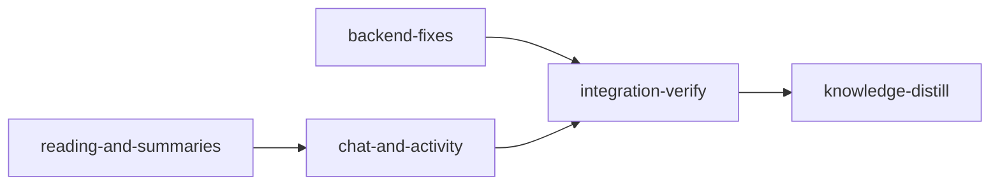

# Plan: Fix the operator's 18 planner issues

Implements: none

## Overview

The operator tested the planner and listed 18 issues. They cover summaries that restate themselves, a summary rebuild that starts two minutes late, chat output corrupted by a new Claude Code paste wrapper, a wrong merged count, a duplicated and ugly activity popover, a crude "Changed since you looked" dialog that does not refresh, and a series of visual defects in the reading column, the document header, the logo and the chat. This plan fixes all 18. The briefs in `doc/plans/briefs/planner-issue-fixes/` hold the per-worker detail. `common.md` holds the verbatim issue list and the operator's decisions. The YAML is authoritative for gates and file ownership.

Models are Claude only. Every visual issue goes to opus subagents at effort medium, which invoke `/frontend-design:frontend-design` before anything else and are refined against screenshots (operator's instruction). Haiku takes the two small specified chat fixes, sonnet the rest of the development, and opus at its default effort the hard bugs (#4/#5, #16, #18) and the final verification.

## Goals

- Every one of the 18 issues is fixed. Integration-verify checks each in the running app and reports one line per item with its evidence.
- Root causes are fixed at their owner, with a test that fails on the old behaviour.
- Non-goals: new wire fields, a new theme system, regenerating stored summaries (the operator's next rebuild does that).

## Operator decisions (asked 2026-11-03)

- #3: a live chat's ⋯ menu offers End chat only. New chat appears only with no chat live or after one concluded.
- #15: keep "Changed since you looked", fix it and redesign it. A document's baseline advances to what this browser saw.
- #1: the overview model default returns to sonnet, and a seal check rejects restatement.

## Evidence behind the diagnoses

- **#4 and #5 share one cause, measured.** Claude Code 2.1.316 records a pasted prompt as `"\n\n<pasted_content id=\"f3a0\">\n…\n</pasted_content id=\"f3a0\">\n"` (operator transcripts `cf2fa1b6…jsonl`, New chat opening; `af7fa405…jsonl`, a message with `<loom-attachments>`). Three consequences follow:
  - `plan_session/attachments/parse.rs::parse_message` sees text after `</loom-attachments>`, so its fallback returns the whole message, markup included (#5).
  - `transcript/mod.rs::take_server_item` no longer matches the sent item, so the opening shows twice (#4).
  - The closing message loses its `Closing` origin.
  Older records in the same version are unwrapped, so both forms must work.
- **#16.** Every row of the operator's summary cost ledger (143 rows on 2026-11-03) carries `trigger: background`, and none carries `button`. So a press either never starts its own session (the work waits for a background pass) or is mis-attributed. The real 2026-11-03 session started within a second of its transcript, and the first seal came 47 s later, so the delay lies before the spawn. The session launches with `--strict-mcp-config`, which rules out a slow MCP start. B2 reproduces this with the fake host before fixing.
- **#1, measured.** 103 overview-to-member sentence pairs resolve in `doc/loom/summaries/overview/**`. Two are identical (`overview/feat-planner/product.md:55` against `section_05.md#s-7c6230dc`). Under word-set Dice similarity, 18 pairs score at least 0.75, and a pair at 0.78 still restates its member. Measured with a script over the stored files at HEAD; threshold: 0.75.
- **#18.** The stored overviews still hold 46, 43 and 14 member-sentence citations. No commit removed level code. The cause is in the rendering or is #1's restatement. O2 reproduces it in a browser before changing anything.
- **#6.** `plan_server/run/strip.rs` counts `data.merge.merged`, which needs `git merge-base --is-ancestor` against a merge point that falls back to `main`. The dashboard counts each stage's `merged` flag (`web/src/lib/notify.ts:76`). `git/merge/status.rs::check_merge_state` deliberately maps a merged non-Knowledge stage with no verifiable commit to `MergeState::Unknown` (phantom-merge guard) and counts a merged Knowledge stage from its flag. The strip is a display count, so it follows the dashboard and reads the flag; `collect_merge_summary` and the phantom guard stay as they are for their other consumers.
- **#14.** `header/activity.tsx` lists the run from `use-activities.ts` and mounts `<RunStrip />` in its footer as well. The summary rebuild doubles up the same way through `SummaryStatusRow`.
- **#15.** `review/changed-since.tsx` diffs from the checkpoint commit every time, while `acknowledge` advances only the file's hash.

## Baselines at 1e6b2795 (main checkout)

- Web: `tsc -b --noEmit`, `oxlint --deny-warnings` and `oxfmt --check` exit 0. `vitest run src/plan`: 271 files, 3330 tests passed.
- Rust: clippy `--all-targets -D warnings` and `fmt --check` exit 0. `cargo build` exits 0. Module runs, all passing:
  - `plan_session::` 596
  - `plan_server::summaries::` 132
  - `planning::summary::` 143
  - `planning::guidance::` 95
  - `user_config::` 51
  - `plan_server::run::strip` 9
  - `plan_server::concept::` 68
  - `--test planning_summary_cli_contracts` 13
- Integration-verify gates at HEAD:
  - `cargo test --all-targets --no-fail-fast` exits 0: 13178 passed, 0 failed.
  - `node scripts/bundle-check.mjs` exits 0.
  - A fresh `vite build` into a scratch dir is identical to the committed `web/dist` (`diff -r` exits 0).

## Before `loom run`

- The operator commits `doc/plans/PLAN-planner-issue-fixes.md` and `doc/plans/briefs/planner-issue-fixes/**` on `feat-planner-ui`, the branch `loom init` records as the base. `loom run` refuses an uncommitted plan or brief bundle (`loom/src/commands/run/plan_inputs.rs`), and a stage worktree is cut from `HEAD`, so an untracked brief would not exist there.
- The operator also commits or discards the two modified summary files, `doc/loom/summaries/overview/feat-planner/product.md` and `doc/loom/summaries/feat-planner/product/section_12.md`. O2's #18 reproduction and every `/f/feat-planner/product` shot read the committed versions.
- `loom run` then commits the rename to `doc/plans/IN_PROGRESS-PLAN-planner-issue-fixes.md`. The briefs directory keeps its name.

## Sibling plans

Never run this plan at the same time as `PLAN-live-test-lane`, `PLAN-autonomous-recovery`, `PLAN-loom-ui-mods`, `PLAN-model-router-hooks` or `PLAN-web-host-graft-followthrough`. Whichever runs second starts from the merged tree. Shared surfaces, all checked at `1e6b2795`:

- `README.md`: this plan changes only the `plan.overview_model` row (about line 660). The siblings' knowledge-distill stages edit other sections.
- `loom/maintainability-baseline.txt` and `doc/loom/knowledge/check-baseline.txt`: no row names a file this plan edits.
- The `loom/src/plan_session/**` glob covers `PLAN-live-test-lane`'s `plan_session/sandbox` tests. No worker here owns `plan_session/sandbox/**`.
- `PLAN-live-test-lane` deletes `sandbox.allow_unsandboxed_escape`, and `SandboxConfig` is `deny_unknown_fields` (`loom/src/plan/schema/types.rs`). This plan's YAML therefore omits the field; its default is `false`, so the YAML parses before and after that plan.
- No sibling consumes `RunStrip`, `BusyRoundel` in the chat, the `Play` glyph, the New chat menu item, the haiku overview default, the changed-since layout or `.activity-row`.

## Issue to gate map

Each issue's executable proof. Integration-verify cites the named gate in its walk line; an item with only a visual proof cites the 1440px and 390px shot paths in both themes.

| # | Stage | Executable proof |
| --- | --- | --- |
| 1 | backend-fixes | contracts `overview-restating-member-rejected`, `overview-near-restatement-rejected`, `overview-model-defaults-to-sonnet`; wiring `restate::restates(` |
| 2 | reading-and-summaries | contract `open-block-edge-in-document-hue`; caps by shot |
| 3 | chat-and-activity | contract `live-chat-menu-ends-only` |
| 4 | backend-fixes, chat-and-activity | contracts `wrapped-opening-replaces-sent-item`, `opening-hides-prompt` |
| 5 | backend-fixes | contract `wrapped-message-parses` |
| 6 | backend-fixes, chat-and-activity | contract `all-merged-stages-count`; `run-once-in-popover` asserts "2 of 6 stages merged" |
| 7 | chat-and-activity | after_stage: `chat-state-glyph.tsx` no longer names `BusyRoundel`; shot |
| 8 | reading-and-summaries | contract `open-all-becomes-fold-all`; wiring `useFoldAll(` |
| 9 | reading-and-summaries | shot only |
| 10 | reading-and-summaries | shot only |
| 11 | chat-and-activity | contract `logo-matches-dashboard` |
| 12 | chat-and-activity | before_stage/after_stage: `\bPlay\b` present before, absent after in `src/plan` |
| 13 | chat-and-activity | shot only |
| 14 | chat-and-activity | contract `run-once-in-popover`; after_stage: nothing mounts `<RunStrip` in `src/plan` (the `RunStrip` wire type in `api/schema-run.ts` stays); after_stage: V2's named tests `a stopped run keeps one dashboard line and no activity` and `a running rebuild's row opens its queue and errors` exist |
| 15 | chat-and-activity | contracts `seen-diff-starts-from-seen`, `seen-text-outlives-a-missing-commit`; artifact `changed-since-data.ts`; wiring `./changed-since.css`; after_stage: O1's named tests `mark all seen during a diff fetch keeps the newer baseline` and `seen text survives a reload` exist |
| 16 | backend-fixes | after_stage: B2's three named regression tests exist; the full suite runs them. `a_pressed_session_is_costed_as_button` reads the ledger line back through `read_log` |
| 17 | chat-and-activity | contract `composer-has-a-border` |
| 18 | reading-and-summaries | O2's `loom memory note "o2-#18: ..."` with shot paths |

## Paths

In the YAML, `files`, `artifacts`, `wiring.source`, contract `file` and `before_stage`/`after_stage` commands are relative to the stage's `working_dir` (`loom/` or `web/`); a file outside the package is reached with `../` in `files` (for example `../README.md`, `../loom/src/plan_server/concept/**`). Retrieval and the plan lints join `files` to `working_dir` (`context/rank_source/paths.rs::join_working_dir`, `v2_lints/mod.rs::stage_touches_dir`), and the worker-table lint (`structural_checks/worker_table.rs`) matches each worker's Files owned cell literally against `files`, so the worker tables use the same base. Briefs, Brief path cells and prose name files repository-relative (`web/src/...`, `loom/src/...`). A command a description says to run "from the worktree root" starts with `cd "$(git rev-parse --show-toplevel)"`, because a stage session starts in its `working_dir`.

## Gate scope

Every code stage runs its suite whole: `cargo test --all-targets --no-fail-fast` in backend-fixes, `node_modules/.bin/vitest run` in both web stages, which with typecheck, lint and `format:check` is `bun run check`. Every stage that may change Rust also runs clippy, fmt and rustdoc with `-D warnings`. reading-and-summaries changes Rust only if O2 finds the #18 cause in `plan_server/concept/**`, so it runs `cargo test --lib plan_server::` and `--test plan_concept_contracts` rather than the hour-long full suite; integration-verify runs the full suite over every change. `loom plan verify` warns that a stage should run a filtered suite. The warning is accepted here, because each change reaches tests outside its module that no scoped run selects:

- the overview default is pinned in `loom/tests/summary_engine_contracts.rs` and, through `web/src/api/fixtures/config.json`, in `commands::status::web::config_api`;
- the paste unwrap and the scheduler are pinned in `loom/tests/plan_session_bridge_core_contracts.rs`, `plan_summary_rebuild_contracts.rs` and `plan_handoff_contracts.rs`;
- `DisabledReason`, the doc heading and the activity glyphs are used across `src/plan/{chat,feature,home,new,offers,files,concept,review}`, and `files/doc-heading-view-parts.test.tsx`, `files/tree-entry.test.tsx` and `concept/page-heading.test.tsx` pin the play icon.

A scoped run would leave those breaks to integration-verify, where no worker owns the files.

## Execution Diagram



`backend-fixes` runs concurrently with the two web stages.

## Stages

No knowledge-bootstrap: the tier-1 files describe this codebase, and `architecture/planner-web-shell.md`, `planner-feature-screens.md`, `summary-store.md` and `planning-session-bridge.md` cover the area.

### 1. backend-fixes (Rust)

Exists by Q2 and Q4. It owns every Rust file the issues touch (`plan_session`, `plan_server/summaries`, `plan_server/run/strip.rs`, `planning/summary`, `user_config`). Folding it into a web stage would put three opus investigations and the web review rounds in one session, past 500,000 tokens. Because it shares no file with the web stages, it runs beside them.

Workers:

- B1 (opus): the paste-wrapper unwrap, for #4 and #5.
- B2 (opus, xhigh): rebuild start latency and press attribution, for #16.
- B3 (sonnet): the overview restatement seal check and prompt rule, the overview default back to sonnet, and the run strip's merged count, for #1 and #6.

Risk walk:

- Untrusted input (the wrapper id, typed text that quotes the tag): `wrapped-message-parses`, plus B1's own edge tests.
- External data (Claude Code's record format, fixture captured from real transcripts): `wrapped-opening-replaces-sent-item`, `wrapped-closing-keeps-origin`.
- Configuration propagation: `overview-model-defaults-to-sonnet`.
- Behaviour the stage exists to add: `overview-restating-member-rejected`, `all-merged-stages-count`.
- Attribution (settled): a summary session is costed `button` when any of its ids was queued by a press (`Via::Button`) or by a "Rebuild all" answer (`Via::Approved`), else `background`. Today `scheduler/session.rs::running_triggers` maps only `Via::Button` to `Trigger::Button`, and `attribution.rs::pressed_or_background` requires every id to be pressed, so an approved rebuild and a press that a background batch joined both log `background`. Either explains the all-background ledger. The rule changes no wire field: `Trigger` already has `Button`.
- Lifecycle and concurrency: B2's scheduler fix carries regression tests written after its reproduction, not a frozen contract. A contract must fail at freeze, and a scheduler-level press test may already pass at base if the cause lies on the answer route or the bridge. The outcomes are settled, so the tests have fixed names, which the stage's `after_stage` checks and the full suite runs:
  - `a_pressed_rebuild_reaches_the_spawner_within_one_tick`;
  - `a_pressed_session_is_costed_as_button`;
  - `a_press_during_a_running_session_joins_the_next_start`.
  Each must fail at the stage's base. The main agent records B2's "fails at base on <behaviour>" line for each with `loom memory note "b2-#16: ..."` before the commit.

Test-integrity events are expected on tests that pin the haiku overview default (`loom/tests/summary_engine_contracts.rs`, `user_config` tests, `planning/summary/config/tests.rs`, `planning/guidance/models/tests.rs`, `loom/tests/planning_summary_cli_contracts.rs`, `web/src/components/settings-plan-section.test.ts`) and on the paste tests B1 rewrites. The main agent files one `dispute-integrity` naming each of them.

### 2. reading-and-summaries (web)

Exists by Q4. Thirteen UI issues with their screenshots and review rounds would pass 500,000 tokens in one session.

Workers:

- O2 (opus): reproduce #18 in a real browser and fix it, or prove it is #1.
- V1 (opus, effort medium, frontend-design): #2 the fold caps and the left rule, #8 Open all and Fold all, #9 the document key and the Rebuild row, #10 the header action alignment.

After V1 returns, the main agent builds and shoots, and sends any miss to a fresh opus/medium visual worker with the shots (the refinement loop in `common.md`).

Risk walk:

- Behaviour the stage exists to add: `open-all-becomes-fold-all`, `open-block-edge-in-document-hue`.
- Reachability: the Fold all contract renders the real route through `renderAt`.
- Shared components: `ui/disabled-reason.tsx`, `ui/doc-heading.tsx` and `ui/design.css` have about 40 consumers across `src/plan`. The stage runs the whole vitest suite, and V1 changes `DisabledReason` only through an opt-in prop.
- Browser journeys: `web/scripts/plan-journeys.mjs` clicks Source, Summary and Edit as links and uses `button.concept-run-cap`, `.concept-passage` and `.concept-mark[data-dashed]`. No stage owns `web/scripts/**`, so V1 keeps those roles and selectors.

### 3. chat-and-activity (web)

Exists by Q2 and Q4. It writes `web/src/plan/help/**` tests after stage 2 restyles the reading surfaces those help scenes render, so it depends on stage 2. With stage 2's work it would pass 500,000 tokens.

Workers:

- C1 (haiku): #3 the menu, #4 the opening label.
- V2 (opus, effort medium, frontend-design): #7 the rail icon, #11 the logo, #12 the rotating arrows, #17 the composer box, #13 and #14 the activity popover, #6 the web side.
- O1 (opus, effort medium, frontend-design): #15 changed-since, its settled behaviour and its look.

The same refinement loop follows.

Risk walk:

- Behaviour: `live-chat-menu-ends-only`, `opening-hides-prompt`, `run-once-in-popover`, `logo-matches-dashboard`, `composer-has-a-border`.
- Lifecycle and state (a seen baseline that advances): `seen-diff-starts-from-seen`, and `seen-text-outlives-a-missing-commit` for a checkpoint commit that history no longer holds. Stale responses: a reset generation guards every diff and acknowledgment (O1's brief, "Generations"), proven by O1's named test `mark all seen during a diff fetch keeps the newer baseline`, which the stage's `after_stage` checks.
- Browser storage (untrusted, may be empty or throw): O1's brief, O1's named test `seen text survives a reload`, and reviewer (b).
- Removal that hides state: dropping `RunStrip` and the duplicate summary line must not hide a stopped run's dashboard link or the summary queue, failures and `start_error` that B2's waiting press relies on. V2's named tests `a stopped run keeps one dashboard line and no activity` and `a running rebuild's row opens its queue and errors` carry it, checked by `after_stage`.
- Removal: the `Play` glyph and `RunStrip` are proven gone by `after_stage` searches. V2's glyph change reaches tests in `src/plan/files` and `src/plan/concept`, so V2 owns those three test files and the stage runs the whole vitest suite.
- Parallel workers sharing a seam: O1's footer row reuses V2's `.activity-row` classes and `ActivityTile`; V2 keeps those names and that export stable.

### Integration Verification

Opus by default. It builds `web/dist` and the binary first, so every gate inspects the new bundle; a first `loom check` is a diagnostic run. Then it runs the journeys and the screens and walks the 18 issues one by one with evidence, recording each walk line with `loom memory note "issue-walk #N: ..."` so the operator can read it with `loom memory show`. That walk is the verification the operator assigned to opus. Every fix is followed by a rebuild of `web/dist`. After the last fix, the final full `loom check` runs against those exact bytes, then the final review round: the review gate compares the round's fingerprint with the tree, so nothing may change after it. It commits the bundle last. See `doc/plans/briefs/planner-issue-fixes/integration-verify.md`.

### Knowledge Distillation

Rewrites `architecture/planner-web-shell.md` (activity popover, chat menu, rail glyph, composer, logo) and `architecture/summary-store.md` (overview default, restatement check, press start path). It records the paste-wrapper lesson in `mistakes/` and curates the remaining memories.

## Environment inventory

| Need | State |
| --- | --- |
| crates.io, npm registry | `allowed_domains` |
| `web/node_modules` | provisioned by `loom.provision` |
| Chromium for screens and O2's reproduction | `~/.cache/ms-playwright` on the host, as plans 12 and 13 used. The shots and O2's reproduction are mandatory, so a missing browser is a blocker, never a pass: each web stage and integration-verify run the browser preflight below before any visual worker or walk, and a failing preflight is filed with `loom stage block <stage-id> "<preflight output>"` (a host install). |
| Browser preflight | after the build, from the worktree root: `scripts/plan-screens.sh loom/target/debug/loom "$LOOM_SCRATCH_DIR/preflight" /`. It starts the real server and Chromium in one call and exits non-zero when either fails or the route does not render. |
| tmux in a stage session | not granted. Journeys that need it print PENDING. `scripts/plan-journeys.sh` runs WITHOUT `--strict` in a stage (`--strict` turns PENDING into a failure), and integration-verify reports each PENDING id. |
| Host platform | Linux only. On Linux loopback binding works in the sandbox with `allow_local_binding: false`. On macOS the sandbox runtime grants bind and loopback only under `allow_local_binding: true` (`sandbox/settings/policy.rs` emits `allowLocalBinding` only then), so an operator running this plan on macOS sets that field to `true` first. |
| Local server and Playwright | loopback works inside one Bash call on Linux with `allow_local_binding: false`: the server start, the wait for its URL and the browser run share one call, as `scripts/plan-screens.sh` does. A throwaway driver imports `playwright-core` by absolute path (`<worktree>/web/node_modules/playwright-core/index.mjs`), because a script under `$LOOM_SCRATCH_DIR` has no `node_modules`, and launches Chromium with `args: ["--no-sandbox"]` as `web/scripts/plan-screens.mjs` does. No script feeds chat frames into the page: a driver that needs a session view stubs `WebSocket` itself in `addInitScript`. |
| Claude login in a stage | none. Real chat, real rebuild timing and a real overview rebuild are operator checks after the run. |
| `web/dist` | a stage that builds the bundle to shoot screens restores it before its final review round: `git restore web/dist`, then `git clean -fdq -- web/dist` (Vite names chunks `assets/[name].js`, so a new lazy chunk is untracked and `restore` leaves it), then `git status --short --untracked-files=all web/dist` prints nothing. Only integration-verify commits a rebuilt bundle. |

## After the run (operator checks)

- A New chat in the operator's Claude Code shows one opening and no markup. A message with an attached document shows a chip, not `<loom-attachments>`.
- Pressing Rebuild starts a session within seconds, and the cost ledger records `button`.
- The next overview rebuild (sonnet) shows no sentence that restates its member. Stored overviews keep their restatements until then.

---

<!-- loom METADATA -->

```yaml
loom:
  version: 2
  auto_merge: null
  sandbox:
    enabled: true
    auto_allow: true
    excluded_commands: []
    filesystem:
      deny_read:
      - ~/.ssh/**
      - ~/.aws/**
      - ~/.config/gcloud/**
      - ~/.gnupg/**
      deny_write:
      - ../../**
      allow_write: []
    network:
      allowed_domains:
      - crates.io
      - index.crates.io
      - static.crates.io
      - registry.npmjs.org
      additional_domains: []
      allow_local_binding: false
      allow_unix_sockets: []
      allow_all_unix_sockets: false
    linux:
      enable_weaker_nested: false
    command_confinement: confined
  ratchet_files:
  - loom/maintainability-baseline.txt
  - doc/loom/knowledge/check-baseline.txt
  provision:
  - working_dir: web
    command: >-
      test ! -e .npmrc && test ! -L .npmrc && bun install --frozen-lockfile
      --ignore-scripts --backend=copyfile --config=/dev/null
  stages:
  - id: backend-fixes
    name: Paste wrapper, rebuild start, restatement guard, overview model, merged count
    summary: >-
      Fixes chat messages that show raw markup or appear twice, makes a pressed summary rebuild
      start at once, stops overviews from copying the sentences they cite, sets overviews back to
      sonnet, and counts merged stages correctly.
    description: |
      Read doc/plans/briefs/planner-issue-fixes/common.md, then the three briefs in doc/plans/briefs/planner-issue-fixes/backend-fixes/, before dispatch. Pass common.md and each worker's brief path to that worker.
      PATHS: working_dir is loom/. The YAML's files, artifacts, contract files, checks and the worker table's Files owned column are relative to loom/ (../ for files outside it); the briefs and the Brief path column are repository-relative.
      KNOWLEDGE: architecture/summary-store.md (Rebuild Scheduler, Rebuilds and Cost), architecture/planning-session-bridge.md, conventions/plan-web.md (New PlanMessage Variants Need Both Schema Arms, for why no wire field is added).
      PUBLIC SURFACE for the contract session:
      - Paste wrapper (in-crate file src/plan_session/transcript/paste_contract_tests.rs, test path plan_session::transcript::paste_contract_tests::<fn>). Use the captured record text in b1-paste-wrapper.md, verbatim.
        - crate::plan_session::attachments::parse_message(&str) -> (String, Vec<Attachment>) (pub, re-exported at attachments/mod.rs).
        - crate::plan_session::transcript::Mapper::new(PathBuf), add_server_item(Item), expect_closing(String), and ingest_main(&str) -> Ingest with pub .deltas, as transcript/tests_server.rs uses them. Item::User { id, text, attachments, delivery, origin }, Delivery::Sent and Origin::{Start, Closing} live in crate::plan_session::model. The pub(super) helpers super::tests::{mapper, drive, lines} may be used.
        - A user record line: {"type":"user","uuid":"u1","timestamp":"2026-11-02T04:29:00Z","message":{"role":"user","content":"<wrapped text>"}}. records::parse needs only uuid and type; copy the exact shape transcript/tests.rs `lines()` uses if it differs.
      - Restatement (in-crate file src/planning/summary/seal/restate_contract_tests.rs, test path planning::summary::seal::restate_contract_tests::<fn>). crate::planning::summary::seal::seal(root: &Path, paths: &RuntimePaths, id: &str, force: bool) -> Result<SealOutcome, SealError>; SealError::Rejected(Vec<FormatError>). The helpers in planning/summary/seal/tests.rs (sealed_sections, member, overview_draft) are private: copy them into the contract file, or build on the pub(crate) cfg(test) fixtures crate::planning::summary::evaluate::fixtures::{two_sections, seal_document, Fixture, PRODUCT, ID1, ID2} with store::{link_from_summary, summary_path} and format::sentence_id. The overview draft must be valid in every other respect: it cites both member summaries (ID1 and ID2) and the vision link [v](../../../../product/demo/index.md#specification-sections), so the restatement is its only problem. At base a one-sentence draft that cites one member is already Rejected for the uncited member and vision, so assert a Rejected error whose message contains "restates", never a bare matches!(Rejected).
        - overview-restating-member-rejected: the overview sentence's text equals the member sentence's text and cites it by #s-<id>.
        - overview-near-restatement-rejected: the member sentence is "File mode is the planning app's reader and editor, adding server document, tree, save, diff and search routes plus in-process plan validation." and the overview sentence citing it is "File mode adds the server's document, tree, save, diff and search routes, with in-process plan validation." (Dice 0.78).
      - Overview default (in-crate file src/user_config/overview_default_contract_tests.rs, test path user_config::overview_default_contract_tests::<fn>). Two cases through UserConfig::plan_overview_model (user_config/plan.rs): it resolves to "sonnet" when plan.overview_model is unset, and to "haiku" when it is set to haiku. Load the config as user_config/plan/tests.rs does.
      - Merged count (in-crate file src/plan_server/run/strip/merged_contract_tests.rs, test path plan_server::run::strip::merged_contract_tests::<fn>). crate::plan_server::run::strip::build_strip(&WorkDir, None). strip/tests.rs's fixture and write_stage are private: copy write_stage, but write stage_type StageType::Standard (Stage::default()), NOT its StageType::Knowledge, because base already counts a merged Knowledge stage from its flag (git/merge/status.rs check_merge_state). Seven stages, each StageStatus::Completed with completed_commit None and no git history: six with merged = true and one with merged = false, serialized with serialize_stage_to_markdown into work_dir.stages_dir(). merged must equal 6 and total 7. At base a Standard stage maps to MergeState::Unknown, so merged is 0.
      WORKERS (one message, all three in parallel):
      | Worker | Role | Tier | Files owned | Shared context | Brief path |
      | ------ | ---- | ---- | ----------- | -------------- | ---------- |
      | B1 | Paste-wrapper unwrap (#4, #5) | opus | src/plan_session/attachments/**; src/plan_session/transcript/**; src/plan_session/bridge/flow.rs; src/plan_session/bridge/tests_queue.rs | common.md | doc/plans/briefs/planner-issue-fixes/backend-fixes/b1-paste-wrapper.md |
      | B2 | Rebuild start and attribution (#16) | opus xhigh | src/plan_server/summaries/**; src/plan_session/bridge/start.rs; src/plan_session/bridge/opening.rs; src/plan_session/bridge/rebuilding.rs; src/plan_session/bridge/tests_opening.rs; src/plan_session/bridge/tests_rebuilding.rs | common.md | doc/plans/briefs/planner-issue-fixes/backend-fixes/b2-rebuild-latency.md |
      | B3 | Restatement check, overview default, merged count (#1, #6) | sonnet | src/planning/summary/**; src/planning/guidance/**; src/user_config/**; tests/planning_summary_cli_contracts.rs; tests/summary_engine_contracts.rs; ../web/src/api/fixtures/config.json; ../web/src/components/settings-plan-section.test.ts; src/plan_server/run/strip.rs; src/plan_server/run/strip/**; ../plan-plugin/**; ../README.md; ../doc/product/feat-planner/section_04.md; ../doc/product/feat-planner/section_09.md | common.md | doc/plans/briefs/planner-issue-fixes/backend-fixes/b3-summary-guard-and-strip.md |
      Frozen, read-only for every worker: src/plan_session/transcript/paste_contract_tests.rs, src/planning/summary/seal/restate_contract_tests.rs, src/user_config/overview_default_contract_tests.rs, src/plan_server/run/strip/merged_contract_tests.rs.
      Spawn B1 as loom-senior-software-engineer, B2 as loom-senior-software-engineer with effort xhigh (hard debugging), and B3 as loom-software-engineer. Each prompt says: Your brief: <path>. Read it and common.md in full before anything else.
      A worker that reports a needed change outside its files: you make it if it passes the small-change rule, else spawn a fresh worker for it after the first three return. loom/src/plan_server/chat/** (the 200 ms bridge driver tick) and loom/src/plan_session/bridge/{driver,recovery,session}.rs are in the stage's files for that follow-up worker only, in case B2 reports the cause there.
      B2's regression tests carry the three fixed names in the plan's backend-fixes risk walk: a_pressed_rebuild_reaches_the_spawner_within_one_tick, a_pressed_session_is_costed_as_button, a_press_during_a_running_session_joins_the_next_start. Settled attribution (B2's brief): a session is costed button when any of its ids came from Via::Button or Via::Approved, else background; a_pressed_session_is_costed_as_button covers a press, a "Rebuild all" answer and a press joined by a background id, and reads the ledger line back through cost::read_log, not only running_triggers(). The first test drives at least one case through the facade (Rebuilds::enqueue or the answer route) to the spawner, not Scheduler alone. Before the commit, record B2's "fails at base on <behaviour>" line for each, and its before/after timeline, with loom memory note "b2-#16: ...". If B2 reports #16 not reproduced, that is a finding to escalate to a loom-advisor, never a pass.
      FIX ROUNDS: a failing check or review finding goes to a fresh worker one tier above the one that failed: sonnet, then opus. Never back to the same agent.
      AFTER THE WORKERS: cargo fmt --all. Then one loom check backend-fixes beside the final loom-code-reviewer round. After the commit, file one dispute-integrity naming every test that pinned the haiku overview default (loom/tests/summary_engine_contracts.rs, web/src/components/settings-plan-section.test.ts, the user_config, planning/summary/config, planning/guidance/models and planning_summary_cli_contracts tests) or the old paste behaviour.
      LEDGER: no file this stage edits may cross 400 lines, and a function over 50 lines is split.
      Use parallel subagents and skills to maximize performance.
      MEMORY: record mistakes, decisions and surprises with loom memory immediately, subagents too; NEVER Claude Code auto-memory.
    dependencies: []
    acceptance:
    - cargo build
    - cargo clippy --all-targets -- -D warnings
    - cargo fmt --check
    - command: cargo test --all-targets --no-fail-fast
      timeout_secs: 3600
    - RUSTDOCFLAGS="-D warnings" cargo doc --workspace --all-features --no-deps
    - cd ../web && node_modules/.bin/vitest run src/components/settings-plan-section.test.ts
    files:
    - src/plan_session/**
    - src/plan_server/summaries/**
    - src/plan_server/chat/**
    - src/plan_server/run/strip.rs
    - src/plan_server/run/strip/**
    - src/planning/summary/**
    - src/planning/guidance/**
    - src/user_config/**
    - tests/planning_summary_cli_contracts.rs
    - tests/summary_engine_contracts.rs
    - ../web/src/api/fixtures/config.json
    - ../web/src/components/settings-plan-section.test.ts
    - ../plan-plugin/**
    - ../README.md
    - ../doc/product/feat-planner/section_04.md
    - ../doc/product/feat-planner/section_09.md
    working_dir: loom
    stage_type: standard
    artifacts:
    - src/planning/summary/seal/restate.rs
    wiring:
    - source: src/planning/summary/seal/links.rs
      pattern: restate::restates(
      description: the seal's sentence check calls the restatement measure
      literal: true
    before_stage:
    - command: test ! -e src/planning/summary/seal/restate.rs
      description: the restatement measure does not exist yet
    after_stage:
    - command: test -s src/planning/summary/seal/restate.rs
      description: the restatement measure exists
    - command: rg -q 'fn a_pressed_rebuild_reaches_the_spawner_within_one_tick\b' src
      description: B2's press-start regression test exists (#16)
    - command: rg -q 'fn a_pressed_session_is_costed_as_button\b' src
      description: B2's attribution regression test exists (#16)
    - command: rg -q 'fn a_press_during_a_running_session_joins_the_next_start\b' src
      description: B2's press-while-running regression test exists (#16)
    subagent_timeout_secs: 900
    implementers:
    - claude
    skills:
    - loom-rust
    contracts:
    - id: wrapped-message-parses
      file: src/plan_session/transcript/paste_contract_tests.rs
      test: plan_session::transcript::paste_contract_tests::wrapped_message_parses_typed_text_and_attachments
      scenario: >-
        calls parse_message on a message wrapped in <pasted_content id="733e"> ... </pasted_content
        id="733e"> holding typed text, a blank line and a one-entry <loom-attachments> block
      rejects: a parser that returns the whole wrapped text with no attachments, so the markup reaches the transcript
    - id: wrapped-opening-replaces-sent-item
      file: src/plan_session/transcript/paste_contract_tests.rs
      test: plan_session::transcript::paste_contract_tests::wrapped_opening_replaces_the_sent_item
      scenario: >-
        add_server_item with a Sent opening "loom plan: no step chosen.\nAsk me what I want to work
        on.", then ingest_main on a user record whose content is that text inside the captured
        pasted_content wrapper
      rejects: a mapper that keeps the sent item and adds the delivered one, showing the opening twice
    - id: wrapped-closing-keeps-origin
      file: src/plan_session/transcript/paste_contract_tests.rs
      test: plan_session::transcript::paste_contract_tests::wrapped_closing_keeps_its_origin
      scenario: >-
        expect_closing with the closing text, then ingest_main on a user record holding that text in
        the pasted_content wrapper
      rejects: a closing record mapped as plain user text with no Closing origin
    - id: overview-restating-member-rejected
      file: src/planning/summary/seal/restate_contract_tests.rs
      test: planning::summary::seal::restate_contract_tests::overview_restating_its_member_is_rejected
      scenario: >-
        seals the member section summaries, then seals an overview draft that is valid in every
        other respect (it cites every member and the vision) and whose sentence repeats one member
        sentence word for word and cites it; the error is Rejected with a message containing restates
      rejects: a seal that accepts an overview sentence identical to the sentence it cites
    - id: overview-near-restatement-rejected
      file: src/planning/summary/seal/restate_contract_tests.rs
      test: planning::summary::seal::restate_contract_tests::overview_near_restatement_is_rejected
      scenario: >-
        seals a member section summary holding "File mode is the planning app's reader and editor,
        adding server document, tree, save, diff and search routes plus in-process plan
        validation.", then seals an otherwise valid overview draft whose sentence "File mode adds
        the server's document, tree, save, diff and search routes, with in-process plan
        validation." cites it
      rejects: an equality-only check that accepts a reworded copy scoring 0.78 under the Dice measure
    - id: overview-model-defaults-to-sonnet
      file: src/user_config/overview_default_contract_tests.rs
      test: user_config::overview_default_contract_tests::overview_model_defaults_to_sonnet
      scenario: >-
        resolves the plan overview model from a config with no plan.overview_model, and from one
        setting it to haiku
      rejects: a default left at haiku, or a resolver that ignores an explicit setting
    - id: all-merged-stages-count
      file: src/plan_server/run/strip/merged_contract_tests.rs
      test: plan_server::run::strip::merged_contract_tests::all_merged_stages_count_as_merged
      scenario: >-
        build_strip on a work dir of seven Standard stages, all Completed with no completed_commit
        and no git history reaching a merge point, six with merged true and one with merged false
      rejects: >-
        a strip that counts merges by commit ancestry and reports 0, or one that counts Completed
        stages whatever their merged flag and reports 7
  - id: reading-and-summaries
    name: Fold caps, Open and Fold all, document header and key, summary levels
    summary: >-
      Makes open blocks and their fold caps easy to see, turns Open all into Fold all, aligns the
      document header's controls, tidies the document key and the Rebuild control, and restores the
      overview's middle level if it is missing.
    description: |
      Read doc/plans/briefs/planner-issue-fixes/common.md, then the two briefs in doc/plans/briefs/planner-issue-fixes/reading-and-summaries/, and web/src/plan/ui/DESIGN.md, before dispatch. Pass common.md and each worker's brief path to that worker.
      PATHS: working_dir is web/. The YAML's files, contract files, wiring, checks and the worker table's Files owned column are relative to web/ (../ for files outside it); the briefs and the Brief path column are repository-relative. "From the worktree root" means cd "$(git rev-parse --show-toplevel)" first.
      KNOWLEDGE: conventions/plan-web.md (Concept Mode Test Rules, UI Repair Test Rules, Visual Stages and the Screenshot Script), architecture/planner-web-shell.md (Reading column), architecture/plan-server.md (Open-state rule).
      VISUAL WORK (operator's instruction): V1 is spawned as loom-senior-software-engineer with effort medium. Its first action is to invoke the frontend-design:frontend-design skill through the Skill tool, before reading code. Every visual fix round goes to a fresh opus/medium visual worker under the same rule, never to haiku or sonnet. The refinement loop is in common.md, "Visual work".
      PUBLIC SURFACE for the contract session (src/plan/concept/reading-fixes.contracts.test.tsx, top-level it() calls named exactly as the contracts' tests):
      - "Open all becomes Fold all and folds the page". Seed as src/plan/concept/concept-route-headers.test.tsx's "the Open all header button opens the page's runs" does: vi.stubGlobal fetch with makeStubFetch from src/plan/concept/concept-route-support.tsx over the concept-summary and concept-overview fixtures (copy that file's serveOverview helper), then renderAt(path) and readingColumn() from the same support file. Do not copy open-all.test.tsx, which seeds atoms through renderHook and bypasses renderAt. The summary fixture's three sentences all carry citations, so all are openable.
        - Summary page /f/demo/product/section_01: the button is named "Open all"; after one click it is named "Fold all" and within(column).findAllByRole("group", { name: /^Detail of/ }) is non-empty; after a second click within(column).queryAllByRole("group", { name: /^Detail of/ }) has length 0, the button is named "Open all" again, and document.activeElement is that button.
        - Overview page /f/demo/product: open the first overview sentence, then the nested member sentence inside it, then click "Open all" and then "Fold all"; no group named /^Detail of/ remains at any level.
      - "an open block draws a 2px edge in its document hue": import @/plan/concept/concept-runs.css?raw; the .concept-passages rule declares border-inline-start: 2px solid var(--run-colour), and no rule reads var(--run-edge) for that edge.
      Frozen from earlier plans and binding on V1: src/plan/concept/concept.contracts.test.tsx (each key chip stays a link, and getAllByRole("link") over the key equals key_chips.length, so "+n more" is not a link) and src/plan/concept/reading.contracts.test.tsx. Never edit them.
      BEFORE SPAWNING: cd "$(git rev-parse --show-toplevel)" && (cd web && bun run build) && (cd loom && cargo build), so O2 can start a real server (subagents cannot build; they may run the built binary and node). Then run the browser preflight from the plan's Environment inventory (scripts/plan-screens.sh loom/target/debug/loom "$LOOM_SCRATCH_DIR/preflight" /). If it fails, spawn no worker: file loom stage block reading-and-summaries "<preflight output>", because O2's reproduction and the shots are mandatory.
      WORKERS (one message, both in parallel):
      | Worker | Role | Tier | Files owned | Shared context | Brief path |
      | ------ | ---- | ---- | ----------- | -------------- | ---------- |
      | O2 | Summary levels in the browser (#18) | opus | src/plan/concept/column-model.ts; src/plan/concept/column-model.test.ts; src/plan/concept/cited-pages.ts; src/plan/concept/page-state.ts; src/plan/concept/run.tsx; src/plan/concept/reading-column.tsx; src/plan/concept/reading-column-runs.test.tsx; src/plan/concept/open-state.ts; src/plan/concept/open-state.test.ts; ../loom/src/plan_server/concept/** | common.md | doc/plans/briefs/planner-issue-fixes/reading-and-summaries/o2-summary-levels.md |
      | V1 | Reading surface: caps, Open and Fold all, header, key (#2, #8, #9, #10) | opus medium | src/plan/concept/concept-runs.css; src/plan/concept/fold-handle.tsx; src/plan/concept/fold-caps.test.tsx; src/plan/concept/fold-handle.test.tsx; src/plan/concept/doc-tokens.test.ts; src/plan/concept/page-heading.tsx; src/plan/concept/page-heading.test.tsx; src/plan/concept/page-heading-actions.test.tsx; src/plan/concept/concept-route-headers.test.tsx; src/plan/concept/concept-route.test.tsx; src/plan/concept/open-all.ts; src/plan/concept/open-all.test.tsx; src/plan/concept/document-key.tsx; src/plan/concept/document-key.test.tsx; src/plan/concept/key-row-extras.tsx; src/plan/concept/concept-page.css; src/plan/concept/page-header-extras.tsx; src/plan/concept/page-header-extras.test.tsx; src/plan/ui/DESIGN.md; src/plan/ui/doc-heading.tsx; src/plan/ui/doc-heading.css; src/plan/ui/doc-heading.test.tsx; src/plan/ui/doc-heading-parts.test.tsx; src/plan/ui/design.css; src/plan/ui/disabled-reason.tsx; src/plan/ui/disabled-reason.test.tsx; src/plan/files/heading-parts.tsx; src/plan/files/doc-heading-view.tsx; src/plan/files/doc-heading-view.test.tsx; src/plan/files/doc-heading-title.test.tsx; src/plan/files/doc-heading-view-parts.test.tsx; src/plan/files/doc-heading-kit.tsx; src/plan/files/plan/plan-actions-extras.test.tsx; src/plan/files/plan/plan-view.test.tsx; src/plan/files/plan/stages-panel.tsx; src/plan/summaries/approval-notice.tsx; src/plan/summaries/rebuild-button.tsx; src/plan/summaries/rebuild-button.test.tsx; src/plan/summaries/rebuild-question.test.tsx; src/plan/help/** | DESIGN.md | doc/plans/briefs/planner-issue-fixes/reading-and-summaries/v1-reading-surface.md |
      Frozen, read-only for both workers: src/plan/concept/reading-fixes.contracts.test.tsx, src/plan/concept/concept.contracts.test.tsx, src/plan/concept/reading.contracts.test.tsx. V1 never edits run.tsx or open-state.ts (O2's); --run-colour is already set inline on the .concept-passages element (run.tsx PassageRun), so the #2 edge needs CSS only. If O2 finds a level-1 run drawn like a level-2 passage, O2 reports the CSS change to you and you pass it to V1's refinement round, because concept-runs.css is V1's.
      Spawn O2 as loom-senior-software-engineer (default effort) and V1 as loom-senior-software-engineer with effort medium. O2's prompt says: Your brief: <path>. Read it and common.md in full before anything else. V1's prompt says: First invoke the frontend-design:frontend-design skill with the Skill tool. Then read your brief <path>, common.md and web/src/plan/ui/DESIGN.md in full before anything else.
      FIX ROUNDS: a visual miss or visual finding goes to a fresh loom-senior-software-engineer with effort medium that invokes frontend-design:frontend-design first and is given the shot paths. A non-visual failure goes to a fresh worker one tier above the one that failed.
      AFTER THE WORKERS: (cd web && node_modules/.bin/oxfmt); (cd loom && cargo fmt --all) if O2 changed Rust. Rebuild the bundle and binary from the worktree root, then run scripts/plan-screens.sh --worktree-doc --themes=ledger,aubergine loom/target/debug/loom "$LOOM_SCRATCH_DIR/screens" /f/feat-planner/product /f/feat-planner/product/section_05 /f/feat-planner/engineering. Those shots are static: in one more Bash call, start the server as plan-screens.sh does and drive a throwaway Playwright script (see the plan's Environment inventory) that opens a sentence on each route, shoots the open block and its caps (#2), then clicks Open all and shoots the Fold all state (#8). Read the shots at 1440px and 390px, and check each of issues 2, 8, 9, 10 and 18 against its brief's fixed targets and common.md's Design direction. Run the refinement loop for every miss (at most two rounds per item; a third miss is recorded and left for integration-verify). Then restore web/dist before the final review round: git restore web/dist; git clean -fdq -- web/dist; git status --short --untracked-files=all web/dist must print nothing. Only integration-verify commits a bundle. The gate is one loom check reading-and-summaries beside the final loom-code-reviewer round. After the commit, file one dispute-integrity naming each test that pinned the old cap values, header structure, key layout, Open all gate or DisabledReason layout, by file.
      Use parallel subagents and skills to maximize performance.
      MEMORY: record mistakes, decisions and surprises with loom memory immediately, subagents too; NEVER Claude Code auto-memory.
    dependencies: []
    acceptance:
    - bun run typecheck
    - bun run lint
    - bun run format:check
    - node_modules/.bin/vitest run
    - cargo clippy --manifest-path ../loom/Cargo.toml --all-targets -- -D warnings
    - command: 'cargo test --manifest-path ../loom/Cargo.toml --lib plan_server::'
      timeout_secs: 1800
    - cargo test --manifest-path ../loom/Cargo.toml --test plan_concept_contracts
    - cargo fmt --manifest-path ../loom/Cargo.toml --check
    - RUSTDOCFLAGS="-D warnings" cargo doc --manifest-path ../loom/Cargo.toml --workspace --all-features --no-deps
    files:
    - src/plan/concept/**
    - src/plan/ui/DESIGN.md
    - src/plan/ui/doc-heading.tsx
    - src/plan/ui/doc-heading.css
    - src/plan/ui/doc-heading.test.tsx
    - src/plan/ui/doc-heading-parts.test.tsx
    - src/plan/ui/design.css
    - src/plan/ui/disabled-reason.tsx
    - src/plan/ui/disabled-reason.test.tsx
    - src/plan/files/heading-parts.tsx
    - src/plan/files/doc-heading-view.tsx
    - src/plan/files/doc-heading-view.test.tsx
    - src/plan/files/doc-heading-title.test.tsx
    - src/plan/files/doc-heading-view-parts.test.tsx
    - src/plan/files/doc-heading-kit.tsx
    - src/plan/files/plan/plan-actions-extras.test.tsx
    - src/plan/files/plan/plan-view.test.tsx
    - src/plan/files/plan/stages-panel.tsx
    - src/plan/summaries/approval-notice.tsx
    - src/plan/summaries/rebuild-button.tsx
    - src/plan/summaries/rebuild-button.test.tsx
    - src/plan/summaries/rebuild-question.test.tsx
    - src/plan/help/**
    - ../loom/src/plan_server/concept/**
    working_dir: web
    stage_type: standard
    wiring:
    - source: src/plan/concept/page-heading.tsx
      pattern: useFoldAll(
      description: the page heading's button folds the page through the fold-all hook
      literal: true
    - source: src/plan/concept/page-heading.tsx
      pattern: useAllOpen(
      description: the page heading's label reads whether every openable sentence is open
      literal: true
    subagent_timeout_secs: 900
    implementers:
    - claude
    skills:
    - loom-react
    - loom-typescript
    contracts:
    - id: open-all-becomes-fold-all
      file: src/plan/concept/reading-fixes.contracts.test.tsx
      test: Open all becomes Fold all and folds the page
      scenario: >-
        renders /f/demo/product/section_01 through renderAt over the concept-summary fixture (three
        openable sentences), clicks Open all, checks the label reads Fold all and runs are open, then
        clicks again and checks no run is open, the label reads Open all and focus stays on the
        button; then on /f/demo/product opens an overview sentence and its nested member sentence and
        checks Fold all closes both levels
      rejects: >-
        a static Open all label, a Fold all that relabels the button without closing the runs, or one
        that clears only top-level runs and leaves a nested member run open
    - id: open-block-edge-in-document-hue
      file: src/plan/concept/reading-fixes.contracts.test.tsx
      test: an open block draws a 2px edge in its document hue
      scenario: >-
        reads concept-runs.css through a ?raw import and finds the .concept-passages rule declaring
        border-inline-start: 2px solid var(--run-colour)
      rejects: the quiet 1px hairline edge that takes the hue only while a cap is hovered
  - id: chat-and-activity
    name: Chat menu and openings, rail icon, logo, activity popover, changed-since
    summary: >-
      Gives a live chat one End chat action, shows openings as a label, replaces the rail roundel and
      the play icon, sizes the logo like the dashboard, makes the chat input visible, shows each
      activity once in a cleaner popover, and fixes and redesigns Changed since you looked.
    description: |
      Read doc/plans/briefs/planner-issue-fixes/common.md, then the three briefs in doc/plans/briefs/planner-issue-fixes/chat-and-activity/, and web/src/plan/ui/DESIGN.md, before dispatch. Pass common.md and each worker's brief path to that worker.
      PATHS: working_dir is web/. The YAML's files, artifacts, contract files, wiring, checks and the worker table's Files owned column are relative to web/ (../ for files outside it); the briefs and the Brief path column are repository-relative. "From the worktree root" means cd "$(git rev-parse --show-toplevel)" first.
      KNOWLEDGE: conventions/plan-web.md (Chat Panel and Review UI Rules, UI Repair Test Rules), architecture/planner-web-shell.md (Header and dock, Chat home and the chat panel).
      VISUAL WORK (operator's instruction): V2 and O1 are spawned as loom-senior-software-engineer with effort medium. The first action of each is to invoke the frontend-design:frontend-design skill through the Skill tool, before reading code. Every visual fix round goes to a fresh opus/medium visual worker under the same rule, never to haiku or sonnet. The refinement loop is in common.md, "Visual work".
      PUBLIC SURFACE for the contract session:
      - src/plan/chat/chat-fixes.contracts.test.tsx (top-level it() calls; stub matchMedia wide).
        - "a live chat's menu offers End chat and not New chat": render PanelHead (src/plan/chat/panel-head.tsx) inside a jotai Provider whose store comes from storeFor() in src/plan/chat/panel-test-kit.tsx (this browser holds authoring), with snapshotAtom set as src/plan/chat/panel-a11y.test.tsx's menu test sets it: { session: { ...the chat-snapshot.json session, state: "idle" }, turns: [], queue: [], previous: null }, session kind authoring. Do not mock ./end-chat or ./start-chat (panel-a11y.test.tsx stubs both; the real useCanEndChat needs the holder, an active session and a non-pressure kind). Inside getByLabelText("Chat menu").closest("details") a button "End chat" exists, and queryByRole("button", { name: "New chat" }) over the whole head is null.
        - "an opening shows its label and hides the prompt until Show": ItemView from src/plan/chat/items.tsx takes { item, turn, nested }; pass a user item whose origin is "start" and whose text is "loom plan: no step chosen.\nAsk me what I want to work on.", and the turn shape items.test.tsx uses. Before Show, the label "Opening message" is visible (no brief is loaded) and queryByText(/loom plan: no step chosen\./) is null; the element named by the Show button's aria-controls exists. After clicking Show, getByText(/loom plan: no step chosen\./) finds the text (the whole prompt sits in one paragraph, so match by regex, not exact string).
        - "the composer has a visible border": import @/plan/chat/chat-composer.css?raw; the .chat-composer-box rule declares border: 1px solid var(--…) with a theme token and no border: 0.
      - src/plan/header/activity-fixes.contracts.test.tsx (mock "@/plan/run/dashboard-button" and useSummaryFeed from "@/plan/summaries/state" exactly as src/plan/header/activity.test.tsx does; set atoms on getDefaultStore() as that file does).
        - "a running plan appears once in the activity popover": ActivityPill from src/plan/header/activity.tsx, with runStripAtom from src/plan/run/use-run.ts set to { plan: "doc/plans/PLAN-x.md", daemon_running: true, merged: 2, total: 6, attention: 0, dashboard_url: null }. Click the pill and await screen.findByRole("dialog", { name: "In progress" }) (the popover renders in a portal). Inside it: exactly one element names PLAN-x.md, getAllByText(/2 of 6 stages merged/) has length 1, the list labelled "In progress" holds exactly one listitem, queryByText("loom run") is null and queryByRole("progressbar") is null.
        - "the planner logo matches the dashboard's sizes": import @/plan/header/header.css?raw; .plan-logo is 32px tall at the base, 40px inside a (min-width: 640px) rule and 56px inside a (min-width: 1024px) rule, and no rule sets it to 22px or 26px.
      - src/plan/review/changed-since-fixes.contracts.test.tsx: "a viewed document's next diff starts from what was seen". Use src/plan/review/changed-since-test-kit.tsx (installChangedSinceLifecycle, fetchMock, replies, mount, openList) with the checkpoint for doc A at commit c1. The kit hard-codes /api/at-commit to "committed text" and /api/doc to "current text" with hash "new", so the contract overrides fetchMock's implementation for those two routes, delegating every other route to the kit: /api/at-commit answers "one" for c1; /api/doc answers text and hash from a variable the test changes ("two"/h2, then "three"/h3). Never edit the kit (O1 owns review/**). Mount with live updates; A reads "two": open its diff (openList, then the button named `Show diff for <A>`). Then set the variable to "three"/h3, set replies["/api/hashes"] so A's hash is h3, and emit a doc_changed frame through the handle mount returns. A's row reappears after the reload: await it with findByRole and open its diff again. The before side shows "two", and queryByText("one") is null.
      - same file: "seen text outlives a missing checkpoint commit". Same overrides as above. Mount, open A's diff while it reads "two" (stored as seen), then call cleanup() from @testing-library/react. Set replies["/api/compare?commit=c1"] to { commit: "c1", available: false, docs: [] }, set /api/doc to "three"/h3 and replies["/api/hashes"] so A's hash is h3, then mount again and openList. A's row still has the button named `Show diff for <A>`; clicking it shows "two" on the before side and "three" after, and no /api/at-commit request for c1 is made after the remount (count fetchMock calls whose URL pathname is /api/at-commit, before and after). At base ComparisonList hides every diff button when the commit is unavailable, so the test fails.
      Accessible names the contracts and existing tests rely on, which every worker keeps: the trigger "Changed since you looked · N", the list "Changed documents", each row's button `Show diff for <path>` (visible text may read "View changes"), the dialog "In progress", the details summary "Chat menu".
      WORKERS (one message, all three in parallel):
      | Worker | Role | Tier | Files owned | Shared context | Brief path |
      | ------ | ---- | ---- | ----------- | -------------- | ---------- |
      | V2 | Chrome and activity: rail, composer, logo, glyph, popover (#7, #11, #12, #13, #14, #17, #6 web) | opus medium | src/plan/chat/chat-state-glyph.tsx; src/plan/chat/panel.test.tsx; src/plan/chat/panel-header.test.tsx; src/plan/chat/chat-composer.css; src/plan/header/header.css; src/plan/header/header.test.tsx; src/plan/ui/activity-glyphs.tsx; src/plan/ui/activity-glyphs.css; src/plan/ui/activity-glyphs.test.tsx; src/plan/ui/glyphs.tsx; src/plan/header/activity.tsx; src/plan/header/activity.css; src/plan/header/activity.test.tsx; src/plan/header/use-activities.ts; src/plan/header/use-activities.test.tsx; src/plan/header/shell-contracts-kit.tsx; src/plan/run/run-strip.tsx; src/plan/run/run-strip.test.tsx; src/plan/feature/run-scope.ts; src/plan/summaries/summary-status.tsx; src/plan/summaries/summary-status.test.tsx; src/plan/summaries/rebuild-question.tsx; src/plan/summaries/rebuild-question.test.tsx; src/plan/files/doc-heading-view-parts.test.tsx; src/plan/files/tree-entry.test.tsx; src/plan/concept/page-heading.test.tsx | DESIGN.md | doc/plans/briefs/planner-issue-fixes/chat-and-activity/v2-chrome-and-activity.md |
      | C1 | End chat only while live, opening label (#3, #4) | haiku | src/plan/chat/panel-head.tsx; src/plan/chat/panel-a11y.test.tsx; src/plan/chat/items.tsx; src/plan/chat/items.test.tsx; src/plan/chat/transcript.test.tsx; src/plan/chat/replay.test.tsx; src/plan/chat/start-chat.test.tsx; src/plan/chat/session-home.test.tsx; src/plan/help/** | common.md | doc/plans/briefs/planner-issue-fixes/chat-and-activity/c1-chat-menu-and-opening.md |
      | O1 | Changed since you looked (#15) | opus medium | src/plan/review/**; ../doc/product/feat-planner/section_10.md | DESIGN.md | doc/plans/briefs/planner-issue-fixes/chat-and-activity/o1-changed-since.md |
      Frozen, read-only for every worker: src/plan/chat/chat-fixes.contracts.test.tsx, src/plan/header/activity-fixes.contracts.test.tsx, src/plan/review/changed-since-fixes.contracts.test.tsx, and the earlier plans' src/plan/header/shell.contracts.test.tsx (fed by shell-contracts-kit.tsx: V2 keeps that kit's exports and their behaviour).
      Named tests the stage's after_stage checks (not frozen; each worker writes its own and must see it fail on the base behaviour): V2 writes "a stopped run keeps one dashboard line and no activity" and "a running rebuild's row opens its queue and errors" in src/plan/header/activity.test.tsx; O1 writes "mark all seen during a diff fetch keeps the newer baseline" and "seen text survives a reload" under src/plan/review/. Their behaviour is in the V2 brief (#14) and the O1 brief (Generations, Text store).
      Seam between the parallel V2 and O1: V2 keeps the class names activity-row, activity-row__body, activity-row__title, activity-row__sub and activity-row__time and the export ActivityTile({ kind?, paused?, children }) from ui/activity-glyphs.tsx; O1's footer row uses only those. V2 keeps the popover a PopoverContent (data-slot="popover-content"): web/scripts/plan-journeys-kit.mjs dismisses auto-opened popovers by it.
      BEFORE SPAWNING: cd "$(git rev-parse --show-toplevel)" && (cd web && bun run build) && (cd loom && cargo build), then the browser preflight from the plan's Environment inventory. If it fails, spawn no worker: file loom stage block chat-and-activity "<preflight output>", because the shots are mandatory.
      Spawn C1 as loom-software-engineer with model haiku; its prompt says: Your brief: <path>. Read it and common.md in full before anything else. Spawn V2 and O1 as loom-senior-software-engineer with effort medium; each prompt says: First invoke the frontend-design:frontend-design skill with the Skill tool. Then read your brief <path>, common.md and web/src/plan/ui/DESIGN.md in full before anything else.
      FIX ROUNDS: a visual miss or visual finding goes to a fresh loom-senior-software-engineer with effort medium that invokes frontend-design:frontend-design first and is given the shot paths. A non-visual failure goes to a fresh worker one tier above the one that failed: haiku, then sonnet, then opus.
      AFTER THE WORKERS: (cd web && node_modules/.bin/oxfmt). Rebuild the bundle and binary from the worktree root, then run scripts/plan-screens.sh --worktree-doc --themes=ledger,aubergine loom/target/debug/loom "$LOOM_SCRATCH_DIR/screens" / /f/feat-planner/product. For the open popover, the chat menu, the collapsed rail and the changed-since dialog, use a throwaway Playwright driver under $LOOM_SCRATCH_DIR, run in one Bash call with the server start (see the plan's Environment inventory). No repository script feeds chat frames: where no session can start, the driver stubs WebSocket in addInitScript and replays frames from web/src/plan/api/fixtures/chat-snapshot.json. Read the shots at 1440px and 390px, and check issues 3, 4, 7, 11, 12, 13, 14, 15 and 17 against their briefs' fixed targets and common.md's Design direction. Run the refinement loop for every visual miss (at most two rounds per item; a third miss is recorded and left for integration-verify). Then restore web/dist before the final review round: git restore web/dist; git clean -fdq -- web/dist; git status --short --untracked-files=all web/dist must print nothing. The gate is one loom check chat-and-activity beside the final loom-code-reviewer round. After the commit, file one dispute-integrity naming, by file, each test that pinned the New chat menu item, the pulse glyph or lucide-play icon, the origin first line, the RunStrip footer and stopped-daemon row, the summary status row and the old changed-since layout.
      Use parallel subagents and skills to maximize performance.
      MEMORY: record mistakes, decisions and surprises with loom memory immediately, subagents too; NEVER Claude Code auto-memory.
    dependencies:
    - reading-and-summaries
    acceptance:
    - bun run typecheck
    - bun run lint
    - bun run format:check
    - node_modules/.bin/vitest run
    files:
    - src/plan/chat/**
    - src/plan/header/**
    - src/plan/ui/activity-glyphs.tsx
    - src/plan/ui/activity-glyphs.css
    - src/plan/ui/activity-glyphs.test.tsx
    - src/plan/ui/glyphs.tsx
    - src/plan/run/**
    - src/plan/feature/run-scope.ts
    - src/plan/summaries/summary-status.tsx
    - src/plan/summaries/summary-status.test.tsx
    - src/plan/summaries/rebuild-question.tsx
    - src/plan/summaries/rebuild-question.test.tsx
    - src/plan/files/doc-heading-view-parts.test.tsx
    - src/plan/files/tree-entry.test.tsx
    - src/plan/concept/page-heading.test.tsx
    - src/plan/review/**
    - src/plan/help/**
    - ../doc/product/feat-planner/section_10.md
    working_dir: web
    stage_type: standard
    artifacts:
    - src/plan/review/changed-since.css
    - src/plan/review/changed-since-data.ts
    wiring:
    - source: src/plan/review/changed-since.tsx
      pattern: ./changed-since.css
      description: the changed-since dialog loads its stylesheet
      literal: true
    before_stage:
    - command: test ! -e src/plan/review/changed-since.css
      description: the dialog has no stylesheet of its own yet
    - command: rg -q '\bPlay\b' src/plan
      description: the planner still draws the play icon for running (#12)
    - command: rg -q '<RunStrip\b' src/plan/header
      description: the activity popover still mounts RunStrip in its footer (#14)
    - command: rg -q 'BusyRoundel' src/plan/chat/chat-state-glyph.tsx
      description: the chat rail glyph still draws the roundel when idle (#7)
    after_stage:
    - command: test -s src/plan/review/changed-since.css
      description: the dialog's stylesheet exists
    - command: '! rg -q ''\bPlay\b'' src/plan'
      description: no play icon is left in the planner (#12)
    - command: '! rg -q ''<RunStrip\b'' src/plan'
      description: nothing mounts RunStrip any more (#14)
    - command: '! rg -q ''BusyRoundel'' src/plan/chat/chat-state-glyph.tsx'
      description: the chat rail glyph draws no roundel (#7)
    - command: rg -qF 'a stopped run keeps one dashboard line and no activity' src/plan/header/activity.test.tsx
      description: V2's stopped-run test exists (#14)
    - command: rg -qF "a running rebuild's row opens its queue and errors" src/plan/header/activity.test.tsx
      description: V2's running-rebuild detail test exists (#14, #16 waiting press)
    - command: rg -qF 'mark all seen during a diff fetch keeps the newer baseline' src/plan/review
      description: O1's reset-generation test exists (#15)
    - command: rg -qF 'seen text survives a reload' src/plan/review
      description: O1's persistence test exists (#15)
    subagent_timeout_secs: 900
    implementers:
    - claude
    skills:
    - loom-react
    - loom-typescript
    contracts:
    - id: live-chat-menu-ends-only
      file: src/plan/chat/chat-fixes.contracts.test.tsx
      test: a live chat's menu offers End chat and not New chat
      scenario: >-
        mounts PanelHead from a panel-test-kit storeFor() store with an idle authoring session this
        browser holds, real end-chat and start-chat modules, then reads the details menu labelled
        Chat menu and the whole head
      rejects: >-
        a menu that still lists New chat beside End chat while a chat is live, or a head that moves
        New chat next to a live chat outside the menu
    - id: opening-hides-prompt
      file: src/plan/chat/chat-fixes.contracts.test.tsx
      test: an opening shows its label and hides the prompt until Show
      scenario: >-
        renders ItemView with a turn and a user item with origin start and text loom plan: no step
        chosen. Ask me what I want to work on., checks the Opening message label shows and the prompt
        is absent, then clicks Show and finds the prompt by regex
      rejects: a collapsed opening that still draws the prompt's first line, or one that draws nothing at all
    - id: composer-has-a-border
      file: src/plan/chat/chat-fixes.contracts.test.tsx
      test: the composer has a visible border
      scenario: >-
        reads chat-composer.css through a ?raw import and finds the .chat-composer-box rule declaring
        a 1px solid border in a theme token and no border: 0
      rejects: the borderless, transparent composer box that vanishes on the card panel
    - id: run-once-in-popover
      file: src/plan/header/activity-fixes.contracts.test.tsx
      test: a running plan appears once in the activity popover
      scenario: >-
        sets runStripAtom to a running plan PLAN-x.md with 2 of 6 merged, renders ActivityPill with
        the dashboard button and summary feed mocked, opens it and reads the In progress dialog
      rejects: >-
        a popover that lists the run in its activity list and again as a RunStrip footer row, one
        that keeps RunStrip but drops the plan name from it, or one that loses the "2 of 6 stages
        merged" count
    - id: logo-matches-dashboard
      file: src/plan/header/activity-fixes.contracts.test.tsx
      test: the planner logo matches the dashboard's sizes
      scenario: >-
        reads header.css through a ?raw import and finds .plan-logo at 32px, 40px from 640px and
        56px from 1024px, with no 22px or 26px rule left
      rejects: a planner logo still 26px tall, or one that shrinks to 22px on a phone
    - id: seen-diff-starts-from-seen
      file: src/plan/review/changed-since-fixes.contracts.test.tsx
      test: a viewed document's next diff starts from what was seen
      scenario: >-
        checkpoint at commit c1 with doc A reading one; A now reads two and its diff is opened; A
        then changes to three and its diff is opened again
      rejects: a diff whose before side is still the checkpoint commit's text one after two was seen
    - id: seen-text-outlives-a-missing-commit
      file: src/plan/review/changed-since-fixes.contracts.test.tsx
      test: seen text outlives a missing checkpoint commit
      scenario: >-
        A's diff is opened while it reads two; after a remount /api/compare reports commit c1
        unavailable and A reads three; A's row still offers its diff, which runs from two to three
        with no /api/at-commit request for c1
      rejects: >-
        a dialog that hides every diff once the checkpoint commit is unavailable, or one that still
        fetches the missing commit for a document whose seen text is stored
  - id: integration-verify
    name: Integration Verification
    summary: >-
      Runs the full suites and the browser journeys, then checks each of the 18 issues in the running
      app with evidence, reviews the changes, and rebuilds the embedded web bundle.
    description: |
      Final verification of the planner issue-fixes plan. Verify FUNCTIONAL INTEGRATION, not just tests passing. NEVER Claude Code auto-memory.
      CONTEXT: read doc/plans/briefs/planner-issue-fixes/common.md and integration-verify.md, loom memory show --all, doc/loom/knowledge/INDEX.md and only the relevant sections.
      PATHS: the session starts in loom/ (working_dir). Commands the brief gives "from the worktree root" start with cd "$(git rev-parse --show-toplevel)"; acceptance commands run from loom/ and reach web/ with cd ../web.
      Follow integration-verify.md in order: build (web/dist and the binary), a diagnostic loom check, the browser preflight, journeys, screens, the issue walk (yours to judge, one line per issue with evidence), fixes each followed by a dist rebuild, the final loom check against the rebuilt bytes, the final parallel loom-code-reviewer round, and the commits.
      BUILD & TEST (zero tolerance): build first, so the dist freshness criterion (the vite build into mktemp and diff -r) inspects the new bundle and passes. The first loom check integration-verify is diagnostic; a fix round re-checks the failed criteria with --criterion <n>. After the last fix and its dist rebuild, run the full loom check integration-verify once more: that run is the acceptance, and nothing but *.md prose may change after it and the final review round. Visual fixes go to a fresh loom-senior-software-engineer with effort medium that invokes frontend-design:frontend-design first, with the shot paths. Other fixes go to a fresh engineer of the cheapest capable tier: haiku for a one-line value, sonnet for code, opus after a failed attempt. Every finding is fixed or disputed, never deferred.
      JOURNEYS: run scripts/plan-journeys.sh WITHOUT --strict (PENDING exits 0 there, FAIL still exits non-zero; no tmux in a stage) and list every PENDING id in the issue walk.
      ISSUE WALK: record each of the 18 lines with loom memory note "issue-walk #N: fixed|not fixed|could not check here: <evidence>", citing the gate the plan's Issue to gate map names, and the three operator checks as loom memory note "issue-walk open: ...".
      SUGGESTIONS: weigh every pending reviewer suggestion; resolve each one implemented with loom memory resolve <id> --outcome implemented --reason <what changed>.
      WEB DIST: after every fix, rebuild web/dist (cd ../web && bun run build, from loom/) and the binary (cargo build), so the next check and shots see the change. The final loom check and the final loom-code-reviewer round both follow the last rebuild: the review gate refuses completion when the tree changed after the round (verify/review/gate.rs covers_review), and only *.md prose is exempt. A fix from that round needs another rebuild, check and round. After the final round, commit the code fixes, then web/dist last as chore(web).
      BROWSER: run the browser preflight from the plan's Environment inventory after the first build. If it fails, file loom stage block integration-verify "<preflight output>"; the screens and the visual walk lines cannot pass without it.
      Record discoveries to loom memory, including stale knowledge: loom memory note "stale-knowledge: ...".
    dependencies:
    - backend-fixes
    - chat-and-activity
    acceptance:
    - command: cargo test --all-targets --no-fail-fast
      timeout_secs: 3600
    - cargo clippy --all-targets -- -D warnings
    - cargo fmt --check
    - cargo build
    - RUSTDOCFLAGS="-D warnings" cargo doc --workspace --all-features --no-deps
    - >-
      cd ../web && node_modules/.bin/tsc -b --noEmit && node_modules/.bin/oxlint
      --deny-warnings && node_modules/.bin/oxfmt --check && node_modules/.bin/vitest run
    - cd ../web && node scripts/bundle-check.mjs
    - >-
      cd ../web && d=$(mktemp -d "${TMPDIR:-/tmp}/dist.XXXXXX") &&
      node_modules/.bin/vite build --outDir "$d" --emptyOutDir --logLevel error && diff -r "$d" dist
    files:
    - ../web/dist/**
    working_dir: loom
    stage_type: integration-verify
    implementers:
    - claude
    skills:
    - loom-rust
    - loom-react
    - loom-typescript
  - id: knowledge-distill
    name: Knowledge Distillation
    summary: >-
      Records the paste-wrapper lesson, the summary restatement check and rebuild start path, and the
      new chat and activity behaviour in the knowledge base.
    description: |
      Curate all stage memories into permanent knowledge. NEVER Claude Code auto-memory. SINGLE-AGENT: do NOT spawn subagents.
      START with loom memory pending --group; read the plan and the knowledge sections it touches: architecture/planner-web-shell.md, architecture/summary-store.md, architecture/planning-session-bridge.md, conventions/plan-web.md, concerns/planner-ui-repair-followups.md.
      CORRECTIONS FIRST: apply every stale-knowledge memory with loom knowledge replace-section. Known stale claims:
      - planner-web-shell.md "Header and dock" describes RunStrip and SummaryStatus footer rows.
      - planner-web-shell.md "Chat home and the chat panel" says New chat moves into the menu beside a live session and that the quartered roundel draws in the rail states, and it describes the composer as having no box.
      - summary-store.md states the haiku overview default.
      - summary-store.md "Cost Ledger and Estimates" (Per-summary versus per-batch attribution) states that a line is Button only when every id was pressed and that approved ids log Background; B2 makes a session Button when any id was pressed or approved.
      NEW KNOWLEDGE: a mistakes topic for the pasted_content wrapper. Claude Code changed its record format, and every text match on a delivered prompt broke silently. The prevention rule: capture fixtures from real transcripts after a Claude Code upgrade. Also record the restatement check and its measured threshold, and the rebuild press start path as B2 left it (the b2-#16 memories). Carry the issue-walk memories' "could not check here" and "open" lines into concerns/planner-ui-repair-followups.md.
      TIER ROUTING: about 40 lines or fewer inline in the tier-1 file; larger via loom knowledge update <category>/<slug> with a 2-4 line tier-1 summary and link.
      SUGGESTIONS: record every unimplemented reviewer suggestion in concerns or the topic it belongs to, then resolve it.
      RECEIPTS: every taken memory gets loom memory resolve right after the write; finish with loom memory pending --strict.
    dependencies:
    - integration-verify
    acceptance:
    - loom knowledge check --strict --baseline doc/loom/knowledge/check-baseline.txt
    - loom memory pending --strict
    files:
    - doc/loom/knowledge/**
    working_dir: .
    stage_type: knowledge-distill
    before_stage:
    - command: '! rg -q ''pasted_content'' doc/loom/knowledge/mistakes'
      description: no mistakes topic records the paste wrapper yet
    - command: rg -q 'RunStrip' doc/loom/knowledge/architecture/planner-web-shell.md
      description: the shell topic still describes the RunStrip footer row
    after_stage:
    - command: rg -q 'pasted_content' doc/loom/knowledge/mistakes
      description: the paste-wrapper lesson is recorded
    - command: '! rg -q ''RunStrip'' doc/loom/knowledge/architecture/planner-web-shell.md'
      description: the shell topic no longer describes the RunStrip footer row
    - command: rg -qi 'restat' doc/loom/knowledge/architecture/summary-store.md
      description: the summary store topic records the restatement check
    implementers:
    - claude
```

<!-- END loom METADATA -->

## Pressure tests

- 2026-11-03: Claude opus, Codex gpt-6-astra; 1 round, review addressed
