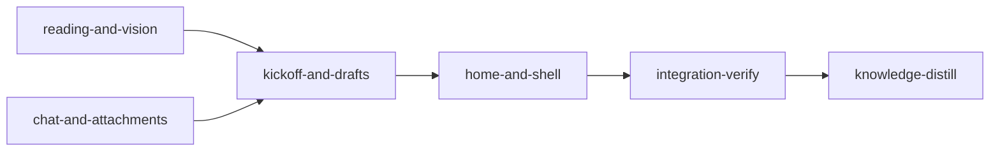

# Plan: Fix the operator's planner review of 2026-11-04

Implements: none

## Overview

The operator walked through the planner and reported 15 issues:

- Home's standalone plans and their Add and Move actions.
- A feature landing on the product overview instead of a short vision.
- An unreadable sources key and overview expansions that repeat themselves.
- A source view that loses the feature.
- A chat panel that feels bolted on, and attachments limited to repository documents.
- A kickoff conversation that shows internal instructions and doubled rows.
- A Taking shape panel with raw JSON and no rename.
- Drafts that vanish, and a New work that reopens the old draft.
- A cramped changed-since dialog, limits buried in the activity popover, an SSH line in Share, and a header that trails the dashboard's.

This plan fixes all 15. `doc/plans/briefs/planner-review-fixes/common.md` holds the issue list, the evidence, the operator's decisions and the plan's settled design decisions (D1-D17). The per-worker briefs sit beside it. The YAML is authoritative for gates and file ownership.

Models (operator's instruction): Claude only. Haiku and sonnet do the development. Opus at effort medium does every visual design, after invoking `frontend-design:frontend-design`. Fable is used only after opus has failed twice on one item, through `loom-advisor`. Integration-verify runs at its stage default (opus).

## Goals

- Each of the 15 issues is fixed and checked in the running app by integration-verify, one line per issue with evidence.
- Root causes are fixed at their owner, each with a test that fails on the old behaviour.
- Non-goals: regenerating stored summaries (the operator's next rebuild does that), resuming an ended Claude Code session (a continued draft starts a new session carrying the draft), and multi-session chat.

## Operator decisions (asked 2026-11-04)

- Attachments beyond repository documents are built now: images, sketches, PDFs and text transcripts, on New work and in chat.
- Implementation lanes: Claude only.

## Evidence behind the diagnoses

- **Issues 9 and 10, read from the operator's kickoff transcript** (`529ae179…`, 2026-11-04).
  - The opening is ONE user record: the `<pasted_content>` wrapper around the kickoff guidance, a blank line and the typed sentence. The user's own text therefore sits behind Show.
  - Every assistant reply ends with a well-formed fenced `loom-kickoff` block (`questions` is an array of strings). The browser renders it as a code block in the transcript, which is the "JSON object" the operator saw.
  - The skill body is an `isMeta` record, already skipped (`plan_session/transcript/records.rs:193`). The prominent "Skill" line is the Skill tool row.
  - "Make this a feature instead." is one plain record, so its doubling happens after delivery. T1 and C1 reproduce it first.
- **Issue 11.**
  - `KickoffTracker` is an in-memory `Mutex` (`plan_server/chat/kickoff.rs:101`).
  - `SessionRecord` (`plan_session/bridge/registry.rs:36-58`) has no shape or draft.
  - Home reads only `featuresAtom` and `standaloneAtom`.
  - The waiting row is a plain `<li>` (`header/activity-rows.tsx:94-105`).
  - `/new` renders the live session whenever one matches (`new/kickoff-route.tsx:22-31`).
- **Issue 5, measured over the stored overviews.** 7 of 25 member-citing sentences in `feat-planner/product`, and 12 of 27 in `feat-planner/engineering`, cite exactly one member sentence. Such a sentence opens to one sentence, often a paraphrase of it. The frozen summary fixtures cite one-sentence members (`loom/tests/planning_summary_support/fixtures.rs` `overview_of`, `product_overview`), so D3's exemption keeps them valid.
- **Issue 3.** `summary_id_for` (`planning/summary/store.rs:102-124`) gives ids to sections and plans only. The product spec says the vision has no summary (`doc/product/feat-planner/section_05.md` "Levels").
- **Issue 6.** `/files/*` is a sibling of `/f/:feature` (`router.tsx:34-51`), so the file view has no spine. Nothing reads the `returnTo` state that `chat/chips.tsx:82` writes.
- **Issue 13.**
  - `SummaryPanel` draws the token totals and `QuotaMeters` inside the popover's summary row (`summaries/summary-panel.tsx:15-45`).
  - The dashboard footer reuses `QuotaMeters` from `snapshot.status.quota` and hides a provider silently.
  - The planner already receives the same quota through `/api/summaries/panel`.

## Baselines at `ed36c12d` (main checkout)

- Web: `bun run typecheck`, `lint`, `format:check` and `vitest run` exit 0, with 356 files and 4196 tests passing, measured 2026-11-04.
- Rust: not re-measured for this plan. The last full suite, at `d8a91e64` (the planner issue fixes plan's integration-verify), passed with `cargo test --all-targets --no-fail-fast`. Each stage's acceptance re-runs its own modules; integration-verify runs the full suite.

## Before `loom run`

- The operator commits:
  - `doc/plans/PLAN-planner-review-fixes.md` and `doc/plans/briefs/planner-review-fixes/**` on `feat-planner-ui`;
  - the regenerated `doc/loom/summaries/**`, which is untracked at `ed36c12d`, so the worktree's screens show summaries. Without it every concept page reads "not built yet".
- `loom run` refuses an uncommitted plan or brief bundle (`loom/src/commands/run/plan_inputs.rs`), and a stage worktree is cut from `HEAD`.

## Sibling plans

Never run this plan at the same time as `PLAN-live-test-lane`, `PLAN-autonomous-recovery`, `PLAN-loom-ui-mods`, `PLAN-model-router-hooks`, `PLAN-adopt-ecc-best-practices` or `PLAN-web-host-graft-followthrough`. Whichever runs second starts from the merged tree.

- `PLAN-live-test-lane` edits `plan_session/sandbox/tests.rs`, `tests_kinds_fixture.rs`, `tests/planning_guidance_operator.rs`, `tests/plan_session_bridge_e2e.rs` and `tests/plan_chat_operator.rs`. This plan's chat stage edits `sandbox/reads.rs`, `sandbox/mod.rs` and `tests/plan_chat_operator/support.rs` (the `AttachmentInput` literal). No sibling plan has run at `ed36c12d`: `allow_unsandboxed_escape` is still in `plan/schema/types.rs`.
- `sandbox.allow_unsandboxed_escape` is omitted from the YAML, as in the previous plan: `PLAN-live-test-lane` deletes the field, and its default is `false`.

## Issue to gate map

| # | Stage | Executable proof |
| --- | --- | --- |
| 1 | home-and-shell | contract `standalone-plans-move-together`; frozen `features repair standalone shelf starts collapsed with its count` |
| 2 | kickoff-and-drafts, home-and-shell | contract `add-plan-preselects-standalone`; wiring `<KindControl` in `empty-kickoff.tsx`; V4's Add plan test; shots |
| 3 | reading-and-vision | contracts `vision-summary-is-expected`, `feature-opens-on-vision`, `vision-page-is-a-summary` |
| 4 | reading-and-vision | contract `key-chip-shows-its-title`; frozen key contracts |
| 5 | reading-and-vision | contract `overview-cites-two-member-sentences`; wiring `draws on at least two` in `seal/links.rs` and `sentence_limit(` in `brief.rs`; after_stage: R2's passing and one-sentence-member exemption tests exist |
| 6 | reading-and-vision, kickoff-and-drafts | contract `source-keeps-the-spine`; journey J2; after_stage: K2's `a Source page keeps the viewed document and sends it` |
| 7 | chat-and-attachments | contract `selection-chips-differ`; frozen context contracts; rail shot |
| 8 | chat-and-attachments | contracts `upload-stores-by-content-and-refuses-a-lie`, `file-attachment-is-sent-by-id`; after_stage: `an_upload_before_any_start_takes_authoring` |
| 9 | chat-and-attachments | contract `opening-splits-guidance-from-typed-text`; wiring `opening_typed(` in the provider and the bridge; after_stage: T1's provider test, bridge test, failed-delivery test and meta test, and C1's Skill drop test exist; artifact `transcript/opening.rs` |
| 10 | chat-and-attachments, kickoff-and-drafts | contracts `kickoff-fence-hidden`, `name-is-editable-while-taking-shape`; after_stage: the doubled-send test and the rename-override test exist |
| 11 | kickoff-and-drafts | contracts `drafts-survive-a-restart`, `new-work-starts-fresh-beside-an-open-draft`, `home-lists-unfinished-drafts`; after_stage: the draft lifecycle test and the continuation test exist; wiring `/new?session=` in `activity-rows.tsx` |
| 12 | home-and-shell | contract `changes-is-a-page`; frozen `changed-since-fixes` contracts |
| 13 | home-and-shell | contracts `footer-shows-limits-and-unavailable`, `footer-hides-the-note-when-limits-exist`, `popover-has-no-limits-or-token-totals`; wiring `<SummaryPanel` in `settings-sections.tsx`; after_stage: H1's `Settings shows the summary totals` |
| 14 | home-and-shell | contract `share-shows-no-tunnel`; before/after_stage `tunnel` in `share.tsx` and `wire/server.rs` |
| 15 | home-and-shell | after_stage: no Home or New work entry in the switcher, header block padding off `--space-2`; shots against the dashboard header; switcher tests |

## Paths

- The four implementation stages run with `working_dir: .` (the worktree root), because each one writes both `web/` and `loom/`, and contract files, artifacts and wiring sources may not contain `..`.
- Every path in their YAML, worker tables and descriptions is repository-relative. Acceptance commands enter `web/` with `cd web`, and cargo runs with `--manifest-path loom/Cargo.toml`.
- Web contracts set `cwd: web` and Rust contracts `cwd: loom`, so each runs from its package.
- Integration-verify keeps `working_dir: loom`.
- A command a description says to run "from the worktree root" starts with `cd "$(git rev-parse --show-toplevel)"`.

## Gate scope

- Every implementation stage runs the planner's whole vitest tree (`vitest run src/plan`). The changes are shared components (`chat/`, `header/`, `ui/`, `api/schema*.ts`) with consumers across `src/plan`, and a narrower run would leave their breakage to integration-verify, where no worker owns the files. The dashboard's tests outside `src/plan` run in integration-verify.
- Rust runs are scoped to the modules and test targets each stage changes, including every integration target that compiles a changed module or support file (`plan_summary_rebuild_contracts` and `planning_summary_session_cli` for the summary store; `plan_session_bridge_runtime_contracts` and `plan_chat_operator` for the bridge and attachments; `plan_session::bridge::` for the kickoff stage's `bridge/recovery.rs`). Integration-verify runs the full Rust suite. Loom's plan verifier warns against an unfiltered suite in a standard stage and leaves it to integration-verify; this plan follows that rule.
- Every implementation stage runs `cargo test --test maintainability`, the 400-line and 50-line ratchet against `loom/maintainability-baseline.txt` (a `ratchet_files` entry: never raise it). No web lint enforces the web limit, so each stage's main agent runs `wc -l` over every web file the stage changed before the final review round and splits any above 400.
- Worker-local checks stay narrow: each brief's "Run once at the end" is ONE command over the worker's own modules (CONTRIBUTING.md "Implementers Do Not Verify"). `cargo test` takes ONE test-name filter before `--`; several module filters go after it: `cargo test --manifest-path loom/Cargo.toml --lib -- a:: b::`.

## Execution Diagram



`reading-and-vision` and `chat-and-attachments` run concurrently. The two later stages run in turn.

## Stages

There is no knowledge-bootstrap stage: `architecture/planner-web-shell.md`, `planner-feature-screens.md`, the summary store topic, `planning-session-bridge.md` and `conventions/plan-web.md` already cover this area.

### 1. reading-and-vision

Exists by Q2 and Q4. It owns the summary store, the concept page server and the reading surfaces: `planning/summary/**`, `plan_server/concept/**`, `src/plan/concept/**`, `src/plan/feature/**` and `router.tsx`. It shares no file with the chat stage, so the two run in parallel. Folded into the chat stage, the two visual redesigns and their review rounds would pass 500,000 tokens.

Workers:

- R1 (sonnet): the vision summary kind (D1).
- R2 (sonnet): the two-member overview rule and the prompts (D3).
- R3 (sonnet): the landing, the vision route and the source route (D2, D4).
- V1 (opus medium, frontend-design): the key, the Summary/Source switch, the spine on source pages and the vision page.

Risk walk:

- Behaviour: `vision-summary-is-expected`, `overview-cites-two-member-sentences`, `feature-opens-on-vision`, `vision-page-is-a-summary`, `source-keeps-the-spine`, `key-chip-shows-its-title`.
- Blast radius of a new expected id: summary id lists and counts in four Rust contract targets and in the lib tests under `planning/summary/` (`status/tests.rs` pins `[ID1, ID2, PRODUCT, "plans/gone"]`, `engine/tests.rs` pins its `expected` list). R1 owns every one of them, updates the ids and counts, keeps every other assertion, and the main agent files one `dispute-integrity` naming each file.
- Planned frozen changes, all R3's and filed in the same dispute (common.md "Frozen contracts"):
  - `feature/spine.contracts.test.tsx` "finished feature opens the product overview" becomes "a feature opens its vision" (operator decision D2).
  - `feature/spine.contracts.test.tsx` "the Vision row opens the vision document" keeps its href and pathname assertions; its `findByText(VISION_BODY)` and `fetchedDocs` assertions become a summary page for `atlas/product/vision` (D1).
  - `concept/concept.contracts.test.tsx` "concept opening a summary sentence shows its source passages as inset blocks": only its `startsWith("/files/product/demo/section_01.md")` becomes `startsWith("/f/demo/source/product/demo/section_01.md")` (D4).
- Journeys: J1 (landing) and J2 (Source) move with the routes. This stage owns `web/scripts/plan-journeys.mjs` and `plan-journeys-kit.mjs`.

### 2. chat-and-attachments

Exists by Q2 and Q4. It owns `src/plan/chat/**`, `src/plan/attachments/**`, `plan_session/transcript/**`, `plan_session/attachments/**` and the new upload route. Its upload worker, transcript debugging and chat redesign would pass 500,000 tokens joined with any other stage.

Workers:

- T1 (sonnet): the opening split, the meta-record check and the doubled send in Rust.
- U1 (sonnet, security-specified brief): `POST /api/attachments` and the `file` attachment kind.
- C1 (sonnet): browser chat behaviour, file attachments and the chip labels.
- V2 (opus medium, frontend-design): the chat panel's presentation.

Risk walk:

- Untrusted input: upload bodies, filenames and ids (`upload-stores-by-content-and-refuses-a-lie`, U1's unit tests, reviewer (a) in integration-verify).
- Authoring: the upload route is `HolderOrTake`, because a fresh New work page attaches before Start, when nobody holds authoring; `an_upload_before_any_start_takes_authoring` proves the first upload, and the refusal of another browser and of read-only mode.
- External data, Claude Code's record shapes: `opening-splits-guidance-from-typed-text`, plus T1's meta-record test.
- Behaviour: `kickoff-fence-hidden`, `selection-chips-differ`, `file-attachment-is-sent-by-id`.
- Sandbox: U1's read-allowed and write-denied test.
- Lifecycle: the doubled send gets a named regression test, `one click on a shape choice sends one message` (C1) or `a_sent_message_is_one_item_after_delivery` (T1, if the cause is in Rust). Its cause is unproven until it is reproduced, so it is no frozen contract.
- The typed text reaches the bridge through a session-directory file, `SessionDir::opening_typed()`, which the guidance provider writes and the bridge reads when it builds the opening's sent items. Each side has its own test (`a_kickoff_offer_with_typed_text_writes_opening_typed`, `a_kickoff_opening_with_typed_text_creates_two_sent_items`, `a_failed_opening_delivery_marks_both_items`); the mapper contract is the reconciliation half. A new field on `LaunchGuidance`, `StartRequest` or `AuthoringStart` would touch about 14 files, three of them frozen, and the reading stage's `summaries/spawner.rs`.
- Blast radius of the `file` attachment: `AttachmentInput` becomes an untagged enum and `Attachment` gains `file: Option<FileMeta>`. Every struct literal of either type changes (U1's row lists each one). Planned frozen changes, U1's, filed in the dispute: `plan_session/transcript/paste_contract_tests.rs` and `tests/plan_session_bridge_core_contracts/records.rs` each gain the line `file: None,` in their `Attachment` literal, and nothing else.
- Frozen label: `chat/chat.contracts.test.tsx` expects "Used 3 tools · edited 2 files" for an ended turn. The fold line keeps that label form.

### 3. kickoff-and-drafts

Exists by Q1 and Q2.

- Q1: it needs the chat stage's merged opening split, fence drop and file attach choice on `/new` (`new/document-starter.tsx`).
- Q2: it writes `plan_server/chat/dispatch.rs`, which the chat stage also edits, and `ui/DESIGN.md` and the feat-planner product spec, which the reading stage also edits. It therefore depends on both earlier stages.

Workers:

- K1 (sonnet): the draft store, rename, set aside, continue and discard (D10, D12).
- K2 (sonnet): `/new`, `/new?session=`, the kind control, the Unfinished shelf and the waiting-row links (D11, D13).
- V3 (opus medium, frontend-design), after K2: the New work screen, the kickoff conversation, Taking shape and the shelf's look.

Risk walk:

- Persistence across a restart: `drafts-survive-a-restart` proves the reader; `a_started_kickoff_writes_its_draft` drives the production writes (start, send, shape, rename, end) through the dispatch harness and reads the result back through a fresh store.
- Continuation: `a_continued_draft_carries_its_name_size_and_attachments` carries the override, size, shape and attachments into the replacement draft, which is written before the old one is deleted. A draft write refreshes its file attachments through the chat stage's `uploads::touch`, so the 30-day attachment sweep never outlives an unfinished draft's references.
- Rename after confirm is refused (D12): `confirm_kickoff` sets `view.target` when it arms the write grant, and K1's refusal keys on `target`.
- Behaviour: `new-work-starts-fresh-beside-an-open-draft`, `home-lists-unfinished-drafts`, `name-is-editable-while-taking-shape`.
- Untrusted input: draft files are read back and checked against their caps, a corrupt file is skipped, and the session id is validated before it becomes a path (K1 tests, reviewer (b)).
- Wire: a new `PlanMessage` variant gets both schema arms and a fixture. The parity checks are `web/src/plan/api/schema.test.ts` (every `PLAN_MESSAGE_TYPES` tag has both arms) and `loom/src/plan_server/wire/tests_schema.rs` / `tests_chat.rs` (Rust round-trips the web fixtures). The frozen `plan schema parses every wire fixture` reads a fixed list of nine fixtures and does not cover a new one.
- Line budget: `plan_server/chat/dispatch.rs` is at 392 of 400 lines at base. The four new commands go in a new `chat/draft_cmd.rs`; `dispatch.rs` gains only the match arms.

### 4. home-and-shell

Exists by Q1 and Q2.

- Q1: Home mounts the kickoff stage's Unfinished shelf, and the header identity reads its `name_override`.
- Q2: it writes `router.tsx` (after the reading stage), `home/home.tsx` and `header/activity-rows.tsx` (after the kickoff stage), and `ui/DESIGN.md`.

Workers:

- H1 (sonnet): the footer, and the statistics moved out of the popover (D15).
- H2 (haiku): the share tunnel removal (D16).
- V4 (opus medium, frontend-design): Home from scratch and the header (D17).
- V5 (opus medium, frontend-design): the `/changes` page (D14).

Risk walk:

- Behaviour: `standalone-plans-move-together`, `changes-is-a-page`, `footer-shows-limits-and-unavailable`, `popover-has-no-limits-or-token-totals`, `share-shows-no-tunnel`.
- Frozen contracts that must hold, unedited: the standalone `details` and its count; `changed-since-fixes` through the kit; `summaries/contracts.test.tsx` (`SummaryPanel` renders the totals AND the claude/codex quota meters, so `SummaryPanel` keeps them); the logo sizes; `the header has no rail or view tabs` (it asserts links named exactly "Home" and "Files", so the Home tab stays); `chat/chat.contracts.test.tsx` "chat changed since you looked…" (it finds a BUTTON named /Changed since you looked/, so the trigger stays a button that navigates); `plan schema parses every wire fixture`.

### Integration Verification

Opus by default. It builds `web/dist` and the binary first, runs a diagnostic check and the browser preflight, then the journeys and the screens, and walks the 15 issues with evidence (`loom memory note "issue-walk #N: …"`). It fixes what fails, re-runs the final full check against the rebuilt bytes, then the final review round with reviewers (a) to (d), and commits the bundle last. See `doc/plans/briefs/planner-review-fixes/integration-verify.md`.

### Knowledge Distillation

It rewrites these sections to the new truth:

- `architecture/planner-web-shell.md`: "Header and dock" (switcher, footer, popover), "Home and kickoff" (table, drafts, kind control), "Chat home and the chat panel" (opening split, fold line, context chip, file attachments) and "Changed since and seen text" (the page).
- `architecture/planner-feature-screens.md`: the landing, the vision page and the source route. It also corrects "concept mode with Source on the same page".
- The summary store topic: the vision id and the two-member rule.

It records in `mistakes/` the `loom-kickoff` fence leaking into the transcript and the composite opening hiding the user's text, then curates the remaining memories.

## Environment inventory

| Need | State |
| --- | --- |
| crates.io, npm registry | `allowed_domains` |
| `web/node_modules` | provisioned by `loom.provision` |
| Chromium for screens | `~/.cache/ms-playwright` on the host, as earlier planner plans used it. Each web stage and integration-verify run the browser preflight before any visual worker or walk. A failing preflight is filed with `loom stage block <stage-id> "<preflight output>"`. |
| Browser preflight | after the build, from the worktree root: `scripts/plan-screens.sh loom/target/debug/loom "$LOOM_SCRATCH_DIR/preflight" /` |
| tmux in a stage session | not granted. `scripts/plan-journeys.sh` runs WITHOUT `--strict`, and PENDING journeys are reported. |
| Host platform | Linux. On macOS the operator sets `allow_local_binding: true` first (`sandbox/settings/policy.rs`). |
| Local server and Playwright | the server start, the URL wait and the browser run share one Bash call. A throwaway driver imports `playwright-core` by absolute path (`<worktree>/web/node_modules/playwright-core/index.mjs`) and launches with `args: ["--no-sandbox"]`. A session view is fed by stubbing `WebSocket` in `addInitScript`. |
| Claude login in a stage | none. A real chat, a real summary rebuild and a real image read are operator checks after the run. |
| `web/dist` | a stage that builds the bundle to shoot restores it before its final review round: `git restore web/dist`, then `git clean -fdq -- web/dist`, then `git status --short --untracked-files=all web/dist` prints nothing. Only integration-verify commits a bundle. |
| `/tmp` plan lock | J3 (edit and save) fails in a stage sandbox (`fs/locking.rs` under `/tmp`). That is the environment; an operator runs J3 outside a stage. |
| Throwaway drivers | every throwaway Playwright script and its output live under `$LOOM_SCRATCH_DIR`, never in the worktree: an untracked file enters the review gate's change fingerprint. |
| Real sandbox | `tests/plan_session_confinement.rs` skips unless bwrap, socat and srt run, which a stage cannot do. The attachments read grant is proven in a stage only at the settings and guard level; the real-sandbox probe is an operator check. |

## After the run (operator checks)

- Rebuild summaries. `feat-planner` gains `product/vision.md`, and no overview sentence cites a single member sentence of a longer summary.
- Attach a screenshot and a transcript in a real chat. The session reads both.
- Start a kickoff, leave it, return from Home's Unfinished shelf, rename it, set it aside, and continue it.
- Outside a stage: `LOOM_TEST_REQUIRE_SANDBOX_FREE=1 cargo test --manifest-path loom/Cargo.toml --test plan_session_confinement`, with U1's probe `an_attachment_is_readable_and_not_writable`.

---

<!-- loom METADATA -->

```yaml
loom:
  version: 2
  auto_merge: null
  sandbox:
    enabled: true
    auto_allow: true
    excluded_commands: []
    filesystem:
      deny_read:
      - ~/.ssh/**
      - ~/.aws/**
      - ~/.config/gcloud/**
      - ~/.gnupg/**
      deny_write:
      - ../../**
      allow_write: []
    network:
      allowed_domains:
      - crates.io
      - index.crates.io
      - static.crates.io
      - registry.npmjs.org
      additional_domains: []
      allow_local_binding: false
      allow_unix_sockets: []
      allow_all_unix_sockets: false
    linux:
      enable_weaker_nested: false
    command_confinement: confined
  ratchet_files:
  - loom/maintainability-baseline.txt
  - doc/loom/knowledge/check-baseline.txt
  provision:
  - working_dir: web
    command: >-
      test ! -e .npmrc && test ! -L .npmrc && bun install --frozen-lockfile
      --ignore-scripts --backend=copyfile --config=/dev/null
  stages:
  - id: reading-and-vision
    name: Vision summary and landing, overview levels, sources key, source inside the feature
    summary: >-
      Gives each feature's vision its own short summary and opens features on it, makes every
      overview expansion show more than the sentence, shows document names in the sources key, and
      keeps the feature sidebar when reading a document's source.
    description: |
      Read doc/plans/briefs/planner-review-fixes/common.md, then the four briefs in doc/plans/briefs/planner-review-fixes/reading-and-vision/, and web/src/plan/ui/DESIGN.md, before dispatch. Pass common.md and each worker's brief path to that worker.
      PATHS: working_dir is the worktree root. Every path in this stage, YAML and prose alike, is repository-relative (web/src/plan/..., loom/src/...); acceptance commands enter web/ with cd web, and cargo uses --manifest-path loom/Cargo.toml.
      KNOWLEDGE: architecture/planner-feature-screens.md (Layout route and landing, Spine), architecture/planner-web-shell.md (Reading column), the summary store topic in INDEX.md, conventions/plan-web.md (Concept Mode Test Rules, Visual Stages and the Screenshot Script).
      PUBLIC SURFACE for the contract session:
      - Rust loom/src/planning/summary/store/vision_contract_tests.rs (test path planning::summary::store::vision_contract_tests::<fn>). Build the project with the pub(crate) cfg(test) fixtures crate::planning::summary::evaluate::fixtures (two_sections, Fixture, and the loader the fixture module uses), whose feature "demo" has a vision doc/product/demo/index.md and two sections. Assert through crate::planning::summary::store: expected_ids(&project) contains "demo/product/vision"; summary_id_for(&project, Path::new("doc/product/demo/index.md")) is Some("demo/product/vision"); summary_path("demo/product/vision") is doc/loom/summaries/demo/product/vision.md; source_of(&project, "demo/product/vision") is Some(doc/product/demo/index.md); Scope::of(&project, "overview/demo/product") (the fixture's PRODUCT) is Some, and its product, engineering and outside lists all lack "demo/product/vision". At base validate_id rejects the id, so all fail. The contract session registers the module by adding `#[cfg(test)] mod vision_contract_tests;` after `mod tests;` in loom/src/planning/summary/store.rs; workers do not touch that line.
      - Rust loom/src/planning/summary/seal/two_member_contract_tests.rs (test path planning::summary::seal::two_member_contract_tests::<fn>). Follow loom/src/planning/summary/seal/restate_contract_tests.rs exactly for setup (its seal_overview_over pattern, fixtures and seal(root, paths, PRODUCT, false)). Seal the member section summaries so section_01's summary holds TWO sentences ("Alpha one holds." and "Alpha two holds."), then seal an overview draft valid in every other respect (it cites every member and the vision) whose first sentence "The planner keeps one thing." cites exactly one of those two member sentences by #s-<sentence_id>. Assert SealError::Rejected with a message containing "at least two". The passing case (both member sentences cited) is R2's unit test, not a contract: it seals at base. The contract session registers the module by adding `#[cfg(test)] mod two_member_contract_tests;` after `mod restate_contract_tests;` in loom/src/planning/summary/seal.rs; workers do not touch that line.
      - Web web/src/plan/feature/review-fixes.contracts.test.tsx (top-level it() calls). Use web/src/plan/concept/concept-route-support.tsx renderAt(path, setup) and makeStubFetch, as web/src/plan/concept/concept-route-headers.test.tsx does. FeatureLayout draws the spine and FeatureLanding leaves "Loading the feature" only when projectAtom holds the feature's checklist, so every test calls renderAt(path, (store) => store.set(projectAtom, { checklists: [finishedChecklist()], standalone: [], moves: [] })). Copy finishedChecklist with the helpers it needs (atlas, section, offer, SECTION_NAMES, SPINE) from web/src/plan/feature/spine.contracts.test.tsx. api/fixtures/concept-summary.json is feature "demo", so each stub page overrides its feature, key and path as below.
        - "a feature with a written spec opens on its vision": renderAt("/f/atlas", seed); waitFor the router's pathname to be "/f/atlas/vision".
        - "the vision page shows the vision summary with Source one click away": the stub answers concept key "atlas/product/vision" with { ...clone(concept-summary.json), key: "atlas/product/vision", title: "Vision", feature: "atlas", path: "doc/product/atlas/index.md" }; renderAt("/f/atlas/vision", seed); the reading column holds that fixture's first sentence text, and a link named exactly "Source" has an href starting "/f/atlas/source/".
        - "a summary's Source link keeps the feature spine": the stub answers concept key "atlas/product/section_01" with { ...clone(concept-summary.json), key: "atlas/product/section_01", feature: "atlas", path: "doc/product/atlas/section_01.md" }; renderAt("/f/atlas/product/section_01", seed); click the link named exactly "Source"; waitFor the pathname to start with "/f/atlas/source/", then screen.getByRole("navigation", { name: "Feature documents" }) exists.
      - Web web/src/plan/concept/review-fixes.contracts.test.tsx: "a key chip shows its document title". Render the overview through renderAt("/f/demo/product") over api/fixtures/concept-overview.json as concept.contracts.test.tsx does. For every link inside getByRole("list", { name: "Document key" }) (the fixture has three chips): clone it, remove every .sr-only descendant from the clone, and expect the clone's textContent to contain the chip's full doc.title from the fixture.
      Frozen and binding on every worker: the contracts listed in common.md "Frozen contracts that bind this plan". The planned edits of frozen files are R3's three, exactly as common.md "Planned edits of frozen tests" words them: feature/spine.contracts.test.tsx "finished feature opens the product overview" becomes "a feature opens its vision"; feature/spine.contracts.test.tsx "the Vision row opens the vision document" swaps its raw-body assertions for the vision summary page; concept/concept.contracts.test.tsx's passage-chip href prefix becomes "/f/demo/source/product/demo/section_01.md".
      BEFORE SPAWNING: cd "$(git rev-parse --show-toplevel)" && (cd web && bun run build) && (cd loom && cargo build). Then run the browser preflight (plan Environment inventory). If it fails, spawn no worker: file loom stage block reading-and-vision "<preflight output>".
      WORKERS (one message, all four in parallel):
      | Worker | Role | Tier | Files owned | Shared context | Brief path |
      | ------ | ---- | ---- | ----------- | -------------- | ---------- |
      | R1 | Vision summary kind, its sentence limit in the brief (issues 3, 5) | sonnet | loom/src/planning/summary/store.rs; loom/src/planning/summary/store/**; loom/src/planning/summary/format.rs; loom/src/planning/summary/format/**; loom/src/planning/summary/evaluate.rs; loom/src/planning/summary/evaluate/**; loom/src/planning/summary/status.rs; loom/src/planning/summary/status/**; loom/src/planning/summary/brief.rs; loom/src/planning/summary/brief/**; loom/src/planning/summary/engine.rs; loom/src/planning/summary/engine/**; loom/src/planning/summary/write.rs; loom/src/planning/summary/write/**; loom/src/planning/summary/cost.rs; loom/src/planning/summary/cost/**; loom/src/planning/summary/claims.rs; loom/src/planning/summary/claims/**; loom/src/planning/summary/config.rs; loom/src/planning/summary/config/**; loom/src/planning/summary/mod.rs; loom/src/plan_server/concept/**; loom/src/plan_server/summaries/**; loom/src/plan_server/wire/concept.rs; loom/src/plan_server/wire/fixtures/concept-overview.json; loom/src/plan_server/wire/fixtures/concept-summary.json; loom/tests/planning_summary_contracts.rs; loom/tests/planning_summary_cli_contracts.rs; loom/tests/planning_summary_support/**; loom/tests/summary_engine_contracts.rs; loom/tests/plan_concept_contracts.rs; doc/product/feat-planner/section_05.md; doc/product/feat-planner/index.md | common.md | doc/plans/briefs/planner-review-fixes/reading-and-vision/r1-vision-summary.md |
      | R2 | Two-member overview rule and prompts (issue 5) | sonnet | loom/src/planning/summary/seal/links.rs; loom/src/planning/summary/seal/tests.rs; plan-plugin/agents/**; loom/src/planning/guidance/text/summary_codex.md | common.md | doc/plans/briefs/planner-review-fixes/reading-and-vision/r2-overview-levels.md |
      | R3 | Landing, vision route, source route, journeys (issues 3, 6) | sonnet | web/src/plan/router.tsx; web/src/plan/router.test.tsx; web/src/plan/feature/landing.ts; web/src/plan/feature/landing.test.ts; web/src/plan/feature/document-page.tsx; web/src/plan/feature/source-href.ts; web/src/plan/feature/source-href.test.ts; web/src/plan/feature/spine-model.ts; web/src/plan/feature/spine-model.test.ts; web/src/plan/feature/feature-layout.tsx; web/src/plan/feature/feature-layout.test.tsx; web/src/plan/feature/spine.contracts.test.tsx; web/src/plan/api/page-key.ts; web/src/plan/api/page-key.test.ts; web/src/plan/api/schema-concept.ts; web/src/plan/api/fixtures/concept-overview.json; web/src/plan/api/fixtures/concept-summary.json; web/src/plan/concept/page-heading.tsx; web/src/plan/concept/page-heading.test.tsx; web/src/plan/concept/passage.tsx; web/src/plan/concept/passage.test.tsx; web/src/plan/concept/concept-route.tsx; web/src/plan/concept/concept-route.test.tsx; web/src/plan/concept/concept-route-headers.test.tsx; web/src/plan/concept/chain.test.tsx; web/src/plan/concept/concept.contracts.test.tsx; web/src/plan/files/doc-heading-view.tsx; web/src/plan/files/doc-heading-view.test.tsx; web/src/plan/files/doc-heading-view-parts.test.tsx; web/src/plan/files/section-chips.ts; web/src/plan/files/section-chips.test.ts; web/src/plan/files/heading-parts.tsx; web/scripts/plan-journeys.mjs; web/scripts/plan-journeys-kit.mjs; web/scripts/plan-journeys-reading.mjs | common.md | doc/plans/briefs/planner-review-fixes/reading-and-vision/r3-vision-routes.md |
      | V1 | Sources key, Summary and Source switch, spine on source, vision page (issues 3, 4, 6) | opus medium | web/src/plan/concept/document-key.tsx; web/src/plan/concept/document-key.test.tsx; web/src/plan/concept/key-chip-extras.tsx; web/src/plan/concept/key-row-extras.tsx; web/src/plan/concept/concept-page.css; web/src/plan/concept/concept.css; web/src/plan/concept/concept-runs.css; web/src/plan/feature/spine.tsx; web/src/plan/feature/spine.css; web/src/plan/feature/spine.test.tsx; web/src/plan/ui/DESIGN.md; web/src/plan/ui/design.css; web/src/plan/ui/doc-heading.tsx; web/src/plan/ui/doc-heading.css; web/src/plan/ui/doc-heading.test.tsx; web/src/plan/ui/doc-heading-parts.test.tsx; web/src/plan/help/reading-scene.tsx; web/src/plan/help/reading-scene.test.tsx; web/src/plan/help/getting-around-scene.tsx; web/src/plan/help/topics.ts; web/src/plan/help/topics.test.tsx | DESIGN.md | doc/plans/briefs/planner-review-fixes/reading-and-vision/v1-reading-visual.md |
      Spawn R1, R2 and R3 as loom-software-engineer. Each prompt says: Your brief: <path>. Read it and common.md in full before anything else. Spawn V1 as loom-senior-software-engineer with effort medium; its prompt says: First invoke the frontend-design:frontend-design skill with the Skill tool. Then read your brief <path>, common.md and web/src/plan/ui/DESIGN.md in full before anything else.
      Seams: R1 adds `pub fn sentence_limit(id: &str) -> usize` in format.rs and calls it from brief.rs write_rules itself (R1 owns brief.rs); R2 only edits the seal and the prompt files. V1's spine.tsx reads useLocation() for the source sub-line; R3's spine-model.ts groupOfPathname marks the row current.
      A worker that reports a needed change outside its files: you make it if it passes the small-change rule, else spawn a fresh worker of the same tier after the first wave returns. Any file in the stage's files list not in the table belongs to that follow-up worker only.
      FIX ROUNDS: a non-visual failure goes to a fresh worker one tier above the one that failed (sonnet, then opus). A visual miss follows common.md's refinement loop; after a third miss, spawn loom-advisor (fable) with the shots, both attempts and their evidence, then one fresh opus/medium worker on its diagnosis.
      AFTER THE WORKERS: (cd web && node_modules/.bin/oxfmt); (cd loom && cargo fmt --all). Rebuild the bundle and binary from the worktree root, then run scripts/plan-screens.sh --worktree-doc --themes=ledger,aubergine loom/target/debug/loom "$LOOM_SCRATCH_DIR/screens" /f/feat-planner /f/feat-planner/vision /f/feat-planner/product /f/feat-planner/product/section_05 /f/feat-planner/source/product/feat-planner/section_05.md. Check issues 3, 4 and 6 against V1's fixed targets at 1440px and 390px, and run the refinement loop for every miss. Restore web/dist before the final review round (plan Environment inventory). Run wc -l over every web file the stage changed and split any above 400. The gate is one loom check reading-and-vision beside the final loom-code-reviewer round. After the commit, file one dispute-integrity naming feature/spine.contracts.test.tsx (both planned tests, D1 and D2), concept/concept.contracts.test.tsx (D4), and every test R1 and R3 reported changing, by file.
      LEDGER: no file this stage edits may cross 400 lines, and a function over 50 lines is split.
      Use parallel subagents and skills to maximize performance.
      MEMORY: record mistakes, decisions and surprises with loom memory immediately, subagents too; NEVER Claude Code auto-memory.
    dependencies: []
    acceptance:
    - cd web && node_modules/.bin/tsc -b --noEmit
    - cd web && node_modules/.bin/oxlint --deny-warnings
    - cd web && node_modules/.bin/oxfmt --check
    - cd web && node_modules/.bin/vitest run src/plan
    - cargo clippy --manifest-path loom/Cargo.toml --all-targets -- -D warnings
    - cargo fmt --manifest-path loom/Cargo.toml --check
    - command: 'cargo test --manifest-path loom/Cargo.toml --lib planning::summary::'
      timeout_secs: 1800
    - command: 'cargo test --manifest-path loom/Cargo.toml --lib plan_server::'
      timeout_secs: 1800
    - >-
      cargo test --manifest-path loom/Cargo.toml --test planning_summary_contracts --test
      planning_summary_cli_contracts --test summary_engine_contracts --test plan_concept_contracts
      --test plan_summary_rebuild_contracts --test planning_summary_session_cli
    - cargo test --manifest-path loom/Cargo.toml --test maintainability
    - RUSTDOCFLAGS="-D warnings" cargo doc --manifest-path loom/Cargo.toml --workspace --all-features --no-deps
    files:
    - web/src/plan/router.tsx
    - web/src/plan/router.test.tsx
    - web/src/plan/feature/**
    - web/src/plan/concept/**
    - web/src/plan/api/page-key.ts
    - web/src/plan/api/page-key.test.ts
    - web/src/plan/api/schema-concept.ts
    - web/src/plan/api/fixtures/concept-overview.json
    - web/src/plan/api/fixtures/concept-summary.json
    - web/src/plan/files/doc-heading-view.tsx
    - web/src/plan/files/doc-heading-view.test.tsx
    - web/src/plan/files/section-chips.ts
    - web/src/plan/files/section-chips.test.ts
    - web/src/plan/files/heading-parts.tsx
    - web/src/plan/ui/DESIGN.md
    - web/src/plan/ui/design.css
    - web/src/plan/ui/doc-heading.tsx
    - web/src/plan/ui/doc-heading.css
    - web/src/plan/ui/doc-heading.test.tsx
    - web/src/plan/ui/doc-heading-parts.test.tsx
    - web/src/plan/help/reading-scene.tsx
    - web/src/plan/help/reading-scene.test.tsx
    - web/src/plan/help/getting-around-scene.tsx
    - web/src/plan/help/topics.ts
    - web/src/plan/help/topics.test.tsx
    - web/scripts/plan-journeys.mjs
    - web/scripts/plan-journeys-kit.mjs
    - web/scripts/plan-journeys-reading.mjs
    - web/src/plan/files/doc-heading-view-parts.test.tsx
    - loom/src/planning/summary/**
    - loom/src/planning/guidance/text/summary_codex.md
    - loom/src/plan_server/concept/**
    - loom/src/plan_server/summaries/**
    - loom/src/plan_server/wire/concept.rs
    - loom/src/plan_server/wire/fixtures/concept-overview.json
    - loom/src/plan_server/wire/fixtures/concept-summary.json
    - loom/tests/planning_summary_contracts.rs
    - loom/tests/planning_summary_cli_contracts.rs
    - loom/tests/planning_summary_support/**
    - loom/tests/summary_engine_contracts.rs
    - loom/tests/plan_concept_contracts.rs
    - plan-plugin/agents/**
    - doc/product/feat-planner/section_05.md
    - doc/product/feat-planner/index.md
    working_dir: .
    stage_type: standard
    artifacts:
    - web/src/plan/feature/source-href.ts
    wiring:
    - source: web/src/plan/concept/page-heading.tsx
      pattern: featureSourceHref(
      description: the summary page's Source view links to the source route inside the feature
      literal: true
    - source: web/src/plan/concept/passage.tsx
      pattern: featureSourceHref(
      description: passage chips open the source inside the feature
      literal: true
    - source: loom/src/planning/summary/store.rs
      pattern: product/vision
      description: the store knows the vision summary id
      literal: true
    - source: loom/src/planning/summary/seal/links.rs
      pattern: draws on at least two
      description: the overview seal enforces the two-member rule (issue 5)
      literal: true
    - source: loom/src/planning/summary/brief.rs
      pattern: sentence_limit(
      description: the rebuild brief states the same sentence cap the seal enforces, 8 for a vision
      literal: true
    - source: web/src/plan/router.tsx
      pattern: '"source/*"'
      description: the source route sits under the feature layout (issue 6)
      literal: true
    before_stage:
    - command: test ! -e web/src/plan/feature/source-href.ts
      description: no feature source route helper exists yet
    - command: '! rg -qF ''product/vision'' loom/src/planning/summary/store.rs'
      description: the summary store has no vision id yet (issue 3)
    after_stage:
    - command: test -s web/src/plan/feature/source-href.ts
      description: the feature source route helper exists (issue 6)
    - command: rg -qF 'a feature opens its vision' web/src/plan/feature/spine.contracts.test.tsx
      description: the planned landing contract replacement is in place (D2)
    - command: '! rg -qF ''finished feature opens the product overview'' web/src/plan/feature/spine.contracts.test.tsx'
      description: the old landing contract is gone (D2)
    - command: test "$(wc -l < web/scripts/plan-journeys.mjs)" -le 400
      description: the journey script is split under the 400-line limit (J1 and J2 moved to plan-journeys-reading.mjs)
    - command: '! rg -q ''Use at most 15 sentences'' plan-plugin/agents/summary.md'
      description: the summary agent prompt states the per-kind cap instead of one flat 15
    - command: rg -q 'at least two' plan-plugin/agents/overview.md
      description: the overview prompt states the two-member rule (D3)
    - command: rg -q 'fn an_overview_sentence_citing_two_member_sentences_seals\b' loom/src/planning/summary/seal
      description: the two-member rule's passing case is tested (D3)
    - command: rg -q 'fn a_sentence_citing_the_only_sentence_of_a_member_seals\b' loom/src/planning/summary/seal
      description: the one-sentence-member exemption is tested (D3)
    subagent_timeout_secs: 900
    implementers:
    - claude
    skills:
    - loom-react
    - loom-typescript
    - loom-rust
    contracts:
    - id: vision-summary-is-expected
      file: loom/src/planning/summary/store/vision_contract_tests.rs
      cwd: loom
      test: planning::summary::store::vision_contract_tests::a_feature_vision_has_a_document_summary
      scenario: >-
        a project whose feature demo has a vision and two sections; expected_ids, summary_id_for,
        summary_path and source_of for the vision, and the product overview's member list
      rejects: >-
        a store that gives the vision no summary id, one that stores it outside
        doc/loom/summaries/demo/product/vision.md, or one that makes the vision an overview member
    - id: overview-cites-two-member-sentences
      file: loom/src/planning/summary/seal/two_member_contract_tests.rs
      cwd: loom
      test: planning::summary::seal::two_member_contract_tests::an_overview_sentence_citing_one_member_sentence_is_rejected
      scenario: >-
        section_01's summary holds two sentences; an otherwise valid overview draft has a sentence
        citing exactly one of them
      rejects: an overview seal that accepts a sentence that opens to a single member sentence
    - id: feature-opens-on-vision
      file: web/src/plan/feature/review-fixes.contracts.test.tsx
      cwd: web
      test: a feature with a written spec opens on its vision
      scenario: renderAt /f/atlas for a feature whose sections are all written
      rejects: the landing that sends a finished feature to /f/atlas/product
    - id: vision-page-is-a-summary
      file: web/src/plan/feature/review-fixes.contracts.test.tsx
      cwd: web
      test: the vision page shows the vision summary with Source one click away
      scenario: >-
        renderAt /f/atlas/vision with the stub serving a summary page for atlas/product/vision
      rejects: >-
        a vision route that still renders the raw vision source, or a Source link that leaves the
        feature for /files
    - id: source-keeps-the-spine
      file: web/src/plan/feature/review-fixes.contracts.test.tsx
      cwd: web
      test: a summary's Source link keeps the feature spine
      scenario: renderAt /f/atlas/product/section_01, click Source
      rejects: a Source link to /files/... where no feature spine is drawn
    - id: key-chip-shows-its-title
      file: web/src/plan/concept/review-fixes.contracts.test.tsx
      cwd: web
      test: a key chip shows its document title
      scenario: >-
        the product overview's first four key chip links, with sr-only text removed, each read
        their document title
      rejects: a chip that shows only a glyph and a number, with the title in sr-only text and a tooltip
  - id: chat-and-attachments
    name: Opening split, quiet tool rows, chat panel redesign, file attachments
    summary: >-
      Shows the user's first message once and keeps agent instructions out of the way, folds tool
      activity into one quiet line, hides the kickoff's JSON block, redesigns the chat panel, and
      lets a chat or New work take screenshots, images, PDFs and text files.
    description: |
      Read doc/plans/briefs/planner-review-fixes/common.md, then the four briefs in doc/plans/briefs/planner-review-fixes/chat-and-attachments/, and web/src/plan/ui/DESIGN.md, before dispatch. Pass common.md and each worker's brief path to that worker.
      PATHS: working_dir is the worktree root. Every path in this stage, YAML and prose alike, is repository-relative (web/src/plan/..., loom/src/...); acceptance commands enter web/ with cd web, and cargo uses --manifest-path loom/Cargo.toml.
      KNOWLEDGE: architecture/planner-web-shell.md (Chat home and the chat panel), architecture/planning-session-bridge.md (Delivery), conventions/plan-web.md (Chat Panel and Review UI Rules, New PlanMessage Variants Need Both Schema Arms).
      PUBLIC SURFACE for the contract session:
      - Rust loom/src/plan_session/transcript/opening_contract_tests.rs (test path plan_session::transcript::opening_contract_tests::<fn>). Use crate::plan_session::transcript::Mapper as loom/src/plan_session/transcript/paste_contract_tests.rs does (Mapper::new, add_server_item(Item), ingest_main(&str) -> Ingest, and the pub(super) helpers in transcript/tests.rs). Add two Sent server items in order: Item::User { id: "s-1", text: GUIDANCE, origin: Some(Origin::Offer), delivery: Sent, attachments: empty } and Item::User { id: "s-2", text: TYPED, origin: None, delivery: Sent, attachments: empty }, where GUIDANCE is "loom plan: Kickoff.\nDiscuss the work and confirm its size and name before writing anything under doc/.\nLoad the skill loom-plan:kickoff, then begin by telling me what you read and what you plan to ask." and TYPED is "i would like to add support for microvm test environment". Then call mapper.expect_opening(Some(Origin::Offer)), as bridge/start.rs Session::configure does for a kickoff. Then ingest one user record (shape as in paste_contract_tests.rs) whose content is "\n\n<pasted_content id=\"f509\">\n" + GUIDANCE + "\n\n" + TYPED + "\n</pasted_content id=\"f509\">\n". Afterwards the mapper's items hold exactly one user item with origin Some(Origin::Offer) whose text is GUIDANCE, exactly one user item with origin None whose text is TYPED, the two have different ids, and no item's delivery is Sent. Read the items back through the mapper's own accessor that the existing tests use (turns()). The contract session registers the module by adding `#[cfg(test)] mod opening_contract_tests;` in loom/src/plan_session/transcript/mod.rs beside `mod paste_contract_tests;`.
      - Rust loom/src/plan_server/tests/uploads_contract.rs (test path plan_server::tests::uploads_contract::<fn>), served through crate::plan_server::tests::support (project, options, serve, request, send, origin, bootstrap, post_json, status, json_body, skip). The test begins `if skip("an_upload_is_stored_by_content_and_a_mislabelled_body_is_refused") { return; }` as the other server tests do. Cookies come from bootstrap(&server); the holder role from post_json(&server, "/api/test/take", &cookies, ""), as loom/src/plan_server/tests/ws.rs takes it. support::request takes body: &str and cannot carry byte 0x89, so a binary upload is built as bytes: let mut raw = request("POST", &server, "/api/attachments?name=sketch%20one.png", &cookies, &[&origin(&server), "Content-Type: image/png", "Content-Length: 32"], "").into_bytes(); raw.extend_from_slice(&body); send(server.local, &raw). The contract session registers the module with `mod uploads_contract;` in loom/src/plan_server/tests/mod.rs.
        - an_upload_is_stored_by_content_and_a_mislabelled_body_is_refused: POST /api/attachments?name=sketch%20one.png with Content-Type image/png and a body of the 8 PNG signature bytes (89 50 4E 47 0D 0A 1A 0A) followed by 24 zero bytes. Expect 200 and a JSON body whose id equals the first 16 lowercase hex characters of the sha256 of those 32 bytes (sha2 and hex are already dependencies), name "sketch one.png", media_type "image/png" and bytes 32; the file server.ctx.runtime().dir.join("attachments").join(format!("{id}.png")) exists and holds those 32 bytes. Then POST the body "hello" with Content-Type image/png: expect 422. Then POST "hello" with Content-Type application/x-msdownload: expect 415.
      - Web web/src/plan/chat/review-fixes.contracts.test.tsx (top-level it() calls; stub matchMedia wide).
        - "an assistant reply hides its loom-kickoff block": mount from web/src/plan/chat/transcript-test-kit.tsx with one assistant text item (build it as transcript-test-kit's own tests build text items) whose markdown is built in the test as const fence = "`".repeat(3); "I read these first.\n\n" + fence + "loom-kickoff\n{\"problem\":\"p\",\"decisions\":[],\"questions\":[\"Which hosts?\"]}\n" + fence + "\n". The log contains "I read these first." and its textContent contains neither "loom-kickoff" nor "Which hosts?" nor "\"questions\"".
        - "two selections on one summary page get different chips": chipLabel from web/src/plan/chat/chips.tsx takes an attachment-shaped input (path, kind, quote…), not a draft, so the test labels chipLabel(toAttachmentInput(d1)) and chipLabel(toAttachmentInput(d2)) (toAttachmentInput from web/src/plan/chat/commands.ts), where d1 and d2 are summary drafts built as web/src/plan/chat/chips.test.tsx's summary() builds them, with the same summary and text set to the quotes "Alpha holds the first idea of the section." and "Beta holds a second, different idea." The two labels differ, the first contains "Alpha holds the first idea" and the second contains "Beta holds a second".
        - "a file attachment is sent by its id": toAttachmentInput from web/src/plan/chat/commands.ts over the draft { kind: "file", id: "0123456789abcdef", name: "sketch.png", media_type: "image/png", bytes: 1234 } (cast through unknown) returns exactly { kind: "file", id: "0123456789abcdef", name: "sketch.png" }, with no path and no quote key.
      Frozen and binding: common.md "Frozen contracts that bind this plan", in particular chat/context.contracts.test.tsx, chat/chat-fixes.contracts.test.tsx, chat/chat.contracts.test.tsx and loom/src/plan_session/transcript/paste_contract_tests.rs.
      BEFORE SPAWNING: cd "$(git rev-parse --show-toplevel)" && (cd web && bun run build) && (cd loom && cargo build), then the browser preflight. If it fails, spawn no worker: file loom stage block chat-and-attachments "<preflight output>".
      WORKERS (one message, all four in parallel):
      | Worker | Role | Tier | Files owned | Shared context | Brief path |
      | ------ | ---- | ---- | ----------- | -------------- | ---------- |
      | T1 | Opening split, meta records, doubled send in Rust (issues 9, 10) | sonnet | loom/src/plan_session/transcript/mod.rs; loom/src/plan_session/transcript/content.rs; loom/src/plan_session/transcript/records.rs; loom/src/plan_session/transcript/tools.rs; loom/src/plan_session/transcript/turns.rs; loom/src/plan_session/transcript/usage.rs; loom/src/plan_session/transcript/opening.rs; loom/src/plan_session/transcript/tests.rs; loom/src/plan_session/transcript/tests_tools.rs; loom/src/plan_session/transcript/tests_opening.rs; loom/src/plan_session/kind.rs; loom/src/plan_session/bridge/flow.rs; loom/src/plan_session/bridge/start.rs; loom/src/plan_session/bridge/session.rs; loom/src/plan_session/bridge/opening.rs; loom/src/plan_session/bridge/commands.rs; loom/src/plan_session/bridge/tests_queue.rs; loom/src/plan_session/bridge/tests_opening.rs; loom/src/plan_server/guidance/**; loom/src/planning/guidance/start.rs; loom/tests/plan_session_bridge_core_contracts.rs | common.md | doc/plans/briefs/planner-review-fixes/chat-and-attachments/t1-transcript.md |
      | U1 | Upload route and file attachments (issue 8) | sonnet | loom/src/plan_server/uploads/**; loom/src/plan_server/routes.rs; loom/src/plan_server/gate.rs; loom/src/plan_server/gate_tests.rs; loom/src/plan_server/mod.rs; loom/src/plan_server/presence.rs; loom/src/plan_server/chat/dispatch.rs; loom/src/plan_server/chat/tests_dispatch.rs; loom/src/plan_server/wire/chat.rs; loom/src/plan_server/wire/tests_chat.rs; loom/src/plan_server/tests/**; loom/src/plan_session/attachments/**; loom/src/plan_session/model/tests.rs; loom/src/plan_session/transcript/tests_server.rs; loom/src/plan_session/transcript/paste_contract_tests.rs; loom/src/plan_session/sandbox/mod.rs; loom/src/plan_session/sandbox/reads.rs; loom/src/plan_session/sandbox/filesystem.rs; loom/src/planning/runtime.rs; loom/tests/plan_session_sandbox_contracts.rs; loom/tests/plan_session_bridge_core_contracts/records.rs; loom/tests/plan_chat_operator/support.rs; loom/tests/plan_session_confinement.rs | common.md | doc/plans/briefs/planner-review-fixes/chat-and-attachments/u1-uploads.md |
      | C1 | Browser chat behaviour, uploads, chip labels (issues 7, 8, 9, 10) | sonnet | web/src/plan/chat/tool-group.ts; web/src/plan/chat/tool-group.test.ts; web/src/plan/chat/tool-row.tsx; web/src/plan/chat/tool-row.test.tsx; web/src/plan/chat/items.tsx; web/src/plan/chat/items.test.tsx; web/src/plan/chat/transcript.tsx; web/src/plan/chat/transcript.test.tsx; web/src/plan/chat/chips.tsx; web/src/plan/chat/chips.test.tsx; web/src/plan/chat/file-chip.tsx; web/src/plan/chat/kickoff-fence.ts; web/src/plan/chat/drafts.ts; web/src/plan/chat/drafts.test.ts; web/src/plan/chat/suggestion-cards.tsx; web/src/plan/chat/commands.ts; web/src/plan/chat/model.ts; web/src/plan/chat/composer-hooks.ts; web/src/plan/chat/attach-document.tsx; web/src/plan/attachments/**; web/src/plan/api/schema-chat.ts; web/src/plan/api/fixtures/chat-commands.json; web/src/plan/api/fixtures/chat-deltas.json; web/src/plan/new/document-starter.tsx; web/src/plan/new/document-starter.test.tsx; web/src/plan/new/proposal.tsx; web/src/plan/new/proposal.test.tsx | common.md | doc/plans/briefs/planner-review-fixes/chat-and-attachments/c1-chat-logic.md |
      | V2 | Chat panel presentation (issues 7, 8, 9) | opus medium | web/src/plan/chat/panel.tsx; web/src/plan/chat/panel.test.tsx; web/src/plan/chat/panel-head.tsx; web/src/plan/chat/panel-a11y.test.tsx; web/src/plan/chat/context-line.tsx; web/src/plan/chat/context-line.test.tsx; web/src/plan/chat/composer.tsx; web/src/plan/chat/chat-state-glyph.tsx; web/src/plan/chat/chat.css; web/src/plan/chat/chat-surface.css; web/src/plan/chat/chat-transcript.css; web/src/plan/chat/chat-composer.css; web/src/plan/help/chat-scene.tsx; web/src/plan/help/chat-scene.test.tsx | DESIGN.md | doc/plans/briefs/planner-review-fixes/chat-and-attachments/v2-chat-visual.md |
      Ownership notes: U1's edits in transcript/paste_contract_tests.rs and tests/plan_session_bridge_core_contracts/records.rs are the one `file: None,` line each, and in tests/plan_session_sandbox_contracts.rs one new test (common.md "Planned edits of frozen tests"). T1 never edits transcript/tests_server.rs or paste_contract_tests.rs; opening_contract_tests.rs is the frozen contract.
      Spawn T1, U1 and C1 as loom-software-engineer; each prompt says: Your brief: <path>. Read it and common.md in full before anything else. Spawn V2 as loom-senior-software-engineer with effort medium; its prompt says: First invoke the frontend-design:frontend-design skill with the Skill tool. Then read your brief <path>, common.md and web/src/plan/ui/DESIGN.md in full before anything else.
      Seams: the file attachment's wire shapes are pinned in u1-uploads.md "Wire shapes" and both U1 and C1 build to them; U1 also writes the Rust side of chat-commands.json and chat-deltas.json examples into its report, and you pass them to C1 if C1 is still running. C1 exports useFileIntake() from composer-hooks.ts and V2 spreads it on the composer box. U1 exports `pub(crate) fn touch` from plan_server/uploads (u1-uploads.md, Handler step 7); the kickoff stage's draft store calls it, so its name and signature are fixed. C1 removes `text-[13px]` from transcript.tsx; V2 sets the transcript sizes in chat-transcript.css. T1 reports whether the doubled send reproduces in Rust (loom memory note "t1-dup: ..."); C1 fixes the browser side regardless, with its named test. V2 lists DESIGN.md exceptions as "exception: ..." lines; record each with loom memory note "chat-exception: ..." for the kickoff stage, which owns DESIGN.md next.
      A worker that reports a needed change outside its files: you make it if it passes the small-change rule, else spawn a fresh worker after the first wave. Any file in the stage's files list not in the table belongs to that follow-up worker only.
      FIX ROUNDS: as in reading-and-vision (non-visual one tier up; visual through common.md's loop, then loom-advisor after a third miss).
      AFTER THE WORKERS: (cd web && node_modules/.bin/oxfmt); (cd loom && cargo fmt --all). Rebuild from the worktree root and shoot /f/feat-planner/product/section_05 with scripts/plan-screens.sh. For an open chat with tool rows, chips and a dragged file, and for the collapsed rail, drive a throwaway Playwright script under $LOOM_SCRATCH_DIR that stubs WebSocket and replays frames from web/src/plan/api/fixtures/chat-snapshot.json (plan Environment inventory). Check issues 7, 8 and 9 against V2's fixed targets at 1440px and 390px and run the refinement loop. Restore web/dist before the final review round. Run wc -l over every web file the stage changed and split any above 400. The gate is one loom check chat-and-attachments beside the final loom-code-reviewer round, which must include a security pass over U1's route against u1-uploads.md "Security". After the commit, file one dispute-integrity naming the planned frozen edits (transcript/paste_contract_tests.rs and tests/plan_session_bridge_core_contracts/records.rs, `file: None` only; the new test in tests/plan_session_sandbox_contracts.rs) and every pinned test the workers reported changing (tool-group fold threshold, chip labels, the single opening item), by file.
      LEDGER: no file this stage edits may cross 400 lines, and a function over 50 lines is split.
      Use parallel subagents and skills to maximize performance.
      MEMORY: record mistakes, decisions and surprises with loom memory immediately, subagents too; NEVER Claude Code auto-memory.
    dependencies: []
    acceptance:
    - cd web && node_modules/.bin/tsc -b --noEmit
    - cd web && node_modules/.bin/oxlint --deny-warnings
    - cd web && node_modules/.bin/oxfmt --check
    - cd web && node_modules/.bin/vitest run src/plan
    - cargo clippy --manifest-path loom/Cargo.toml --all-targets -- -D warnings
    - cargo fmt --manifest-path loom/Cargo.toml --check
    - command: 'cargo test --manifest-path loom/Cargo.toml --lib plan_session::'
      timeout_secs: 1800
    - command: 'cargo test --manifest-path loom/Cargo.toml --lib plan_server::'
      timeout_secs: 1800
    - >-
      cargo test --manifest-path loom/Cargo.toml --test plan_session_bridge_core_contracts
      --test plan_session_sandbox_contracts --test plan_session_bridge_runtime_contracts
      --test plan_chat_operator --test plan_session_confinement
    - cargo test --manifest-path loom/Cargo.toml --test maintainability
    - RUSTDOCFLAGS="-D warnings" cargo doc --manifest-path loom/Cargo.toml --workspace --all-features --no-deps
    files:
    - web/src/plan/chat/**
    - web/src/plan/attachments/**
    - web/src/plan/api/schema-chat.ts
    - web/src/plan/api/fixtures/chat-commands.json
    - web/src/plan/api/fixtures/chat-deltas.json
    - web/src/plan/new/document-starter.tsx
    - web/src/plan/new/document-starter.test.tsx
    - web/src/plan/new/proposal.tsx
    - web/src/plan/new/proposal.test.tsx
    - web/src/plan/help/chat-scene.tsx
    - web/src/plan/help/chat-scene.test.tsx
    - loom/src/plan_session/transcript/**
    - loom/src/plan_session/attachments/**
    - loom/src/plan_session/kind.rs
    - loom/src/plan_session/model/tests.rs
    - loom/src/plan_session/bridge/flow.rs
    - loom/src/plan_session/bridge/start.rs
    - loom/src/plan_session/bridge/session.rs
    - loom/src/plan_session/bridge/opening.rs
    - loom/src/plan_session/bridge/commands.rs
    - loom/src/plan_session/bridge/tests_queue.rs
    - loom/src/plan_session/bridge/tests_opening.rs
    - loom/src/plan_session/sandbox/mod.rs
    - loom/src/plan_session/sandbox/reads.rs
    - loom/src/plan_session/sandbox/filesystem.rs
    - loom/src/planning/runtime.rs
    - loom/src/plan_server/uploads/**
    - loom/src/plan_server/routes.rs
    - loom/src/plan_server/gate.rs
    - loom/src/plan_server/gate_tests.rs
    - loom/src/plan_server/mod.rs
    - loom/src/plan_server/presence.rs
    - loom/src/plan_server/chat/dispatch.rs
    - loom/src/plan_server/chat/tests_dispatch.rs
    - loom/src/plan_server/wire/chat.rs
    - loom/src/plan_server/wire/tests_chat.rs
    - loom/src/plan_server/tests/**
    - loom/src/plan_server/guidance/**
    - loom/src/planning/guidance/start.rs
    - loom/tests/plan_session_bridge_core_contracts.rs
    - loom/tests/plan_session_bridge_core_contracts/records.rs
    - loom/tests/plan_session_sandbox_contracts.rs
    - loom/tests/plan_chat_operator/support.rs
    - loom/tests/plan_session_confinement.rs
    working_dir: .
    stage_type: standard
    artifacts:
    - loom/src/plan_server/uploads/mod.rs
    - web/src/plan/attachments/upload.ts
    - loom/src/plan_session/transcript/opening.rs
    wiring:
    - source: loom/src/plan_server/routes.rs
      pattern: super::uploads::routes()
      description: the upload module's routes are in the route table (routes.rs holds one extend line per module)
      literal: true
    - source: loom/src/plan_server/uploads/mod.rs
      pattern: '"/api/attachments"'
      description: the upload route's path is declared by its module
      literal: true
    - source: loom/src/plan_server/routes.rs
      pattern: super::uploads::install(
      description: the 30-day attachment sweep runs from the server's install step
      literal: true
    - source: loom/src/plan_server/uploads/mod.rs
      pattern: Role::HolderOrTake
      description: an upload takes authoring when nobody holds it, so New work can attach before Start
      literal: true
    - source: loom/src/plan_session/sandbox/reads.rs
      pattern: '"attachments"'
      description: the planning session may read uploaded attachments (read-only runtime grant)
      literal: true
    - source: web/src/plan/chat/attach-document.tsx
      pattern: uploadAttachment(
      description: the composer's attach menu uploads a local file
      literal: true
    - source: web/src/plan/new/document-starter.tsx
      pattern: uploadAttachment(
      description: New work's attach choice uploads a local file (issue 8)
      literal: true
    - source: web/src/plan/chat/composer.tsx
      pattern: useFileIntake(
      description: the composer accepts dropped and pasted files
      literal: true
    - source: loom/src/plan_server/guidance/provider.rs
      pattern: opening_typed(
      description: the provider records the typed part of an opening separately (issue 9)
      literal: true
    - source: loom/src/plan_session/bridge/start.rs
      pattern: opening_typed(
      description: the bridge reads the typed part when it builds the opening's sent items (issue 9)
      literal: true
    before_stage:
    - command: test ! -e loom/src/plan_server/uploads/mod.rs
      description: no upload module exists yet (issue 8)
    after_stage:
    - command: test -s loom/src/plan_server/uploads/mod.rs
      description: the upload module exists
    - command: rg -q 'fn a_meta_skill_body_with_list_content_is_skipped\b' loom/src/plan_session/transcript
      description: T1's meta-record regression test exists (issue 9)
    - command: rg -q 'fn a_kickoff_opening_with_typed_text_creates_two_sent_items\b' loom/src/plan_session/bridge
      description: T1's bridge test proves the opening is two sent items in production (issue 9)
    - command: rg -q 'fn a_kickoff_offer_with_typed_text_writes_opening_typed\b' loom/src/plan_server/guidance
      description: the real provider writes the typed part to the session directory (issue 9)
    - command: rg -q 'fn a_failed_opening_delivery_marks_both_items\b' loom/src/plan_session/bridge
      description: a failed opening delivery leaves neither opening item sending (issue 9)
    - command: rg -q 'fn an_upload_before_any_start_takes_authoring\b' loom/src/plan_server/tests
      description: the first upload on a fresh New work page is accepted with nobody holding authoring (issue 8)
    - command: rg -q 'it\("one click on a shape choice sends one message"' web/src/plan/new
      description: C1's doubled-send regression test exists as a test (issue 10)
    - command: rg -q 'it\("drops a Skill tool row' web/src/plan/chat/tool-group.test.ts
      description: the Skill-row drop is tested (issue 9)
    - command: rg -q 'fn an_attachment_is_readable_and_not_writable\b' loom/tests/plan_session_confinement.rs
      description: the real-sandbox probe for the attachments grant exists for the operator run
    subagent_timeout_secs: 900
    implementers:
    - claude
    skills:
    - loom-react
    - loom-typescript
    - loom-rust
    contracts:
    - id: opening-splits-guidance-from-typed-text
      file: loom/src/plan_session/transcript/opening_contract_tests.rs
      cwd: loom
      test: plan_session::transcript::opening_contract_tests::a_kickoff_opening_shows_guidance_and_typed_text_once
      scenario: >-
        two Sent server items (the kickoff guidance with origin Offer, then the typed sentence),
        then one delivered record wrapping both in pasted_content with a blank line between
      rejects: >-
        a mapper that matches only a single sent item and leaves both sent items beside the
        delivered one, or one that delivers the whole text as one origin item hiding the user's text
    - id: upload-stores-by-content-and-refuses-a-lie
      file: loom/src/plan_server/tests/uploads_contract.rs
      cwd: loom
      test: plan_server::tests::uploads_contract::an_upload_is_stored_by_content_and_a_mislabelled_body_is_refused
      scenario: >-
        a real server; POST /api/attachments with a PNG body, then a text body labelled image/png,
        then an unsupported media type
      rejects: >-
        a server with no upload route, one that trusts the Content-Type without checking the bytes,
        or one that accepts any media type
    - id: kickoff-fence-hidden
      file: web/src/plan/chat/review-fixes.contracts.test.tsx
      cwd: web
      test: an assistant reply hides its loom-kickoff block
      scenario: an assistant text item whose markdown ends with a fenced loom-kickoff JSON block
      rejects: a transcript that renders the block as a code block showing problem, decisions and questions
    - id: selection-chips-differ
      file: web/src/plan/chat/review-fixes.contracts.test.tsx
      cwd: web
      test: two selections on one summary page get different chips
      scenario: chipLabel over two summary drafts of one summary with different quotes
      rejects: the label "Summary · <stem>" repeated for every selection on the page
    - id: file-attachment-is-sent-by-id
      file: web/src/plan/chat/review-fixes.contracts.test.tsx
      cwd: web
      test: a file attachment is sent by its id
      scenario: toAttachmentInput over a file draft
      rejects: a client that sends a path or the bytes, or drops the file attachment
  - id: kickoff-and-drafts
    name: Drafts that persist, New work that starts fresh, rename, the New work screen
    summary: >-
      Keeps unfinished kickoffs as drafts listed on Home, makes New work start a new conversation
      while offering to continue an open one, lets the work be renamed until it is confirmed, makes the plan or
      feature choice visible, and redesigns the New work screen and Taking shape.
    description: |
      Read doc/plans/briefs/planner-review-fixes/common.md, then the three briefs in doc/plans/briefs/planner-review-fixes/kickoff-and-drafts/, and web/src/plan/ui/DESIGN.md, before dispatch. Read loom memory show --all for the chat stage's "chat-exception:" lines and pass them to V3.
      PATHS: working_dir is the worktree root. Every path in this stage, YAML and prose alike, is repository-relative (web/src/plan/..., loom/src/...); acceptance commands enter web/ with cd web, and cargo uses --manifest-path loom/Cargo.toml.
      KNOWLEDGE: architecture/planner-web-shell.md (Home and kickoff, Chat home and the chat panel), conventions/plan-web.md (New PlanMessage Variants Need Both Schema Arms, UI Repair Test Rules).
      PUBLIC SURFACE for the contract session:
      - Rust loom/src/plan_server/tests/drafts_contract.rs (test path plan_server::tests::drafts_contract::<fn>), through crate::plan_server::tests::support (project, options, serve, get, status, json_body) with the access cookie as the existing tests obtain it.
        - a_stored_kickoff_draft_is_listed_after_a_restart: the test begins `if skip("a_stored_kickoff_draft_is_listed_after_a_restart") { return; }`. Before serve, write two files into `crate::planning::runtime::server_runtime_paths(&options(&project).root).unwrap().0.dir.join("kickoffs")` (create_runtime_dir, then fs::create_dir_all, as loom/src/plan_server/pressure/tests.rs `context` does; the server derives the same directory in PlanContext::new): 11111111-1111-4111-8111-111111111111.json = {"session":"11111111-1111-4111-8111-111111111111","started_at":"2026-11-04T10:47:11Z","updated_at":"2026-11-04T10:50:00Z","messages":["i would like to add support for microvm test environment"],"shape":{"size":"feature","name":"microvm-test-env","problem":"Tests need isolation.","decisions":[],"questions":["Which hosts?"],"proposal":false},"name_override":null,"live":true}, and 22222222-2222-4222-8222-222222222222.json the same with session 22222222-2222-4222-8222-222222222222, updated_at "2026-11-04T09:00:00Z", shape name "x-name" and name_override "renamed-work". Copy the KickoffShape field set from loom/src/plan_server/wire/kickoff.rs (it also has `sections`, which defaults; add "sections":[]). GET /api/kickoffs (cookie from bootstrap(&server)) answers 200 with the body {"drafts":[…]}, read as json_body(&response)["drafts"], newest updated_at first: the first has session 1111…, name "microvm-test-env", size "feature", problem "Tests need isolation." and live false (the stored flag says true, but no session is running after a restart); the second has name "renamed-work". The contract session registers the module with `mod drafts_contract;` in loom/src/plan_server/tests/mod.rs.
      - Shared seam pinned for the contract session (K2 builds it): `kickoffDraftsAtom`, exported from web/src/plan/state/atoms.ts as `atom<KickoffDraftView[]>([])`, each item the snake_case wire object {session, name, size, problem, started_at, updated_at, live}. Tests seed it with store.set(kickoffDraftsAtom, [...]). The FakeSocket in kickoff-route.test.tsx delivers only "chat" frames to subscribers and never runs PlanSocket.apply, so a kickoff_drafts frame pushed through it reaches nothing; do not seed drafts that way.
      - Web web/src/plan/new/review-fixes.contracts.test.tsx (top-level it() calls; stub matchMedia wide). Seed state as web/src/plan/new/kickoff-route.test.tsx's mount() does (storeFor(), planSocketAtom set to a FakeSocket copied from that file, snapshotAtom with the live kickoff session S, kickoffAtom), with the kickoff view { session: S, target: null, shape: { size: "feature", name: "microvm-test-env", proposal: false, problem: "Tests need isolation.", decisions: [], questions: [], sections: [] } }. proposal stays false: with proposal true the Proposal panel inside Taking shape draws a second button named "Rename". Seed store.set(kickoffDraftsAtom, [{ session: S, name: "microvm-test-env", size: "feature", problem: "Tests need isolation.", started_at: "2026-11-04T10:47:11Z", updated_at: "2026-11-04T10:50:00Z", live: true }]).
        - "New work shows an empty form beside an open draft": render the route /new (no query). The textbox named /What do you want to build/ is present; the text "microvm-test-env is still open" is present; a link named "Continue" has href "/new?session=" + S.
        - "the Name row renames the work": render the route /new?session=S. Inside the element document.querySelector('[aria-label="Taking shape"]') (an aside today; taking-shape.tsx allows a section, so do not query by role), click the button named "Rename", type "better-name" into the textbox that appears, press Enter; the FakeSocket's send received exactly one message whose type is "chat", command is "rename_kickoff" and name is "better-name".
        - "Add plan opens New work with Standalone plan chosen": render the route /new with location state { small: true } (mount's state option) and no live kickoff (snapshot session null, kickoffAtom null, kickoffDraftsAtom []). getByRole("radio", { name: /Standalone plan/ }) is checked and getByRole("radio", { name: /Feature/ }) is not.
      - Web web/src/plan/home/drafts.contracts.test.tsx: "Home lists unfinished drafts by name or as Untitled". Render the Home route as web/src/plan/home/home.test.tsx does, with store.set(kickoffDraftsAtom, …) holding two ended drafts (live false): A (session "11111111-1111-4111-8111-111111111111", name "microvm-test-env") and B (session "22222222-2222-4222-8222-222222222222", name null, started_at "2026-11-04T10:47:11Z"). Within getByRole("region", { name: "Unfinished" }): a link named /microvm-test-env/ with href "/new?session=" + A's session, and a link whose name matches /^Untitled · / with href "/new?session=" + B's session.
      Frozen and binding: common.md "Frozen contracts that bind this plan", and this plan's chat-and-attachments contracts.
      BEFORE SPAWNING: build and run the browser preflight as in the earlier stages; on failure file loom stage block kickoff-and-drafts "<preflight output>".
      WORKERS: wave 1 is K1 and K2 in parallel; wave 2 is V3, after K2 returns.
      | Worker | Role | Tier | Files owned | Shared context | Brief path |
      | ------ | ---- | ---- | ----------- | -------------- | ---------- |
      | K1 | Draft store, rename, set aside, continue, discard (issues 10, 11) | sonnet | loom/src/plan_server/chat/**; loom/src/plan_server/wire/kickoff.rs; loom/src/plan_server/wire/mod.rs; loom/src/plan_server/wire/message.rs; loom/src/plan_server/wire/chat.rs; loom/src/plan_server/wire/tests_chat.rs; loom/src/plan_server/wire/tests_schema.rs; loom/src/plan_server/routes.rs; loom/src/plan_server/tests/**; loom/src/planning/guidance/**; loom/src/plan_session/bridge/recovery.rs; plan-plugin/skills/kickoff/SKILL.md; doc/product/feat-planner/** | common.md | doc/plans/briefs/planner-review-fixes/kickoff-and-drafts/k1-drafts-server.md |
      | K2 | New work, drafts, rename and kind control in the browser (issues 2, 10, 11) | sonnet | web/src/plan/new/kickoff-route.tsx; web/src/plan/new/kickoff-route.test.tsx; web/src/plan/new/empty-kickoff.tsx; web/src/plan/new/empty-kickoff.test.tsx; web/src/plan/new/kickoff-state.ts; web/src/plan/new/kickoff-state.test.ts; web/src/plan/new/draft-view.tsx; web/src/plan/new/draft-view.test.tsx; web/src/plan/new/rename-field.tsx; web/src/plan/new/proposal.tsx; web/src/plan/new/proposal.test.tsx; web/src/plan/new/taking-shape.tsx; web/src/plan/new/taking-shape.test.tsx; web/src/plan/new/kind-control.tsx; web/src/plan/new/kind-control.test.tsx; web/src/plan/home/drafts-shelf.tsx; web/src/plan/home/drafts-shelf.test.tsx; web/src/plan/home/home.tsx; web/src/plan/home/home.test.tsx; web/src/plan/header/use-activities.ts; web/src/plan/header/use-activities.test.tsx; web/src/plan/header/activity-rows.tsx; web/src/plan/header/activity-popover.test.tsx; web/src/plan/api/schema-kickoff.ts; web/src/plan/api/schema.ts; web/src/plan/api/schema-chat.ts; web/src/plan/api/socket.ts; web/src/plan/api/fixtures/kickoff.json; web/src/plan/api/fixtures/kickoff-drafts.json; web/src/plan/api/fixtures/chat-commands.json; web/src/plan/state/atoms.ts; web/src/plan/chat/commands.ts; web/src/plan/chat/viewed-document.ts; web/src/plan/chat/viewed-document.test.ts; web/src/plan/chat/viewed-source.test.tsx; web/scripts/plan-journeys-chat.mjs | common.md | doc/plans/briefs/planner-review-fixes/kickoff-and-drafts/k2-drafts-web.md |
      | V3 | New work screen, kickoff conversation, Taking shape, Unfinished shelf look (issues 2, 9, 10) | opus medium | web/src/plan/new/kickoff.css; web/src/plan/new/taking-shape.css; web/src/plan/new/proposal.css; web/src/plan/new/kickoff-head.tsx; web/src/plan/new/shape-size.tsx; web/src/plan/home/drafts-shelf.css; web/src/plan/ui/DESIGN.md; web/src/plan/help/features-scene.tsx; web/src/plan/help/features-scene.test.tsx | DESIGN.md | doc/plans/briefs/planner-review-fixes/kickoff-and-drafts/v3-kickoff-visual.md |
      Spawn K1 and K2 as loom-software-engineer; each prompt says: Your brief: <path>. Read it and common.md in full before anything else. After K2 returns, spawn V3 as loom-senior-software-engineer with effort medium; its prompt says: First invoke the frontend-design:frontend-design skill with the Skill tool. Then read your brief <path>, common.md and web/src/plan/ui/DESIGN.md in full before anything else. Give V3 the chat stage's exception lines. In wave 2 V3 may also restyle K2's markup in new/*.tsx and home/drafts-shelf.tsx, because K2 has finished; V3 changes no behaviour there, except the kickoff heading text its brief sets, and it may update the heading-text assertions in K2's tests for it.
      Seams: K1's brief "Wire" and "Commands" pin every JSON shape; K2 writes web/src/plan/api/fixtures/kickoff-drafts.json and the chat-commands.json examples from them, and K1 writes no web file. K1's draft store calls the chat stage's `crate::plan_server::uploads::touch` (U1's, merged before this stage) on every draft write that holds a file attachment. K1's Rust parity tests include_str! those fixtures, so run `cargo test --manifest-path loom/Cargo.toml --lib plan_server::wire::` yourself once both have returned.
      A worker that reports a needed change outside its files: you make it if it passes the small-change rule, else spawn a fresh worker after the wave. Any file in the stage's files list not in the table belongs to that follow-up worker only, except as the wave-2 rule above allows V3.
      FIX ROUNDS: as in reading-and-vision.
      AFTER THE WORKERS: (cd web && node_modules/.bin/oxfmt); (cd loom && cargo fmt --all). Rebuild and shoot / and /new with scripts/plan-screens.sh. Drive a throwaway Playwright script under $LOOM_SCRATCH_DIR for /new beside a live draft, the live kickoff conversation, /new?session= of an ended draft and the Taking shape rename, stubbing WebSocket with kickoff.json, kickoff-drafts.json and chat-snapshot.json frames. Check issues 2, 9, 10 and 11 against V3's fixed targets and run the refinement loop. Restore web/dist before the final review round. Run wc -l over every web file the stage changed and split any above 400. The gate is one loom check kickoff-and-drafts beside the final loom-code-reviewer round. After the commit, file one dispute-integrity naming every pinned test the workers reported changing (the active-session /new view, the hidden small toggle, the Untitled waiting row text, kickoff-route.test.tsx "recognizes the tab's kickoff before its shape arrives"), by file.
      LEDGER: no file this stage edits may cross 400 lines, and a function over 50 lines is split.
      Use parallel subagents and skills to maximize performance.
      MEMORY: record mistakes, decisions and surprises with loom memory immediately, subagents too; NEVER Claude Code auto-memory.
    dependencies:
    - reading-and-vision
    - chat-and-attachments
    acceptance:
    - cd web && node_modules/.bin/tsc -b --noEmit
    - cd web && node_modules/.bin/oxlint --deny-warnings
    - cd web && node_modules/.bin/oxfmt --check
    - cd web && node_modules/.bin/vitest run src/plan
    - cargo clippy --manifest-path loom/Cargo.toml --all-targets -- -D warnings
    - cargo fmt --manifest-path loom/Cargo.toml --check
    - command: 'cargo test --manifest-path loom/Cargo.toml --lib plan_server::'
      timeout_secs: 1800
    - 'cargo test --manifest-path loom/Cargo.toml --lib planning::guidance::'
    - 'cargo test --manifest-path loom/Cargo.toml --lib plan_session::bridge::'
    - >-
      cargo test --manifest-path loom/Cargo.toml --test planning_guidance_contracts --test
      plan_session_bridge_runtime_contracts
    - cargo test --manifest-path loom/Cargo.toml --test maintainability
    - RUSTDOCFLAGS="-D warnings" cargo doc --manifest-path loom/Cargo.toml --workspace --all-features --no-deps
    files:
    - web/src/plan/new/**
    - web/src/plan/home/drafts-shelf.tsx
    - web/src/plan/home/drafts-shelf.css
    - web/src/plan/home/drafts-shelf.test.tsx
    - web/src/plan/home/drafts.contracts.test.tsx
    - web/src/plan/home/home.tsx
    - web/src/plan/home/home.test.tsx
    - web/src/plan/header/use-activities.ts
    - web/src/plan/header/use-activities.test.tsx
    - web/src/plan/header/activity-rows.tsx
    - web/src/plan/header/activity-popover.test.tsx
    - web/src/plan/api/schema-kickoff.ts
    - web/src/plan/api/schema.ts
    - web/src/plan/api/schema-chat.ts
    - web/src/plan/api/socket.ts
    - web/src/plan/api/fixtures/kickoff.json
    - web/src/plan/api/fixtures/kickoff-drafts.json
    - web/src/plan/api/fixtures/chat-commands.json
    - web/src/plan/state/atoms.ts
    - web/src/plan/chat/commands.ts
    - web/src/plan/chat/viewed-document.ts
    - web/src/plan/chat/viewed-document.test.ts
    - web/src/plan/chat/viewed-source.test.tsx
    - web/src/plan/ui/DESIGN.md
    - web/src/plan/help/features-scene.tsx
    - web/src/plan/help/features-scene.test.tsx
    - web/scripts/plan-journeys-chat.mjs
    - loom/src/plan_server/chat/**
    - loom/src/plan_server/wire/kickoff.rs
    - loom/src/plan_server/wire/mod.rs
    - loom/src/plan_server/wire/message.rs
    - loom/src/plan_server/wire/chat.rs
    - loom/src/plan_server/wire/tests_chat.rs
    - loom/src/plan_server/wire/tests_schema.rs
    - loom/src/plan_server/routes.rs
    - loom/src/plan_server/tests/**
    - loom/src/planning/guidance/**
    - loom/src/plan_session/bridge/recovery.rs
    - plan-plugin/skills/kickoff/SKILL.md
    - doc/product/feat-planner/**
    working_dir: .
    stage_type: standard
    artifacts:
    - loom/src/plan_server/chat/drafts.rs
    - loom/src/plan_server/chat/draft_cmd.rs
    - web/src/plan/home/drafts-shelf.tsx
    - web/src/plan/new/kind-control.tsx
    wiring:
    - source: web/src/plan/home/home.tsx
      pattern: <DraftsShelf
      description: Home mounts the Unfinished shelf
      literal: true
    - source: loom/src/plan_server/routes.rs
      pattern: super::chat::routes()
      description: the chat module's routes (the drafts listing) are in the route table
      literal: true
    - source: loom/src/plan_server/chat/drafts.rs
      pattern: '"/api/kickoffs'
      description: the drafts listing route is declared by the draft store
      literal: true
    - source: loom/src/plan_server/wire/message.rs
      pattern: KickoffDrafts
      description: the server broadcasts the drafts list
      literal: true
    - source: web/src/plan/api/schema.ts
      pattern: kickoff_drafts
      description: the browser accepts the drafts frame
      literal: true
    - source: web/src/plan/new/empty-kickoff.tsx
      pattern: <KindControl
      description: New work shows the Feature or Standalone plan choice (issue 2)
      literal: true
    - source: loom/src/plan_server/chat/drafts.rs
      pattern: uploads::touch(
      description: a draft write keeps its file attachments from the 30-day sweep (D10)
      literal: true
    - source: web/src/plan/header/activity-rows.tsx
      pattern: /new?session=
      description: the waiting kickoff row links back to its screen (issue 11)
      literal: true
    before_stage:
    - command: test ! -e loom/src/plan_server/chat/drafts.rs
      description: kickoff drafts are not persisted yet (issue 11)
    after_stage:
    - command: test -s loom/src/plan_server/chat/drafts.rs
      description: the draft store exists
    - command: rg -q 'RenameKickoff' loom/src/plan_server/wire/chat.rs loom/src/plan_server/chat/dispatch.rs
      description: the rename command exists and is dispatched (issue 10)
    - command: rg -q 'fn a_started_kickoff_writes_its_draft\b' loom/src/plan_server/chat
      description: a kickoff start writes its draft, proven by a test (issue 11)
    - command: rg -q 'fn a_rename_wins_over_a_later_agent_block\b' loom/src/plan_server/chat
      description: the live kickoff view carries the rename (D12)
    - command: rg -q 'fn a_landed_kickoff_leaves_the_drafts\b' loom/src/plan_server/chat
      description: a landed kickoff is no longer listed as unfinished (D10)
    - command: rg -q 'fn a_continued_draft_carries_its_name_size_and_attachments\b' loom/src/plan_server/chat
      description: continuing a draft keeps its name, size, shape and attachments, and the old draft until the new one is written (D11)
    - command: rg -q 'it\("a Source page keeps the viewed document and sends it"' web/src/plan/chat/viewed-source.test.tsx
      description: the feature source route keeps the chat's viewed document (D4)
    subagent_timeout_secs: 900
    implementers:
    - claude
    skills:
    - loom-react
    - loom-typescript
    - loom-rust
    contracts:
    - id: drafts-survive-a-restart
      file: loom/src/plan_server/tests/drafts_contract.rs
      cwd: loom
      test: plan_server::tests::drafts_contract::a_stored_kickoff_draft_is_listed_after_a_restart
      scenario: >-
        two draft files written under the runtime kickoffs directory before the server starts, one
        with a name override; GET /api/kickoffs
      rejects: >-
        drafts kept only in memory, a listing that reports a draft live with no running session, or
        one where the agent's name beats the user's rename
    - id: new-work-starts-fresh-beside-an-open-draft
      file: web/src/plan/new/review-fixes.contracts.test.tsx
      cwd: web
      test: New work shows an empty form beside an open draft
      scenario: /new with a live kickoff session and its draft
      rejects: a /new that reopens the live kickoff instead of an empty form, or one that hides the open draft
    - id: name-is-editable-while-taking-shape
      file: web/src/plan/new/review-fixes.contracts.test.tsx
      cwd: web
      test: the Name row renames the work
      scenario: /new?session=S, Rename in Taking shape, type a new name, Enter
      rejects: a read-only Name row, or a rename that only changes local state and sends no command
    - id: add-plan-preselects-standalone
      file: web/src/plan/new/review-fixes.contracts.test.tsx
      cwd: web
      test: Add plan opens New work with Standalone plan chosen
      scenario: /new with location state small true and no live kickoff
      rejects: a /new whose kind of work is a hidden toggle, or one that ignores Add plan's preselection
    - id: home-lists-unfinished-drafts
      file: web/src/plan/home/drafts.contracts.test.tsx
      cwd: web
      test: Home lists unfinished drafts by name or as Untitled
      scenario: Home with two ended drafts, one named and one unnamed
      rejects: a Home that lists no drafts, or one that names an unnamed draft by its tmux label
  - id: home-and-shell
    name: Home redesign, header, footer limits, changes page, share
    summary: >-
      Redesigns Home with a selectable table of standalone plans that move together, rebuilds the
      header to match the dashboard, shows Claude and Codex limits in a footer, turns Changed since
      you looked into a wide page, and drops the SSH line from Share.
    description: |
      Read doc/plans/briefs/planner-review-fixes/common.md, then the four briefs in doc/plans/briefs/planner-review-fixes/home-and-shell/, and web/src/plan/ui/DESIGN.md, before dispatch. Pass common.md and each worker's brief path to that worker.
      PATHS: working_dir is the worktree root. Every path in this stage, YAML and prose alike, is repository-relative (web/src/plan/..., loom/src/...); acceptance commands enter web/ with cd web, and cargo uses --manifest-path loom/Cargo.toml.
      KNOWLEDGE: architecture/planner-web-shell.md (Header and dock, Home and kickoff, Changed since and seen text), conventions/plan-web.md (UI Repair Test Rules, Chat Panel and Review UI Rules).
      PUBLIC SURFACE for the contract session:
      - Web web/src/plan/home/review-fixes.contracts.test.tsx: "two selected plans move to a feature in one message". renderWithProject has no socket and no authoring state, so use harness() and installStartChatLifecycle() from web/src/plan/chat/start-chat-test-kit.tsx, as web/src/plan/home/move-into-feature.test.tsx does: h.store.set(projectAtom, project({ standalone: standalonePlans(3), checklists: [checklist("demo")] })) with project, standalonePlans and checklist from web/src/plan/home/features-contracts-kit.tsx, then mount <MemoryRouter><StandaloneShelf /></MemoryRouter> through h.mount. Open the details (click its summary). Check the checkboxes named "Select Plan 1" and "Select Plan 2", click the button named /Move to a feature/, choose the radio named "demo", click the button named exactly "Move". Exactly one sent message has command "start"; its text contains "doc/plans/PLAN-plan-1.md" and "doc/plans/PLAN-plan-2.md" and not "doc/plans/PLAN-plan-3.md".
      - Web web/src/plan/review/changes-page.contracts.test.tsx: "Changed since you looked is a page". Do not call the kit's mount (V5 rewrites it). Use installChangedSinceLifecycle() and replies from web/src/plan/review/changed-since-test-kit.tsx for one changed document A, build a store as the kit's mount does (serverInfoAtom with project_key, checkpointAtom, hashesAtom, a planSocketAtom stub with send, subscribe and onResync), stub matchMedia wide as web/src/plan/router.test.tsx does, and render createMemoryRouter(routes, { initialEntries: ["/changes"] }) with routes from web/src/plan/router.tsx. findByRole("heading", { level: 1, name: "Changed since you looked" }) exists, queryByRole("dialog") is null, and the list named "Changed documents" holds a button named "Show diff for " + A.
      - Web web/src/plan/shell-footer.contracts.test.tsx (top-level it() calls). Render the planner shell at "/" as web/src/plan/shell.test.tsx does, with GET /api/summaries/panel answering web/src/plan/api/fixtures/summary-panel.json, and find the footer with findByRole("contentinfo").
        - "the footer shows Claude limits and says Codex limits are unavailable": the panel's quota.codex is null and quota.claude keeps its windows; within the footer, an img whose name matches /^claude 5h window/ and the text "Codex limits unavailable".
        - "the footer shows no unavailable note when both providers report": the fixture unmodified (both providers have windows); within the footer, imgs matching /^claude 5h window/ and /^codex 7d window/, and queryByText(/limits unavailable/) is null.
      - Web web/src/plan/header/popover-stats.contracts.test.tsx: "the activity popover shows no limits and no token totals". ActivityPill from web/src/plan/header/activity.tsx, rendered as web/src/plan/header/activity-popover.test.tsx renders it (TooltipProvider, its useSummaryFeed mock, setPanel seeding panelLoadAtom through getDefaultStore(), openIdle, expand), with the panel set to summary-panel.json. Inside the dialog "In progress": the summary row button named /^Summary rebuilds:/ exists (so the row rendered), queryByRole("region", { name: "Token totals" }) is null and no img name matches /window .*% used/.
      - Web web/src/plan/header/share.contracts.test.tsx: "the share popover shows the link and no tunnel". Render Share from web/src/plan/header/share.tsx as web/src/plan/header/share.test.tsx does, with /api/share answering { "url": "http://127.0.0.1:7272/?token=t", "bind": "loopback" }. After opening: a button named "Copy link" exists, queryByText(/tunnel/i) is null, and queryByRole("button", { name: /tunnel/i }) is null.
      Frozen and binding: common.md "Frozen contracts that bind this plan", and the earlier stages' contracts.
      BEFORE SPAWNING: build and run the browser preflight; on failure file loom stage block home-and-shell "<preflight output>".
      WORKERS (one message, all four in parallel):
      | Worker | Role | Tier | Files owned | Shared context | Brief path |
      | ------ | ---- | ---- | ----------- | -------------- | ---------- |
      | H1 | Footer limits, statistics out of the popover (issue 13) | sonnet | web/src/plan/shell.tsx; web/src/plan/shell-footer.tsx; web/src/plan/shell-footer.test.tsx; web/src/plan/header/activity.tsx; web/src/plan/header/activity.test.tsx; web/src/plan/summaries/**; web/src/plan/settings/** | common.md | doc/plans/briefs/planner-review-fixes/home-and-shell/h1-footer-and-summaries.md |
      | H2 | Share without the tunnel (issue 14) | haiku | web/src/plan/header/share.tsx; web/src/plan/header/share.test.tsx; web/src/plan/api/schema.ts; web/src/plan/api/fixtures/share.json; loom/src/plan_server/wire/server.rs; loom/src/plan_server/server_info/**; loom/src/plan_server/tests/** | common.md | doc/plans/briefs/planner-review-fixes/home-and-shell/h2-share.md |
      | V4 | Home from scratch, header, switcher, footer spacing (issues 1, 2, 15) | opus medium | web/src/plan/home/**; web/src/plan/header/header.tsx; web/src/plan/header/header.css; web/src/plan/header/header.test.tsx; web/src/plan/header/feature-switcher.tsx; web/src/plan/header/feature-switcher.test.tsx; web/src/plan/header/tabs.tsx; web/src/plan/header/tabs.test.tsx; web/src/plan/header/overflow.tsx; web/src/plan/header/overflow.test.tsx; web/src/plan/tabs.ts; web/src/plan/ui/DESIGN.md; web/src/plan/ui/design.css; web/src/plan/help/** | DESIGN.md | doc/plans/briefs/planner-review-fixes/home-and-shell/v4-home-and-header.md |
      | V5 | Changed since you looked as a page (issue 12) | opus medium | web/src/plan/review/**; web/src/plan/router.tsx; web/src/plan/router.test.tsx; web/src/plan/shell.test.tsx | DESIGN.md | doc/plans/briefs/planner-review-fixes/home-and-shell/v5-changes-page.md |
      Spawn H1 as loom-software-engineer and H2 as loom-mechanical-engineer; each prompt says: Your brief: <path>. Read it and common.md in full before anything else. Spawn V4 and V5 as loom-senior-software-engineer with effort medium; each prompt says: First invoke the frontend-design:frontend-design skill with the Skill tool. Then read your brief <path>, common.md and web/src/plan/ui/DESIGN.md in full before anything else.
      Seams: H1 renders shell-footer.tsx's markup and data as a <footer className="plan-footer">; V4 styles .plan-footer in ui/design.css and reports any markup change it needs to you. V4 owns web/src/plan/home/** but keeps the kickoff stage's drafts-shelf.tsx behaviour, its contract and the `<DraftsShelf />` mount in home/home.tsx (the kickoff stage's wiring, re-run by integration-verify). V5 adds /changes to shell.test.tsx's route list. V4 is the only editor of ui/DESIGN.md in this stage: H1 and V5 report their deliberate exceptions as "exception: <surface>: <rule>: <why>" lines, and you pass them to V4 if it is still running, else you add them.
      Decisions that keep frozen tests green (common.md D14, D15, D17): the Home tab stays (spine.contracts "the header has no rail or view tabs" asserts links named exactly "Home" and "Files"); the changed-since trigger stays a button that navigates (chat.contracts "chat changed since you looked…" finds a button); SummaryPanel keeps its quota meters and moves whole into Settings (summaries/contracts.test.tsx asserts them).
      A worker that reports a needed change outside its files: you make it if it passes the small-change rule, else spawn a fresh worker after the first wave. Any file in the stage's files list not in the table belongs to that follow-up worker only.
      FIX ROUNDS: as in reading-and-vision; a haiku failure goes to sonnet.
      AFTER THE WORKERS: (cd web && node_modules/.bin/oxfmt); (cd loom && cargo fmt --all). Rebuild and shoot /, /changes, /f/feat-planner/product and /new with scripts/plan-screens.sh. Drive a throwaway Playwright script under $LOOM_SCRATCH_DIR for the selected-plans action bar and move dialog, the switcher popover, the activity popover and the share popover. Compare the header shots with the dashboard header (start the dashboard as the earlier planner plans did, or read web/src/components/header.tsx values against the shots). Check issues 1, 2, 12, 13, 14 and 15 against the briefs' fixed targets and run the refinement loop. Restore web/dist before the final review round. Run wc -l over every web file the stage changed and split any above 400. The gate is one loom check home-and-shell beside the final loom-code-reviewer round. After the commit, file one dispute-integrity naming every pinned test the workers reported changing (the chip shelf and its cap, the switcher's Home and New work entries, the dialog tests of changed-since, the popover quota test, the share tunnel tests, "Move into feature" button names), by file.
      LEDGER: no file this stage edits may cross 400 lines, and a function over 50 lines is split.
      Use parallel subagents and skills to maximize performance.
      MEMORY: record mistakes, decisions and surprises with loom memory immediately, subagents too; NEVER Claude Code auto-memory.
    dependencies:
    - reading-and-vision
    - kickoff-and-drafts
    acceptance:
    - cd web && node_modules/.bin/tsc -b --noEmit
    - cd web && node_modules/.bin/oxlint --deny-warnings
    - cd web && node_modules/.bin/oxfmt --check
    - cd web && node_modules/.bin/vitest run src/plan
    - cargo clippy --manifest-path loom/Cargo.toml --all-targets -- -D warnings
    - cargo fmt --manifest-path loom/Cargo.toml --check
    - command: 'cargo test --manifest-path loom/Cargo.toml --lib plan_server::'
      timeout_secs: 1800
    - cargo test --manifest-path loom/Cargo.toml --test maintainability
    - RUSTDOCFLAGS="-D warnings" cargo doc --manifest-path loom/Cargo.toml --workspace --all-features --no-deps
    files:
    - web/src/plan/home/**
    - web/src/plan/header/**
    - web/src/plan/review/**
    - web/src/plan/summaries/**
    - web/src/plan/settings/**
    - web/src/plan/shell.tsx
    - web/src/plan/shell.test.tsx
    - web/src/plan/shell-footer.tsx
    - web/src/plan/shell-footer.test.tsx
    - web/src/plan/shell-footer.contracts.test.tsx
    - web/src/plan/router.tsx
    - web/src/plan/router.test.tsx
    - web/src/plan/tabs.ts
    - web/src/plan/api/schema.ts
    - web/src/plan/api/fixtures/share.json
    - web/src/plan/ui/DESIGN.md
    - web/src/plan/ui/design.css
    - web/src/plan/help/**
    - loom/src/plan_server/wire/server.rs
    - loom/src/plan_server/server_info/**
    - loom/src/plan_server/tests/**
    working_dir: .
    stage_type: standard
    artifacts:
    - web/src/plan/shell-footer.tsx
    - web/src/plan/review/changes-page.tsx
    wiring:
    - source: web/src/plan/shell.tsx
      pattern: <PlanFooter
      description: the planner shell draws the footer
      literal: true
    - source: web/src/plan/router.tsx
      pattern: '"changes"'
      description: the changes page is routed
      literal: true
    - source: web/src/plan/settings/settings-sections.tsx
      pattern: <SummaryPanel
      description: Settings shows the summary statistics that left the popover (D15)
      literal: true
    before_stage:
    - command: rg -qF 'tunnel' web/src/plan/header/share.tsx
      description: the share dialog still shows the SSH tunnel (issue 14)
    - command: rg -qF 'CHIPS_SHOWN' web/src/plan/home/standalone-shelf.tsx
      description: the standalone shelf still caps its chips (issue 1)
    after_stage:
    - command: '! rg -qF ''tunnel'' web/src/plan/header/share.tsx'
      description: the share dialog shows no tunnel
    - command: '! rg -qF ''tunnel'' loom/src/plan_server/wire/server.rs'
      description: the share wire type carries no tunnel
    - command: '! rg -q ''CHIPS_SHOWN'' web/src/plan/home'
      description: standalone plans are no longer capped chips
    - command: '! rg -qF ''New work…'' web/src/plan/header/feature-switcher.tsx'
      description: the switcher no longer holds New work (issue 15)
    - command: '! rg -qF ''to="/"'' web/src/plan/header/feature-switcher.tsx'
      description: the switcher no longer holds Home (issue 15)
    - command: '! rg -q ''padding: var\(--space-2\) var\(--page-gutter\)'' web/src/plan/header/header.css'
      description: the header's 8px block padding is gone (issue 15; the target is var(--space-4), 16px)
    - command: rg -q 'it\("Settings shows the summary totals"' web/src/plan/settings/settings-dialog.test.tsx
      description: the real Settings dialog shows the summary totals that left the popover (D15)
    - command: '! rg -q ''<SummaryPanel'' web/src/plan/summaries/summary-status.tsx'
      description: the activity popover no longer draws the statistics panel (issue 13)
    subagent_timeout_secs: 900
    implementers:
    - claude
    skills:
    - loom-react
    - loom-typescript
    - loom-rust
    contracts:
    - id: standalone-plans-move-together
      file: web/src/plan/home/review-fixes.contracts.test.tsx
      cwd: web
      test: two selected plans move to a feature in one message
      scenario: the standalone shelf over three plans; select two, Move to a feature, choose demo, Move
      rejects: a single-plan radio dialog, or one start command per plan
    - id: changes-is-a-page
      file: web/src/plan/review/changes-page.contracts.test.tsx
      cwd: web
      test: Changed since you looked is a page
      scenario: the planner routes at /changes with one changed document
      rejects: a /changes path no route matches, or a changed-since view that is still a modal dialog
    - id: footer-shows-limits-and-unavailable
      file: web/src/plan/shell-footer.contracts.test.tsx
      cwd: web
      test: the footer shows Claude limits and says Codex limits are unavailable
      scenario: the planner shell with a summary panel whose quota has Claude windows and no Codex data
      rejects: a shell with no footer, or a footer that hides an unavailable provider silently
    - id: footer-hides-the-note-when-limits-exist
      file: web/src/plan/shell-footer.contracts.test.tsx
      cwd: web
      test: the footer shows no unavailable note when both providers report
      scenario: the planner shell with a summary panel whose quota has Claude and Codex windows
      rejects: a footer that prints "limits unavailable" whatever the data says
    - id: popover-has-no-limits-or-token-totals
      file: web/src/plan/header/popover-stats.contracts.test.tsx
      cwd: web
      test: the activity popover shows no limits and no token totals
      scenario: the activity pill opened with its summary row expanded over a full summary panel
      rejects: a popover that still draws the quota meters or the Today and 7 days token totals
    - id: share-shows-no-tunnel
      file: web/src/plan/header/share.contracts.test.tsx
      cwd: web
      test: the share popover shows the link and no tunnel
      scenario: Share opened over a loopback link with no tunnel field
      rejects: a share schema that requires a tunnel field, or a dialog that still offers a tunnel command
  - id: integration-verify
    name: Integration Verification
    summary: >-
      Runs the full suites and the browser journeys, checks each of the 15 review issues in the
      running app with evidence, reviews the changes (upload security first), and rebuilds the
      embedded web bundle.
    description: |
      Final verification of the planner review fixes plan. Verify FUNCTIONAL INTEGRATION, not just tests passing. NEVER Claude Code auto-memory.
      CONTEXT: read doc/plans/briefs/planner-review-fixes/common.md and integration-verify.md, loom memory show --all, doc/loom/knowledge/INDEX.md and only the relevant sections.
      PATHS: the session starts in loom/ (working_dir). Commands the brief gives "from the worktree root" start with cd "$(git rev-parse --show-toplevel)"; acceptance commands run from loom/ and reach web/ with cd ../web.
      Follow integration-verify.md in order: build (web/dist and the binary), a diagnostic loom check, the browser preflight, journeys, screens, the issue walk (yours to judge, one line per issue with evidence), fixes each followed by a dist rebuild, the final loom check against the rebuilt bytes, the final parallel loom-code-reviewer round (a) to (d), and the commits.
      BUILD & TEST (zero tolerance): build first, so the dist freshness criterion inspects the new bundle. The first loom check integration-verify is diagnostic; a fix round re-checks the failed criteria with --criterion <n>. After the last fix and its dist rebuild, run the full loom check integration-verify once more: that run is the acceptance, and nothing but *.md prose may change after it and the final review round. Visual fixes go to a fresh loom-senior-software-engineer with effort medium that invokes frontend-design:frontend-design first, with the shot paths; after a third miss, loom-advisor (fable) diagnoses first. Other fixes go to the cheapest capable engineer: haiku for a one-line value, sonnet for code, opus after a failed attempt. Every finding is fixed or disputed, never deferred.
      JOURNEYS: run scripts/plan-journeys.sh WITHOUT --strict and list every PENDING id in the issue walk.
      ISSUE WALK: record each of the 15 lines with loom memory note "issue-walk #N: fixed|not fixed|could not check here: <evidence>", citing the gate the plan's Issue to gate map names, and the three operator checks as loom memory note "issue-walk open: ...".
      SUGGESTIONS: weigh every pending reviewer suggestion; resolve each one implemented with loom memory resolve <id> --outcome implemented --reason <what changed>.
      WEB DIST: after every fix, rebuild web/dist (cd ../web && bun run build, from loom/) and the binary (cargo build). The final loom check and the final loom-code-reviewer round both follow the last rebuild (verify/review/gate.rs covers_review; only *.md prose is exempt). After the final round, commit the code fixes, then web/dist last as chore(web).
      BROWSER: run the browser preflight after the first build. If it fails, file loom stage block integration-verify "<preflight output>".
      Record discoveries to loom memory, including stale knowledge: loom memory note "stale-knowledge: ...".
    dependencies:
    - reading-and-vision
    - chat-and-attachments
    - kickoff-and-drafts
    - home-and-shell
    acceptance:
    - command: cargo test --all-targets --no-fail-fast
      timeout_secs: 3600
    - cargo clippy --all-targets -- -D warnings
    - cargo fmt --check
    - cargo build
    - RUSTDOCFLAGS="-D warnings" cargo doc --workspace --all-features --no-deps
    - >-
      cd ../web && node_modules/.bin/tsc -b --noEmit && node_modules/.bin/oxlint
      --deny-warnings && node_modules/.bin/oxfmt --check && node_modules/.bin/vitest run
    - cd ../web && node scripts/bundle-check.mjs
    - >-
      cd ../web && d=$(mktemp -d "${TMPDIR:-/tmp}/dist.XXXXXX") &&
      node_modules/.bin/vite build --outDir "$d" --emptyOutDir --logLevel error && diff -r "$d" dist
    files:
    - ../web/dist/**
    working_dir: loom
    stage_type: integration-verify
    implementers:
    - claude
    skills:
    - loom-rust
    - loom-react
    - loom-typescript
  - id: knowledge-distill
    name: Knowledge Distillation
    summary: >-
      Records the vision summary, the overview two-member rule, kickoff drafts, file attachments, the
      chat redesign and the new shell in the knowledge base, with the transcript lessons as mistakes.
    description: |
      Curate all stage memories into permanent knowledge. NEVER Claude Code auto-memory. SINGLE-AGENT: do NOT spawn subagents.
      START with loom memory pending --group; read the plan and the knowledge sections it touches: architecture/planner-web-shell.md, architecture/planner-feature-screens.md, the summary store topic, architecture/planning-session-bridge.md, conventions/plan-web.md, concerns/planner-ui-repair-followups.md.
      CORRECTIONS FIRST: apply every stale-knowledge memory with loom knowledge replace-section. Known stale claims:
      - planner-feature-screens.md "Layout route and landing" says landingPath sends a written feature to product and that vision and metaplan render source because they have no summaries, and calls product and engineering "concept mode with Source on the same page"; Source left the feature for /files.
      - planner-web-shell.md "Home and kickoff" describes the standalone shelf's chips and a kickoff with no persisted draft; "Header and dock" describes a switcher holding Home and New work and a popover holding the summary panel and the limits; "Changed since and seen text" describes a dialog; "Chat home and the chat panel" places the context line at the top of the panel and folds only three or more tool rows after a turn ends.
      - the summary store topic lists only section and plan document ids.
      NEW KNOWLEDGE: a mistakes entry for the loom-kickoff fence rendered in the transcript and the composite opening that hid the user's typed text behind Show (prevention: replay a real kickoff transcript through the mapper and the transcript whenever an opening or a structured block changes). Also record the upload route's rules (types, caps, storage by content, read-only sandbox grant), the draft store's file shape and lifecycle, and the two-member overview rule with its measurement. Carry the issue-walk memories' "could not check here" and "open" lines into concerns/planner-ui-repair-followups.md.
      TIER ROUTING: about 40 lines or fewer inline in the tier-1 file; larger via loom knowledge update <category>/<slug> with a 2-4 line tier-1 summary and link.
      SUGGESTIONS: record every unimplemented reviewer suggestion in concerns or the topic it belongs to, then resolve it.
      RECEIPTS: every taken memory gets loom memory resolve right after the write; finish with loom memory pending --strict.
    dependencies:
    - integration-verify
    acceptance:
    - loom knowledge check --strict --baseline doc/loom/knowledge/check-baseline.txt
    - loom memory pending --strict
    files:
    - doc/loom/knowledge/**
    working_dir: .
    stage_type: knowledge-distill
    before_stage:
    - command: '! rg -q ''loom-kickoff'' doc/loom/knowledge/mistakes'
      description: no mistakes entry records the kickoff fence yet
    - command: '! rg -qF ''product/vision'' doc/loom/knowledge'
      description: knowledge does not yet describe the vision summary
    after_stage:
    - command: rg -q 'loom-kickoff' doc/loom/knowledge/mistakes
      description: the kickoff fence lesson is recorded
    - command: rg -qF 'product/vision' doc/loom/knowledge
      description: the vision summary id is recorded
    - command: rg -qF '/api/attachments' doc/loom/knowledge
      description: the upload route is recorded
    - command: rg -qF 'kickoffs/' doc/loom/knowledge
      description: the draft store's location and lifecycle are recorded
    - command: rg -qF 'opening_typed' doc/loom/knowledge
      description: the opening split's seam is recorded
    implementers:
    - claude
```

<!-- END loom METADATA -->

## Pressure tests

- 2026-11-04: Claude opus, Codex gpt-6-astra; 1 round, review addressed
