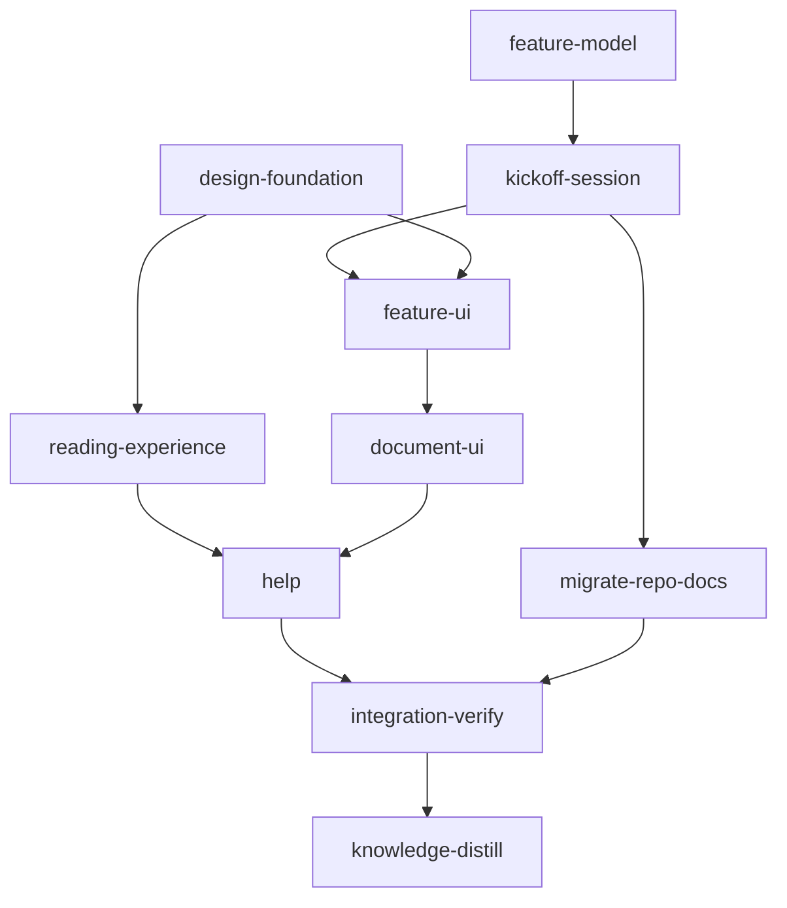

# Plan: Planner UI redesign and features

Implements: section_01, section_03, section_05, section_06, section_08, section_09

## Draft status

This plan is a working draft, written to be edited with the user before `loom init`. Locked with
the user: the shell layout, the ink-wash hover, inline fold caps, the document header (to be
revisited once testing starts), features as directory pairs, Inter for chrome and titles,
Source Serif 4 for body text, Commit Mono Cosmix for code. The decisions under
[Open decisions](#open-decisions) carry a recommendation each; stage text assumes the
recommendation and names the decision it depends on (`[D10]`). Before `loom init`:

1. Close every open decision and rewrite the stages that cite it.
2. Update the product spec (see [Spec changes before running](#spec-changes-before-running)),
   since the files under `doc/product/` are the truth the planning sessions and reviewers read.
3. Promote the metadata to `version: 2`: add contracts to every standard stage, the `web`
   provision entry (as plan 11 has it), the worker briefs in this plan's brief bundle, and the
   worker tables. A `version: 1` draft cannot carry `provision`, so the web stages' acceptance
   would not find `node_modules` if run as is.
4. Wait for `IN_PROGRESS-PLAN-feat-planner-11-execution-handoff.md` to finish. Stage
   `migrate-repo-docs` moves plan files, and plan 11's run reads its plan file by path.

Mockups for every screen below:
[Loom Plan redesign artifact](https://claude.ai/artifact/2T7SurQrDQJhCX4yyKi9iu).

## Problem

Plans 1-11 delivered every capability the vision names. The app works, but it does not read
as one product with the dashboard, and two of its system rules do not survive a real
repository. Review findings, from running `loom plan` against a copy of this repository's
`doc/` (screenshots in the artifact):

| #   | Finding                                                                                                                                                                                                                                                                                                                                                                                                 | Evidence                                                                                                                                                                         |
| --- | ------------------------------------------------------------------------------------------------------------------------------------------------------------------------------------------------------------------------------------------------------------------------------------------------------------------------------------------------------------------------------------------------------- | -------------------------------------------------------------------------------------------------------------------------------------------------------------------------------- |
| F1  | No iconography beyond the step tracker's ticks; plain text links everywhere.                                                                                                                                                                                                                                                                                                                             | `web/src/plan/header/header.tsx` imports no icon; the dashboard header uses lucide (`web/src/components/header.tsx:3`).                                                          |
| F2  | Document text is set in Inter. The dashboard rule ("chrome uses the body face") was applied to reading text too.                                                                                                                                                                                                                                                                                         | `--font-display` overridden to `--font-sans` (`web/src/index.css:138`); `.concept-column` and `markdown.css` inherit Inter.                                                       |
| F3  | Sentence hover is a `--muted` wash, nearly invisible on Ledger and on the dark themes.                                                                                                                                                                                                                                                                                                                   | `web/src/plan/concept/concept.css:56-58`.                                                                                                                                        |
| F4  | No theme toggle, no theme picker, no settings, no help in the planner. `ThemeProvider` is mounted, so the tokens switch; nothing lets the user switch them.                                                                                                                                                                                                                                               | `web/src/plan/main.tsx:26`; `header.tsx` has no `ThemeToggle`.                                                                                                                   |
| F5  | Document headers: the title shows twice (header and the document's own H1), the state word, lock icon, path and "Uncommitted changes" sit on different baselines, and plan facts (state, dates, `Implements`, validation) are a stack of plain lines.                                                                                                                                                     | `web/src/plan/files/doc-header.tsx`, `web/src/plan/files/plan/plan-header.tsx:64-86`.                                                                                            |
| F6  | Folding is reachable only through a 16px bracket in the left gutter that appears on hover.                                                                                                                                                                                                                                                                                                               | `concept.css:160-200` (`.concept-fold-handle`).                                                                                                                                  |
| F7  | One repository is one product. `VISION_PATH` is the single `doc/product/index.md`; every metaplan feeds one engineering overview; every plan no metaplan names becomes its own amber "Add … to a metaplan" offer. On this repository the home screen is about 40 identical buttons and the engineering overview mixes the planner programme with the token-optimisation programme.                      | `loom/src/planning/kinds.rs:50`; `loom plan check` lists 2 metaplans and 41 unlisted plans; `doc/product/section_05.md` "The two overviews".                                     |
| F8  | No way to start a second feature. The "ready, all done" offer is "start a new metaplan round" under the same vision.                                                                                                                                                                                                                                                                                     | `doc/product/section_01.md` "What the app offers".                                                                                                                               |
| F9  | Sections are written one session per section with no choice of pace. A user who wants the whole spec drafted and reviewed at the end has no path.                                                                                                                                                                                                                                                         | `doc/product/section_01.md` primary offer for step 2; `plan-plugin/skills/section/SKILL.md`.                                                                                     |
| F10 | Smaller defects: the home screen renders the step tracker twice; summary sentences show raw backticks (`sentence.tsx:61` renders `sentence.text` as plain text); document key chips read "01 01 — Workflow Model" (number plus a title that already starts with it); "Fold all" and "Summaries up to date" are unstyled text; the chat panel's empty header reads "No chat Pressure-test adopt-ecc-…". | Screenshots in the artifact; `web/src/plan/concept/document-key.tsx:50`.                                                                                                         |

## Goals

- The planner and the dashboard look like one product: same logo, header grid, segmented view
  switch, counter cells, theme controls, settings and help.
- Reading is comfortable for long documents: a serif reading face, a clear hover, and a fold
  control a first-time reader finds without being told.
- A repository holds several features. Each has its own vision, spec, metaplan, plans,
  checklist and overviews, and the app always says which feature it shows.
- A user can start a new feature from the browser and choose the pace of spec writing: guided
  (one section at a time) or draft-all (an agent team of up to five drafts every missing section,
  or every missing plan, coordinating as it writes; the user reviews at the end).

## Non-goals

- No change to the summary engine's hashing, sealing or rebuild budget beyond scoping ids by
  feature.
- No change to the session bridge, sandbox or access model.
- No new dependency for icons: lucide is already installed (`web/package.json:40`).

## Design

### 1. Features: the document model

An **feature** is a name shared by two directories:

```text
doc/product/<feature>/index.md          vision
doc/product/<feature>/section_NN.md     product sections
doc/plans/<feature>/index.md            metaplan (later rounds: metaplan-NN.md)
doc/plans/<feature>/PLAN-<slug>.md      plans, in every lifecycle spelling
doc/plans/<feature>/archive/            done and retired plans
doc/plans/<feature>/briefs/<slug>/      brief bundles
```

Membership comes from location, which a reader sees in any file listing; no file has to name
its feature. A feature needs only one of the two directories: `doc/plans/optim-token/`
alone is an engineering-only feature; `doc/product/live-test-lane/` alone is a spec not yet
planned. `Implements: section_07` in a plan resolves against its own feature's product
directory.

The top level of `doc/plans/` holds only **standalone plans**: bugfixes, performance work and
small features that need no product spec and no metaplan. They have a plan's own lifecycle
(written, pressure-tested, running, done) and no seven-step checklist. On the home screen they sit
on one shelf with "New standalone plan" and "Move into a feature…", and no per-plan offers.
Anything with a product spec, a metaplan, or several related plans is a feature and lives in
subdirectories. A vision at `doc/product/index.md`, a section directly under `doc/product/`, or a
metaplan directly under `doc/plans/` raises a `needs-feature` problem with an offer to move it
(and what it lists) into a feature.

`loom run` already supports the layout: `add_prefix_to_filename` and
`remove_prefix_from_filename` keep the plan's parent directory (`loom/src/fs/plan_lifecycle.rs:32-55`).
The planning model needs the changes in [Stage feature-model](#stage-feature-model): the
classifier only accepts plans whose parent is `doc/plans` or `doc/plans/archive`
(`loom/src/planning/kinds.rs:62,78`), briefs only under `doc/plans/briefs/`, and the retired
path is fixed to `doc/plans/archive/RETIRED-PLAN-<slug>.md` (`plan_lifecycle.rs:25`).
Loom does not decide what a project ignores: in a target project it only manages the
`.loom/work` and `.worktrees` entries (`loom/src/commands/repair/workspace.rs`). Discovery already
reads ignored files and file mode marks them "not committed" (`doc/product/section_03.md`
"Discovery"), so a project that ignores done plans keeps working inside feature directories.
This repository's own `.gitignore` (`doc/plans/DONE-*`, `doc/plans/REVIEW-*`) gains the
`doc/plans/**/` forms in `migrate-repo-docs`.

Each feature gets its own checklist (the seven steps, computed exactly as today, scoped to
its directories), its own product and engineering overviews, and its own summary namespace
(`doc/loom/summaries/<feature>/...`; plan summaries stay keyed by plan slug, which stays
unique repository-wide). The project view is the list of features plus the standalone plans.

### 2. Screens and navigation

| Route                               | Screen                                                                                                                                   |
| ----------------------------------- | ---------------------------------------------------------------------------------------------------------------------------------------- |
| `/`                                 | **Home**: the invitation card, feature cards (title, pitch from the vision's first paragraph, a 7-cell progress strip, counts), the standalone-plans shelf. |
| `/f/<feature>`                   | **Feature**: the step rail, the next-step card, the feature's checklist grouped by step.                                           |
| `/f/<feature>/product[/<doc>]`   | Product overview and section summary pages (concept mode).                                                                               |
| `/f/<feature>/engineering[/<plan>]` | Engineering overview and plan summary pages.                                                                                           |
| `/files/...`                        | File mode, unchanged paths; the header breadcrumb names the feature a file belongs to.                                                |
| `/new`                              | **Kickoff**: the conversation that starts a feature, with the taking-shape panel; "Write the vision" moves it to `/f/<name>`.        |

A repository with exactly one feature opens straight on `/f/<name>`.

### 3. App shell (locked)

One header grid shared with the dashboard (`web/src/components/header.tsx`), one row plus the
step rail:

- Left: Loom's logo, the `Logo` component (`web/src/components/logo.tsx`, the box-drawing strokes
  of `crate::LOGO`), then an eyebrow ("Planning · feature") over the feature switcher (title
  plus `ChevronsUpDown`, opening a popover list of features).
- Right: the **activity pill** (section 11; it replaces the plain "Summaries up to date" text), a
  segmented view switch with icons (Home `House`, Product `Package`, Engineering `Cog`, Files
  `FolderTree`, the `ViewSwitch` idiom from `web/src/components/view-switch.tsx`), presence,
  Share, `ThemeToggle` (`web/src/aurora-ui/theme/ThemeToggle.tsx`), Settings (section 9), Help
  (section 10).
- The project home (`/`) shows the first row only: the step rail belongs to a feature.
- Second row: the **step rail**, seven counter cells in the dashboard's STAGES-cell form
  (glyph, count, label; done cells show `CircleCheck` in the ok tone, the current step is
  tinted with an accent underline), and the **next-step card** beside it: one DocMark, one
  sentence, one primary button. It replaces the duplicated tracker and the wall of offers; the
  remaining gaps live on the feature screen's checklist, grouped by step.

Theme choice stays per app (settled): the planner (port 7272) and the dashboard (7373+) are
different origins, each remembers its own theme in the browser, and no server preference store
is added.

### 4. Typography (locked)

- **Inter** for chrome and every title: header, controls, chips, chat, document titles, headings
  inside documents. This keeps `doc/loom/knowledge/conventions/web-dashboard-typography.md`
  "Dashboard chrome uses the body face" as it stands.
- **Source Serif 4** for body text only: concept-mode prose, rendered Markdown paragraphs, lists
  and tables in file mode, quoted passages in chat, feature pitches. Token `--font-reading` in
  `web/src/plan/plan.css`. It sets Greek natively (fontsource subsets `latin`, `latin-ext`,
  `greek`, `cyrillic`, `cyrillic-ext`, `vietnamese`; monotonic Greek).
- **Commit Mono Cosmix** for code, paths and ids, the face the dashboard already bundles
  (`web/src/fonts.css`, `web/public/fonts/commit-mono-cosmix/`), through the existing
  `--font-mono` token. The planner currently inherits it; this plan only checks that nothing in
  `src/plan/` overrides it.
- Alternative reading faces in Settings (settled): Literata and Piazzolla. Both set Greek,
  polytonic included, so every offered face covers Greek.
- Reading size in Settings: 17, 19 (default) or 21px, line height 1.6; measure stays 68-70ch.
- Fonts ship self-hosted through `@fontsource-variable/source-serif-4`,
  `@fontsource-variable/literata` and `@fontsource-variable/piazzolla` (`bun add`), imported from `web/src/plan/main.tsx` only, so the dashboard bundle
  (`index.html`) does not grow. Browsers fetch only the `unicode-range` subsets a page uses, but
  every file is embedded in the `loom` binary. `web/scripts/bundle-rules.json` gains a rule
  forbidding the font packages in `index.html`.

### 5. Iconography

Lucide only, through one module, `web/src/plan/ui/glyphs.tsx`, so each concept has exactly one
glyph:

| Concept         | Glyph                                                                 |
| --------------- | --------------------------------------------------------------------- |
| Steps 1-7       | `Telescope`, `BookOpen`, `Map`, `ListChecks`, `Gauge`, `ScanEye`, `Play` |
| Document kinds  | vision `Telescope`, section `BookOpen`, note `StickyNote`, metaplan `Map`, plan `ListChecks`, brief `FileText`, knowledge `Library`, run review `FileSearch` |
| Plan states     | written `PencilLine`, running `Play`, done `CircleCheckBig`, retired `Archive` |
| Summary states  | current `CircleCheck`, rebuilding `RefreshCw`, stale `CircleDashed`   |
| Other           | read-only `Lock`, pressure-tested `FlaskConical`, open questions `MessageCircleQuestion` |

**DocMark** is the dashboard's `TerminalMark` idiom (`web/src/components/terminal/terminal-glyph.tsx`):
a 20px rounded square tinted in the document's colour (the colour concept mode already assigns),
holding the kind's glyph at 12px. It appears on key chips, tree entries, header titles (30px
variant), chat "files changed" chips and the next-step card.

### 6. Reading interactions (locked)

- **Hover: ink wash.** The sentence takes a tint of its document's colour and a 2px underline in
  that colour; its marks scale to 1.35; a small `ChevronDown` fades in after the marks. Keyboard
  focus looks the same. Plain sentences (nothing to open) keep no hover, as today.
- **Fold: inline caps.** An opened run keeps flowing in its paragraph on a 10% tint of its
  document's colour, with a fold cap at both ends: a 1.3em disc in the document's colour holding a
  0.78em `ChevronLeft` (start) or `ChevronRight` (end) at stroke 2.5. Hovering or focusing either
  cap grows it 12%, deepens the whole run to a 22% tint with a hairline outline (`:has()`), and
  shows a tooltip "Fold · Esc", so the reader sees what will fold before clicking. A nested run
  uses its own document's colour. Both caps have the accessible name "Fold", which keeps the
  existing test's query (`doc/loom/knowledge/conventions/plan-web.md` "Concept Mode Test Rules").
  The gutter bracket goes. `Esc` folds the innermost run that holds focus, or else the run opened
  last; `Shift+Esc` folds everything. A source passage (level 2) flows inline after a small chip
  naming its file and heading, which opens it in file mode.
- Summary sentences render inline Markdown code spans, emphasis and strong only; links stay as
  marks. This goes through the existing mdast inline renderer (`web/src/plan/markdown/inline.tsx`),
  never `dangerouslySetInnerHTML` ("Markdown renderer rules").
- Key chips drop the duplicated number: the chip shows the number in mono, then the title without
  its leading `NN — `.

### 7. Document headers (locked; revisit once testing starts)

One header component for file mode and summary pages, `web/src/plan/ui/doc-heading.tsx`:

```text
Planner UI › Plans › feat-planner-11                                   (breadcrumb)
[DocMark] Execution handoff                  [Summary|Source] [Edit] [Discuss]
[▶ Running] [Implements §11, §01] [Not pressure-tested] [Valid · 0 warnings] [Changed 2 h ago]
doc/plans/…/IN_PROGRESS-PLAN-feat-planner-11-execution-handoff.md  [copy]   ● Uncommitted changes
[lock notice, when locked]
```

- The title row is a three-column grid (`auto 1fr auto`): mark, title, actions. Everything else is
  one wrapping row of icon chips, so no line floats on its own baseline.
- The body suppresses the document's first H1 when its text equals the header title.
- "Summary | Source" switches between the summary page and file mode for the same document.
  "Discuss" opens a chat with the document attached.

### 8. New feature: the kickoff conversation `[D10, D11]`

All new work starts with a conversation, a feature or a standalone plan alike, and nothing in
plans 1-11 serves that: "Start a vision discussion" targets the single root vision, and every
session needs its target file to exist (or be named) at launch. This plan adds the **kickoff**.
Its first job is to decide the size of the work with the user:

- **A feature**: a vision, product sections, a metaplan and several plans, in
  `doc/product/<name>/` and `doc/plans/<name>/`.
- **A standalone plan**: a bugfix, performance work or a small feature. No product spec and no
  metaplan; one `doc/plans/PLAN-<slug>.md` with `Implements: none`, written by the `plan` step
  skill once the conversation has settled the scope.

"New standalone plan" on the home shelf opens the same kickoff, told the work is small; the
session can still say it has grown into a feature, and the user decides.

- **Invitation.** The home screen leads with an invitation card: a monoline doodle (a thread
  leaves a spool, loops through a thought, and weaves into cloth on a small loom), "Start
  something new", one sentence, a "Start a conversation" button and "Nothing is written until you
  say so." On hover or focus the thread redraws itself (`stroke-dashoffset` over `pathLength="1"`)
  and the sparks twinkle; at rest it is fully drawn; reduced motion keeps it still. The same
  doodle heads the empty kickoff screen and the empty state of a repository with no features.
  It lives in `web/src/plan/ui/doodle.tsx`, stroked in `currentColor` and `--ring`.
- **Empty kickoff (`/new`).** "What do you want to build?", a large composer set in the reading
  face, and starters: a new feature, a small fix or improvement, growing standalone plans into a
  feature, starting from a document the user has (attached as a passage).
- **Conversation.** The transcript takes the main column and is set in the reading face. A
  **"Taking shape"** panel replaces the chat dock on the right. It shows the size (feature or
  standalone plan), the proposed name, the problem, the settled decisions, the open questions and,
  for a feature, the proposed sections, each marked settled, being worded or open. The session
  proposes the size, a name and sections in a proposal block ("Use this", "Rename", "Change
  sections", "Make it standalone" / "Make it a feature").
- **Writing.** For a feature, "Write the vision" (or the user saying so) creates
  `doc/product/<name>/index.md` with the settled content and the open questions; from then on the
  session is an ordinary vision session on that file, and the feature appears on the home screen.
  For a standalone plan, "Write the plan" creates `doc/plans/PLAN-<slug>.md` through the `plan`
  step skill, and the plan appears on the shelf. Until then the session writes nothing under
  `doc/` `[D11]`.

After the vision, `/f/<name>` shows a step list (Conversation, Vision, Product spec, Metaplan,
Plans). The Product spec step, and the Plans step once the metaplan exists, offer a pace:

- **Guided.** One session drafts the lowest-numbered missing section (or the first missing plan)
  with the user and stops. The next is offered once the user has read it. This is today's
  behaviour.
- **Draft all, with a team** (settled, D10). One authoring session leads an **agent team** of up
  to five teammates (fewer when fewer documents are missing) and drafts every missing section, or
  every missing plan, in one run. A team is chosen over subagents so the drafters coordinate while
  they write, for consistent documents:
  - The lead reads the vision (or metaplan) and the settled decisions, writes a short shared
    brief (terms, decisions, which document owns which topic, cross-references to expect), and
    assigns each teammate its documents.
  - Teammates message each other through `SendMessage` while drafting, to agree on a term, settle
    an overlap, or ask which document owns a topic. They write only their own files.
  - When every teammate has finished, the lead makes one consistency pass over the set (terms,
    cross-references, duplicated or missing topics, `Implements:` lines for plans, and
    `loom plan check` or `loom plan verify` per document). It then hands the user a review queue
    ordered by open-question count, with a note per document on what the pass changed.
  - Before anything starts, the cost line shows the team size, the documents each teammate takes
    and the model (anti-goal "Background summarization whose token cost surprises the user").
    While the team works, each document's row shows its teammate and an animated drafting glyph,
    and the panel shows tokens per teammate (read from teammate transcripts, as pressure sessions
    do). "Stop the team" ends it; documents already written stay.

The pace is a property of the session request, not stored state: the app records nothing new, and
"reviewed" is the user reading (vision, Decisions, "Approval").

### 9. Settings

A planner settings dialog in the dashboard's form (`web/src/components/settings-webui.tsx`,
`ThemePicker`), opened from the header:

- **Theme**: four cards (Ledger, Aubergine, Pacific, Graphite) in `ThemePicker`'s card layout,
  each with a 120×76 thumbnail drawn for the planner rather than the dashboard's stage graph: the
  header with Loom's logo strokes and the view switch, the step rail with the current cell in the
  accent, a reading column with an ink-washed sentence and its two caps, and the chat panel with
  a quoted user message and the composer. Same `ThemePalette` data as
  `web/src/components/theme-picker.tsx`; the thumbnail is a new `PlannerThemeSwatch`, and
  `ThemePicker` takes the swatch as a prop so both apps share one picker.
- **Reading face**: three cards (Source Serif 4, marked default; Literata; Piazzolla), each an
  "Aa Ωω" specimen in the face, the name and the scripts covered.
- **Reading size**: Compact 17px, Comfortable 19px, Large 21px, with a live preview line in
  English and Greek.
- **Reading toggles**: source marks on or off; rebuild summaries automatically (the existing
  budget of 5); browser notification when a session needs the user.

Preferences are per browser (`storageKey` from `chat/storage.ts`); the theme also stays per app.

### 10. Help

A planner help dialog in the dashboard's form (`web/src/components/help-dialog.tsx`,
`help-scene.tsx`, `help-topics.ts`; `doc/loom/knowledge/conventions/web-dashboard-typography.md`
"Help uses operational illustrations" and "Help illustrations use real components"): topics on the
left, and per topic a one-line intro and scenes. Each scene is a production component in sample
state with numbered pins measured at runtime, one sentence per pin, and hovering a note rings its
target. Facts with no control to point at go in "Good to know". `?` opens it anywhere outside a
text field.

Layout, as mocked in the artifact's Help tab:

- **Navigation** (260px, left): Loom's logo and "Help", a search field (`/` focuses it), then one
  row per topic: a 32px tinted square with the topic's glyph in its own hue, the label, and a
  one-line description. The current topic fills its square and sits on a raised card.
- **Topic hero**: a 52px tinted badge, "Topic n of 7", the title in Inter and the intro in the
  reading face.
- **Scenes**: each a card with "Scene n", its title and "Hover a note to find it". The production
  component sits lifted (shadow, rounded) on a dotted canvas; wide components such as the header
  render at 74% with full layout width. Pins are accent discs with a halo; hovering a note scales
  its pin, pulses its halo, and outlines the target. A pin never sits on its target: it takes the
  first spot above, left, below or right of it that stays inside the scene and covers no other
  pinned control or pin. The dotted canvas keeps a 32px margin so those spots exist, and a pin
  anchors to the whole control group (the identity block, not its title alone). Notes sit in a two-column grid with matching
  number discs.
- **Good to know**: a tinted card with a lightbulb badge.
- **Footer**: previous and next topic cards, and the `?` and `Esc` keys.
- **Legend**: grouped (Reading, States, In progress), each entry a glyph tile with its name and
  meaning. **Shortcuts**: grouped key tables (While reading, Anywhere) with raised keycaps.

| Topic                  | Scenes (real components)                                                                                     |
| ---------------------- | ------------------------------------------------------------------------------------------------------------ |
| Getting around         | The header: feature switcher, step rail, next-step card, views, activity pill, settings                    |
| Reading summaries      | A sentence, a mark and a dashed mark, a fold cap, a source-passage chip                                       |
| Features            | The invitation card, a feature card, the standalone-plans shelf; the kickoff's "Vision taking shape" panel |
| Chat and sessions      | Composer with an attached passage, tool rows, changed-files chips, permission card, session states           |
| Pressure tests and runs | Run header, Codex status item, step timeline, run strip                                                     |
| Legend                 | Every mark, DocMark, state glyph and animated glyph with its meaning (complete, as the dashboard's legend)    |
| Shortcuts              | Reading, navigation and dialog keys                                                                           |

### 11. Activity and animated glyphs

Every operation in progress has a glyph that moves while the work runs and stops when it ends.
One module, `web/src/plan/ui/activity-glyphs.tsx`; CSS animations only; `prefers-reduced-motion`
freezes all of them.

| Operation                    | Glyph and motion                                     |
| ---------------------------- | ---------------------------------------------------- |
| Summaries rebuilding         | `RefreshCw`, one turn per 1.2 s                      |
| Pressure test                | A gauge (custom SVG) whose needle sweeps, 1.8 s      |
| Codex reviewing              | A scan frame (custom SVG) with a travelling beam     |
| A session drafting a document | `PenLine` writing a small loop                       |
| Plan running (`loom run`)    | `Play` with an outgoing pulse ring                   |
| Session starting             | `LoaderCircle` turning                               |
| Waiting for the user         | The status LED breathing                             |
| Permission needed            | `BellRing` ringing every 2.4 s                       |

The **activity pill** in the header shows the count ("5 in progress") with the most urgent glyph,
and opens a popover listing each operation with its glyph, title, subject and elapsed time. A key
chip whose summary is rebuilding shows the turning glyph in its DocMark, and "2 summaries
rebuilding" in a chat turn uses it too.

### 12. Pressure test, as the user sees it

Plan 11 builds the behaviour (`doc/product/section_11.md` "Pressure testing from the app"). This
plan restyles it on the new shell:

1. **Dialog.** A hero row: the animated gauge in a tinted badge, "Pressure-test a plan", and one
   line saying two reviewers read the plan at once, then an editor addresses both. Below it:
   - a plan card (DocMark, title, file name, state chips, Change);
   - "What happens": a dashed "Each round, N times" frame drawing one round, with Review
     (Claude `/pressure`) and Second review (Codex `$pressure`, marked background) wired into
     Address (Claude `/address`). Each node carries its model picker, preset to what `[pressure]`
     resolves. A 1/2/3 rounds control sits above the frame; a line under it says the record line
     is written at the end;
   - four consequences in two columns: estimated time for the chosen rounds, edits the plan and
     its briefs, writes `planning-omissions.md`, and (in the warning tone) ends the open chat
     first with its closing write.
   
   The footer says it holds authoring until it finishes, then Cancel and "Start pressure test".
2. **Run.** A run strip under the header (gauge glyph, plan, round, step, progress, elapsed).
   The plan's header gets a "Being pressure-tested" chip and its Edit locks. The chat panel shows
   the run header with Stop, a step timeline per round (Codex and Claude `/pressure` side by side,
   then `/address`, then the record line), the Codex status item, and each Claude step's turns.
3. **Done.** A summary card: rounds and duration, every edited file with its diff, "Review the
   changes" and "Test the next plan". The plan header shows "Pressure-tested today", and the
   record line appears at the end of the plan.

## Stages



`feature-model` & `design-foundation` run concurrently; then `kickoff-session` &
`reading-experience`; then `feature-ui` & `migrate-repo-docs`; then `document-ui` and `help`.
No knowledge-bootstrap: the knowledge base already describes the planning model
(`architecture/planning-document-model.md`, `architecture/plan-server.md`,
`conventions/plan-web.md`).

### Stage feature-model

Rust and plugin changes for section 1 and the pace option of section 8. Exists because
`feature-ui` needs its API merged (Q1).

- `loom/src/planning/kinds.rs`: classify `doc/product/<f>/index.md`, `section_NN.md`, notes;
  `doc/plans/<f>/index.md` and `*metaplan*.md`; plans whose parent is `doc/plans/<f>` or
  `doc/plans/<f>/archive`; briefs under `doc/plans/<f>/briefs/<slug>/`; top-level
  `doc/plans/PLAN-*.md` (and `archive/`) as standalone plans with briefs under
  `doc/plans/briefs/<slug>/`. `DocKind` gains the feature name; `DocId` becomes
  `product/<f>/section_NN` and `product/<f>/index`, and stays `plan/<slug>`. `VISION_PATH` goes:
  a vision is any `doc/product/<f>/index.md`. Feature names: `[a-z0-9][a-z0-9-]*`; anything
  else is `other`, with a `bad-feature-name` problem.
- `loom/src/planning/{project,checklist,checklist/offers,problems,vision,metaplan,implements}.rs`:
  `Project` holds `Vec<Feature>` and the standalone plans; `build_checklist` runs per
  feature; `Implements:` resolves in the plan's feature (a standalone plan writes
  `Implements: none`); a top-level vision, section or metaplan raises `needs-feature` with a
  `MoveIntoFeature` offer; the per-plan `AddPlanToMetaplan` offers go. New
  `Offer::DraftAllSections` and `Offer::DraftAllPlans` sit beside `WriteSection` and `WritePlan`.
- `loom/src/fs/plan_lifecycle.rs`: the retired path is the plan's own `archive/` directory.
- `loom/src/planning/summary/{store,format,brief,seal/links,evaluate/cite}.rs`: overview ids
  `overview/<f>/product` and `overview/<f>/engineering`; section summaries under
  `doc/loom/summaries/<f>/product/`; plans unchanged.
- `loom/src/plan_server/{wire/checklist,concept/key,concept/page,concept/delta,files/tree,chat/guidance}.rs`:
  a `/api/features` route and the feature on every checklist, concept and tree payload.
- `loom/src/planning/guidance/opening.rs`, `plan-plugin/skills/{vision,section,metaplan,plan}/SKILL.md`:
  target paths inside the feature (the draft-all team mode comes in `kickoff-session`).
- `loom/src/commands/plan/check.rs`: output grouped by feature; JSON `schema: 2` with an
  `features` array (`loom/tests/fixtures/planning/check_schema.json` updated).

### Stage kickoff-session `[D10, D11]`

The two new authoring session shapes on the server. The first is the kickoff conversation: a
session that starts with no target file, settles the size of the work with the user, and gains
one target (a feature's vision or a standalone plan) when the user confirms the size and name.
The second is the draft-all team: one authoring session that leads an agent team. Exists because it needs `feature-model`'s classifier
merged to recognise the new directory (Q1), and the session, sandbox and guidance changes would
push `feature-model` past one session's budget (Q4).

- `loom/src/plan_session/` (sandbox settings and the planning hook): the one-time creation grant
  of D11, checked against the directory listing taken at session start.
- `loom/src/plan_server/chat/`: start a kickoff from `/new` (with an optional first message and
  attachments), the "confirm name" request that arms the grant, and the switch to an ordinary
  vision session on the new file.
- `loom/src/planning/guidance/` and `plan-plugin/skills/kickoff/SKILL.md`: the kickoff brief
  (ask before writing, propose a name and sections in the proposal form the app renders, keep the
  "taking shape" list current, write nothing until the name is confirmed).
- A `kickoff` message variant carrying the taking-shape state (name, problem, decisions, open
  questions, sections, each settled, wording or open), parsed from a fenced block the skill
  emits; both schema arms (`web/src/plan/api/`) come in `feature-ui`.
- **Draft-all team** `[D10]`:
  - The session launch adds `CLAUDE_CODE_EXPERIMENTAL_AGENT_TEAMS=1` and keeps teammates
    in-process (`teammateMode`), as pressure sessions do (`doc/product/section_11.md`, "How the
    server runs it").
  - `SendMessage` and `ListAgents` are allowed for a draft-all session only; every other
    authoring session keeps them denied (`doc/product/section_12.md`, tool table).
  - The planning hook allows writes to the missing documents the run was started for and to
    nothing else, so a teammate cannot overwrite a written section.
  - The bridge reads teammate transcripts for tokens and for the document each teammate is
    writing, and renders none of their messages (as for pressure).
  - A `draft_team` message variant carries the team: teammate, assigned documents, state, tokens.
  - `plan-plugin/skills/section/SKILL.md` and `plan-plugin/skills/plan/SKILL.md` gain the team
    mode: shared brief, assignment, coordination through messages, one owner per file, the lead's
    consistency pass, and the review-queue summary.
  - This reverses `doc/product/section_09.md`'s "Agent teams are not used in authoring", which
    the spec update rewrites.

### Stage design-foundation

Web foundation every later web stage imports: fonts, tokens, glyphs, DocMark, activity glyphs,
the doodle, the shell header, settings, and the help dialog's frame. Exists because
`reading-experience`, `feature-ui`, `document-ui` and `help` all build on it (Q1), and they
would otherwise all edit `header.tsx` and `plan.css` (Q2).

- `bun add @fontsource-variable/source-serif-4 @fontsource-variable/literata @fontsource-variable/piazzolla`; import in
  `web/src/plan/main.tsx`; `--font-reading` in `web/src/plan/plan.css`; bundle rule in
  `web/scripts/bundle-rules.json`. Confirm `--font-mono` (Commit Mono Cosmix) reaches every
  planner surface.
- `web/src/plan/ui/glyphs.tsx` (section 5), `web/src/plan/ui/doc-mark.tsx`,
  `web/src/plan/ui/activity-glyphs.tsx` (section 11), `web/src/plan/ui/doodle.tsx` (section 8).
- `web/src/plan/header/header.tsx` rebuilt on the dashboard grid with Loom's `Logo`;
  `step-tracker.tsx` becomes the step rail; `tabs.tsx` becomes the segmented switch; new
  `web/src/plan/header/next-step.tsx` and `web/src/plan/header/activity.tsx` (pill and popover);
  `ThemeToggle` mounted. The feature switcher slot renders the project name until
  `feature-ui` fills it.
- Settings (section 9): `web/src/plan/settings/`; `ThemePicker` in
  `web/src/components/theme-picker.tsx` takes the swatch as a prop, and the planner passes a new
  `PlannerThemeSwatch` (`web/src/plan/settings/planner-swatch.tsx`).
- Help frame (section 10): `web/src/plan/help/` with the dialog, the pinned-scene component and the
  topic registry, holding Getting around, Legend and Shortcuts; `?` opens it.
- `web/src/plan/checklist-view.tsx`: the duplicate tracker removed (F10).

### Stage reading-experience

Section 6 plus the file-mode reading face. Exists separately from `feature-ui` because the two
together exceed one session's context budget (Q4); their files are disjoint.

- `web/src/plan/concept/{concept.css,sentence.tsx,run.tsx,fold-handle.tsx,column-keys.ts,document-key.tsx,passage.tsx}`.
- `web/src/plan/markdown/markdown.css`, `web/src/plan/files/reading-column.tsx`: the reading face.
- Tests that pin the gutter handle are updated in the same change (`reading-column.test.tsx`,
  `concept.contracts.test.tsx`).

### Stage feature-ui

Sections 2 and 8 in the browser. Exists because it needs the feature API and the kickoff
session merged (Q1).

- Routes in `web/src/plan/router.tsx`; home `web/src/plan/home/` (invitation card, feature
  cards, standalone-plans shelf with "New standalone plan" and "Move into a feature…");
  feature screen
  `web/src/plan/feature/` (step list, pace choice, section queue); kickoff
  `web/src/plan/new/` (empty kickoff, conversation, taking-shape panel, proposal block, "Write the
  vision").
- Feature switcher in the header slot `design-foundation` left.
- Schemas in `web/src/plan/api/` for the feature and kickoff payloads (both arms, per
  "New PlanMessage Variants Need Both Schema Arms").

### Stage document-ui

Sections 7 and 12: the shared document header, the restyled pressure dialog, run strip and run
panel, and the chat panel's empty header (F10). Exists because the header's breadcrumb reads the
feature payload `feature-ui` adds to `web/src/plan/api/` (Q1), and the two stages together
exceed one session's budget (Q4).

- `web/src/plan/ui/doc-heading.tsx` replacing `files/doc-header.tsx`, `files/plan/plan-header.tsx`
  and `concept/page-header.tsx`; H1 suppression in `web/src/plan/markdown/render.tsx`.
- The pressure dialog, run panel and run strip plan 11 builds (`web/src/plan/chat/pressure/`,
  `web/src/plan/run/`), restyled per section 12 with the activity glyphs; no behaviour change.
- `web/src/plan/chat/panel.tsx`, `web/src/plan/chat/run-header.tsx`.

### Stage help

The remaining help topics (Reading summaries, Features, Chat and sessions, Pressure tests and
runs), each scene built from the production components the earlier stages ship, as the
dashboard's help requires ("Help illustrations use real components"). Exists because those
components must be merged first (Q1).

- `web/src/plan/help/topics/` and the registry in `web/src/plan/help/`.
- The legend gains every animated glyph and DocMark.

### Stage migrate-repo-docs (settled: the planner and optim-token become features)

Moves this repository's tracked planning documents into features and rewrites references in
unlocked files. Exists because it must run on `feature-model`'s merged classifier (Q1) and
after `kickoff-session`, the last stage that edits `loom/src/` (Q2).

- `git mv doc/product/*.md doc/product/planner-ui/`; `doc/plans/metaplan-planner-ui.md` to
  `doc/plans/planner-ui/index.md`; `doc/plans/optim-token-metaplan.md` to
  `doc/plans/optim-token/index.md`; tracked planner plans and their brief bundles alongside;
  the summaries under `doc/loom/summaries/` move to the new ids and are re-sealed with
  `loom plan summary`. The 41 standalone plans stay where they are.
- This repository's `.gitignore`: `doc/plans/**/DONE-*` and `doc/plans/**/REVIEW-*` beside the
  existing top-level forms.
- Rewrites `doc/product/section_NN.md` and `doc/product/index.md` references in code comments,
  knowledge and unlocked plans (about 190 files reference them today). Locked plans and briefs
  are history and keep their text.
- Gitignored `DONE-*` plans are not in the worktree; the operator moves them after merge with the
  commands the stage prints.

## Open decisions

None. Every decision below was settled with the user.

Settled with the user:

- D10: draft-all runs one authoring session leading an **agent team of up to five**, not
  subagents, so the drafters coordinate and the generated sections and plans stay consistent.
  Design section 8 has the procedure; `kickoff-session` builds the team launch, the tool and
  write rules, and the skills' team mode.

- D1: the unit is called a **feature** (`/f/<feature>` routes, `feature-model`, `feature-ui`).
- D4: not loom's decision. Loom never edits a target project's ignores beyond `.loom/work` and
  `.worktrees`; only this repository's `.gitignore` gains the `doc/plans/**/` forms during the
  migration.
- D2/D3, layout: the top level of `doc/plans/` holds standalone plans only; anything with a spec
  or a metaplan is a feature in subdirectories; this repository's planner and optim-token
  docs migrate.
- D5: one header row plus the step rail. D8: ink wash. D9: inline caps, redesigned.
- D6: themes stay per app; no shared preference store.
- D7: Source Serif 4 (default), Literata, Piazzolla; code in Commit Mono Cosmix.
- D11: the kickoff's one-time creation grant. The session starts with no write under `doc/`;
  after the user confirms the size and name, the planning hook allows creating exactly one new
  target that did not exist at session start: `doc/product/<name>/index.md` for a feature, or
  `doc/plans/PLAN-<slug>.md` (plus its brief bundle) for a standalone plan. From then on its
  writes are those of a vision or plan session on that file.
- D12: the seven help topics in Design section 10, in the redesigned layout.
- Standalone plans: every new piece of work starts with a short kickoff conversation; a
  small feature gets no product spec.

## Spec changes before running

| Section                         | Change                                                                                                                         |
| ------------------------------- | ------------------------------------------------------------------------------------------------------------------------------ |
| `index.md` "The screen", Decisions | Features; the header described in Design section 3; the reading face; "Spec location" becomes `doc/product/<feature>/`. |
| `section_01.md`                 | Checklist per feature; standalone plans; `needs-feature`, `MoveIntoFeature` and `DraftAllSections`.                  |
| `section_03.md`                 | Discovery and kinds for feature directories; brief and archive paths; `Implements:` scoping.                               |
| `section_05.md`                 | Overviews per feature; hover and fold; the reading face; key chips.                                                         |
| `section_06.md`                 | Document header; breadcrumb; H1 suppression.                                                                                   |
| `section_08.md`                 | Chat header and empty state.                                                                                                   |
| `section_07.md`                 | The kickoff session: a vision session with no target until the name is confirmed.                                              |
| `section_09.md`                 | Feature target paths in the step skills; the kickoff skill; the draft-all team mode of the section and plan skills, replacing "Agent teams are not used in authoring". |
| `section_12.md`                 | The kickoff's one-time creation grant (D11); `SendMessage` and `ListAgents` allowed for draft-all team sessions (D10).                                                                                |
| `section_11.md`                 | The pressure dialog's presentation (Design section 12); behaviour unchanged.                                                   |

<!-- loom METADATA -->

```yaml
loom:
  version: 1
  sandbox:
    enabled: true
    auto_allow: true
    allow_unsandboxed_escape: false
    excluded_commands: []
    filesystem:
      deny_read:
        - ~/.ssh/**
        - ~/.aws/**
        - ~/.config/gcloud/**
        - ~/.gnupg/**
      deny_write:
        - ../../**
      allow_write: []
    network:
      allowed_domains:
        - crates.io
        - index.crates.io
        - static.crates.io
        - registry.npmjs.org
      additional_domains: []
      allow_local_binding: false
      allow_unix_sockets: []
      allow_all_unix_sockets: false
    linux:
      enable_weaker_nested: false
    command_confinement: confined
  stages:
    - id: feature-model
      name: Features in the planning model and server
      summary: >-
        Teaches the planning model, the plan server and the planning skills that a repository
        holds several features, each a pair of directories under doc/product and doc/plans.
      stage_type: standard
      working_dir: loom
      dependencies: []
      description: |
        Implements Design section 1 and the pace offer of section 8 of doc/plans/PLAN-planner-ui-redesign.md. Read that plan's Design and "Stage feature-model" sections first; they list every file and the decisions (D1, D2, D4, D10) this stage assumes.
        PATHS: working_dir is loom/; YAML paths are package-relative (../ outside the crate).
        KNOWLEDGE: architecture/planning-document-model.md (Module Map; Kinds, Ids and Slugs; Project View and Checklist), architecture/summary-store.md, architecture/planning-guidance.md.
        ORDER: (1) kinds, slug and discover with their tests, as a foundation worker; (2) checklist, offers, problems, implements, summary store ids, plan_lifecycle retired path, in parallel; (3) plan_server payloads, the /api/features route, guidance opening and plan-plugin skills, plan check output and its JSON fixture.
        RULES: the top level of doc/plans/ holds standalone plans only; a top-level vision, section or metaplan is a needs-feature problem, never a fallback feature; plan ids stay plan/<slug> and slugs stay unique repository-wide (a duplicate slug across features is a problem, never a silent winner). No backwards-compatibility shims: this repository's own docs move in migrate-repo-docs.
        Use parallel subagents and skills to maximize performance.
        MEMORY: record mistakes, decisions and surprises with loom memory immediately, subagents too; NEVER Claude Code auto-memory.
      acceptance:
        - cargo build
        - cargo clippy --all-targets -- -D warnings
        - cargo fmt --check
        - "cargo test --lib planning::"
        - "cargo test --lib plan_server::"
        - cargo test --test planning_documents_contracts --test planning_checklist_contracts --test planning_check_cli_contracts
      wiring:
        - source: src/plan_server/wire/checklist.rs
          pattern: "feature"
          description: checklist payload carries its feature
        - source: src/planning/checklist/offers.rs
          pattern: "MoveIntoFeature"
          description: a top-level vision, section or metaplan is offered a move into a feature
        - source: src/planning/checklist/offers.rs
          pattern: "DraftAllSections"
          description: the spec step offers draft-all
        - source: src/planning/checklist/offers.rs
          pattern: "DraftAllPlans"
          description: the plans step offers draft-all
      files:
        - loom/src/planning/**
        - loom/src/plan_server/**
        - loom/src/commands/plan/**
        - loom/src/fs/plan_lifecycle.rs
        - loom/src/fs/plan_lifecycle/**
        - loom/src/fs/plan_lifecycle_tests.rs
        - loom/tests/planning_*.rs
        - loom/tests/fixtures/planning/**
        - plan-plugin/skills/**

    - id: design-foundation
      name: Design foundation and app shell
      summary: >-
        Adds Source Serif 4 and the reading-face options, the glyph set, DocMarks, animated
        activity glyphs and the doodle, and rebuilds the planner header on the dashboard's grid
        with Loom's logo, the activity pill, theme toggle, settings and the help frame.
      stage_type: standard
      working_dir: web
      dependencies: []
      description: |
        Implements Design sections 3, 4, 5, 9, 11, the doodle of section 8 and the frame of section 10 of doc/plans/PLAN-planner-ui-redesign.md. Read that plan's Design sections and "Stage design-foundation" first; the artifact linked under Draft status shows the target. The fonts (D7) are settled.
        PATHS: working_dir is web/; brief paths are repo-relative.
        KNOWLEDGE: conventions/web-dashboard-typography.md (theme tokens; chrome uses the body face; TerminalMark; Help uses operational illustrations; Help illustrations use real components), conventions/plan-web.md (CodeMirror lazy boundary; bundle rules), architecture/web-dashboard.md.
        FONT: bun add @fontsource-variable/source-serif-4 @fontsource-variable/literata @fontsource-variable/piazzolla; import them from src/plan/main.tsx only; add a bundle rule so index.html never contains them. Code stays Commit Mono Cosmix through --font-mono (src/fonts.css).
        REUSE: Logo (src/components/logo.tsx), ThemeToggle (src/aurora-ui/theme/ThemeToggle.tsx), ThemePicker (src/components/theme-picker.tsx, which gains a swatch prop; the dashboard keeps its stage-graph swatch), the help dialog and pinned scenes (src/components/help-dialog.tsx, help-scene.tsx), the ViewSwitch idiom (src/components/view-switch.tsx), Button. Nothing from components/graph/stage-graph or the terminal (plan.html bundle rules).
        MOTION: every activity glyph is CSS animation only, and prefers-reduced-motion stops all of them; the doodle is fully drawn at rest.
        AFTER THE WORKERS: node_modules/.bin/oxfmt; bun run build once so node scripts/bundle-check.mjs has a manifest; inspect the header, settings and help at 390px and 1280px in all four themes before the gate.
        Use parallel subagents and skills to maximize performance.
        MEMORY: record mistakes, decisions and surprises with loom memory immediately, subagents too; NEVER Claude Code auto-memory.
      acceptance:
        - bun run typecheck
        - bun run lint
        - bun run format:check
        - node_modules/.bin/vitest run src/plan/header src/plan/ui src/plan/settings src/plan/help src/components/theme-picker.test.tsx
      wiring:
        - source: src/plan/header/header.tsx
          pattern: "ThemeToggle"
          description: the planner header mounts the theme toggle
        - source: src/plan/settings/settings-dialog.tsx
          pattern: "PlannerThemeSwatch"
          description: the planner's theme picker draws planner thumbnails
        - source: src/plan/main.tsx
          pattern: "@fontsource-variable/"
          description: the reading face is loaded by the planner entry only
        - source: src/plan/plan.css
          pattern: "--font-reading"
          description: the reading-face token exists
      before_stage:
        - command: test ! -e src/plan/ui/glyphs.tsx
          description: the glyph module does not exist yet
      after_stage:
        - command: test -s src/plan/ui/glyphs.tsx
          description: one glyph module serves every icon in the planner
      artifacts:
        - src/plan/ui/glyphs.tsx
        - src/plan/ui/doc-mark.tsx
        - src/plan/ui/activity-glyphs.tsx
        - src/plan/ui/doodle.tsx
        - src/plan/header/next-step.tsx
        - src/plan/header/activity.tsx
        - src/plan/settings/settings-dialog.tsx
        - src/plan/settings/planner-swatch.tsx
        - src/plan/help/help-dialog.tsx
      files:
        - web/package.json
        - web/bun.lock
        - web/scripts/bundle-rules.json
        - web/src/plan/main.tsx
        - web/src/plan/plan.css
        - web/src/plan/header/**
        - web/src/plan/header-extras.tsx
        - web/src/plan/ui/**
        - web/src/plan/settings/**
        - web/src/plan/help/**
        - web/src/components/theme-picker.tsx
        - web/src/components/theme-picker.test.tsx
        - web/src/plan/checklist-view.tsx
        - web/src/plan/shell.tsx

    - id: reading-experience
      name: Reading face, hover and fold
      summary: >-
        Sets documents in the reading face, makes sentence hover clear, and replaces the gutter
        bracket with fold buttons on each opened run plus Esc and Shift+Esc.
      stage_type: standard
      working_dir: web
      dependencies: ["design-foundation"]
      description: |
        Implements Design section 6 and the reading-face half of section 4 of doc/plans/PLAN-planner-ui-redesign.md (ink wash and inline caps, both settled with the user; the cap sizes, tints and tooltip are specified there).
        PATHS: working_dir is web/.
        KNOWLEDGE: conventions/plan-web.md (Markdown renderer rules; Concept Mode Test Rules, including that the fold control's accessible name stays exactly Fold).
        RULES: inline Markdown in summary sentences goes through src/plan/markdown/inline.tsx, never dangerouslySetInnerHTML; colours only from CSS variables; reduced motion turns transitions off; the tests that pinned the gutter handle change in the same commit.
        Use parallel subagents and skills to maximize performance.
        MEMORY: record mistakes, decisions and surprises with loom memory immediately, subagents too; NEVER Claude Code auto-memory.
      acceptance:
        - bun run typecheck
        - bun run lint
        - bun run format:check
        - node_modules/.bin/vitest run src/plan/concept src/plan/markdown src/plan/files
      wiring:
        - source: src/plan/concept/concept.css
          pattern: "--font-reading"
          description: concept prose uses the reading face
        - source: src/plan/markdown/markdown.css
          pattern: "--font-reading"
          description: file-mode Markdown uses the reading face
        - source: src/plan/concept/column-keys.ts
          pattern: "shiftKey"
          description: Shift+Esc folds every open run
      files:
        - web/src/plan/concept/concept.css
        - web/src/plan/concept/concept.contracts.test.tsx
        - web/src/plan/concept/column-keys.ts
        - web/src/plan/concept/document-key.tsx
        - web/src/plan/concept/fold-handle.tsx
        - web/src/plan/concept/fold-handle.test.tsx
        - web/src/plan/concept/fold-note.tsx
        - web/src/plan/concept/paragraph.tsx
        - web/src/plan/concept/passage.tsx
        - web/src/plan/concept/run.tsx
        - web/src/plan/concept/sentence.tsx
        - web/src/plan/concept/sentence-text.tsx
        - web/src/plan/concept/sentence-text.test.tsx
        - web/src/plan/concept/reading-column*.tsx
        - web/src/plan/concept/reading-column*.ts
        - web/src/plan/markdown/markdown.css
        - web/src/plan/markdown/inline.tsx
        - web/src/plan/files/reading-column.tsx

    - id: kickoff-session
      name: Kickoff conversation and draft-all teams on the server
      summary: >-
        Lets new work start as a conversation that gains exactly one target (a feature's vision or
        a standalone plan) when the user confirms the size and name, and lets "Draft all" run one
        authoring session leading an agent team of up to five.
      stage_type: standard
      working_dir: loom
      dependencies: ["feature-model"]
      description: |
        Implements "Stage kickoff-session" and Design section 8 of doc/plans/PLAN-planner-ui-redesign.md. Decisions assumed: D10, D11.
        PATHS: working_dir is loom/; YAML paths are package-relative (../ outside the crate).
        KNOWLEDGE: architecture/planning-session-bridge.md, architecture/planning-session-sandbox.md, architecture/planning-guidance.md, doc/product/section_12.md (write rules are literal paths; the tool table), doc/product/section_11.md "How the server runs it" (the agent-team launch pressure sessions use).
        RULES: until the size and name are confirmed the kickoff writes nothing under doc/; the grant covers one target that did not exist when the session started (doc/product/<name>/index.md for a feature, doc/plans/PLAN-<slug>.md and its brief bundle for a standalone plan); a confirmed name that already exists is refused; the planning hook, not the prompt, enforces it.
        TEAM RULES: only a draft-all session launches with agent teams enabled and keeps SendMessage and ListAgents; teammates stay in-process; the hook allows writes only to the documents the run was started for; the bridge reads teammate transcripts for tokens and current document and renders none of their messages; at most five teammates.
        Use parallel subagents and skills to maximize performance.
        MEMORY: record mistakes, decisions and surprises with loom memory immediately, subagents too; NEVER Claude Code auto-memory.
      acceptance:
        - cargo build
        - cargo clippy --all-targets -- -D warnings
        - cargo fmt --check
        - "cargo test --lib plan_session::"
        - "cargo test --lib plan_server::chat::"
        - "cargo test --lib planning::guidance::"
      wiring:
        - source: src/plan_server/chat/mod.rs
          pattern: "kickoff"
          description: the chat routes start kickoff sessions
        - source: src/plan_server/chat/mod.rs
          pattern: "draft_team"
          description: the chat routes start draft-all team sessions
      files:
        - loom/src/plan_session/**
        - loom/src/plan_server/chat/**
        - loom/src/planning/guidance/**
        - plan-plugin/skills/kickoff/**
        - plan-plugin/skills/section/**
        - plan-plugin/skills/plan/**

    - id: feature-ui
      name: Features home and the kickoff conversation
      summary: >-
        Adds the home screen with the invitation card, feature cards and standalone plans, the
        feature switcher and routes, the kickoff conversation with its taking-shape panel,
        and the spec pace choice.
      stage_type: standard
      working_dir: web
      dependencies: ["kickoff-session", "design-foundation"]
      description: |
        Implements Design sections 2 and 8 of doc/plans/PLAN-planner-ui-redesign.md. Decisions assumed: D1, D10 (and the settled layout and D11).
        PATHS: working_dir is web/.
        KNOWLEDGE: conventions/plan-web.md (Chat Panel and Review UI Rules; New PlanMessage Variants Need Both Schema Arms), architecture/plan-server.md.
        RULES: every server string through Untrusted; every storage key through storageKey; read-only browsers see the screens but no write controls (DisabledReason); the kickoff transcript is set in the reading face and the taking-shape panel in Inter.
        Use parallel subagents and skills to maximize performance.
        MEMORY: record mistakes, decisions and surprises with loom memory immediately, subagents too; NEVER Claude Code auto-memory.
      acceptance:
        - bun run typecheck
        - bun run lint
        - bun run format:check
        - node_modules/.bin/vitest run src/plan/home src/plan/feature src/plan/new src/plan/api
      wiring:
        - source: src/plan/router.tsx
          pattern: "FeatureRoute"
          description: feature routes are mounted
        - source: src/plan/router.tsx
          pattern: "KickoffRoute"
          description: the kickoff conversation is mounted
        - source: src/plan/home/home.tsx
          pattern: "Doodle"
          description: the invitation card renders the doodle
      files:
        - web/src/plan/router.tsx
        - web/src/plan/home/**
        - web/src/plan/feature/**
        - web/src/plan/new/**
        - web/src/plan/api/**
        - web/src/plan/state/**
        - web/src/plan/offers/**
        - web/src/plan/header/feature-switcher.tsx

    - id: document-ui
      name: Document header and pressure-test presentation
      summary: >-
        Gives every document one header grid and restyles the pressure-test dialog, run strip and
        run panel on the new shell, with the animated glyphs.
      stage_type: standard
      working_dir: web
      dependencies: ["feature-ui"]
      description: |
        Implements Design sections 7 and 12 of doc/plans/PLAN-planner-ui-redesign.md. The header is settled with the user and revisited once testing starts.
        PATHS: working_dir is web/.
        KNOWLEDGE: conventions/plan-web.md (Chat Panel and Review UI Rules), doc/product/section_11.md "Pressure testing from the app".
        RULES: the document header replaces doc-header.tsx, plan-header.tsx and page-header.tsx, and the replaced files are deleted; the pressure restyle changes presentation only, never the run's behaviour or messages.
        Use parallel subagents and skills to maximize performance.
        MEMORY: record mistakes, decisions and surprises with loom memory immediately, subagents too; NEVER Claude Code auto-memory.
      acceptance:
        - bun run typecheck
        - bun run lint
        - bun run format:check
        - node_modules/.bin/vitest run src/plan/ui src/plan/files src/plan/concept src/plan/chat src/plan/run
      before_stage:
        - command: test ! -e src/plan/ui/doc-heading.tsx
          description: the shared document header does not exist yet
      after_stage:
        - command: test ! -e src/plan/files/plan/plan-header.tsx
          description: the plan header was folded into doc-heading.tsx and deleted
      wiring:
        - source: src/plan/files/file-mode.tsx
          pattern: "DocHeading"
          description: file mode renders the shared document header
        - source: src/plan/chat/pressure/pressure-dialog.tsx
          pattern: "RoundDiagram"
          description: the pressure dialog draws one round with its model pickers
      artifacts:
        - src/plan/ui/doc-heading.tsx
      files:
        - web/src/plan/ui/doc-heading.tsx
        - web/src/plan/ui/doc-heading.test.tsx
        - web/src/plan/files/doc-header.tsx
        - web/src/plan/files/file-mode.tsx
        - web/src/plan/files/plan/**
        - web/src/plan/files/tree*.tsx
        - web/src/plan/concept/page-header*.tsx
        - web/src/plan/markdown/render.tsx
        - web/src/plan/markdown/markdown-render.test.tsx
        - web/src/plan/chat/pressure/**
        - web/src/plan/run/**
        - web/src/plan/chat/panel.tsx
        - web/src/plan/chat/run-header.tsx

    - id: help
      name: Planner help topics
      summary: >-
        Fills the planner's help with scenes built from the real components: reading summaries,
        features and the kickoff, chat and sessions, pressure tests and runs, and the full legend.
      stage_type: standard
      working_dir: web
      dependencies: ["document-ui", "reading-experience"]
      description: |
        Implements Design section 10 of doc/plans/PLAN-planner-ui-redesign.md. Decision assumed: D12.
        PATHS: working_dir is web/.
        KNOWLEDGE: conventions/web-dashboard-typography.md (Help uses operational illustrations; Help illustrations use real components; Help content), mistakes/web-dashboard-server.md (Help illustrations must match production UI).
        RULES: every scene renders production components in an isolated Jotai store with sample state, never redrawn lookalikes; one sentence per pin; facts with no control go in Good to know; type at least 13px; the Legend topic is complete; preview the rendered dialog at 390px and 1280px before committing.
        Use parallel subagents and skills to maximize performance.
        MEMORY: record mistakes, decisions and surprises with loom memory immediately, subagents too; NEVER Claude Code auto-memory.
      acceptance:
        - bun run typecheck
        - bun run lint
        - bun run format:check
        - node_modules/.bin/vitest run src/plan/help
      wiring:
        - source: src/plan/help/topics.ts
          pattern: "pressure"
          description: the help registry lists the pressure topic
      files:
        - web/src/plan/help/**

    - id: migrate-repo-docs
      name: Move this repository's planning docs into features
      summary: >-
        Moves the planner spec and plans into the planner-ui feature and the token metaplan
        into optim-token, and rewrites references to the old paths in unlocked files.
      stage_type: standard
      working_dir: "."
      dependencies: ["kickoff-session"]
      description: |
        Implements "Stage migrate-repo-docs" of doc/plans/PLAN-planner-ui-redesign.md, decision D3. Runs only after IN_PROGRESS-PLAN-feat-planner-11-execution-handoff.md is done.
        Use git mv for every tracked move. Rewrite doc/product/index.md and doc/product/section_NN.md references in loom/src comments, doc/loom/knowledge and unlocked plans; leave locked plans (IN_PROGRESS-, DONE-, RETIRED-, archive/) and their briefs unchanged. Print the mv commands for gitignored DONE- plans for the operator.
        Use parallel subagents and skills to maximize performance.
        MEMORY: record mistakes, decisions and surprises with loom memory immediately, subagents too; NEVER Claude Code auto-memory.
      acceptance:
        - test -f doc/product/planner-ui/index.md
        - test ! -e doc/product/index.md
        - loom plan check --json
      files:
        - .gitignore
        - doc/product/**
        - doc/plans/**
        - doc/loom/summaries/**
        - loom/src/**

    - id: integration-verify
      name: Integration Verification
      summary: >-
        Runs the full suite, reviews the redesign in a real browser in every theme, and proves
        features, the shell and the reading interactions are wired into the planning app.
      stage_type: integration-verify
      working_dir: loom
      dependencies: ["help", "migrate-repo-docs"]
      description: |
        Final verification of doc/plans/PLAN-planner-ui-redesign.md. Verify FUNCTIONAL INTEGRATION, not just tests passing. NEVER Claude Code auto-memory.
        CONTEXT: read the plan, loom memory show --all, doc/loom/knowledge/INDEX.md and only the relevant sections.
        BUILD & TEST (zero tolerance): loom check integration-verify once.
        CODE REVIEW: parallel loom-code-reviewer subagents: (1) the planning model's feature rules against the updated doc/product sections 01 and 03 (classifier, ids, loose plans, retired path, duplicate slugs); (2) web security (Untrusted, inline Markdown path, no dangerouslySetInnerHTML); (3) layout and accessibility in a real browser: home, feature screen, product overview with a run opened two levels deep, a plan in file mode, the new-feature flow, at 390px and 1280px in Ledger, Aubergine, Pacific and Graphite (no sideways scroll, focus order, the fold buttons and Esc reachable by keyboard, hover visible in every theme). Fix every finding through an engineer agent or dispute it; never defer one.
        WEB FIXES: a review fix in web/src rebuilds web/dist after the final review round and commits it last as chore(web).
        Record discoveries to loom memory, including stale knowledge: loom memory note "stale-knowledge: ...".
      acceptance:
        - command: "cargo test --all-targets --no-fail-fast"
          timeout_secs: 3600
        - cargo clippy --all-targets -- -D warnings
        - cargo fmt --check
        - cargo build
        - cd ../web && node_modules/.bin/tsc -b --noEmit && node_modules/.bin/oxlint --deny-warnings && node_modules/.bin/oxfmt --check && node_modules/.bin/vitest run
        - cd ../web && node scripts/bundle-check.mjs
        - 'cd ../web && d=$(mktemp -d "${TMPDIR:-/tmp}/dist.XXXXXX") && node_modules/.bin/vite build --outDir "$d" --emptyOutDir --logLevel error && diff -r "$d" dist'
        - cd ../web && git diff --quiet -- dist

    - id: knowledge-distill
      name: Knowledge Distillation
      summary: Records features, the planner shell, the reading face and the fold rules in the knowledge base.
      stage_type: knowledge-distill
      working_dir: "."
      dependencies: ["integration-verify"]
      description: |
        Curate all stage memories into permanent knowledge. NEVER Claude Code auto-memory. SINGLE-AGENT: do NOT spawn subagents.
        START with loom memory pending --group; read the plan and the knowledge sections it touches (architecture/planning-document-model.md, architecture/plan-server.md, conventions/plan-web.md, conventions/web-dashboard-typography.md).
        CORRECTIONS FIRST: apply every stale-knowledge memory with loom knowledge replace-section. Claims that VISION_PATH is the only vision, that plans live only in doc/plans or doc/plans/archive, that the fold control is a gutter bracket, and that headings and reading text both use Inter are now stale.
        TIER ROUTING: about 40 lines or fewer inline in the tier-1 file; larger via loom knowledge update <category>/<slug> with a 2-4 line tier-1 summary and link.
        RECEIPTS: every taken memory gets loom memory resolve right after the write; finish with loom memory pending --strict.
        INDEX BUDGET: doc/loom/knowledge/INDEX.md stays at most 15,000 bytes; shorten blurbs, never delete topics.
      acceptance:
        - loom knowledge check --strict --baseline doc/loom/knowledge/check-baseline.txt
        - loom memory pending --strict
        - 'test "$(wc -c < doc/loom/knowledge/INDEX.md)" -le 15000'
      files:
        - doc/loom/knowledge/**
```

<!-- END loom METADATA -->
