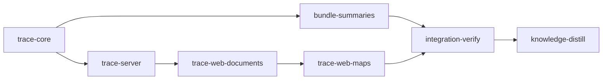

# Plan: Planning trace, settled documents, brief summaries and the findings loop

Implements: none

## Overview

The feature planner follows the manual process step by step: vision, product spec, metaplan, plans, run, follow-ups. But it models each step as a whole document, so it cannot tell which spec heading a plan delivers, which documents the user has agreed to, or what a run taught about the plans not yet written. This plan adds a **planning trace**: a per-feature model of documents, headings and plain-text edge lines, built from the files in `doc/`. It is not the source-code graph of `loom map`, and the code calls it `trace` so the two are never confused. On top of the trace:

- **Stub, body, summary.** Each document has a stub (a vision row or a metaplan entry) that exists before it, the body, and the summaries generated from the body. Summaries are built for drafts and settled documents alike.
- **Settled marks** are written per document, a plan together with its briefs. A `Settled:` line records the hashes of the body, the stub and, for plans, the spec headings the plan implements, so the planner can say "changed since settled", "stub changed" or "spec changed under this plan".
- **Edges point at headings.** `Covers:` lines on metaplan entries, anchored `Implements:` tokens, and per-stage `Implements (stage:<id>):` lines link work to spec headings. Coverage gaps follow from these lines.
- **Plan summaries cover the briefs.** A plan summary cites and tracks every file of the plan's brief bundle.
- **Findings ledger.** `doc/plans/<f>/findings.md` is filled automatically from each run review and by a new **Review the feature** session, which the user can open at any point after a plan has run. Findings are triaged on a Findings page (the wave screen): plan this, fold into an unwritten entry ("revisit before writing"), or dismiss with a reason.
- **Screens.** The spine shows maturity and settle state, with frontier hints under the next step. Document headings carry the settle control and the stub. Summary sentences carry edge chips. The turn footer lists downstream impact. A Coverage page lays the layers side by side, with a focus panel for walking why and how.

`doc/plans/briefs/planning-trace/common.md` is the design contract: the user's decisions, every grammar, the domain and wire shapes, the routes and the screens. Worker briefs sit beside it, one directory per stage. The YAML is authoritative for gates and file ownership.

## Goals

- Every facet listed under "Requirement to gate map" is built, wired and proven by a contract or a functional check.
- Documents stay plain Markdown that a reader without `loom plan` can follow: edges, settle marks and findings are lines in the files, with no sidecar state.
- Non-goals: a force-directed graph view; accepting a session's edits piece by piece (common.md, Settled during planning); migrating existing documents (the project is unreleased; `feat-planner` gains no `Covers:` or `Settled:` lines from this plan); anything involving the source-code graph; and, from the brainstorm, a generated reading view, concepts shared across features and merging the knowledge base into the trace (common.md, "Left out").

## User decisions (2026-11-05, do not reopen)

- Stubs come before documents; summaries are generated after, to help humans review, understand and revise. The two are never merged.
- Summaries for drafts are needed; settling is document-level; a plan settles with its briefs.
- Links can point at headings.
- Briefs without summaries was a mistake; plan summaries cover them.
- The findings storage is the planner's call: one ledger per feature fed from the run reviews.
- Lanes: Claude only.
- This plan runs only after `PLAN-planner-follow-ups` is complete.

## Before `loom run`

- `PLAN-planner-follow-ups` must be DONE. Its stages summary-fragments (two-level plan summaries, `ConceptPage.detail`), chat-hearth (the Hearth chat, `turn-footer` changes) and built-and-new (`ChecklistView.built`, the Built page, the `runOffer(offer, seed)` seed mechanism, `follow_up_start`) are the base this plan builds on. Each stage below starts by reading the merged code of those seams; where a name differs from what this plan says, the merged code wins and the worker records a `loom memory decision`.
- Commit `doc/plans/PLAN-planning-trace.md` and `doc/plans/briefs/planning-trace/**` on the branch `loom run` starts from.

## Sibling plans

Never run this plan beside another plan that writes `loom/src/planning/**`, `loom/src/plan_server/**` or `web/src/plan/**`.

## Paths and gates

- Implementation stages run with `working_dir: .`; acceptance enters `web/` with `cd web` and cargo uses `--manifest-path loom/Cargo.toml`. Rust contracts set `cwd: loom`, web contracts `cwd: web`. Integration-verify runs from `loom/`.
- Each implementation stage runs its own module-filtered Rust tests and web directories, `cargo test --test maintainability` (the 400/50 ratchet; `loom/maintainability-baseline.txt` is a ratchet file and does not change), clippy, fmt and rustdoc. The full suites run once, in integration-verify.

## Execution Diagram



`bundle-summaries` and `trace-server` run concurrently after `trace-core` on disjoint files: the summary store against the server, sessions and web schema. There is no knowledge-bootstrap stage, because `architecture/planning-document-model.md`, `summary-store.md`, `plan-server.md`, `planner-feature-screens.md` and `conventions/plan-web.md` already cover this area.

## Stages

### 1. trace-core

The Rust model under `loom/src/planning/`. It adds the edge-line tokens, anchored `Implements:`, metaplan `Covers:` lines and stub hashes, the `Settled:` line (`trace::settle`), the trace build per feature (documents, progress, settle states, headings, coverage, gaps, frontier), the findings ledger (`planning::findings`) with its import from run reviews at plan completion, and the plan-check problems for every malformed line. It also rewrites the product spec to the new truth before code: the vision's Decisions (`Approval` becomes settled marks, briefs get summaries, product-to-plan links reach headings, the findings ledger, the trace is separate from `loom map`), section 01 (maturity, frontier, the Coverage and Findings pages, Review the feature) and section 03 (edge lines, the Settled line, `findings.md`).

It exists by Q1 and Q4. Q1: trace-server serves `Trace` and writes through `settle` and `findings`, so these must be merged first. Q4: the model, the ledger and the server routes together would pass the stage budget.

Workers, two waves: wave 1 T2 (sonnet, tokens, implements anchors, metaplan Covers and span hash, problems) and D1 (sonnet, spec); wave 2 T1 (opus, settle, trace build, project wiring) and T3 (sonnet, ledger and lifecycle import).

Risk walk:

- **Untrusted input.** Edge tokens and ledger text are written by agents and people. `metaplan-entry-reads-its-covers-line` (fenced lines, bad tokens, the next entry's lines), `implements-keeps-heading-anchors`, `finding-text-cannot-open-a-heading`, `finding-title-cuts-on-a-char-boundary`.
- **Filesystem paths and symlinks.** The ledger write: `ledger-refuses-a-symlinked-file`.
- **Lifecycle.** `generate` runs again for a plan already done, so import must not append twice: `review-import-is-idempotent`. The Settled line must survive re-marking: `settle-mark-round-trips`.
- **Reachability.** A `reachable` check of `import_review` from `mark_plan_done_if_all_merged`, and a wiring check of the `build_trace(` call in `project.rs` (`load` is too common a name for the source graph to resolve).
- **Behaviour.** `settle-states-follow-body-stub-and-upstream`, `uncovered-headings-are-gaps`.
- **External data.** The run review is `fs::plan_review`'s output: the import contract uses its bullet form and headings.
- Not applicable: process I/O, configuration.

### 2. bundle-summaries

The summary store learns a plan's brief bundle. A plan summary (`plans/<slug>`) may cite any file of its bundle (`briefs::bundle_files`, added by trace-core) as a source, must cite every brief file at least once, and records the bundle's per-file hashes in a new front-matter map `bundle`, required on a plan summary whose plan has briefs and refused on any other summary. Evaluation marks the summary incomplete when a brief is added, removed or changed, and a cited brief span going stale stales its sentence. The rebuild brief lists the bundle under Sources, the summary agent and codex prompts tell the agent to give each stage its own detail paragraph citing `#stage:<id>` and that stage's briefs, and section 04 states the rule. This builds on summary-fragments' two-level plan summary.

It exists by Q1, Q2 and Q4. Q1: it needs trace-core's `briefs::bundle_files` merged, the one helper the trace and the store share. Q2: it writes `loom/src/planning/summary/**` and the summary prompts, which no other stage touches, so it runs beside trace-server. Q4: folded into trace-core, the store change would pass the budget.

Worker: S1 (opus).

Risk walk:

- **External data.** The summary agent's draft format: `a-plan-summary-must-cite-every-brief` (the refusal names the uncited brief, which is how the agent learns it).
- **Untrusted input.** A draft citing another plan's brief: `another-plans-brief-is-not-a-source`.
- **Lifecycle.** A brief edit after sealing: `a-brief-edit-leaves-the-plan-summary-out-of-date`.
- **Reachability.** The rebuild brief the agent reads: `the-rebuild-brief-lists-the-bundle`.
- **Behaviour.** `a-plan-summary-seals-citing-its-briefs`.
- Not applicable: filesystem writes (seal's write path is unchanged), process I/O, configuration.

### 3. trace-server

The server and the sessions. It adds the trace wire (`wire/trace.rs`, a writer-checked fixture copied to the web), `GET /api/trace/<feature>`, `POST /api/settle`, `POST /api/findings/status`, `GET /api/settled-version`, and the `trace_changed` message after watcher batches. It adds the `Review the feature` offer (checklist, wire kind, opening, start, `loom-plan:review` skill, web handler and next-step sentence), and has built-and-new's Built candidates read the ledger. It updates the skills: metaplan (`Covers:` lines, folding findings and setting their status), plan (anchored `Implements:`, stage lines), and every authoring skill (never touch `Status:` lines, say when a settled document was edited). It also updates the plan-writer skill and sections 09, 10 and 11.

It exists by Q1 and Q2. Q1: both web stages call these routes and parse this wire. Q2: it writes `checklist/offers.rs`, `guidance/opening.rs`, `start.rs`, `wire/checklist*.rs`, `wire/message.rs` and `web/src/plan/api/schema.ts`, which trace-core does not, and it needs trace-core's model merged.

Workers, one wave: R1 (sonnet, wire, routes, message, schema), R2 (sonnet, offer end to end, Built candidates), R3 (sonnet, skills and spec text).

Risk walk:

- **Untrusted input.** A dismissal reason holding a newline and a heading: `finding-dismissal-is-one-line`.
- **Filesystem and lifecycle.** Writes go through `save_document` (lock, hash check, no-follow replace): `settle-writes-the-status-line-once` (a second post with the old hash is a conflict), `locked-plan-cannot-be-settled`.
- **Behaviour.** `settle-needs-confirmation-for-my-calls`, `review-feature-offered-after-a-run`.
- **Reachability.** `trace-route-serves-the-feature` drives the served route; `trace-changed-follows-a-heading-edit` drives the watcher and the socket; `review-feature-is-an-authoring-offer` drives `runOffer`.
- **External data.** The web fixture is the server's serialized output, byte for byte (the writer test).
- Not applicable: process I/O, configuration.

### 4. trace-web-documents

The browser's trace state and everything drawn on existing screens: `traceAtom`, settle state on spine rows, frontier hints under the next step, the settle control and stub panel in document headings (summary and source pages) with "Changes since settled", edge chips on summary sentences, and downstream impact rows in the turn footer. Section 05 is rewritten for chips, settle and stubs, and `ui/DESIGN.md` gets its entries.

It exists by Q1, Q2 and Q4. Q1: it needs trace-server's wire and routes merged. Q2: trace-web-maps writes `spine-model.ts`, `spine.tsx` and `DESIGN.md` after it. Q4: two fable passes with screenshot rounds over two screen families would pass the budget in one stage.

Workers, three waves: W1 (sonnet, trace state, pure models, spine marks and frontier hints), then W1B (sonnet, the settle control, stub panel and brief list, chips and impact rows, wired into their screens), then V1 (fable, the look against the approved mockups, DESIGN.md, screenshots).

Risk walk:

- **External data.** The trace fixture is the server's bytes; `web/src/plan/api/schema-trace.test.ts` (written by trace-server) parses it.
- **Behaviour and reachability.** `spine-shows-settle-state`, `mark-settled-posts-path-and-hash`, `unresolved-settle-asks-before-confirming`, `revised-document-links-its-changes`, `frontier-hints-are-at-most-five`, `sentence-shows-covering-plans`, `turn-footer-lists-downstream-plans`; `reachable` checks for `SettleControl`, `EdgeChips` and `FrontierHints`.
- **Untrusted input.** Heading titles and finding counts are drawn as text (covered by trace-web-maps' markup contract for finding text).
- Not applicable: filesystem, process I/O, configuration, lifecycle beyond the fetch-and-refetch rule `page-state.ts` already follows (W1's unit tests).

### 5. trace-web-maps

The two new pages and their entry points. The Coverage page (`/f/<f>/coverage`) has its layer columns, lineage highlight, focus panel, keys and filters. The Findings page (`/f/<f>/findings`) has the findings grouped by run, the actions Plan this, Fold into entry and Dismiss, and the `Review the feature` button as that offer's one owner. The spine gets a Coverage row under Product spec and a Findings row with the open count under Run, the Built page links to Findings, and help topics are added for both pages.

It exists by Q1 and Q2. Q1: it needs `traceAtom` and the chip and settle components merged. Q2: it writes `spine-model.ts`, `spine.tsx`, `router.tsx` and `DESIGN.md` after trace-web-documents.

Workers, two waves: W2 (sonnet, routes, models, keys, actions, tests), then V2 (fable, the look, help, screenshots).

Risk walk:

- **Untrusted input.** `finding-markup-renders-as-text`.
- **Behaviour and reachability.** `coverage-marks-and-filters-uncovered`, `focus-keys-walk-why-and-how`, `dismiss-needs-a-reason`, `plan-this-seeds-plan-follow-ups`, `spine-links-coverage-and-findings`; wiring checks for the router entries.
- Not applicable: filesystem, process I/O, configuration, lifecycle.

### Integration Verification

Builds `web/dist` and the binary, runs the full suites, and drives a scratch feature end to end in the browser: settle a section, edit it and see `revised` with its changes, see an uncovered heading on the Coverage page, import a run review into the ledger, fold and dismiss findings, start Review the feature, see a plan summary cite its briefs. It walks the requirement map with evidence, reviews, and commits the bundle. See `doc/plans/briefs/planning-trace/integration-verify.md`.

### Knowledge Distillation

Writes `architecture/planning-trace.md` (model, edge lines, Settled line, ledger, routes, screens) with summaries in `architecture.md` and the planner topics. It rewrites `summary-store.md` (bundle front matter, seal and evaluation of briefs), `planning-document-model.md` (anchored Implements, Covers, findings.md), `planner-feature-screens.md` (spine, offers' owners, Coverage, Findings) and `plan-server.md` (routes, `trace_changed`). It sets the Fix line of `mistakes/planner-design-brainstorm.md` "Plan briefs were left out of the summaries" to the bundle rule.

## Environment inventory

| Need                            | State                                                                                                                                                                                                                                                                                                                                                                                                    |
| ------------------------------- | -------------------------------------------------------------------------------------------------------------------------------------------------------------------------------------------------------------------------------------------------------------------------------------------------------------------------------------------------------------------------------------------------------- |
| crates.io, npm registry         | `allowed_domains`                                                                                                                                                                                                                                                                                                                                                                                        |
| `web/node_modules`              | provisioned by `loom.provision`                                                                                                                                                                                                                                                                                                                                                                          |
| Chromium for screenshots        | `~/.cache/ms-playwright` on the host, as the planner plans used it. Visual stages run `scripts/plan-screens.sh loom/target/debug/loom "$LOOM_SCRATCH_DIR/preflight" /` after building; a failing preflight is filed with `loom stage block <stage-id> "<preflight output>"`.                                                                                                                             |
| Fixture feature for screenshots | a scratch git repository under `$LOOM_SCRATCH_DIR` with a `demo` feature carrying `Covers:`, `Status:` and `findings.md` (the briefs give its files); the `loom plan` server is started against it, and a throwaway Playwright driver under `$LOOM_SCRATCH_DIR` imports `playwright-core` by absolute path and launches with `--no-sandbox`. Server start, URL wait and browser run share one Bash call. |
| git in stage sessions           | used for the scratch repository and for `/api/settled-version` tests (route tests init a repository in a TempDir)                                                                                                                                                                                                                                                                                        |
| tmux in a stage                 | not granted; `scripts/plan-journeys.sh` runs without `--strict` in integration-verify.                                                                                                                                                                                                                                                                                                                   |
| Claude login in a stage         | none. A real Review the feature session, a real summary rebuild over a bundle and a real plan completion are operator checks after the run.                                                                                                                                                                                                                                                              |
| `web/dist`                      | visual stages build it to shoot, then restore it before their final review round (`git restore web/dist`, `git clean -fdq -- web/dist`, then `git status --short --untracked-files=all web/dist` prints nothing). Only integration-verify commits a bundle.                                                                                                                                              |
| Host platform                   | Linux. On macOS the operator sets `allow_local_binding: true` first.                                                                                                                                                                                                                                                                                                                                     |

## After the run (operator checks)

- Rebuild summaries; open a plan with briefs: its detail paragraphs cite the stage and its briefs; edit a brief and see the summary marked out of date.
- Settle a section and a plan from the browser, commit, edit the section, follow "Changes since settled".
- Complete a small feature plan and see its run review's open findings in `findings.md` and on the Findings page.
- Start Review the feature and record a finding; plan one finding and fold another into an unwritten entry.

## Requirement to gate map

| Facet                                                                                        | Stage                                                                              | Proof                                                                                                                                                                                                                                                            |
| -------------------------------------------------------------------------------------------- | ---------------------------------------------------------------------------------- | ---------------------------------------------------------------------------------------------------------------------------------------------------------------------------------------------------------------------------------------------------------------- |
| Edge lines (Covers, anchored Implements, stage lines, About) and their problems              | trace-core                                                                         | `metaplan-entry-reads-its-covers-line`, `implements-keeps-heading-anchors`; T2 unit tests                                                                                                                                                                        |
| Stub, body and summary; stub drift after settling                                            | trace-core, trace-web-documents                                                    | `settle-states-follow-body-stub-and-upstream`; stub panel in `revised-document-links-its-changes`                                                                                                                                                                |
| Document-level settled marks; a plan with its briefs; changes since settled                  | trace-core, trace-server, trace-web-documents                                      | `settle-mark-round-trips`, `settle-writes-the-status-line-once`, `locked-plan-cannot-be-settled`, `settle-needs-confirmation-for-my-calls`, `mark-settled-posts-path-and-hash`, `unresolved-settle-asks-before-confirming`, `revised-document-links-its-changes` |
| Summaries for drafts and settled documents                                                   | trace-web-documents                                                                | the settle state shown on summary pages (`spine-shows-settle-state`, V1 screenshots); summaries keep building for drafts (no change to the scheduler)                                                                                                            |
| Plan summaries cover briefs, one detail paragraph per stage                                  | bundle-summaries                                                                   | the five bundle contracts                                                                                                                                                                                                                                        |
| Briefs listed with their plan on its pages                                                   | trace-web-documents                                                                | W1 component tests; integration-verify walk                                                                                                                                                                                                                      |
| A wave-1 finding reaches a later plan, written or not, before it runs (revisit)              | trace-core, trace-web-documents                                                    | T1 revisit tests (unwritten entry, written plan, none once running); W1 frontier tests                                                                                                                                                                           |
| Stub drift: sessions update the stub with the body; a later stub change reads `stub_changed` | trace-core, trace-server                                                           | `settle-states-follow-body-stub-and-upstream`; R3's skill duty (after_stage greps)                                                                                                                                                                               |
| Coverage gaps at heading level                                                               | trace-core, trace-web-maps                                                         | `uncovered-headings-are-gaps`, `coverage-marks-and-filters-uncovered`                                                                                                                                                                                            |
| Maturity in the spine; frontier next actions                                                 | trace-core, trace-web-documents                                                    | `spine-shows-settle-state`, `frontier-hints-are-at-most-five`                                                                                                                                                                                                    |
| Edge chips on summary sentences                                                              | trace-web-documents                                                                | `sentence-shows-covering-plans`                                                                                                                                                                                                                                  |
| Downstream impact in the turn footer                                                         | trace-web-documents                                                                | `turn-footer-lists-downstream-plans`                                                                                                                                                                                                                             |
| Coverage map with focus panel (why/how)                                                      | trace-web-maps                                                                     | `focus-keys-walk-why-and-how`                                                                                                                                                                                                                                    |
| Findings ledger fed from run reviews                                                         | trace-core                                                                         | `review-import-is-idempotent`, `ledger-refuses-a-symlinked-file`, `finding-text-cannot-open-a-heading`, `finding-title-cuts-on-a-char-boundary`; `reachable` import from plan completion                                                                         |
| Wave screen: triage (plan this, fold, dismiss), revisit marks                                | trace-server, trace-web-maps                                                       | `finding-dismissal-is-one-line`, `dismiss-needs-a-reason`, `plan-this-seeds-plan-follow-ups`, `finding-markup-renders-as-text`                                                                                                                                   |
| Feature review at any time after a run                                                       | trace-server, trace-web-maps                                                       | `review-feature-offered-after-a-run`, `review-feature-is-an-authoring-offer`                                                                                                                                                                                     |
| Live updates                                                                                 | trace-server                                                                       | `trace-changed-follows-a-heading-edit`                                                                                                                                                                                                                           |
| Spec, skills and knowledge at the new truth                                                  | trace-core, bundle-summaries, trace-server, trace-web-documents, knowledge-distill | after_stage checks; knowledge-distill's checks                                                                                                                                                                                                                   |
| All of the above in the running app                                                          | integration-verify                                                                 | the walk with evidence                                                                                                                                                                                                                                           |

---

<!-- loom METADATA -->

```yaml
loom:
  version: 2
  auto_merge: null
  sandbox:
    enabled: true
    auto_allow: true
    allow_unsandboxed_escape: false
    excluded_commands: []
    filesystem:
      deny_read:
        - ~/.ssh/**
        - ~/.aws/**
        - ~/.config/gcloud/**
        - ~/.gnupg/**
      deny_write:
        - ../../**
      allow_write: []
    network:
      allowed_domains:
        - crates.io
        - index.crates.io
        - static.crates.io
        - registry.npmjs.org
      additional_domains: []
      allow_local_binding: false
      allow_unix_sockets: []
      allow_all_unix_sockets: false
    linux:
      enable_weaker_nested: false
    command_confinement: confined
  ratchet_files:
    - loom/maintainability-baseline.txt
    - doc/loom/knowledge/check-baseline.txt
  provision:
    - working_dir: web
      command: >-
        test ! -e .npmrc && test ! -L .npmrc && bun install --frozen-lockfile
        --ignore-scripts --backend=copyfile --config=/dev/null
  stages:
    - id: trace-core
      name: Planning trace model, settled marks and the findings ledger
      summary: >-
        Adds the planning trace: heading-level links between spec, metaplan and
        plans, settled marks that notice later changes, coverage gaps, and a
        findings ledger filled from each run review.
      description: |
        Read doc/plans/briefs/planning-trace/common.md in full, then the four briefs in doc/plans/briefs/planning-trace/trace-core/, before dispatch. Pass common.md and each worker's brief path to that worker.
        PATHS: working_dir is the worktree root; every path is repository-relative; cargo uses --manifest-path loom/Cargo.toml.
        FIRST: confirm PLAN-planner-follow-ups is merged (doc/plans/**/DONE-PLAN-planner-follow-ups.md or its archive copy exists, and loom/src/planning/run_review.rs exists). Read the merged seams this stage uses: loom/src/planning/{implements.rs,metaplan.rs,project.rs,sections.rs,briefs.rs,run_review.rs,problems/plans.rs}, loom/src/fs/plan_review/mod.rs and loom/src/fs/plan_lifecycle.rs (mark_plan_done_if_all_merged).
        KNOWLEDGE: architecture/planning-document-model.md (Kinds, Ids and Slugs; Project View and Checklist), architecture/summary-store.md (Store Layout and Ids). Their claims about Implements granularity and approval become stale here: record each with loom memory note "stale-knowledge: ...".
        PUBLIC SURFACE for the contract session. Write only these, in loom/tests/planning_trace_contracts.rs (its own test target, no scaffold). Build fixtures by writing files into a tempfile::TempDir and load with loom::planning::project::Project::load(root); the feature is project.feature("demo").unwrap(), its trace is the new pub field .trace (common.md "The trace model").
        DEMO fixture: doc/product/demo/index.md "# Demo\n\nA demo.\n\n## Specification sections\n\n| # | Section |\n| --- | --- |\n| 01 | Alpha |\n| 02 | Beta |\n"; doc/product/demo/section_01.md "# Alpha\n\n## One\n\nText one.\n\n## Two\n\nText two.\n\n## Open questions\n\nNone.\n"; doc/product/demo/section_02.md "# Beta\n\n## Three\n\nText three.\n"; doc/plans/demo/index.md "# Engineering\n\n## 1. First (`PLAN-first.md`)\n\nCovers: section_01#one\n\nFirst plan.\n\n## 2. Second (`PLAN-second.md`)\n\nCovers: section_02\n\nSecond plan.\n"; doc/plans/demo/PLAN-first.md "# First\n\nImplements: section_01#one\n\nBody.\n".
        - metaplan_entry_reads_its_covers_line: loom::planning::metaplan::entries on "# E\n\n## 1. A (`PLAN-a.md`)\n\nCovers: section_01#one, section_02, bogus\n\n" + FENCE + "text\nCovers: section_09\n" + FENCE + "\n\n## 2. B (`PLAN-b.md`)\n\nCovers: section_03\n", where FENCE is three backtick characters (build it in the test with "`".repeat(3)). entries[0].covers == vec![SectionRef { number: 1, anchor: Some("one".into()) }, SectionRef { number: 2, anchor: None }] (loom::planning::trace::tokens::SectionRef, pub fields), entries[0].bad_covers == vec!["bogus"], entries[1].covers == vec![SectionRef { number: 3, anchor: None }], and entries[0].span_hash differs from entries[1].span_hash. At base the fields do not exist.
        - implements_keeps_heading_anchors: loom::planning::implements::parse("# X\n\nImplements: section_04#rebuild-budget, section_02, section_04#rebuild-budget, section_04\n"): value == Implements::Sections(vec![4, 2]), anchors == vec![(4, "rebuild-budget".to_string())], bad_tokens is empty.
        - settle_mark_round_trips: use loom::planning::trace::settle::{body_hash, mark, clear, settled_line, SettledLine}. text = "# Alpha\n\nImplements: section_01\n\nBody.\n"; h = body_hash(text, &[]); line = SettledLine { body: h.clone(), stub: None, upstream: None }; marked = mark(text, &line). Assert marked == format!("# Alpha\n\nImplements: section_01\n\nSettled: {h}\n\nBody.\n"), body_hash(&marked, &[]) == h, mark(&marked, &line) == marked, settled_line(&marked) == Some(line), clear(&marked) == text, and h is 12 lowercase hex digits.
        - settle_states_follow_body_stub_and_upstream: the DEMO fixture. For section_01 and PLAN-first, take the TraceDoc (trace.documents, matched by path) and write mark(<file text>, &doc.current) into each file; reload: both settle == SettleState::Settled. Edit section_01's "Text one." to "Text one, changed."; reload: section_01 is Revised and PLAN-first is UpstreamChanged. Restore section_01's settled text and change the vision row "| 01 | Alpha |" to "| 01 | Alpha first |"; reload: section_01 is StubChanged. section_02 (never settled) is Draft throughout.
        - uncovered_headings_are_gaps: the DEMO fixture. The gaps of kind GapKind::Uncovered name exactly NodeRef { path: "doc/product/demo/section_01.md", anchor: Some("two") }; no gap names the anchor "open-questions". Rewrite PLAN-first's line to "Implements: section_01"; reload: no Uncovered gap remains. The heading section_01#one lists a CoverRef of kind CoverKind::Entry and one of kind CoverKind::Plan.
        - review_import_is_idempotent: the DEMO fixture with PLAN-first moved to doc/plans/demo/IN_PROGRESS-PLAN-first.md. review = "# Code Review: First\n\n## Open Questions\n\nNo open questions.\n\n## Open Findings\n\n- **Build** (`build`): Rename the flag\n". loom::planning::findings::import_review(root, Path::new("doc/plans/demo/IN_PROGRESS-PLAN-first.md"), review) returns Ok(1), then Ok(0). doc/plans/demo/findings.md starts "# Findings\n", holds exactly one line starting "## F-", the line "About: PLAN-first.md#stage:build, section_01#one" and the line "Status: open". For Path::new("doc/plans/PLAN-solo.md") (written with "# Solo\n") it returns Ok(0) and doc/plans/findings.md does not exist.
        - ledger_refuses_a_symlinked_file: the DEMO fixture; doc/plans/demo/findings.md is a symlink to a file in a second TempDir holding "keep\n". import_review with the review above returns Err, and the outside file still reads "keep\n".
        - finding_text_cannot_open_a_heading: as review_import_is_idempotent, with the item text "## F-9 injected". After import, the only line of findings.md that starts with "## " starts with "## F-1 ", and loom::planning::findings::parse(&text).findings has one Finding whose text contains "F-9 injected".
        - finding_title_cuts_on_a_char_boundary: the item text is "é" repeated 100 times. import_review does not panic, and the parsed Finding's title is "é" repeated 80 times.
        Write no other contract. Do not import from a frozen test file.
        WORKERS (two waves):
        | Worker | Role | Tier | Files owned | Shared context | Brief path |
        | ------ | ---- | ---- | ----------- | -------------- | ---------- |
        | T2 | Edge tokens, anchored Implements, metaplan Covers and span hash, the bundle helper, edge-line problems (wave 1) | sonnet | loom/src/planning/briefs.rs; loom/src/planning/tests/briefs_tests.rs; loom/src/planning/trace/tokens.rs; loom/src/planning/trace/tokens/**; loom/src/planning/implements.rs; loom/src/planning/tests/implements_tests.rs; loom/src/planning/metaplan.rs; loom/src/planning/tests/metaplan_tests.rs; loom/src/planning/problems/plans.rs; loom/src/planning/problems/trace.rs | common.md | doc/plans/briefs/planning-trace/trace-core/t2-tokens.md |
        | D1 | Product spec to the new truth (wave 1) | sonnet | doc/product/feat-planner/index.md; doc/product/feat-planner/section_01.md; doc/product/feat-planner/section_03.md | common.md | doc/plans/briefs/planning-trace/trace-core/d1-spec.md |
        | T1 | Settled line, trace build, progress, coverage, gaps, frontier, project wiring (wave 2) | opus | loom/src/planning/trace/mod.rs; loom/src/planning/trace/settle.rs; loom/src/planning/trace/settle/**; loom/src/planning/trace/build.rs; loom/src/planning/trace/build/**; loom/src/planning/project.rs; loom/src/planning/project/**; loom/src/planning/mod.rs; loom/src/planning/problems.rs | common.md | doc/plans/briefs/planning-trace/trace-core/t1-trace.md |
        | T3 | Findings ledger and its import at plan completion (wave 2) | sonnet | loom/src/planning/findings.rs; loom/src/planning/findings/**; loom/src/fs/plan_lifecycle.rs; loom/src/fs/plan_lifecycle/** | common.md | doc/plans/briefs/planning-trace/trace-core/t3-findings.md |
        Spawn T2, D1 and T3 as loom-software-engineer and T1 as loom-senior-software-engineer. Each prompt says: Your brief: <path>. Read it and common.md in full before anything else.
        Seams: T2 creates loom/src/planning/trace/tokens.rs and a declaration-only loom/src/planning/trace/mod.rs (pub mod tokens;) plus pub mod trace; in planning/mod.rs; T1 then owns both files. T3 calls trace::tokens for About lines only through T1's build (T3's parser keeps About tokens as written). T1 adds pub mod findings; to planning/mod.rs for T3. Parallel workers share one crate: a compile error in another worker's file is reported, not fixed.
        FIX ROUNDS: a failure goes to a fresh worker one tier above the one that failed (haiku to sonnet, sonnet to opus); after a second failure on one item, loom-advisor diagnoses first.
        AFTER THE WORKERS: (cd loom && cargo fmt --all). loom/src/planning/project.rs must stay at or under 400 lines. The gate is one loom check trace-core beside the final loom-code-reviewer round.
        LEDGER: no file this stage edits may cross 400 lines, a function over 50 lines is split, and loom/maintainability-baseline.txt does not change.
        Use parallel subagents and skills to maximize performance.
        MEMORY: record mistakes, decisions and surprises with loom memory immediately, subagents too; NEVER Claude Code auto-memory.
      dependencies: []
      parallel_group: null
      acceptance:
        - cargo clippy --manifest-path loom/Cargo.toml --all-targets -- -D warnings
        - cargo fmt --manifest-path loom/Cargo.toml --check
        - command: "cargo test --manifest-path loom/Cargo.toml --lib -- planning:: fs::plan_review:: fs::plan_lifecycle::"
          timeout_secs: 1800
        - command: >-
            cargo test --manifest-path loom/Cargo.toml --test planning_trace_contracts
            --test planning_checklist_contracts --test planning_documents_contracts
            --test spec_check_contracts --test follow_ups_contracts
          timeout_secs: 1800
        - cargo test --manifest-path loom/Cargo.toml --test maintainability
        - >-
          RUSTDOCFLAGS="-D warnings" cargo doc --manifest-path loom/Cargo.toml
          --workspace --all-features --no-deps
      setup: []
      files:
        - loom/src/planning/trace/**
        - loom/src/planning/briefs.rs
        - loom/src/planning/tests/briefs_tests.rs
        - loom/src/planning/implements.rs
        - loom/src/planning/tests/implements_tests.rs
        - loom/src/planning/metaplan.rs
        - loom/src/planning/tests/metaplan_tests.rs
        - loom/src/planning/problems.rs
        - loom/src/planning/problems/plans.rs
        - loom/src/planning/problems/trace.rs
        - loom/src/planning/project.rs
        - loom/src/planning/project/**
        - loom/src/planning/mod.rs
        - loom/src/planning/findings.rs
        - loom/src/planning/findings/**
        - loom/src/fs/plan_lifecycle.rs
        - loom/src/fs/plan_lifecycle/**
        - loom/tests/planning_trace_contracts.rs
        - doc/product/feat-planner/index.md
        - doc/product/feat-planner/section_01.md
        - doc/product/feat-planner/section_03.md
      auto_merge: null
      working_dir: "."
      stage_type: standard
      artifacts:
        - loom/src/planning/trace/settle.rs
        - loom/src/planning/trace/tokens.rs
        - loom/src/planning/findings.rs
      wiring:
        - source: loom/src/planning/project.rs
          pattern: build_trace(
          description: every project load and refresh builds each feature's trace
          literal: true
        - source: loom/src/fs/plan_lifecycle.rs
          pattern: findings::import_review(
          description: plan completion imports the run review into the feature's ledger
          literal: true
      reachable:
        - symbol: import_review
          from: mark_plan_done_if_all_merged
          description: the ledger import runs when a plan completes
      before_stage:
        - command: test -f loom/src/planning/run_review.rs
          description: PLAN-planner-follow-ups' run review parser is merged
        - command: "! test -e loom/src/planning/trace"
          description: there is no trace module yet
      after_stage:
        - command: "rg -qF 'Settled:' doc/product/feat-planner/section_03.md"
          description: section 03 documents the Settled line
        - command: rg -qF 'findings.md' doc/product/feat-planner/section_03.md
          description: section 03 documents the findings ledger
        - command: rg -qF 'Covers:' doc/product/feat-planner/section_03.md
          description: section 03 documents Covers lines
        - command: "! rg -q '^- \\*\\*Approval \\(10\\)\\.\\*\\* Not recorded' doc/product/feat-planner/index.md"
          description: the vision no longer says approval is not recorded
      context_ceiling_tokens: null
      sandbox: {}
      ultracode: false
      implementers:
        - claude
      subagent_timeout_secs: 900
      skills:
        - loom-rust
      contracts:
        - id: metaplan-entry-reads-its-covers-line
          file: loom/tests/planning_trace_contracts.rs
          test: metaplan_entry_reads_its_covers_line
          cwd: loom
          scenario: >-
            a metaplan of two entries; the first has a Covers line with an anchored token,
            a whole section and a bad token, plus a fenced Covers line; the second has its
            own Covers line
          rejects: >-
            a parser that reads the fenced line, drops the whole line for one bad token, or
            gives the first entry the second entry's Covers line
        - id: implements-keeps-heading-anchors
          file: loom/tests/planning_trace_contracts.rs
          test: implements_keeps_heading_anchors
          cwd: loom
          scenario: an Implements line naming section_04#rebuild-budget twice, section_02 and section_04
          rejects: >-
            a parser that files the anchored token as bad, keeps duplicate section numbers,
            or drops the anchor
        - id: settle-mark-round-trips
          file: loom/tests/planning_trace_contracts.rs
          test: settle_mark_round_trips
          cwd: loom
          scenario: mark, re-mark, read back and clear the Settled line of a section with an Implements line
          rejects: >-
            a body hash that includes the Settled line, a second Settled line on re-marking, or
            a line placed above the Implements line
        - id: settle-states-follow-body-stub-and-upstream
          file: loom/tests/planning_trace_contracts.rs
          test: settle_states_follow_body_stub_and_upstream
          cwd: loom
          scenario: >-
            settle a section and the plan implementing one of its headings, then change the
            section body, then restore it and change the section's vision row
          rejects: >-
            a trace that ignores the stub or upstream hash, reports a stub change as a body
            revision, or marks an unsettled document settled
        - id: uncovered-headings-are-gaps
          file: loom/tests/planning_trace_contracts.rs
          test: uncovered_headings_are_gaps
          cwd: loom
          scenario: >-
            a section of two headings and an open-questions heading, one heading covered by an
            entry and a plan, then the plan implementing the whole section
          rejects: >-
            coverage that ignores whole-section Implements, reports the open-questions heading,
            or reports covered headings
        - id: review-import-is-idempotent
          file: loom/tests/planning_trace_contracts.rs
          test: review_import_is_idempotent
          cwd: loom
          scenario: import the same run review twice for a running feature plan, then once for a standalone plan
          rejects: >-
            an import that appends the finding a second time when generate runs again, or one
            that writes a ledger for a standalone plan
        - id: ledger-refuses-a-symlinked-file
          file: loom/tests/planning_trace_contracts.rs
          test: ledger_refuses_a_symlinked_file
          cwd: loom
          scenario: the feature's findings.md is a symlink to a file outside the repository
          rejects: an import that follows the symlink and appends to the outside file
        - id: finding-text-cannot-open-a-heading
          file: loom/tests/planning_trace_contracts.rs
          test: finding_text_cannot_open_a_heading
          cwd: loom
          scenario: a run review item whose text is "## F-9 injected"
          rejects: an import that writes the text verbatim, so it opens a second ledger entry
        - id: finding-title-cuts-on-a-char-boundary
          file: loom/tests/planning_trace_contracts.rs
          test: finding_title_cuts_on_a_char_boundary
          cwd: loom
          scenario: a run review item of one hundred two-byte characters
          rejects: a title cut at 80 bytes, which panics inside a character or keeps 40 characters
    - id: bundle-summaries
      name: Plan summaries cover the brief bundle
      summary: >-
        Plan summaries now read and cite the plan's briefs, one detail paragraph per
        stage, and go out of date when a brief changes.
      description: |
        Read doc/plans/briefs/planning-trace/common.md in full, then doc/plans/briefs/planning-trace/bundle-summaries/s1-bundle.md, before dispatch.
        PATHS: working_dir is the worktree root; every path is repository-relative; cargo uses --manifest-path loom/Cargo.toml.
        FIRST: read the merged two-level plan summary of PLAN-planner-follow-ups (summary-fragments): loom/src/planning/summary/seal/links.rs, seal/levels_contract_tests.rs (how a two-level plan draft is written and sealed in a test), format/front.rs, evaluate.rs, evaluate/cite.rs, store.rs, brief.rs, plan-plugin/agents/summary.md and loom/src/planning/guidance/text/summary_codex.md, plus loom/src/planning/briefs.rs (bundle_files, from trace-core). The bundle rules layer on the two-level rules; they never relax them.
        KNOWLEDGE: architecture/summary-store.md (File Format, Seal, States, Reachability Gotchas). Record every claim this stage makes stale with loom memory note "stale-knowledge: ...".
        DESIGN (common.md "The user's decisions"): a plan summary (plans/<slug>) may cite every file of its brief bundle (briefs::bundle_files) as a Source (path#anchor or the bare path); it must cite each brief file at least once, else the seal refuses with "brief <path> is not cited" on line 1; a Source link to a file outside the plan and its bundle is refused as today ("is not a source of summary"). Front matter gains bundle: a map from each brief's repository path to its content hash, computed at seal time, required on a plan summary whose plan has a non-empty bundle, refused on every other summary (deny_unknown_fields stays). Evaluation: the summary is incomplete when the bundle map differs from the current bundle (a brief added, removed or changed); a cited brief span whose hash changed stales its sentence. The rebuild brief lists each brief file under Sources and states the rule; the summary agent prompt (plan-plugin/agents/summary.md) and the codex prompt (summary_codex.md) say: give each stage its own detail paragraph citing PLAN-<x>.md#stage:<id> and that stage's brief files (briefs/<slug>/<stage-id>/...), and cite common.md and other bundle files where the plan relies on them. This stage rewrites doc/product/feat-planner/section_04.md (Summary levels, file format) and never edits doc/product/feat-planner/index.md, whose Summary levels bullet trace-core rewrites.
        PUBLIC SURFACE for the contract session: write only loom/src/planning/summary/seal/bundle_contract_tests.rs, registered with #[cfg(test)] mod bundle_contract_tests; after the line that registers levels_contract_tests in loom/src/planning/summary/seal.rs (workers do not touch that line). Build the plan fixture with the helpers levels_contract_tests uses (super::super::evaluate::fixtures or as that file imports them), and, with B = the fixture plan's bundle directory (PLAN-x.md's home joined with "briefs/x"), add B/common.md "# Common\n\n## Rules\n\nRule one.\n" and B/build/w1.md "# W1\n\n## Task\n\nDo it.\n" for the fixture plan PLAN-x.md of feature demo, and write drafts in the two-level form levels_contract_tests writes, sealing them through the same call it uses. Tests (each a plain fn; the test id is planning::summary::seal::bundle_contract_tests::<fn>):
        - a_plan_summary_seals_citing_its_briefs: a two-level draft whose detail sentences cite PLAN-x.md#stage:build plus briefs/x/build/w1.md#task, and briefs/x/common.md#rules, seals; the sealed front matter's bundle map has exactly the two brief paths.
        - a_plan_summary_must_cite_every_brief: the same draft without the common.md citation is refused, and one problem names the repository path of B/common.md.
        - another_plans_brief_is_not_a_source: a draft citing common.md of plan y's bundle (the sibling directory "briefs/y" beside B, also written to the fixture with a PLAN-y.md) is refused as not a source.
        - a_brief_edit_leaves_the_plan_summary_out_of_date: after the first test's seal, editing w1.md's "Do it." makes the summary's state not Current (evaluate); adding briefs/x/build/w2.md makes it Incomplete.
        - the_rebuild_brief_lists_the_bundle: the rebuild brief text for plans/x (the function loom plan summary brief uses to render it in brief.rs) contains both brief paths.
        Write no other contract.
        WORKER: one loom-senior-software-engineer (S1, opus). Prompt: Your brief: doc/plans/briefs/planning-trace/bundle-summaries/s1-bundle.md. Read it and common.md in full before anything else. Files owned: loom/src/planning/summary/** except seal/bundle_contract_tests.rs; plan-plugin/agents/summary.md; loom/src/planning/guidance/text/summary_codex.md; doc/product/feat-planner/section_04.md.
        FIX ROUNDS: a failure goes to a fresh opus worker with both attempts' evidence; after a second failure, loom-advisor diagnoses first.
        AFTER THE WORKER: (cd loom && cargo fmt --all). The gate is one loom check bundle-summaries beside the final loom-code-reviewer round.
        LEDGER: no file this stage edits may cross 400 lines (store.rs is at 352, format/body.rs at 350: put new code in sibling modules), a function over 50 lines is split, and loom/maintainability-baseline.txt does not change.
        Use parallel subagents and skills to maximize performance.
        MEMORY: record mistakes, decisions and surprises with loom memory immediately, subagents too; NEVER Claude Code auto-memory.
      dependencies:
        - trace-core
      parallel_group: null
      acceptance:
        - cargo clippy --manifest-path loom/Cargo.toml --all-targets -- -D warnings
        - cargo fmt --manifest-path loom/Cargo.toml --check
        - command: "cargo test --manifest-path loom/Cargo.toml --lib -- planning::summary:: plan_server::concept:: planning::guidance::"
          timeout_secs: 1800
        - command: "cargo test --manifest-path loom/Cargo.toml --test planning_summary_contracts --test plan_concept_contracts"
          timeout_secs: 1800
        - cargo test --manifest-path loom/Cargo.toml --test maintainability
        - >-
          RUSTDOCFLAGS="-D warnings" cargo doc --manifest-path loom/Cargo.toml
          --workspace --all-features --no-deps
      setup: []
      files:
        - loom/src/planning/summary/**
        - plan-plugin/agents/summary.md
        - loom/src/planning/guidance/text/summary_codex.md
        - doc/product/feat-planner/section_04.md
      auto_merge: null
      working_dir: "."
      stage_type: standard
      artifacts: []
      wiring:
        - source: loom/src/planning/summary/**/*.rs
          pattern: bundle_files(
          description: the summary store reads the plan's brief bundle
          literal: true
        - source: plan-plugin/agents/summary.md
          pattern: stage:<id>
          description: the summary agent is told to give each stage a detail paragraph citing its briefs
          literal: true
      before_stage:
        - command: "! rg -qF 'bundle_files(' loom/src/planning/summary"
          description: the summary store does not read brief bundles yet
      after_stage:
        - command: rg -qi 'brief' doc/product/feat-planner/section_04.md
          description: section 04 states the bundle rule
      context_ceiling_tokens: null
      sandbox: {}
      ultracode: false
      implementers:
        - claude
      subagent_timeout_secs: 900
      skills:
        - loom-rust
      contracts:
        - id: a-plan-summary-seals-citing-its-briefs
          file: loom/src/planning/summary/seal/bundle_contract_tests.rs
          test: planning::summary::seal::bundle_contract_tests::a_plan_summary_seals_citing_its_briefs
          cwd: loom
          scenario: a two-level plan draft whose detail sentences cite the stage, its worker brief and common.md
          rejects: >-
            a seal that still refuses brief links as not a source, or one that seals without
            recording the bundle map
        - id: a-plan-summary-must-cite-every-brief
          file: loom/src/planning/summary/seal/bundle_contract_tests.rs
          test: planning::summary::seal::bundle_contract_tests::a_plan_summary_must_cite_every_brief
          cwd: loom
          scenario: the same draft without its common.md citation
          rejects: a seal that accepts a plan summary leaving a brief file uncited, or a refusal that does not name it
        - id: another-plans-brief-is-not-a-source
          file: loom/src/planning/summary/seal/bundle_contract_tests.rs
          test: planning::summary::seal::bundle_contract_tests::another_plans_brief_is_not_a_source
          cwd: loom
          scenario: a draft citing a brief file of another plan's bundle in the same feature
          rejects: an allowed-source rule that admits every brief of the feature
        - id: a-brief-edit-leaves-the-plan-summary-out-of-date
          file: loom/src/planning/summary/seal/bundle_contract_tests.rs
          test: planning::summary::seal::bundle_contract_tests::a_brief_edit_leaves_the_plan_summary_out_of_date
          cwd: loom
          scenario: seal, then edit a cited brief, then add a new brief file to the bundle
          rejects: an evaluation that compares only the plan file's hash, so brief changes go unnoticed
        - id: the-rebuild-brief-lists-the-bundle
          file: loom/src/planning/summary/seal/bundle_contract_tests.rs
          test: planning::summary::seal::bundle_contract_tests::the_rebuild_brief_lists_the_bundle
          cwd: loom
          scenario: the rebuild brief rendered for plans/x
          rejects: a rebuild brief that names only the plan file, so the agent never reads the briefs
    - id: trace-server
      name: Trace routes, settle and findings actions, and the Review the feature session
      summary: >-
        Serves the planning trace to the browser, lets a reader settle documents and
        triage findings, and adds a Review the feature session that records findings.
        Planning skills learn the new link lines.
      description: |
        Read doc/plans/briefs/planning-trace/common.md in full, then the three briefs in doc/plans/briefs/planning-trace/trace-server/, before dispatch. Pass common.md and each worker's brief path to that worker.
        PATHS: working_dir is the worktree root; acceptance enters web/ with cd web; cargo uses --manifest-path loom/Cargo.toml.
        FIRST: read the merged seams: loom/src/planning/trace/** (trace-core), loom/src/plan_server/files/save.rs (save_document), routes.rs (all_routes, install_all), watch.rs, wire/message.rs, wire/checklist.rs, wire/checklist_built.rs and its use of run_review (built-and-new), loom/src/planning/checklist/offers.rs, loom/src/planning/guidance/{opening.rs,start.rs}, loom/build/assets.rs (how plan-plugin skills are embedded), web/src/plan/api/schema.ts, web/src/plan/chat/{offer-handlers.ts,offer-flow.ts}, web/src/plan/offers/actions.ts and web/src/plan/feature/next-action-copy.ts. Where built-and-new named a seam differently from common.md, the merged code wins: record a loom memory decision.
        KNOWLEDGE: architecture/plan-server.md (Module map, Route modules, Wire model and parity, WebSocket), architecture/planning-guidance.md, architecture/planner-feature-screens.md (Offers have one owner each).
        PUBLIC SURFACE for the contract session. Write only these:
        - Rust loom/src/plan_server/trace/contract_tests.rs (the module root loom/src/plan_server/trace/mod.rs is new; loom derives its declaration). Use the plan_server test support (crate::plan_server::tests::support: project, options, serve, bootstrap, get, post_json, request, connect_ws, read_until) as loom/src/plan_server/features.rs's tests do. Fixture: common.md's DEMO tree as trace-core's contracts write it (doc/product/demo/index.md, section_01.md, section_02.md, doc/plans/demo/index.md, doc/plans/demo/PLAN-first.md; see loom/tests/planning_trace_contracts.rs), inside a git repository (git init and one commit in the TempDir). Paths in settle requests are relative to doc/. hash is loom::planning::sections::normalized_hash of the file text. Act as the holder the way loom/src/plan_server/files/tests/save.rs does (BrowserId::mint, then server.ctx.authoring().require_authoring(&holder, Take::TakeIfFree)), or let the first HolderOrTake POST take authoring.
          - trace_route_serves_the_feature: GET /api/trace/demo is 200; its JSON headings include one with path "doc/product/demo/section_01.md", anchor "two" and an empty covered_by, and gaps include {kind: "uncovered", node: {path: "doc/product/demo/section_01.md", anchor: "two"}}. GET /api/trace/nope is 404.
          - settle_writes_the_settled_line_once: as the holder, POST /api/settle?path=product/demo/section_01.md&hash=<hash> is 200; the file holds exactly one line starting "Settled: "; GET /api/trace/demo shows that document's settle "settled". The same POST again with the old hash is 409 and the file is unchanged.
          - settle_needs_confirmation_for_my_calls: section_02.md ends with "Use a lock. (My call.)\n"; POST /api/settle for it is 409 with code "unresolved" and my_calls 1, and the file is unchanged; with &confirm=1 it is 200.
          - locked_plan_cannot_be_settled: with doc/plans/demo/IN_PROGRESS-PLAN-first.md in place of PLAN-first.md, POST /api/settle?path=plans/demo/IN_PROGRESS-PLAN-first.md&hash=<hash> is 403 and the file is unchanged.
          - finding_dismissal_is_one_line: doc/plans/demo/findings.md "# Findings\n\n## F-1 Flag\n\nAbout: section_01#one\nStatus: open\n\nRename the flag.\n"; POST /api/findings/status {feature: "demo", id: "F-1", hash: <hash of findings.md>, status: {kind: "dismissed", detail: "not needed\n## F-2 x"}} is 200; the file holds the line "Status: dismissed: not needed ## F-2 x" and exactly one line starting "## F-". With detail "" (and the new hash) it is 400.
          - trace_changed_follows_a_heading_edit: a connected socket; append "\n## Four\n\nText four.\n" to section_01.md; read_until a frame with type "trace_changed" and feature "demo".
        - Rust loom/tests/review_feature_contracts.rs (its own target): review_feature_offered_after_a_run: the DEMO tree plus doc/plans/demo/archive/DONE-PLAN-second.md "# Second\n" — Project::load; the feature checklist's secondary offers include id "review-feature" with label "Review the feature"; without the archived plan (PLAN-second unwritten, PLAN-first not run) no offer has that id. loom::planning::guidance::opening_message(&AuthoringStart::Offer(Offer::ReviewFeature), &project, Some("demo")): its second line is "Record findings from reviewing the feature in doc/plans/demo/findings.md." and its third line names loom-plan:review.
        - Web web/src/plan/chat/review-feature.contracts.test.tsx, one top-level it(): "the Review the feature offer starts an authoring chat": registerAuthoringOffers(send) from ./offer-handlers with send = vi.fn(); runOffer({ id: "review-feature", kind: "review_feature", label: "Review the feature", target: null }) from @/plan/offers/actions returns true and send was called with { offer: "review-feature" }; unregister afterwards.
        Write no other contract. Do not import from a frozen test file.
        WORKERS (one message, all three in parallel):
        | Worker | Role | Tier | Files owned | Shared context | Brief path |
        | ------ | ---- | ---- | ----------- | -------------- | ---------- |
        | R1 | Trace wire and fixture, the four routes, trace_changed, the web schema | sonnet | loom/src/plan_server/trace/**; loom/src/plan_server/wire/trace.rs; loom/src/plan_server/wire/trace/**; loom/src/plan_server/wire/fixtures/trace.json; loom/src/plan_server/wire/mod.rs; loom/src/plan_server/wire/message.rs; loom/src/plan_server/wire/tests_schema.rs; loom/src/plan_server/routes.rs; loom/src/plan_server/watch.rs; loom/src/plan_server/mod.rs; web/src/plan/api/schema-trace.ts; web/src/plan/api/schema-trace.test.ts; web/src/plan/api/fixtures/trace.json; web/src/plan/api/schema.ts | common.md | doc/plans/briefs/planning-trace/trace-server/r1-routes.md |
        | R2 | Review the feature offer end to end; Built candidates from the ledger | sonnet | loom/src/planning/checklist/offers.rs; loom/src/planning/checklist/offers_tests.rs; loom/src/plan_server/wire/checklist.rs; loom/src/plan_server/wire/checklist_built.rs; loom/src/plan_server/wire/checklist_built/**; loom/src/plan_server/wire/checklist_tests.rs; loom/src/planning/guidance/opening.rs; loom/src/planning/guidance/opening/**; loom/src/planning/guidance/start.rs; loom/src/planning/guidance/start/**; loom/src/planning/guidance/tests.rs; loom/src/assets/mod.rs; plan-plugin/skills/review/SKILL.md; web/src/plan/chat/offer-handlers.ts; web/src/plan/chat/offer-handlers.test.ts; web/src/plan/feature/next-action-copy.ts | common.md | doc/plans/briefs/planning-trace/trace-server/r2-review-offer.md |
        | R3 | Skills, guidance and spec text | sonnet | plan-plugin/skills/metaplan/SKILL.md; plan-plugin/skills/plan/SKILL.md; plan-plugin/skills/section/SKILL.md; plan-plugin/skills/vision/SKILL.md; plan-plugin/skills/refine/SKILL.md; loom/src/planning/guidance/text/common_brief.md; skills/loom-plan-writer/SKILL.md; doc/product/feat-planner/section_09.md; doc/product/feat-planner/section_10.md; doc/product/feat-planner/section_11.md | common.md | doc/plans/briefs/planning-trace/trace-server/r3-skills.md |
        Spawn all three as loom-software-engineer. Each prompt says: Your brief: <path>. Read it and common.md in full before anything else.
        Seams: R1 owns schema.ts; R2 adds "review_feature" to OFFER_KINDS by asking R1 (one line) before R1 finishes, or the orchestrator adds it after the wave under the small-change rule. R2's skill text and R3's skill duties state the same ledger format (common.md). Parallel Rust workers share one crate: a compile error in another worker's file is reported, not fixed.
        FIX ROUNDS: a failure goes to a fresh worker one tier above the one that failed; after a second failure on one item, loom-advisor diagnoses first.
        AFTER THE WORKERS: (cd web && node_modules/.bin/oxfmt); (cd loom && cargo fmt --all). wc -l every web file changed and split any above 400. The gate is one loom check trace-server beside the final loom-code-reviewer round. If a pinned test (wire fixtures, guidance tests, skill lists) had to change, file one dispute-integrity after the commit naming each edit.
        LEDGER: no file this stage edits may cross 400 lines (wire/message.rs is at 333, wire/checklist.rs near 318 before built-and-new: put new code in sibling modules), a function over 50 lines is split, and loom/maintainability-baseline.txt does not change.
        Use parallel subagents and skills to maximize performance.
        MEMORY: record mistakes, decisions and surprises with loom memory immediately, subagents too; NEVER Claude Code auto-memory.
      dependencies:
        - trace-core
      parallel_group: null
      acceptance:
        - cd web && node_modules/.bin/tsc -b --noEmit
        - cd web && node_modules/.bin/oxlint --deny-warnings
        - cd web && node_modules/.bin/oxfmt --check
        - cd web && node_modules/.bin/vitest run src/plan/api src/plan/chat src/plan/feature
        - cargo clippy --manifest-path loom/Cargo.toml --all-targets -- -D warnings
        - cargo fmt --manifest-path loom/Cargo.toml --check
        - command: "cargo test --manifest-path loom/Cargo.toml --lib -- plan_server:: planning::checklist:: planning::guidance:: assets::"
          timeout_secs: 1800
        - command: >-
            cargo test --manifest-path loom/Cargo.toml --test review_feature_contracts
            --test follow_ups_contracts --test planning_guidance_contracts --test
            plan_redesign_contracts --test planning_checklist_contracts
          timeout_secs: 1800
        - cargo test --manifest-path loom/Cargo.toml --test maintainability
        - >-
          RUSTDOCFLAGS="-D warnings" cargo doc --manifest-path loom/Cargo.toml
          --workspace --all-features --no-deps
      setup: []
      files:
        - loom/src/plan_server/trace/**
        - loom/src/plan_server/wire/trace.rs
        - loom/src/plan_server/wire/trace/**
        - loom/src/plan_server/wire/fixtures/trace.json
        - loom/src/plan_server/wire/mod.rs
        - loom/src/plan_server/wire/message.rs
        - loom/src/plan_server/wire/tests_schema.rs
        - loom/src/plan_server/routes.rs
        - loom/src/plan_server/watch.rs
        - loom/src/plan_server/mod.rs
        - loom/src/planning/checklist/offers.rs
        - loom/src/planning/checklist/offers_tests.rs
        - loom/src/plan_server/wire/checklist.rs
        - loom/src/plan_server/wire/checklist_built.rs
        - loom/src/plan_server/wire/checklist_built/**
        - loom/src/plan_server/wire/checklist_tests.rs
        - loom/src/planning/guidance/opening.rs
        - loom/src/planning/guidance/opening/**
        - loom/src/planning/guidance/start.rs
        - loom/src/planning/guidance/start/**
        - loom/src/planning/guidance/tests.rs
        - loom/src/planning/guidance/text/common_brief.md
        - loom/src/assets/mod.rs
        - loom/tests/review_feature_contracts.rs
        - plan-plugin/skills/review/SKILL.md
        - plan-plugin/skills/metaplan/SKILL.md
        - plan-plugin/skills/plan/SKILL.md
        - plan-plugin/skills/section/SKILL.md
        - plan-plugin/skills/vision/SKILL.md
        - plan-plugin/skills/refine/SKILL.md
        - skills/loom-plan-writer/SKILL.md
        - web/src/plan/api/schema-trace.ts
        - web/src/plan/api/schema-trace.test.ts
        - web/src/plan/api/fixtures/trace.json
        - web/src/plan/api/schema.ts
        - web/src/plan/chat/offer-handlers.ts
        - web/src/plan/chat/offer-handlers.test.ts
        - web/src/plan/chat/review-feature.contracts.test.tsx
        - web/src/plan/feature/next-action-copy.ts
        - doc/product/feat-planner/section_09.md
        - doc/product/feat-planner/section_10.md
        - doc/product/feat-planner/section_11.md
      auto_merge: null
      working_dir: "."
      stage_type: standard
      artifacts:
        - loom/src/plan_server/trace/mod.rs
        - loom/src/plan_server/wire/trace.rs
        - plan-plugin/skills/review/SKILL.md
        - web/src/plan/api/schema-trace.ts
      wiring:
        - source: loom/src/plan_server/routes.rs
          pattern: trace::routes()
          description: the trace, settle and findings routes are registered
          literal: true
        - source: loom/src/planning/checklist/offers.rs
          pattern: Offer::ReviewFeature
          description: the checklist offers Review the feature
          literal: true
        - source: web/src/plan/chat/offer-handlers.ts
          pattern: '"review_feature"'
          description: the Review the feature offer starts an authoring chat
          literal: true
        - source: loom/src/plan_server/wire/checklist_built.rs
          pattern: findings
          description: the Built page's candidates come from the findings ledger
      before_stage:
        - command: test -f loom/src/planning/trace/settle.rs
          description: trace-core is merged
        - command: "! test -e plan-plugin/skills/review"
          description: there is no review skill yet
      after_stage:
        - command: rg -qF 'Covers:' plan-plugin/skills/metaplan/SKILL.md
          description: the metaplan skill writes Covers lines
        - command: rg -qF 'Implements (stage:' plan-plugin/skills/plan/SKILL.md
          description: the plan skill writes stage lines
        - command: rg -qF 'Implements (stage:' skills/loom-plan-writer/SKILL.md
          description: the plan-writer skill documents stage lines
        - command: rg -qF 'Review the feature' doc/product/feat-planner/section_09.md
          description: section 09 lists the review skill
      context_ceiling_tokens: null
      sandbox: {}
      ultracode: false
      implementers:
        - claude
      subagent_timeout_secs: 900
      skills:
        - loom-rust
        - loom-react
        - loom-typescript
      contracts:
        - id: trace-route-serves-the-feature
          file: loom/src/plan_server/trace/contract_tests.rs
          test: plan_server::trace::contract_tests::trace_route_serves_the_feature
          cwd: loom
          scenario: GET /api/trace/demo on the served DEMO project, then GET /api/trace/nope
          rejects: a route that is never registered, or one that answers an unknown feature with an empty view
        - id: settle-writes-the-status-line-once
          file: loom/src/plan_server/trace/contract_tests.rs
          test: plan_server::trace::contract_tests::settle_writes_the_settled_line_once
          cwd: loom
          scenario: the holder settles section_01, then posts again with the hash it opened
          rejects: >-
            a settle that skips the hash check and writes a second Settled line or overwrites a
            newer text
        - id: settle-needs-confirmation-for-my-calls
          file: loom/src/plan_server/trace/contract_tests.rs
          test: plan_server::trace::contract_tests::settle_needs_confirmation_for_my_calls
          cwd: loom
          scenario: settling a section holding one My call marker, without and then with confirm=1
          rejects: a settle that ignores My call markers, or one that refuses even when confirmed
        - id: locked-plan-cannot-be-settled
          file: loom/src/plan_server/trace/contract_tests.rs
          test: plan_server::trace::contract_tests::locked_plan_cannot_be_settled
          cwd: loom
          scenario: settling an IN_PROGRESS plan
          rejects: a settle that writes into a running plan's file
        - id: finding-dismissal-is-one-line
          file: loom/src/plan_server/trace/contract_tests.rs
          test: plan_server::trace::contract_tests::finding_dismissal_is_one_line
          cwd: loom
          scenario: dismissing F-1 with a reason holding a newline and a heading, then with an empty reason
          rejects: >-
            a status write that keeps the newline, so the reason opens a second entry, or one
            that accepts an empty reason
        - id: trace-changed-follows-a-heading-edit
          file: loom/src/plan_server/trace/contract_tests.rs
          test: plan_server::trace::contract_tests::trace_changed_follows_a_heading_edit
          cwd: loom
          scenario: a connected socket while a heading is added to section_01
          rejects: a trace that is served but never announced, so open pages keep the old coverage
        - id: review-feature-offered-after-a-run
          file: loom/tests/review_feature_contracts.rs
          test: review_feature_offered_after_a_run
          cwd: loom
          scenario: the DEMO feature with an archived done plan, then without any plan run
          rejects: >-
            an offer that appears before anything ran, only once every plan is done, or opens
            a skill other than loom-plan:review
        - id: review-feature-is-an-authoring-offer
          file: web/src/plan/chat/review-feature.contracts.test.tsx
          test: the Review the feature offer starts an authoring chat
          cwd: web
          scenario: registerAuthoringOffers, then runOffer with a review_feature offer view
          rejects: a wire kind added to the schema with no registered handler
    - id: trace-web-documents
      name: Settle state, stubs, frontier, edge chips and turn impact in the browser
      summary: >-
        Shows on existing screens what the trace knows: settle state in the spine and
        on each document, the stub above sections and plans, next-step hints, chips on
        summary sentences, and what a chat turn's edits affect downstream.
      description: |
        Read doc/plans/briefs/planning-trace/common.md in full, then the two briefs in doc/plans/briefs/planning-trace/trace-web-documents/, before dispatch. Pass common.md and each worker's brief path to that worker.
        PATHS: working_dir is the worktree root; acceptance enters web/ with cd web.
        FIRST: read the merged seams: web/src/plan/api/schema-trace.ts and fixtures/trace.json (trace-server), web/src/plan/concept/page-state.ts, concept-route.tsx, page-heading.tsx, sentence.tsx, web/src/plan/feature/spine.tsx, spine-model.ts, spine-row.tsx, next-action.tsx, feature-source page, web/src/plan/chat/turn-footer*.tsx (as chat-hearth left them), web/src/plan/review/ (compare view), web/src/plan/ui/DESIGN.md.
        KNOWLEDGE: architecture/plan-server.md (Browser: routes, page state and view state; Reading column, focus and keys), architecture/planner-feature-screens.md (Spine), architecture/planner-web-shell.md, conventions/plan-web.md.
        PUBLIC SURFACE for the contract session: write only web/src/plan/trace/trace.contracts.test.tsx (top-level it() calls). Copy route-rendering and stub-server helpers from web/src/plan/feature/polish.contracts.test.tsx and the chat mocks from pages.contracts.test.tsx (copy, never import). Serve /api/trace/<feature> from web/src/plan/api/fixtures/trace.json and the checklist from the existing checklist fixture, adjusted in the test only where the trace fixture needs a matching feature. Read trace.json to pick the documents the assertions name. Components (new, named exports): SettleControl (web/src/plan/trace/settle-control.tsx), StubPanel (stub-panel.tsx), FrontierHints (frontier-hints.tsx), EdgeChips (edge-chips.tsx), ImpactRows (impact-rows.tsx).
        - "the spine shows each document's settle state": on /f/<feature>/product, the spine row of a settled section has accessible text containing "Settled" and the row of a draft section "Draft".
        - "Mark settled posts the document and its hash": on a draft section's summary page, activating the button named "Mark settled" sends POST /api/settle with path (relative to doc/) and hash of that document.
        - "an unresolved answer asks before settling with confirm=1": the stub server answers 409 {code: "unresolved", my_calls: 1, open_questions: 0}; a dialog names one My call; confirming sends the POST again with confirm=1.
        - "a revised document links to its changes since settled": a document whose settle is revised shows a link named "Changes since settled".
        - "frontier hints are at most five links": with a trace whose frontier has seven gaps (built in the test from the fixture), the hints under the next step render exactly five links.
        - "a sentence shows the plans covering the headings it rests on": a product summary sentence whose rests_on names a heading covered by a plan shows a chip naming that plan's slug.
        - "the turn footer lists settled plans downstream of a changed section": a turn that changed a section shows, under it, a covering plan whose settle is upstream_changed.
        Write no other contract.
        WORKERS (three waves):
        | Worker | Role | Tier | Files owned | Shared context | Brief path |
        | ------ | ---- | ---- | ----------- | -------------- | ---------- |
        | W1 | Trace state, pure models, spine settle marks and frontier hints; unit tests; section 05 (wave 1) | sonnet | web/src/plan/trace/state.ts; web/src/plan/trace/state.test.ts; web/src/plan/trace/model.ts; web/src/plan/trace/model.test.ts; web/src/plan/trace/frontier-hints.tsx; web/src/plan/trace/spine-marks.test.tsx; web/src/plan/feature/spine.tsx; web/src/plan/feature/spine-model.ts; web/src/plan/feature/spine-row.tsx; web/src/plan/feature/next-action.tsx; doc/product/feat-planner/section_05.md | common.md | doc/plans/briefs/planning-trace/trace-web-documents/w1-state.md |
        | W1B | Settle control, stub panel and brief list, edge chips, impact rows; their wiring into headings, sentences, the source page and the turn footer; unit tests (wave 2) | sonnet | web/src/plan/trace/settle-control.tsx; web/src/plan/trace/stub-panel.tsx; web/src/plan/trace/edge-chips.tsx; web/src/plan/trace/impact-rows.tsx; web/src/plan/trace/components.test.tsx; web/src/plan/concept/page-heading.tsx; web/src/plan/concept/sentence.tsx; web/src/plan/feature/feature-source-page.tsx; web/src/plan/chat/turn-footer.tsx | common.md | doc/plans/briefs/planning-trace/trace-web-documents/w1b-components.md |
        | V1 | The look of settle state, stub panel, hints, chips and impact rows; DESIGN.md; screenshots (wave 3) | fable | web/src/plan/trace/trace.css; web/src/plan/ui/DESIGN.md | common.md | doc/plans/briefs/planning-trace/trace-web-documents/v1-look.md |
        Spawn W1 as loom-software-engineer; after it returns, W1B as loom-software-engineer; after W1B returns, spawn V1 as loom-senior-software-engineer with the model override fable; its prompt says to invoke frontend-design:frontend-design first. Each prompt says: Your brief: <path>. Read it and common.md in full before anything else. V1 may change markup classes in W1's and W1B's component files only through a list it returns; the orchestrator applies those edits (small-change rule) or spawns a fresh sonnet worker for them.
        If a file W1's or W1B's row names does not exist under that name in the merged tree (for example the feature source page or the turn footer split differently), that worker edits the file that holds that seam, the orchestrator records a loom memory decision, and the files list below covers it under web/src/plan/**.
        FIX ROUNDS: visual misses go to a fresh fable worker; others one tier up; after a second failure on one item, loom-advisor diagnoses first.
        AFTER THE WORKERS: (cd web && node_modules/.bin/oxfmt). wc -l every web file changed and split any above 400. Restore web/dist before the final review round. The gate is one loom check trace-web-documents beside the final loom-code-reviewer round.
        Use parallel subagents and skills to maximize performance.
        MEMORY: record mistakes, decisions and surprises with loom memory immediately, subagents too; NEVER Claude Code auto-memory.
      dependencies:
        - trace-server
      parallel_group: null
      acceptance:
        - cd web && node_modules/.bin/tsc -b --noEmit
        - cd web && node_modules/.bin/oxlint --deny-warnings
        - cd web && node_modules/.bin/oxfmt --check
        - cd web && node_modules/.bin/vitest run src/plan
      setup: []
      files:
        - web/src/plan/**
        - doc/product/feat-planner/section_05.md
      auto_merge: null
      working_dir: "."
      stage_type: standard
      artifacts:
        - web/src/plan/trace/state.ts
        - web/src/plan/trace/settle-control.tsx
        - web/src/plan/trace/edge-chips.tsx
        - web/src/plan/trace/trace.css
      wiring:
        - source: web/src/plan/chat/turn-footer*.tsx
          pattern: <ImpactRows
          description: the turn footer draws downstream impact
          literal: true
        - source: web/src/plan/concept/sentence.tsx
          pattern: <EdgeChips
          description: summary sentences draw edge chips
          literal: true
      reachable:
        - symbol: SettleControl
          from: ConceptRoute
          description: the settle control is drawn on summary pages
        - symbol: FrontierHints
          from: Spine
          description: the frontier hints sit under the spine's next step
        - symbol: EdgeChips
          from: ConceptRoute
          description: edge chips reach the concept reading column
      before_stage:
        - command: test -f web/src/plan/api/schema-trace.ts
          description: trace-server is merged
      after_stage:
        - command: rg -qi 'settled' doc/product/feat-planner/section_05.md
          description: section 05 describes settle state and chips
        - command: rg -qi 'settle' web/src/plan/ui/DESIGN.md
          description: the design record covers the settle state
      context_ceiling_tokens: null
      sandbox: {}
      ultracode: false
      implementers:
        - claude
      subagent_timeout_secs: 900
      skills:
        - loom-react
        - loom-typescript
      contracts:
        - id: spine-shows-settle-state
          file: web/src/plan/trace/trace.contracts.test.tsx
          test: the spine shows each document's settle state
          cwd: web
          scenario: the product route with the trace fixture holding a settled and a draft section
          rejects: a spine that ignores the trace and draws every row alike
        - id: mark-settled-posts-path-and-hash
          file: web/src/plan/trace/trace.contracts.test.tsx
          test: Mark settled posts the document and its hash
          cwd: web
          scenario: activating Mark settled on a draft section's summary page
          rejects: a post without the opened hash, which would let a stale page overwrite newer text
        - id: unresolved-settle-asks-before-confirming
          file: web/src/plan/trace/trace.contracts.test.tsx
          test: an unresolved answer asks before settling with confirm=1
          cwd: web
          scenario: the server answers unresolved with one My call
          rejects: a control that resends with confirm=1 at once, or one that swallows the answer
        - id: revised-document-links-its-changes
          file: web/src/plan/trace/trace.contracts.test.tsx
          test: a revised document links to its changes since settled
          cwd: web
          scenario: a summary page of a document whose settle state is revised
          rejects: a revised document drawn as settled, with no way to see what changed
        - id: frontier-hints-are-at-most-five
          file: web/src/plan/trace/trace.contracts.test.tsx
          test: frontier hints are at most five links
          cwd: web
          scenario: a trace whose frontier holds seven gaps
          rejects: hints that list every gap and push the spine's rows down
        - id: sentence-shows-covering-plans
          file: web/src/plan/trace/trace.contracts.test.tsx
          test: a sentence shows the plans covering the headings it rests on
          cwd: web
          scenario: a product summary sentence resting on a heading a plan implements
          rejects: chips keyed on the section number only, which miss heading-level links
        - id: turn-footer-lists-downstream-plans
          file: web/src/plan/trace/trace.contracts.test.tsx
          test: the turn footer lists settled plans downstream of a changed section
          cwd: web
          scenario: a turn that changed a section whose covering plan is upstream_changed
          rejects: a footer that lists only the changed files, as before
    - id: trace-web-maps
      name: Coverage and Findings pages
      summary: >-
        Adds the Coverage page, which lays vision, spec headings, metaplan entries,
        plans and findings side by side with a focus panel, and the Findings page,
        where findings from runs and reviews are planned, folded or dismissed.
      description: |
        Read doc/plans/briefs/planning-trace/common.md in full, then the two briefs in doc/plans/briefs/planning-trace/trace-web-maps/, before dispatch. Pass common.md and each worker's brief path to that worker.
        PATHS: working_dir is the worktree root; acceptance enters web/ with cd web.
        FIRST: read the merged seams: web/src/plan/trace/** (trace-web-documents), web/src/plan/router.tsx, feature/spine-model.ts, feature/built-page.tsx and built-model.ts (built-and-new), web/src/plan/offers/actions.ts (runOffer with a seed), feature/page-offer.ts, web/src/plan/help/, web/src/plan/ui/DESIGN.md.
        KNOWLEDGE: architecture/planner-feature-screens.md (Layout route and landing; Spine; Offers have one owner each), conventions/plan-web.md.
        PUBLIC SURFACE for the contract session: write only web/src/plan/trace/maps.contracts.test.tsx (top-level it() calls), with helpers copied from web/src/plan/feature/polish.contracts.test.tsx and the trace fixture served as trace-web-documents' contracts serve it. Pages (new, named exports): CoveragePage (web/src/plan/trace/coverage-page.tsx) at /f/:feature/coverage and FindingsPage (findings-page.tsx) at /f/:feature/findings.
        - "the coverage page marks uncovered headings and filters to them": on /f/<feature>/coverage every uncovered heading card carries the accessible description "Not covered"; choosing the filter "Uncovered" leaves only those cards.
        - "focus keys walk why and how": focus a heading card covered by a plan; l moves focus to that plan's card, h moves back to the heading, h again to the section's vision row card; the focus panel heading names the focused node.
        - "dismiss needs a reason and posts the status": on /f/<feature>/findings, Dismiss on an open finding shows a reason field; the confirm button is disabled while it is empty; with "duplicate" it sends POST /api/findings/status with {feature, id, hash, status: {kind: "dismissed", detail: "duplicate"}}.
        - "Plan this seeds Plan follow-ups with the finding": Plan this on a finding calls runOffer with the feature's plan_follow_ups offer and a seed containing the finding id and title (spy on @/plan/offers/actions runOffer).
        - "finding markup renders as text": a finding (added to the fixture in the test) whose title is "" and whose text is "**bold**" shows those exact strings as text; the page holds no img element and no strong element from them.
        - "the spine links Coverage and Findings with the open count": the spine has a link named Coverage to /f/<feature>/coverage and a link to /f/<feature>/findings whose name holds the open findings count from the fixture.
        Write no other contract.
        WORKERS (two waves):
        | Worker | Role | Tier | Files owned | Shared context | Brief path |
        | ------ | ---- | ---- | ----------- | -------------- | ---------- |
        | W2 | Routes, coverage and findings models, focus keys, actions, spine rows, Built link, offer owner; unit tests (wave 1) | sonnet | web/src/plan/trace/coverage-page.tsx; web/src/plan/trace/coverage-model.ts; web/src/plan/trace/coverage-model.test.ts; web/src/plan/trace/coverage-keys.ts; web/src/plan/trace/findings-page.tsx; web/src/plan/trace/findings-model.ts; web/src/plan/trace/findings-model.test.ts; web/src/plan/trace/findings-actions.ts; web/src/plan/trace/pages.test.tsx; web/src/plan/router.tsx; web/src/plan/feature/spine-model.ts; web/src/plan/feature/spine-model.test.ts; web/src/plan/feature/built-page.tsx; web/src/plan/feature/page-offer.ts | common.md | doc/plans/briefs/planning-trace/trace-web-maps/w2-pages.md |
        | V2 | The look of both pages and the new spine rows; help topics; DESIGN.md; screenshots (wave 2) | fable | web/src/plan/trace/maps.css; web/src/plan/help/**; web/src/plan/ui/DESIGN.md | common.md | doc/plans/briefs/planning-trace/trace-web-maps/v2-look.md |
        Spawn W2 as loom-software-engineer. After W2 returns, spawn V2 as loom-senior-software-engineer with the model override fable; its prompt says to invoke frontend-design:frontend-design first. Each prompt says: Your brief: <path>. Read it and common.md in full before anything else. V2 returns markup changes for W2's files as a list; the orchestrator applies them (small-change rule) or spawns a fresh sonnet worker.
        FIX ROUNDS: visual misses go to a fresh fable worker; others one tier up; after a second failure on one item, loom-advisor diagnoses first.
        AFTER THE WORKERS: (cd web && node_modules/.bin/oxfmt). wc -l every web file changed and split any above 400. Restore web/dist before the final review round. The gate is one loom check trace-web-maps beside the final loom-code-reviewer round.
        Use parallel subagents and skills to maximize performance.
        MEMORY: record mistakes, decisions and surprises with loom memory immediately, subagents too; NEVER Claude Code auto-memory.
      dependencies:
        - trace-web-documents
      parallel_group: null
      acceptance:
        - cd web && node_modules/.bin/tsc -b --noEmit
        - cd web && node_modules/.bin/oxlint --deny-warnings
        - cd web && node_modules/.bin/oxfmt --check
        - cd web && node_modules/.bin/vitest run src/plan
      setup: []
      files:
        - web/src/plan/**
      auto_merge: null
      working_dir: "."
      stage_type: standard
      artifacts:
        - web/src/plan/trace/coverage-page.tsx
        - web/src/plan/trace/findings-page.tsx
        - web/src/plan/trace/maps.css
      wiring:
        - source: web/src/plan/router.tsx
          pattern: <CoveragePage
          description: the Coverage page is routed under the feature
          literal: true
        - source: web/src/plan/router.tsx
          pattern: <FindingsPage
          description: the Findings page is routed under the feature
          literal: true
      before_stage:
        - command: test -f web/src/plan/trace/state.ts
          description: trace-web-documents is merged
      after_stage:
        - command: rg -qi 'coverage' web/src/plan/ui/DESIGN.md
          description: the design record covers the Coverage page
      context_ceiling_tokens: null
      sandbox: {}
      ultracode: false
      implementers:
        - claude
      subagent_timeout_secs: 900
      skills:
        - loom-react
        - loom-typescript
      contracts:
        - id: coverage-marks-and-filters-uncovered
          file: web/src/plan/trace/maps.contracts.test.tsx
          test: the coverage page marks uncovered headings and filters to them
          cwd: web
          scenario: the coverage route over the trace fixture, then the Uncovered filter
          rejects: a page that marks gaps by colour alone, or a filter that keeps covered headings
        - id: focus-keys-walk-why-and-how
          file: web/src/plan/trace/maps.contracts.test.tsx
          test: focus keys walk why and how
          cwd: web
          scenario: h and l from a covered heading card
          rejects: keys that move between neighbouring cards instead of along the lineage
        - id: dismiss-needs-a-reason
          file: web/src/plan/trace/maps.contracts.test.tsx
          test: dismiss needs a reason and posts the status
          cwd: web
          scenario: Dismiss on an open finding, first with no reason, then with one
          rejects: a dismissal sent without a reason, or without the ledger hash
        - id: plan-this-seeds-plan-follow-ups
          file: web/src/plan/trace/maps.contracts.test.tsx
          test: Plan this seeds Plan follow-ups with the finding
          cwd: web
          scenario: Plan this on one finding
          rejects: a Plan this that starts an unseeded session, so the finding is lost
        - id: finding-markup-renders-as-text
          file: web/src/plan/trace/maps.contracts.test.tsx
          test: finding markup renders as text
          cwd: web
          scenario: a finding whose title holds an img tag and whose text holds Markdown bold
          rejects: rendering finding text as HTML or Markdown
        - id: spine-links-coverage-and-findings
          file: web/src/plan/trace/maps.contracts.test.tsx
          test: the spine links Coverage and Findings with the open count
          cwd: web
          scenario: the spine of the fixture feature
          rejects: pages that are routed but reachable from nowhere
    - id: integration-verify
      name: Integration Verification
      summary: >-
        Runs the full suites, drives a scratch feature through settling, coverage,
        findings and review in the browser, checks every facet against the plan's map,
        reviews the changes and rebuilds the embedded web bundle.
      description: |
        Final verification of the planning trace plan. Verify FUNCTIONAL INTEGRATION, not just tests passing. NEVER Claude Code auto-memory.
        CONTEXT: read doc/plans/briefs/planning-trace/common.md and integration-verify.md, loom memory show --all, doc/loom/knowledge/INDEX.md and only the relevant sections.
        PATHS: the session starts in loom/ (working_dir). Commands the brief gives "from the worktree root" start with cd "$(git rev-parse --show-toplevel)"; acceptance commands run from loom/ and reach web/ with cd ../web.
        Follow integration-verify.md in order: build (web/dist and the binary), a diagnostic loom check, the browser preflight, the scratch-feature walk, the facet walk (one line per row of the plan's Requirement to gate map, with evidence), fixes each followed by a dist rebuild, the final loom check against the rebuilt bytes, the final parallel loom-code-reviewer round, and the commits.
        BUILD & TEST (zero tolerance): the first loom check integration-verify is diagnostic; a fix round re-checks the failed criteria with --criterion <n>. After the last fix and its dist rebuild, run the full loom check integration-verify once more: that run is the acceptance, and nothing but *.md prose may change after it and the final review round. Visual fixes go to a fresh loom-senior-software-engineer with the model override fable that invokes frontend-design:frontend-design first. Other fixes go to the cheapest capable engineer. Every finding is fixed or disputed, never deferred.
        JOURNEYS: run scripts/plan-journeys.sh WITHOUT --strict and list every PENDING id in the walk.
        FACET WALK: record each row with loom memory note "req-walk <facet>: done|not done|could not check here: <evidence>", and the operator checks as loom memory note "req-walk open: ...".
        SUGGESTIONS: weigh every pending reviewer suggestion; resolve each one implemented with loom memory resolve <id> --outcome implemented --reason <what changed>.
        WEB DIST: after every fix, rebuild web/dist (cd ../web && bun run build, from loom/) and the binary (cargo build). After the final round, commit the code fixes, then web/dist last as chore(web).
        BROWSER: run the browser preflight after the first build. If it fails, file loom stage block integration-verify "<preflight output>".
        Record discoveries to loom memory, including stale knowledge: loom memory note "stale-knowledge: ...".
      dependencies:
        - bundle-summaries
        - trace-web-maps
      parallel_group: null
      acceptance:
        - command: cargo test --all-targets --no-fail-fast
          timeout_secs: 3600
        - cargo clippy --all-targets -- -D warnings
        - cargo fmt --check
        - cargo build
        - RUSTDOCFLAGS="-D warnings" cargo doc --workspace --all-features --no-deps
        - >-
          cd ../web && node_modules/.bin/tsc -b --noEmit && node_modules/.bin/oxlint
          --deny-warnings && node_modules/.bin/oxfmt --check && node_modules/.bin/vitest run
        - cd ../web && node scripts/bundle-check.mjs
        - >-
          cd ../web && d=$(mktemp -d "${TMPDIR:-/tmp}/dist.XXXXXX") &&
          node_modules/.bin/vite build --outDir "$d" --emptyOutDir --logLevel error && diff -r "$d" dist
      setup: []
      files:
        - ../web/dist/**
      auto_merge: null
      working_dir: loom
      stage_type: integration-verify
      artifacts: []
      wiring: []
      context_ceiling_tokens: null
      sandbox: {}
      ultracode: false
      implementers:
        - claude
      skills:
        - loom-rust
        - loom-react
        - loom-typescript
    - id: knowledge-distill
      name: Knowledge Distillation
      summary: >-
        Records the planning trace, settled marks, brief summaries and the findings
        loop in the knowledge base, and closes the brief-summary mistake.
      description: |
        Curate all stage memories into permanent knowledge. NEVER Claude Code auto-memory. SINGLE-AGENT: do NOT spawn subagents.
        START with loom memory pending --group; read the plan, doc/plans/briefs/planning-trace/common.md, and the knowledge sections it touches: architecture/planning-document-model.md, architecture/summary-store.md, architecture/plan-server.md, architecture/planner-feature-screens.md, architecture/planning-guidance.md, conventions/plan-web.md and mistakes/planner-design-brainstorm.md.
        CORRECTIONS FIRST: apply every stale-knowledge memory with loom knowledge replace-section. Known stale claims after this plan: product-to-plan links are section-level only (planning-document-model.md and plan-server.md "Page route and page model"); briefs have no summaries (summary-store.md "Store Layout and Ids"); a document summary cites only its source (summary-store.md "File Format", "Seal"); the front matter field list (summary-store.md "File Format"); offers and their owners (planner-feature-screens.md "Offers have one owner each"); the spine's rows (planner-feature-screens.md "Spine").
        NEW KNOWLEDGE: a tier-2 topic architecture/planning-trace via loom knowledge update architecture/planning-trace (edge lines and tokens, the Settled line and its hashes, the trace model and frontier, the findings ledger and its import, the routes and trace_changed, the Coverage and Findings pages), with loom knowledge annotate architecture/planning-trace --blurb and a 2-4 line summary plus link in architecture.md. State that the trace is separate from the loom map source graph. Set the Fix line of mistakes/planner-design-brainstorm.md "Plan briefs were left out of the summaries" to the bundle rule with replace-section. Carry the facet walk's "could not check here" and "open" lines into concerns/.
        TIER ROUTING: about 40 lines or fewer inline in the tier-1 file; larger via loom knowledge update <category>/<slug> with a 2-4 line tier-1 summary and link.
        SUGGESTIONS: record every unimplemented reviewer suggestion in concerns or the topic it belongs to, then resolve it.
        RECEIPTS: every taken memory gets loom memory resolve right after the write; finish with loom memory pending --strict.
      dependencies:
        - integration-verify
      parallel_group: null
      acceptance:
        - loom knowledge check --strict --baseline doc/loom/knowledge/check-baseline.txt
        - loom memory pending --strict
      setup: []
      files:
        - doc/loom/knowledge/**
      auto_merge: null
      working_dir: "."
      stage_type: knowledge-distill
      artifacts:
        - doc/loom/knowledge/architecture/planning-trace.md
      wiring: []
      before_stage:
        - command: "! test -e doc/loom/knowledge/architecture/planning-trace.md"
          description: knowledge has no planning trace topic yet
      after_stage:
        - command: "rg -qF 'Settled:' doc/loom/knowledge/architecture/planning-trace.md"
          description: the trace topic records the Settled line
        - command: rg -qF 'bundle' doc/loom/knowledge/architecture/summary-store.md
          description: the summary store topic records the brief bundle
        - command: "! rg -qF 'Fix**: Pending' doc/loom/knowledge/mistakes/planner-design-brainstorm.md"
          description: the brief-summary mistake names its fix
      context_ceiling_tokens: null
      sandbox: {}
      ultracode: false
      implementers:
        - claude
```

<!-- END loom METADATA -->
