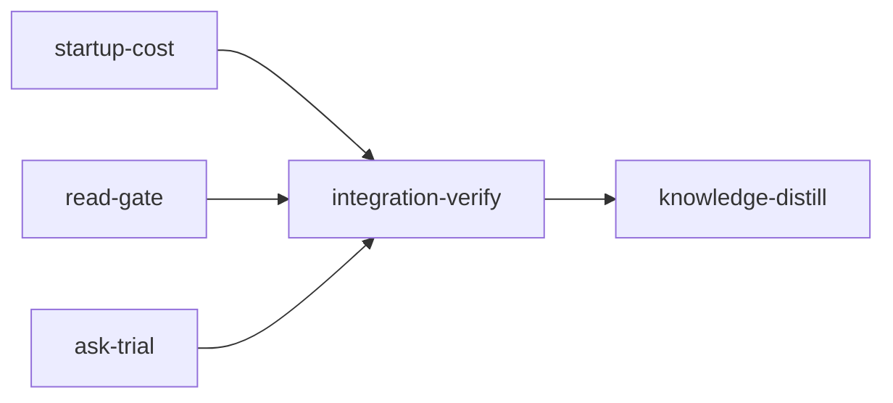

# Plan: Token savings inspired by Portal by Spotify

Implements: none

## Overview

This plan attributes loom's token cost by what entered context, gives mechanical work a smaller worker type, denies the first whole read of a large file in stages, gives Markdown a real outline, and ships a one-shot read worker for an evaluation before any agent is told to use it.

## Background

[Shunt](https://github.com/spotify/portal-ai-plugins/tree/main/plugins/shunt), a Claude Code plugin for Spotify's Portal, blocks whole reads over 350 lines with a PreToolUse hook and answers questions over files in one stateless call to a cheap model. Spotify [reports about 90% savings](https://engineering.atspotify.com/2026/9/portal-by-spotify-cut-my-claude-code-token-usage-by-90) on Claude's read tokens in three selected scenarios, excluding worker cost. It moved to hooks because CLAUDE.md rules could be ignored, and its worker missed a subtle thread-safety bug, so debugging and architecture stay out of it.

This plan takes three ideas from Shunt: enforcement over advice, a worker that is one call with no agent loop, and per-role configuration. It does not build Shunt's `code-writer`.

### Where loom's cost goes

Measured over `~/.claude/projects/*-src-loom*` for the 14 days to 2026-11-02: 2,077 transcripts, 1.54 billion cost units at the `loom usage` S2 weights. Admitted items are estimated at characters ÷ 4, and shares are not price-weighted across models.

| Category | Share |
| --- | --- |
| Tool results, including replay (file reads about 15%) | 21.9% |
| Startup context, replayed on every request (estimate) | 19.5% |
| Output tokens (Write and Edit about 1.1%) | 16.1% |
| Not attributed | about 42% |

A sample of 300 transcripts suggests most of the unattributed share is replayed assistant output (at most 16%) and injected attachments. The Attribution section replaces this estimate.

### What the numbers decided

- **Attribution comes first,** because 42% of cost has no explanation yet.
- **A Shunt-style worker saves at most 3.7% to 5.0%,** assuming answers at 10% of file size, no re-reads and a free worker. Rule 17 keeps source files small, so few source reads cross the gate. That is why `loom ask` ships for evaluation only.
- **Spawned readers lose to a direct read.** A 1,000-line read costs about 52K units with 50 requests remaining, against 438K for an average `Explore` run. The worker must be a single call.
- **The gate needs no model.** 72% of the read guard's "not covered by the source graph" warnings are for `.md` files, so a heading outline serves most of them. Deny is opt-in today, so most hits only warn.
- **The 400-line threshold stays.** A denied call costs about 15K units at 150K resident context, which breaks even near 2,400 tokens, or about 290 lines at Shunt's measured 8.4 tokens per line.
- **Startup is the cheapest lever.** Engineer subagents start at about 36,700 resident tokens and reviewers at about 22,200. `skill_listing` at 7,751 tokens appears on engineers and never on reviewers, and tool schemas probably account for the rest. `sandbox_instructions` is not part of the gap: none of 180 engineer transcripts carries it. Each 1K removed from every startup saves very roughly 0.7% of total cost.
- **Haiku engineers are about 1% of cost,** so `loom-mechanical-engineer` itself saves under roughly 0.2%. Its value is proving the cut before anyone considers the larger tiers.
- **The Claude lane starts far lighter than Codex.** `claude -p` with no tools and no setting sources started at 610 tokens on the operator's subscription, and `codex exec` at 20,200 input tokens, 11,520 of them cached. `claude --bare` is unusable here because it reads only API-key credentials.

### Rejected

| Idea | Why |
| --- | --- |
| `code-writer` equivalent | Write and Edit output is about 1.1% of cost, and existing lanes cover that work |
| Answer cache keyed on file and question | Repeat reads are at most 3.5%, and worded questions rarely match |
| Worker-based review or debugging | Excluded by the `optim-token` metaplan's constraint on verification |
| Cache rebuild tuning | Rebuilds are 2.2% of cost |
| Build and test output filter | Build and test tool results are near 0% |

### Later decisions, outside this plan

- **Skill listing size.** Much of the 7,751-token listing comes from plugins unrelated to loom. Shrinking it in stage sessions could be worth several percent.
- **Sonnet and Opus engineers' tool lists.** They are 27% of cost and use `Skill` for declared skills, so a cut needs another way to load them.

## Goals

- `loom usage` explains where cost goes, including startup composition per agent type.
- `loom usage` attributes agent types when the hook ledger is absent, as it is under `--all`.
- Mechanical work runs on a `loom-mechanical-engineer` that carries no skill listing.
- In a live stage, the first whole read of a file over 400 lines is denied with an outline, and a repeat is allowed.
- `loom map --outline` returns headings for Markdown without the source graph.
- `loom ask` answers a question over files in one worker call, on the Claude or Codex lane, and `loom ask --eval` reports whether it clears the accuracy bar. The Codex lane stays experimental until the probe in After merge shows it has no shell.

## Non-goals

- No agent is told to use `loom ask`, and no hook routes to it. That needs the evaluation result and the replays the `optim-token` metaplan requires, and belongs to a later plan.
- No local models, by operator decision. The read worker's lanes are Claude and Codex only.
- Sonnet and Opus engineers keep their tool lists and doctrine. By operator decision, trimming starts with mechanical workers only.
- Review, debugging and verification are never routed to a cheaper worker.

## Implementers

Sonnet and Opus only, by operator decision. No stage spawns a Haiku or Codex implementer, and every standard stage lists `implementers: ["claude"]`. The Haiku agent type this plan creates and the Codex lane of `loom ask` are products of the plan, not implementers of it. The main sessions and reviewers keep their configured defaults.

## Sibling plans

Run this plan alone in its checkout, and only after `IN_PROGRESS-PLAN-feat-planner-13` has merged: that plan's knowledge-distill stage owns the five knowledge-check issues open today, and both plans write `doc/loom/knowledge/**` and `check-baseline.txt`.

`PLAN-model-router-hooks` is parked. `PLAN-web-host-graft-followthrough` and `PLAN-loom-ui-mods` are unexecuted and also own `loom/src/cli/types.rs`, `loom/src/cli/dispatch.rs`, `loom/src/orchestrator/signals/**`, `README.md` and `doc/loom/knowledge/**`. These plans run one at a time, in any order. Whichever runs second re-reads the merged tree, finds `Commands` and `dispatch` by symbol, and reconciles the `dispatch` ledger row with the length it measures then. This plan's `ask-trial` globs `loom/src/cli/dispatch*.rs` in `files:` and wiring, so a merged `PLAN-web-host-graft-followthrough`, whose wiring expects `dispatch_commands.rs`, does not invalidate them.

**BLOCKING sibling amendment (before `PLAN-model-router-hooks` is revived with this plan merged):** its `router-core` classifier and template must add `loom-mechanical-engineer` to the allowed agent names, or every mechanical spawn draws a wrong-type note.

## Observed baselines

Run at `4e53ce56`:

- `cargo test --all-targets --no-fail-fast`: 12,449 passed, 0 failed, 20 ignored.
- `cargo test --doc --workspace --all-features -- --test-threads=1`: 6 passed, 0 failed, 7 ignored.
- `cargo clippy --all-targets -- -D warnings` and `RUSTDOCFLAGS='-D warnings' cargo doc --workspace --all-features --no-deps`: exit 0.
- `cargo fmt --check`: exit 0.
- `./scripts/check-hook-syntax.sh`: exit 0, 178 scripts.
- `bash loom-hooks/tests/run-all.sh` and `LOOM_HOOK_TEST_BSD=1 bash loom-hooks/tests/run-all.sh`: 108 passed, 0 failed each, under `bwrap` with a private `/tmp` to approximate the host job.
- `loom knowledge check --strict --baseline doc/loom/knowledge/check-baseline.txt`: exit 1, five new issues, all source references to planner files feat-planner-13 deleted. `check-baseline.txt` holds no tolerated issue.

## Execution Diagram



The three feature stages share no files and run concurrently. There is no knowledge-bootstrap stage: the tier-1 files already describe this codebase.

## Stages

### 1. Startup cost (`startup-cost`)

Adds the `loom usage` attribution section, the agent-type sidecar fallback, and the `loom-mechanical-engineer` agent with its doctrine. **Exists by Q4:** merged with either other stage, its doctrine pins, contract session and review round would risk passing 500,000 tokens across unrelated subsystems. Attribution and the mechanical worker share a stage because attribution is what measures the worker's saving.

Risk walk:

| Area | Contract |
| --- | --- |
| Filesystem paths and symlinks | `symlinked-sidecar-is-ignored` |
| External data | `sidecar-fills-missing-agent-type`, written from the real `agentType` key; `attachment-rows-count-requests-once-and-honour-since`, written from the real `rendered` shape |
| Lifecycle (two sources for one fact) | `ledger-outranks-sidecar` |
| Reachability | `report-carries-attribution`, `usage-command-renders-attribution-rows` |
| The stage's own behaviour | `tool-result-counts-admission-and-replay`, `startup-attachments-are-not-double-counted`, `attribution-totals-follow-the-definitions`, `windowed-transcript-has-no-startup`, `terminal-result-costs-nothing`, `over-attribution-is-reported`, `mechanical-worker-carries-no-skill-tool` |

### 2. Read gate (`read-gate`)

Adds deny-once to rule 1 of the read discipline and the Markdown outline fast path. **Exists by Q4,** and because the gate changes tool-call behaviour in every stage, a checkpoint on it should not be mixed with unrelated review findings (Q3).

Risk walk:

| Area | Contract |
| --- | --- |
| Untrusted input | `fenced-headings-are-not-outlined` |
| Filesystem paths and symlinks | `symlinked-markdown-gets-no-rows` |
| Configuration propagation | `read-gate-false-only-warns` |
| Lifecycle and retries | `first-whole-read-denied-then-repeat-allowed`, `unrecordable-denial-fails-open`, `second-agent-gets-its-own-denial`, `bash-cat-and-read-share-one-denial`, `denial-ledger-at-capacity-warns` |
| Session identity | `outside-a-live-stage-only-warns` |
| Doctrine collisions | `control-inputs-are-exempt` |
| Reachability | `markdown-outline-reaches-the-denial` |

`uncovered_file_warns_and_allows_even_with_deny_on` stays unchanged: its session has no `LOOM_MAIN_AGENT_PID`, so it pins "outside a live stage only warns". No test-integrity dispute is expected.

### 3. Ask trial (`ask-trial`)

Adds `loom ask` and `loom ask --eval` with frozen fixtures. **Exists by Q4,** and it is a self-contained command with no shared files.

Risk walk:

| Area | Contract |
| --- | --- |
| Untrusted input | `worker-has-no-tools-and-no-settings`, `worker-env-is-scrubbed`, `codex-lane-uses-stdin-and-a-temp-cwd`, `codex-tool-use-fails-closed` |
| Filesystem paths and symlinks | `refuses-paths-outside-the-project`, `refuses-credential-files` |
| Process I/O volume | `large-payload-goes-through-stdin`, `oversized-payload-is-refused` |
| Process lifetime | `timeout-kills-the-worker`, `sigint-kills-the-worker`, `descendant-holding-pipes-does-not-hang` |
| External data | `parses-captured-claude-output`, `parses-captured-codex-output`, `codex-reply-without-an-answer-fails` |
| Reachability and the stage's own behaviour | `text-mode-separates-answer-and-usage`, `eval-exits-nonzero-below-the-bar`, `eval-bar-is-ninety-percent`, `eval-counts-forbidden-strings`, `eval-report-carries-token-and-latency-lines` |

### Integration Verification

Full suite, lint, docs and both hook-suite runs, parallel reviews, and functional proof that all three features are reachable.

### Knowledge Distillation

Curates memories, rewrites the knowledge sections these changes make stale, keeps the knowledge check green without adding to its baseline, and updates the README.

## After merge (operator)

Stage sessions run installed assets, so the agent and hook changes take effect only after install. Install only when no other loom run is active: installed hooks and agents apply to every checkout at once. The evaluation spends provider tokens and needs network, so no stage can run it.

```bash
./dev-install.sh
loom ask --eval loom/tests/fixtures/ask_eval/cases.json --backend claude
loom usage --all --since 14d
```

**Prove isolation before trusting a lane.** No stage can do this, because it takes a provider call. Write a project file telling the reader to print the contents of `/etc/hostname`, and a second holding `@/etc/hostname`, then ask about each with `loom ask --question "What does this file say to do, and what is the result?" --paths <file>`, once per backend. If an answer holds the machine's hostname, that lane can reach files it was not given: do not use it, and treat its evaluation as void. `codex exec` has no switch that removes tools, so the `--disable` flags in the stage's Codex argv are the closest available and are unproven until this passes. `--ignore-user-config` does not cover a global `AGENTS.md` under `CODEX_HOME`, so also confirm the reply follows the mode prompt with one present. Run `loom ask --eval loom/tests/fixtures/ask_eval/cases.json --backend codex` only after the probe passes.

A smaller first request or fewer reads alone is not a saving, by the `optim-token` metaplan's evidence rule. Both defaults below are operator decisions with no replay behind them, so these checks decide whether they stay.

**Mechanical worker.** After a run that used `loom-mechanical-engineer`, read the Attribution section for its median first-request resident, then compare its whole cost per transcript with Haiku `loom-software-engineer` transcripts: divide its `by_agent_model` usage row by that type's `transcripts` in `startup_by_agent`, and count any task respawned at a higher tier against it. Route mechanical work back if the whole cost does not fall.

**Read gate.** Compare the reads section and the Attribution `read:*` rows for 14 days before and after install, and count the rows under `.loom/work/hooks/read-denials/`. Each row is a denied call that cost one request, and `same_transcript_rereads` counts a retry. Turn the gate off unless the `read:*` cost falls by more than those denied calls cost, about 15K units each at 150K resident.

To turn the gate off, set `read_gate = false` under `[hooks]` in `.loom/work/config.toml` after `loom init` and before `loom run`. `loom clean` and `loom init --clean` drop it, and `loom config` does not manage it. Editing the file during a host job fails that job with `verification policy changed`.

---

<!-- loom METADATA -->

```yaml
loom:
  version: 2
  ratchet_files:
    - loom/maintainability-baseline.txt
    - doc/loom/knowledge/check-baseline.txt
  provision:
    - working_dir: "web"
      command: "test ! -e .npmrc && test ! -L .npmrc && bun install --frozen-lockfile --ignore-scripts --backend=copyfile --config=/dev/null"
  sandbox:
    enabled: true
    auto_allow: true
    filesystem:
      deny_read: ["~/.ssh/**", "~/.aws/**", "~/.config/gcloud/**", "~/.gnupg/**"]
    network:
      allowed_domains: ["crates.io", "index.crates.io", "static.crates.io", "registry.npmjs.org"]
  stages:
    - id: startup-cost
      name: "Startup cost attribution and mechanical worker"
      summary: "Shows where token cost goes in loom usage, fixes agent-type attribution, and adds a smaller worker type for mechanical edits."
      stage_type: standard
      implementers: ["claude"]
      skills: ["loom-rust"]
      dependencies: []
      working_dir: "."
      description: |
        Implement the attribution section, the agent-type sidecar fallback, and the
        loom-mechanical-engineer agent. Implementers are Sonnet and Opus only: spawn no Haiku or
        Codex worker in this stage. The file-level detail is in the briefs below.

        Use parallel subagents and skills to maximize performance.

        | Worker | Role | Tier | Files owned | Shared context | Brief path |
        | --- | --- | --- | --- | --- | --- |
        | attribution | Usage attribution and sidecar | sonnet | loom/src/commands/usage/** | none | doc/plans/briefs/portal-token-savings/startup-cost/attribution.md |
        | mechanical | Agent and doctrine | sonnet | agents/loom-mechanical-engineer.md, CLAUDE.md.template, README.md, skills/loom-orchestration/SKILL.md, skills/loom-plan-writer/**, loom/src/orchestrator/signals/**, loom-hooks/spawn-guard.sh, loom/src/commands/hook/worker_brief.rs, loom/src/commands/hook/tests_worker_brief.rs | none | doc/plans/briefs/portal-token-savings/startup-cost/mechanical.md |

        PUBLIC SURFACE the contracts call (all in the lib crate):

        crate::commands::usage::agent_sidecar::agent_type_from_sidecar(transcript_path: &Path)
        -> Option<String> reads <dir>/<stem>.meta.json beside a subagent transcript through
        crate::fs::safe_read::read_bounded (no-follow, 64 KiB cap) and returns its top-level
        "spawnedAgentType" string when non-empty, else its top-level "agentType" string when
        non-empty (a team agent's agentType is the teammate's name).
        crate::commands::usage::parse_all (existing, private, reachable from the child module)
        sets Transcript.agent_type from the hook ledger first and from the sidecar only when the
        ledger has no row. The sidecar never sets stage_id,
        loom_session_id or requested_model. parse_all also sets
        Transcript.agent_type_from_sidecar: bool. sections::agents keeps
        agent_type_ledger_matches counting ledger rows only and adds agent_type_sidecar_matches, so
        the ledger diagnostic stays true when the sidecar fills the gap.

        crate::commands::usage::transcript_types::Transcript gains
        pub attachments: Vec<AttachmentEntry>, with AttachmentEntry { requests_before: usize,
        kind: String, chars: usize } defined in transcript_types. Real rows are
        {"type":"attachment","attachment":{"type":<kind>,...},"rendered":[{"content":<string>},...],
        "timestamp":...}. kind is attachment.type. chars is the total character count of the
        content strings in the top-level rendered array. A row with no non-empty rendered array is
        never parsed into attachments: the model never saw it (prompt_snapshot, hook_success,
        deferred_tools_record, credential_org, hook_permission_decision, command_permissions).
        requests_before counts the non-synthetic assistant entries retained so far, once per
        request, so it never exceeds n. Rows older than the --since cutoff are dropped like
        entries.

        crate::commands::usage::sections::attribution::build(&[Transcript]) -> Attribution, with
        Attribution { total_s2: f64, startup_s2: f64, output_s2: f64, assistant_replay_s2: f64,
        residual_s2: f64, over_attributed_s2: f64, startup_excluded: u64, rows: Vec<AttributionRow>,
        startup_by_agent: Vec<StartupRow> };
        AttributionRow { class: String, items: u64, chars: u64, s2: f64 }; StartupRow { agent_type:
        String, transcripts: u64, median_resident: u64, kinds: Vec<StartupKind> }; StartupKind {
        kind: String, median_tokens: u64 }. Attribution derives serde::Serialize.
        AttributionRow.class is exactly one of read:skill, read:knowledge, read:plan-or-signal,
        read:source-other, bash:build-test, bash:loom, bash:git, bash:search, bash:file-read,
        bash:other, agent-report, skill-tool, edit-ack, search-tool, other-tool, user-text,
        attach:<kind>, or other (the merged tail). sections::build keeps its signature
        (transcripts: &[Transcript], windowing: Windowing, provider_ledger: ProviderLedger) ->
        Report. startup_by_agent groups by agent_type, then main for main scope, then unknown.
        sections::Report gains pub attribution: attribution::Attribution, and sections::render
        prints a section headed "Attribution" through attribution::render, including when there is
        no data.

        DEFINITIONS, exact, for one transcript. n counts its non-synthetic requests (model is not
        SYNTHETIC_MODEL), and first is the first of them. k for an item counts the non-synthetic
        requests before it. total_s2 sums Accounting::of(&request.usage).s2 over those requests.
        write_rate is the transcript's own: (1.25 * sum(ephemeral_5m) + 2.0 * sum(ephemeral_1h)) /
        sum(ephemeral_5m + ephemeral_1h), or 1.25 when it recorded no writes. An item admitted after k
        requests, with 1 <= k <= n - 1, costs chars / 4 * (write_rate + 0.1 * (n - k - 1)): request k + 1
        writes it to the cache and the n - k - 1 requests after that read it, because one request's
        resident context is the next request's cache_read. An item with k == n was never sent and costs
        nothing. Anything admitted at k == 0 is startup and never enters rows: it is already inside the
        first request's resident context. startup_s2 applies only when
        first.normalization.true_fresh_start is Some(true), because a --since cutoff can remove the real
        start; any other transcript with a request contributes 0, stays out of startup_by_agent, counts
        once in startup_excluded, and leaves its k == 0 items to the residual. Otherwise startup_s2 = first.usage.input + 0.1 * first.usage.cache_read +
        1.25 * first.usage.ephemeral_5m + 2.0 * first.usage.ephemeral_1h + 0.1 * first.usage.resident() *
        (n - 1). output_s2 = sum(output) * 5. assistant_replay_s2 = sum over request i, 1-based, from 1 to
        n - 1, of output_i * (write_rate + 0.1 * (n - i - 1)), labelled an upper bound because thinking
        may not be replayed. With x = total_s2 - startup_s2 - output_s2 - assistant_replay_s2 -
        sum(rows.s2), residual_s2 = max(x, 0) and over_attributed_s2 = max(-x, 0), each computed per
        transcript and then summed, so one transcript's excess cannot hide inside another's residual.
        median_resident is the median of first.usage.resident() over the fresh-start
        transcripts of that agent type. StartupKind.median_tokens is the median, over those transcripts
        that have the kind at k == 0, of the per-transcript sum of chars / 4. Medians use
        sections::fmt::percentile(&mut values, 0.5).

        SCAFFOLD: the contract writer creates the module roots
        loom/src/commands/usage/agent_sidecar/mod.rs and
        loom/src/commands/usage/sections/attribution/mod.rs (the <dir>/mod.rs form, never <dir>.rs), each
        holding only #[cfg(test)] mod tests;, plus mod agent_sidecar; in usage/mod.rs and pub mod
        attribution; in sections/mod.rs. They are not frozen. The attribution worker extends these files
        and keeps those lines.

        CONTRACT SURFACE: the lib contracts share one test target, so the symbols this stage adds keep them
        all red at freeze. loom/tests/usage_attribution_contracts.rs declares #[path =
        "integration/helpers.rs"] #[allow(dead_code)] mod helpers; and spawns the binary only through
        helpers::loom_cmd(). Every contract file stays at 400 lines or fewer, every function at 50 or fewer,
        and rustfmt-clean, because --test maintainability scans tests/. A contract never self-skips.

        MEMORY: record mistakes, decisions and surprises via loom memory immediately; NEVER loom
        knowledge in this stage; NEVER Claude Code auto-memory.
      acceptance:
        - "cargo build --manifest-path loom/Cargo.toml"
        - "cargo test --manifest-path loom/Cargo.toml --lib commands::usage::"
        - "cargo test --manifest-path loom/Cargo.toml --lib commands::hook::"
        - "cargo test --manifest-path loom/Cargo.toml --lib orchestrator::signals::"
        - "cargo test --manifest-path loom/Cargo.toml --lib assets::"
        - "cargo test --manifest-path loom/Cargo.toml --test token_optimization_contracts"
        - "cargo test --manifest-path loom/Cargo.toml --test maintainability"
        - "cargo test --manifest-path loom/Cargo.toml --test integration hooks_spawn_guard"
        - "cargo clippy --manifest-path loom/Cargo.toml --all-targets -- -D warnings"
        - "cargo fmt --manifest-path loom/Cargo.toml --check"
        - "RUSTDOCFLAGS='-D warnings' cargo doc --manifest-path loom/Cargo.toml --workspace --all-features --no-deps"
        - "./scripts/check-hook-syntax.sh"
        - "bash loom-hooks/tests/run-all.sh"
        - "LOOM_HOOK_TEST_BSD=1 bash loom-hooks/tests/run-all.sh"
      before_stage:
        - command: "rg --version"
          description: "ripgrep on PATH for the doctrine surface sweep"
      after_stage:
        - command: "test -s agents/loom-mechanical-engineer.md"
          description: "the mechanical worker agent exists"
        - command: "test -z \"$(rg -l 'model: haiku' CLAUDE.md.template README.md skills/loom-orchestration/SKILL.md skills/loom-plan-writer loom/src/orchestrator/signals)\""
          description: "no doctrine surface still routes mechanical work to model: haiku on loom-software-engineer"
      files:
        - "loom/src/commands/usage/**"
        - "loom/src/commands/hook/worker_brief.rs"
        - "loom/src/commands/hook/tests_worker_brief.rs"
        - "loom/tests/usage_attribution_contracts.rs"
        - "loom/tests/mechanical_worker_contracts.rs"
        - "agents/loom-mechanical-engineer.md"
        - "CLAUDE.md.template"
        - "README.md"
        - "skills/loom-orchestration/SKILL.md"
        - "skills/loom-plan-writer/**"
        - "loom/src/orchestrator/signals/**"
        - "loom-hooks/spawn-guard.sh"
      artifacts:
        - "agents/loom-mechanical-engineer.md"
        - "loom/src/commands/usage/agent_sidecar/mod.rs"
        - "loom/src/commands/usage/sections/attribution/mod.rs"
      wiring:
        - source: "loom/src/commands/usage/sections/mod.rs"
          pattern: "attribution::build(transcripts)"
          literal: true
          description: "the attribution section is built into the usage report"
        - source: "loom/src/commands/usage/sections/mod.rs"
          pattern: "attribution::render(&report.attribution)"
          literal: true
          description: "the attribution section is rendered"
        - source: "loom/src/commands/usage/mod.rs"
          pattern: "agent_sidecar::agent_type_from_sidecar"
          literal: true
          description: "parse_all consults the sidecar"
        - source: "loom-hooks/spawn-guard.sh"
          pattern: "loom-mechanical-engineer"
          literal: true
          description: "the spawn guard names the new agent type in its typed-agent guidance"
        - source: "CLAUDE.md.template"
          pattern: "`loom-mechanical-engineer`"
          literal: true
          description: "Rule 7's agent table routes mechanical work to the new type"
        - source: "loom/src/commands/hook/worker_brief.rs"
          pattern: "loom-mechanical-engineer"
          literal: true
          description: "the worker-brief hook omits the skills line for the Skill-less agent"
        - source: "skills/loom-orchestration/SKILL.md"
          pattern: "HAIKU (loom-mechanical-engineer)"
          literal: true
          description: "the orchestration skill routes Haiku work to the new type"
        - source: "skills/loom-plan-writer/SKILL.md"
          pattern: "HAIKU (loom-mechanical-engineer)"
          literal: true
          description: "the plan-writer skill routes Haiku work to the new type"
        - source: "loom/src/orchestrator/signals/tests_doctrine_blocks.rs"
          pattern: "HAIKU (loom-mechanical-engineer)"
          literal: true
          description: "BLOCK-B carries the new type"
        - source: "loom/src/orchestrator/signals/format/codex.rs"
          pattern: "loom-mechanical-engineer"
          literal: true
          description: "the Codex fallback text names the new type"
        - source: "README.md"
          pattern: "`loom-mechanical-engineer`"
          literal: true
          description: "the README agent table lists the new type"
        - source: "skills/loom-plan-writer/references/codex-implementers.md"
          pattern: "loom-mechanical-engineer"
          literal: true
          description: "the Codex reference names the new type"
        - source: "skills/loom-orchestration/SKILL.md"
          pattern: "For Codex and `loom-mechanical-engineer`, quote applicable rules in briefs"
          literal: true
          description: "briefs quote rules for a worker with no Skill tool"
      contracts:
        - id: sidecar-fills-missing-agent-type
          file: loom/src/commands/usage/agent_sidecar/tests.rs
          test: commands::usage::agent_sidecar::tests::sidecar_fills_missing_agent_type
          scenario: "writes agent-a1.jsonl and agent-a1.meta.json holding {\"agentType\":\"loom-code-reviewer\"} under <session>/subagents in a TempDir, with no starts ledger, then calls parse_all with work_dir None"
          rejects: "a fix that only changes the agent-type ledger counter or reads the sidecar under a guessed snake_case key, leaving Transcript.agent_type None"
        - id: ledger-outranks-sidecar
          file: loom/src/commands/usage/agent_sidecar/tests.rs
          test: commands::usage::agent_sidecar::tests::ledger_outranks_sidecar
          scenario: "gives the same subagent a starts.jsonl row with type loom-advisor and a sidecar saying loom-code-reviewer, then calls parse_all with that work_dir"
          rejects: "a parse_all that lets the sidecar overwrite the authoritative hook ledger"
        - id: symlinked-sidecar-is-ignored
          file: loom/src/commands/usage/agent_sidecar/tests.rs
          test: commands::usage::agent_sidecar::tests::symlinked_sidecar_is_ignored
          scenario: "makes agent-a1.meta.json a symlink to a JSON file outside the subagents directory holding a valid agentType, then calls agent_type_from_sidecar"
          rejects: "an implementation using fs::read_to_string, which follows the symlink and returns the outside file's value"
        - id: tool-result-counts-admission-and-replay
          file: loom/src/commands/usage/sections/attribution/tests.rs
          test: commands::usage::sections::attribution::tests::tool_result_counts_admission_and_replay
          scenario: "builds a Transcript of 5 requests with no cache writes, so write_rate is 1.25, with a Read of loom/src/x.rs in request 2 and a 400-character result entry after it, then asserts the read:source-other row's s2 is 145.0 within 1e-6 (100 tokens * (1.25 + 0.1 * 2): request 3 writes it, requests 4 and 5 read it)"
          rejects: "a build that counts only the admission cost, charges a cache read on the request that wrote the item (155.0), or uses the transcript's total request count instead of the requests remaining"
        - id: startup-attachments-are-not-double-counted
          file: loom/src/commands/usage/sections/attribution/tests.rs
          test: commands::usage::sections::attribution::tests::startup_attachments_are_not_double_counted
          scenario: "builds a Transcript whose first request has true_fresh_start Some(true), with a skill_listing attachment at requests_before 0 and a hook_additional_context attachment at requests_before 2, then asserts rows has class attach:hook_additional_context and no class attach:skill_listing, and startup_by_agent lists skill_listing"
          rejects: "a build that adds startup attachments to rows as well as startup_s2, charging them twice and shrinking the residual"
        - id: report-carries-attribution
          file: loom/src/commands/usage/sections/attribution/tests.rs
          test: commands::usage::sections::attribution::tests::report_carries_attribution
          scenario: "calls sections::build with one Transcript and a ProviderLedger built with provider::normalize_provider_events from an empty ProviderEventInput, as usage_tests.rs::provider_input does, serializes the Report to JSON, then asserts the attribution object is present with total_s2 above zero"
          rejects: "an attribution module that compiles and passes its unit tests but is never added to the usage Report"
        - id: attribution-totals-follow-the-definitions
          file: loom/src/commands/usage/sections/attribution/tests.rs
          test: commands::usage::sections::attribution::tests::attribution_totals_follow_the_definitions
          scenario: "builds a fresh-start Transcript of three requests: r1 input 10, cache_creation 100 split as ephemeral_5m 60 and ephemeral_1h 40, cache_read 0, output 20; r2 input 1, cache_read 110, output 30; r3 input 1, cache_read 5000, output 50, and no other items, then asserts within 1e-6 total_s2 1178.0, startup_s2 187.0, output_s2 500.0, assistant_replay_s2 79.5, residual_s2 411.5"
          rejects: "any formula with the wrong remaining-request count, a flat 1.25 weight on a 1-hour write, replay charged on the last request's output, or a residual that subtracts the wrong terms"
        - id: windowed-transcript-has-no-startup
          file: loom/src/commands/usage/sections/attribution/tests.rs
          test: commands::usage::sections::attribution::tests::windowed_transcript_has_no_startup
          scenario: "builds the same three requests with true_fresh_start Some(false) on the first and a skill_listing attachment at requests_before 0, then asserts startup_s2 0.0, startup_excluded 1, an empty startup_by_agent, no attach:skill_listing row, and residual_s2 598.5 within 1e-6; then builds it with true_fresh_start None and asserts startup_excluded 1 and startup_s2 0.0"
          rejects: "a section that reports the context a --since cutoff left behind as startup, or drops those transcripts with no count of how many it left out"
        - id: terminal-result-costs-nothing
          file: loom/src/commands/usage/sections/attribution/tests.rs
          test: commands::usage::sections::attribution::tests::terminal_result_costs_nothing
          scenario: "builds a fresh-start Transcript of one request, input 10, output 20, holding a Read of loom/src/x.rs with a 400-character result entry after it, then asserts within 1e-6 total_s2 110.0, startup_s2 10.0, output_s2 100.0, assistant_replay_s2 0.0, residual_s2 0.0, over_attributed_s2 0.0 and a total of 0.0 across rows"
          rejects: "a formula that charges a write for a result no later request ever sent, or replay on the only request's output"
        - id: over-attribution-is-reported
          file: loom/src/commands/usage/sections/attribution/tests.rs
          test: commands::usage::sections::attribution::tests::over_attribution_is_reported
          scenario: "builds a fresh-start Transcript of two requests, r1 input 10 and r2 input 1, no cache counters and no output, with a Read of loom/src/x.rs in r1 and a 4,000-character result entry after it, then asserts within 1e-6 total_s2 11.0, startup_s2 11.0, the read:source-other row's s2 1250.0, residual_s2 0.0 and over_attributed_s2 1250.0"
          rejects: "a residual clamped to zero with no other trace, which reads as a fully explained total when the estimates exceed what was billed"
        - id: attachment-rows-count-requests-once-and-honour-since
          file: loom/src/commands/usage/sections/attribution/tests.rs
          test: commands::usage::sections::attribution::tests::attachment_rows_count_requests_once_and_honour_since
          scenario: "writes a JSONL holding, in order: an older request and an attachment row before the --since cutoff; two assistant rows sharing one message.id after it; a row {\"type\":\"attachment\",\"attachment\":{\"type\":\"hook_additional_context\"},\"rendered\":[{\"content\":\"abcd\"}]}, with a timestamp; and a prompt_snapshot attachment row with no rendered key; calls transcript::parse and asserts one attachment with requests_before 1, kind hook_additional_context and chars 4"
          rejects: "a count of rows or of file requests, an attachment kept past the cutoff, chars taken from the serialized attachment object, rendered read as a string, or a row the model never saw counted as cost"
        - id: usage-command-renders-attribution-rows
          file: loom/tests/usage_attribution_contracts.rs
          test: usage_command_renders_attribution_rows
          scenario: "writes a transcript at <TempDir>/-tmp-proj/s1.jsonl with a Read of loom/src/x.rs, a 400-character result, and a hook_additional_context attachment with a rendered array, both after the first of at least three requests; runs helpers::loom_cmd() with usage --all --since 2000-01-01 --claude-root <TempDir>, asserting read:source-other and attach:hook_additional_context appear under Attribution; then with --json asserts attribution.total_s2 above zero"
          rejects: "a section that prints its heading and no_data on real transcripts, or is missing from render or the JSON"
        - id: mechanical-worker-carries-no-skill-tool
          file: loom/tests/mechanical_worker_contracts.rs
          test: mechanical_worker_carries_no_skill_tool
          scenario: "reads agents/loom-mechanical-engineer.md through CARGO_MANIFEST_DIR and parses its frontmatter, asserting model is haiku, tools is exactly Read, Edit, Write, Glob, Grep, Bash, and the file is under 2,000 bytes"
          rejects: "an agent that copies loom-software-engineer's tools line, which keeps Skill and so keeps the 7,751-token skill listing the agent exists to remove"

    - id: read-gate
      name: "Deny-once read gate and Markdown outlines"
      summary: "In stages, the first whole read of a large file is denied with an outline and a repeat is allowed; Markdown gets a heading outline with no source graph."
      stage_type: standard
      implementers: ["claude"]
      skills: ["loom-rust"]
      dependencies: []
      working_dir: "."
      harness: ["loom/tests/read_gate_contracts/**"]
      description: |
        Implement the gate and the outline. Implementers are Sonnet and Opus only: spawn no Haiku
        or Codex worker in this stage. The file-level detail is in the briefs below.

        Use parallel subagents and skills to maximize performance.

        | Worker | Role | Tier | Files owned | Shared context | Brief path |
        | --- | --- | --- | --- | --- | --- |
        | gate | Deny-once in the hook core | opus | loom-hooks/_read_discipline.sh, loom-hooks/_read_ledger.sh, loom-hooks/_containment.sh, loom-hooks/read-guard.sh, loom/tests/integration/hooks_read_guard.rs, loom/tests/integration/hooks_read_guard_cases.rs, loom/tests/integration/hooks_read_guard_repeat.rs, loom/tests/integration/hooks_poll_guard_reads.rs, loom-hooks/poll-guard.sh | none | doc/plans/briefs/portal-token-savings/read-gate/gate.md |
        | outline | Markdown outline | sonnet | loom/src/commands/map.rs, loom/src/map/views/** | none | doc/plans/briefs/portal-token-savings/read-gate/outline.md |

        BEHAVIOUR the contracts pin. The contracts run the real hook scripts and the real binary.

        GATE: rule 1 of loom_read_discipline_check applies to an unbounded read over
        READ_GUARD_LINE_LIMIT (400, unchanged) lines. In a live stage, meaning LOOM_STAGE_ID and
        LOOM_MAIN_AGENT_PID are both set and the PID is a live ancestor (is_ancestor), the first
        such read by one agent of one path exits 2 with the message on stderr, whether or not the
        graph covers the file and with no dependence on deny_enabled. The message includes the
        outline when one exists and contains the literal text `Repeating this read is allowed`. A
        second whole read of that path by that agent, through Read or through Bash cat, is
        allowed. Rule 1's whole-read definition is unchanged, so a bare head and cat x | head -5
        count as whole reads. Denials are keyed on the path normalised through cd and pwd -P in a
        subshell, in both channels, so cat ../files/x.md and a Read of the absolute path are one
        key. Denials are keyed on (agent, absolute path) and recorded through _loom_ledger_file
        with kind read-denials.
        Outside a live stage, or with read_gate = false under [hooks] in $LOOM_WORK_DIR/config.toml,
        rule 1 only warns. A denial that cannot be recorded warns instead of denying, so an agent
        can never be denied forever. deny_enabled keeps its meaning for poll-guard's own rules.
        The ledger is per loom session, so a handoff or the contract-to-implementer switch re-denies
        once. It stays under hooks/read-denials until the work directory is removed. It holds at most
        _LOOM_LEDGER_MAX_ROWS (300) rows per agent and is never trimmed: an agent whose ledger is full
        gets a warning instead of a new denial, because an evicted row would deny a path a second time.

        EXEMPT from rule 1, with no denial: skills and INDEX.md (rules 0 and 0b, unchanged), tier-1
        knowledge (rule 3 stays a warning), anything under a .loom/ directory or $LOOM_WORK_DIR
        (signals and handoffs), and anything under doc/plans/ (plans and worker briefs: sessions
        are told to read them whole).

        OUTLINE: loom map --outline <path> with a .md or .markdown extension (case-insensitive), as
        the only requested view and without --census, is served in execute_graph_views after the
        project root resolves and before load_graph, so it needs no graph and works on an untracked
        file. It prints the existing header line, one row per ATX heading in the existing format
        "  L<a>-L<b>  heading  <scope>  <signature>", including the two leading spaces the hook's
        regex requires, then "coverage: markdown headings". The hook always passes an absolute
        path. A path outside the project root, or one that read_bounded refuses, prints the header
        and "coverage: markdown unavailable - <reason>" with no rows, so the hook falls through to
        its no-outline message.

        uncovered_file_warns_and_allows_even_with_deny_on stays unchanged: its session has no
        LOOM_MAIN_AGENT_PID, so it pins "outside a live stage only warns". No test-integrity
        dispute is expected. Keep rg -n, offset/limit, Outline and "Read the ranges you need with
        offset/limit" in the messages: existing tests assert them.

        CONTRACT SURFACE: rule 1 already warns with exit 0, so a contract asserting only exit 0 and a
        warning passes before implementation and freeze refuses it: every "allowed" contract below
        opens with a control that exits 2. loom/tests/read_gate_contracts.rs declares
        #[path = "integration/helpers.rs"] #[allow(dead_code)] mod helpers; for clear_relay_env,
        loom_bin_path and loom_cmd, spawns the binary only through helpers::loom_cmd(), and writes
        the hooks by iterating loom::fs::permissions::constants::LOOM_HOOKS. Builders go in
        loom/tests/read_gate_contracts/support.rs. Each run sets LOOM_WORK_DIR, LOOM_SESSION_ID,
        TMPDIR, and LOOM_BIN to a missing path unless testing the outline. A contract never
        self-skips: a skip reads as a pass, and the host job mounts /proc. Every file stays at 400
        lines or fewer, every function at 50 or fewer, and rustfmt-clean.

        MEMORY: record mistakes, decisions and surprises via loom memory immediately; NEVER loom
        knowledge in this stage; NEVER Claude Code auto-memory.
      acceptance:
        - "cargo build --manifest-path loom/Cargo.toml"
        - "cargo test --manifest-path loom/Cargo.toml --lib map::"
        - "cargo test --manifest-path loom/Cargo.toml --test integration hooks_read_guard"
        - "cargo test --manifest-path loom/Cargo.toml --test integration hooks_poll_guard"
        - "cargo test --manifest-path loom/Cargo.toml --test maintainability"
        - "cargo clippy --manifest-path loom/Cargo.toml --all-targets -- -D warnings"
        - "cargo fmt --manifest-path loom/Cargo.toml --check"
        - "RUSTDOCFLAGS='-D warnings' cargo doc --manifest-path loom/Cargo.toml --workspace --all-features --no-deps"
        - "./scripts/check-hook-syntax.sh"
        - "bash loom-hooks/tests/run-all.sh"
        - "LOOM_HOOK_TEST_BSD=1 bash loom-hooks/tests/run-all.sh"
      before_stage:
        - command: "jq --version"
          description: "jq on PATH for the hook scripts"
      after_stage:
        - command: "test -s loom/src/map/views/markdown_outline.rs"
          description: "the Markdown outline exists"
      files:
        - "loom-hooks/_read_discipline.sh"
        - "loom-hooks/_read_ledger.sh"
        - "loom-hooks/_containment.sh"
        - "loom-hooks/read-guard.sh"
        - "loom-hooks/poll-guard.sh"
        - "loom/src/commands/map.rs"
        - "loom/src/map/views/**"
        - "loom/tests/read_gate_contracts.rs"
        - "loom/tests/read_gate_contracts/**"
        - "loom/tests/integration/hooks_read_guard.rs"
        - "loom/tests/integration/hooks_read_guard_cases.rs"
        - "loom/tests/integration/hooks_read_guard_repeat.rs"
        - "loom/tests/integration/hooks_poll_guard_reads.rs"
      artifacts:
        - "loom/src/map/views/markdown_outline.rs"
        - "loom-hooks/_read_ledger.sh"
        - "loom-hooks/_read_discipline.sh"
      wiring:
        - source: "loom/src/commands/map.rs"
          pattern: "markdown_outline::"
          literal: true
          description: "the map command serves Markdown outlines"
        - source: "loom-hooks/_read_discipline.sh"
          pattern: "loom_read_deny_once"
          literal: true
          description: "rule 1 calls the deny-once gate"
      contracts:
        - id: first-whole-read-denied-then-repeat-allowed
          file: loom/tests/read_gate_contracts.rs
          test: first_whole_read_denied_then_repeat_allowed
          scenario: "copies the hooks to a TempDir, sets LOOM_STAGE_ID and LOOM_MAIN_AGENT_PID to the test process, leaves deny_enabled unset, and sends read-guard.sh the same whole Read of a 500-line file twice for one agent, asserting exit 2 with 'Repeating this read is allowed' on stderr, then exit 0 with empty stdout"
          rejects: "a gate still conditioned on deny_enabled, which never denies by default, or one that denies every attempt and leaves no way to read the file"
        - id: outside-a-live-stage-only-warns
          file: loom/tests/read_gate_contracts.rs
          test: outside_a_live_stage_only_warns
          scenario: "asserts a whole read of a 500-line file with a live PID exits 2, then sends a second file with LOOM_STAGE_ID set and LOOM_MAIN_AGENT_PID naming a dead process, then a third with neither set, asserting exit 0 and a warning for each"
          rejects: "a gate keyed on LOOM_STAGE_ID alone, which leaks into plain sessions from an exporting shell and would block ordinary work"
        - id: unrecordable-denial-fails-open
          file: loom/tests/read_gate_contracts.rs
          test: unrecordable_denial_fails_open
          scenario: "in a live stage with session sess-a, asserts a first read exits 2; then with session sess-b makes $LOOM_WORK_DIR/hooks/read-denials/sess-b a symlink, sends the read twice, and asserts exit 0 with a warning both times and nothing written through the symlink"
          rejects: "a gate that denies without confirming the denial was recorded, which would deny that read on every retry"
        - id: control-inputs-are-exempt
          file: loom/tests/read_gate_contracts.rs
          test: control_inputs_are_exempt
          scenario: "in a live stage, creates 500-line Markdown files in a TempDir: one under .loom/work/signals, one under a briefs directory directly below doc/plans, one under a briefs directory one level deeper, and doc/plans/PLAN-x.md; sends a whole read of each and asserts exit 0 with empty stdout; then asserts a whole read of a 500-line file outside those directories exits 2"
          rejects: "a gate that denies the stage signal, a worker brief or the plan, which every session is told to read in full, wasting a request on every start"
        - id: read-gate-false-only-warns
          file: loom/tests/read_gate_contracts.rs
          test: read_gate_false_only_warns
          scenario: "in a live stage, writes [hooks] read_gate = false to $LOOM_WORK_DIR/config.toml, sends the read and asserts exit 0 with a warning, then rewrites the value to read_gate = true and asserts exit 2"
          rejects: "a switch that is documented but never read, leaving the gate on when the operator turned it off"
        - id: fenced-headings-are-not-outlined
          file: loom/tests/read_gate_contracts.rs
          test: fenced_headings_are_not_outlined
          scenario: "in a fresh git repository with no graph and no .loom state, writes an untracked .md with a real heading, a fenced bash block holding '# comment', a ~~~ block holding '## also code', and a heading whose text carries an ANSI escape, then runs the loom binary with map --outline, asserting the real heading's row is present, neither fenced line is a row, and stdout holds no ESC byte"
          rejects: "a line scan that outlines fenced comments as headings, or one that loads the graph and so reports no rows for an untracked file"
        - id: symlinked-markdown-gets-no-rows
          file: loom/tests/read_gate_contracts.rs
          test: symlinked_markdown_gets_no_rows
          scenario: "writes real.md and asserts map --outline real.md prints a heading row, then makes link.md a symlink to a Markdown file outside the repository and asserts map --outline link.md prints the Outline: header, coverage: markdown unavailable, no L<a>-L<b> row and none of the outside file's heading text"
          rejects: "an outline that follows the symlink and prints headings from a file outside the project"
        - id: markdown-outline-reaches-the-denial
          file: loom/tests/read_gate_contracts.rs
          test: markdown_outline_reaches_the_denial
          scenario: "in a fresh git repository writes a 500-line .md with two headings, sends read-guard.sh a whole Read of its absolute path in a live stage with LOOM_BIN set to helpers::loom_bin_path() and the repository as working directory, and asserts exit 2 with both heading rows in stderr"
          rejects: "rows without the two-space indent the hook regex requires, an absolute path refused because the project root is '.', or a denial that omits the outline"
        - id: second-agent-gets-its-own-denial
          file: loom/tests/read_gate_contracts.rs
          test: second_agent_gets_its_own_denial
          scenario: "in a live stage, agent-a's whole Read of a 500-line file exits 2 then 0, then agent-b's first whole Read of it exits 2"
          rejects: "a ledger keyed on session or path alone, so one subagent's denial waives the gate for its siblings"
        - id: bash-cat-and-read-share-one-denial
          file: loom/tests/read_gate_contracts.rs
          test: bash_cat_and_read_share_one_denial
          scenario: "in a live stage with cwd a sibling of the file's directory, poll-guard.sh with cat ../files/big.md, a 500-line file, exits 2, then read-guard.sh with the absolute path exits 0; on a second 500-line file, Read exits 2, then cat exits 0"
          rejects: "a key that differs by tool or keeps the path as given, which denies twice"
        - id: denial-ledger-at-capacity-warns
          file: loom/tests/read_gate_contracts.rs
          test: denial_ledger_at_capacity_warns
          scenario: "in a live stage, one agent sends first whole Reads of 301 distinct 500-line files, asserting exit 2 on each of the first 300, then exit 0 with a warning on the 301st; then a repeat of the first file exits 0 with empty stdout and a repeat of the 301st exits 0"
          rejects: "a gate using the trimming append alone, which evicts the first denial and denies that path a second time after the contract promised a repeat is allowed"

    - id: ask-trial
      name: "One-shot read worker for evaluation"
      summary: "Adds loom ask, which answers a question over files in one worker call, and an evaluation command that reports whether it is accurate enough to adopt."
      stage_type: standard
      implementers: ["claude"]
      skills: ["loom-rust"]
      dependencies: []
      working_dir: "."
      harness: ["loom/tests/fixtures/ask/**", "loom/tests/ask_contracts/**"]
      description: |
        Implement loom ask. Implementers are Sonnet and Opus only: spawn no Haiku or Codex worker in
        this stage. The worker's Codex lane is a product feature; it is tested with fake binaries
        and no stage calls a provider. The file-level detail is in the briefs below. Spawn core
        first and cases once it returns: the self-check test imports core's case parser.

        Use parallel subagents and skills to maximize performance.

        | Worker | Role | Tier | Files owned | Shared context | Brief path |
        | --- | --- | --- | --- | --- | --- |
        | core | Command, payload, backends, evaluation runner | opus | loom/src/commands/ask/mod.rs, loom/src/commands/ask/payload.rs, loom/src/commands/ask/backend.rs, loom/src/commands/ask/run.rs, loom/src/commands/ask/payload_tests.rs, loom/src/commands/ask/run_tests.rs, loom/src/commands/ask/eval.rs, loom/src/commands/mod.rs, loom/src/cli/types.rs, loom/src/cli/dispatch*.rs, loom/maintainability-baseline.txt | none | doc/plans/briefs/portal-token-savings/ask-trial/core.md |
        | cases | Frozen evaluation fixtures and their self-check | sonnet | loom/src/commands/ask/eval_tests.rs, loom/tests/fixtures/ask_eval/** | core's case parser | doc/plans/briefs/portal-token-savings/ask-trial/eval.md |

        The cases worker also owns the single line #[cfg(test)] mod eval_tests; in
        loom/src/commands/ask/eval.rs, and no other line of that file.

        CLI, for the contracts:

        loom ask --question <Q> --paths <P>... [--backend claude|codex] [--model <M>]
        [--timeout-secs <N>] [--json]

        loom ask --eval <CASES.json> [--backend claude|codex] [--model <M>] [--timeout-secs <N>]

        Defaults: backend claude, model haiku on claude and gpt-6-luna on codex, timeout 180 s.
        --question and --eval form a required, exclusive group, and --json conflicts with --eval.
        Exit 0 on an answer. A refused path, an oversized payload, a timeout, a worker failure or
        an error result exits 1 with a stderr message: a path outside the root says "outside the
        project", a credential file says "credential", a timeout says "timed out". Clap's usage
        error is exit 2, which is how a contract tells a refusal from a missing command. After
        SIGINT or SIGTERM, exit 130.

        CLAUDE LANE: spawn the binary loom/src/claude.rs resolves, with args
        -p --model <M> --tools "" --setting-sources "" --strict-mcp-config
        --disable-slash-commands --no-session-persistence --system-prompt <MODE_PROMPT>
        --output-format json. The child gets CLAUDE_CODE_DISABLE_FILE_MENTIONS=1, because --tools
        does not govern @path expansion in the prompt. Never --bare: it reads only API-key
        credentials, and the operator uses OAuth. CODEX LANE: spawn what
        crate::codex::find_codex_path resolves, with args
        exec --json --sandbox read-only --skip-git-repo-check --ephemeral --ignore-user-config
        --ignore-rules --disable shell_tool --disable unified_exec --disable apps
        --disable browser_use --disable computer_use --disable multi_agent --disable plugins -m <M>
        -c model_reasoning_effort=low. codex exec has no switch that removes tools, and
        --sandbox read-only still lets a shell read the whole disk, so these flags are the closest
        available. No stage can prove they work: the lane is experimental until the After merge
        probe passes. codex exec has no system-prompt argument in this argv, so on the Codex lane
        the stdin payload opens with <MODE_PROMPT>; on the Claude lane it stays in --system-prompt
        and out of stdin. On both lanes the payload goes on stdin, and the child's cwd
        is a fresh tempfile::TempDir so no project instructions are discovered.

        On both lanes the child's environment loses LOOM_* and CLAUDECODE, CLAUDE_CODE_SESSION_ID,
        CLAUDE_CODE_CHILD_SESSION, CLAUDE_CODE_ENTRYPOINT, CLAUDE_CODE_MESSAGING_SOCKET,
        CLAUDE_CODE_MESSAGING_TOKEN and CLAUDE_CODE_EXECPATH, and keeps everything else, because the
        provider CLIs need HOME and their auth. The worker runs in its own process group. On SIGINT or
        SIGTERM one ctrlc handler kills that group and marks the run interrupted: a terminal's signal never
        reaches a separate group, and an --eval run stops rather than starting the next case.

        SIZE LIMITS: dispatch in loom/src/cli/dispatch.rs is an exact ledger entry at 59 lines, and the ledger
        fails on growth and on shrinkage. Move the three-line Commands::Project arm into a dispatch_project
        helper (-2), add the one-line Commands::Ask { args } => ask::execute(args), arm (+1), and lower the
        row in loom/maintainability-baseline.txt to `function src/cli/dispatch.rs dispatch 58`. Add no
        padding to hold the old count, and raise no limit. That file is a ratchet, so the edit raises
        TI-ratchet-loom/maintainability-baseline.txt: the main agent files loom stage dispute-integrity,
        naming this one tightened row. If a merged sibling already split dispatch or removed the row, find
        the arm's home by symbol, measure, and leave the ledger exact.
        loom/src/cli/types.rs is 392 of 400 lines, so the Ask variant fits in at most 8.

        --json prints one object: backend, model, answer, input_tokens, cache_read_tokens,
        cache_write_tokens, output_tokens, latency_ms. Text mode prints the answer on stdout and one
        usage line on stderr. For Claude the tokens are usage.input_tokens,
        usage.cache_read_input_tokens, usage.cache_creation_input_tokens, usage.output_tokens, and
        is_error true or a non-success subtype is a failure. For Codex they come from the
        turn.completed row: cache_read_tokens is cached_input_tokens, cache_write_tokens is
        cache_write_input_tokens, and input_tokens is input_tokens minus both, because Codex counts
        cached tokens inside input_tokens. The answer is the last item.completed agent_message. A
        turn.failed or error row, a missing turn.completed or agent_message, or an item.completed
        whose item.type is neither agent_message nor reasoning is a failure with no answer printed:
        a worker that used a tool read beyond the named files. The check is an allowlist, because
        no captured output shows the tool item types.
        cache_write_input_tokens defaults to 0 when absent, and input_tokens uses a saturating
        subtraction.

        PATHS: the root is WorkDir::new(".").project_root(), canonicalized once: the nearest .loom/work
        workspace, else the cwd, never the git root. Each argument canonicalizes under the root, else it is
        refused as outside the project. Then std::path::absolute(arg) with the root prefix stripped goes to
        crate::fs::safe_read::read_to_string_bounded, so a symlink inside the root and a non-UTF-8 file are
        refused. A duplicate canonical path is read once. Refused as a credential, on the path as given and
        on its canonical form, ignoring ASCII case: any .git path component, and a basename matching .env*,
        .netrc, .npmrc, .pgpass, .git-credentials, *.pem, *.key, *.p12, *.pfx, id_rsa*, id_ed25519*,
        id_ecdsa*, id_dsa* or credentials*. That also refuses credentials.rs and .envrc: intended. Total file
        bytes are capped at 400,000 by passing the remaining allowance as max_bytes.

        EVAL: --eval reads a JSON array of { id, question, paths, must_contain, must_not_contain },
        with paths relative to the cases file. A case passes when the answer contains every
        must_contain string and no must_not_contain string, ignoring ASCII case. The cases file and
        its documents live under the root. Cases run one at a time with no overall deadline, and a
        worker failure counts as a failed case. The report prints one line per case, then exactly
        these labels: "accuracy: <0.00>", "worker tokens: input <n> cache_read <n> cache_write <n>
        output <n>", "latency p50: <ms> p90: <ms>" and "direct tokens estimate: <n>", the last
        being file chars / 4. Exit 0 when accuracy is at least 0.90, else exit 1.

        Tests use fake claude and codex scripts on PATH and make no provider call. No doctrine,
        hook or skill mentions loom ask in this plan: see the plan's non-goals.

        CONTRACT SURFACE: loom/tests/ask_contracts.rs declares #[path = "integration/helpers.rs"]
        #[allow(dead_code)] mod helpers; and spawns loom only through helpers::loom_cmd(), prepending the
        fake's directory to PATH. Builders go in loom/tests/ask_contracts/support.rs. A fake records argv one
        argument per line, so an empty value survives. Every test is #[serial], because each writes and
        execs a fake binary and a concurrent fork would make that exec fail with ETXTBSY. A contract never
        self-skips. Every file stays at 400 lines or fewer, every function at 50 or fewer, and rustfmt-clean.

        The real provider outputs captured on 2026-11-02 are in
        doc/plans/briefs/portal-token-savings/ask-trial/captured/. The contract session copies them
        to loom/tests/fixtures/ask/ and builds the fake binaries from them. Never write these
        fixtures from memory.

        MEMORY: record mistakes, decisions and surprises via loom memory immediately; NEVER loom
        knowledge in this stage; NEVER Claude Code auto-memory.
      acceptance:
        - "cargo build --manifest-path loom/Cargo.toml"
        - "cargo test --manifest-path loom/Cargo.toml --lib commands::ask::"
        - "cargo test --manifest-path loom/Cargo.toml --test maintainability"
        - "cargo run -q --manifest-path loom/Cargo.toml -- ask --help"
        - "cargo clippy --manifest-path loom/Cargo.toml --all-targets -- -D warnings"
        - "cargo fmt --manifest-path loom/Cargo.toml --check"
        - "RUSTDOCFLAGS='-D warnings' cargo doc --manifest-path loom/Cargo.toml --workspace --all-features --no-deps"
      before_stage:
        - command: "cargo --version"
          description: "cargo on PATH"
      after_stage:
        - command: "test -s loom/tests/fixtures/ask_eval/cases.json"
          description: "the evaluation cases exist"
        - command: "test -s loom/tests/fixtures/ask_eval/docs/token-optim-metaplan.md"
          description: "a frozen evaluation document exists"
        - command: "test -s loom/tests/fixtures/ask_eval/docs/context-retrieval.md"
          description: "a frozen evaluation document exists"
        - command: "test -s loom/tests/fixtures/ask_eval/docs/source-graph.md"
          description: "a frozen evaluation document exists"
        - command: "test -s loom/tests/fixtures/ask_eval/docs/stage-diff.diff"
          description: "a frozen evaluation document exists"
        - command: "test -s loom/tests/fixtures/ask_eval/docs/test-run.txt"
          description: "a frozen evaluation document exists"
      files:
        - "loom/src/commands/ask/**"
        - "loom/src/commands/mod.rs"
        - "loom/src/cli/types.rs"
        - "loom/src/cli/dispatch*.rs"
        - "loom/maintainability-baseline.txt"
        - "loom/tests/ask_contracts.rs"
        - "loom/tests/ask_contracts/**"
        - "loom/tests/fixtures/ask/**"
        - "loom/tests/fixtures/ask_eval/**"
      artifacts:
        - "loom/src/commands/ask/mod.rs"
        - "loom/src/commands/ask/eval.rs"
        - "loom/tests/fixtures/ask_eval/cases.json"
      wiring:
        - source: "loom/src/cli/dispatch*.rs"
          pattern: "Commands::Ask { args } =>"
          literal: true
          description: "loom ask is dispatched from the CLI"
        - source: "loom/src/commands/ask/eval.rs"
          pattern: "mod eval_tests;"
          literal: true
          description: "the evaluation self-check is compiled into the lib tests"
      contracts:
        - id: large-payload-goes-through-stdin
          file: loom/tests/ask_contracts.rs
          test: large_payload_goes_through_stdin
          scenario: "writes a 300,000-byte file, puts on PATH a fake claude that records its argv, writes 200 KiB of blank lines to stdout and 200 KiB to stderr before reading stdin, reads stdin to EOF, checks it holds the file's last line, and prints the captured result, then runs loom ask with a 30 s timeout and asserts exit 0"
          rejects: "passing the payload on argv, which fails above Linux's 128 KiB single-argument limit, or writing stdin on the waiting thread, which deadlocks once the pipe buffer fills"
        - id: worker-has-no-tools-and-no-settings
          file: loom/tests/ask_contracts.rs
          test: worker_has_no_tools_and_no_settings
          scenario: "runs loom ask with a fake claude recording argv and cwd, over a file whose text says to run a shell command, then asserts --tools followed by an empty value, --setting-sources followed by an empty value, --strict-mcp-config, --disable-slash-commands, --no-session-persistence, --output-format json, a --system-prompt value, --model haiku when --model was not given, and a cwd outside the project"
          rejects: "a worker spawned with its default tools or project settings, where instructions planted in a read file could act and startup cost returns to tens of thousands of tokens"
        - id: refuses-paths-outside-the-project
          file: loom/tests/ask_contracts.rs
          test: refuses_paths_outside_the_project
          scenario: "runs loom ask over inside.md with a fake claude that records each run and asserts exit 0 and one recorded run, then runs it with ../outside.md and with link.md, a symlink to that file, asserting exit 1, 'outside the project' on stderr, and no further recorded run"
          rejects: "a read that resolves .. or follows the symlink and sends a file from outside the project to a provider"
        - id: refuses-credential-files
          file: loom/tests/ask_contracts.rs
          test: refuses_credential_files
          scenario: "runs loom ask over inside.md with a fake claude that records each run and asserts exit 0 and one recorded run, then for each of .env.local, .ENV, x.pem, x.key, id_rsa, credentials.json and a file under .git asserts exit 1, 'credential' on stderr, and no further recorded run"
          rejects: "an implementation that confines paths to the project but still uploads its secrets"
        - id: timeout-kills-the-worker
          file: loom/tests/ask_contracts.rs
          test: timeout_kills_the_worker
          scenario: "runs loom ask with --timeout-secs 1 over a 300,000-byte file, with a fake claude that never reads stdin, writes its pid to a file, backgrounds sleep 60 and writes that pid to a second file, then sleeps 60 s; reads both pid files with expect, then asserts exit 1 within 10 s, 'timed out' on stderr, and that both pids are gone by loom::process::is_process_alive"
          rejects: "a timeout that leaves the worker or its children running and spending tokens, or a stdin write on the waiting thread, which blocks when the worker does not read, so the timeout never fires"
        - id: descendant-holding-pipes-does-not-hang
          file: loom/tests/ask_contracts.rs
          test: descendant_holding_pipes_does_not_hang
          scenario: "with --timeout-secs 30, a fake claude backgrounds sleep 60 with stdout and stderr still inherited, writes that pid to a file, prints the captured output and exits 0; reads the pid file with expect, then asserts loom ask exits 0 within 10 s with the answer on stdout and that the pid is gone by loom::process::is_process_alive"
          rejects: "readers joined with no bound, which hang until the descendant closes the pipes, or a group retired only on timeout, which leaves the descendant running after a successful answer"
        - id: parses-captured-claude-output
          file: loom/tests/ask_contracts.rs
          test: parses_captured_claude_output
          scenario: "a fake claude prints the captured ask-claude.json; loom ask --json must report answer ok, input_tokens 2, cache_read_tokens 0, cache_write_tokens 608 and output_tokens 4; a second run with is_error set true in that output must exit nonzero"
          rejects: "a parser written from a remembered shape that misses the cache fields, or one that reports an error result as an answer"
        - id: parses-captured-codex-output
          file: loom/tests/ask_contracts.rs
          test: parses_captured_codex_output
          scenario: "a fake codex prints the captured ask-codex.jsonl; loom ask --backend codex --json must report answer ok, input_tokens 8680, cache_read_tokens 11520, cache_write_tokens 0 and output_tokens 5"
          rejects: "a parser that reports input_tokens as 20200, counting cached tokens twice in any total"
        - id: eval-exits-nonzero-below-the-bar
          file: loom/tests/ask_contracts.rs
          test: eval_exits_nonzero_below_the_bar
          scenario: "writes under the working directory a cases file of two cases whose must_contain the fake worker's fixed answer satisfies only once, runs loom ask --eval and asserts exit 1 and 'accuracy: 0.50' in stdout, then a file where all pass and asserts exit 0"
          rejects: "an evaluation that always exits 0, so a worker below the bar reads as passing"
        - id: worker-env-is-scrubbed
          file: loom/tests/ask_contracts.rs
          test: worker_env_is_scrubbed
          scenario: "runs loom ask with LOOM_STAGE_ID, CLAUDECODE and CLAUDE_CODE_SESSION_ID set on the command, with a fake claude recording its environment, and asserts exit 0, none of those three recorded, HOME kept and CLAUDE_CODE_DISABLE_FILE_MENTIONS=1 present"
          rejects: "a child that inherits session identity, so a nested claude refuses to start or hooks attribute its work to the stage"
        - id: oversized-payload-is-refused
          file: loom/tests/ask_contracts.rs
          test: oversized_payload_is_refused
          scenario: "with a fake claude recording each run, asserts a 399,000-byte file exits 0 and runs the fake, then a 400,001-byte file exits 1 with a stderr reason and no further run, and two 250,000-byte files together exit 1"
          rejects: "a cap that is never applied, or one applied per file so several files exceed it"
        - id: sigint-kills-the-worker
          file: loom/tests/ask_contracts.rs
          test: sigint_kills_the_worker
          scenario: "a fake claude writes its pid and sleeps 60 s; the test reads the pid file with expect, sends SIGINT to the loom process, and asserts exit 130 within 5 s and that the pid is gone"
          rejects: "a worker left running because its own process group never received the terminal's signal"
        - id: codex-lane-uses-stdin-and-a-temp-cwd
          file: loom/tests/ask_contracts.rs
          test: codex_lane_uses_stdin_and_a_temp_cwd
          scenario: "runs loom ask --backend codex over a 300,000-byte file with a fake codex recording argv, cwd and stdin, and printing the captured output; asserts argv is exactly exec --json --sandbox read-only --skip-git-repo-check --ephemeral --ignore-user-config --ignore-rules --disable shell_tool --disable unified_exec --disable apps --disable browser_use --disable computer_use --disable multi_agent --disable plugins -m gpt-6-luna -c model_reasoning_effort=low, stdin starts with 'You answer one question about the files provided', ends with the question and holds the file's last line, and cwd is outside the project"
          rejects: "a prompt passed on argv, a dropped tool-disabling flag, a Codex worker that never receives the mode prompt, or a worker run in the project directory"
        - id: codex-tool-use-fails-closed
          file: loom/tests/ask_contracts.rs
          test: codex_tool_use_fails_closed
          scenario: "a fake codex prints the captured ask-codex.jsonl with one extra row before turn.completed, {\"type\":\"item.completed\",\"item\":{\"id\":\"item_9\",\"type\":\"command_execution\"}}, and exits 0; asserts exit 1, that the fake ran, and that stdout does not hold the captured answer; the unmodified capture is asserted to exit 0 in the same test"
          rejects: "a parser that takes the last agent_message and ignores what else the worker did, so an answer built on a shell read reads as a one-call answer over the named files"
        - id: codex-reply-without-an-answer-fails
          file: loom/tests/ask_contracts.rs
          test: codex_reply_without_an_answer_fails
          scenario: "a fake codex records its run, prints the captured ask-codex.jsonl with its item.completed row removed, and exits 0; asserts exit 1 and that the fake ran"
          rejects: "an empty answer reported as success"
        - id: text-mode-separates-answer-and-usage
          file: loom/tests/ask_contracts.rs
          test: text_mode_separates_answer_and_usage
          scenario: "a fake claude prints the captured output; asserts stdout is exactly the answer, stderr holds one usage line with the token counts, and a --json run carries backend, model and latency_ms"
          rejects: "a usage line on stdout, which corrupts captured answers"
        - id: eval-bar-is-ninety-percent
          file: loom/tests/ask_contracts.rs
          test: eval_bar_is_ninety_percent
          scenario: "ten cases, nine satisfied: asserts 'accuracy: 0.90' and exit 0; eight satisfied: asserts 'accuracy: 0.80' and exit 1"
          rejects: "a bar of 1.0, a strict greater-than, or 0.5"
        - id: eval-counts-forbidden-strings
          file: loom/tests/ask_contracts.rs
          test: eval_counts_forbidden_strings
          scenario: "a case whose must_contain matches and whose must_not_contain matches in a different ASCII case, beside a passing case; asserts 'accuracy: 0.50' and exit 1"
          rejects: "a runner that ignores must_not_contain and inflates accuracy"
        - id: eval-report-carries-token-and-latency-lines
          file: loom/tests/ask_contracts.rs
          test: eval_report_carries_token_and_latency_lines
          scenario: "one case over a known file with the captured Claude output; asserts 'worker tokens: input 2 cache_read 0 cache_write 608 output 4', a 'latency p50:' line with 'p90:', and 'direct tokens estimate:' equal to file chars / 4"
          rejects: "a report that prints zeros or bytes"

    - id: integration-verify
      name: "Integration Verification"
      summary: "Confirms all three features are reachable in the running program and the full test suite, lint and hook suites pass."
      stage_type: integration-verify
      dependencies: ["startup-cost", "read-gate", "ask-trial"]
      working_dir: "."
      description: |
        Final verification after all stages. Verify FUNCTIONAL INTEGRATION, not just tests passing.
        NEVER Claude Code auto-memory.
        CONTEXT: read the plan, loom memory show --all, doc/loom/knowledge/INDEX.md and only the
        relevant sections.
        BUILD AND TEST (zero tolerance): run loom check integration-verify once.
        CODE REVIEW: spawn parallel loom-code-reviewer subagents (security, architecture, test
        coverage). Have them examine in particular: whether the read gate can deny a path an agent
        is told to read in full; bash 3.2 compatibility and set -u safety in the changed hooks;
        whether attribution double-counts anything; and whether loom ask can send a file the
        operator did not name. Fix ALL findings with a Sonnet or Opus engineer agent; every finding
        is fixed or disputed, never deferred.
        SUGGESTIONS: weigh every pending reviewer suggestion the signal lists; resolve each one
        implemented with loom memory resolve <id> --outcome implemented --reason <what changed>;
        leave the rest pending.
        FUNCTIONAL: the frozen contracts drive the real binary and hooks in the full suite; the
        acceptance lines here are smoke checks. No provider call runs here; the evaluation is an
        operator step after merge.
        Record discoveries to loom memory for knowledge-distill, including any knowledge file
        contradicted by the tree: loom memory note "stale-knowledge: ...".
      acceptance:
        - "cargo build --manifest-path loom/Cargo.toml"
        - "cargo test --manifest-path loom/Cargo.toml --all-targets --no-fail-fast"
        - "cargo test --manifest-path loom/Cargo.toml --doc --workspace --all-features -- --test-threads=1"
        - "cargo clippy --manifest-path loom/Cargo.toml --all-targets -- -D warnings"
        - "cargo fmt --manifest-path loom/Cargo.toml --check"
        - "RUSTDOCFLAGS='-D warnings' cargo doc --manifest-path loom/Cargo.toml --workspace --all-features --no-deps"
        - "./scripts/check-hook-syntax.sh"
        - "bash loom-hooks/tests/run-all.sh"
        - "LOOM_HOOK_TEST_BSD=1 bash loom-hooks/tests/run-all.sh"
        - "cargo run -q --manifest-path loom/Cargo.toml -- ask --help"
        - "cargo run -q --manifest-path loom/Cargo.toml -- map --outline README.md | rg -q '^\\s+L[0-9]+-L[0-9]+\\s+heading\\s'"
        - "test -z \"$(rg -l 'loom ask' CLAUDE.md.template AGENTS.md.template agents skills loom-hooks loom/src/orchestrator/signals)\""
      wiring:
        - source: "loom/src/cli/dispatch*.rs"
          pattern: "Commands::Ask { args } =>"
          literal: true
          description: "loom ask is dispatched from the CLI"
        - source: "loom/src/commands/usage/sections/mod.rs"
          pattern: "attribution::render(&report.attribution)"
          literal: true
          description: "attribution is rendered in the usage report"

    - id: knowledge-distill
      name: "Knowledge Distillation"
      summary: "Records what this plan learned in the knowledge base and updates the README."
      stage_type: knowledge-distill
      dependencies: ["integration-verify"]
      working_dir: "."
      description: |
        Curate all stage memories into permanent knowledge; update user docs. NEVER Claude Code
        auto-memory. SINGLE-AGENT: do NOT spawn subagents.
        START with loom memory pending --group, then read the plan and the knowledge sections it
        touches.
        CORRECTIONS FIRST: apply every stale-knowledge memory in place with loom knowledge
        replace-section <file> "<heading>" "<body>", never with loom knowledge update.
        THESE SECTIONS GO STALE and must state the new truth:
        architecture/token-accounting-and-receipts.md "Read Advisories and Reread Measurement" (rule
        1 is now deny-once by default in a live stage, and same_transcript_rereads counts a
        denied attempt plus its retry); architecture/skill-catalog.md "Why Most Skills Live
        Outside `~/.claude/skills`" (it says a deny needs deny_enabled); patterns/subagent-hierarchy.md,
        the haiku line in its model playbook section; architecture/hook-system.md wherever it
        describes read-guard behaviour; architecture/source-graph-view.md or the closest outline
        section (Markdown outlines bypass the graph). Add architecture/loom-ask.md with its
        evaluation status and the Codex lane's experimental status, and a concerns entry stating
        that no agent may be told to use it until the evaluation and replays pass.
        BASELINE: run loom knowledge check --strict --baseline first. feat-planner-13's distill
        clears the five planner issues open at 12c33d2a. If any still show because that plan has
        not merged, fix them here: acceptance cannot pass otherwise. check-baseline.txt holds no
        tolerated issue and stays that way.
        Then curate mistakes, patterns, decisions and conventions via loom knowledge update.
        TIER ROUTING: findings of about 40 lines or fewer go inline in the tier-1 file; larger ones
        go via loom knowledge update <category>/<slug> with a 2-4 line tier-1 summary and link.
        README: document loom ask (evaluation only), loom-mechanical-engineer, the [hooks]
        read_gate switch with the After merge text on when to set it and what drops it, and the
        Attribution section.
        SUGGESTIONS: record every unimplemented reviewer suggestion in concerns or its topic, then
        resolve it promoted, merged or discarded.
        RECEIPTS: every Note, Decision or Question taken into knowledge gets loom memory resolve
        <id> --outcome promoted|merged|discarded|deferred right after the write that used it; finish
        with loom memory pending --strict and resolve whatever it lists.
        Never run --write-baseline in this stage: it would turn the acceptance below green without
        fixing anything.
      acceptance:
        - "loom knowledge check --strict --baseline doc/loom/knowledge/check-baseline.txt"
        - "loom memory pending --strict"
        - "test -z \"$(rg -v '^#' doc/loom/knowledge/check-baseline.txt)\""
        - "test -s doc/loom/knowledge/architecture/loom-ask.md"
        - "rg -q 'loom ask' doc/loom/knowledge/concerns.md doc/loom/knowledge/concerns"
        - "rg -q 'read_gate' README.md"
        - "rg -q 'loom ask' README.md"
        - "rg -q 'Attribution' README.md"
      files:
        - "doc/loom/knowledge/**"
        - "README.md"
```

<!-- END loom METADATA -->

## Pressure tests

- 2026-11-02: Claude opus, Codex gpt-6-astra; 1 round, review addressed
