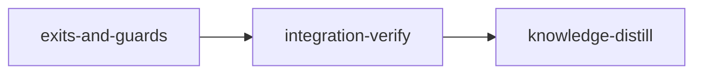

# Plan: Recorded stage exits, verdict delivery and three guards

Implements: none

## Overview

The review-remediation run exposed ten defects in how a stage session reaches a recorded exit
and in the guards and doctrine around it. Four of its stages met a commit hook that demanded an edit the
plan's prose forbade; two edited on their own authority and two sat waiting for a person, one
of them for 2 h 53 min. This plan removes the cause in this repository's hook, tells every
stage session what a refused commit means, blocks an unattended stop once so it ends in a
recorded state, delivers every verdict of a dispute round to the next session, stops an
accepted contract replacement from staling the review, makes a replacement trial's rerun follow
its own job, closes an absolute-path gap in the worktree hook, and adds one plan lint.

One implementation stage, twelve codex units over disjoint files, then integration-verify and
knowledge-distill.

## Findings

Evidence is from the run of `doc/plans/IN_PROGRESS-PLAN-review-remediation.md`: stage
transcripts, `.loom/work` records and the tree at `88da0e126`.

| # | Finding | Evidence | Fix | Unit |
| --- | --- | --- | --- | --- |
| F1 | A hook-refused `loom stage commit` leaves the session with the hook's output and no rule. Sessions believed a dispute needs a commit first | `run_hooks` in `commands/stage/commit.rs` runs before the relay; no filing path checks git state; the stage-exit block says "Before a dispute, run `loom stage complete` on that commit" | The stage-exit block and the refusal text state the rule: fix what the hook names, it outranks plan prose, a ratchet entry may always be lowered, a refused commit never stops a filing | w2 |
| F2 | A session ended its turn uncommitted and idle for 47 min; the stage read `Executing` | The Stop hook `commit-guard.sh` is advisory; the stall line is three times `subagent_timeout_secs` (4500 s here) | `loom hook idle-stop`, called by the Stop hook that may already block once: an unattended stop of an executing stage session with nothing pending is blocked, at most three times a session and once per tool call | w1, w1b |
| F3 | Seven reruns of `loom check --contracts --replacement` each cancelled the previous trial | `state_matches` in `host_verify/wait.rs` compares the worktree digest; the trial's own overlay of the frozen file changes it; `submit_selection` supersedes a trial it cannot join | A trial's rerun follows the recorded request whatever the digest reads; the advice text states the real rule | w3 |
| F4 | Two disputes judged back to back left one notice; the next session could not explain a modified frozen file | `append_rejection`, `append_questions`, `write_notice` in `adjudication/feedback.rs` truncate | Notices of a round accumulate; the first filing of a round clears the file | w4 |
| F5 | The first of two accepted disputes was archived as superseded | `replace_review_reason` in `models/stage/issue_history.rs` | A further reason in `NeedsAdjudication` joins the first | w4b |
| F6 | An accepted contract replacement made the latest review round stale: a third review round and a full gate run | `compute_local` in `verify/review/fingerprint.rs` hashes frozen files; the daemon's write changes one | A round still covers a tree whose only changes are frozen files equal to the freeze record | w5 |
| F7 | `loom plan verify --strict` accepted `! cargo test ... \| rg -q "<failures>"`, which passes whenever cargo dies another way | `masked_exit.rs` flags forced success only | Warning `NegatedSearch` | w6 |
| F8 | `cd <main checkout>/loom && rg ...` ran unblocked in a stage session | `worktree-isolation.sh` judges tokens with `..` or `.worktrees/` only | Rule `main-checkout`: an absolute path into the main checkout outside state, worktree and scratch is blocked | w7 |
| F9 | This repository's pre-commit hook refuses a commit whose ledger has a stale or shrunk row, with a message about growth | `loom/.githooks/pre-commit`, `tests/maintainability/baseline.rs` | The test lowers the ledger under `LOOM_LEDGER_TIGHTEN=1`; the hook runs that mode and stages the ledger | w8, w8b |
| F10 | The plan-writer doctrine says commit hooks run on the daemon's side, does not call a commit hook a gate, and allowed "do not edit" for a ratchet file | `skills/loom-plan-writer/SKILL.md` Section 8, `references/sandbox.md` | Four doc edits | w9 |

The signal sentence "an assertion or ratchet file changed" (ratchet files raise an event only
when loosened) and the contracts sentence "On accept the daemon writes it into the worktree."
(it is left uncommitted) are corrected by w2.

## Goals

- A stage session that cannot go on ends in a state loom records: completed, disputed, blocked
  or waiting on a question. It never ends idle on a message nobody reads.
- No stage needs a person because of ledger bookkeeping, a lost verdict notice, a stale review
  caused by the daemon's own write, or a trial that cancels itself.
- Every guard added blocks the observed case and leaves the neighbouring legitimate case alone;
  each has a contract that names the wrong implementation it rejects.
- General loom behaviour for any repository on Linux and macOS, except units w8 and w8b, which
  change this repository's own ledger test and hooks.
- Non-goals: backward compatibility or migrations; new configuration keys; any change to the
  web dashboard.

## Decisions

1. **No new dispute kind for a refused commit.** The repository's commit hook is a gate the
   session must pass. Every way of passing it that touches something protected already meets an
   adjudicated gate at completion: a loosened ratchet file raises `TI-ratchet`, a changed or
   removed assertion raises `TI-edit`, a changed frozen file fails the contract check. Anything
   else is ordinary code under the review gate. A hook no tree can satisfy needs a person and is
   a `loom stage block`. The missing piece was the rule, so the rule goes into the stage-exit
   block every stage session reads and into the refusal text.
2. **The hook outranks plan prose.** A plan instruction that forbids what the hook demands is a
   plan defect; the session follows the hook and records the deviation with
   `loom memory decision`.
3. **The idle-stop check lives in the Stop hook that may already block.** `loom-relay-stop.sh`
   blocks once per stranded ticket with a JSON decision and never when `stop_hook_active` is
   set. The new reason uses the same form. It never blocks while a subagent, a native worker or
   a host job of the stage is live, when that evidence cannot be read, in a contract, judge or
   merge session, or twice without a tool call in between. No new hook file is registered.
4. **The decision is computed by loom, in Rust**, from the lifecycle journal, the host-job
   store and the stage file, the same sources the daemon's quiet-refusal timer reads. The shell
   hook only relays it.
5. **A trial's rerun ignores the worktree digest; the daemon's join rule is unchanged.** The
   replacement bytes already key the wait state. The job still refuses a receipt for a tree
   that moved, and a filing still needs a receipt for the current tree.
6. **A dispute round** is every dispute filed between one entry into `NeedsAdjudication` and
   the requeue after the last verdict. Notices accumulate within a round and are cleared by the
   first filing of the next.
7. **A frozen file equal to the freeze record never stales a review.** Only the daemon can
   produce that state after an accepted ruling. An agent's own edit of a frozen file does not
   match the record and keeps the round stale.
8. **`NegatedSearch` is a warning.** `--strict` fails on it; `loom init` of a plan already
   written does not. Only the piped form is flagged; a negated file search without a pipe is a
   common absence check and stays out.
9. **The main-checkout rule judges absolute paths only inside the repository root.** It is off
   when that root is `/`, the home directory or an ancestor of it.
10. **The ledger is lowered by the commit hook, never raised by it.** The pre-push hook and CI
    stay strict and read-only.
11. **No knowledge-bootstrap.** The knowledge base maps this codebase (184 indexed entries) and
    the review-remediation plan's knowledge stages keep it current; each brief names the files
    its unit needs.

## Not in this plan

| Item | Why |
| --- | --- |
| A daemon nudge into a live stage session, or a shorter stall line for an ended turn | No mechanism sends text into a stage session, and a session waiting on its own background command cannot be told apart from an idle one by the daemon. F2's block reaches the agent in the session itself. Revisit if sessions still end idle after three blocks |
| The daemon committing an accepted replacement and completing the stage without a session | A contract verdict always starts a fresh session today (`apply_contract_rulings.rs`). With F4 and F6 fixed that session stages one file, commits and completes. Revisit if that session proves costly |
| A completion gate on edits outside a stage's `files:` list | A product decision: `files:` is an ownership declaration, and stages legitimately touch module roots and lockfiles. The observed out-of-list edits were ratchet tightenings, which loom allows |
| A freeze that proves a contract can pass | A build failure is an accepted red. The contract that could never pass was fixed by a dispute in about 3.5 min once filed; F1 removes what delayed the filing |
| The two daemon warnings ("criterion group may survive retirement", "Graph disagrees with Executing stage file") | Seen once each in a rotated log; not reproduced. Recorded for knowledge-distill as open concerns |
| A warning for `! rg -q <pattern> <file>` | Fail-open only when the file is unreadable; many plans use it. Decision 8 |

## Run order and sibling plans

This plan runs after `IN_PROGRESS-PLAN-review-remediation.md` has completed and merged: that
plan's `hooks-and-delivery` stage changed `loom-hooks/worktree-isolation.sh`, and its
integration-verify may still move anchors. It runs before the pending plans below. Each of them
names a file this plan edits and must re-read that file before `loom init`.

| Pending plan | Shared files | What this plan leaves there |
| --- | --- | --- |
| `PLAN-autonomous-recovery.md` | `orchestrator/signals/helpers.rs`, `orchestrator/signals/v2_section.rs`, `host_verify/wait.rs`, `stage_service/dispute.rs`, `stage_service/dispute_kinds.rs`, `models/dispute.rs`, `skills/loom-plan-writer/**` | The reworded stage-exit block (`BLOCK_F`); `models::dispute::feedback_file`; the feedback clear in both filing paths; a trial exemption in `state_matches`; four doc edits. Its block guard and its `needs-person` verdict fit Decision 1 unchanged |
| `PLAN-live-test-lane.md` | `stage_service/dispute.rs`, `skills/loom-plan-writer/**` | As above |
| `PLAN-loom-state-confinement.md` | `commands/hook/`, `loom/.githooks/pre-commit` | `commands/hook/idle_stop.rs` and one `HookCommands` variant; the pre-commit hook's ledger block rewritten |
| `PLAN-loom-ui-mods.md` | `commands/hook/` | As above |
| `PLAN-vm-test-devices.md`, `PLAN-ignored-plan-inputs.md`, `PLAN-contract-disputes-and-run-parity.md` | `skills/loom-plan-writer/**`, `orchestrator/signals/v2_section.rs` | Four doc edits; one sentence of the contracts section |

A pending plan that carries the criterion `! cargo test --test maintainability 2>&1 | rg -q ...`
will warn under `--strict` once F7 is merged, and no longer needs it once F9 is merged: its ledger
criterion becomes `cargo test --test maintainability`.

Every brief says: locate each seam by symbol; line numbers are advisory.

## Environment inventory

| Need | State |
| --- | --- |
| Cargo registry for a cold worktree build | allowed: `crates.io`, `index.crates.io`, `static.crates.io` |
| `web/node_modules` (repository lint: a JS package needs a provision entry; knowledge-distill lints the README with `markdownlint-cli2`) | provisioned: the hardened `bun install` entry |
| The pre-commit hook's `bunx markdownlint-cli2` (runs in the session at `loom stage commit`) | allowed: `registry.npmjs.org`; the hook only warns when it cannot run |
| `git`, `bash`, `jq`, `rg`, `python3`, the Rust toolchain | present on the host that ran the review-remediation plan with the same gates |
| Unix sockets, credentials, host daemons | none needed. The hook tests and the contracts use files and child processes only |
| Codex lane | available on this host; quota at authoring time: Claude 19% of the 7-day budget used, Codex 4% |

## Baseline

`loom plan verify --strict --dry-run` ran at `31aa1f0fd` (after `cli-and-accounting` merged,
while the review-remediation plan's integration-verify was executing): 0 errors, 0 warnings.

- `exits-and-guards`: 18 of its 22 criteria pass at base (the build, all ten module filters,
  `hook_false_positive_contracts`, `maintainability`, both hook suites, the syntax check, clippy
  and the formatter). The two new contract targets select no tests yet and the two `rg` checks
  fail, all four as the stage's work requires.
- `integration-verify`: the full suite fails at base on two existing tests,
  `stand_in_signal_guard::no_test_can_hang_on_a_stand_in` (`loom/tests/integration/`) and
  `checkpoint_resumes_from_offset` (`loom/tests/token_flow_contracts.rs`). Neither is in a file
  this plan touches. The second sits in the token tracker that `cli-and-accounting` changed;
  both belong to the review-remediation plan's integration-verify, which must leave the suite
  green before this plan starts. The dry run keeps no test output, so the cause of each was not
  read. The `hook idle-stop` smoke fails as expected before the stage's work.
- `knowledge-distill`: the knowledge check fails at base; the review-remediation plan's distill
  stage owns that.

Before `loom init`, confirm the two tests pass on the merged tree. The stage's main agent still
runs `loom check exits-and-guards` once before starting units and records the result with
`loom memory note`; a criterion red at base for a reason the stage cannot touch is disputed.

## Execution diagram



## Stages

### 1. exits-and-guards

All ten findings. One stage: no unit needs another's code merged first (Q1), the units write
disjoint files (Q2), nothing later needs a checkpoint on a part of it (Q3), and the main agent
holds only twelve unit reports, the gate output and the review rounds, well under 500,000
tokens (Q4). The contract session writes twelve contract tests in nine files.

Units run on codex: eleven on `gpt-6.2-sol` at effort xhigh and one, the prose edits of w9, on
`gpt-6.1-terra` at effort high, as the operator asked. At xhigh a sol unit fits about four
file-sized changes inside its 1500 s deadline, which is why F2, F4/F5 and F9 are two units
each. No unit is expected to pass 25 minutes, and no unit waits for another: the three pairs
share a pinned interface (the subcommand's output, the environment variable, nothing for
w4/w4b). At most six units run at once, so the main agent starts six and starts the rest as
slots free.

Risk walk:

- Untrusted input: the Stop payload and the subcommand's output crossing into the hook
  (`idle-stop-never-blocks-a-wait`; w1b re-emits the decision through `jq`); criterion text
  (`negated-output-search-is-flagged`, `fail-closed-searches-stay-clean`).
- Filesystem paths and symlinks: absolute paths into the main checkout
  (`main-checkout-path-is-blocked`); the idle-stop marker (w1's symlink test); the feedback
  file (w4 keeps the descriptor-anchored append).
- Process I/O volume: does not apply; no new process reads a pipe of unbounded size (the
  subcommand call is bounded as its precedent is).
- Configuration propagation: the rule reaches all three stage prefixes
  (`exit-block-carries-the-refused-commit-rule`); the hook passes `LOOM_LEDGER_TIGHTEN`
  (`tightened-ledger-is-staged`).
- Lifecycle and concurrency: a second verdict and a second filing
  (`verdict-notices-accumulate`, `second-filing-keeps-the-first-reason`); a rerun during a
  running trial (`trial-rerun-follows-its-own-job`); repeated stops
  (`idle-stop-blocks-an-unattended-stop`); a ledger with unstaged edits
  (`ledger-with-unstaged-edits-is-not-swept-in`).
- Reachability: `reachable` for `emit_idle_stop`, `only_intact_frozen` and `negates_search`;
  `wiring` for the three shell seams the graph does not model.
- External data: the freeze record's digest form against the fingerprint's
  (`intact-frozen-file-keeps-the-round`).

### 2. integration-verify

Full Rust suite, doc tests, clippy, formatter, rustdoc, the hook suite, the script suites and a
run of the new subcommand through the built binary. Three reviewers: security (the idle-stop
decision and its marker, the main-checkout rule's exemptions, the frozen-file exemption),
lifecycle (dispute rounds, the trial rerun, the hook's staging) and doctrine consistency (the
stage-exit block on every surface, the plan-writer skill against the code). Every finding is
fixed or disputed. The web package is untouched and its gates are not run.

### 3. knowledge-distill

Applies every `stale-knowledge` memory first. This plan makes these sections wrong and the
stage rewrites them whether or not a memory names them: the growth-only ledger criterion and
"one stage owns the ledger" in `conventions/plan-yaml-and-hooks.md` and
`conventions/git-and-build-workflow.md`; the Stop-hook rows of `entry-points/hooks.md`; the
feedback-file lifecycle in `architecture/adjudication-lifecycle.md`; the review fingerprint in
`architecture/verification-v2-gates.md`; the stage-exit block's content in
`patterns/doctrine-cross-surface.md`; the closed concern "BLOCK-F and commit timing disagree" in
`concerns/agent-rule-bending-hardening.md`. It records the incident under `mistakes/` and the
rows of "Not in this plan" as open concerns.

## Open decisions

1. **Lanes.** The operator set them: codex `gpt-6.2-sol` at xhigh for implementation, terra at
   high for mechanical parts, opus as verifier. The stage's orchestrator stays on the standard
   stage default; reviewers and integration-verify run on their opus defaults. Units w1 (a
   decision that can block a session) and w7 (a containment rule) are security-sensitive code
   that the lane rule would give to opus; they stay on sol by that instruction, with their
   wrong implementations pinned by contracts and named for the security reviewer.
2. **Whether the hook may outrank plan prose without a judge** (Decisions 1 and 2). The
   alternative is a `commit-refusal` dispute kind. It costs a kind in about a dozen files with
   exhaustive matches and overlaps `PLAN-autonomous-recovery.md`; it was not chosen because the existing
   integrity and contract gates already judge every protected edit.

## Residual risks

- A session waiting on its own long background command, with no subagent or host job, gets one
  block and an extra turn. The reason says to wait.
- After three blocks a session can still end idle; the stall line then applies as today.
- The main-checkout rule reads literal tokens. A path built from a shell variable the hook
  cannot expand is skipped.
- `LOOM_LEDGER_TIGHTEN=1` rewrites a tracked file from a test binary. Only the pre-commit hook
  sets it.

---

<!-- loom METADATA -->

```yaml
loom:
  version: 2
  sandbox:
    enabled: true
    auto_allow: true
    filesystem:
      deny_read:
        - "~/.ssh/**"
        - "~/.aws/**"
        - "~/.config/gcloud/**"
        - "~/.gnupg/**"
      deny_write: []
      allow_write: []
    network:
      allowed_domains:
        - crates.io
        - index.crates.io
        - static.crates.io
        - registry.npmjs.org
      allow_local_binding: false
      allow_unix_sockets: []
      allow_all_unix_sockets: false
  ratchet_files:
    - loom/maintainability-baseline.txt
    - doc/loom/knowledge/check-baseline.txt
  provision:
    - working_dir: web
      command: "test ! -e .npmrc && test ! -L .npmrc && bun install --frozen-lockfile --ignore-scripts --backend=copyfile --config=/dev/null"
  stages:
    - id: exits-and-guards
      name: "Recorded stage exits, verdict delivery, plan lint and worktree guard"
      summary: >-
        A stage session that stops with nothing pending is told to finish, dispute or
        block; every verdict of a dispute round reaches the next session; an accepted
        contract replacement no longer stales the review; a replacement trial's rerun
        follows its job; the commit hook lowers the size ledger; plan verify warns on a
        negated output search; the worktree hook blocks absolute paths into the main
        checkout.
      stage_type: standard
      skills: ["loom-rust", "loom-security-audit"]
      implementers: ["codex", "claude"]
      subagent_timeout_secs: 1500
      description: |
        Build stage exits-and-guards of doc/plans/PLAN-stage-exits-and-guards.md (IN_PROGRESS-PLAN-stage-exits-and-guards.md once running). Read doc/plans/briefs/stage-exits-and-guards/common.md first.
        Use parallel subagents and skills to maximize performance.

        PATHS: working_dir is the repository root. Paths in the files list, the contracts and the worker table are repo-relative. Cargo criteria run with --manifest-path loom/Cargo.toml; workers run cargo from loom/. Brief paths are repo-relative; hand each unit the absolute path of its brief inside this worktree. Line numbers in briefs are advisory: locate every seam by symbol.

        BEFORE THE UNITS: run loom check exits-and-guards once and record what is red with loom memory note. The frozen contracts are red by design. Any other red criterion is a base fault: dispute it if this stage's files cannot fix it.

        PUBLIC SURFACE (what the contract tests call; each in-crate contract file is a new file and a child of the module named, so private items of that module are reachable through super):

        1. idle-stop-blocks-an-unattended-stop and idle-stop-never-blocks-a-wait. File loom/src/commands/hook/idle_stop_contract_tests.rs, a child of commands::hook. Calls super::idle_stop::{decide, StopFacts, MAX_IDLE_STOP_BLOCKS}: pub(crate) fn decide(stage_id: &str, facts: &StopFacts) -> Option<String>; pub(crate) const MAX_IDLE_STOP_BLOCKS: u32 = 3; pub(crate) struct StopFacts (Debug, Clone, Copy) with public fields owns_executing_stage: bool, stage_session: bool, children_quiet: Option<bool>, host_job_live: bool, worked_since_last_block: bool, blocks_so_far: u32. The blocking combination is owns_executing_stage true, stage_session true, children_quiet Some(true), host_job_live false, worked_since_last_block true, blocks_so_far 0. Contract one: decide("s1", blocking) is Some(reason) and the reason contains "s1", "loom stage block" and "loom stage complete"; the same facts with worked_since_last_block false give None; with blocks_so_far equal to MAX_IDLE_STOP_BLOCKS give None. Contract two: from the blocking combination, each of children_quiet Some(false), children_quiet None, host_job_live true, stage_session false and owns_executing_stage false alone gives None.

        2. exit-block-carries-the-refused-commit-rule. File loom/src/orchestrator/signals/exit_doctrine_contract_tests.rs, a child of orchestrator::signals. Calls super::cache::{generate_stable_prefix, generate_integration_verify_stable_prefix, generate_knowledge_distill_stable_prefix}, each pub fn() -> String (loom/src/orchestrator/signals/tests_commit_timing.rs imports the same functions). Required: each of the three strings contains "A refused commit never stops a filing" and "it outranks a plan instruction", and generate_stable_prefix() is at most 8192 bytes long (STABLE_PREFIX_MAX_BYTES in tests_size.rs; the other two generators have no such ceiling, so do not bound them).

        3. trial-rerun-follows-its-own-job. File loom/src/host_verify/trial_follow_contract_tests.rs, a child of host_verify. Calls crate::host_verify::wait::{wait_or_request, WaitSite, WaitOutcome}: pub fn wait_or_request(site: &WaitSite<'_>, relay: &mut dyn FnMut(&HostJobRequest) -> Result<String>, out: &mut dyn Write) -> Result<WaitOutcome>; WaitSite has the public fields work_dir, stage_id, session_id, checkout, knowledge, kind, no_cache, criteria, contracts, at_base, scratch_dir, budget; crate::models::dispute_replacement::FileReplacement { file: String, content: String, base_sha256: Option<String> }. Fixture: re-create the fixture of loom/src/host_verify/tests_wait.rs (its fixture() and Fx::site are private to that module): a temp directory holding checkout, .loom/work and scratch; a git repository in checkout made with crate::test_git::TestRepo::builder().no_seed().init_in(&checkout), the file a.txt with "one\n" added and committed through crate::test_git::git; a WaitSite with kind JobKind::Check, knowledge false, no_cache false, criteria None, at_base false, a budget of zero or a few milliseconds, and contracts Some of one FileReplacement { file: "a.txt", content: "two\n", base_sha256: None }. Scenario: call wait_or_request with a relay closure that counts its calls and returns a fixed 32-character hex id; then write "two\n" to checkout/a.txt (what the daemon's trial overlay does); call wait_or_request again with the same site. Required: the closure ran exactly once in total and the second outcome is not WaitOutcome::Refused.

        4. verdict-notices-accumulate. File loom/src/orchestrator/adjudication/notice_contract_tests.rs, a child of orchestrator::adjudication. Calls super::feedback::{write_notice, read_feedback}: pub fn write_notice(work_dir: &Path, stage_id: &str, body: &str) -> Result<()>; pub fn read_feedback(work_dir: &Path, stage_id: &str) -> Result<Option<String>> (both unchanged signatures). Scenario: a temp directory as work_dir; write_notice(dir, "s1", "first notice"); write_notice(dir, "s1", "second notice"). Required: read_feedback returns text that contains both bodies, the first before the second.

        5. second-filing-keeps-the-first-reason. File loom/src/models/stage/adjudication_reason_contract_tests.rs, a child of models::stage. Calls Stage::default(), the public field status, Stage::try_request_adjudication(&mut self, reason: Option<String>) -> Result<()>, the public fields review_reason: Option<String> and issue_history, and IssueDisposition::Superseded (find the enum with loom map --find-all IssueDisposition). Scenario: a default stage with status StageStatus::Executing; try_request_adjudication(Some("first reason".into())); try_request_adjudication(Some("second reason".into())). Required: both calls are Ok, review_reason contains "first reason" and "second reason", and no entry of issue_history has disposition Some(IssueDisposition::Superseded).

        6. intact-frozen-file-keeps-the-round. File loom/src/verify/review/frozen_cover_contract_tests.rs, a child of verify::review. Calls super::frozen_cover::only_intact_frozen(changed: &[String], current: &BTreeMap<String, String>, frozen: &BTreeMap<String, String>) -> bool (pub(crate)). Maps are worktree-relative path to digest string. Scenario with frozen = {"tests/c.rs": "aa"}: changed ["tests/c.rs"] and current {"tests/c.rs": "aa"} is true; the same with current {"tests/c.rs": "bb"} is false; changed ["tests/c.rs", "src/x.rs"] with current holding both (c.rs at "aa") is false; an empty changed is false; current {"tests/c.rs": "deleted"} is false.

        7. negated-output-search-is-flagged and fail-closed-searches-stay-clean. File loom/src/plan/schema/tests/negated_search_contract_tests.rs, a child of plan::schema::tests. Calls crate::plan::schema::validation::criterion_hazards::{scan, Hazard}: pub(crate) fn scan(command: &str, in_wiring_test: bool) -> BTreeSet<Hazard>, and the new variant Hazard::NegatedSearch. Contract one: scan(c, false) contains Hazard::NegatedSearch for c = the criterion  ! cargo test --test maintainability 2>&1 | rg -q "grew from|new violation at"  and for c =  cd loom && ! cargo test 2>&1 | grep -q FAILED . Contract two: scan(c, false) does not contain Hazard::NegatedSearch for  cargo test | rg -q "test result: ok" , for  ! rg -q TODO src/lib.rs  and for  ! rg -q "a|b" file ; the same test also asserts that the first criterion of contract one IS flagged, so it cannot pass before the variant exists.

        8. main-checkout-path-is-blocked. File loom/tests/hook_main_checkout_contracts.rs, a new integration test target. Runs the script loom-hooks/worktree-isolation.sh (path: CARGO_MANIFEST_DIR/../loom-hooks/worktree-isolation.sh) with bash, the way loom/tests/hook_false_positive_contracts.rs runs it (copy its runner; its helpers are private): a JSON payload on stdin with tool_name "Bash", tool_input.command and cwd, the process started in cwd, every LOOM_ variable removed from the environment and HOME set to a second temp directory. Fixture: a temp directory REPO holding src/main.rs, .loom/work/signals/s.md and the directory .worktrees/stage-a (the cwd). Required in ONE test: the command  cat REPO/src/main.rs  and the command  cd REPO/src && cat main.rs  (REPO written out as the absolute path) each exit 2 with a first stderr line that starts with [worktree-isolation/main-checkout]; the commands  cat REPO/.loom/work/signals/s.md ,  cat /etc/hostname  and  ls HOME/.cargo/bin  (HOME written out) each exit 0.

        9. tightened-ledger-is-staged and ledger-with-unstaged-edits-is-not-swept-in. File loom/tests/ledger_hook_contracts.rs, a new integration test target. Runs the script loom/.githooks/pre-commit (path: CARGO_MANIFEST_DIR/.githooks/pre-commit) with bash from the root of a temp git repository. Fixture: the repository holds loom/src/a.rs and loom/maintainability-baseline.txt (two comment lines, then the rows  file src/a.rs 500  and  function src/a.rs f 60 ), all committed, with user.name and user.email set in the repository's own config; a temp bin directory first on PATH holding two executable fakes: cargo, which exits 0 for every call and, only when its first argument is test and the environment variable LOOM_LEDGER_TIGHTEN is 1, first deletes the line  function src/a.rs f 60  from maintainability-baseline.txt in its working directory; and bunx, which prints  markdownlint-cli2 v0.0.0  and exits 0. HOME is a temp directory. Contract one: stage an edit of loom/src/a.rs and run the hook; it exits 0 and git diff --cached --name-only lists loom/maintainability-baseline.txt. Contract two: the same, but first append a comment line to the ledger without staging it; the hook exits non-zero and git diff --cached --name-only does not list the ledger.

        UNITS: twelve codex units, territories disjoint, none waits for another. Start six at once and start each remaining unit as a slot frees; never slice them into waves. Model and effort per row: codex sol means gpt-6.2-sol at effort xhigh; codex terra means gpt-6.1-terra at effort high (the operator's choice for the prose unit). Units run no git and touch no .loom path. After each unit finishes, check git status --short and run that unit's module tests yourself (a codex unit only compiles): w1 commands::hook:: ; w1b bash loom-hooks/tests/loom-relay-stop.sh ; w2 orchestrator::signals:: and commands::stage:: ; w3 host_verify:: and relay:: ; w4 orchestrator::adjudication:: and stage_service:: ; w4b models:: ; w5 verify::review:: and commands::stage:: ; w6 plan::schema:: ; w7 bash loom-hooks/tests/worktree-isolation-main-checkout.sh, bash loom-hooks/tests/containment-cwd-resolve.sh and --test hook_main_checkout_contracts ; w8 --test maintainability ; w8b bash scripts/test-pre-commit-partial-staging.sh and --test ledger_hook_contracts (after w8) ; w9 the two rg proofs in its brief. A unit that overruns its deadline is re-split against its partial tree, never restarted as is. A failed sol unit moves to a Claude worker at the tier the piece needs, with both attempts in the brief.

        | Worker | Role | Tier | Files owned | Shared context | Brief path |
        | --- | --- | --- | --- | --- | --- |
        | w1-idle-stop | the idle-stop decision and subcommand | codex sol | loom/src/commands/hook/idle_stop.rs; loom/src/commands/hook/idle_stop_tests.rs; loom/src/commands/hook/mod.rs; loom/src/commands/hook/tests_cli_surface.rs; loom/src/cli/types_ops.rs; loom/src/cli/dispatch.rs | common.md | doc/plans/briefs/stage-exits-and-guards/exits-and-guards/w1-idle-stop.md |
        | w1b-idle-stop-hook | the Stop hook relays the decision | codex sol | loom-hooks/loom-relay-stop.sh; loom-hooks/tests/loom-relay-stop.sh | common.md | doc/plans/briefs/stage-exits-and-guards/exits-and-guards/w1b-idle-stop-hook.md |
        | w2-exit-doctrine | stage-exit block, ratchet and replacement sentences, refusal text | codex sol | loom/src/orchestrator/signals/helpers.rs; loom/src/orchestrator/signals/tests_doctrine_v2.rs; loom/src/orchestrator/signals/v2_section.rs; loom/src/orchestrator/signals/v2_section_tests.rs; loom/src/orchestrator/signals/v2_section_review.rs; loom/src/commands/stage/commit.rs; loom/src/commands/stage/commit_tests.rs | common.md | doc/plans/briefs/stage-exits-and-guards/exits-and-guards/w2-exit-doctrine.md |
        | w3-trial-follow | a trial rerun follows its job | codex sol | loom/src/host_verify/wait.rs; loom/src/host_verify/wait_state.rs; loom/src/host_verify/wait_state_tests.rs; loom/src/host_verify/tests_wait.rs; loom/src/relay/emit/stderr_text.rs | common.md | doc/plans/briefs/stage-exits-and-guards/exits-and-guards/w3-trial-follow.md |
        | w4-verdict-notices | notices accumulate, first filing clears | codex sol | loom/src/orchestrator/adjudication/feedback.rs; loom/src/models/dispute.rs; loom/src/stage_service/dispute.rs; loom/src/stage_service/dispute_kinds.rs | common.md | doc/plans/briefs/stage-exits-and-guards/exits-and-guards/w4-verdict-notices.md |
        | w4b-adjudication-reason | a second reason joins the first | codex sol | loom/src/models/stage/issue_history.rs; loom/src/models/stage/issue_history_tests.rs | common.md | doc/plans/briefs/stage-exits-and-guards/exits-and-guards/w4b-adjudication-reason.md |
        | w5-frozen-review | intact frozen files keep the review round | codex sol | loom/src/verify/review/frozen_cover.rs; loom/src/verify/review/mod.rs; loom/src/verify/review/gate.rs; loom/src/verify/review/gate_tests.rs; loom/src/commands/stage/review_status.rs | common.md | doc/plans/briefs/stage-exits-and-guards/exits-and-guards/w5-frozen-review.md |
        | w6-negated-search-lint | the NegatedSearch warning | codex sol | loom/src/plan/schema/validation/criterion_hazards.rs; loom/src/plan/schema/validation/criterion_hazards/masked_exit.rs; loom/src/plan/schema/validation/criterion_hazards/negated_search.rs; loom/src/plan/schema/tests/negated_search_tests.rs; loom/src/plan/schema/tests/mod.rs | common.md | doc/plans/briefs/stage-exits-and-guards/exits-and-guards/w6-negated-search-lint.md |
        | w7-main-checkout-guard | absolute paths into the main checkout | codex sol | loom-hooks/worktree-isolation.sh; loom-hooks/_containment.sh; loom-hooks/tests/worktree-isolation-main-checkout.sh; loom-hooks/tests/containment-cwd-resolve.sh; loom-hooks/tests/run-all.sh | common.md | doc/plans/briefs/stage-exits-and-guards/exits-and-guards/w7-main-checkout-guard.md |
        | w8-ledger-tighten | the ledger test's tighten mode | codex sol | loom/tests/maintainability.rs; loom/tests/maintainability/baseline.rs; loom/tests/maintainability/tighten.rs | common.md | doc/plans/briefs/stage-exits-and-guards/exits-and-guards/w8-ledger-tighten.md |
        | w8b-ledger-hooks | the commit hook lowers and stages the ledger | codex sol | loom/.githooks/pre-commit; loom/.githooks/pre-push; scripts/test-pre-commit-partial-staging.sh; CONTRIBUTING.md | common.md | doc/plans/briefs/stage-exits-and-guards/exits-and-guards/w8b-ledger-hooks.md |
        | w9-plan-writer-doctrine | four plan-writer doc edits | codex terra | skills/loom-plan-writer/SKILL.md; skills/loom-plan-writer/references/v2-contracts.md; skills/loom-plan-writer/references/verification-rules.md; skills/loom-plan-writer/references/sandbox.md | common.md | doc/plans/briefs/stage-exits-and-guards/exits-and-guards/w9-plan-writer-doctrine.md |

        INTEGRITY: existing tests whose assertions change, to be filed in ONE loom stage dispute-integrity exits-and-guards after the final review, with the ids from loom stage review integrity exits-and-guards. (1) loom/src/orchestrator/signals/v2_section_tests.rs: the literal that ends "On accept the daemon writes it into the worktree." gains the commit instruction. (2) Any test in loom/src/orchestrator/adjudication/feedback.rs that asserted a second notice replaces the first now asserts both are kept. (3) Any test of loom/src/models/stage that asserted a superseded entry after two filings in NeedsAdjudication now asserts none. (4) Any test that pins the sentence "A rerun within 120 s follows the same request". Each unit's report names the tests it changed; paste this line into every reviewer prompt.

        AFTER THE UNITS: chmod +x loom-hooks/tests/worktree-isolation-main-checkout.sh. Run cargo fmt --all from loom. Run LOOM_LEDGER_TIGHTEN=1 cargo test --manifest-path loom/Cargo.toml --test maintainability once: it lowers every ledger row this stage shrank; stage loom/maintainability-baseline.txt with the rest (lowering raises no integrity event). Run loom check exits-and-guards once beside the review round. The reviewer looks hardest at: (a) idle_stop.rs: every fact that is unknown or unreadable lets the session stop, the marker cannot be made to loop or be redirected through a symlink, and a contract, judge or merge session is never blocked; (b) loom-relay-stop.sh: nothing the subcommand prints reaches stdout without the jq check; (c) frozen_cover.rs and gate.rs: the exemption requires equality with the current freeze record for every changed path, and an unreadable record is not covered; (d) worktree-isolation.sh and _containment.sh: state, scratch, the session's own worktree and system paths stay reachable, the rule is off when the repository holds the home directory, Bash 3.2 syntax; (e) feedback.rs and the two filing paths: the clear happens only on a filing that enters NeedsAdjudication; (f) wait.rs: only a trial with replacements skips the digest; (g) pre-commit: the ledger is never staged when it had unstaged edits; (h) helpers.rs: the block is byte-identical to BLOCK_F and no ceiling in tests_size.rs moved. Send all findings and failed criteria of a round to ONE codex sol fix unit, then one re-review. Then commit with loom stage commit.

        MEMORY: record mistakes, decisions and surprises with loom memory at once. Record stale knowledge as stale-knowledge notes: any knowledge section that describes the feedback file as overwritten per verdict, the ledger as owned by one stage or guarded by a growth-only criterion, commit hooks as run by the daemon, the Stop hooks as never blocking an idle stop, or the review fingerprint as covering frozen files without exception. Never run loom knowledge and never use any other memory store.
      dependencies: []
      working_dir: "."
      acceptance:
        - command: "cargo build --manifest-path loom/Cargo.toml --all-targets"
          timeout_secs: 1800
        - command: "cargo test --manifest-path loom/Cargo.toml --lib commands::hook::"
          timeout_secs: 1200
        - command: "cargo test --manifest-path loom/Cargo.toml --lib commands::stage::"
          timeout_secs: 900
        - command: "cargo test --manifest-path loom/Cargo.toml --lib orchestrator::signals::"
          timeout_secs: 900
        - command: "cargo test --manifest-path loom/Cargo.toml --lib host_verify::"
          timeout_secs: 900
        - command: "cargo test --manifest-path loom/Cargo.toml --lib relay::"
          timeout_secs: 900
        - command: "cargo test --manifest-path loom/Cargo.toml --lib orchestrator::adjudication::"
          timeout_secs: 900
        - command: "cargo test --manifest-path loom/Cargo.toml --lib stage_service::"
          timeout_secs: 900
        - command: "cargo test --manifest-path loom/Cargo.toml --lib models::"
          timeout_secs: 900
        - command: "cargo test --manifest-path loom/Cargo.toml --lib verify::review::"
          timeout_secs: 900
        - command: "cargo test --manifest-path loom/Cargo.toml --lib plan::schema::"
          timeout_secs: 900
        - "cargo test --manifest-path loom/Cargo.toml --test hook_main_checkout_contracts"
        - "cargo test --manifest-path loom/Cargo.toml --test ledger_hook_contracts"
        - "cargo test --manifest-path loom/Cargo.toml --test hook_false_positive_contracts"
        - command: "cargo test --manifest-path loom/Cargo.toml --test maintainability"
          timeout_secs: 900
        - command: "bash loom-hooks/tests/run-all.sh"
          timeout_secs: 600
        - "bash scripts/test-pre-commit-partial-staging.sh"
        - "bash scripts/check-hook-syntax.sh"
        - "rg -q -F 'A commit hook is a gate every stage must pass' skills/loom-plan-writer/SKILL.md"
        - "rg -q -F 'in the stage session' skills/loom-plan-writer/references/sandbox.md"
        - command: "cargo clippy --manifest-path loom/Cargo.toml --all-targets -- -D warnings"
          timeout_secs: 1800
        - "cargo fmt --manifest-path loom/Cargo.toml --check"
      files:
        - loom/src/commands/hook/idle_stop.rs
        - loom/src/commands/hook/idle_stop_tests.rs
        - loom/src/commands/hook/idle_stop_contract_tests.rs
        - loom/src/commands/hook/mod.rs
        - loom/src/commands/hook/tests_cli_surface.rs
        - loom/src/cli/types_ops.rs
        - loom/src/cli/dispatch.rs
        - loom-hooks/loom-relay-stop.sh
        - loom-hooks/tests/loom-relay-stop.sh
        - loom/src/orchestrator/signals/helpers.rs
        - loom/src/orchestrator/signals/tests_doctrine_v2.rs
        - loom/src/orchestrator/signals/v2_section.rs
        - loom/src/orchestrator/signals/v2_section_tests.rs
        - loom/src/orchestrator/signals/v2_section_review.rs
        - loom/src/orchestrator/signals/exit_doctrine_contract_tests.rs
        - loom/src/orchestrator/signals/mod.rs
        - loom/src/commands/stage/commit.rs
        - loom/src/commands/stage/commit_tests.rs
        - loom/src/host_verify/wait.rs
        - loom/src/host_verify/wait_state.rs
        - loom/src/host_verify/wait_state_tests.rs
        - loom/src/host_verify/tests_wait.rs
        - loom/src/host_verify/trial_follow_contract_tests.rs
        - loom/src/host_verify/mod.rs
        - loom/src/relay/emit/stderr_text.rs
        - loom/src/orchestrator/adjudication/feedback.rs
        - loom/src/orchestrator/adjudication/notice_contract_tests.rs
        - loom/src/orchestrator/adjudication/mod.rs
        - loom/src/models/dispute.rs
        - loom/src/stage_service/dispute.rs
        - loom/src/stage_service/dispute_kinds.rs
        - "loom/src/stage_service/*tests*.rs"
        - loom/src/models/stage/issue_history.rs
        - loom/src/models/stage/issue_history_tests.rs
        - loom/src/models/stage/adjudication_reason_contract_tests.rs
        - loom/src/models/stage/mod.rs
        - "loom/src/models/stage/*tests*.rs"
        - loom/src/verify/review/frozen_cover.rs
        - loom/src/verify/review/frozen_cover_contract_tests.rs
        - loom/src/verify/review/mod.rs
        - loom/src/verify/review/gate.rs
        - loom/src/verify/review/gate_tests.rs
        - loom/src/commands/stage/review_status.rs
        - loom/src/plan/schema/validation/criterion_hazards.rs
        - loom/src/plan/schema/validation/criterion_hazards/masked_exit.rs
        - loom/src/plan/schema/validation/criterion_hazards/negated_search.rs
        - loom/src/plan/schema/tests/negated_search_tests.rs
        - loom/src/plan/schema/tests/negated_search_contract_tests.rs
        - loom/src/plan/schema/tests/mod.rs
        - loom-hooks/worktree-isolation.sh
        - loom-hooks/_containment.sh
        - loom-hooks/tests/worktree-isolation-main-checkout.sh
        - loom-hooks/tests/containment-cwd-resolve.sh
        - loom-hooks/tests/run-all.sh
        - loom/tests/hook_main_checkout_contracts.rs
        - loom/tests/maintainability.rs
        - loom/tests/maintainability/baseline.rs
        - loom/tests/maintainability/tighten.rs
        - loom/maintainability-baseline.txt
        - loom/.githooks/pre-commit
        - loom/.githooks/pre-push
        - scripts/test-pre-commit-partial-staging.sh
        - CONTRIBUTING.md
        - loom/tests/ledger_hook_contracts.rs
        - skills/loom-plan-writer/SKILL.md
        - skills/loom-plan-writer/references/v2-contracts.md
        - skills/loom-plan-writer/references/verification-rules.md
        - skills/loom-plan-writer/references/sandbox.md
      reachable:
        - symbol: emit_idle_stop
          from: dispatch_hook
          description: "loom hook idle-stop is dispatched from the hook subcommand table"
        - symbol: only_intact_frozen
          from: stale_review
          description: "the review gate consults the frozen-file exemption"
        - symbol: negates_search
          from: scan_into
          description: "the criterion scan runs the negated-search check"
      wiring:
        - source: loom-hooks/loom-relay-stop.sh
          pattern: "hook idle-stop"
          literal: true
          description: "the Stop hook calls the idle-stop subcommand"
        - source: loom-hooks/worktree-isolation.sh
          pattern: "loom_path_in_main_checkout"
          literal: true
          description: "the Bash guard applies the main-checkout rule defined in _containment.sh"
        - source: loom/.githooks/pre-commit
          pattern: "LOOM_LEDGER_TIGHTEN=1 cargo test"
          literal: true
          description: "the commit hook runs the ledger test in tighten mode"
      contracts:
        - id: idle-stop-blocks-an-unattended-stop
          file: loom/src/commands/hook/idle_stop_contract_tests.rs
          test: "commands::hook::idle_stop_contract_tests::an_unattended_stop_is_blocked_once_per_tool_call"
          scenario: >-
            decide is called with an executing stage session that owns its stage, has no
            active child and no live host job and has run a tool since its last block; then
            with the same facts but no tool call since the last block; then with the block
            count at its maximum.
          rejects: >-
            A check that blocks every stop of an executing stage, so a session that was
            just told to act and stops again is blocked in a loop with no bound
        - id: idle-stop-never-blocks-a-wait
          file: loom/src/commands/hook/idle_stop_contract_tests.rs
          test: "commands::hook::idle_stop_contract_tests::a_wait_or_an_unreadable_fact_is_never_blocked"
          scenario: >-
            From the blocking combination, one fact at a time changes: a child is active,
            the child evidence is unreadable, a host job is live, the session is no stage
            session, the session does not own an executing stage.
          rejects: >-
            A check that reads unknown subagent evidence as no subagent, or ignores a
            running host job, and so blocks a lead that is waiting, which is the fault that
            made the commit guard advisory
        - id: exit-block-carries-the-refused-commit-rule
          file: loom/src/orchestrator/signals/exit_doctrine_contract_tests.rs
          test: "orchestrator::signals::exit_doctrine_contract_tests::every_stage_prefix_states_the_refused_commit_rule"
          scenario: >-
            The standard, integration-verify and knowledge-distill stable prefixes are
            generated and searched for the two rule phrases; the standard prefix's byte
            length is compared with its ceiling of 8192.
          rejects: >-
            An edit that adds the rule to one prefix generator or to a skill only, or that
            makes room for it by raising the standard prefix's ceiling
        - id: trial-rerun-follows-its-own-job
          file: loom/src/host_verify/trial_follow_contract_tests.rs
          test: "host_verify::trial_follow_contract_tests::a_trial_rerun_after_the_overlay_relays_nothing"
          scenario: >-
            A replacement trial for a.txt is requested in a temp repository; the
            replacement bytes are then written over a.txt, as the daemon's overlay does
            while the trial runs; the same request is made again.
          rejects: >-
            A rerun that compares the worktree digest for a trial, so the daemon's own
            overlay makes it relay a second request that supersedes the running trial
        - id: verdict-notices-accumulate
          file: loom/src/orchestrator/adjudication/notice_contract_tests.rs
          test: "orchestrator::adjudication::notice_contract_tests::a_second_verdict_notice_keeps_the_first"
          scenario: >-
            Two verdict notices are written for one stage, one after the other, and the
            stage's feedback is read.
          rejects: >-
            A writer that truncates the feedback file on each verdict, so the notice of
            the first of two disputes judged back to back never reaches the next session
        - id: second-filing-keeps-the-first-reason
          file: loom/src/models/stage/adjudication_reason_contract_tests.rs
          test: "models::stage::adjudication_reason_contract_tests::a_second_filing_does_not_supersede_the_first"
          scenario: >-
            An executing stage requests adjudication with one reason and, while it needs
            adjudication, again with another.
          rejects: >-
            A second filing that replaces the review reason and archives the first
            dispute's reason as superseded although that dispute is still open
        - id: intact-frozen-file-keeps-the-round
          file: loom/src/verify/review/frozen_cover_contract_tests.rs
          test: "verify::review::frozen_cover_contract_tests::only_an_intact_frozen_file_keeps_the_round"
          scenario: >-
            The changed-path set of a review round is checked against a freeze record: a
            frozen file at the frozen digest, the same file at another digest, the same
            file beside a changed source file, an empty set, a deleted frozen file.
          rejects: >-
            An exemption for every path the freeze record names whatever its content, which
            lets an agent's own edit of a frozen file ride a stale review round
        - id: negated-output-search-is-flagged
          file: loom/src/plan/schema/tests/negated_search_contract_tests.rs
          test: "plan::schema::tests::negated_search_contract_tests::a_negated_search_over_command_output_is_flagged"
          scenario: >-
            The criterion scan runs over a negated pipeline from a test runner into rg,
            and over the same shape placed after a cd and a logical and.
          rejects: >-
            A lint that inspects only the first word of the command and misses a negated
            pipeline that follows a directory change
        - id: fail-closed-searches-stay-clean
          file: loom/src/plan/schema/tests/negated_search_contract_tests.rs
          test: "plan::schema::tests::negated_search_contract_tests::fail_closed_searches_are_not_flagged"
          scenario: >-
            The criterion scan runs over a pipeline into rg that is not negated, a negated
            rg over a file with no pipe, and a negated rg whose pattern holds a quoted
            pipe character; a negated output search is scanned beside them.
          rejects: >-
            A lint that flags every pipeline ending in a matcher or every negated matcher,
            rejecting the fail-closed forms plans use to assert on output and on absence
        - id: main-checkout-path-is-blocked
          file: loom/tests/hook_main_checkout_contracts.rs
          test: "an_absolute_path_into_the_main_checkout_is_blocked"
          scenario: >-
            The worktree isolation hook is run from a stage worktree of a temp repository
            with commands that read a source file of the main checkout by absolute path,
            that cd into it, that read the state directory, and that read system and
            home-directory paths.
          rejects: >-
            A rule that judges only cd targets, leaving a plain absolute read open, or one
            that blocks every absolute path outside the worktree, which also blocks the
            state directory the stage signal lives in
        - id: tightened-ledger-is-staged
          file: loom/tests/ledger_hook_contracts.rs
          test: "a_ledger_the_hook_lowered_is_staged"
          scenario: >-
            The pre-commit hook runs in a temp repository with a staged source change and
            a fake cargo that removes one ledger row when the tighten variable is set.
          rejects: >-
            A hook that lowers the ledger in the working tree and never stages it, so the
            commit is made without the lowered rows and the next commit is refused
        - id: ledger-with-unstaged-edits-is-not-swept-in
          file: loom/tests/ledger_hook_contracts.rs
          test: "a_ledger_with_unstaged_edits_refuses_the_commit"
          scenario: >-
            The same run, with an unstaged edit already in the ledger before the hook
            starts.
          rejects: >-
            A hook that stages the ledger unconditionally, committing edits the author had
            not staged

    - id: integration-verify
      name: "Integration Verification"
      summary: >-
        Runs the full Rust suite, lint, docs and the hook and script suites on the merged
        tree, reviews the new guards for security and lifecycle faults, and proves the
        idle-stop subcommand answers through the built binary.
      stage_type: integration-verify
      skills: ["loom-rust", "loom-security-audit"]
      description: |
        Final verification after exits-and-guards. Verify FUNCTIONAL INTEGRATION as well as passing tests. NEVER Claude Code auto-memory.
        Use parallel subagents and skills to maximize performance.
        CONTEXT: read the plan's Overview, Findings, Decisions and the exits-and-guards stage section by line range (doc/plans/), loom memory show --all, doc/loom/knowledge/INDEX.md and only the sections it points to for the files this plan changed.
        BUILD AND TEST (zero tolerance): run loom check integration-verify once (full suite, doc tests, clippy, formatter, rustdoc, the hook suite, the script suites, the subcommand smoke). Fix every warning and error; a fix re-checks with --criterion <n>.
        CODE REVIEW: spawn three loom-code-reviewer subagents in ONE message. (1) Security: loom/src/commands/hook/idle_stop.rs and loom-hooks/loom-relay-stop.sh (can a session be blocked in a loop, can a subagent or a judge be blocked, can the marker be redirected through a symlink, can subcommand output reach stdout unchecked); loom-hooks/worktree-isolation.sh and _containment.sh (can a path into the main checkout still pass through a variable, a quoted token, a flag value or a tilde; is any state, scratch or system path blocked); loom/src/verify/review/frozen_cover.rs (can an agent make a non-frozen change ride the exemption). (2) Lifecycle: the feedback clear in both filing paths against a verdict applied between two filings, the notice bound, the joined review reason through requeue, the trial rerun against a real edit, the pre-commit hook's staging against the partial-staging guard. (3) Doctrine: the stage-exit block is byte-identical on every surface that pins it and no byte ceiling moved; the four plan-writer files agree with commands/stage/commit.rs (hooks run in the session), with verify/integrity/ratchet_diff.rs and with the new warning's message. Paste the acceptance criteria and this description into every reviewer brief. Every finding is fixed or disputed, never deferred; send all findings of a round to ONE codex sol fix unit when the code is codex-written, then one re-review.
        SUGGESTIONS: weigh every pending reviewer suggestion the signal lists; resolve each one implemented with loom memory resolve <id> --outcome implemented --reason <what changed>; leave the rest pending.
        FUNCTIONAL: the smoke criterion runs the built binary's hook idle-stop with no stage in the environment and expects exit 0 and no output. Also run, with the built binary through cargo run, plan verify --strict on a scratch plan file under $LOOM_SCRATCH_DIR whose one stage carries a negated output search, and confirm the NegatedSearch warning text is printed; record the result with loom memory note.
        Record discoveries to loom memory for knowledge-distill, including any knowledge file the tree contradicts: loom memory note "stale-knowledge: ...". Record the two daemon warnings named under "Not in this plan" as open concerns if nothing in this plan's diff explains them.
      dependencies: ["exits-and-guards"]
      working_dir: "."
      acceptance:
        - command: "cargo test --manifest-path loom/Cargo.toml --all-targets --no-fail-fast"
          timeout_secs: 3600
        - command: "cargo test --manifest-path loom/Cargo.toml --doc --workspace --all-features -- --test-threads=1"
          timeout_secs: 1200
        - command: "cargo clippy --manifest-path loom/Cargo.toml --all-targets -- -D warnings"
          timeout_secs: 1800
        - "cargo fmt --manifest-path loom/Cargo.toml --check"
        - command: "RUSTDOCFLAGS='-D warnings' cargo doc --manifest-path loom/Cargo.toml --workspace --all-features --no-deps"
          timeout_secs: 1800
        - command: "bash loom-hooks/tests/run-all.sh"
          timeout_secs: 600
        - "bash scripts/test-pre-commit-partial-staging.sh"
        - "bash scripts/check-hook-syntax.sh"
        - command: "cargo run --manifest-path loom/Cargo.toml --quiet -- hook idle-stop < /dev/null"
          timeout_secs: 1800
      wiring:
        - source: loom-hooks/loom-relay-stop.sh
          pattern: "hook idle-stop"
          literal: true
          description: "the Stop hook calls the idle-stop subcommand on the merged tree"

    - id: knowledge-distill
      name: "Knowledge Distillation"
      summary: >-
        Rewrites the knowledge sections this plan made wrong, records the incident and
        the items left out as open concerns, and updates the README where behaviour
        changed.
      stage_type: knowledge-distill
      description: |
        Curate all stage memories into permanent knowledge; update user docs. NEVER Claude Code auto-memory.
        Use parallel subagents and skills to maximize performance where this stage type allows it: this stage is SINGLE-AGENT, so do NOT spawn subagents; memories are compact summaries, lean on them and keep code spot-reads narrow.
        START with loom memory pending --group (corrections, mistakes, decisions, other); read the plan's Overview, Findings, Decisions and "Not in this plan" by line range, and the knowledge sections named below.
        CORRECTIONS FIRST: apply every stale-knowledge memory in place with loom knowledge replace-section <file> "<heading>" "<body>", never with loom knowledge update. Then rewrite, whether or not a memory names them, the sections that describe: the growth-only ledger criterion and one stage owning the ledger (conventions/plan-yaml-and-hooks.md, conventions/git-and-build-workflow.md); the Stop hooks (entry-points/hooks.md: loom-relay-stop.sh now relays the idle-stop decision); the feedback file's lifecycle (architecture/adjudication-lifecycle.md: notices accumulate per round); the review gate's frozen-file exemption (architecture/verification-v2-gates.md); the stage-exit block's content (patterns/doctrine-cross-surface.md); the closed concern "BLOCK-F and commit timing disagree" (concerns/agent-rule-bending-hardening.md). Every such section states how the tree works now; history goes only under mistakes.
        MISTAKES: record the incident (a plan forbade an edit its repository's commit hook demanded; four stages, two human waits) with its prevention rule, under the mistakes topic whose blurb covers plan authoring.
        CONCERNS: record each row of the plan's "Not in this plan" table as an open concern with its reason and revisit condition.
        TIER ROUTING: findings of about 40 lines or fewer go inline in the tier-1 file; larger findings go via loom knowledge update <category>/<slug> with a 2-4 line tier-1 summary plus link. INDEX.md regenerates on every knowledge write.
        README: update the sections on stage exits, disputes and hooks where behaviour changed (the idle-stop block, the ledger hook); if a section needs no change, record why in memory.
        SUGGESTIONS: record every unimplemented reviewer suggestion in concerns or the topic it belongs to, then resolve it promoted, merged or discarded.
        RECEIPTS: every Note, Decision and Question taken into knowledge gets loom memory resolve <id> --outcome promoted|merged|discarded|deferred right after the write that used it; finish with loom memory pending --strict and resolve whatever it lists.
        LAST, if this stage removed structural issues, ratchet the baseline: loom knowledge check --write-baseline doc/loom/knowledge/check-baseline.txt
      dependencies: ["integration-verify"]
      working_dir: "."
      acceptance:
        - "loom knowledge check --strict --baseline doc/loom/knowledge/check-baseline.txt"
        - "loom memory pending --strict"
        - "web/node_modules/.bin/markdownlint-cli2 README.md"
      files:
        - "doc/loom/knowledge/**"
        - README.md
```

<!-- END loom METADATA -->
