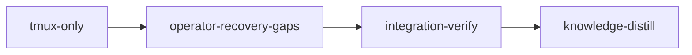

# Plan: Run every Loom session in tmux

Implements: none

Source: the tmux-only proposal of 2026-11-21, narrowed to a clean removal (see Decisions). Everything a
stage needs is in this plan and its briefs; no stage reads the proposal.

## Overview

Loom starts each orchestrated Claude Code session (stage, contract writer, merge resolver, knowledge,
adjudication) through `SessionBackend`, which dispatches to a native terminal-emulator lane or a tmux
lane. This plan deletes the native lane and everything that selects it: emulator detection, window
titles and AppleScript/X11 window control, the `[terminal]` config section and `terminal.backend` key,
the `--backend` flag on `loom init` / `loom run`, the init prompt, the planner's backend radio, the
daemon's `LOOM_TERMINAL` forwarding, `SessionBackendKind` and `Session.backend`. The shared launch
machinery that today lives under `orchestrator/terminal/native/` (capsule, session settings, wrapper,
build cache, PID tracking and the PID wait) moves to `orchestrator/terminal/launch/` and the tmux lane
keeps its current behaviour.

## Goals

- One spawn path: tmux. A missing tmux fails `loom run` (background and `--foreground`) before the
  daemon or orchestrator starts, and fails any direct spawn (manual merge resolver), with
  `Loom needs tmux on PATH to start sessions. Install tmux and retry.` `loom init` prints the same
  text as a warning and finishes.
- No terminal selector anywhere: CLI, `loom config`, dashboard Settings, planner Run dialog.
- Shared launch helpers keep their exact behaviour (tracking key, PID-file path, session id,
  environment allowlists, wrapper text) after the move.
- Non-goals: `codex.backend`, `plan.summary_backend`, `loom ask --backend`, planning-chat tmux servers,
  notifications, browser opening and the browser-terminal view/control modes are unchanged.

## Decisions

YAML is authoritative where it and this prose differ.

| Proposal item | This plan | Why |
| --- | --- | --- |
| Deserialize adapter for legacy `execution: {backend: native}` in plan YAML | Dropped | The project forbids compatibility routines at this stage; today's schema already rejects those forms, so nothing changes for plans |
| Hidden `--backend native\|tmux` on init/run | Deleted; clap rejects the flag as unknown | Same rule |
| Inert `[terminal]` key, `loom config -k terminal.backend` returning `tmux`, no-op writes | Key leaves the registry; nothing reads `[terminal]` | `UserConfig` parses per key (`user_config/mod.rs::parse_document`) and `Session`/work-dir config readers ignore sections they do not ask for, so a leftover section is ignored without code; a write to the removed key fails as an unknown key |
| `POST /api/run/start` tolerating `backend`, `GET /api/run/state` keeping `backends` | Deleted from both wire types and the client | Same rule; the web client ships in the same binary |
| Stored-session policy for live/dead/unverifiable native sessions at upgrade | Dropped | `Session` does not deny unknown fields, so an old record's `backend` key is ignored; operators finish native sessions before upgrading (CHANGELOG says so). A leftover native record is read by PID identity: liveness and kill work (the tmux lane's liveness is `pid_only_is_alive`, and its teardown returns when the socket is absent); `loom attach` finds no socket for it |
| `session_backend` in the status payload | Deleted; the dashboard gates terminals on `session_alive`, and the merge-attention attach hint is shown when `session_alive` | Every live session is a tmux session |
| `SessionBackend` facade | Kept as a thin wrapper over `TmuxBackend` | 19 files already hold it; a facade with one lane removes the dispatcher without touching them |
| PID-only liveness probe (`LivenessProbe::PidOnly`) | Deleted | It existed for a backend that could not be built; `SessionBackend::new` cannot fail, and the tmux lane answers liveness from the same PID identity |
| `escape_applescript_string` (defined in the emulator module) | Moved to `orchestrator/notify.rs` | Desktop notifications are its only remaining user and stay unchanged |

## Execution Diagram

A second implementation stage, `operator-recovery-gaps`, fixes four operator-recovery defects found
while running the previous plan; it shares no seam with the tmux removal but writes inside its file
territory, so it runs after it.



No knowledge-bootstrap stage: the tier-1 files already describe this codebase.

### Run order against sibling plans

This plan renames `loom/src/orchestrator/terminal/native/` to `terminal/launch/` (and `native/launch.rs`
to `launch/prepare.rs`) and deletes `NativeBackend`, `LOOM_TERMINAL` and `Session.backend`. Three pending
plans name those paths. Run one plan at a time in this checkout, and before `loom init` commit this plan
and its briefs (stage worktrees are built from committed history).

| Sibling | Shared surface | If the sibling merged first | If this plan merges first |
| --- | --- | --- | --- |
| `PLAN-warm-stage-builds` (stage `seed-stage-builds`) | `terminal/native/build_cache.rs`, `terminal/native/mod.rs`, `daemon/server/environment.rs`, `orchestrator/core/mod.rs` | Nothing to do: the rename carries its edits, and config-cli keeps its new host-environment names (briefed) | Nothing to do: its `files:`, its `wiring-and-status` brief and its criterion `cargo test --lib orchestrator::terminal::launch::build_cache` already name `terminal/launch` and `terminal::launch` |
| `PLAN-loom-state-confinement` (phase I4, a design without loom YAML) | `terminal/native/{session_settings,capsule,launch,wrapper}.rs`, `commands/run/**`, `cli/**` | Nothing to do | Its phase I4 file list uses `terminal/launch/` and `launch/prepare.rs` when it becomes a loom plan |
| `PLAN-contract-disputes-and-run-parity` (a design; stage `contract-dispute-many`) | `plan/amendment.rs` (`AmendmentRequest.patch` becomes `patches`), `orchestrator/adjudication/{plan_patch,apply}.rs`, `cli/types_stage_disputes.rs` | Stage 2's contract `artifacts-amend-takes-a-verbatim-glob` builds the request with the field that tree has (`patches: vec![...]`) | That plan lists `plan/amendment/artifacts_contract_tests.rs` as a planned edit of a frozen test |

**Order: this plan runs before `PLAN-warm-stage-builds`.** That sibling's `files:`, its
`wiring-and-status` brief and its criterion filter already name `terminal/launch` /
`terminal::launch`, the paths this plan's rename produces. The moved
`launch/build_cache.rs` is an `artifacts:` entry of tmux-only, so its tests run under the
`orchestrator::` filter.

Plan filename inside stage worktrees: `loom run` commits the rename to
`doc/plans/IN_PROGRESS-PLAN-tmux-only-terminal-sessions.md` before creating worktrees
(`commands/run/plan_inputs.rs::mark_plan_in_progress`). Stage descriptions and briefs name that path.

## Stages

### 1. tmux-only (Remove the native terminal lane)

The only implementation stage: Rust, web and operator docs share no files across the three territories,
and none needs another merged first, so the Stage Necessity Test gives one stage. It runs at the repo
root (`working_dir: "."`) like the other plans here, using `--manifest-path loom/Cargo.toml` and
`cd web`.

Workers (territories are disjoint; briefs are authoritative for each worker):

| Worker | Role | Tier | Files owned | Shared context | Brief path |
| --- | --- | --- | --- | --- | --- |
| terminal-core | Move shared launch code to `terminal/launch/`, delete the native lane, collapse `SessionBackend`, delete `SessionBackendKind` | loom-senior-software-engineer (opus, medium) | loom/src/orchestrator/terminal/**, loom/src/orchestrator/mod.rs, loom/src/orchestrator/spawner.rs, loom/src/models/session/**, loom/src/orchestrator/orphan_candidates.rs, loom/src/orchestrator/session_registry.rs, loom/src/orchestrator/session_registry/identityless.rs, loom/src/orchestrator/core/orchestrator.rs, loom/src/orchestrator/notify.rs, loom/tests/e2e/tmux_backend.rs | Pinned interface in every brief | doc/plans/briefs/tmux-only-terminal-sessions/tmux-only/terminal-core.md |
| config-cli | Remove `[terminal]`, `terminal.backend`, `--backend`, the init prompt, run backend resolution, daemon terminal forwarding, the config API entry | loom-software-engineer (sonnet) | loom/src/user_config/**, loom/src/fs/work_dir.rs, loom/src/fs/work_dir/**, loom/src/commands/config/**, loom/src/cli/**, loom/src/commands/init/**, loom/src/commands/run/**, loom/src/completions/**, loom/src/daemon/server/launch.rs, loom/src/daemon/server/launch/**, loom/src/daemon/server/environment.rs, loom/src/commands/status/web/config_api.rs, loom/src/commands/status/web/config_api/**, loom/src/commands/status/web/tests/config_api.rs, loom/tests/e2e/daemon_config/** | Pinned interface | doc/plans/briefs/tmux-only-terminal-sessions/tmux-only/config-cli.md |
| surfaces | Planner run wire and init args, dashboard child, attach, status payload, merge attention, web-terminal resolver, resolver stop | loom-software-engineer (sonnet) | loom/src/plan_server/run/**, loom/src/plan_server/wire/run.rs, loom/src/plan_server/wire/tests_run.rs, loom/src/plan_server/router.rs, loom/src/commands/attach/**, loom/src/status/**, loom/src/commands/status/web/terminal/**, loom/src/commands/status/web/model_tests_stages.rs, loom/src/commands/status/ui/**, loom/src/commands/status/render/**, loom/src/commands/stage/merge_resolver.rs, loom/src/orchestrator/core/merge_handler/resolver_stop.rs, loom/src/orchestrator/signals/merge_launch.rs, loom/src/orchestrator/core/completion_handler.rs, loom/src/orchestrator/core/mod.rs | Pinned interface | doc/plans/briefs/tmux-only-terminal-sessions/tmux-only/surfaces.md |
| web | Remove `session_backend`, the Run dialog backend radio, native hints and fixtures | loom-software-engineer (sonnet) | web/src/**, web/scripts/graph-keyboard-test.mjs | Pinned wire shapes | doc/plans/briefs/tmux-only-terminal-sessions/tmux-only/web.md |
| docs | README, CHANGELOG (with the upgrade steps), installer advisory and its test, product spec, contributor docs, usage skill, retrieval eval case | loom-software-engineer (sonnet) | README.md, CHANGELOG.md, install.sh, loom/tests/installer_tmux_advisory.rs, CONTRIBUTING.md, doc/sandbox-release-checklist.md, doc/product/feat-planner/section_11.md, doc/product/feat-planner/section_12.md, skills/loom-usage/SKILL.md, loom/eval/retrieval-cases.yaml | Pinned operator-visible strings | doc/plans/briefs/tmux-only-terminal-sessions/tmux-only/docs.md |
| compile-sweep | After the first three return: make every remaining Rust file compile and pass clippy and rustdoc (test fixtures, import paths, `LOOM_TERMINAL` guards, `from_config` and `resolve_lane` callers, earlier plans' contract test files), make the maintainability ledger exact | loom-software-engineer (sonnet) | loom/src/**, loom/tests/** except loom/tests/installer_tmux_advisory.rs, loom/maintainability-baseline.txt (runs after the Rust workers return) | Pinned interface | doc/plans/briefs/tmux-only-terminal-sessions/tmux-only/compile-sweep.md |

terminal-core, config-cli, surfaces, web and docs start together in one message; each brief pins the
interface the others depend on, so none waits. compile-sweep starts when the three Rust workers have
returned. The longest chain is two workers (terminal-core then compile-sweep); terminal-core may run
past 30 minutes because it moves about 45 files. compile-sweep touches over 100 files outside the
first-wave territories; if it returns with the crate still not compiling, the main agent spawns a fresh
compile-sweep with the same brief and the remaining `cargo check` errors, and never fixes them itself.

Contract files. Frozen for this stage are only the six files its own `contracts:` list names. A
`*contract_tests.rs` or `*.contract(s).test.ts(x)` file from an earlier plan is an ordinary test here:
no freeze record of this stage covers it, and six Rust ones (`orchestrator/core/{dead_worker,block,spawn_publication}_contract_tests.rs`,
`orchestrator/terminal/tmux/history_contract_tests.rs`, `status/data/stopped_contract_tests.rs`,
`commands/hook/relay/provenance_contract_tests.rs`) plus `commands/init/execute_contract_tests.rs` and two
web ones (`web/src/routes/terminal.contract.test.tsx`, `web/src/token-insights.contracts.test.tsx`) use
names this stage deletes. The owning worker removes the removed-name setup lines, imports and arguments
from them and changes no assertion. `loom/tests/fixtures/**` holds frozen replay inputs that mention the
old flag and paths; no worker edits them and the gates skip that directory.

Gates. The four negative `rg` criteria exempt only this stage's own contract files and the fixtures
directory, so residue in any other file fails them. The `terminal.backend` criterion is a regex that
does not match ratatui's `terminal.backend()` and `terminal.backend_mut()` calls, which stay. The
repository's commit hook (`loom/.githooks/pre-commit`) runs rustdoc with warnings denied whenever a
doc comment changes and rewrites `loom/maintainability-baseline.txt` when a recorded file or function
shrank; both are acceptance criteria here, so they fail before the final review round.

Embedded dashboard. Cargo embeds the tracked `web/dist` (`loom/build/assets.rs`), and the old bundle's
strict schemas require the `session_backend`, `backends` and `default_backend` fields this stage
removes from the server. So tmux-only rebuilds `web/dist` itself (the main agent runs `bun run build`
in `web/` after the web worker returns, before the final review round, and stages every changed, new
and removed file under `web/dist`); no merged stage serves a bundle that disagrees with its server.
An acceptance criterion rebuilds into the gitignored `web/node_modules/.dist-check` and requires
`diff -r` against `web/dist` to be empty, which catches stale, missing and extra files.
`web/scripts/graph-keyboard-test.mjs` (the web worker drops its `session_backend` line; a negative
gate scans `web/scripts`) runs in the CI browser job (`bun run test:browser`, Chrome plus a loopback
bind); this stage's sandbox denies loopback binding, so no stage runs it.

Risk-checklist walk (the areas that apply, and the contract covering each):

- Configuration propagation: a stale `[terminal] backend = "native"` must not select anything
  (`stale-native-setting-still-requires-tmux`); a retired user key must not reset other settings
  (`retired-user-key-keeps-other-settings`).
- Untrusted input / boundary: the CLI rejects `--backend` on init and run but keeps `loom ask --backend`
  (`retired-backend-flag-rejected`); the run-start request takes `plan` and `clean` only and refuses
  any other key, the retired `backend` included (`#[serde(deny_unknown_fields)]`, as the
  `plan_server/wire/server.rs` types use; `run-start-takes-plan-and-clean`, plus a surfaces router
  test that the POST with `backend` is a client error and starts no job), and the dialog posts only
  those two (`run-dialog-posts-plan-and-clean`).
- Failure path: missing tmux yields the one actionable message (`missing-tmux-message`), and every one
  of the five spawn methods returns it before writing a launch file
  (`stale-native-setting-still-requires-tmux`). The manual merge resolver
  (`commands/stage/merge_resolver.rs::spawn_resolver_session`) publishes a merge snapshot, writes
  its signal and records a write-ahead session before it reaches the facade, so it calls
  `SessionBackend::ensure_tmux` first, after the daemon-managed and already-running returns and
  before publishing anything (`wiring` on `merge_resolver.rs`, and a surfaces test with a false
  probe asserting the message and no snapshot, signal or session change across a retry).
- Installer: `install.sh` warns without failing when tmux is absent; `loom/tests/installer_tmux_advisory.rs`
  sources it with `LOOM_INSTALL_LIB_ONLY=1` (as `tests/installer_decline_contracts.rs` does) and runs
  `check_runtime_tools` with tmux absent and present, asserting exit 0 both times and the advisory only
  when absent (an acceptance criterion runs it).
- Environment: the daemon child no longer gets a terminal hint (`daemon-child-has-no-terminal-hint`).
- Reachability: `require_tmux` reached from the background run path (`reachable`), called in the
  foreground run path (`wiring` on `run/foreground.rs`) and reached from `loom init`'s advisory
  (`reachable` from `initialize_with_plan`); the dashboard gate opens a live stage with no backend field
  (`terminal-gate-without-backend-field`).
- Docs: the README section rename, the CHANGELOG entry and its pinned upgrade sentence, the installer
  advisory and the moved paths each have an acceptance check.

### 2. operator-recovery-gaps (Name the merge route and make artifacts correctable)

Four defects behind an earlier run, where a knowledge-distill stage blocked on one stale `artifacts` path:

1. The background daemon runs in watch mode (`commands/run/mod.rs`, `watch_mode: true`) and exits once
   every stage is terminal (`orchestrator/core/run.rs::run_finished`,
   `orchestrator/core/recovery.rs::all_stages_terminal`); an agent-blocked stage is terminal. An
   operator's `loom stage complete --force-unsafe` (or `--no-verify`) then records the branch tip and
   prints that "the daemon's auto-merge (or `loom stage merge <id>`) lands it", though no daemon is
   running and `loom stage merge` refuses outside the stage worktree. The commit stays unmerged until
   someone happens to rerun `loom run` (whose startup sync merges every Completed, unmerged stage,
   `orchestrator/core/recovery_sync.rs::sync_authoritative_stages`). Fix: both paths print one landing
   note chosen by `DaemonServer::is_running`; with no daemon it names `loom run`. Either route merges
   only with auto-merge on (the default; run, plan or stage policy can disable it,
   `merge_handler/auto_merge_dispatch.rs::is_auto_merge_enabled`), so each note says "with auto-merge
   on" and also names the manual route, `loom stage merge <id>` run from `.worktrees/<id>` (it refuses
   elsewhere, `stage/merge/preflight.rs::resolve_worktree_paths`). `is_running` also counts a
   process-only or unreachable daemon as running (`daemon/server/core.rs::daemon_running_from_status`);
   the note then says a daemon is running, which is true, and the manual route still covers it. The
   note is printed only when a commit was recorded (`loom run` merges a Completed stage that has
   `completed_commit`); a `--no-verify` completion that recorded none says so instead. The warning
   printed before a forced completion stops promising the daemon's auto-merge. The daemon's exit rule
   does not change.
2. A stage's `artifacts` list cannot be corrected once a plan runs: `loom stage amend --field` has no
   `artifacts`, `dispute-criteria --field` has none, and an adjudicator `plan_patch` may only amend
   `acceptance`, `wiring`, `wiring-tests` or `contracts`. Fix: `artifacts` becomes an amendable field
   (a plain glob taken verbatim, as `harness` is), a disputable field (`--field artifacts`, failures
   labelled `[artifact n]`), and a field an accepted artifacts dispute's `plan_patch` may amend. The
   places that tell agents and planners which fields exist learn it too: the stage-exit rules in every
   stage signal, two refusal texts, the README and the plan-writer skill. An amended glob passes the
   same plan validation as an authored one (no `..`, no absolute path) and must parse as a glob
   (`glob::Pattern::new`) before anything is journalled; a stored pattern that does not parse yields
   an indexed `[artifact n]` gap instead of aborting the whole goal-backward check, so it too can be
   disputed or amended by index. `loom stage amend` stays operator-only, and a verdict may patch
   `artifacts` only on an accepted artifacts dispute.
3. The agent's own completion runs as a signed host job (`host_verify/child_complete.rs`), which
   records the whole goal-backward check as one `goal-backward` outcome. The daemon's block guard
   (`stage_service/control_block.rs::failures_in`) refuses `loom stage block` only for failing
   `acceptance-<i>`, contract and impact-test outcomes, and the host job's report
   (`host_verify/wait_report.rs`) prints dispute guidance only for contract failures. So an agent
   whose completion fails on an artifacts (or wiring) gap sees no dispute route and may block, which
   is exactly the motivating case. Fix: when the `goal-backward` check fails, the host child also
   records one failed outcome per indexed gap label in its message (`[artifact n]` → `artifact-n`,
   `[wiring n]` → `wiring-n`, `[wiring_tests n]` → `wiring_tests-n`); `failures_in` collects them, so
   the block is refused with the matching `--field artifacts|wiring|wiring-tests --criterion-index <n>`
   routes; and the report prints the goal-gap dispute guidance when `goal-backward` failed. A
   goal-backward failure with no indexed label (dead code, reachability, a setup error) still blocks.
4. An accepted criterion verdict's `plan_patch` is checked for its field and for duplicate indices,
   never against the indices the dispute filed (`adjudication/verdict.rs::validate_accept`), so an
   accepted dispute of artifact 0 could delete artifact 1. Contract disputes already compare indices
   (`verdict_contract.rs`). Fix, for every criterion field: a `replace` or `delete` patch must name an
   index the dispute filed; an `insert` may name any index (it removes nothing). A verdict breaking
   that is re-requested from the judge as the duplicate-index check is, and nothing is recorded or
   applied.

Stage Necessity: Q2. It writes `loom/src/cli/types_stage_amend.rs`, `types_stage.rs`,
`types_stage_disputes.rs` and `README.md`, inside the tmux-only stage's `loom/src/cli/**` and README
territory (tmux-only's compile-sweep worker owns all of `loom/src/**`), so it cannot share that stage
without two owners for one file set, and two concurrent stages may not both write it. It depends on
tmux-only and starts from the merged tmux-only tree.

One `loom-software-engineer` (sonnet) worker implements all four fixes from the stage description.
Adding the enum variants makes the compiler list every exhaustive match; the description lists those
and the string tables, doc lists and tests the compiler cannot see.

Risk-checklist walk: misleading operator output (`landing-note-names-the-route`); configuration
propagation through amendment and its audit round trip (`artifacts-amend-takes-a-verbatim-glob`); the
CLI boundary (`artifacts-cli-fields-parse`); the dispute boundary
(`artifacts-dispute-field-maps-end-to-end`, `artifacts-plan-patch-admitted`,
`criterion-verdict-patches-only-filed-entries`); failure labelling and routing
(`artifact-gaps-carry-their-index`, `goal-gap-labels-become-outcomes`, and worker tests on the block
refusal and the host report).

### 3. Integration Verification

Full Rust suite, clippy, rustdoc, fmt and the web checks (`tsc`, `oxlint`, `oxfmt --check`, `vitest run`,
the commands behind `bun run check`); rebuild the tracked `web/dist` so the binary serves the new UI,
before the final review round; review; read the built binary's `run --help` and `init --help` for
`--backend` (the contract `retired-backend-flag-rejected` is the executable proof that clap rejects it).

### 4. Knowledge Distillation

Rewrite the terminal-backend, web-terminal, daemon-launch and entry-point knowledge to the tmux-only tree
and curate the memories.

---

<!-- loom METADATA -->

```yaml
loom:
  version: 2
  sandbox:
    enabled: true
    auto_allow: true
    filesystem:
      deny_read:
        - "~/.ssh/**"
        - "~/.aws/**"
        - "~/.config/gcloud/**"
        - "~/.gnupg/**"
      deny_write:
        - "../../**"
      allow_write: []
    network:
      allowed_domains:
        - crates.io
        - index.crates.io
        - static.crates.io
        - registry.npmjs.org
      allow_local_binding: false
      allow_unix_sockets: []
      allow_all_unix_sockets: false
  ratchet_files:
    - doc/loom/knowledge/check-baseline.txt
    - loom/maintainability-baseline.txt
  provision:
    - working_dir: web
      command: >-
        test ! -e .npmrc && test ! -L .npmrc && bun install --frozen-lockfile
        --ignore-scripts --backend=copyfile --config=/dev/null
  stages:
    - id: tmux-only
      name: "Remove the native terminal lane; run every session in tmux"
      summary: >-
        Deletes native terminal-window support and the backend selector from the CLI,
        config, dashboard and planner, moves the shared launch code to a launch module,
        and makes a missing tmux one clear error.
      stage_type: standard
      skills: ["loom-rust", "loom-react", "loom-typescript"]
      implementers: ["claude"]
      subagent_timeout_secs: 900
      description: |
        Read doc/plans/IN_PROGRESS-PLAN-tmux-only-terminal-sessions.md (loom run renamed
        it before creating this worktree) sections Overview, Goals, Decisions and
        Stages/1 first (YAML is authoritative where they differ).
        Use parallel subagents and skills to maximize performance.

        PUBLIC SURFACE (the contract session writes from this before any code; every
        worker brief repeats it):
          crate::orchestrator::terminal::backend::TMUX_MISSING_MESSAGE: &str
            = "Loom needs tmux on PATH to start sessions. Install tmux and retry."
            The constant exists today with other text (commands/run/mod.rs imports
            it): its text is replaced, no second constant is added.
          crate::orchestrator::terminal::backend::require_tmux(
              tmux_available: impl Fn() -> bool) -> anyhow::Result<()>
            Err whose Display is exactly TMUX_MISSING_MESSAGE when the probe is false.
            Re-exported as crate::orchestrator::terminal::require_tmux. Callers:
            the background run preflight (commands/run/mod.rs, inside
            prepare_background_run, which runs before DaemonServer::start); the
            foreground run (commands/run/foreground.rs execute, before the
            orchestrator is built; the text `require_tmux(` appears in that file);
            SessionBackend::ensure_tmux; and the init advisory below.
          crate::orchestrator::terminal::SessionBackend::ensure_tmux(&self)
              -> anyhow::Result<()>
            require_tmux(self.tmux_available). dispatch_spawn calls it first. The
            manual merge resolver (commands/stage/merge_resolver.rs
            spawn_resolver_session) calls it before publish_merge_snapshot, the
            signal and write_ahead_merge_session, after the DaemonManaged and
            AlreadyRunning returns; the backend is built by the caller and passed
            in, so a test passes SessionBackend::with_tmux_probe(work_dir, || false).
          crate::commands::init::plan_setup::tmux_advisory(
              tmux_available: impl Fn() -> bool) -> Option<String>
            Some(format!("warning: {TMUX_MISSING_MESSAGE}")) when require_tmux is
            Err, else None. initialize_with_plan calls it, prints the line to
            stderr and continues; loom init still exits 0.
          crate::orchestrator::terminal::SessionBackend::new(work_dir: PathBuf) -> Self
            Infallible; replaces from_config; reads no configuration.
            SessionBackend::resolve_lane is deleted with every caller.
          #[cfg(test)] pub(crate) SessionBackend::with_tmux_probe(work_dir: PathBuf,
              tmux_available: fn() -> bool) -> Self
          SessionBackend::spawn_session / spawn_contract_session /
            spawn_merge_session_in_worktree / spawn_knowledge_session /
            spawn_adjudication_session keep their current signatures; all five go
            through one private dispatch_spawn seam that calls require_tmux first, so
            each returns Err(require_tmux error) before any wrapper or PID file is
            written when the probe is false.
          crate::orchestrator::signals::merge_launch::write_ahead_merge_session(
              session, stage_id, work_dir): the lane parameter is removed; the other
            parameter types and the return type stay.
          crate::commands::init::execute(plan_path: Option<PathBuf>, clean: bool,
              no_repair: bool); commands::run::execute and execute_background lose
            only their backend parameter; initialize_with_plan loses terminal_backend.
          status attention (status/attention_model/merge.rs resolver_view): returns
            the tmux attach hint when stage.session_alive, else None.
          orchestrator::session_registry::LivenessProbe has no PidOnly variant
            (resolve returns Backend(SessionBackend::new(..)); #[cfg(test)] Error stays).
          escape_applescript_string moves from terminal/emulator.rs to a private fn
            in orchestrator/notify.rs with its tests.
          crate::orchestrator::terminal::launch (replaces terminal::native): every item
            native/mod.rs re-exported keeps its name, except NativeBackend,
            detect_terminal, spawn_in_terminal and the window functions, which are
            deleted. launch::tracking_and_pid_key(session: &Session)
            -> Option<(String, String)> replaces NativeBackend::window_title_and_pid_key
            with identical values. launch::await_session_pid(work_dir, pid_key, workdir,
            session_id) -> Result<u32> (no fallback parameter).
          Deleted: crate::models::session::{SessionBackendKind, TerminalConfig},
            Session.backend, Session.native_window_title, OrphanEvidence.backend,
            crate::fs::work_dir::{read_terminal_config, write_terminal_config},
            orchestrator::terminal::{emulator, native}, user_config terminal_backend
            accessors and the "terminal.backend" KeySpec.
          daemon::server::launch::daemon_command(exe: &Path, work_root: &Path,
              config: &DaemonConfig, env: &DaemonEnvironment) -> Command
            (terminal parameter removed); DaemonEnvironment::capture_from no longer
            admits LOOM_TERMINAL (LOOM_HOOKS_DIR stays).
          crate::plan_server::wire::run::RunStartRequest { plan: String, clean: bool }
            with #[serde(deny_unknown_fields)], so a body naming backend (or any
            other key) fails to deserialize and POST /api/run/start answers it with
            the client error req.json() gives before any run job begins;
            RunStateView without backends/default_backend; enum Backend deleted.
          crate::cli::Cli: `init`, `run` and `run --foreground` have no --backend
            option; `loom ask --backend claude|codex` is unchanged.
          StageSummary (status payload) has no session_backend field; the web client's
            stage schema has none either, and terminalGate(terminals, stage) returns
            null when terminals is true and stage.session_alive is true.
          The planner Run dialog posts {"plan": <path>, "clean": <bool>} to
            /api/run/start and renders no backend choice.

        WORKERS: see the worker table in the plan prose (Stages/1). Spawn
        terminal-core, config-cli, surfaces, web and docs BY AGENT TYPE in ONE message,
        each with: "Your brief: <path>. Read it in full before anything else."
        When terminal-core, config-cli and surfaces have all returned, spawn
        compile-sweep with its brief. If it returns with the crate not compiling,
        spawn a fresh compile-sweep with the same brief plus the remaining cargo
        check errors. Workers never spawn subagents.
        CONTRACT FILES: frozen are only the six files this stage's contracts list
        names. Contract test files of earlier plans are ordinary tests; the briefs
        name the nine that use removed names and how to edit them.
        BEFORE THE FINAL REVIEW ROUND, in this order: cargo fmt --manifest-path
        loom/Cargo.toml --all; LOOM_LEDGER_TIGHTEN=1 cargo test --manifest-path
        loom/Cargo.toml --test maintainability (lowers ledger rows of files and
        functions that shrank; the commit hook would otherwise rewrite the ledger
        after the review and stale the round); cd web && ./node_modules/.bin/oxfmt
        (formats the web sources); then cd web && bun run build, and stage every
        changed, new and removed file under web/dist with the commit (Cargo embeds
        that bundle; the old one requires the wire fields this stage removes). A
        fix touching web/src after a review round reruns the build before the next
        round. A check that fails only in the host job is
        reproduced with loom check tmux-only --criterion <n>; hand the output to a
        worker.
        INTEGRITY (paste this paragraph into every reviewer prompt): expected test
        changes for deleted code are (a) deleted native-lane tests: emulator,
        window_ops, NativeBackend and backend native cases, init backend prompt,
        terminal_config, native-configured session-registry cases,
        live_tmux_sessions_skips_native_backend_sessions and
        builtin_backend_default_is_tmux; (b) assertions retargeted from the
        generic-enum fixture terminal.backend to plan.summary_backend (config TUI,
        config_api, web settings kit) with the same behaviour asserted; (c) deleted
        LOOM_TERMINAL capture assertions in the daemon environment and launch tests,
        replaced by the contract daemon-child-has-no-terminal-hint; (d) backend
        fields dropped from run-wire, status-payload, attention and web tests;
        (e) setup lines, imports and arguments removed from earlier plans' contract
        test files with no assertion changed; (f) ledger rows removed or lowered.
        MEMORY: record mistakes, decisions and surprises with loom memory immediately
        (subagents report theirs to you); never loom knowledge (implementation stage);
        never Claude Code auto-memory.
      dependencies: []
      working_dir: "."
      files:
        - "loom/src/**"
        - "loom/tests/**"
        - "loom/eval/retrieval-cases.yaml"
        - "loom/maintainability-baseline.txt"
        - "web/src/**"
        - "web/scripts/graph-keyboard-test.mjs"
        - "web/dist/**"
        - "README.md"
        - "CHANGELOG.md"
        - "CONTRIBUTING.md"
        - "install.sh"
        - "doc/sandbox-release-checklist.md"
        - "doc/product/feat-planner/section_11.md"
        - "doc/product/feat-planner/section_12.md"
        - "skills/loom-usage/SKILL.md"
      before_stage:
        - command: "test -d loom/src/orchestrator/terminal/native"
          description: "the native lane this stage removes is present at the stage's base"
      after_stage:
        - command: "rg -qF 'on PATH to start sessions. Install' loom/src/orchestrator/terminal/backend.rs"
          description: "the single missing-tmux message lives at the spawn boundary"
      acceptance:
        - command: "cargo test --manifest-path loom/Cargo.toml --lib -- orchestrator:: models::session user_config:: fs::work_dir commands:: daemon::server:: plan_server::run plan_server::wire:: status:: cli::"
          timeout_secs: 2400
        - command: "cargo test --manifest-path loom/Cargo.toml --test e2e -- tmux_backend:: daemon_config:: web_terminal::"
          timeout_secs: 1200
        - command: "cargo test --manifest-path loom/Cargo.toml --test pressure_pipeline_contracts"
          timeout_secs: 900
        - command: "cargo test --manifest-path loom/Cargo.toml --test installer_tmux_advisory"
          timeout_secs: 600
        - command: "cargo test --manifest-path loom/Cargo.toml --test maintainability"
          timeout_secs: 900
        - command: "cargo clippy --manifest-path loom/Cargo.toml --all-targets -- -D warnings"
          timeout_secs: 1200
        - command: 'RUSTDOCFLAGS="-D warnings" cargo doc --manifest-path loom/Cargo.toml --workspace --all-features --no-deps'
          timeout_secs: 1200
        - "cargo fmt --manifest-path loom/Cargo.toml --all -- --check"
        - command: "cd web && ./node_modules/.bin/tsc -b --noEmit && ./node_modules/.bin/oxlint --deny-warnings && ./node_modules/.bin/oxfmt --check && ./node_modules/.bin/vitest run src/api src/components src/lib src/routes src/state src/plan/run src/plan/api src/plan/files src/plan/feature src/plan/settings src/token-insights.contracts.test.tsx"
          timeout_secs: 1500
        - command: "cd web && ./node_modules/.bin/vite build --outDir node_modules/.dist-check --emptyOutDir --logLevel warn && diff -r dist node_modules/.dist-check"
          timeout_secs: 900
        - "test ! -e loom/src/orchestrator/terminal/native && test ! -e loom/src/orchestrator/terminal/emulator.rs"
        - '! rg -q -g "!loom/tests/fixtures/**" -g "!**/orchestrator/terminal/contract_tests.rs" -g "!**/user_config/contract_tests.rs" -g "!**/daemon/server/launch/contract_tests.rs" -g "!**/plan_server/wire/run_contract_tests.rs" -g "!**/cli/contract_tests.rs" -g "!**/tmux-only.contract.test.tsx" "SessionBackendKind|NativeBackend|TerminalEmulator|TerminalConfig\b|detect_terminal|spawn_in_terminal|native_window_title|LOOM_TERMINAL\b|session_backend|default_backend|terminal_backend|read_terminal_config|write_terminal_config|resolve_backend_flag|resolve_lane|window_title_and_pid_key|terminal::native|terminal/native" loom/src loom/tests web/src web/scripts'
        - 'test -f install.sh && test -f doc/product/feat-planner/section_11.md && ! rg -qF -g "!loom/tests/fixtures/**" -g "!**/cli/contract_tests.rs" -g "!**/tmux-only.contract.test.tsx" -e "--backend native" -e "--backend tmux" loom/src loom/tests web/src web/scripts install.sh doc/product/feat-planner/section_11.md'
        - 'test -f install.sh && test -f doc/product/feat-planner/section_11.md && ! rg -q -g "!loom/tests/fixtures/**" -g "!**/user_config/contract_tests.rs" -g "!**/tmux-only.contract.test.tsx" -e "terminal\.backend([^_(A-Za-z0-9]|$)" loom/src loom/tests web/src web/scripts install.sh doc/product/feat-planner/section_11.md'
        - 'rg -q "^## Terminal Sessions" README.md && ! rg -q -e "\[terminal\]|terminal\.backend|LOOM_TERMINAL|#terminal-backends|#selecting-a-backend|--backend native|--backend tmux|native\|tmux|terminal/native" README.md'
        - 'rg -q "^## \[Unreleased\]" CHANGELOG.md && rg -qF "Loom needs tmux on PATH to start sessions. Install tmux and retry." CHANGELOG.md && rg -qiF "let running native-terminal sessions finish, stop the old daemon, install tmux, then start the new binary with" CHANGELOG.md && rg -qF "command -v tmux" install.sh && bash -n install.sh'
        - 'test -f CONTRIBUTING.md && test -f doc/sandbox-release-checklist.md && test -f doc/product/feat-planner/section_12.md && test -f loom/eval/retrieval-cases.yaml && ! rg -q "SessionBackendKind|terminal/native" CONTRIBUTING.md doc/sandbox-release-checklist.md doc/product/feat-planner/section_11.md doc/product/feat-planner/section_12.md loom/eval/retrieval-cases.yaml'
        - '! rg -qF "terminal windows" skills/loom-usage/SKILL.md'
      artifacts:
        - "loom/src/orchestrator/terminal/launch/mod.rs"
        - "loom/src/orchestrator/terminal/launch/pid_wait.rs"
        - "loom/src/orchestrator/terminal/launch/build_cache.rs"
        - "loom/tests/installer_tmux_advisory.rs"
      wiring:
        - source: "loom/src/commands/run/foreground.rs"
          pattern: 'require_tmux\('
          description: "loom run --foreground refuses to start without tmux"
        - source: "loom/src/commands/stage/merge_resolver.rs"
          pattern: 'ensure_tmux\('
          description: "the manual merge resolver checks for tmux before publishing launch state"
      reachable:
        - symbol: require_tmux
          from: execute_background
          description: "loom run's background path refuses to start without tmux"
        - symbol: tmux_advisory
          from: initialize_with_plan
          description: "loom init warns when tmux is missing"
      contracts:
        - id: missing-tmux-message
          file: loom/src/orchestrator/terminal/contract_tests.rs
          test: orchestrator::terminal::contract_tests::missing_tmux_names_the_one_fix
          scenario: "calls require_tmux(|| false) and require_tmux(|| true); asserts the first is Err whose to_string() equals TMUX_MISSING_MESSAGE and that constant equals \"Loom needs tmux on PATH to start sessions. Install tmux and retry.\", and the second is Ok"
          rejects: "a message that still offers [terminal] backend = \"native\" as the remedy, or a probe result that is ignored"
        - id: stale-native-setting-still-requires-tmux
          file: loom/src/orchestrator/terminal/contract_tests.rs
          test: orchestrator::terminal::contract_tests::stale_native_setting_cannot_bypass_tmux
          scenario: "in a TempDir work dir writes config.toml with a [terminal] section holding backend = \"native\"; builds SessionBackend::with_tmux_probe(work_dir, || false), then records the list of files under the work dir; with Stage::new(\"s\".into(), None) given id \"s\", a signal file outside the work dir and Worktree::new(\"s\".into(), <a TempDir path>, \"loom/s\".into()), calls all five spawn methods: spawn_knowledge_session(&stage, Session::new_knowledge(\"s\"), signal, repo_root) and spawn_adjudication_session(&stage, Session::new_adjudication(\"s\"), signal, repo_root) with the TempDir as repo root, and spawn_session(&stage, &worktree, Session::new(), signal), spawn_contract_session(&stage, &worktree, Session::new_contract(\"s\"), signal) and spawn_merge_session_in_worktree(&stage, &worktree, Session::new_merge(\"loom/s\".into(), \"main\".into()), signal); asserts each returns Err whose chain contains TMUX_MISSING_MESSAGE, and that the list of files under the work dir is unchanged afterwards (no PID or wrapper file was created)"
          rejects: "a SessionBackend that still reads [terminal] and launches through another lane, a spawn method that skips the tmux check, or one that starts writing launch files before checking for tmux"
        - id: retired-user-key-keeps-other-settings
          file: loom/src/user_config/contract_tests.rs
          test: user_config::contract_tests::retired_terminal_key_leaves_other_settings_in_force
          scenario: "parses with crate::user_config::parse_document a document holding [terminal] backend = \"kitty\" and [update] check = false; asserts Ok and update_check() is false; asserts crate::user_config::keys::spec(\"terminal.backend\") is Err"
          rejects: "a parser that still validates the retired key, so UserConfig::load falls back to all defaults, or a registry that still lists terminal.backend"
        - id: daemon-child-has-no-terminal-hint
          file: loom/src/daemon/server/launch/contract_tests.rs
          test: daemon::server::launch::contract_tests::daemon_child_never_receives_a_terminal_hint
          scenario: "captures DaemonEnvironment::capture_from with LOOM_TERMINAL=kitty, TERM=xterm-256color and HOME=/home/user; builds daemon_command(Path::new(\"/usr/bin/loom\"), Path::new(\"/repo/.loom/work\"), &DaemonConfig::default(), &env); asserts get_envs() has no LOOM_TERMINAL entry and keeps TERM"
          rejects: "a launcher that still detects or forwards the caller's terminal emulator to the daemon child"
        - id: run-start-takes-plan-and-clean
          file: loom/src/plan_server/wire/run_contract_tests.rs
          test: plan_server::wire::run_contract_tests::run_start_request_is_plan_and_clean
          scenario: "deserializes {\"plan\":\"doc/plans/PLAN-x.md\",\"clean\":true} into RunStartRequest and asserts the fields; serializes RunStartRequest { plan, clean: false } with serde_json and asserts the object's keys are exactly plan and clean; asserts serde_json::from_str::<RunStartRequest> of {\"plan\":\"doc/plans/PLAN-x.md\",\"clean\":false,\"backend\":\"tmux\"} is_err()"
          rejects: "a request type that still requires, emits or silently accepts a backend field"
        - id: retired-backend-flag-rejected
          file: loom/src/cli/contract_tests.rs
          test: cli::contract_tests::retired_backend_flag_is_rejected_on_init_and_run
          scenario: "Cli::try_parse_from on [loom, init, p.md, --backend, tmux], [loom, run, --backend, native] and [loom, run, --foreground, --backend, tmux] each returns Err of kind clap::error::ErrorKind::UnknownArgument; [loom, init, p.md] and [loom, run] parse; [loom, ask, --question, q, --paths, a.rs, --backend, codex] parses"
          rejects: "keeping a hidden --backend on init or run, or removing loom ask --backend along with it"
        - id: terminal-gate-without-backend-field
          file: web/src/tmux-only.contract.test.tsx
          cwd: web
          runner: vitest
          test: "tmux only terminal gate opens a live stage without a backend field"
          scenario: "takes a stage from src/api/fixtures/snapshot.json, deletes its session_backend key, sets session_alive true, parses it with stageSummarySchema from src/api/schema.ts, imports terminalGate from src/components/terminal/terminal-glyph.tsx and asserts terminalGate(true, stage) is null; with session_alive false asserts it is \"No live session\""
          rejects: "a schema that still requires session_backend, or a gate that still refuses a live session for lack of a tmux backend value"
        - id: run-dialog-posts-plan-and-clean
          file: web/src/tmux-only.contract.test.tsx
          cwd: web
          runner: vitest
          test: "tmux only run dialog starts a run with plan and clean alone"
          scenario: "renders the planner Run dialog the way src/plan/run/run-dialog.test.tsx does, with a run-state fixture whose JSON has no backends or default_backend keys; starts the run; asserts the captured POST /api/run/start body deep-equals {plan: <the preselected plan>, clean: false} and no radio or text named Native or tmux is rendered"
          rejects: "a dialog that still renders a backend choice or posts a backend field"

    - id: operator-recovery-gaps
      name: "Name the merge route after a forced completion; make artifacts correctable"
      summary: >-
        A forced or unverified completion names the route that merges it; a stage's artifacts
        list can be amended, disputed and patched by a verdict; a failed host completion's
        artifact and wiring gaps route to a dispute; a verdict patches only disputed entries.
      stage_type: standard
      skills: ["loom-rust"]
      implementers: ["claude"]
      description: |
        Read doc/plans/IN_PROGRESS-PLAN-tmux-only-terminal-sessions.md (loom run renamed it)
        section Stages/2 first (YAML is authoritative where they differ). Use parallel subagents and skills to maximize performance.
        One loom-software-engineer (sonnet) worker implements all of it (A to E) in one brief
        (paste this description into it); the main agent runs the gate and the review loop and writes no code.
        Every path is relative to the repo root (working_dir "."); run cargo with
        --manifest-path loom/Cargo.toml. Locate seams by symbol, never by line number.

        PUBLIC SURFACE (contracts are written from this before any code):
        A. loom/src/commands/stage/complete_force.rs:
             pub(in crate::commands::stage) fn landing_note(stage_id: &str, daemon_running: bool) -> String
           Both texts use stage_id (the manual route), so the parameter is never unused.
           complete_force is a private module of
           commands::stage::complete (complete.rs: `#[path = "complete_force.rs"] mod
           complete_force;`); change that declaration to `pub(super) mod complete_force;` so the
           contract file, a child of commands::stage, calls
           crate::commands::stage::complete::complete_force::landing_note. complete_pipeline.rs
           is a child of complete and reaches it as super::complete_force::landing_note.
           Returns exactly one line (format! with {stage_id}; shown here for stage id s1).
           Auto-merge can be off (run, plan or stage policy), and `loom stage merge` refuses
           outside the stage worktree, so both texts are conditional and name the manual route
           with its directory. daemon_running true:
             "  → Not merged yet: with auto-merge on (the default) the running daemon lands it and triggers dependents; otherwise run `loom stage merge s1` from .worktrees/s1."
           daemon_running false:
             "  → Not merged yet, and no daemon is running to merge it: with auto-merge on (the default) `loom run` merges it and triggers dependents; otherwise run `loom stage merge s1` from .worktrees/s1."
           Consumers:
           - report_forced_landing's Unmerged(Some) arm replaces its "Not merged yet ...
             `loom stage merge {}`" println with the note. Thread work_dir into
             report_forced_landing (its only caller, handle_force_unsafe_completion, has it) and
             write the call on ONE line, which the wiring check greps:
               let note = landing_note(stage_id, DaemonServer::is_running(work_dir));
           - warn_force_unsafe: the line "This records the committed branch tip and queues it
             for the daemon's auto-merge into the target." becomes "This records the committed
             branch tip for landing; the note after completion names the route that merges it."
             The ForcedLanding::Unmerged doc comment drops "(or `loom stage merge`)".
           - complete_pipeline.rs::complete_without_verification replaces "The orchestrator will
             handle merge and dependent triggering." in both cases: when its `snapshot` is Some
             (a commit was recorded) it prints
             landing_note(stage_id, DaemonServer::is_running(work_dir)) (on one line);
             when None it prints "  → No commit recorded for landing: the stage cannot merge
             until a commit is recorded." Import crate::daemon::DaemonServer where needed.
           crate::daemon::DaemonServer::is_running(work_dir: &Path) -> bool is pub; work_dir is
           the .loom/work root these functions already receive. The daemon's exit rule
           (run_finished, all_stages_terminal) does NOT change. Update the header comment of
           commands/stage/tests/operator_landing_tests.rs if it repeats the old wording.
        B. artifacts as an amendable field, modelled on harness (a plain glob, trimmed, empty
           rejected, taken verbatim, never parsed as YAML), and additionally rejected in
           parse_amendment_value when glob::Pattern::new refuses it (the error names the
           pattern), so an invalid glob is never journalled:
             cli/types_stage_amend.rs: AmendField::Artifacts, to_field -> AmendmentField::Artifacts;
               the --value doc names artifacts beside harness; cli/types_stage.rs amend help lists
               artifacts.
             plan/amendment.rs: AmendmentField::Artifacts (serde "artifacts"; field_from_name,
               a private fn of plan::amendment, round-trips it),
               ParsedAmendmentValue::Artifacts(String), module doc scope list.
               ParsedAmendmentValue derives neither Debug nor PartialEq: tests use matches!.
             plan/amendment_fields.rs: current_field_len, parse_amendment_value,
               apply_patch_to_stage_def, stage_field_matches, sync_stage_from_definition arms.
             plan/amendment/journal.rs AuditRow::field_name -> "artifacts";
             plan/amendment_catch_up.rs stage_def_field_matches and copy_field;
             orchestrator/adjudication/apply_accept.rs field_name; apply_freeze_refusal.rs name
               map; verdict_freeze_refusal.rs adds Artifacts to the arm that refuses
               (a refused freeze amends only contracts, harness and acceptance).
        C. artifacts as a disputable field:
             models/dispute_criterion.rs: CriterionField::Artifacts, as_str "artifacts",
               gap_label "artifact", amendment_field AmendmentField::Artifacts.
             cli/types_stage_disputes.rs: DisputeField::Artifacts, to_field
               Some(CriterionField::Artifacts); --field doc names `[artifact n]`.
             stage_service/dispute.rs range check reads stage.artifacts.len() for Artifacts.
             verify/goal_backward: each artifacts gap (missing, empty or stub) carries the prefix
               "[artifact <n>] " where n is the 0-based index of its pattern in stage_def.artifacts,
               as indexed_gaps prefixes wiring gaps. verify_artifacts(&[String], &Path) is a
               baselined 60-line function and stays byte for byte; its caller
               run_goal_backward_verification is exactly 50 lines and may not grow. Add
               fn artifact_gaps(stage_def, working_dir) -> Vec<VerificationGap> beside
               wiring_gaps in goal_backward/mod.rs: it calls
               verify_artifacts(std::slice::from_ref(pattern), working_dir) per pattern and
               prefixes every gap of that pattern (one glob can yield several) with its index;
               an Err for one pattern (verify_artifacts fails on an invalid glob) becomes one
               GapType::ArtifactMissing gap "[artifact <n>] <the error text>" with the
               suggestion to correct the pattern, and the other patterns are still checked;
               the three-line artifacts step in run_goal_backward_verification becomes
               gaps.extend(artifact_gaps(stage_def, working_dir));
             commands/stage/acceptance_runner.rs::failure_guidance: one more dispute line, in the
               form of its wiring line, naming `--field artifacts --criterion-index <n>` and the
               label ([artifact n]); update its doc comment.
             orchestrator/adjudication/plan_patch.rs: normalize accepts "artifacts" (message lists
               it); admits(Artifacts, Artifacts) is true; admits(Acceptance, Artifacts) is false;
               admitted_fields(CriterionField::Artifacts) is "\"artifacts\""; update the admits
               doc comment.
             orchestrator/adjudication/prompt: prompt.rs routes CriterionField::Artifacts to a new
               builder in a NEW sibling file prompt/criterion_artifacts.rs (declare it beside
               `mod criterion_entry;` in prompt.rs). criterion_entry.rs is 367 lines and a third
               builder would pass 400; criterion.rs is 395 and its shared text (schema_json,
               PATCHES_RULE, verdict_rules) is pinned by prompt/tests_golden.rs: edit neither.
               The new builder reuses their pub(super) helpers (widen a helper's visibility to
               pub(super) where needed, changing no text), uses the list name "artifacts" and the
               noun "artifact pattern" (the shared text pluralises the noun with an s), and
               appends its own paragraph after the schema: for this list a patch `value` is a
               plain glob string taken verbatim (trimmed, never parsed as YAML).
               apply.rs disputed_entry labels it with exactly one added line (the file is at 399
               of 400): CriterionField::Artifacts => "artifacts entry",
             Exhaustive matches the compiler flags (each gets an arm): models/dispute_criterion.rs
               (as_str, gap_label, amendment_field), cli/types_stage_disputes.rs to_field,
               cli/types_stage_amend.rs to_field, stage_service/dispute.rs, adjudication/prompt.rs,
               adjudication/apply.rs disputed_entry, plan_patch.rs admitted_fields, and the
               AmendmentField matches listed in B. No match on these enums exists in
               goal_backward/mod.rs (beyond artifact_gaps), verify/completion/aggregated.rs,
               daemon/protocol_debug.rs, adjudication/verdict.rs or commands/stage/dispute_transport.rs
               (its criterion_subject has a catch-all arm): no match arm goes there (verdict.rs
               takes only the E call).
             Sites the compiler does NOT flag (string tables and lists; all required):
               orchestrator/signals/helpers.rs STAGE_EXIT_RULES: "(`--field` for wiring,
                 wiring-tests, impact-tests)" becomes "(`--field` for wiring, wiring-tests,
                 artifacts, impact-tests)", with the same edit to the BLOCK_F constant in
                 orchestrator/signals/tests_doctrine_v2.rs, which pins that text verbatim;
               stage_service/control_block.rs: the refusal sentence "`loom stage dispute-criteria
                 --field wiring` or `--field wiring-tests` for wiring entries" also names
                 `--field artifacts` for artifact entries;
               stage_service/dispute_admission.rs: "only its acceptance criteria, wiring checks
                 and wiring tests can be disputed" also names artifacts;
               models/stage/dispute_budgets.rs test every_criterion_field_spends_the_criterion_budget:
                 add CriterionField::Artifacts to its list and expect a count of 4;
               doc comments that list the fields: stage_service/dispute.rs,
                 commands/stage/dispute_criteria.rs, daemon/protocol.rs, commands/stage/amend.rs,
                 plan/amendment_fields.rs, cli/types_stage_disputes.rs.
        D. goal-gap failures reach the host job's block guard and report (Stages/2 item 3):
             NEW verify/goal_backward/gap_labels.rs (declared in goal_backward/mod.rs):
               pub(crate) fn goal_gap_ids(message: &str) -> Vec<String>
               every "[artifact <n>]", "[wiring <n>]" and "[wiring_tests <n>]" label in message,
               as "artifact-<n>", "wiring-<n>", "wiring_tests-<n>", sorted and deduplicated;
               any other bracketed text (e.g. "[criterion 0]") is ignored.
             host_verify/child_complete.rs run_completion_checks: when label is "goal-backward"
               and checked is Err, after recording that outcome, record one failed
               CriterionOutcome per goal_gap_ids(&format!("{error:#}")) entry, label the id,
               summary the goal-backward summary. The completion checkpoint's
               verification.criteria ids are the outcome labels (acceptance-<i> travels that
               way); trace CriterionOutcome.label to CriterionResult.id to confirm and report
               any difference instead of guessing.
             stage_service/control_block.rs failures_in: collect failed "artifact-<n>",
               "wiring-<n>", "wiring_tests-<n>" ids into DisputableFailures (three index lists;
               is_empty counts them), and failed_completion_refusal adds one route per list:
               `loom stage dispute-criteria <id> --field artifacts --criterion-index <n>...`,
               `--field wiring`, `--field wiring-tests`. A failed goal-backward with no such id
               leaves the block allowed. control_block.rs is 393 lines: put the id parsing and
               the three new routes in a NEW sibling stage_service/control_block_gaps.rs, and
               move failed_completion_refusal there too if control_block.rs would pass 400.
             host_verify/wait_report.rs: for a failed job whose outcomes include a failed
               "goal-backward", append the goal-gap guidance text of
               commands/stage/acceptance_runner.rs::failure_guidance (make it pub(crate);
               print_acceptance_failure_guidance keeps printing it), as contract failures
               append contracts::completion::guidance.
             Update the doc comment above failure_guidance and the control_block.rs module
             comment that list which failures refuse a block.
        E. criterion verdicts patch only filed entries (Stages/2 item 4):
             NEW orchestrator/adjudication/verdict_indices.rs:
               pub(super) fn unfiled_patch(patches: &[AmendmentPatch], filed: &[usize])
                 -> Option<usize>
               the first replace or delete patch whose index is not in filed; inserts are
               never unfiled. adjudication/verdict.rs parse_and_validate_for, in its
               DisputeKind::Criterion arm: an Accept whose plan_patch has an unfiled patch
               becomes needs_more_evidence("Accept verdict 'plan_patch' patches index <i>, which
               this dispute did not file; replace or delete only the filed indices <list>, or
               insert a new entry"), the same route the duplicate-index check takes, so nothing
               is recorded or applied. Read the patches from the validated verdict (or call
               the check inside validate_accept by passing the filed indices through
               classify_and_validate); pick whichever keeps verdict.rs at or under 400 lines and
               every function under 50. It applies to every CriterionField. INTEGRITY: an
               existing test whose accepted criterion verdict patches an index its dispute did
               not file is retargeted to a filed index, its other assertions unchanged.
           README.md, located by text (the tmux-only stage edits other README lines; change only
           these six places):
             the synopsis `loom stage dispute-criteria <stage-id> [--field acceptance|wiring|wiring-tests]`
               gains `|artifacts`;
             the synopsis `loom stage amend <stage-id> --field acceptance|wiring|wiring-tests|contracts|harness`
               gains `|artifacts`, and its comment says harness and artifacts take a plain glob
               verbatim;
             the sentence "`loom stage complete --force-unsafe` without `--assume-merged` records
               the same tip and leaves the stage unmerged for the daemon's auto-merge" says that
               with auto-merge on a running daemon lands it, otherwise `loom run` does, that
               `loom stage merge <id>` from the stage worktree is the manual route, and that the
               command prints which;
             the sentence starting "`loom stage amend` is the audited, operator-facing way to edit
               a stage's" and the later sentence "replaces, inserts, or deletes one element of a
               stage's" each add `artifacts` to their list;
             the sentence "`--field wiring` or `--field wiring-tests` makes the index point into
               those lists" adds `--field artifacts`.
           skills/loom-plan-writer/SKILL.md: the sentence with
             `[--field acceptance|wiring|wiring-tests]` gains `|artifacts`, and its label list
             `[criterion n]`, `[wiring n]` or `[wiring_tests n]` gains `[artifact n]`.
           skills/loom-plan-writer/references/verification-rules.md: the phrase
             `loom stage amend --field acceptance|wiring|wiring-tests` gains `|artifacts`.
             Change those sentences only.

        SIBLING: PLAN-contract-disputes-and-run-parity (stage contract-dispute-many) turns
        AmendmentRequest.patch into patches: Vec<AmendmentPatch>. Build amendment requests with
        the field the tree has when this stage runs.

        LINE LIMITS (cargo test --test maintainability: 400 lines/file, 50/function; ledger rows
        are never raised or added). Near the limit: verdict_freeze_refusal.rs (396; adding
        Artifacts to the refusing arm makes rustfmt split it, +3 lines, so change nothing else
        there), orchestrator/adjudication/apply.rs (399; one line only),
        commands/stage/dispute_transport.rs (399; no edit), prompt/criterion.rs (395; no edit),
        prompt/criterion_entry.rs (367; no edit), cli/types_stage_disputes.rs (385),
        stage_service/dispute.rs (383), stage_service/control_block.rs (393; see D),
        adjudication/verdict.rs (370; only the E call),
        adjudication/apply_freeze_refusal_tests.rs (400; add no case there),
        orchestrator/adjudication/mod.rs (382; only the new mod lines). A file that would
        pass 400 gets a new sibling file. New amend tests go in plan/amendment/tests.rs or a new
        sibling, never plan/tests/amendment.rs (605, baselined). Golden prompt tests
        (prompt/tests_golden.rs) pin the acceptance briefing: it must not change.
        The commit hook runs rustdoc with warnings denied: in doc comments name private items
        in plain backticks, never as [`links`].

        TESTS the worker writes (never in a contract file; the final reviewer checks each exists):
        (a) the amend audit round trip for an artifacts row; (b) an artifacts amendment on an
        unmerged stage clears completed_commit as harness does, and leaves it on a merged stage;
        (c) a filed artifacts dispute with an index past stage.artifacts is refused;
        (d) sync_stage_from_definition, stage_field_matches and amendment_catch_up copy_field for
        AmendmentField::Artifacts read and write artifacts and leave harness untouched;
        (e) failure_guidance output contains "--field artifacts --criterion-index";
        (f) the adjudication briefing of an artifacts dispute names the artifacts list, says the
        value is a plain glob, and does not name wiring; (g) complete_without_verification's two
        outputs (commit recorded, none recorded) and report_forced_landing's note, each run with
        no daemon in the TempDir work dir, asserting the no-daemon text; (h) an amend with the
        value "docs/[x.md" is refused before any journal row is written; (i) failures_in for a
        ToolFailed checkpoint holding failed "goal-backward" and "artifact-1" yields a block
        refusal naming `--field artifacts --criterion-index 1`, and one holding only a failed
        "goal-backward" leaves the block allowed; (j) the host child records "artifact-1" beside
        a failed "goal-backward" whose error names "[artifact 1]"; (k) the wait report of a
        failed job with a failed "goal-backward" contains "--field artifacts --criterion-index".
        INTEGRITY (paste into every reviewer prompt): BLOCK_F and the dispute-budget count change
        with the field list they pin; assertions on the old landing texts are retargeted to the
        new ones; tests whose accepted criterion verdict patched an unfiled index are retargeted
        to a filed index (E).
        BEFORE THE FINAL REVIEW ROUND: cargo fmt --manifest-path loom/Cargo.toml --all, then
        LOOM_LEDGER_TIGHTEN=1 cargo test --manifest-path loom/Cargo.toml --test maintainability
        (the commit hook would otherwise rewrite the ledger after the review).

        MEMORY: record mistakes/decisions/surprises via loom memory immediately (the worker reports
        its own); NEVER loom knowledge (implementation stage); NEVER Claude Code auto-memory.
      dependencies: ["tmux-only"]
      working_dir: "."
      files:
        - "loom/src/**"
        - "loom/maintainability-baseline.txt"
        - "README.md"
        - "skills/loom-plan-writer/SKILL.md"
        - "skills/loom-plan-writer/references/verification-rules.md"
      before_stage:
        - command: '! rg -q "fn landing_note" loom/src/commands/stage/complete_force.rs'
          description: "no landing note exists at the stage's base"
      after_stage:
        - command: 'rg -qF "Artifacts" loom/src/cli/types_stage_amend.rs'
          description: "loom stage amend offers the artifacts field"
      acceptance:
        - command: "cargo test --manifest-path loom/Cargo.toml --lib -- commands::stage:: plan:: orchestrator::adjudication:: orchestrator::signals:: models:: verify:: stage_service:: host_verify:: daemon::protocol cli::"
          timeout_secs: 2400
        - command: "cargo test --manifest-path loom/Cargo.toml --test maintainability"
          timeout_secs: 900
        - command: "cargo clippy --manifest-path loom/Cargo.toml --all-targets -- -D warnings"
          timeout_secs: 1200
        - command: 'RUSTDOCFLAGS="-D warnings" cargo doc --manifest-path loom/Cargo.toml --workspace --all-features --no-deps'
          timeout_secs: 1200
        - "cargo fmt --manifest-path loom/Cargo.toml --all -- --check"
        - 'rg -qF -e "--field artifacts" loom/src/commands/stage/acceptance_runner.rs && rg -qF "wiring-tests, artifacts, impact-tests" loom/src/orchestrator/signals/helpers.rs && rg -qF -e "--field artifacts" loom/src/stage_service/control_block.rs'
        - 'rg -qF "wiring-tests|artifacts]" README.md && rg -qF "contracts|harness|artifacts" README.md && rg -qF "[artifact n]" skills/loom-plan-writer/SKILL.md && rg -qF "wiring-tests|artifacts" skills/loom-plan-writer/references/verification-rules.md'
      artifacts:
        - "loom/src/orchestrator/adjudication/prompt/criterion_artifacts.rs"
        - "loom/src/verify/goal_backward/gap_labels.rs"
        - "loom/src/stage_service/control_block_gaps.rs"
        - "loom/src/orchestrator/adjudication/verdict_indices.rs"
      wiring:
        - source: "loom/src/host_verify/child_complete.rs"
          pattern: 'goal_gap_ids\('
          description: "the host job records each indexed goal gap as its own failed outcome"
        - source: "loom/src/stage_service/control_block.rs"
          pattern: 'control_block_gaps'
          description: "the block guard reads the goal-gap outcomes"
        - source: "loom/src/host_verify/wait_report.rs"
          pattern: 'failure_guidance\('
          description: "a failed host job prints the goal-gap dispute routes"
        - source: "loom/src/orchestrator/adjudication/verdict.rs"
          pattern: 'unfiled_patch\('
          description: "an accepted criterion verdict may patch only the filed entries"
        - source: "loom/src/commands/stage/complete_force.rs"
          pattern: 'landing_note\(.*is_running'
          description: "the forced landing report asks whether a daemon will merge the commit"
        - source: "loom/src/commands/stage/complete_pipeline.rs"
          pattern: 'landing_note\('
          description: "the unverified completion report names the merge route"
        - source: "loom/src/orchestrator/adjudication/plan_patch.rs"
          pattern: '"artifacts"'
          description: "a verdict's plan_patch may name the artifacts list"
      reachable:
        - symbol: landing_note
          from: handle_force_unsafe_completion
          description: "a forced completion reaches the landing note"
        - symbol: landing_note
          from: complete_without_verification
          description: "a --no-verify completion reaches the landing note"
      contracts:
        - id: landing-note-names-the-route
          file: loom/src/commands/stage/landing_note_contract_tests.rs
          test: commands::stage::landing_note_contract_tests::landing_note_names_the_route
          scenario: "calls crate::commands::stage::complete::complete_force::landing_note(\"s1\", true) and landing_note(\"s1\", false) and compares each for equality with the two texts in the stage description's PUBLIC SURFACE A (stage id s1)"
          rejects: "a note that tells the operator the daemon will merge when none runs, one that promises a merge without the auto-merge condition, one that names `loom stage merge` without the worktree it must run from, or one that omits `loom run` when no daemon runs"
        - id: artifacts-amend-takes-a-verbatim-glob
          file: loom/src/plan/amendment/artifacts_contract_tests.rs
          test: plan::amendment::artifacts_contract_tests::artifacts_amend_takes_a_verbatim_glob
          scenario: "a child module of plan::amendment (declared in plan/amendment.rs), so it reaches the private field_from_name through super. Builds an AmendmentRequest for field AmendmentField::Artifacts with AmendmentPatch::Replace { index: 0, value: \"  docs/*.md  \" } and asserts crate::plan::amendment_fields::parse_amendment_value(&request) matches ParsedAmendmentValue::Artifacts(g) with g == \"docs/*.md\" (matches!, the type has no Debug or PartialEq; `*` starts a YAML alias, so a YAML parse fails here), and that a request whose value is empty, and one whose value is \"docs/[x.md\" (an unclosed glob class), each is_err(); calls apply_patch_to_stage_def on a StageDefinition (Default plus artifacts [\"old.md\", \"keep.md\"]) with the docs/*.md replace at index 0 and asserts artifacts are [\"docs/*.md\", \"keep.md\"]; asserts a replace at index 2 is_err(); asserts field_from_name(AmendmentField::Artifacts's audit name \"artifacts\") is Some(AmendmentField::Artifacts)"
          rejects: "an artifacts value parsed as YAML, an invalid glob that is accepted, a patch that writes another list, an out-of-range index that is accepted, or an audit name that does not round-trip"
        - id: artifacts-cli-fields-parse
          file: loom/src/cli/artifacts_field_contract_tests.rs
          test: cli::artifacts_field_contract_tests::artifacts_cli_fields_parse
          scenario: "a child module of cli (declared #[cfg(test)] in cli/mod.rs), so it names crate::cli::types::{Cli, Commands} and crate::cli::types_stage::{StageCommands, CriteriaDispute} as types_stage_disputes.rs's tests do (AmendField and DisputeField sit in private submodules and are reached only through the parsed args). Cli::try_parse_from([loom, stage, amend, s1, --field, artifacts, --op, replace, --index, 0, --value, docs/*.md, --reason, r]) parses to Commands::Stage { command: StageCommands::Amend(args) } with args.field.to_field() == AmendmentField::Artifacts; Cli::try_parse_from([loom, stage, dispute-criteria, s1, --reason, r, --field, artifacts, --criterion-index, 1]) parses to StageCommands::DisputeCriteria(args) and CriteriaDispute::try_from(args) is CriteriaDispute::Entry whose target.field is CriterionField::Artifacts and target.criterion_indices is [1]"
          rejects: "a CLI that has no artifacts value for --field on amend or dispute-criteria, or one that maps it to another list"
        - id: artifacts-dispute-field-maps-end-to-end
          file: loom/src/models/dispute_artifacts_contract_tests.rs
          test: models::dispute_artifacts_contract_tests::artifacts_dispute_field_maps_end_to_end
          scenario: "asserts CriterionField::Artifacts as_str is \"artifacts\", gap_label is \"artifact\", amendment_field is AmendmentField::Artifacts; serde_json serializes CriterionField::Artifacts as \"artifacts\" and deserializes it back (the CLI side is artifacts-cli-fields-parse)"
          rejects: "a dispute field that files against acceptance or wiring, a label other than artifact, or an amendment that targets another list"
        - id: artifacts-plan-patch-admitted
          file: loom/src/orchestrator/adjudication/artifacts_contract_tests.rs
          test: orchestrator::adjudication::artifacts_contract_tests::artifacts_plan_patch_admitted
          scenario: "calls plan_patch::normalize (pub(super), reached as super::plan_patch) on the JSON object {\"field\":\"artifacts\",\"op\":\"replace\",\"index\":0,\"value\":\"doc/a.md\"} and asserts Ok with AmendmentField::Artifacts and one Replace patch at index 0 whose value is \"doc/a.md\"; asserts admits(CriterionField::Artifacts, AmendmentField::Artifacts) is true and admits(CriterionField::Acceptance, AmendmentField::Artifacts) and admits(CriterionField::Artifacts, AmendmentField::Acceptance) are false; asserts admitted_fields(CriterionField::Artifacts) names artifacts and no other field"
          rejects: "a verdict that cannot amend artifacts, or one that amends artifacts on an acceptance dispute or acceptance on an artifacts dispute"
        - id: artifact-gaps-carry-their-index
          file: loom/src/verify/goal_backward/artifact_index_contract_tests.rs
          test: verify::goal_backward::artifact_index_contract_tests::artifact_gaps_carry_their_index
          scenario: "in a TempDir holding present.rs with the content `fn present() {}` (no TODO, FIXME, todo! or unimplemented! text, which the stub check flags), calls run_goal_backward_verification(&def, dir, None, CommandConfinement::default(), None, 1) as the existing test in goal_backward/mod.rs does, with def = StageDefinition { artifacts: [\"present.rs\", \"missing.rs\", \"bad/[x.rs\"], ..Default::default() }; asserts the call is Ok and its gaps() holds exactly two gaps: one whose description starts with \"[artifact 1] \" and names missing.rs, and one whose description starts with \"[artifact 2] \" and names bad/[x.rs"
          rejects: "an artifact gap with no index, the wrong index, an index counted from 1, or an invalid stored glob that aborts the check instead of naming its index"
        - id: goal-gap-labels-become-outcomes
          file: loom/src/verify/goal_backward/gap_labels_contract_tests.rs
          test: verify::goal_backward::gap_labels_contract_tests::goal_gap_labels_become_outcome_ids
          scenario: "calls crate::verify::goal_backward::gap_labels::goal_gap_ids on \"Goal-backward verification failed for stage 's1': [artifact 1] No files match artifact pattern: x.md; [wiring 0] pattern not found; [artifact 1] stub found; [criterion 3] ignored; [wiring_tests 2] missing\" and asserts the result equals [\"artifact-1\", \"wiring-0\", \"wiring_tests-2\"]; on \"Goal-backward verification failed for stage 's1': dead code found\" asserts it is empty"
          rejects: "a parser that drops an indexed gap, keeps a duplicate, reads an unrelated bracket as a dispute target, or invents one when no label is present"
        - id: criterion-verdict-patches-only-filed-entries
          file: loom/src/orchestrator/adjudication/verdict_indices_contract_tests.rs
          test: orchestrator::adjudication::verdict_indices_contract_tests::criterion_verdict_patches_only_filed_entries
          scenario: "a child module of orchestrator::adjudication. Builds accept-verdict JSON the way the existing accept tests in adjudication/verdict_tests.rs do (same grounding fields), with plan_patch {field: artifacts, patches: [...], reason}; calls crate::orchestrator::adjudication::verdict::parse_and_validate_for(raw, &DisputeKind::Criterion { criterion_indices: vec![0], field: CriterionField::Artifacts, owner_stage: None }); asserts a patch [{op: delete, index: 1}] is not ValidationOutcome::Verdict(DisputeVerdict::Accept { .. }), a patch [{op: replace, index: 0, value: \"doc/a.md\"}] is, and a patch [{op: insert, index: 2, value: \"doc/b.md\"}] is; then the same three with field acceptance and CriterionField::Acceptance (values as YAML criterion strings) give the same three answers"
          rejects: "a verdict on one disputed entry that replaces or deletes another entry of the list, for any criterion field"

    - id: integration-verify
      name: "Integration Verification"
      summary: >-
        Runs the full Rust and web suites, rebuilds the embedded dashboard bundle, reviews
        the removal, and checks on the built binary that the backend flag is gone.
      stage_type: integration-verify
      description: |
        Final verification after all stages. Verify FUNCTIONAL INTEGRATION, not just
        tests passing. NEVER Claude Code auto-memory.
        CONTEXT: read the plan's Overview, Goals and Decisions by line range
        (doc/plans/), loom memory show --all, doc/loom/knowledge/INDEX.md and only the
        relevant sections (architecture/terminal-backends.md, architecture/web-terminal.md).
        ORDER: web bundle, gate, review, fixes, re-review, functional check. The last
        review round must see the final web/dist: a fix that touches web/src reruns
        WEB BUNDLE before the next review round, and nothing changes the tree after
        the last round.
        WEB BUNDLE: tmux-only already rebuilt web/dist. From web/, run bun run build
        once from the final web sources and include every changed, new and removed
        tracked file under web/dist in this stage (usually none); Cargo embeds that
        directory. An acceptance criterion rebuilds into the gitignored
        web/node_modules/.dist-check and requires diff -r against web/dist to be empty
        (bundle file names carry no hash), catching stale, missing and extra files.
        BUILD & TEST (zero tolerance): run loom check integration-verify once. A test
        that needs a capability the host job lacks (AF_UNIX for tmux) gets the
        existing sandbox_probe guard, never a --skip. Gates no stage can run, owned by
        CI (.github/workflows/ci.yml): the real-tmux e2e with LOOM_E2E_REQUIRE_TMUX=1,
        and the browser job (bun run test:browser, which runs
        web/scripts/graph-keyboard-test.mjs; it needs Chrome and a loopback bind this
        sandbox denies). Reviewer (3) reads that script's fixture setup for removed
        fields.
        CODE REVIEW: spawn parallel loom-code-reviewer subagents: (1) launch-path
        integrity: the moved capsule, session settings, wrapper environment
        allowlists, tracking key, PID-file path and teardown after a partial tmux
        spawn are byte-for-byte the old behaviour; no spawn path skips require_tmux;
        (2) removal completeness: no dead code left behind by the deletion (orphaned
        helpers, unused config readers, pub items in pub modules that nothing calls,
        stale comments naming the native lane, inert `[terminal]` writes in test
        setup that no assertion reads), no surviving consumer of codex.backend,
        plan.summary_backend or loom ask --backend broken, and the README, CHANGELOG,
        install.sh, CONTRIBUTING and product-spec text match the shipped behaviour;
        (3) web and planner: Run dialog, terminal gate, Settings and
        fixtures; (4) operator-recovery-gaps: every AmendmentField/CriterionField match has
        an Artifacts arm that reads or writes the artifacts list and no other, the string
        tables and tests listed in that stage's description (stage-exit rules, refusal
        texts, failure_guidance, worker tests (a) to (k)) exist, the landing
        note is chosen by DaemonServer::is_running on both forced and --no-verify paths and
        states the auto-merge condition and the worktree route, a failed goal-backward
        host job's indexed gaps refuse a block and print the dispute routes while an
        unlabelled goal-backward failure still blocks, an accepted criterion verdict cannot
        replace or delete an unfiled entry, and the acceptance adjudicator briefing golden
        is unchanged. Fix ALL findings with an
        engineer agent; every finding is fixed or disputed, never deferred. Weigh every
        pending reviewer suggestion. Before each review round run cargo fmt and
        LOOM_LEDGER_TIGHTEN=1 cargo test --manifest-path loom/Cargo.toml --test maintainability.
        FUNCTIONAL (read-only, after the last review round): the contract
        retired-backend-flag-rejected, which the full suite runs, proves clap rejects
        --backend on init and run, and an acceptance criterion runs the debug binary
        the suite built (loom/target/debug/loom): `run --help` and `init --help` must
        succeed with output that has no --backend, and `config -k terminal.backend`
        must fail. Also confirm by hand that `config --help` and the key list name no
        terminal.backend; a hit is a finding to fix. Run only --help and read-only commands with the
        worktree binary, never `run` or `init`: the worktree's .loom/work is the
        live run's state. Record discoveries for knowledge-distill, including stale
        knowledge: loom memory note "stale-knowledge: ...".
      dependencies: ["operator-recovery-gaps"]
      working_dir: "."
      files:
        - "loom/src/**"
        - "loom/tests/**"
        - "loom/maintainability-baseline.txt"
        - "loom/eval/retrieval-cases.yaml"
        - "web/src/**"
        - "web/scripts/graph-keyboard-test.mjs"
        - "web/dist/**"
        - "README.md"
        - "CHANGELOG.md"
        - "CONTRIBUTING.md"
        - "install.sh"
        - "doc/sandbox-release-checklist.md"
        - "doc/product/feat-planner/section_11.md"
        - "doc/product/feat-planner/section_12.md"
        - "skills/loom-usage/SKILL.md"
        - "skills/loom-plan-writer/SKILL.md"
        - "skills/loom-plan-writer/references/verification-rules.md"
      acceptance:
        - command: "cargo test --manifest-path loom/Cargo.toml --all-targets --no-fail-fast"
          timeout_secs: 3600
        - command: "cargo clippy --manifest-path loom/Cargo.toml --all-targets -- -D warnings"
          timeout_secs: 1200
        - command: 'RUSTDOCFLAGS="-D warnings" cargo doc --manifest-path loom/Cargo.toml --workspace --all-features --no-deps'
          timeout_secs: 1200
        - "cargo fmt --manifest-path loom/Cargo.toml --all -- --check"
        - command: "cd web && ./node_modules/.bin/tsc -b --noEmit && ./node_modules/.bin/oxlint --deny-warnings && ./node_modules/.bin/oxfmt --check && ./node_modules/.bin/vitest run"
          timeout_secs: 1500
        - command: "cd web && ./node_modules/.bin/vite build --outDir node_modules/.dist-check --emptyOutDir --logLevel warn && diff -r dist node_modules/.dist-check"
          timeout_secs: 900
        - '! rg -q -e "--backend tmux|native terminal window|session_backend|default_backend" web/dist'
        - 'test -x loom/target/debug/loom && for c in run init; do h=$(loom/target/debug/loom "$c" --help) && test -n "$h" || exit 1; case "$h" in *--backend*) exit 1;; esac; done && ! loom/target/debug/loom config -k terminal.backend >/dev/null 2>&1'

    - id: knowledge-distill
      name: "Knowledge Distillation"
      summary: >-
        Rewrites the terminal-backend, web-terminal and daemon-launch knowledge to the
        tmux-only tree and records what this plan learned.
      stage_type: knowledge-distill
      description: |
        Curate all stage memories into permanent knowledge. NEVER Claude Code
        auto-memory. SINGLE-AGENT: do NOT spawn subagents.
        START with loom memory pending --group; read the plan's Overview, Goals and
        Decisions by line range, and the knowledge sections below.
        CORRECTIONS FIRST: apply every stale-knowledge memory in place with
        loom knowledge replace-section, never with loom knowledge update.
        REWRITE to the new truth, with replace-section (current truth only, no
        "was"/"removed" narrative outside the mistakes files):
          architecture/terminal-backends.md: one tmux lane behind SessionBackend;
            require_tmux, ensure_tmux and the message (rewrite "## Tmux Unavailable or
            Failing"); terminal/launch/ module contents; remove the sections
            "Two Lanes Behind One Dispatcher", "Configuration and Lane Resolution",
            "Session-Recorded Backend Dispatch" and "macOS Terminal Detection Priority"
            with loom knowledge delete-section <file> "<heading>" (never by replacing
            them with empty text), and update "## Terminal Backend Entry Points".
          architecture/web-terminal.md and architecture/web-dashboard.md: the gate is
            session_alive; no session_backend.
          architecture/orchestrator-loop.md and architecture.md (the daemon launch
            text): no terminal detection, no LOOM_TERMINAL.
          architecture/directory-structure.md: terminal/launch/ replaces native/.
          entry-points/orchestrator-daemon-and-sessions.md (its "## Daemon" and
            "## Terminal Backend" sections list the dispatcher and native paths) and
            entry-points/cli-and-plan-pipeline.md: moved paths, removed --backend.
          concerns/platform-and-commit-gaps.md: drop native-emulator concerns.
          The operator-recovery-gaps stage: artifacts is amendable, disputable
            (--field artifacts, [artifact n]) and patchable by an accepted artifacts
            dispute; a forced or --no-verify completion's note names `loom run` when no
            daemon runs, the auto-merge condition and the worktree merge route; a failed
            host completion records artifact-<n>/wiring-<n>/wiring_tests-<n> outcomes that
            refuse a block; an accepted criterion verdict may replace or delete only filed
            indices. Rewrite conventions/dispute-and-adjudication.md (its "Never
            amends" list names artifacts), entry-points/cli-and-plan-pipeline.md (the
            amendable list), architecture/adjudication-lifecycle.md (CriterionField and
            admits), entry-points/orchestrator-daemon-and-sessions.md (the --field list
            and the mirrored enums), concerns/verification-v2-followups.md (the mirrored
            enums) and architecture/core-abstractions.md (--force-unsafe).
          Any section this still finds outside mistakes files (about 30 files match
            at the plan's base; a hit about Codex `--backend`, codex.backend or the
            planning-chat tmux servers is unrelated and stays):
            rg -n -e "terminal/native|native/|NativeBackend|SessionBackendKind|session_backend|native_window_title|detect_terminal|emulator\.rs|window_ops|\[terminal\]|native lane|native terminal|--backend (tmux|native)|terminal\.backend|LOOM_TERMINAL|init/backend" doc/loom/knowledge
          MISTAKES FILES keep their narrative. Change only a backticked source path
            in them that no longer exists: to the file's new path (terminal/launch/...,
            launch/prepare.rs) when it moved, or to plain unbackticked text when it was
            deleted. `loom knowledge check` reports a backticked path to a missing
            source file as missing-source-ref in mistakes files too, and about 15
            such lines name terminal/native paths.
        BASELINE: before curating memories run
        loom knowledge check --strict --baseline doc/loom/knowledge/check-baseline.txt
        and fix every issue it reports; never add an issue to the baseline.
        Then curate mistakes, patterns, decisions and conventions. TIER ROUTING: about
        40 lines or fewer inline in the tier-1 file; larger through
        loom knowledge update <category>/<slug> with a 2-4 line tier-1 summary and link.
        SUGGESTIONS: record every unimplemented reviewer suggestion in concerns or the
        topic it belongs to, then resolve it.
        RECEIPTS: every memory taken into knowledge gets loom memory resolve right after
        the write that used it; finish with loom memory pending --strict.
        LAST, only if this stage removed issues the baseline lists (the rewrite may
        shrink it, never grow it):
        loom knowledge check --write-baseline doc/loom/knowledge/check-baseline.txt
      dependencies: ["integration-verify"]
      working_dir: "."
      files: ["doc/loom/knowledge/**"]
      acceptance:
        - "loom knowledge check --strict --baseline doc/loom/knowledge/check-baseline.txt"
        - "loom memory pending --strict"
```

<!-- END loom METADATA -->

## Pressure tests

- 2026-11-24: Claude fable, Codex gpt-6.2-astra; 1 round, review addressed
