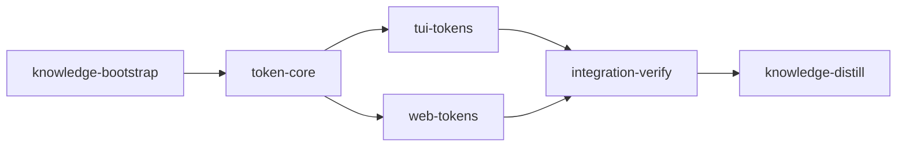

# Plan: Live token flow in loom status

## Overview

Show a live token rate for every stage, every agent and subagent, and every forwarded Codex job (from the moment its forward returns; Decision 12), refreshed every 30 seconds, in `loom status --web` (chiefly) and `loom status --live`. The numbers come from local files the daemon tails: Claude transcripts, subagent transcripts and Codex rollout files. No Anthropic or OpenAI usage API serves Max or ChatGPT plans in real time. The approved design is the mockup at <https://claude.ai/artifact/BFDRMiWwtsv653hqsMPvED>. Every existing UI element stays; the plan only adds.

The authoritative spec shared by every stage is `doc/plans/briefs/token-flow/common.md`: units, wire model, fixture values, source formats, quota time-left rule and corner cases. YAML is authoritative where this prose and the YAML differ.

## Goals

- A daemon thread (`tokens-tracker`) reads transcript deltas every 30 s from saved byte offsets and writes `.loom/work/tokens/flow.json`. A checkpoint lets it survive restarts without double counting.
- `StatusData.tokens` carries plan, stage and agent totals, 5-minute rates, 30 s series, quota time-left estimates and a count of unreadable lines.
- Web: a TOKENS header rail, a Token flow panel, a ledger TOKENS column, a token line on graph nodes, a Tokens section in the stage dialog, and a time-left label beside the Claude 5h quota meter.
- TUI: a header token summary, a TOKENS column, a time-left suffix in the quota line, and a `t` key that opens a per-agent token pane.
- Non-goals:
  - dollar costs;
  - OpenTelemetry;
  - server-side usage APIs;
  - Codex fork-replay handling;
  - cross-file dedupe of Claude message ids (loom never resumes a stage session into a new transcript).

## Decisions

1. **Fresh tokens lead.** Fresh = input + cache write + output. Cache reads appear only in the mix and the cache-hit percentage.
2. **Rate is a 5-minute moving average.** Charts, sparklines and heat strips show raw 30 s buckets.
3. **Usage is bucketed by the timestamp on each line**, never by read time.
4. **The tracker is a producer thread, not part of the broadcaster.** `run_status_broadcaster` re-reads files every 1 s and never touches in-memory orchestrator state (`daemon/server/broadcast.rs`, `STATUS_BROADCAST_INTERVAL_MS`). The tracker therefore persists `flow.json` and the collector reads it, exactly as `crate::quota::read_snapshot` does for quota.
5. **Token data lives in one optional `StatusData.tokens` block, not on `StageSummary`.** In `web/src/api/schema.ts`, `stageSummarySchema` and `snapshotSchema` are `.strict()` but `statusDataSchema` is not. An older embedded bundle therefore still parses frames that carry `tokens`.
6. **Quota time left is a duration** ("~2h07m left", "lasts to reset" or nothing), estimated from the slope of the observed 5h percentage over the last 30 minutes. The window is 30 minutes, not 5, because `quota/poller.rs` polls every 180 s. The Codex prolite plan reports only a weekly window (rollout `rate_limits.primary.window_minutes` 10080, `secondary` null), so Codex normally shows no time-left label. Its 5h dash is correct behaviour.
7. **The web metric toggle from the mockup is dropped.** Series are fresh-only, and the mix grid already shows output and cache reads.
8. **TUI token pane agent states are "live" or "idle"** (any usage in the last 2 minutes). The mockup's generating, waiting and done would need the private `commands/subagents/classify.rs` machinery.
9. **The TUI quota tiers keep their 120-column breakpoint** (`QUOTA_FULL_WIDTH`) while the ledger's `FULL_WIDTH` becomes 132.
10. **Codex lane:** `gpt-6-astra` at effort `medium` for every codex unit (operator's choice). `loom-hooks/codex-forward.sh` accepts both values.
11. **Sandbox:** all network (`allowed_domains: ["*"]`, local binding allowed), at the operator's request after repeated sandbox friction.
12. **Codex jobs appear when their forward returns.** The tracker learns a job's `codex_thread_id` only from forward receipts, and PostToolUse writes a receipt only after the forwarder's foreground Bash call returns (`loom-hooks/post-tool-use.sh` near line 250; `loom/src/models/forward_receipt.rs` skips calls without a result). A running job is therefore invisible for up to the 540 s wrapper deadline, then back-fills its own past buckets by line timestamp (Decision 3). A live source exists and is out of scope: companion job records under `~/.codex/plugin-data/state/*/jobs/*.json` carry `threadId` while running, and `loom/src/codex_lifecycle/jobs.rs` `locate_job` (`pub(super)`) matches them to authorization rows. knowledge-distill records it as a concern.
13. **Quota time left segments the five-hour window itself and ignores `HistoryContinuity`.** Real `.loom/work/quota/history/claude.jsonl` rows alternate the five-hour `resets_at` between two values one second apart on successive polls, and `loom/src/quota/history.rs` `continuity_from_windows` marks any `resets_at` difference in either window as `Reset`. A "run since the last Reset" therefore never holds more than one point and the label would never appear. The opposite failure is real too: `continuity_from_windows` returns `Unknown` (which outranks `Reset`) when the seven-day window appears or disappears, so a real five-hour reset that coincides with a weekly-window change is not marked `Reset` at all. Segmenting on the five-hour window's own `resets_at` (a jump over 300 s) or a `used_percent` drop handles both; when either point's five-hour `resets_at` is null, only the drop rule applies. The rule is in common.md section 6; contracts `quota-left-survives-reset-jitter` and `quota-left-ignores-pre-reset-points` pin both directions.
14. **`AgentFlow.active` is authoritative.** Every UI reads it verbatim for live/idle, the "agents live" count and the rate dash; none derives activity from `series`.
15. **The TUI ledger trades two columns at 120-131 cells for TOKENS.** With `FULL_WIDTH` 132 and the drop order `[Time, Models, DependsOn, Tokens, Context]`, a 120-column terminal shows six of today's eight columns plus TOKENS (TIME and MODELS dropped; `columns_for_width` gives 123 without Time and 105 without Models). This is the accepted cost of the contracted drop order; "every existing UI element stays" holds at 132 columns and wider.
16. **The flow file is capped at 512 KiB** (`MAX_FLOW_BYTES`), a quarter of the daemon's 2 MiB response frame (`loom/src/daemon/wire.rs` `MAX_RESPONSE_BYTES`). A flow near the frame limit would make `frame_overflow` (`loom/src/daemon/server/broadcast.rs`) skip every status broadcast, freezing the TUI and web entirely. Before a write would pass the cap, the tracker empties the `series` of inactive agents (keeping their totals), and if still over, skips the write and logs once; a skipped write ages out after `FLOW_STALE_SECS` and the collector then publishes no `tokens`, so ordinary status always wins over token detail. `flow.json` is compact JSON (`serde_json::to_vec`) and the cap is measured on those bytes. Every UI treats an empty or short `series` as zeros. Contract `oversized-flow-sheds-idle-series` drives a flow past the cap through `scan_pass` and checks that the collector still publishes it; checkpoint retention (`STAGE_SERIES_LEN` buckets, 4096 ids per file, 8 MiB read cap) is separate from this wire budget.
17. **`read_flow` and the checkpoint read accept only a regular file and read at most their cap.** `crate::quota::cache::reject_symlink` checks only the leaf for a symlink; a FIFO or directory at `flow.json` would pass it, and reading a FIFO blocks the 1 s broadcast loop. Both readers check `symlink_metadata(..).file_type().is_file()` and read through `File::open(..)?.take(cap + 1)`, refusing more than `cap` bytes. Strings in a valid but hostile `flow.json` are flattened at the collector boundary (contract `collector-flattens-flow-strings` writes such a file directly, with no `scan_pass`), which also covers strings restored from the checkpoint, since every published string passes the collector.

## Baselines (observed 2026-10-14 at committed HEAD d0c22b9c, in a clean worktree)

- `cargo clippy --all-targets -- -D warnings`: exit 0.
- `cargo fmt --check`: exit 0.
- `cargo test --test maintainability`: 8 passed.
- `cargo test --lib commands::status::`: 447 passed.
- `cargo test --lib quota::`: 123 passed.
- `cd web && bun run check`: 42 files, 462 tests passed.
- `vite build` is deterministic (two builds byte-identical; a scratch build into a temp dir diffs clean against `web/dist`). web-tokens always rebuilds and commits `dist`, whatever state the base is in.

These numbers predate the operator's work in progress (next section); HEAD moved to 934c9de0 since (`70edd4b4` added status tests), so the `commands::status::` count is already about 454 at HEAD. They are orientation only: no stage gate compares a count.

## Before `loom run` (operator)

1. **Settle the work in progress in the main checkout.** At pressure-test time it was about 90 modified tracked files plus about 20 untracked source files, still changing, overlapping this plan's territory: `loom/src/commands/status/data/{collector,mod,sanitize}.rs`, `status/web/model_tests*.rs`, `daemon/wire_tests.rs`, `status/ui/tui/ledger/{legend,mod,panels,rows,tests}.rs` (plus new `entries.rs`, `tests_attention.rs`), `web/src/api/{schema.ts,fixtures/snapshot.json}`, `stage-sections.tsx`, `stage-modal*`, `routes/ledger.test.tsx` and `web/dist/assets/index.{js,css}`. Get it green (`cargo build`, `cargo clippy --all-targets -- -D warnings`, `cargo test --test maintainability`, `cd web && bun run check && bun run build`) and commit it. Do not stash it: it rewrites `web/dist`, which web-tokens also rebuilds and commits, so a later `git stash pop` conflicts in the minified bundle. If it must be stashed anyway, use `git stash push -u` (it includes untracked modules such as `status/data/stopped.rs`), and after the plan merges resolve `web/dist` by running `bun run build`, never by a text merge.
2. **Re-measure what the stage text pins**, on the committed tree, and correct the stage text where a number crossed a threshold: `wc -l` of `loom/src/daemon/wire_tests.rs` (400 with the WIP), `ledger/panels.rs`, `ledger/tests.rs`, `ledger/layout.rs` (377), `tui/app.rs` (390); the `run_server` row in `loom/maintainability-baseline.txt` (127); the length of `collect_status_data` in `status/data/collector.rs` (45). The stages are written to work at the WIP sizes measured on 2026-10-14.
3. **Commit `doc/plans/PLAN-token-flow.md` and `doc/plans/briefs/token-flow/**` on main.** `loom run` refuses an uncommitted plan or brief bundle (`loom/src/commands/run/plan_inputs.rs`), and a stage worktree is cut from HEAD, so an untracked brief would not exist there (`doc/loom/knowledge/mistakes/verification-harness.md`, "Untracked Plan and Worker Briefs Leave a Worktree Stage Blind"). `loom run` then commits the rename to `doc/plans/IN_PROGRESS-PLAN-token-flow.md`; stage descriptions name both spellings.
4. **Do not run this plan concurrently with `PLAN-loom-ui-mods`, `PLAN-web-host-graft-followthrough` or `PLAN-model-router-hooks`, and start it only after `IN_PROGRESS-PLAN-source-graph-mechanism` has completed** (next section).

## Sibling plans

No sibling plan defines or consumes `crate::tokens`, `StatusData.tokens` or `TokenFlow`, and no sibling contract pins the ledger column order or `FULL_WIDTH`. Two siblings write files this plan writes:

- `PLAN-loom-ui-mods` (stage `loom-ui`) owns `loom/src/commands/status/data/{collector,mod,sanitize}.rs`, `README.md` and `loom/maintainability-baseline.txt`. Its edits (visibility and `pub(crate)` re-exports) do not conflict in meaning with this plan's (one `StatusData` field, one literal line), and its sibling note ("No other sibling owns a file this plan writes") is wrong once this plan exists.
- `PLAN-web-host-graft-followthrough` owns `loom/src/commands/status/web/**` (which covers `model_tests.rs`) and `loom/maintainability-baseline.txt`.
- `PLAN-model-router-hooks` declares `loom/src/**` in its integration-verify stage and `README.md` plus `doc/loom/knowledge/**` in its knowledge stage, overlapping token-core, tui-tokens and this plan's knowledge-distill.
- `IN_PROGRESS-PLAN-source-graph-mechanism` touches none of this plan's source namespaces, but its knowledge stages write `doc/loom/knowledge/**` (and with it `INDEX.md`) like this plan's knowledge-bootstrap and knowledge-distill.

Run them one after another, never at the same time. Whichever runs second re-reads `collector.rs`, `status/data/mod.rs`, `status/web/model_tests.rs`, `web/src/api/fixtures/snapshot.json` and `README.md` on the merged tree before editing them, and refreshes its briefs against the merged `StatusData` and serializer fixture. **Blocking sibling amendment (before either plan runs concurrently with this one):** `PLAN-loom-ui-mods`'s sibling note ("No other sibling owns a file this plan writes") must name this plan and the shared `status/data/{collector,mod}.rs` and `README.md`; `PLAN-web-host-graft-followthrough` and `PLAN-model-router-hooks` must list this plan as a run-after or run-before sibling for `status/web/model_tests.rs` and `loom/src/**` respectively. Until those notes exist, the serial order above is the only allowed schedule. `crate::tokens` stays this plan's own namespace; nothing moves into a sibling's domain.

## Execution Diagram



## Stages

### 1. knowledge-bootstrap

Records the facts verified while planning (source formats, broadcaster behaviour, wire pinning, size headroom), so every later stage's knowledge brief carries them. Single agent, sonnet override: it writes already-verified facts and explores nothing.

### 2. token-core (`working_dir: loom`)

**Exists because:**

- **Q1:** tui-tokens and web-tokens need `StatusData.tokens`, the `crate::tokens` types and the pinned fixture in `web/src/api/fixtures/snapshot.json` merged before they start.
- **Q2:** it writes `snapshot.json`, which web-tokens reads as its contract fixture.

**Execution:**

1. **Warm the build** (main agent): `cargo test --lib --no-run` once, before any edit. A fresh worktree's `target/` is empty, and parallel codex units would otherwise queue on cargo's build lock inside their 540 s deadline.
2. **Foundation** (main agent, under 20 lines in 6 files):
   - add `pub mod tokens;` to `loom/src/lib.rs`;
   - create `loom/src/tokens/mod.rs` with `pub mod claude_line; pub mod codex_line; pub mod model; pub mod quota_left; pub use model::*;` and a module doc comment;
   - seed `loom/src/tokens/{model,quota_left,codex_line,claude_line}.rs`, each holding one `//!` line, so the crate compiles before any unit runs (a declared module without a file is E0583 and would make every unit's check depend on its siblings, `doc/loom/knowledge/mistakes/codex-worker-briefing.md`).
3. **Wave 1a:** C3 (model) and C1 (quota_left), codex, foreground, in parallel. C1 needs nothing from C3.
4. **Wave 1b:** C2 (codex_line) and C4 (claude_line), codex, foreground, in parallel, after C3 returns: both import `TokenUsage` from C3's `model.rs`.
5. Every codex unit's own check is compile-only, `cargo test --lib --no-run`: TMPDIR is read-only inside the codex sandbox (`doc/loom/knowledge/architecture/owned-waits.md`), so C3's `TempDir` tests cannot run there. A compile error in another unit's file is not the unit's to fix; it reports it and stops. The main agent runs `cargo test --lib tokens::` after each wave.
6. **Wave 2:** W1 (engine) and W2 (wiring) in parallel.

**Workers:**

| Worker | Role | Tier | Files owned | Shared context | Brief path |
| ------ | ---- | ---- | ----------- | -------------- | ---------- |
| C1 | Quota estimator | codex astra | src/tokens/quota_left.rs; src/tokens/quota_left_tests.rs | common.md | doc/plans/briefs/token-flow/token-core/c1-quota-left.md |
| C2 | Codex line parser | codex astra | src/tokens/codex_line.rs; src/tokens/codex_line_tests.rs | common.md | doc/plans/briefs/token-flow/token-core/c2-codex-line.md |
| C3 | Model | codex astra | src/tokens/model.rs; src/tokens/model_tests.rs | common.md | doc/plans/briefs/token-flow/token-core/c3-model.md |
| C4 | Claude line parser | codex astra | src/tokens/claude_line.rs; src/tokens/claude_line_tests.rs | common.md | doc/plans/briefs/token-flow/token-core/c4-claude-line.md |
| W1 | Tracker engine | opus/xhigh | src/tokens/mod.rs; src/tokens/tail.rs; src/tokens/accumulate.rs; src/tokens/discover.rs; src/tokens/checkpoint.rs; src/tokens/tracker.rs; src/tokens/*_tests.rs; src/commands/usage/codex_discovery.rs; src/commands/usage/mod.rs | common.md | doc/plans/briefs/token-flow/token-core/w1-engine.md |
| W2 | Snapshot and daemon wiring | sonnet | src/commands/status/data/mod.rs; src/commands/status/data/collector.rs; src/daemon/server/lifecycle.rs; src/commands/status/web/model_tests.rs; ../web/src/api/fixtures/snapshot.json; src/daemon/wire_tests.rs; src/commands/status/ui/tui/ledger/tests.rs; src/commands/status/ui/tui/ledger/tests_viewport.rs; src/commands/status/ui/tui/ledger/quota_tests.rs; src/commands/status/ui/tui/ledger/header.rs; src/commands/status/ui/tui/state_tests.rs; src/commands/status/render/graph_tests.rs; src/commands/stop.rs | common.md | doc/plans/briefs/token-flow/token-core/w2-wiring.md |

W1's `src/tokens/*_tests.rs` glob excludes C1-C4's test files, which are written earlier in wave 1. W1 owns `src/commands/usage/mod.rs` because `mod codex_discovery;` there is private: widening `codex_root` alone would not make it reachable from `crate::tokens`.

W2's `lifecycle.rs` edit must leave `run_server` at exactly 127 lines after `cargo fmt`: `loom/maintainability-baseline.txt` pins `function src/daemon/server/lifecycle.rs run_server 127`, `tests/maintainability/baseline.rs` fails on growth and on shrinkage alike, and the file is a `ratchet_files` entry, so any row change raises a TI-ratchet integrity event. The w2-wiring brief gives a line-neutral shape (two run_server lines replaced in place).

**Risk walk (contracts in `loom/tests/token_flow_contracts.rs`, plus three in `loom/tests/token_flow_bounds_contracts.rs` because one file cannot hold 21 contracts under the 400-line limit):**

- Lifecycle: `second-pass-counts-nothing-new`, `rewritten-transcript-is-rescanned`, `checkpoint-resumes-from-offset` (offsets are used, not a full rescan each pass), `corrupt-checkpoint-rescans` (a bad checkpoint never stalls the thread).
- The behaviour the stage adds: `rate-is-five-minute-average` (Decision 2); `plan-rate-sums-stages-and-expires` (plan sums across two stages, series lengths, and a rate and `active` that decay to zero on a later pass with no new data).
- Size at scale: `oversized-flow-sheds-idle-series` (Decision 16; a flow past `MAX_FLOW_BYTES` still reaches `StatusData.tokens`).
- External data (quota history across a real reset): `quota-left-ignores-pre-reset-points` (Decision 13).
- Untrusted input at the reader: `collector-flattens-flow-strings` (the collector boundary flattens `flow.json` strings, as `status/data/sanitize.rs` does for the rest of the payload).
- External data: `repeated-message-id-counts-once`, `codex-job-totals-are-deltas-attributed-to-stage`, `unreadable-usage-line-is-counted`.
- Process I/O and partial reads: `torn-last-line-counted-once-after-newline`.
- Lifecycle (time): `backlog-lands-in-its-own-buckets`.
- Paths and symlinks: `symlinked-tokens-dir-is-refused`.
- Untrusted input: `agent-labels-are-sanitized`.
- Reachability: `status-data-carries-fresh-flow`, plus `reachable` checks from the daemon and the collector.
- Configuration propagation: `status-data-drops-stale-flow` (the staleness bound is applied).
- The estimator: `quota-left-estimates-from-slope`, `quota-left-flat-usage-lasts-to-reset`.
- External data (quota history), the tracker's estimator input: `quota-left-survives-reset-jitter` (real history alternates `resets_at` by 1 s; Decision 13).

### 3. tui-tokens (`working_dir: loom`)

**Exists because:**

- **Q1:** it needs token-core merged.
- **Q4:** folding it into token-core would put eight workers, 29 contracts (21 plus 8) and their review rounds in one session, past the 500,000-token budget.

It runs concurrently with web-tokens, sharing no file. The main agent first warms the build (`cargo test --lib --no-run`), then the foundation step (1 line) adds `mod tokens_pane;` to `ledger/mod.rs` and seeds `ledger/tokens_pane.rs` with one `//!` line so the crate compiles. Wave 1: C1 builds the pane renderer and text helpers (codex; compile-only check). Wave 2: W1 does everything else (Claude sonnet).

| Worker | Role | Tier | Files owned | Shared context | Brief path |
| ------ | ---- | ---- | ----------- | -------------- | ---------- |
| C1 | Pane renderer | codex astra | src/commands/status/ui/tui/ledger/tokens_pane.rs; src/commands/status/ui/tui/ledger/tokens_pane_tests.rs | common.md | doc/plans/briefs/token-flow/tui-tokens/c1-pane.md |
| W1 | Column, header, quota, footer, key, layout | sonnet | src/commands/status/ui/tui/ledger/mod.rs; src/commands/status/ui/tui/ledger/columns.rs; src/commands/status/ui/tui/ledger/cells.rs; src/commands/status/ui/tui/ledger/rows.rs; src/commands/status/ui/tui/ledger/header.rs; src/commands/status/ui/tui/ledger/quota.rs; src/commands/status/ui/tui/ledger/quota_tests.rs; src/commands/status/ui/tui/ledger/panels.rs; src/commands/status/ui/tui/ledger/footer.rs; src/commands/status/ui/tui/ledger/layout.rs; src/commands/status/ui/tui/ledger/layout_tokens.rs; src/commands/status/ui/tui/ledger/legend.rs; src/commands/status/ui/tui/ledger/tests.rs; src/commands/status/ui/tui/ledger/tests_tokens.rs; src/commands/status/ui/tui/ledger/tests_alignment.rs; src/commands/status/ui/tui/ledger/tests_viewport.rs; src/commands/status/ui/tui/event_handler.rs; src/commands/status/ui/tui/app.rs | common.md | doc/plans/briefs/token-flow/tui-tokens/w1-ledger.md |

W1 owns `ledger/panels.rs` because the only caller of `quota_line` is `render_footer` there (it passes `view.now_epoch`), and the key hints (`key_hints`) and the test pinning `"? legend · q quit"` live there too. `ledger/footer.rs` (new) receives the footer functions only if `panels.rs` would pass 390 lines; `ledger/tests_tokens.rs` (new, `#[cfg(test)]`) holds the shared section-4 `TokenFlow` test helper, because `ledger/tests.rs` (363 lines) has no room for it.

**Risk walk:**

- Reachability: `token-pane-shows-agents-when-toggled`, `footer-quota-shows-time-left` (the real footer passes `quota_left` to `quota_line`), plus `reachable` from `render_dashboard`.
- Configuration propagation: `quota-tiers-unchanged-at-120` (the new `FULL_WIDTH` must not move the quota breakpoint).
- Width arithmetic, the behaviour the stage adds: `tokens-column-between-context-and-time`, `tokens-column-drop-order`, `quota-line-shows-time-left`.
- Data reaches the cell: `tokens-cell-shows-stage-rate` (a column whose cells are all empty would pass every header-only contract), `header-shows-plan-token-summary`.

The ledger module is `pub(crate)`, so the contracts live in the crate. The contract session writes `ledger/tests_tokens_contracts.rs` and declares it from the test-only `ledger/tests_completion.rs` (harness), which no worker edits.

### 4. web-tokens (`working_dir: web`)

**Exists because:**

- **Separate working directory:** its contracts are vitest files that must lie under `web/`.
- **Q1:** its contracts read the `tokens` block token-core writes into `snapshot.json`.

Wave 1: three codex units in parallel (C1 schema, C2 helpers, C3 Sparkline and HeatStrip), followed by the main agent's `bun run typecheck` (vitest passes code that `tsc -b` rejects, such as parameter properties under `erasableSyntaxOnly`). Wave 2: W1 (overview surfaces) and W2 (dialog and footer) in parallel. Then the main agent runs `bun run format` and `bun run build` BEFORE the verifier round, so the rebuilt `dist/` is in the tree the gate and the final review see; after the gate and review are green it commits the feature, then the rebuilt `dist/` as a separate `chore(web)` commit.

| Worker | Role | Tier | Files owned | Shared context | Brief path |
| ------ | ---- | ---- | ----------- | -------------- | ---------- |
| C1 | Schema | codex astra | src/api/schema.ts; src/api/schema.test.ts | common.md | doc/plans/briefs/token-flow/web-tokens/c1-schema.md |
| C2 | Helpers | codex astra | src/lib/tokens.ts; src/lib/tokens.test.ts | common.md | doc/plans/briefs/token-flow/web-tokens/c2-lib.md |
| C3 | Charts | codex astra | src/components/sparkline.tsx; src/components/sparkline.test.tsx | common.md | doc/plans/briefs/token-flow/web-tokens/c3-sparkline.md |
| W1 | Overview surfaces | sonnet | src/components/header.tsx; src/components/header-lines.tsx; src/header.css; src/components/token-flow-panel.tsx; src/components/token-flow-panel.test.tsx; src/routes/overview.tsx; src/routes/overview.test.tsx; src/routes/ledger.tsx; src/routes/ledger.test.tsx; src/components/ledger-table.tsx; src/components/ledger-row.tsx; src/components/graph/stage-node.tsx; src/components/graph/stage-node.test.tsx; src/components/graph/stage-graph.tsx; src/components/graph/stage-graph.test.ts; src/lib/graph.ts; src/lib/graph.test.ts; src/components/legend-dialog.tsx | common.md | doc/plans/briefs/token-flow/web-tokens/w1-overview.md |
| W2 | Dialog and footer | sonnet | src/components/stage-tokens.tsx; src/components/stage-tokens.test.tsx; src/components/stage-sections.tsx; src/components/stage-sections.test.tsx; src/components/stage-heading.tsx; src/components/stage-modal.test.tsx; src/components/quota-meters.tsx; src/components/quota-meters.test.tsx; src/routes/shell.tsx | common.md | doc/plans/briefs/token-flow/web-tokens/w2-dialog.md |

W2 owns `routes/shell.tsx` because the footer lives there (`Footer` passes `snapshot={quota}`, only `status.quota`, to `QuotaMeters`); `quota_left` reaches the gauge through a new `quotaLeft` prop. W1 owns `components/legend-dialog.tsx` for the "tokens" legend entry.

**Risk walk (contracts in `web/src/token-flow.contracts.test.tsx`):**

- Reachability: the panel is rendered from the overview route; the dialog lanes are rendered from the modal; the time-left label is rendered in the footer.
- Configuration and absent data: `snapshot-without-tokens-renders-no-panel` (with a positive control in the same test, so it is red at freeze).
- External data: the numbers asserted are the pinned fixture's (common.md section 4).
- Data reaches each surface: `stage-surfaces-show-stage-rate` (ledger cell and graph card), `header-rail-shows-plan-totals` (a mounted but empty rail passes the `<TokenLine` wiring grep).

### 5. integration-verify

Runs the full Rust suite, clippy, fmt and doc, the web check (as acceptance, through `bunx` because `loom plan verify` warns on a `bun` criterion at a root without `package.json`), the `dist` freshness check, and code review. It also runs an end-to-end smoke of the freshly built binary (`loom/target/debug/loom`, never the installed `loom`, which has no tracker) serving a `flow.json` through `loom status --web`, in a single Bash invocation: each Bash call gets its own network namespace, so a server started in one call is unreachable from the next (`doc/loom/knowledge/mistakes/sandbox-tooling-and-network.md`).

### 6. knowledge-distill

Curates memories, records the token-flow architecture, and updates the README's `loom status` section.

---

<!-- loom METADATA -->

```yaml
loom:
  version: 2
  ratchet_files:
    - loom/maintainability-baseline.txt
    - doc/loom/knowledge/check-baseline.txt
  provision:
    - working_dir: "web"
      command: "test ! -e .npmrc && test ! -L .npmrc && bun install --frozen-lockfile --ignore-scripts --backend=copyfile --config=/dev/null"
  sandbox:
    enabled: true
    auto_allow: true
    filesystem:
      deny_read: ["~/.ssh/**", "~/.aws/**", "~/.config/gcloud/**", "~/.gnupg/**"]
    network:
      allowed_domains: ["*"]
      allow_local_binding: true
      allow_unix_sockets: []
  stages:
    - id: knowledge-bootstrap
      name: "Record token-flow facts verified while planning"
      summary: "Writes the transcript, rollout, broadcaster and wire-pinning facts verified during planning into the knowledge base, so the implementation stages' briefs carry them."
      stage_type: knowledge
      model: "sonnet"
      working_dir: "."
      dependencies: []
      description: |
        The knowledge base already maps this codebase; do NOT re-map it. This stage only records facts verified on 2026-10-14, so retrieval hands them to later stages. model is overridden to sonnet because the stage writes already-verified facts and explores nothing.
        Use parallel subagents and skills to maximize performance. (A single agent is enough: no subagents.)
        Run loom knowledge sync first. Then write ONE new tier-2 topic with loom knowledge update architecture/token-flow-sources "<entry>", annotate it with loom knowledge annotate architecture/token-flow-sources --blurb "Token usage sources: transcripts, rollouts, receipts", and add a 2-4 line summary plus link to architecture.md with loom knowledge update architecture "<entry>". Facts to record, each as current truth, taken from doc/plans/briefs/token-flow/common.md section 5 and the plan's Decisions:
        - Claude transcript lines: assistant lines carry message.id, message.model, message.usage (input_tokens, cache_creation_input_tokens, cache_read_input_tokens, output_tokens) and an RFC 3339 timestamp; one API response spans several lines sharing message.id; subagent transcripts are <dir>/<session uuid>/subagents/agent-<agentId>.jsonl with isSidechain true and agentId.
        - Codex rollouts: ~/.codex/sessions/YYYY/MM/DD/rollout-<timestamp>-<thread_id>.jsonl, written line by line; event_msg token_count carries cumulative total_token_usage and per-call last_token_usage; total_tokens = input_tokens + output_tokens, so cached_input_tokens and cache_write_input_tokens are parts of input_tokens; info null is a rate-limit ping; turn_context.payload.model names the model; the prolite plan reports only a weekly window (primary.window_minutes 10080, secondary null).
        - Forward receipts (.loom/work/subagents/<stage>/forward-receipts.jsonl, loom/src/models/forward_receipt.rs) record codex_thread_id; loom never passes --ephemeral to codex.
        - The daemon status broadcaster re-reads files every second and never reads in-memory orchestrator state; a new status field needs a producer that persists a file the collector reads (the quota cache pattern).
        - The web wire contract: loom/src/commands/status/web/model_tests.rs fixture_matches_serde_output pins exact equality between the Rust serializer and web/src/api/fixtures/snapshot.json; stageSummarySchema and snapshotSchema are .strict(), statusDataSchema is not.
        - web/dist is committed and embedded by loom/build/assets.rs; cargo never runs bun; vite build output is deterministic.
        - The quota poller samples every 180 s, so quota slopes need a window of about 30 minutes.
        - Quota history (.loom/work/quota/history/<provider>.jsonl) flips the five-hour resets_at between two values one second apart on successive polls, and loom/src/quota/history.rs continuity_from_windows marks any resets_at difference in either window as Reset; the history store also skips a row identical to the last one. A consumer that needs one reset period segments on the window's own resets_at with a tolerance instead of trusting HistoryContinuity.
        - A forward receipt (and with it codex_thread_id) is written by PostToolUse only after the forwarder's foreground Bash call returns, so a running Codex job has no receipt yet; companion job records under ~/.codex/plugin-data/state/*/jobs/*.json carry threadId while running.
        - loom/maintainability-baseline.txt rows are exact: tests/maintainability/baseline.rs fails when a recorded function grows AND when it shrinks, and the file is a ratchet_files entry in v2 plans, so editing a recorded function must keep its length or raise a TI-ratchet integrity event.
        Use the loom knowledge CLI, NOT Write/Edit. NEVER Claude Code auto-memory.
      acceptance:
        - "loom knowledge check --strict --baseline doc/loom/knowledge/check-baseline.txt"
        - "rg -qF 'cache_write_input_tokens' doc/loom/knowledge/architecture/token-flow-sources.md"
        - "rg -qF 'fixture_matches_serde_output' doc/loom/knowledge/architecture/token-flow-sources.md"
        - "rg -qF 'codex_thread_id' doc/loom/knowledge/architecture/token-flow-sources.md"
        - "rg -qF 'continuity_from_windows' doc/loom/knowledge/architecture/token-flow-sources.md"
      files: ["doc/loom/knowledge/**"]
      artifacts:
        - "doc/loom/knowledge/architecture/token-flow-sources.md"

    - id: token-core
      name: "Token tracker, StatusData.tokens and daemon wiring"
      summary: "Adds the tokens-tracker daemon thread that tails stage transcripts and Codex rollouts every 30 s into .loom/work/tokens/flow.json, and publishes it as StatusData.tokens to the TUI and the web dashboard."
      stage_type: standard
      skills: ["loom-rust"]
      implementers: ["codex", "claude"]
      subagent_timeout_secs: 900
      working_dir: "loom"
      dependencies: ["knowledge-bootstrap"]
      description: |
        Build stage 2 of the plan (doc/plans/PLAN-token-flow.md, renamed doc/plans/IN_PROGRESS-PLAN-token-flow.md once loom run starts).
        Use parallel subagents and skills to maximize performance.
        PATHS: working_dir is loom/ because loom runs each contract as `cargo test <name> -- --exact` from it. YAML paths and the worker table are package-relative (../ for files outside the crate); brief paths are repo-relative from the worktree root.
        Every worker reads doc/plans/briefs/token-flow/common.md first, then its own brief. common.md is authoritative for the wire model, fixture values, source formats and corner cases.
        WARM-UP (you, first): cargo test --lib --no-run, so the empty worktree target/ is built before parallel codex units queue on cargo's build lock inside their 540 s deadline.
        FOUNDATION (you, before any spawn): add `pub mod tokens;` to src/lib.rs next to `pub mod quota;`; create src/tokens/mod.rs holding a module doc comment, `pub mod claude_line; pub mod codex_line; pub mod model; pub mod quota_left;` and `pub use model::*;`; create src/tokens/{model,quota_left,codex_line,claude_line}.rs each holding a single `//!` doc line, so the crate compiles before any unit runs (a declared module without a file is E0583; doc/loom/knowledge/mistakes/codex-worker-briefing.md records a unit that timed out waiting for a sibling's module). Run cargo build.
        WAVE 1a (codex lane): spawn C3 (model) and C1 (quota_left) as two loom-codex-forwarder subagents in the FOREGROUND, in ONE message. WAVE 1b: after both return, spawn C2 (codex_line) and C4 (claude_line) the same way; both import TokenUsage from C3's model.rs. Every forward uses `--model gpt-6-astra --effort medium`, an explicit Bash timeout of 600000 ms, and "Your brief: <path>. Read it in full before anything else." Tell every codex unit: do not run git; do not touch .loom paths; your only check is `cargo test --lib --no-run` (TMPDIR is read-only inside the codex sandbox, so TempDir tests cannot run there); a compile error in a file you do not own is not yours: report it and stop, never edit that file and never wait for it. After each sub-wave, run `git status --short` to catch stray writes, then cargo test --lib tokens:: yourself. A timed-out unit is re-split, never re-forwarded as is; a unit that fails twice moves to a loom-software-engineer.
        WAVE 2 (Claude lane): spawn W1 (loom-senior-software-engineer, effort xhigh) and W2 (loom-software-engineer) in the background in ONE message, and wait with one background loom subagents watch.
        AFTER THE WAVES: rustfmt --check --edition 2021 tests/token_flow_contracts.rs tests/token_flow_bounds_contracts.rs (frozen files the formatter would rewrite fail completion; a failure here is a dispute-contract, never an edit); cargo fmt --all; cargo test --test maintainability; route any failure to a fresh worker of the owning territory; then one loom-verifier round, briefed with the repo's canonical gate verbatim (cargo build; cargo test --all-targets --no-fail-fast; cargo clippy --all-targets -- -D warnings; cargo fmt --check; RUSTDOCFLAGS='-D warnings' cargo doc --workspace --all-features --no-deps) plus the acceptance list: the acceptance runs scoped test filters (loom plan verify warns on an unfiltered suite outside integration-verify, so the full suite lives in the verifier round), and this stage changes StatusData, the daemon lifecycle and test literals across the crate. cargo audit is not briefed: this stage adds no dependency. No row of maintainability-baseline.txt changes: loom/maintainability-baseline.txt is a ratchet_files entry (any change is a TI-ratchet integrity event) and pins `function src/daemon/server/lifecycle.rs run_server 127` exactly (tests/maintainability/baseline.rs fails on growth AND shrinkage), so W2's lifecycle.rs edit must leave run_server at exactly 127 lines after cargo fmt (w2-wiring.md gives the line-neutral shape). Likewise src/daemon/wire_tests.rs is at 400 of 400 lines with the operator's work committed: W2 replaces its `quota: crate::quota::QuotaSnapshot::default(),` line in status_data() with `..Default::default()` (StatusData derives Default) instead of adding `tokens: None`.
        MUTATION: before the final review round, for each contract apply the wrong implementation its rejects text describes (or revert the line it guards), confirm the contract fails, restore from a saved copy kept under $LOOM_SCRATCH_DIR (never git checkout), and record loom memory note "mutation: <contract id> red under <mutation>".

        | Worker | Role | Tier | Files owned | Shared context | Brief path |
        | ------ | ---- | ---- | ----------- | -------------- | ---------- |
        | C1 | Quota estimator | codex astra | src/tokens/quota_left.rs; src/tokens/quota_left_tests.rs | common.md | doc/plans/briefs/token-flow/token-core/c1-quota-left.md |
        | C2 | Codex line parser | codex astra | src/tokens/codex_line.rs; src/tokens/codex_line_tests.rs | common.md | doc/plans/briefs/token-flow/token-core/c2-codex-line.md |
        | C3 | Model | codex astra | src/tokens/model.rs; src/tokens/model_tests.rs | common.md | doc/plans/briefs/token-flow/token-core/c3-model.md |
        | C4 | Claude line parser | codex astra | src/tokens/claude_line.rs; src/tokens/claude_line_tests.rs | common.md | doc/plans/briefs/token-flow/token-core/c4-claude-line.md |
        | W1 | Tracker engine | opus/xhigh | src/tokens/mod.rs; src/tokens/tail.rs; src/tokens/accumulate.rs; src/tokens/discover.rs; src/tokens/checkpoint.rs; src/tokens/tracker.rs; src/tokens/tail_tests.rs; src/tokens/accumulate_tests.rs; src/tokens/discover_tests.rs; src/tokens/checkpoint_tests.rs; src/tokens/tracker_tests.rs; src/commands/usage/codex_discovery.rs; src/commands/usage/mod.rs | common.md | doc/plans/briefs/token-flow/token-core/w1-engine.md |
        | W2 | Snapshot and daemon wiring | sonnet | src/commands/status/data/mod.rs; src/commands/status/data/collector.rs; src/daemon/server/lifecycle.rs; src/commands/status/web/model_tests.rs; ../web/src/api/fixtures/snapshot.json; src/daemon/wire_tests.rs; src/commands/status/ui/tui/ledger/tests.rs; src/commands/status/ui/tui/ledger/tests_viewport.rs; src/commands/status/ui/tui/ledger/quota_tests.rs; src/commands/status/ui/tui/ledger/header.rs; src/commands/status/ui/tui/state_tests.rs; src/commands/status/render/graph_tests.rs; src/commands/stop.rs | common.md | doc/plans/briefs/token-flow/token-core/w2-wiring.md |

        CONTRACT SURFACE (the contract session writes tests/token_flow_contracts.rs, its shared fixture builders in tests/token_flow_contracts/support.rs (declared at the top of the contract file as `#[path = "token_flow_contracts/support.rs"]` then `mod support;`, the pattern of tests/subagent_owned_wait.rs) and fixtures under tests/fixtures/token_flow/ from this text before any code; every contract is a top-level #[test] fn in tests/token_flow_contracts.rs named after its id with underscores, so `cargo test <name> -- --exact` selects it; keep every fn under 50 lines and each file under 400 lines and rustfmt-clean, because cargo test --test maintainability scans tests/; eighteen contracts share tests/token_flow_contracts.rs and three more (plan-rate-sums-stages-and-expires, oversized-flow-sheds-idle-series, quota-left-ignores-pre-reset-points) live as top-level #[test] fns in tests/token_flow_bounds_contracts.rs, which declares the same support module as `#[allow(dead_code)]` then `#[path = "token_flow_contracts/support.rs"]` then `mod support;` (each test file is its own crate, so builders the second file never calls would otherwise fail clippy -D warnings); every fixture builder, transcript-line builder and session writer lives in support.rs (split it into further `token_flow_contracts/*.rs` modules if it nears 400 lines) and each contract fn stays at about 20 lines):
        - API: loom::tokens::{scan_pass, read_flow, flow_path, TokenFlow, AgentKind, BUCKET_SECS, FLOW_STALE_SECS, MAX_FLOW_BYTES, STAGE_SERIES_LEN, PLAN_SERIES_LEN} and loom::tokens::quota_left::{estimate, QuotaEstimate}. scan_pass(work_root: &Path, codex_sessions_root: Option<&Path>, now: i64) -> anyhow::Result<TokenFlow>; read_flow(work_root: &Path) -> Option<TokenFlow>; estimate(points: &[(i64, f64)], resets_at: Option<i64>, now: i64) -> QuotaEstimate { minutes_left: Option<u32>, lasts_to_reset: bool }. Wire types are listed in common.md section 3.
        - Fixture work dir: a tempfile::TempDir <tmp>; work_root is <tmp>/.loom/work (create_dir_all it; WorkDir::new on a bare TempDir resolves to a nonexistent path). Session records are written with loom::fs::session_files::save_session(&Session, &work_root) with stage_id set and transcript_path pointing at a transcript file copied into <tmp>/claude/<uuid>.jsonl; subagent files go in <tmp>/claude/<uuid>/subagents/agent-<id>.jsonl. Codex rollouts go under <tmp>/codex-sessions/2026/10/14/rollout-2026-10-14T10-58-07-<thread_id>.jsonl and scan_pass receives Some(<tmp>/codex-sessions). Forward receipts are lines encoded with loom::models::forward_receipt::ForwardObservation::encode_line at receipts_path(&work_root, stage_id)? (it returns a Result) carrying codex_thread_id; encode_line requires receipt_id to equal ForwardIdentity::new(..)?.receipt_id() (models/forward_receipt.rs), so build the identity first. A stage appears in the flow only through a session record whose transcript_path names an existing file, so every contract that expects a stage (the codex one included) writes that session and transcript. Fixture lines are built from the samples in common.md section 5, with timestamps relative to the test's own now.
        - Started-agent ledger rows (.loom/work/subagents/<stage>/starts.jsonl) are scoped: production lookups go through StartedAgentTypeIndex::get_metadata(agent_id, parent_session_id) (StartedAgentTypeIndex::get is #[cfg(test)]). A fixture row is the full JSON object {"agent_id","agent_type","stage_id","parent_session_id","loom_session_id","ts"} with parent_session_id equal to the main transcript's file stem (the Claude session uuid); an unscoped row resolves to no agent_type and would make a sanitization assertion pass vacuously.
        - Quota history fixture rows (for quota-left-survives-reset-jitter and quota-left-ignores-pre-reset-points; a row whose windows list holds only the five-hour entry models a vanished weekly window) are lines of <work_root>/quota/history/claude.jsonl in the format loom/src/quota/history_store.rs writes: {"schema_version":1,"observed_at":<unix>,"windows":[{"kind":"five-hour","used_percent":<f64>,"resets_at":<unix>},{"kind":"seven-day","used_percent":<f64>,"resets_at":<unix>}],"plan":null}. Create <work_root>/quota/history with mode 0700 (create_dir_all is fine in a TempDir).
        - Contracts are red at freeze because loom::tokens does not exist (BuildFailed counts as red).
        MEMORY: record mistakes, decisions and surprises via loom memory immediately (subagents too); NEVER loom knowledge (implementation stage); NEVER Claude Code auto-memory.
      files:
        - "src/lib.rs"
        - "src/tokens/**"
        - "src/commands/usage/codex_discovery.rs"
        - "src/commands/usage/mod.rs"
        - "src/commands/status/data/mod.rs"
        - "src/commands/status/data/collector.rs"
        - "src/daemon/server/lifecycle.rs"
        - "src/commands/status/web/model_tests.rs"
        - "src/daemon/wire_tests.rs"
        - "src/commands/status/ui/tui/ledger/tests.rs"
        - "src/commands/status/ui/tui/ledger/tests_viewport.rs"
        - "src/commands/status/ui/tui/ledger/quota_tests.rs"
        - "src/commands/status/ui/tui/ledger/header.rs"
        - "src/commands/status/ui/tui/state_tests.rs"
        - "src/commands/status/render/graph_tests.rs"
        - "src/commands/stop.rs"
        - "tests/token_flow_contracts.rs"
        - "tests/token_flow_bounds_contracts.rs"
        - "tests/token_flow_contracts/**"
        - "tests/fixtures/token_flow/**"
        - "../web/src/api/fixtures/snapshot.json"
      acceptance:
        - "cargo build"
        - "cargo test --lib tokens::"
        - "cargo test --lib commands::status::"
        - "cargo test --lib commands::usage::"
        - "cargo test --lib daemon::"
        - "cargo test --test token_flow_contracts"
        - "cargo test --test token_flow_bounds_contracts"
        - "cargo test --test maintainability"
        - "cargo clippy --all-targets -- -D warnings"
        - "cargo fmt --check"
        - "RUSTDOCFLAGS='-D warnings' cargo doc --workspace --all-features --no-deps"
        - "cd ../web && bunx oxfmt --check src/api/fixtures/snapshot.json"
      before_stage:
        - command: "cargo --version"
          description: "cargo on PATH"
        - command: "codex --version"
          description: "codex CLI on PATH (codex lane)"
      after_stage:
        - command: 'rg -qF "crate::tokens::tracker::spawn_token_tracker(" src/daemon/server/lifecycle.rs'
          description: "tracker spawned by the daemon"
        - command: 'rg -qF "\"tokens\"" ../web/src/api/fixtures/snapshot.json'
          description: "web fixture carries the tokens block"
      artifacts:
        - "src/tokens/model.rs"
        - "src/tokens/tracker.rs"
        - "src/tokens/quota_left.rs"
        - "src/tokens/claude_line.rs"
        - "src/tokens/codex_line.rs"
      wiring:
        - source: "src/daemon/server/lifecycle.rs"
          pattern: "crate::tokens::tracker::spawn_token_tracker("
          literal: true
          description: "the daemon spawns the tracker thread"
        - source: "src/commands/status/data/collector.rs"
          pattern: "crate::tokens::model::read_flow("
          literal: true
          description: "the collector publishes the flow as StatusData.tokens"
      reachable:
        - symbol: spawn_token_tracker
          from: run_server
          description: "the daemon server starts the tracker"
        - symbol: scan_pass
          from: spawn_token_tracker
          description: "the tracker thread runs scan passes"
        - symbol: read_flow
          from: collect_status_data
          description: "status collection reads the flow file"
      harness: ["tests/fixtures/token_flow/**", "tests/token_flow_contracts/**"]
      contracts:
        - id: second-pass-counts-nothing-new
          file: tests/token_flow_contracts.rs
          test: second_pass_counts_nothing_new
          scenario: "one stage session whose transcript holds two assistant usage lines with distinct message ids; scan_pass twice with the same now and no file change; compare the stage total after each pass"
          rejects: "a tracker that re-reads each file from offset 0 every pass, or adds totals again from the checkpoint, so the second pass doubles the total"
        - id: repeated-message-id-counts-once
          file: tests/token_flow_contracts.rs
          test: repeated_message_id_counts_once
          scenario: "a transcript with three assistant lines sharing message.id msg_A and identical usage (input 2, cache_creation 14477, cache_read 4542, output 20), then a fourth msg_A line whose output_tokens is 50; one scan_pass"
          rejects: "a tracker that sums every line (input counted 4 times) or ignores the later larger output_tokens; the expected agent total is input 2, cache_write 14477, cache_read 4542, output 50"
        - id: torn-last-line-counted-once-after-newline
          file: tests/token_flow_contracts.rs
          test: torn_last_line_counted_once_after_newline
          scenario: "a transcript holding one full usage line plus the first half of a second usage line without newline; scan_pass; append the rest of the second line and a newline; scan_pass again"
          rejects: "a tracker that advances its offset past the torn half (the second line is never counted) or counts a partial parse, instead of counting the second line exactly once on the second pass"
        - id: rewritten-transcript-is-rescanned
          file: tests/token_flow_contracts.rs
          test: rewritten_transcript_is_rescanned
          scenario: "scan_pass over a transcript with three usage lines; then truncate and rewrite the file with one different usage line (shorter than the saved offset); scan_pass again"
          rejects: "a tracker that keeps reading from the stale offset (counting nothing new) or adds the new content to the old totals, instead of reporting exactly the rewritten file's usage"
        - id: backlog-lands-in-its-own-buckets
          file: tests/token_flow_contracts.rs
          test: backlog_lands_in_its_own_buckets
          scenario: "a transcript whose single usage line is timestamped now - 600 s (fresh 1000); one scan_pass at now"
          rejects: "a tracker that buckets by read time, putting the 1000 in the last series bucket, instead of 20 buckets before the last (series[len-21] == 1000, series[len-1] == 0)"
        - id: codex-job-totals-are-deltas-attributed-to-stage
          file: tests/token_flow_contracts.rs
          test: codex_job_totals_are_deltas_attributed_to_stage
          scenario: "stage alpha has a session and a forward receipt with codex_thread_id 01a1396b-2aa4-7d93-9e18-d54685ff45df; the codex sessions root holds that thread's rollout with the two token_count lines of common.md section 5; one scan_pass"
          rejects: "a tracker that sums cumulative totals (input counted as 21255 + 43274), adds cached_input_tokens to input, or does not attach the job to stage alpha; expected codex agent total is input 9994 (43274 - 33280 - 0), cache_read 33280, cache_write 0, output 206, kind codex, id starting codex-01a1396b"
        - id: unreadable-usage-line-is-counted
          file: tests/token_flow_contracts.rs
          test: unreadable_usage_line_is_counted
          scenario: "a transcript holding one valid usage line, one assistant line whose usage.output_tokens is the string \"many\", and one valid user line whose text mentions \"usage\"; one scan_pass"
          rejects: "a tracker that silently treats the malformed line as zero tokens (unreadable_lines 0) or counts the user line as unreadable; expected unreadable_lines == 1"
        - id: symlinked-tokens-dir-is-refused
          file: tests/token_flow_contracts.rs
          test: symlinked_tokens_dir_is_refused
          scenario: "<work_root>/tokens is a symlink to <tmp>/outside (an existing empty dir); one scan_pass over a valid stage session"
          rejects: "a tracker that follows the symlink and writes flow.json or checkpoint.json into <tmp>/outside; expected scan_pass to return Err and <tmp>/outside to stay empty"
        - id: agent-labels-are-sanitized
          file: tests/token_flow_contracts.rs
          test: agent_labels_are_sanitized
          scenario: "a subagent transcript whose assistant usage line has message.model \"claude\\u{1b}[31m-x\\u{202e}\" and a scoped started-agent ledger row (.loom/work/subagents/<stage>/starts.jsonl, the full row shape of the contract surface, parent_session_id = the main transcript's uuid stem) giving that agent agent_type \"evil\\u{1b}[2J\\nline\"; one scan_pass"
          rejects: "a tracker that copies model or agent_type into the flow raw, never reads subagents/ (no subagent agent at all) or never resolves agent_type (either would pass a no-ESC check vacuously); expected exactly one agent of kind subagent whose total equals its usage line, its agent_type and model both Some, and neither string to contain ESC, U+202E or a newline"
        - id: status-data-carries-fresh-flow
          file: tests/token_flow_contracts.rs
          test: status_data_carries_fresh_flow
          scenario: "scan_pass over a valid stage session with now = the current unix time; then loom::commands::status::data::collect_status_data(&WorkDir::new(<tmp>)?)"
          rejects: "a collector that never reads flow.json (tokens None) although the tracker wrote it"
        - id: status-data-drops-stale-flow
          file: tests/token_flow_contracts.rs
          test: status_data_drops_stale_flow
          scenario: "scan_pass with now = current unix time - FLOW_STALE_SECS - 60; then collect_status_data"
          rejects: "a collector that publishes a flow older than FLOW_STALE_SECS (tokens Some) instead of None"
        - id: collector-flattens-flow-strings
          file: tests/token_flow_contracts.rs
          test: collector_flattens_flow_strings
          scenario: "no tracker run; hand-write <work_root>/tokens/flow.json (observed_at = the current unix time, every key of the common.md section 3 model present) with one stage whose stage_id, and one agent whose id, agent_type and model, each contain ESC (\\u{1b}[31m), U+202E and a newline; then collect_status_data(&WorkDir::new(<tmp>)?)"
          rejects: "a collector that publishes flow.json strings raw because the tracker sanitizes at write time (status/data/sanitize.rs flattens untrusted strings at the collector boundary); expected tokens Some and none of those four strings containing ESC, U+202E or a newline"
        - id: corrupt-checkpoint-rescans
          file: tests/token_flow_contracts.rs
          test: corrupt_checkpoint_rescans
          scenario: "one stage session whose transcript holds two usage lines with distinct message ids (cache_creation 1000 each, other fields 0); <work_root>/tokens/checkpoint.json holds the single byte `{`; one scan_pass"
          rejects: "a scan_pass that propagates the checkpoint parse error with ? (the thread would then fail every pass forever) or trusts a partial checkpoint; expected Ok with the stage total cache_write 2000"
        - id: checkpoint-resumes-from-offset
          file: tests/token_flow_contracts.rs
          test: checkpoint_resumes_from_offset
          scenario: "scan_pass over a transcript holding one usage line A (message.id msg_A1, output 10); then rewrite the file so its first line is A2, the same byte length as A (message.id msg_A2, output 99), and append line B (message.id msg_B1, output 5) plus a newline (same inode, larger size); scan_pass again"
          rejects: "a tracker that ignores the saved offset and rescans each file from 0 every pass (it would count A2); expected the agent's total output 15 (A + B) after the second pass"
        - id: rate-is-five-minute-average
          file: tests/token_flow_contracts.rs
          test: rate_is_five_minute_average
          scenario: "one stage session whose transcript holds two usage lines with distinct message ids: one timestamped now - 60 with cache_creation 3000 and one timestamped now - 420 with cache_creation 6000 (input, cache_read and output 0); one scan_pass at now"
          rejects: "a rate taken over the whole series or the total, one that counts the line outside the last 10 buckets, or one per 30 s instead of per minute; expected stage and agent rate.cache_write 600 (3000 / 5), total.cache_write 9000, and the agent active"
        - id: quota-left-estimates-from-slope
          file: tests/token_flow_contracts.rs
          test: quota_left_estimates_from_slope
          scenario: "estimate over points (now-3000, 10.0), (now-1530, 52.0), (now-630, 57.0), (now-30, 62.0) with resets_at now + 133 * 60"
          rejects: "an estimate that uses the 5h window length or a clock time instead of the observed slope (slope 10 points over 25 min = 0.4/min, 38 / 0.4 - 0.5 = 94.5), that keeps the point older than 30 minutes (35), or that drops the elapsed-time term (95); expected minutes_left Some(94) and lasts_to_reset false. The numbers are chosen so either float evaluation order floors to 94"
        - id: quota-left-flat-usage-lasts-to-reset
          file: tests/token_flow_contracts.rs
          test: quota_left_flat_usage_lasts_to_reset
          scenario: "estimate over points (now-1200, 40.0), (now, 40.0) with resets_at now + 3600"
          rejects: "an estimate that divides by a zero slope (infinite or saturated minutes) instead of returning minutes_left None and lasts_to_reset true"
        - id: quota-left-survives-reset-jitter
          file: tests/token_flow_contracts.rs
          test: quota_left_survives_reset_jitter
          scenario: "no stage sessions; <work_root>/quota/history/claude.jsonl holds three rows at now-1530 (five-hour 52.0), now-630 (57.0) and now-30 (62.0) whose five-hour resets_at alternate R-1, R, R-1 with R = now + 133 * 60 (seven-day 20.0, resets_at now + 400000 in every row); no codex history and no quota cache files; one scan_pass at now"
          rejects: "a tracker that never fills quota_left (always []), reads the seven-day window, or splits the history at every HistoryContinuity::Reset (real history alternates the five-hour resets_at by 1 s between polls, and history.rs marks any difference Reset), leaving one point and no entry; expected flow.quota_left == [QuotaLeft { provider: Claude, minutes_left: Some(94), lasts_to_reset: false }]"
        - id: plan-rate-sums-stages-and-expires
          file: tests/token_flow_bounds_contracts.rs
          test: plan_rate_sums_stages_and_expires
          scenario: "two stage sessions, alpha and beta, each with its own transcript holding one usage line timestamped now - 60 (alpha cache_creation 3000, beta cache_creation 1500; input, cache_read and output 0); scan_pass at now; then scan_pass at now + 600 with no file change"
          rejects: "a plan rate or total taken from one stage only (600 or 300), series of the wrong length, a rate or active flag that does not decay when no new data arrives (cached from the previous pass or taken from the last non-empty bucket), or totals lost on the second pass; expected after the first pass plan.rate.cache_write 900, plan.total.cache_write 4500, plan.series.len() == PLAN_SERIES_LEN with plan.series[PLAN_SERIES_LEN - 3] == 4500, each stage's series.len() == STAGE_SERIES_LEN, both agents active; after the second pass every plan and stage rate field 0, both agents active false, plan.total.cache_write still 4500, plan.series[PLAN_SERIES_LEN - 23] == 4500"
        - id: oversized-flow-sheds-idle-series
          file: tests/token_flow_bounds_contracts.rs
          test: oversized_flow_sheds_idle_series
          scenario: "one stage session alpha whose main transcript holds one usage line timestamped now - 60 (output 10), and 1600 subagent transcripts <uuid>/subagents/agent-a<i as 16 hex digits>.jsonl, each holding one usage line with its own message.id timestamped now - 1800 (cache_creation 100, other fields 0); one scan_pass at now; then read_flow(&work_root) and collect_status_data(&WorkDir::new(<tmp>)?). The fixture is sized so the compact flow with every series at STAGE_SERIES_LEN values exceeds MAX_FLOW_BYTES (each idle agent carries at least 240 bytes of series) and the flow with idle series emptied stays well under it (about 230 bytes per agent)"
          rejects: "a tracker with no cap (flow.json over MAX_FLOW_BYTES, so read_flow returns None and token data vanishes), one that skips the write without first shedding idle series (no flow.json), one that drops idle agents or their totals instead of their series, or one that also sheds the active agent's series; expected metadata(flow_path(&work_root)).len() <= MAX_FLOW_BYTES, read_flow Some with 1601 agents in stage alpha, plan.total.cache_write 160000 and plan.total.output 10, every subagent active false with an empty series, the main agent active with series.len() == STAGE_SERIES_LEN, and collect_status_data's tokens Some with 1601 agents"
        - id: quota-left-ignores-pre-reset-points
          file: tests/token_flow_bounds_contracts.rs
          test: quota_left_ignores_pre_reset_points
          scenario: "no stage sessions; <work_root>/quota/history/claude.jsonl holds four rows: now-1500 (five-hour 90.0 resets_at now-600, seven-day 40.0 resets_at now+400000), now-1200 (five-hour 95.0 resets_at now-600, seven-day 40.5 resets_at now+400000), now-630 (five-hour 5.0 resets_at now+17300, no seven-day window) and now-30 (five-hour 35.0 resets_at now+17300, no seven-day window); no codex history and no quota cache files; one scan_pass at now. history.rs marks the row-2 to row-3 step Unknown (the weekly window vanished), not Reset"
          rejects: "a tracker that keeps every point since the last HistoryContinuity::Reset (all four points: a falling endpoint slope gives minutes_left None and lasts_to_reset true) or that never splits on the five-hour resets_at jump or the used_percent drop; expected flow.quota_left == [QuotaLeft { provider: Claude, minutes_left: Some(21), lasts_to_reset: false }] (slope (35 - 5) / 10 = 3.0 per minute, 65 / 3.0 - 0.5 = 21.17)"

    - id: tui-tokens
      name: "TUI token column, header summary, quota time left and t pane"
      summary: "Adds a TOKENS column, a header token summary, a time-left suffix on the Claude 5h quota and a t-key per-agent token pane to loom status --live."
      stage_type: standard
      skills: ["loom-rust"]
      implementers: ["codex", "claude"]
      subagent_timeout_secs: 900
      working_dir: "loom"
      dependencies: ["token-core"]
      description: |
        Build stage 3 of the plan (doc/plans/IN_PROGRESS-PLAN-token-flow.md) to Mockup C of the approved mockup https://claude.ai/artifact/BFDRMiWwtsv653hqsMPvED. The current TUI layout, columns, keys and quota line are described in the briefs.
        Use parallel subagents and skills to maximize performance.
        PATHS: working_dir is loom/; YAML paths are package-relative; brief paths are repo-relative.
        Every worker reads doc/plans/briefs/token-flow/common.md first, then its brief.
        WARM-UP (you, first): cargo test --lib --no-run, so the worktree's empty target/ is built before the codex unit's 540 s deadline starts.
        FOUNDATION (you, before any spawn): add `mod tokens_pane;` to src/commands/status/ui/tui/ledger/mod.rs next to the other module declarations, and create src/commands/status/ui/tui/ledger/tokens_pane.rs holding one `//!` doc line so the crate compiles; run cargo build.
        WAVE 1 (codex lane): spawn C1 as one loom-codex-forwarder subagent in the FOREGROUND with `--model gpt-6-astra --effort medium`, an explicit Bash timeout of 600000 ms, and "Your brief: <path>. Read it in full before anything else."; tell it not to run git or touch .loom paths, and that its only check is `cargo test --lib --no-run` (TMPDIR is read-only in the codex sandbox). Then run `git status --short` and cargo test --lib commands::status::ui::tui::ledger::tokens_pane yourself.
        WAVE 2 (Claude lane): spawn W1 (loom-software-engineer) in the background and wait with one background loom subagents watch.
        FILES W1 MUST TOUCH THAT ARE EASY TO MISS: the only caller of quota_line is render_footer in ledger/panels.rs (it passes view.now_epoch), the key hints are key_hints in ledger/panels.rs, and a panels.rs test pins `"? legend · q quit"`; if panels.rs would pass 390 lines, W1 moves the footer functions and their tests into a new ledger/footer.rs. ledger/tests.rs is at 363 lines, so the shared section-4 TokenFlow test helper goes in a new #[cfg(test)] ledger/tests_tokens.rs. rows.rs's width test (stage_row at 120 asserts width 120) and the MODELS-at-120 assertions in tests.rs and tests_alignment.rs move to 132 under Decision 15.
        AFTER THE WAVES: rustfmt --check --edition 2021 src/commands/status/ui/tui/ledger/tests_tokens_contracts.rs src/commands/status/ui/tui/ledger/tests_completion.rs (frozen files; a failure is a dispute-contract, never an edit); cargo fmt --all; cargo test --test maintainability (measure layout.rs, app.rs, panels.rs and tests.rs before W1 starts and put the numbers in its brief; at planning time layout.rs was 377 and app.rs 390 of 400 lines); then one loom-verifier round, briefed with the repo's canonical gate verbatim (cargo build; cargo test --all-targets --no-fail-fast; cargo clippy --all-targets -- -D warnings; cargo fmt --check; RUSTDOCFLAGS='-D warnings' cargo doc --workspace --all-features --no-deps) plus the acceptance list (the unfiltered suite stays out of acceptance because loom plan verify warns on it outside integration-verify). No row of maintainability-baseline.txt changes.
        MUTATION: as in token-core, mutate per contract, confirm red, restore from a saved copy kept under $LOOM_SCRATCH_DIR, record loom memory note "mutation: <id> red under <mutation>".
        TEST INTEGRITY: the new column changes existing assertions, for example columns.rs `assert_eq!(cols.len(), 8)` and `assert_eq!(total(&cols), 120)`, the width tests in rows.rs, tests.rs and tests_alignment.rs, and the panels.rs key-hint assertion. Each changed assertion line in a test file that existed at base raises a TI-edit event. After the final review round, list them with `loom stage review integrity tui-tokens` and file ONE `loom stage dispute-integrity` naming every event, with the reason (nine columns at FULL_WIDTH 132, plan Decision 15; the `t tokens` key hint). Never revert a correct assertion change to avoid the dispute.

        | Worker | Role | Tier | Files owned | Shared context | Brief path |
        | ------ | ---- | ---- | ----------- | -------------- | ---------- |
        | C1 | Pane renderer | codex astra | src/commands/status/ui/tui/ledger/tokens_pane.rs; src/commands/status/ui/tui/ledger/tokens_pane_tests.rs | common.md | doc/plans/briefs/token-flow/tui-tokens/c1-pane.md |
        | W1 | Column, header, quota, footer, key, layout | sonnet | src/commands/status/ui/tui/ledger/mod.rs; src/commands/status/ui/tui/ledger/columns.rs; src/commands/status/ui/tui/ledger/cells.rs; src/commands/status/ui/tui/ledger/rows.rs; src/commands/status/ui/tui/ledger/header.rs; src/commands/status/ui/tui/ledger/quota.rs; src/commands/status/ui/tui/ledger/quota_tests.rs; src/commands/status/ui/tui/ledger/panels.rs; src/commands/status/ui/tui/ledger/footer.rs; src/commands/status/ui/tui/ledger/layout.rs; src/commands/status/ui/tui/ledger/layout_tokens.rs; src/commands/status/ui/tui/ledger/legend.rs; src/commands/status/ui/tui/ledger/tests.rs; src/commands/status/ui/tui/ledger/tests_tokens.rs; src/commands/status/ui/tui/ledger/tests_alignment.rs; src/commands/status/ui/tui/ledger/tests_viewport.rs; src/commands/status/ui/tui/event_handler.rs; src/commands/status/ui/tui/app.rs | common.md | doc/plans/briefs/token-flow/tui-tokens/w1-ledger.md |

        CONTRACT SURFACE (the contract session writes src/commands/status/ui/tui/ledger/tests_tokens_contracts.rs and adds exactly two lines, `#[path = "tests_tokens_contracts.rs"]` and on the next line `mod tokens_contracts;`, at the top level of src/commands/status/ui/tui/ledger/tests_completion.rs (a test-only file no worker edits; rustfmt rejects the one-line form). The ledger module is pub(crate), so the contracts cannot live under tests/. Keep every fn under 50 lines and the contract file under 400 lines and rustfmt-clean: cargo test --test maintainability scans src/ as well as tests/):
        - Helpers in ledger/tests.rs (pub(super), reachable as super::super::tests::*): screen(width, height, &LedgerView) -> Vec<String> (rows trimmed of trailing spaces only), contains(rows, needle), make_stage(id, status), fixture() -> StatusData (its executing stage is "s-executing"). Workers must not change these four signatures. LedgerView (ledger/mod.rs) gains `show_tokens: bool`; it already carries `now_epoch: i64`. quota::quota_line(snapshot: &QuotaSnapshot, left: &[QuotaLeft], now: i64, width: u16) -> Line. QuotaLeft is crate::tokens::QuotaLeft.
        - A TokenFlow fixture is built in the contract file from the common.md section 4 values, with the StageFlow's stage_id set to "s-executing" (fixture()'s executing stage) instead of "server".
        - The quota snapshot of quota-tiers-unchanged-at-120 is pinned here, because quota_tests.rs's claude()/codex()/snapshot() are private: now 1_788_523_200; claude observed_at now, five-hour 48.0 resets_at 1_788_531_180, seven-day 31.0 resets_at 1_788_876_000, plan None, error None; codex observed_at 1_788_522_960, seven-day 63.0 resets_at 1_788_728_400, plan Some("pro"), error None.
        - Contracts are red at freeze because show_tokens and the new quota_line parameter do not exist (BuildFailed counts as red).
        MEMORY: record mistakes, decisions and surprises via loom memory immediately (subagents too); NEVER loom knowledge; NEVER Claude Code auto-memory.
      files:
        - "src/commands/status/ui/tui/**"
      acceptance:
        - "cargo build"
        - "cargo test --lib commands::status::ui::tui::"
        - "cargo test --test maintainability"
        - "cargo clippy --all-targets -- -D warnings"
        - "cargo fmt --check"
        - "RUSTDOCFLAGS='-D warnings' cargo doc --workspace --all-features --no-deps"
      before_stage:
        - command: "cargo --version"
          description: "cargo on PATH"
        - command: "codex --version"
          description: "codex CLI on PATH (codex lane)"
      after_stage:
        - command: 'rg -qF "tokens_pane_lines(" src/commands/status/ui/tui/ledger/layout.rs src/commands/status/ui/tui/ledger/layout_tokens.rs'
          description: "pane renderer called from the layout (not only defined and unit-tested)"
      artifacts:
        - "src/commands/status/ui/tui/ledger/tokens_pane.rs"
      wiring:
        - source: "src/commands/status/ui/tui/event_handler.rs"
          pattern: "KeyCode::Char('t')"
          literal: true
          description: "t is bound"
        - source: "src/commands/status/ui/tui/app.rs"
          pattern: "KeyEventResult::ToggleTokens"
          literal: true
          description: "the app toggles the pane on t"
        - source: "src/commands/status/ui/tui/app.rs"
          pattern: "show_tokens: self.show_tokens"
          literal: true
          description: "the app passes its toggle into the LedgerView it renders"
      reachable:
        - symbol: tokens_pane_lines
          from: render_dashboard
          description: "the dashboard renders the token pane"
        - symbol: quota_left_text
          from: quota_line
          description: "the quota line appends the time-left text"
      harness: ["src/commands/status/ui/tui/ledger/tests_completion.rs"]
      contracts:
        - id: tokens-column-between-context-and-time
          file: src/commands/status/ui/tui/ledger/tests_tokens_contracts.rs
          test: commands::status::ui::tui::ledger::tests_completion::tokens_contracts::tokens_column_between_context_and_time
          scenario: "renders the ledger at 132x40 with fixture() plus the section 4 TokenFlow on an executing stage; finds the header row"
          rejects: "a TOKENS column appended after MERGE or missing, instead of CONTEXT, TOKENS and TIME in that order on the header row"
        - id: tokens-column-drop-order
          file: src/commands/status/ui/tui/ledger/tests_tokens_contracts.rs
          test: commands::status::ui::tui::ledger::tests_completion::tokens_contracts::tokens_column_drop_order
          scenario: "renders the same view at width 90 and at width 80"
          rejects: "a drop order that removes TOKENS before DEPENDS ON or never removes it; expected at 90 TOKENS present and DEPENDS ON absent, at 80 TOKENS absent and CONTEXT present"
        - id: token-pane-shows-agents-when-toggled
          file: src/commands/status/ui/tui/ledger/tests_tokens_contracts.rs
          test: commands::status::ui::tui::ledger::tests_completion::tokens_contracts::token_pane_shows_agents_when_toggled
          scenario: "renders at 132x48 with show_tokens true, then with show_tokens false"
          rejects: "a pane renderer never wired into the layout or that ignores the toggle; expected a row containing \"fresh per 30 s cell\" and a row whose first non-space text (trim_start) begins with \"main\" only when show_tokens is true"
        - id: tokens-cell-shows-stage-rate
          file: src/commands/status/ui/tui/ledger/tests_tokens_contracts.rs
          test: commands::status::ui::tui::ledger::tests_completion::tokens_contracts::tokens_cell_shows_stage_rate
          scenario: "renders the ledger at 132x40 with fixture() plus the section 4 TokenFlow (stage_id \"s-executing\"), then the same view with tokens None"
          rejects: "a TOKENS column whose cells never receive the flow (every cell empty), or that shows the total (2.23M) instead of the 5 min fresh rate; expected some row containing \"s-executing\" to also contain \"43.2k\" with the flow, and no row at all to contain \"43.2k\" without it"
        - id: footer-quota-shows-time-left
          file: src/commands/status/ui/tui/ledger/tests_tokens_contracts.rs
          test: commands::status::ui::tui::ledger::tests_completion::tokens_contracts::footer_quota_shows_time_left
          scenario: "renders the whole ledger at 132x40 (now_epoch 1_788_523_200) with fixture() whose quota is the pinned snapshot and whose tokens carries quota_left [QuotaLeft { provider: Claude, minutes_left: Some(127), lasts_to_reset: false }]; finds the row containing \"claude 5h\""
          rejects: "a footer that still calls quota_line with an empty or dropped quota_left (the direct quota_line contracts would still pass); expected that row to contain \"~2h07m left\""
        - id: header-shows-plan-token-summary
          file: src/commands/status/ui/tui/ledger/tests_tokens_contracts.rs
          test: commands::status::ui::tui::ledger::tests_completion::tokens_contracts::header_shows_plan_token_summary
          scenario: "renders the ledger at 150x40 with fixture() plus the section 4 TokenFlow (stage_id \"s-executing\"), then the same view with tokens None; width 150 because at 132 the summary's fit depends on the dev version label's length, which grows with the commit count"
          rejects: "a header summary never added, or one showing the total or a per-30 s figure as the rate; expected one row containing \"tokens 43.2k/m\", \"2.23M total\" and \"hit 93.1%\" with the flow, and no row containing \"tokens 43.2k/m\" without it"
        - id: quota-line-shows-time-left
          file: src/commands/status/ui/tui/ledger/tests_tokens_contracts.rs
          test: commands::status::ui::tui::ledger::tests_completion::tokens_contracts::quota_line_shows_time_left
          scenario: "quota_line at width 120 over a claude five-hour window at 62 percent with left = [QuotaLeft { provider: Claude, minutes_left: Some(127), lasts_to_reset: false }], then with lasts_to_reset true and minutes_left None"
          rejects: "a quota line that omits the suffix or prints a clock time; expected \"~2h07m left\" then \"lasts to reset\""
        - id: quota-tiers-unchanged-at-120
          file: src/commands/status/ui/tui/ledger/tests_tokens_contracts.rs
          test: commands::status::ui::tui::ledger::tests_completion::tokens_contracts::quota_tiers_unchanged_at_120
          scenario: "quota_line at width 120 and now 1_788_523_200 with left empty over the quota snapshot pinned in the contract surface (claude 48 percent / 31 percent, codex 63 percent)"
          rejects: "a quota layout still keyed to FULL_WIDTH, which drops to 6-cell bars at 120 once FULL_WIDTH is 132; expected the 8-cell FULL string ` claude 5h ━━━━╌╌╌╌ 48% · 2h13m  7d ━━╌╌╌╌╌╌ 31% · 4d2h │ codex 5h —  7d ━━━━━╌╌╌ 63% · 2d9h`"

    - id: web-tokens
      name: "Web dashboard token surfaces"
      summary: "Adds the TOKENS header rail, Token flow panel, ledger TOKENS column, graph node token line, stage dialog Tokens section and Claude 5h time-left label to loom status --web, and rebuilds the embedded bundle."
      stage_type: standard
      skills: ["loom-react", "loom-typescript"]
      implementers: ["claude", "codex"]
      subagent_timeout_secs: 900
      working_dir: "web"
      dependencies: ["token-core"]
      description: |
        Build stage 4 of the plan (doc/plans/IN_PROGRESS-PLAN-token-flow.md) to the approved mockup https://claude.ai/artifact/BFDRMiWwtsv653hqsMPvED (A1, A2, B). Everything that exists today stays; only additions.
        Use parallel subagents and skills to maximize performance.
        PATHS: working_dir is web/; YAML paths are package-relative; brief paths are repo-relative.
        Every worker reads doc/plans/briefs/token-flow/common.md and doc/loom/knowledge/conventions/web-dashboard-typography.md first, then its brief.
        WAVE 1 (codex lane): spawn C1, C2, C3 as three loom-codex-forwarder subagents in the FOREGROUND, ALL in ONE message, each with `--model gpt-6-astra --effort medium`, an explicit Bash timeout of 600000 ms, and "Your brief: <path>. Read it in full before anything else."; tell each not to run git, not to touch .loom paths and not to run oxfmt, and to write erasable TypeScript only (no parameter properties, enums or namespaces: tsconfig sets erasableSyntaxOnly, and vitest passes code that tsc -b rejects with TS1294, doc/loom/knowledge/mistakes/codex-worker-briefing.md). Then `git status --short`, `bun run format`, `bun run typecheck` and bun run test yourself.
        WAVE 2 (Claude lane): spawn W1 and W2 (loom-software-engineer each) in the background in ONE message; wait with one background loom subagents watch.
        AFTER THE WAVES: bun run format; then bun run build, so the rebuilt dist/ is part of the tree the gate and the final review see (web/dist is committed and embedded by loom/build/assets.rs; rebuild whatever state the base is in); then one loom-verifier round over the acceptance list; then the review rounds. Once the gate and the final review are green, commit the feature (everything except dist/), then dist/ as a separate chore(web) commit. Never rebuild after the final review round: any edit changes the change fingerprint. Tell every reviewer that dist/ is the minified build output of the reviewed source and is not to be reviewed line by line.
        TEST INTEGRITY: the new ledger column and graph node height change existing assertions (column order or count in ledger tests, node heights in lib/graph.test.ts and stage-graph tests). Each changed assertion line in a test file that existed at base raises a TI-edit event. After the final review round, list them with `loom stage review integrity web-tokens` and file ONE `loom stage dispute-integrity` naming every event with the reason. Never revert a correct assertion change to avoid the dispute.
        MUTATION: before the final review round, for each contract apply the wrong implementation its rejects text describes (or revert the line it guards), confirm the contract fails, restore from a saved copy kept under $LOOM_SCRATCH_DIR (never git checkout), and record loom memory note "mutation: <contract id> red under <mutation>".

        | Worker | Role | Tier | Files owned | Shared context | Brief path |
        | ------ | ---- | ---- | ----------- | -------------- | ---------- |
        | C1 | Schema | codex astra | src/api/schema.ts; src/api/schema.test.ts | common.md | doc/plans/briefs/token-flow/web-tokens/c1-schema.md |
        | C2 | Helpers | codex astra | src/lib/tokens.ts; src/lib/tokens.test.ts | common.md | doc/plans/briefs/token-flow/web-tokens/c2-lib.md |
        | C3 | Charts | codex astra | src/components/sparkline.tsx; src/components/sparkline.test.tsx | common.md | doc/plans/briefs/token-flow/web-tokens/c3-sparkline.md |
        | W1 | Overview surfaces | sonnet | src/components/header.tsx; src/components/header-lines.tsx; src/header.css; src/components/token-flow-panel.tsx; src/components/token-flow-panel.test.tsx; src/routes/overview.tsx; src/routes/overview.test.tsx; src/routes/ledger.tsx; src/routes/ledger.test.tsx; src/components/ledger-table.tsx; src/components/ledger-row.tsx; src/components/graph/stage-node.tsx; src/components/graph/stage-node.test.tsx; src/components/graph/stage-graph.tsx; src/components/graph/stage-graph.test.ts; src/lib/graph.ts; src/lib/graph.test.ts; src/components/legend-dialog.tsx | common.md | doc/plans/briefs/token-flow/web-tokens/w1-overview.md |
        | W2 | Dialog and footer | sonnet | src/components/stage-tokens.tsx; src/components/stage-tokens.test.tsx; src/components/stage-sections.tsx; src/components/stage-sections.test.tsx; src/components/stage-heading.tsx; src/components/stage-modal.test.tsx; src/components/quota-meters.tsx; src/components/quota-meters.test.tsx; src/routes/shell.tsx | common.md | doc/plans/briefs/token-flow/web-tokens/w2-dialog.md |

        CONTRACT SURFACE (the contract session writes src/token-flow.contracts.test.tsx before any code):
        - Every contract is one TOP-LEVEL it() (no describe) whose title is exactly the contract's test string. Loom runs `bunx vitest run <file> -t '<regex-escaped test string>'` (loom/src/testrun/adapters/vitest.rs), and vitest matches -t against the full name, which joins describe and it titles with " > "; a describe("token flow") wrapper would make every -t select zero tests, and the freeze refuses a contract the runner did not select.
        - Render the real routes and components the way src/routes/overview.test.tsx, src/routes/ledger.test.tsx, src/components/stage-modal.test.tsx and src/components/quota-meters.test.tsx do (snapshotSchema.parse + applySnapshot + createMemoryRouter(routes)), seeding the store from src/api/fixtures/snapshot.json, which already carries status.tokens with the common.md section 4 values. The footer lives in src/routes/shell.tsx (Footer -> QuotaMeters): render the shell route for the footer contracts. Do not fake timers; W2 renders the time-left label whatever the reading's age.
        - Import only modules that exist at the stage base and reach new behaviour through rendered output only. A namespace import of a module that does not exist yet still fails Vite's import resolution, and the whole file then fails to collect ("no tests"), which hides why each contract is red.
        - Expected texts from the fixture: plan fresh rate "43.2k"; server stage lanes 3 with one codex marker; footer "~2h07m left"; with quota_left[0] changed to minutes_left null and lasts_to_reset true, "lasts to reset". The Token flow panel is a region: `<section aria-label="Token flow">`, queried with getByRole("region", { name: "Token flow" }).
        - Contracts are red at freeze because the schema strips status.tokens and nothing renders token data. A contract whose assertion already holds at the base (such as "no panel without tokens") must also carry a positive control in the same it() that is red at freeze.
        - The frozen file must be oxfmt- and oxlint-clean as written (run `bunx oxfmt src/token-flow.contracts.test.tsx` and `bun run lint` on it before freezing): the main agent's `bun run format` runs over the whole tree, would rewrite a non-clean frozen file, change its hash and fail completion.
        MEMORY: record mistakes, decisions and surprises via loom memory immediately (subagents too); NEVER loom knowledge; NEVER Claude Code auto-memory.
      files:
        - "src/api/**"
        - "src/lib/**"
        - "src/components/**"
        - "src/routes/**"
        - "src/header.css"
        - "src/token-flow.contracts.test.tsx"
        - "dist/**"
      acceptance:
        - "bun run typecheck"
        - "bun run lint"
        - "bun run format:check"
        - "bun run test"
        - 'd=$(mktemp -d "${TMPDIR:-/tmp}/tokdist.XXXXXX") && bunx vite build --outDir "$d" --emptyOutDir --logLevel error && diff -r "$d" dist'
      before_stage:
        - command: "bun --version"
          description: "bun on PATH"
        - command: "codex --version"
          description: "codex CLI on PATH (codex lane)"
      after_stage:
        - command: 'rg -qF "Token flow" dist/assets/index.js'
          description: "embedded bundle carries the panel"
      artifacts:
        - "src/components/token-flow-panel.tsx"
        - "src/components/stage-tokens.tsx"
        - "src/components/sparkline.tsx"
        - "src/lib/tokens.ts"
      wiring:
        - source: "src/routes/overview.tsx"
          pattern: "<TokenFlowPanel"
          literal: true
          description: "the overview mounts the token flow panel"
        - source: "src/routes/ledger.tsx"
          pattern: "<TokenFlowPanel"
          literal: true
          description: "the ledger view mounts the token flow panel"
        - source: "src/components/header.tsx"
          pattern: "<TokenLine"
          literal: true
          description: "the header mounts the TOKENS rail"
        - source: "src/components/stage-sections.tsx"
          pattern: "<StageTokens"
          literal: true
          description: "the stage section grid mounts the Tokens section"
      contracts:
        - id: overview-shows-plan-rate
          file: src/token-flow.contracts.test.tsx
          test: token flow overview shows the plan rate in the token flow panel
          scenario: "renders the overview route with the fixture snapshot and queries the region named Token flow"
          rejects: "a panel that is built but never mounted, or that shows the plan total (2.23M) instead of the 5 min fresh rate 43.2k"
        - id: ledger-tokens-column-order
          file: src/token-flow.contracts.test.tsx
          test: token flow ledger puts the tokens column between context and time
          scenario: "renders the ledger route with the fixture snapshot and reads the column header texts in order"
          rejects: "a tokens column appended at the end or missing, instead of context, tokens, time in that order"
        - id: dialog-lane-per-agent
          file: src/token-flow.contracts.test.tsx
          test: token flow stage dialog shows one lane per agent including codex jobs
          scenario: "opens the stage dialog for stage server with the fixture snapshot and counts elements with data-testid token-lane"
          rejects: "a Tokens section that renders the stage total only, or drops the codex agent; expected 3 lanes, one carrying the text codex"
        - id: footer-time-left
          file: src/token-flow.contracts.test.tsx
          test: token flow footer shows time left for a five hour window that runs out before reset
          scenario: "renders the shell footer with the fixture snapshot (claude quota_left minutes_left 127, lasts_to_reset false)"
          rejects: "a footer that shows a clock time or nothing instead of ~2h07m left"
        - id: footer-lasts-to-reset
          file: src/token-flow.contracts.test.tsx
          test: token flow footer shows lasts to reset when usage is flat
          scenario: "renders the shell footer with the fixture snapshot modified so quota_left[0] has minutes_left null and lasts_to_reset true"
          rejects: "a footer that renders nothing or ~0m left for a flat slope instead of lasts to reset"
        - id: stage-surfaces-show-stage-rate
          file: src/token-flow.contracts.test.tsx
          test: token flow ledger row and graph card show the executing stage rate
          scenario: "renders /ledger with the fixture snapshot and reads the cell with data-label \"tokens\" in the row containing the stage id server; then cleanup() and renders / and reads the stage card (.react-flow__node-stage) containing server"
          rejects: "a tokens column or graph token line that never reads the flow (only \"—\"), or shows the total (2.23M) instead of the rate; expected both to contain \"43.2k/m\""
        - id: header-rail-shows-plan-totals
          file: src/token-flow.contracts.test.tsx
          test: token flow header rail shows the plan rate total and cache hit
          scenario: "renders / with the fixture snapshot and reads within the header landmark (getByRole(\"banner\"), the <header> of components/header.tsx)"
          rejects: "a TokenLine that is mounted (the wiring grep passes) but empty or wrong; expected the banner to contain \"43.2k\", \"2.23M\" and \"93%\""
        - id: snapshot-without-tokens-renders-no-panel
          file: src/token-flow.contracts.test.tsx
          test: token flow snapshot without token data renders no token flow panel
          scenario: "positive control first: renders the overview route with the fixture snapshot and asserts the region named Token flow exists (red at freeze); then cleanup(), renders the overview again from a deep copy of the fixture with status.tokens deleted, and asserts no region named Token flow and that the stage graph (region \"stages\") still renders"
          rejects: "components that assume status.tokens exists and throw, or render an empty Token flow region showing 0, instead of rendering no Token flow region; without the positive control this contract passes at the base and the freeze refuses it"

    - id: integration-verify
      name: "Integration Verification"
      summary: "Confirms the tracker, the TUI and the web dashboard work together on the merged tree, the embedded bundle is current, and the full suite passes."
      stage_type: integration-verify
      skills: ["loom-rust", "loom-react", "loom-typescript", "loom-security-audit"]
      working_dir: "."
      dependencies: ["tui-tokens", "web-tokens"]
      description: |
        Final verification of doc/plans/IN_PROGRESS-PLAN-token-flow.md. Verify FUNCTIONAL INTEGRATION, not only tests passing. NEVER Claude Code auto-memory.
        Use parallel subagents and skills to maximize performance.
        CONTEXT: read the plan, doc/plans/briefs/token-flow/common.md, loom memory show --all, and the knowledge sections the plan cites. This stage runs at the repository root; token-core and tui-tokens ran in loom/, web-tokens in web/.
        BUILD AND TEST (zero tolerance; nothing is pre-existing): every acceptance command below.
        FUNCTIONAL (from this session's own shell):
        - Build the binary (cargo build --manifest-path loom/Cargo.toml) and use bin=$PWD/loom/target/debug/loom for this step, NOT the loom on PATH (the installed binary has no tracker; this is the sanctioned exception to "loom from PATH"). Run the whole smoke in ONE Bash invocation, because each Bash call gets its own network namespace and a server started in one call is unreachable from the next (doc/loom/knowledge/mistakes/sandbox-tooling-and-network.md); model it on scripts/smoke-web-dashboard.sh: H=$(mktemp -d "${TMPDIR:-/tmp}/tokflow.XXXXXX"); out=$(mktemp "${TMPDIR:-/tmp}/tokflow-out.XXXXXX"); mkdir -p $H/.loom/work/tokens; jq --argjson now "$(date +%s)" '.status.tokens | .observed_at = $now' web/src/api/fixtures/snapshot.json > $H/.loom/work/tokens/flow.json; (cd "$H" && exec "$bin" status --web 0) >"$out" 2>&1 & with a kill trap on EXIT; poll $out for `http://127.0.0.1:<port>`; then curl --noproxy '*' -fsS "http://127.0.0.1:$port/api/status" | jq -e '.status.tokens.plan.rate.cache_write == 36000'. No daemon is needed: without a daemon socket the server collects status from the files under $H/.loom/work. Record the result in loom memory.
        - Run cargo test --manifest-path loom/Cargo.toml --test token_flow_contracts --test token_flow_bounds_contracts -- --nocapture once more and confirm every contract ran (21).
        - The web check runs as an acceptance criterion: the scripts of web/package.json's `check` (tsc -b --noEmit, oxlint --deny-warnings, oxfmt --check, vitest run) through bunx, because `loom plan verify` warns on any `bun ` criterion of a stage whose working_dir has no package.json and --strict fails on that warning; `bunx` is not matched by that rule. The dist freshness check is an acceptance criterion too (a scratch build diffed against web/dist). A dist diff is a finding: rebuild with bun run build in web/ and commit dist as chore(web).
        CODE REVIEW: parallel loom-code-reviewer subagents - security (symlink and size handling of tokens/, checkpoint parsing of untrusted JSON, inline_safe on every rendered string, file-name agent ids), correctness (offset, truncation, dedupe and Codex delta logic against common.md section 7; timestamp bucketing; rate and series arithmetic; quota estimate), architecture (tracker thread isolation from the broadcaster, no work on the 1 s broadcast path, the 512 KiB MAX_FLOW_BYTES cap and its over-cap behaviour against the 2 MiB frame limit, tracker panic containment and shutdown latency), UI (web and TUI against the mockup; existing elements untouched; graph node height agreement). Fix or dispute every finding; never defer one.
        SUGGESTIONS: weigh every pending reviewer suggestion the signal lists; resolve each one implemented with loom memory resolve <id> --outcome implemented --reason <what changed>.
        Record discoveries to loom memory for knowledge-distill, including any knowledge file the tree contradicts: loom memory note "stale-knowledge: ...".
      acceptance:
        - "cargo test --manifest-path loom/Cargo.toml --all-targets --no-fail-fast"
        - "cargo clippy --manifest-path loom/Cargo.toml --all-targets -- -D warnings"
        - "cargo fmt --manifest-path loom/Cargo.toml --check"
        - "RUSTDOCFLAGS='-D warnings' cargo doc --manifest-path loom/Cargo.toml --workspace --all-features --no-deps"
        - "rg -qF 'Token flow' web/dist/assets/index.js"
        - "cd web && bunx tsc -b --noEmit && bunx oxlint --deny-warnings && bunx oxfmt --check && bunx vitest run"
        - 'cd web && d=$(mktemp -d "${TMPDIR:-/tmp}/tokdist.XXXXXX") && bunx vite build --outDir "$d" --emptyOutDir --logLevel error && diff -r "$d" dist'
      wiring:
        - source: "loom/src/daemon/server/lifecycle.rs"
          pattern: "crate::tokens::tracker::spawn_token_tracker("
          literal: true
          description: "the daemon spawns the tracker thread"
        - source: "web/src/routes/overview.tsx"
          pattern: "<TokenFlowPanel"
          literal: true
          description: "the overview mounts the token flow panel"

    - id: knowledge-distill
      name: "Knowledge Distillation"
      summary: "Records the token-flow architecture and lessons in the knowledge base and documents the new status surfaces in the README."
      stage_type: knowledge-distill
      working_dir: "."
      dependencies: ["integration-verify"]
      description: |
        Curate all stage memories into permanent knowledge; update user docs. NEVER Claude Code auto-memory.
        SINGLE-AGENT: do NOT spawn subagents; memories are compact summaries; keep code spot-reads narrow.
        START with loom memory pending --group (corrections, mistakes, decisions, other); read the plan and the knowledge sections it touches.
        CORRECTIONS FIRST: apply every stale-knowledge memory in place with loom knowledge replace-section <file> "<heading>" "<body>", never loom knowledge update. Known candidates: architecture/status-data-model.md (add the tokens field and its producer; its ledger section says "Eight columns ... FULL_WIDTH=120 (ledger/mod.rs:40)", stale even before this plan, and now nine columns with FULL_WIDTH 132 and the `t` pane), architecture/web-dashboard.md (the new panels), architecture/quota-poller.md (the time-left estimate reads its history; the history's continuity flag marks a 1 s resets_at jitter as Reset, Decision 13).
        Then curate: the token-flow architecture (tracker thread, flow.json and checkpoint, collector read with the staleness bound, fresh-token definition, rate and series, quota time-left rule), into architecture/token-flow-sources or a new architecture/token-flow topic linked from architecture.md, plus every mistake the stages recorded. TIER ROUTING: findings ~40 lines or fewer go inline in the tier-1 file; larger findings go via loom knowledge update <category>/<slug> with a 2-4 line tier-1 summary + link, plus loom knowledge annotate --blurb for a new topic.
        DOCS: in README.md's loom status section, add a short paragraph on token flow (what the web panel, ledger column, stage dialog section, TUI column and t pane show; fresh tokens defined; the 5h time-left label; numbers come from local transcripts; Codex jobs appear when their forward returns). Correct its TUI description, which says "eight columns (...)" and lists only `?` among the keys: nine columns at 132 cells, and the `t` key. Relevant sections only. Lint with bunx markdownlint-cli2 README.md WITHOUT --fix; a non-zero bunx exit with no "markdownlint-cli2 v" banner means the tool never ran.
        SUGGESTIONS: record every unimplemented reviewer suggestion in concerns or the topic it belongs to, then resolve it promoted, merged or discarded. Also record as concerns: Codex fork rollouts replay parent history and would double count; compaction and auxiliary calls may be missing from transcripts (numbers are a lower bound); sessions under another CLAUDE_CONFIG_DIR may be invisible to the daemon (its environment allowlist forwards HOME but not CLAUDE_CONFIG_DIR or CODEX_HOME); a running Codex job is invisible until its forward returns, and companion job records (threadId present while running) plus codex_lifecycle::jobs::locate_job would make it live (Decision 12).
        RECEIPTS: every memory taken into knowledge gets loom memory resolve <id> --outcome promoted|merged|discarded|deferred right after the write that used it; finish with loom memory pending --strict and resolve whatever it lists.
        LAST, if this stage removed structural issues, ratchet the baseline: loom knowledge check --write-baseline doc/loom/knowledge/check-baseline.txt
      acceptance:
        - "loom knowledge check --strict --baseline doc/loom/knowledge/check-baseline.txt"
        - "loom memory pending --strict"
        - "rg -qi 'token flow' README.md"
        - "bunx markdownlint-cli2 README.md"
        - "bunx markdownlint-cli2 README.md 2>&1 | rg -q 'markdownlint-cli2 v'"
      files: ["doc/loom/knowledge/**", "README.md"]
```

<!-- END loom METADATA -->
