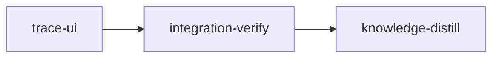

# Planning trace UI: the approved design

Implements: section_05

## Overview

`PLAN-planning-trace` built the planning trace and shipped its web screens from briefs written
before the design round finished. The user later approved a different design, the round-3
mockups. This plan reworks the shipped screens to that design:
- the spine gets one state glyph per row, turning amber on attention, the activity roundel for a
  running plan, short plan slugs, no Coverage or Findings rows, and a head naming the top
  attention item
- documents get a heading with Edit · Discuss · a real settle button, a scope standfirst, and a
  plan page with its pressure record, what it implements and its briefs
- reading text loses its chips; an opened passage says what covers it instead
- the chat turn footer lists the settled documents a turn put out of step
- Coverage becomes a page grouped by section, with count tiles that filter
- Findings becomes a triage page of cards grouped by run
- every screen is designed for phones

One change from the screenshots: no title or heading uses a serif. They are set in Inter, and only
running prose keeps the reading face.

The specification is `doc/plans/briefs/trace-screens-redesign/design.md`. The visual target is the
Firefox screenshots in `doc/plans/mockups/trace-screens-redesign/`; the mockups' HTML was lost. The
backend (the trace model, Settled lines, the findings ledger, the routes) does not change.

## Preconditions

- **`PLAN-planning-trace` is complete:** `trace-web-maps` merged, so `coverage-page.tsx` and
  `findings-page.tsx` exist. The `trace-ui` stage's `before_stage` checks this.
- **The working tree's uncommitted web changes are committed or dropped first.** When this plan was
  written, about 94 web files were modified, including a deleted spine `NextAction` and a reworked
  `ui/doc-heading.tsx`. The briefs name seams by role and tell workers to edit whichever file holds
  them.
- **The Playwright Firefox build** in `~/.cache/ms-playwright/firefox-*` on the host is needed for
  the Firefox checks. If `playwright-core` cannot launch it, the stage falls back to Chromium and
  records the gap.

## Execution diagram



## Stages

### trace-ui

One stage: every change is in `web/` and the territories are disjoint, so the Stage Necessity Test
gives no reason to split it.
- **Wave 1:** three sonnet workers write markup and behaviour: W1 the spine, W2 documents, W3 the
  Coverage and Findings pages.
- **Wave 2:** two opus workers using `frontend-design:frontend-design` set the look: V1 for
  documents and the spine, V2 for the pages. They check it in Firefox against the screenshots.

The stage removes contract tests that the approved design supersedes, which raises test-integrity
events. The stage's main agent removes them and files one `loom stage dispute-integrity` naming
them:
- in `web/src/plan/trace/trace.contracts.test.tsx`:
  - "frontier hints are at most five links"
  - "a sentence shows the plans covering the headings it rests on"
  - "a revised document links to its changes since settled"
  - "the turn footer lists settled plans downstream of a changed section"
- in `web/src/plan/trace/maps.contracts.test.tsx`:
  - "the coverage page marks uncovered headings and filters to them"
  - "focus keys walk why and how"
  - "the spine links Coverage and Findings with the open count"
- plus the unit tests of the deleted `frontier-hints.tsx`, `edge-chips.tsx` and `coverage-keys.ts`

The new contracts in `web/src/plan/trace/trace-ui.contracts.test.tsx` replace them. The surviving
old contracts keep passing unchanged:
- the spine settle words
- Mark settled posts path and hash
- the unresolved confirm
- dismiss needs a reason
- Plan this seeds the offer
- finding markup renders as text

### integration-verify

Full suites, a Firefox screen walk against every approved screenshot, a live settle walk, a review
round, and the `web/dist` rebuild.

### knowledge-distill

Records the shipped screens in `architecture/planning-trace.md` and `planner-feature-screens.md`,
the Inter title rule and the Firefox screenshot flag in `conventions/plan-web.md`, and closes the
lost-mockups mistake.

## Requirement to gate map

| Requirement | Gate |
| --- | --- |
| One glyph per spine row, amber on attention | contract `spine-row-names-changed-state`; IV screen walk |
| Roundel on a running plan | contract `running-plan-shows-roundel` |
| Short plan slugs | contract `plan-slugs-drop-feature-prefix` |
| No Coverage or Findings spine rows | contract `spine-has-no-map-rows` |
| Spine head names the top attention item | contract `spine-head-names-top-item` |
| Settle button carries the state; See what changed | contract `changed-document-offers-see-what-changed` |
| Settle confirm quotes open items | frozen old contract (unresolved); W2 unit tests; IV live walk |
| Scope standfirst | contract `scope-standfirst-links-its-stub` |
| Plan page blocks | contract `plan-page-lists-implements-and-briefs` |
| Opened passage coverage line | contract `opened-passage-says-what-covers-it` |
| Turn footer out-of-step block | contract `turn-footer-lists-out-of-step-documents` |
| Coverage tiles filter; rows expand | contracts `coverage-tiles-filter-rows`, `coverage-row-expands` |
| Findings grouped by run, decided lines | contract `findings-group-by-run-and-fold-decided` |
| Entry links on product overview and Run page | contract `overview-and-run-link-the-pages` |
| Titles in Inter | IV computed font-family check; V1 DESIGN.md Type step |
| Phone layouts | IV screen walk at 390 |
| Firefox verification | `plan-screens.sh --browser=firefox` (W1); V1, V2 and IV shots |

## Non-goals

- No backend, wire or route change.
- No change to the file-mode plan rail's running glyph. The roundel is used only in the spine.
- No brief descriptions on the plan page.

<!-- loom METADATA -->

```yaml
loom:
  version: 2
  auto_merge: null
  sandbox:
    enabled: true
    auto_allow: true
    allow_unsandboxed_escape: false
    excluded_commands: []
    filesystem:
      deny_read:
        - ~/.ssh/**
        - ~/.aws/**
        - ~/.config/gcloud/**
        - ~/.gnupg/**
      deny_write:
        - ../../**
      allow_write: []
    network:
      allowed_domains:
        - crates.io
        - index.crates.io
        - static.crates.io
        - registry.npmjs.org
      additional_domains: []
      allow_local_binding: false
      allow_unix_sockets: []
      allow_all_unix_sockets: false
    linux:
      enable_weaker_nested: false
    command_confinement: confined
  ratchet_files:
    - loom/maintainability-baseline.txt
    - doc/loom/knowledge/check-baseline.txt
  provision:
    - working_dir: web
      command: >-
        test ! -e .npmrc && test ! -L .npmrc && bun install --frozen-lockfile
        --ignore-scripts --backend=copyfile --config=/dev/null
  stages:
    - id: trace-ui
      name: Rework the trace screens to the approved design
      summary: >-
        Reworks the spine, document headings, plan pages, opened passages, the chat turn
        footer, and the Coverage and Findings pages to the approved round-3 design, with
        Inter titles, and checks every screen in Firefox.
      description: |
        Read doc/plans/briefs/trace-screens-redesign/design.md in full and look at the screenshots in doc/plans/mockups/trace-screens-redesign/ before dispatch. Pass design.md and each worker's brief path to that worker.
        PATHS: working_dir is the worktree root; acceptance enters web/ with cd web.
        FIRST: read the merged seams the briefs name: web/src/plan/feature/spine.tsx, spine-model.ts, spine-row.tsx; web/src/plan/trace/*.tsx and model.ts; web/src/plan/concept/page-heading.tsx, sentence.tsx, passage.tsx; web/src/plan/ui/doc-heading.tsx; web/src/plan/feature/document-page.tsx, run-page.tsx, gaps.tsx; web/src/plan/chat/turn-footer.tsx; web/src/plan/header/activity.tsx and popover.tsx; web/src/plan/ui/DESIGN.md. If a seam moved, tell the worker which file holds it and record a loom memory decision.
        KNOWLEDGE: architecture/planning-trace.md (the browser screens), architecture/planner-feature-screens.md (Spine), architecture/planner-web-shell.md, conventions/plan-web.md.
        PUBLIC SURFACE for the contract session: write only web/src/plan/trace/trace-ui.contracts.test.tsx (top-level it() calls; split into trace-ui-pages.contracts.test.tsx only if it passes 400 lines, and name both in the contracts below). Copy the harness (matchMedia stub, ChatPanel mock, fetch stub serving /api/trace/demo from web/src/plan/api/fixtures/trace.json, /api/settle, /api/settled-version, /api/doc, /api/concept/*, /api/findings/status, the runOffer mock) from trace.contracts.test.tsx and maps.contracts.test.tsx; copy, never import. Adjust the trace fixture inside the test where a scenario needs a state the fixture lacks. Read trace.json and the checklist fixture to pick names. The spine is the navigation named "Feature documents".
        - "a changed document's spine row names its state": a section whose settle is revised has a spine link whose name matches /changed since you settled it/i and holds exactly one element with a data-glyph attribute.
        - "a running plan's spine row shows the activity roundel": a plan whose progress is running has a spine link containing an .aurora-roundel element and no .activity-glyph__led element (the LiveDot from ui/activity-glyphs.tsx).
        - "plan slugs drop the feature prefix in the spine": a plan whose slug is "<feature>-<rest>" shows a spine link whose visible text contains "<rest>" and not "<feature>-<rest>", with the full slug in its title attribute.
        - "the spine has no Coverage or Findings rows": inside the spine no link's name matches /^Coverage\b/ or /^Findings\b/.
        - "the spine head names the top attention item": with a frontier whose first gap is a revised section titled T, the spine shows the text "T changed since you settled it." and exactly one link named "Review T" pointing to that section's summary page; no other frontier gap is named.
        - "a changed document offers See what changed": a revised section's summary page has a button whose name matches /changed since you settled it/i and a link or button named "See what changed"; no element is named "Changes since settled".
        - "the scope shows as a standfirst linking its stub": a section summary page shows its vision row text inside the page heading and a link whose name matches /from the vision/i pointing at the vision.
        - "a plan page lists what it implements and its briefs": a plan summary page has a region or list named "What it implements" holding a heading the plan covers, and a list named "Briefs" holding every bundle file name.
        - "an opened passage says what covers it": opening a sentence whose passage is a covered heading shows "Covered by" with a link to the covering plan; a passage of an uncovered heading shows "Not covered by any plan".
        - "the turn footer lists documents now out of step": TurnFooter for a turn that changed a section shows "Now out of step with what you settled" and, below it, the title of a settled plan covering that section.
        - "coverage tiles filter the heading rows": on /f/demo/coverage, buttons named /Not covered/ and /All headings/ carry aria-pressed; pressing Not covered leaves only the uncovered headings' row buttons, and aria-pressed follows.
        - "a coverage row expands to why, how and findings": a covered heading's row button has aria-expanded false; activating it sets true and shows "Why", "How" and "Findings" with the covering plan's short slug.
        - "findings group by run and fold decided ones": on /f/demo/findings, a group heading matching /^Run of/ precedes a heading "Reviews"; a dismissed finding shows "Dismissed:" with its reason on one line and no Dismiss button.
        - "the product overview links Coverage and the Run page links Findings": /f/demo/product has a link named /^Coverage\b/ to /f/demo/coverage; /f/demo/run has a link whose name matches /Findings/ and /\b\d+ open\b/ to /f/demo/findings.
        Write no other contract.
        SUPERSEDED TESTS: after the contract session, the main agent deletes the seven superseded contract tests the plan lists (trace.contracts.test.tsx and maps.contracts.test.tsx) and their now-unused helpers, then files ONE loom stage dispute-integrity naming every resulting event, with the reason "superseded by the approved trace UI design; replaced by trace-ui.contracts.test.tsx". Workers' deletions of unit tests for deleted modules belong in the same filing. Never edit the surviving frozen contracts.
        WORKERS (two waves):
        | Worker | Role | Tier | Files owned | Shared context | Brief path |
        | ------ | ---- | ---- | ----------- | -------------- | ---------- |
        | W1 | Spine glyphs, roundel, short slugs, map rows removed, SpineHead, frontierHead, Firefox flag (wave 1) | sonnet | web/src/plan/feature/spine.tsx; web/src/plan/feature/spine-model.ts; web/src/plan/feature/spine-model.test.ts; web/src/plan/feature/spine-row.tsx; web/src/plan/trace/model.ts; web/src/plan/trace/model.test.ts; web/src/plan/trace/spine-head.tsx; web/src/plan/trace/frontier-hints.tsx; web/src/plan/trace/spine-marks.test.tsx; web/scripts/plan-screens.mjs; scripts/plan-screens.sh | design.md | doc/plans/briefs/trace-screens-redesign/trace-ui/w1-spine.md |
        | W2 | Settle control and confirm, See what changed, scope standfirst, chips, plan page, passage coverage, turn footer (wave 1) | sonnet | web/src/plan/trace/settle-control.tsx; web/src/plan/trace/settle-flow.ts; web/src/plan/trace/settled-changes.tsx; web/src/plan/trace/stub-panel.tsx; web/src/plan/trace/scope-line.tsx; web/src/plan/trace/stub-text.ts; web/src/plan/trace/edge-chips.tsx; web/src/plan/trace/impact-rows.tsx; web/src/plan/trace/plan-extras.tsx; web/src/plan/trace/passage-coverage.tsx; web/src/plan/trace/doc-model.ts; web/src/plan/trace/doc-model.test.ts; web/src/plan/trace/components.test.tsx; web/src/plan/trace/settle-flow.test.tsx; web/src/plan/concept/page-heading.tsx; web/src/plan/concept/sentence.tsx; web/src/plan/concept/passage.tsx; web/src/plan/feature/document-page.tsx; web/src/plan/chat/turn-footer.tsx | design.md | doc/plans/briefs/trace-screens-redesign/trace-ui/w2-documents.md |
        | W3 | Coverage and Findings pages, help text, entry links (wave 1) | sonnet | web/src/plan/trace/coverage-page.tsx; web/src/plan/trace/coverage-model.ts; web/src/plan/trace/coverage-model.test.ts; web/src/plan/trace/coverage-keys.ts; web/src/plan/trace/findings-page.tsx; web/src/plan/trace/findings-cards.tsx; web/src/plan/trace/findings-model.ts; web/src/plan/trace/findings-model.test.ts; web/src/plan/trace/pages.test.tsx; web/src/plan/help/maps-help.tsx; web/src/plan/help/topics.ts; web/src/plan/help/shortcuts.tsx; web/src/plan/feature/run-page.tsx; web/src/plan/feature/gaps.tsx | design.md | doc/plans/briefs/trace-screens-redesign/trace-ui/w3-pages.md |
        | V1 | Look of the spine, heading, plan page, passage line and turn footer; DESIGN.md; Firefox shots (wave 2) | opus | web/src/plan/trace/trace.css; web/src/plan/feature/spine.css; web/src/plan/ui/doc-heading.css; web/src/plan/ui/DESIGN.md | design.md, W reports | doc/plans/briefs/trace-screens-redesign/trace-ui/v-look.md |
        | V2 | Look of the Coverage and Findings pages; Firefox shots (wave 2) | opus | web/src/plan/trace/maps.css; web/src/plan/trace/maps-columns.css; web/src/plan/trace/maps-findings.css | design.md, W reports | doc/plans/briefs/trace-screens-redesign/trace-ui/v-look.md |
        Spawn W1, W2 and W3 in one message as loom-software-engineer. W1 deletes chipsFor from model.ts while W2 deletes edge-chips.tsx, so tsc is only expected green once all three return. If a W reports an edit needed in a file it does not own (for example a standfirst prop on web/src/plan/ui/doc-heading.tsx), apply it yourself (small-change rule) or give it to a fresh sonnet worker. After wave 1 returns and tsc and vitest run src/plan are green apart from the superseded tests, spawn V1 and V2 in one message as loom-senior-software-engineer (opus, effort high). Their prompts say to invoke frontend-design:frontend-design first and pass all three W reports. V2's DESIGN.md lines and both V markup change lists come back to you; apply them or give them to one fresh sonnet worker.
        FIX ROUNDS: visual misses go to a fresh opus worker with frontend-design:frontend-design; others one tier up; after a second failure on one item, loom-advisor diagnoses first.
        AFTER THE WORKERS: (cd web && node_modules/.bin/oxfmt). wc -l every changed web file and split any above 400. Restore web/dist before the final review round (integration-verify rebuilds it). The gate is one loom check trace-ui beside the final loom-code-reviewer round.
        Use parallel subagents and skills to maximize performance.
        MEMORY: record mistakes, decisions and surprises with loom memory immediately, subagents too; NEVER Claude Code auto-memory.
      dependencies: []
      parallel_group: null
      acceptance:
        - cd web && node_modules/.bin/tsc -b --noEmit
        - cd web && node_modules/.bin/oxlint --deny-warnings
        - cd web && node_modules/.bin/oxfmt --check
        - cd web && node_modules/.bin/vitest run src/plan
      setup: []
      files:
        - web/src/plan/**
        - web/scripts/plan-screens.mjs
        - scripts/plan-screens.sh
      auto_merge: null
      working_dir: "."
      stage_type: standard
      artifacts:
        - web/src/plan/trace/spine-head.tsx
        - web/src/plan/trace/passage-coverage.tsx
        - web/src/plan/trace/plan-extras.tsx
        - web/src/plan/trace/scope-line.tsx
      wiring:
        - source: web/src/plan/feature/spine.tsx
          pattern: <SpineHead
          description: the spine draws its head from the trace frontier
          literal: true
        - source: web/src/plan/concept/passage.tsx
          pattern: PassageCoverage
          description: an opened passage says what covers it
          literal: true
        - source: web/src/plan/concept/page-heading.tsx
          pattern: PlanExtras
          description: a plan's summary page draws its pressure record, implements list and briefs
          literal: true
        - source: scripts/plan-screens.sh
          pattern: --browser=
          description: the screenshot script can shoot Firefox
          literal: true
      reachable:
        - symbol: SpineHead
          from: Spine
          description: the spine head is drawn in the spine
        - symbol: PassageCoverage
          from: ConceptRoute
          description: the passage coverage line reaches the reading column
        - symbol: ScopeLine
          from: ConceptRoute
          description: the scope standfirst is drawn on summary pages
      before_stage:
        - command: test -f web/src/plan/trace/coverage-page.tsx
          description: PLAN-planning-trace's trace-web-maps is merged
      after_stage:
        - command: rg -qi 'roundel' web/src/plan/ui/DESIGN.md
          description: the design record covers the spine roundel
        - command: "! test -e web/src/plan/trace/edge-chips.tsx"
          description: sentence chips are gone
        - command: "! test -e web/src/plan/trace/frontier-hints.tsx"
          description: the frontier hints list is gone
      context_ceiling_tokens: null
      sandbox: {}
      ultracode: false
      implementers:
        - claude
      subagent_timeout_secs: 900
      skills:
        - loom-react
        - loom-typescript
      contracts:
        - id: spine-row-names-changed-state
          file: web/src/plan/trace/trace-ui.contracts.test.tsx
          test: a changed document's spine row names its state
          cwd: web
          scenario: the product route with a section whose settle is revised
          rejects: a row that adds a second mark beside its glyph, or one that drops the state word
        - id: running-plan-shows-roundel
          file: web/src/plan/trace/trace-ui.contracts.test.tsx
          test: a running plan's spine row shows the activity roundel
          cwd: web
          scenario: the spine of a feature with a running plan
          rejects: a running row that keeps the pulsing live dot
        - id: plan-slugs-drop-feature-prefix
          file: web/src/plan/trace/trace-ui.contracts.test.tsx
          test: plan slugs drop the feature prefix in the spine
          cwd: web
          scenario: a plan slug starting with the feature name
          rejects: rows that show the full slug, or lose it from the tooltip
        - id: spine-has-no-map-rows
          file: web/src/plan/trace/trace-ui.contracts.test.tsx
          test: the spine has no Coverage or Findings rows
          cwd: web
          scenario: the spine of the fixture feature with open findings
          rejects: a spine that keeps the trace-web-maps rows
        - id: spine-head-names-top-item
          file: web/src/plan/trace/trace-ui.contracts.test.tsx
          test: the spine head names the top attention item
          cwd: web
          scenario: a frontier of several gaps whose first is a revised section
          rejects: a head that lists every gap, or one that ignores the frontier
        - id: changed-document-offers-see-what-changed
          file: web/src/plan/trace/trace-ui.contracts.test.tsx
          test: a changed document offers See what changed
          cwd: web
          scenario: the summary page of a revised section
          rejects: a settle state shown as a passive pill with no way to see the changes
        - id: scope-standfirst-links-its-stub
          file: web/src/plan/trace/trace-ui.contracts.test.tsx
          test: the scope shows as a standfirst linking its stub
          cwd: web
          scenario: a section summary page whose vision row is known
          rejects: a scope hidden in a disclosure or a boxed panel below the actions
        - id: plan-page-lists-implements-and-briefs
          file: web/src/plan/trace/trace-ui.contracts.test.tsx
          test: a plan page lists what it implements and its briefs
          cwd: web
          scenario: a plan summary page with a brief bundle and one covered heading
          rejects: a plan page that lists briefs without the headings it implements, or drops bundle files
        - id: opened-passage-says-what-covers-it
          file: web/src/plan/trace/trace-ui.contracts.test.tsx
          test: an opened passage says what covers it
          cwd: web
          scenario: opening a sentence on a covered heading, then one on an uncovered heading
          rejects: chips after every sentence at rest, or a passage silent about an uncovered heading
        - id: turn-footer-lists-out-of-step-documents
          file: web/src/plan/trace/trace-ui.contracts.test.tsx
          test: the turn footer lists documents now out of step
          cwd: web
          scenario: a turn that changed a section a settled plan covers
          rejects: a footer that lists only the changed files
        - id: coverage-tiles-filter-rows
          file: web/src/plan/trace/trace-ui.contracts.test.tsx
          test: coverage tiles filter the heading rows
          cwd: web
          scenario: the coverage route, then the Not covered tile
          rejects: tiles that only count, or a filter that keeps covered headings
        - id: coverage-row-expands
          file: web/src/plan/trace/trace-ui.contracts.test.tsx
          test: a coverage row expands to why, how and findings
          cwd: web
          scenario: activating a covered heading's row
          rejects: rows whose chevron toggles but opens nothing
        - id: findings-group-by-run-and-fold-decided
          file: web/src/plan/trace/trace-ui.contracts.test.tsx
          test: findings group by run and fold decided ones
          cwd: web
          scenario: the findings route with a run finding, a review finding and a dismissed finding
          rejects: one flat list, or decided findings drawn as full cards with live actions
        - id: overview-and-run-link-the-pages
          file: web/src/plan/trace/trace-ui.contracts.test.tsx
          test: the product overview links Coverage and the Run page links Findings
          cwd: web
          scenario: the product overview and the Run page of the fixture feature
          rejects: pages reachable only by typing their address once the spine rows are gone
    - id: integration-verify
      name: Integration Verification
      summary: >-
        Runs the full suites, walks every reworked screen in Firefox against the approved
        screenshots, settles and edits a document live, reviews the changes and rebuilds
        the embedded web bundle.
      description: |
        Final verification of the planning trace UI plan. Verify FUNCTIONAL INTEGRATION, not just tests passing. NEVER Claude Code auto-memory.
        CONTEXT: read doc/plans/briefs/trace-screens-redesign/design.md and integration-verify.md, loom memory show --all, doc/loom/knowledge/INDEX.md and only the relevant sections.
        PATHS: the session starts in loom/ (working_dir). Commands the brief gives "from the worktree root" start with cd "$(git rev-parse --show-toplevel)"; acceptance commands run from loom/ and reach web/ with cd ../web.
        Follow integration-verify.md in order: build, a diagnostic loom check, the Firefox preflight, the screen walk against every approved screenshot, the live settle walk, fixes each followed by a dist rebuild, the final loom check against the rebuilt bytes, the final parallel loom-code-reviewer round, and the commits.
        BUILD & TEST (zero tolerance): the first loom check integration-verify is diagnostic; a fix round re-checks the failed criteria with --criterion <n>. After the last fix and its dist rebuild, run the full loom check integration-verify once more: that run is the acceptance, and nothing but *.md prose may change after it and the final review round. Every finding is fixed or disputed, never deferred.
        SUGGESTIONS: weigh every pending reviewer suggestion; resolve each one implemented with loom memory resolve <id> --outcome implemented --reason <what changed>.
        WEB DIST: after every fix, rebuild web/dist (cd ../web && bun run build, from loom/) and the binary (cargo build). After the final round, commit the code fixes, then web/dist last as chore(web).
        Record discoveries to loom memory, including stale knowledge: loom memory note "stale-knowledge: ...".
      dependencies:
        - trace-ui
      parallel_group: null
      acceptance:
        - command: cargo test --all-targets --no-fail-fast
          timeout_secs: 3600
        - cargo clippy --all-targets -- -D warnings
        - cargo fmt --check
        - cargo build
        - >-
          cd ../web && node_modules/.bin/tsc -b --noEmit && node_modules/.bin/oxlint
          --deny-warnings && node_modules/.bin/oxfmt --check && node_modules/.bin/vitest run
        - cd ../web && node scripts/bundle-check.mjs
        - >-
          cd ../web && d=$(mktemp -d "${TMPDIR:-/tmp}/dist.XXXXXX") &&
          node_modules/.bin/vite build --outDir "$d" --emptyOutDir --logLevel error && diff -r "$d" dist
      setup: []
      files:
        - ../web/dist/**
      auto_merge: null
      working_dir: loom
      stage_type: integration-verify
      artifacts: []
      wiring: []
      context_ceiling_tokens: null
      sandbox: {}
      ultracode: false
      implementers:
        - claude
      skills:
        - loom-react
        - loom-typescript
    - id: knowledge-distill
      name: Knowledge Distillation
      summary: >-
        Records the reworked trace screens, the Inter title rule and the Firefox
        screenshot flag in the knowledge base, and closes the lost-mockups mistake.
      description: |
        Curate all stage memories into permanent knowledge. NEVER Claude Code auto-memory. SINGLE-AGENT: do NOT spawn subagents.
        START with loom memory pending --group; read the plan, doc/plans/briefs/trace-screens-redesign/design.md, and the knowledge sections it touches: architecture/planning-trace.md, architecture/planner-feature-screens.md (Spine), architecture/planner-web-shell.md, conventions/plan-web.md and mistakes/planner-design-brainstorm.md.
        CORRECTIONS FIRST: apply every stale-knowledge memory with loom knowledge replace-section. Known stale claims after this plan: the browser screens in architecture/planning-trace.md (frontier hints list, sentence chips, the stub panel, Coverage lanes and h/l focus keys, the Coverage and Findings spine rows); the spine's row marks and running glyph in planner-feature-screens.md "Spine"; any claim that the activity roundel appears only in the header pill.
        NEW KNOWLEDGE: in conventions/plan-web.md, the title rule (titles and headings in Inter, the reading face for running prose only) and scripts/plan-screens.sh --browser=firefox as the way to check screens in the user's browser. Set the Fix line of mistakes/planner-design-brainstorm.md "Approved trace mockups were never committed and the plan ran on the superseded web briefs" to this plan with replace-section.
        TIER ROUTING: about 40 lines or fewer inline in the tier-1 file; larger via loom knowledge update <category>/<slug> with a 2-4 line tier-1 summary and link.
        SUGGESTIONS: record every unimplemented reviewer suggestion in concerns or the topic it belongs to, then resolve it.
        RECEIPTS: every taken memory gets loom memory resolve right after the write; finish with loom memory pending --strict.
      dependencies:
        - integration-verify
      parallel_group: null
      acceptance:
        - loom knowledge check --strict --baseline doc/loom/knowledge/check-baseline.txt
        - loom memory pending --strict
      setup: []
      files:
        - doc/loom/knowledge/**
      auto_merge: null
      working_dir: "."
      stage_type: knowledge-distill
      artifacts: []
      wiring: []
      before_stage:
        - command: "! rg -qF -- '--browser=firefox' doc/loom/knowledge/conventions/plan-web.md"
          description: the conventions do not yet record the Firefox screenshot flag
      after_stage:
        - command: rg -qF -- '--browser=firefox' doc/loom/knowledge/conventions/plan-web.md
          description: the conventions record the Firefox screenshot flag
      context_ceiling_tokens: null
      sandbox: {}
      ultracode: false
      implementers:
        - claude
```

<!-- END loom METADATA -->
