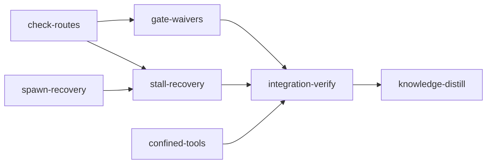

# Plan: Autonomous recovery for five classes of stage stops

## Overview

Five classes of stop parked a stage for a human during plans 05-08 although no credential,
host install or decision only a person can make was involved. This plan gives each an
autonomous route through loom's existing machinery (disputes, audited amendments, adjudication,
bounded retry) or a self-repair, and makes every route that genuinely ends at a person reach a
readable block with a precise reason instead of a loop:

- **G1, gate checks with no route.** Every goal-backward, after-stage and re-verification gap
  carries an address (`[reachable 1]`, `[stage-a/reachable 0]`); `loom stage dispute-criteria`
  and `loom stage amend` accept every list; integration-verify disputes a completed stage's
  wiring or reachable check with `--owner`; loom's own gates (`unwired`, `duplicates`, an
  errored impact run) are disputed with `--field gate` and waived by an audited verdict.
- **G2, the block guard.** `loom stage block` is refused while any failing check, open finding
  or integrity event has a dispute route; the adjudicator's new `needs-person` verdict blocks a
  stage with `needs a host install: <what>` (or a credential, or a decision).
- **G4, tools hidden by confinement.** Confined commands see the install roots of the tools they
  call (Bun global, npm and nvm prefixes, uv tool, pipx, Homebrew kegs, cargo install), on Linux
  bubblewrap and macOS Seatbelt, without exposing the home directory or any credential path; a
  tool still hidden, or missing on the host, is reported as such.
- **G5, a failed judge spawn.** Spawn failures are classified (transient, repairable,
  permanent); stale hook scripts are reinstalled when the daemon is current; a daemon whose
  binary was replaced restarts itself onto the installed binary; retries are bounded, survive
  restarts and never start a second judge; a permanent failure escalates with its full error.
- **G7, a stalled scheduler.** Resolved-merge verification moves off the scheduler thread into
  a host job (the confirmed cause of plan 05's 187 s stall); every scheduler-thread wait is
  bounded and named; the status names the blocking operation and its age; a scheduler stalled
  past every bound is restarted by the daemon itself, with a restart budget.

## Goals

- Every stop in the five groups ends either in an autonomous route or, for a credential, a host
  install or a decision only a person can make, in a block whose reason names exactly what is
  needed. No route loops: each has a budget and a terminal state.
- Every new CLI value, dispute kind, verdict and state edge is reachable from its entry point
  and covered by a contract that rejects a named wrong implementation.
- General loom features for any project on Linux and macOS. Nothing specific to this
  repository, machine or user.
- Non-goals: operator-shell drivers (agents or people driving loom); backwards compatibility or
  migrations (loom is unreleased); new configuration keys; a supervisor process outside the
  daemon.

## Run order and sibling plans

This plan runs after the feat-planner plans 08-11 have merged (08 merged at `806f5982`; 09 is
executing; 10 and 11 are queued) and after the live-test-lane plan
(`doc/plans/PLAN-live-test-lane.md`) has merged. Every file this plan edits was checked against
those plans' stage `files:` lists and worker tables; the live plan's YAML and briefs state the
tree this plan starts from.

| Sibling stage | What it leaves in the tree | How this plan handles it |
| --- | --- | --- |
| live-test-lane `confinement-hardening` | `CommandConfinement::Inherit` replaced by a `#[cfg(test)]` `TestUnconfined`; `allow_unsandboxed_escape` gone; `apply_confined_host_environment`; containment revision `host-os-boundary-v10` | nothing here names `Inherit` or `allow_unsandboxed_escape`; `confined-tools` bumps the revision to v11 |
| live-test-lane `test-escape-policy` | `process::sandbox_probe::{Facility, require_facility}`, `LOOM_TEST_FACILITIES`, the escape lint | new tests that need a facility guard with `require_facility` (`common.md`); no criterion here uses an escape flag |
| live-test-lane `live-gate-and-boundary` | `confine_host.rs` split: the Linux `platform_command`, `bind_read_roots`, `bind_resolver_target` in `confine_bwrap.rs`, the macOS `seatbelt_path_rules`, `platform_command` in `confine_seatbelt.rs`; `read_roots`, `writable_roots`, `environment_path` stay; `wrap(original, tree, network, live: Option<&LiveBoundary>)`; `prepare_live`, `run_live_with_timeout` | `confined-tools` starts only after the split (`before_stage`) and edits the post-split files |
| live-test-lane `live-profile` | `Commands::Live` in `cli/types.rs` (about 357 lines: P2 moves the inline test module to `cli/types_tests.rs` first); `dispatch`'s exact ledger row lowered; `Stage.live` | `spawn-recovery` edits `dispatch_run` only and keeps `types.rs` at or under 400 |
| live-test-lane `live-checks` | `Live` in `CriterionField`, `AmendmentField`, `DisputeField`, `AmendField`; the `live` check in `run_checks`; `live::completion::block_refusal` called from `control_block.rs`; `JobKind::Live`; `HostJobRequest.live`; `--field live` in the plan-writer doctrine; a Merge session's `check` admitted only with `live` and only for the stage it resolves (`relay/matrix_host.rs`, `inbox_drain/check.rs`); the merge signal's `## Live Entries` section (`signals/merge_live.rs`), which has a resolver of a stage with required entries run `loom check --live` before `--resolved` | `check-routes` and `spawn-recovery` start only after it merged (`before_stage`: `pub fn block_refusal(` in `src/live/completion.rs`); the new values go beside `Live`; the block guard keeps the live rule (Decision 9); `JobKind::Land` sits beside `Live`, and its `live` check reads the receipt the resolver recorded (stall-recovery W2) |
| feat-planner 09-11 | `src/plan_server/**`, `src/planning/**`, `web/**` | disjoint; this plan changes no web file and no planning-server file |

Files both plans edit (a live-plan worker, then this plan's stage and worker):

| File | Live plan | This plan | Rule |
| --- | --- | --- | --- |
| `src/verify/criteria/confine.rs` | H2a (v10, `TestUnconfined`), B1 (`prepare(.., live)`, `prepare_live`) | confined-tools W1 | `exposed_roots`; v10 becomes v11; `prepare_live` unchanged |
| `src/verify/criteria/confine_host.rs` | B1 (split, `wrap(.., live)`, facility variable) | confined-tools W1 | tool roots in `read_roots`; `wrap` returns `Wrapped`, whose roots include a live boundary's paths |
| `src/verify/criteria/confine_seatbelt.rs` | B1 (new: `seatbelt_path_rules`, live rules) | confined-tools W1 | a file root gets a `literal` rule; live rules untouched |
| `src/verify/criteria/confine_host_tests.rs`, `confine_cargo_home_tests.rs` | H2a, B1 (`wrap(.., None)`) | confined-tools W1 | the `wrap` call sites move to the `Wrapped` fields; no assertion changes |
| `src/verify/criteria/confine_git_tests.rs` | B1 (`wrap(.., None)`) | confined-tools W1 | the one `wrap` call site moves to the `Wrapped` fields; no assertion changes; no other worker of the stage owns it |
| `src/verify/criteria/confine_host_tool_tests.rs` | H2a | confined-tools W1 | new tests; the two `wrap` call sites move to the `Wrapped` fields; existing assertions unchanged |
| `src/verify/criteria/tests/cache_tests.rs`, `tests/cache_contract_tests.rs` | H2a (`Inherit` to `TestUnconfined`) | confined-tools W1 | `TestUnconfined` kept; an assertion the revision change alters is a filed TI-edit |
| `src/verify/criteria/executor.rs` | B1 (`run_live_with_timeout`) | confined-tools W2 | diagnosis in `run_prepared_with_timeout`, which live runs share |
| `src/verify/criteria/mod.rs` | B1 (live re-exports) | confined-tools foundation | two module lines |
| `src/verify/goal_backward/truths.rs` | H2a (test-only `TestUnconfined`) | confined-tools W2 | gap text only |
| `src/process/mod.rs` | H1 (three re-exports) | stall-recovery C1 (one line), W1 | at or under 400 |
| `src/sandbox/config/preflight.rs` | H2b (escape term dropped) | spawn-recovery W2 | typed kinds; the field stays gone |
| `src/cli/types.rs` | P2 (`Commands::Live`) | spawn-recovery W1 | hidden `--take-over` (about four lines); ends near 361, under 400 with no condensing |
| `src/cli/dispatch.rs` | P2 (`dispatch` exact row, `dispatch_project_or_live`), R1 (`run_check`) | spawn-recovery W1 | `dispatch_run` only; `dispatch` and `maintainability-baseline.txt` untouched |
| `src/host_verify/mod.rs`, `child.rs`, `apply.rs`, `submit.rs` | R1 (`JobKind::Live`, `child_live`, submit rules) | stall-recovery W2 | `Land` arms beside `Live`; `child.rs` at or under 400; `Check` and `Live` refused behind `Land` |
| `src/orchestrator/signals/merge.rs` | R2 (one `merge_live::format_live_section` call after the task section; 397 lines) | stall-recovery W2 | step 5's `--resolved` wording only; the live section call stays; at or under 400 |
| `src/orchestrator/signals/mod.rs` | R2 (`mod merge_live;`), the live-checks contract scaffold (`live_signal_contract_tests`) | gate-waivers W2 | one more module line (`audit_section`); the live plan's lines stay |
| `src/relay/payload.rs` | R1 (`HostJobRequest.live`) | check-routes W3 | owner decode tests only; at or under 400 |
| `src/models/dispute.rs` | R3 (`CriterionField::Live`) | check-routes W0, gate-waivers W0 | `Live` moves with `CriterionField` to `dispute_field.rs` |
| `src/cli/types_stage_disputes.rs`, `src/cli/types_stage_amend.rs` | R3 (`DisputeField::Live`, `AmendField::Live`) | check-routes W0, gate-waivers W0 | new values after `Live` |
| `src/plan/amendment.rs` | R3 (`AmendmentField::Live`, `ParsedAmendmentValue::Live`) | check-routes W0, gate-waivers W2 | `Live` kept |
| `src/plan/amendment_fields.rs`, `amendment_catch_up.rs` | R3 | check-routes W2 | `Live` arms kept; the completed-stage rule (Decision 3) covers `Live` too |
| `src/plan/amendment/journal.rs` | R3 | check-routes W2, stall-recovery W1 | `live` name kept |
| `src/models/stage/dispute_budgets.rs` | R3 | gate-waivers W0 | `Live` spends the criterion budget |
| `src/stage_service/dispute.rs` | R3 (`stage.live.len()`) | check-routes W3 | `refusal` keeps the live length |
| `src/stage_service/control_block.rs`, `control_block_agent_tests.rs` | R2 (`latest_failing_labels`, the live refusal, two live tests) | gate-waivers W3 | the guard calls `block_refusal` for `live`; the live tests keep passing |
| `src/commands/stage/complete_verification.rs` | R2 (`live` check in `run_checks`) | check-routes W1, gate-waivers W2 | `live` is a plan list, never waivable; `run_checks` under 50 lines |
| `src/verify/goal_backward/mod.rs`, `src/daemon/protocol_debug.rs` | R3 | check-routes W1, W3 | `Live` arms kept |
| `src/orchestrator/adjudication/verdict.rs`, `prompt.rs`, `apply.rs` | R3 | check-routes W4, gate-waivers W1 | a `Live` dispute amends `live` only and keeps its `criterion_entry` briefing |
| `src/orchestrator/adjudication/apply_accept.rs`, `plan_patch.rs`, `prompt/criterion_entry.rs` | R3 | check-routes W4 | `Live` arms kept |
| `../skills/loom-plan-writer/SKILL.md` | R4 (Sections 6, 8) | check-routes W5, gate-waivers W4 (Section 9) | only the named Section 9 sentences; the field list includes `live` |
| `../skills/loom-plan-writer/references/v2-contracts.md` | R4 (Section 5 "Live entries" row, `--field live` in "Disputes") | check-routes W5, gate-waivers W4 | R4's row and `--field live` kept |
| `../skills/loom-plan-writer/references/verification-rules.md` | R4 (rule 4) | check-routes W5 | the amend field list includes `live` |
| `README.md`, `doc/loom/knowledge/**` | knowledge-distill | knowledge-distill | this distill rewrites the live plan's sections only where this plan changed them |

Overlaps through a `files:` glob only, with no worker editing the file on one side:
`src/models/stage/{sandbox_config,methods_tests,types,defaults,methods}.rs`,
`src/orchestrator/terminal/native/{build_cache,tests_capsule_bwrap}.rs`,
`src/sandbox/config/preflight/tests.rs`, `src/host_verify/{runner,child_live}.rs`,
`src/commands/stage/criterion_output.rs`, `../skills/loom-plan-writer/references/sandbox.md`
and the rest of `src/orchestrator/adjudication/**`.

Every brief says: locate each seam by symbol (`loom map --outline`, `--find-all`) before
editing; line numbers are advisory; record a moved name in `loom memory`.

## Decisions

1. **Addresses, not new commands, for plan-authored checks.** `CriterionField` gains
   `reachable`, `artifacts`, `dead-code-check`, `regression-test` and `after-stage`; each gap is
   labelled `[<list> <n>]` (singletons use index 0), produced by one helper
   (`models::dispute::gap_prefix`). A reachable graph that cannot be built yields one
   `[reachable n] could not be evaluated` gap per entry instead of an error, so it is disputable.
2. **The owner route.** Integration-verify re-runs completed stages' wiring and reachable
   checks (`aggregated_wiring`, `reverify_reachable`); their gaps read `[<owner>/<list> <n>]`.
   `loom stage dispute-criteria integration-verify --owner <stage> --field wiring|reachable
   --criterion-index <n>` files against the owner's list. Only an integration-verify stage
   may name an owner; the owner must be `Completed`; the filer's criterion budget is spent and
   only the filer moves to `NeedsAdjudication`. An accepted verdict amends the OWNER's
   definition; the verdict cannot choose the stage.
3. **Amending a completed stage keeps it completed.** `sync_stage_from_definition` clears
   `completed_commit` only for a stage that is not `Completed`: clearing it on a merged
   predecessor would fail every dependent's merged-dependency check
   (`verify/transitions/state.rs`, "marked merged but has no completed_commit").
4. **Owner amendments carry a composite dispute id** `"<filer>/<dispute>.<k>"`. The amendment
   journal's idempotency key is `(stage_id, dispute_id)`; an owner's own dispute `n` is keyed
   `"n.k"`, so a bare `"n.k"` from the filer's dispute would be skipped as already applied.
5. **Singletons.** `dead_code_check` and `regression_test` are addressed at index 0; insert only
   when absent, replace and delete only when present. An artifact amendment is a relative path
   with no `..` component.
6. **A reachable dispute amends `reachable` only.** Deleting an entry requires the verdict to
   cite a test that executes the path (a frozen contract, a test function or a wiring test);
   otherwise the judge replaces the entry with one the graph resolves, or rejects.
7. **Gate waivers for loom's own gates.** `WAIVABLE_GATES = ["unwired", "duplicates",
   "impact-tests"]`. `--field gate --gate <label>` files `DisputeKind::Gate` through the file-
   dispute route for plan versions 1 and 2, only for a label that failed in the current
   session's latest signed completion (`impact-tests` only when the run named no failing test),
   with its own budget of 3. An accepted verdict (`plan_patch: {"waive": [...]}`) records a
   `GateWaiver { gate, dispute_id, reason, loom_version, waived_at }` in the stage's flattened
   tally; completion still runs the gate and prints the waiver; integration-verify's signal
   lists every waiver and every plan amendment of the plan for its reviewers.
8. **`needs-person`.** A verdict for every dispute kind:
   `{"verdict": "needs-person", "need": "host-install"|"credential"|"decision", "what": "...",
   "reasoning", "citations"}`. Apply blocks the stage through `stage_service::apply_block` with
   the reason `<needs a host install|needs a credential|needs a decision>: <what> (dispute <n>;
   ...)` and closes the stage's other open disputes. This needs one new state edge,
   `NeedsAdjudication -> Blocked`; no new state.
9. **The block guard reads routes from loom's own records**: the current session's latest
   trusted checkpoint (every failing label mapped to its route), and for plan version 2 the open
   review findings and unaccepted integrity events. A label with no route, or a record that
   cannot be read, never refuses a block. The `live` label's route is the live-test-lane plan's
   `live::completion::block_refusal`, called, never re-derived: `None` (every failing required
   entry could not run for want of the live credential) is no route, so that block is allowed
   directly; `Some` names `loom check --live` or `--field live`.
10. **Tool roots are computed per command**, from the program and the first word of every
    simple command of a `sh -c` script (at most 16 words, 8 symlink hops, 3 interpreters), by
    the rules in `confined-tools/c1-tool-roots.md`; a root that is `/`, the home directory or
    an ancestor of it, or that contains or lies in a credential path, is never exposed. What
    the boundary exposes changes, so the containment revision moves from
    `host-os-boundary-v10` to `v11` and no pass cached under v10 certifies a v11 run.
11. **Diagnosis is host-side and textual.** A confined run exiting 126 or 127 gets one
    `loom: tool hidden by confinement: <path> -> <target>` or `loom: tool missing on the host:
    <name> (needs a host install)` line per finding appended to its stderr; result fields are
    unchanged, so no consumer type widens. A `before_stage` block names the finding first.
12. **Spawn failure taxonomy by type, never by message text.** Permanent: a preflight refusal of
    kind `WritableInstall`, `WritableHookTool`, `Policy` or `NoHooksDir`, and
    `claude::ClaudeBinaryMissing`. Repairable: hook drift repaired in place, or `StaleDaemon`.
    Transient: everything else, retried at 30, 60, then escalated on the third failure.
    Repairable spawns retry every 30 s and escalate on the fifth. A spawn failure never spends a
    judge attempt nor the dispute budget.
13. **Hook self-repair only when the daemon is current**: a running daemon whose recorded binary
    still matches its start fingerprint reinstalls drifted hooks into the verified hooks
    directory and re-checks; a replaced binary means the daemon is stale and restarts instead.
    `loom run`'s own preflight keeps refusing (the operator is at the terminal there).
14. **The daemon restarts itself, successor first.** The accept loop spawns `<recorded binary>
    run --daemon-child <root> --take-over <pid>:<start>`, waits for its `WAITING_BYTE`, then
    shuts down at a tick boundary and exits; the successor takes the singleton lock when the
    kernel releases it. A failed successor leaves the old daemon serving. At most 3 restarts an
    hour (`.loom/work/daemon-restarts.json`); the fourth is refused with a reason status shows.
15. **No verification on the scheduler thread.** Resolved-merge verification runs as a host job
    (`JobKind::Land`); the inbox reply and the resolver's exit only submit or join it, and
    `tick_host_jobs` lands the merge when it passes.
16. **Every scheduler-thread wait is bounded and named.** Git is already bounded
    (`git/runner.rs`: 15 s reads, 120 s mutations, 300 s network); lock waits get 30 s; the
    process runner and the lock helpers report into a thread-local activity stack, which the
    tick file's third line records. The watchdog restarts the daemon at 900 s.
17. **No knowledge-bootstrap.** The knowledge base maps this codebase and plans 01-08's distill
    stages keep it current; the briefs cite the topics each stage needs.

## The five groups

Each table lists the case, what loom does after this plan, and the contract (`C:`) or test
(`T:`) that covers it. Contract ids are the YAML's.

### G1. Gate checks with no dispute or amend route

Root cause confirmed: `DisputeField`, `AmendField`, `CriterionField` and `AmendmentField` know
only acceptance, wiring, wiring tests and the live-test-lane plan's `live` (plus contracts and
harness for amendments); reachable,
artifact, dead-code, regression-test and after-stage gaps carry no index
(`verify/goal_backward/mod.rs`); integration-verify's re-verification reads completed stages'
definitions from the plan file but its gaps name no owner and a dispute indexes only the filer's
own lists. The brief's evidence held, with two additions: `after_stage` and `aggregated_wiring`
have the same gap, and the existing amendment sync would have cleared a completed owner's
`completed_commit` (Decision 3).

| Case | Behaviour | Covered by |
| --- | --- | --- |
| A reachable entry fails in its own stage | gap `[reachable 1] ...`, dispute `--field reachable --criterion-index 1` | C: `reachable-gap-carries-its-index` |
| The graph cannot model the path (trait object, stored closure, registration by string) | judge reads the code, deletes the entry citing the executing test, or replaces it | C: `accept-on-reachable-amends-reachable`; T: W4 golden briefing |
| The unit is really unreachable | judge rejects; the stage escalates to human review (deadlock rule) | existing reject path; T: `tests_criterion_field.rs` |
| The graph cannot be built at all | one `could not be evaluated` gap per entry, disputable | C: `reachable-graph-failure-is-an-indexed-gap` |
| Artifact, dead-code, regression-test, after-stage gaps | labelled, disputable, amendable | C: `artifacts-and-singletons-carry-labels`, `singleton-delete-clears-dead-code-check` |
| Integration-verify fails on a completed stage's check | gap `[stage-a/reachable 0]`; `--owner stage-a` files against stage-a's list | C: `reverify-gap-names-the-owner`, `owner-dispute-files-against-the-owner-list` |
| A non-integration stage names an owner; an owner that is not completed; an owner id like `../x` | refused, nothing written | C: `owner-dispute-refuses-non-integration-filer`, `owner-id-traversal-refused`; T: W3 refusal tests |
| The owner is completed and merged | its status, `completed_commit` and `merged` survive the amendment | C: `owner-amendment-keeps-completed-commit` |
| The owner has its own dispute with the same number | the owner amendment still applies | C: `owner-amendment-not-shadowed-by-owner-dispute` |
| Re-verification after the amendment, on the merged tree | the requeued integration-verify re-reads the amended plan and passes | C: `amended-reachable-passes-reverify` |
| Amendment cap (`max_amendments_per_stage`) | counted on the amended stage's rows; the filer escalates when spent | C: `cap-counts-the-owner-rows` |
| Dispute budget of 3 per kind | unchanged; an exhausted budget escalates to human review | existing `dispute_budgets` tests |
| Check-definition hash, criteria cache, frozen contracts, review fingerprint | the policy hash digests the plan file, so every amendment invalidates earlier completion evidence and the requeued stage completes again; cached criteria key on their own commands; frozen contracts and the worktree fingerprint are untouched (the amendment writes the main checkout's plan, not the worktree) | `handoff/completion/policy.rs::effective_policy_hash`; T: W2 test that a reachable amendment leaves `contracts/<stage>/freeze.json` byte-identical |
| Plan file renamed `PLAN-` to `IN_PROGRESS-` | the amendment resolves the plan through `config.toml` `source_path`, which `mark_plan_in_progress` updates | `fs/plan_lifecycle.rs::update_plan_source_path`; T: W2 test amending after a source-path update |
| An adjudicator replaces, deletes or waives | replace/delete: an amendment, audited in `plan_versions/audit.md` with a snapshot; waive: G2's gate waiver; both listed in integration-verify's signal | C: `gate-accept-records-a-waiver`; T: W2 (gate-waivers) audit section test |
| A wrong `plan_patch` field or a `stage` key in the patch | re-prompted; the request's owner decides the amended stage | C: `accept-on-reachable-amends-reachable`; T: W4 |
| A malicious artifact path in a verdict | refused | C: `artifact-amendment-refuses-escaping-path` |

### G2. The block guard and genuine human needs

Root cause confirmed: `handle_agent_block_stage` (`stage_service/control_block.rs`) refuses
only for failing `acceptance-<i>` labels (derived from the live-test-lane plan's
`latest_failing_labels`) and for a failing `live` label that `live::completion::block_refusal`
refuses; every other failing label passes. The adjudicator has no verdict that ends at a block,
so "a criterion fails because a host tool is missing" had no route at all once the guard sends
it to a dispute.

| Case | Behaviour | Covered by |
| --- | --- | --- |
| Agent blocks with a failing goal-backward, after-stage, contract, impact, gate or re-verification label | refused; the reply lists each route | C: `block-refused-on-failing-goal-backward`; T: W3 one test per label |
| Agent blocks with an open review finding or unaccepted integrity event (v2) | refused with `dispute-findings` / `dispute-integrity` | T: W3 v2 tests |
| Agent blocks for a credential with no failing check | allowed | C: `block-allowed-without-a-dispute-route` |
| A label with no route, or an unreadable record | the block is allowed | C: `block-allowed-without-a-dispute-route` |
| Only `live` fails and every failing required entry could not run for want of the live credential | allowed: `block_refusal` gives no route | C: `block-keeps-the-live-credential-rule` |
| A live entry failed, or could not run for want of a facility | refused, naming `loom check --live` or `--field live` | C: `block-keeps-the-live-credential-rule` |
| A criterion fails because a host install is missing | dispute; `needs-person host-install` verdict; stage `Blocked` with `needs a host install: <what>`; operator installs and runs `loom stage retry` | C: `needs-person-blocks-with-reason`, `needs-adjudication-may-block` |
| `what` carries control characters or is long | one safe line, at most 300 bytes | C: `needs-person-what-is-one-safe-line` |
| Unknown `need` | re-prompted | C: `needs-person-rejects-unknown-need` |
| A loom gate's false positive (`unwired` detector misses a registration) | `--field gate --gate unwired`; accepted verdict waives it; completion passes | C: `gate-accept-records-a-waiver`, `waived-gate-passes-completion`, `gate-dispute-files-for-v1-stage` |
| Gate label not waivable, did not fail, waive names another gate | refused / re-prompted | C: `gate-dispute-refuses-unwaivable-label`, `gate-dispute-needs-a-current-failure`, `waive-must-name-disputed-gates` |
| Gate budget spent | the fourth gate dispute escalates to human review, other budgets untouched | C: `gate-dispute-files-for-v1-stage` (asserts the counter); T: W0 budget test |
| A waiver after a retry or requeue | kept on the stage record | T: W1 test reloading the stage after `notify_and_requeue` |
| Operator blocks, daemon signing blocks | never refused (they call `handle_block_stage`) | existing tests in `control_block.rs` |

### G4. Tools hidden by confinement

Root cause confirmed: `confine_host.rs::read_roots` exposes `~/.bun/bin` and
`~/.bun/install/cache` but not `~/.bun/install/global/node_modules`, where every Bun global bin
link points (captured: `~/.bun/bin/prettier -> ../install/global/node_modules/prettier/bin/
prettier.cjs`); nvm prefixes, `~/.local/bin` and uv-tool venvs are not exposed at all;
`before_stage` runs confined at the default level (`verify/before_after.rs`). A 127 exit blocked
the stage as a `TestFailure` with no word on the cause.

| Case | Behaviour | Covered by |
| --- | --- | --- |
| Bun global tool | `~/.bun/install/global/node_modules` exposed read-only | C: `bun-global-link-exposes-global-node-modules` |
| uv tool, pipx | the tool's venv root (holding `pyvenv.cfg`) exposed; its Python is already exposed | C: `uv-tool-link-exposes-the-tool-venv` |
| npm/nvm global, `/usr/local` npm, a `#!/usr/bin/env node` script | `<prefix>/lib/node_modules` plus the interpreter's prefix bin | C: `nvm-shebang-exposes-the-interpreter-prefix` |
| Homebrew on macOS (`/opt/homebrew`, `/usr/local/Cellar`) | already inside fixed roots; Linuxbrew keg exposed | T: C1 keg test |
| cargo install | `~/.cargo/bin` already exposed (real binaries) | existing |
| A link into `~/.ssh`, a root equal to `HOME` | never exposed | C: `link-into-a-credential-directory-is-not-exposed` |
| PATH and HOME come from the command, not loom | yes | C: `tool-resolution-reads-the-command-path` |
| Linux and macOS emission | `--ro-bind` / Seatbelt `subpath`/`literal` rules from one list | C: `prepared-command-exposes-the-tool-root` |
| Still hidden (an unmodelled layout) | `loom: tool hidden by confinement: <path> -> <target>`; a before_stage block names it | C: `hidden-tool-is-diagnosed-distinctly` |
| Missing everywhere | `tool missing on the host: <name> (needs a host install)`; before_stage block reason starts `needs a host install` | C: `hidden-tool-is-diagnosed-distinctly`; T: W2 evidence test |
| A behavioural failure of a found tool | reported as today | T: W2 |
| A huge script | bounded scan | C: `tool-scan-is-bounded` |
| Cached passes from the old boundary | containment revision v11 invalidates them | T: W1 revision test |

### G5. A failed adjudicator spawn

Root cause confirmed, with one correction: `start_pending_adjudications` escalates on the first
spawn error and `claim_session_slot` spends a judge attempt first (`adjudication/session.rs`,
`mod.rs`); `orchestrator/retry.rs` auto-retries only `SessionCrash` and `Timeout`. The
`map-api-freshness` incident's cause (a deleted binary path after `loom update`) is already
fixed by `record_daemon_binary` (knowledge `mistakes/daemon-singleton.md`, "`loom update`
Replaced the Binary Under a Running Daemon"). The live cause is the one behind plan 05's
`SandboxSetupFailure`: a daemon older than the installed binary compares the installed hooks
with its own embedded copy and refuses every spawn (`sandbox/config/preflight.rs`, check 2);
commit `e06badb5` changed only this repository's `dev-install.sh`. The same refusal blocks
stage, merge-resolver and knowledge spawns, so the repair covers every spawn kind.

| Case | Behaviour | Covered by |
| --- | --- | --- |
| Transient spawn error | dispute stays pending; retries after 30 s, 60 s; escalates on the third with the full error | C: `spawn-failure-does-not-spend-a-judge-attempt`, `third-transient-failure-escalates-with-the-full-error` |
| Hook scripts drifted, daemon current | reinstalled into the verified hooks directory, spawn proceeds | C: `hook-drift-is-repaired-when-the-daemon-is-current` |
| Hook scripts drifted, daemon binary replaced | no reinstall; `StaleDaemon`; the daemon restarts onto the installed binary; stage spawns stay queued meanwhile | C: `hook-drift-from-a-stale-daemon-is-not-reinstalled`, `binary-replacement-is-detected`; T: W2 stage-spawn test |
| Hooks directory missing or not operator-owned | permanent; nothing written | C: `unverified-hooks-dir-is-never-written` |
| Two loom builds share one hooks directory (two projects, two daemon versions) | one repair; a second drift within 10 minutes is refused as permanent with "another loom build keeps installing its own hooks", a decision about which build serves the machine | T: spawn-recovery W2 hazard tests |
| A session runs a hook while it is reinstalled | each script is replaced by a same-directory rename, never written in place | T: spawn-recovery W2 hazard tests |
| LOOM_BIN or a hook tool under a writable root, `claude` missing | permanent; reason names the cause (`needs a host install: claude on PATH`) | C: `classify-reads-typed-errors` |
| Daemon restarts mid-backoff | the retry state is read from disk | C: `retry-state-survives-a-restart` |
| Daemon dies between spawn and record | the record is saved first; a fresh unverified judge record counts as live for 60 s | C: `fresh-judge-record-blocks-a-second-spawn` |
| Stage reset or dispute closed during backoff | no judge | T: W3 session tests |
| Restart loop | the fourth restart in an hour is refused; the reason reaches status | C: `restart-budget-stops-a-loop` |
| Successor fails to start | the old daemon keeps serving and records the failure | T: W1 lifecycle test with a successor binary that exits at once |
| Successor waits for the lock | takes it when the predecessor exits, errors at the deadline | C: `take-over-waits-for-the-predecessor-lock` |
| Successor command | recorded binary, `--take-over`, allowlisted environment | C: `successor-argv-takes-over-the-predecessor` |
| Interplay: dispute budget, judge attempts, takedown | spawn retries spend neither budget; escalation still retires the disputing agent first | C: `spawn-failure-does-not-spend-a-judge-attempt`; T: W3 |
| Status keeps the full error | the review reason's first line names the class and remedy (what the one-line TUI and web rows show); every cause follows on its own line, `loom status` prints them all, and `failure_info.evidence` keeps them | C: `third-transient-failure-escalates-with-the-full-error`; existing `render/attention.rs` prints the whole reason |

### G7. The scheduler stalls in its sync phase

Root cause found: two scheduler-thread call sites run a stage's whole completion verification
inline: `resolve_merge_from_inbox` (sync phase, `drain_session_inboxes`) and
`land_resolved_worktree` (events phase), both through `verify_resolved_completion`
(`commands/stage/complete_resolved.rs`). For integration-verify that is the full test suite on
the scheduler thread, matching plan 05's "no tick for 187 s ... during merge resolution". Other
blocking waits found: unbounded `flock` waits in `fs/locking.rs`, `plan/amendment/journal.rs`,
`fs/safe_fs.rs`, `fs/memory/storage.rs`, `fs/jsonl_spool.rs`. Git calls are already bounded
(`git/runner.rs`) and killed by process group; `merge_stage` merges off the checkout and waits
at most 30 s for its lock.

| Case | Behaviour | Covered by |
| --- | --- | --- |
| A resolver reports `merge --resolved` | a `Land` host job starts; the reply says so; the merge lands when it passes | C: `resolved-merge-verification-runs-as-a-host-job` |
| Two reports, or a report and the resolver's exit | one job | C: `resolved-landing-submits-one-job` |
| The job fails | the stage goes to human review with the failing labels, as today | C: `land-job-failure-names-the-labels` |
| The branch moved during the job | treated as a failure and verified again | T: W2 |
| Daemon restart mid-job | job settled by `recover_after_restart`; a resolved worktree with no job and no resolver gets a new job, not a counted resolver | T: W2 |
| A lock holder hangs | the wait errors after 30 s; the tick continues and retries next tick | C: `stage-lock-wait-is-bounded` |
| Status during a long operation | `orchestrator loop stalled: no tick for 187s in sync: drain_session_inboxes > git merge-tree; loom restarts the daemon after 900s` | C: `stall-alert-names-the-operation`, `bounded-run-names-its-operation` |
| An operation label carries control characters | one clean line, at most 256 bytes | C: `operation-name-is-one-line` |
| Stalled past 900 s | the daemon restarts through G5's facility (budgeted) | C: `watchdog-restarts-only-past-the-limit` |
| A stale tick left by a daemon that crashed | ignored: the new daemon stamps its own tick before the first watchdog check | T: stall-recovery W3 |
| A git mutation in flight at the restart | it finishes in its own process group; the successor retries on `index.lock` | design (Destructive-path, below) |
| A landing cut between the target update and `merged = true` | the successor's reconcile marks it merged from ancestry | existing `git/merge/status.rs` ancestry check |
| Restart budget spent | the alert says the daemon will not restart again and why | T: W1 (stall-recovery) alert test |

**Destructive-path review (G5 and G7).** Nothing in this plan kills a git process. The forced
restart abandons the scheduler thread by exiting the process, never by signalling a child;
`process::run_bounded` starts every child in its own process group, so a git mutation outlives
the daemon and completes, and the merge path's off-checkout design (`merge-tree`, `commit-tree`,
`update-ref`, a final fast-forward) leaves the target either at the old tip or at the new one.
State writes use the existing atomic rename helpers, so an exit mid-write leaves the old or the
new file. Every recovery channel was enumerated: sessions (re-adopted by the successor's
`initialize_run`), host jobs (`recover_after_restart`), disputes and verdicts (on disk, resumed
by the next tick), the relay spools (drained by the successor), and `Land` jobs (resubmitted for
a resolved worktree).

## Blast radius of the widened types

| Type | Consumers updated (owner) | Compiler-caught or silent |
| --- | --- | --- |
| `CriterionField` (+5 after the live plan's `Live`, which every site below already handles) | `as_str`/`gap_label`/`amendment_field` (check-routes W0), `stage_service/dispute.rs::refusal` (W3), `verdict.rs::admits`/`admitted_fields` (W4), `apply.rs::disputed_entry` (W4), `prompt.rs` dispatch and `prompt/criterion_entry.rs` (W4), `goal_backward/mod.rs` (W1), clap `DisputeField` (W0), dynamic completions read clap's values | exhaustive matches caught; `admits` and the prompt text are silent and have contracts |
| `DisputeKind::Criterion.owner` | every pattern without `..` (5 sites: `models/dispute.rs`, `prompt.rs`, `dispute_transport.rs` x3), protocol, relay payload, stage request, spool apply (W3) | caught; payload `deny_unknown_fields` silent until a test (W3) |
| `AmendmentField` (+5 after `Live`) | `amendment_fields.rs`, `amendment_catch_up.rs`, `journal.rs` names (W2), `plan_patch.rs::normalize`, `apply_accept.rs::field_name`, freeze-refusal arms (W4), `AmendField` (W0) | the journal name and `normalize` strings are silent: W2 round-trip test, W4 tests |
| `DisputeKind::Gate`, `DisputeVerdict::NeedsPerson` | `name`, `filed_by`, budgets (gate-waivers W0), confirm, relay hook routing, verdict routing, apply, prompts (W1) | the relay hook's shell routing is silent: `loom-relay-kinds.sh` lines and `cargo test --test integration relay_e2e` |
| `StageStatus` transitions | one new edge; `exhaustive_policy_tests` bitmask (W0) | caught by the bitmask test |
| `SandboxPreflightRefusal` kinds | `host_refusals` callers: `launch.rs`, `commands/run/confinement.rs` (spawn-recovery W2) | caught |
| `JobKind::Land` | `JobKind::name` (`mod.rs`), `apply.rs`'s match, `child.rs::run_job`, `submit.rs`'s refusal behind a running job and `covers`, each beside the live plan's `Live` arm; `wait.rs` keeps `site.kind == JobKind::Complete` (stall-recovery W2) | the matches are caught; the submit rules are silent: W2 tests |
| Tick file third line | `tick::read`, `scheduling_report`, TUI and web read `tick_age_secs` only | silent: contract `operation-name-is-one-line` |
| Status and broadcast payloads | unchanged: no field added to `StageSummary`, `WebAlert`, `FailureType` or `StageStatus`'s value set; gate waivers live on the stage file only; the stall operation travels in the alert text. `commands/status/web/schema_parity.rs` runs in integration-verify's full suite | no `web/` fixture changes |

## Environment inventory

- Every criterion runs in the daemon's confined host job: no network, private `/tmp`, the
  worktree writable. The commands are `cargo build`, `cargo test` with module or target filters,
  `cargo clippy`, `cargo fmt --check`, and the `rg` and `test -f` before_stage probes. The
  runner sets `LOOM_TEST_FACILITIES` (the live-test-lane plan's advertisement); a new test that
  needs a Unix socket, loopback, the process tree, bubblewrap or tmux guards itself with
  `require_facility`, so it fails in the runner instead of skipping.
- Crates: none added. The sandbox still lists the cargo and npm registries for the sessions'
  own builds and the repository's pre-commit hook, as plan 09 does.
- `web/`: provisioned as the repository's provision lint requires; no stage changes web code.
- No test needs tmux, a real Claude Code, network or the real `HOME`; tests that set `HOME` or
  `PATH` point them at a `TempDir` and are `#[serial]`.
- Host tools: `cargo`, `rg`, `git`, `bwrap` (Linux) or `sandbox-exec` (macOS), all used by the
  plans before this one.

## Baseline

Not observed at authoring time: this checkout is mid-plan-09 and the plan runs after plans
09-11 and live-test-lane, which change the tree it would measure. Each stage's main agent runs
`loom check <stage-id>` once before briefing workers and records the result in `loom memory`; a
criterion red at base for a reason the stage cannot touch is disputed (CLAUDE.md Rule 13).

## Execution diagram



`check-routes`, `confined-tools` and `spawn-recovery` start together.

## Stages

### 1. check-routes (G1)

Addresses for every gap, the widened fields, the owner route and the amendment engine.
Necessity: Q2 (gate-waivers writes the same files: `models/dispute.rs`,
`types_stage_disputes.rs`, `verdict.rs`, `apply_kinds.rs`, `complete_verification.rs`) and Q4
(both together pass 500,000 tokens: about 45 files changed across six workers plus a review).
Risk walk: untrusted input (owner id, verdict field: `owner-id-traversal-refused`,
`accept-on-reachable-amends-reachable`); paths (`artifact-amendment-refuses-escaping-path`);
configuration (`cap-counts-the-owner-rows` with a non-default cap); lifecycle and concurrency
(`owner-amendment-keeps-completed-commit`, `owner-amendment-not-shadowed-by-owner-dispute`,
`amended-reachable-passes-reverify`); reachability (`cli-accepts-new-fields-and-owner`,
`reverify-gap-names-the-owner`, `reachable` checks); external data and process volume do not
apply (no new external format, no new process).

### 2. gate-waivers (G1 gate disputes, G2)

Gate disputes and waivers, the needs-person verdict, the state edge, the block guard, the
integration-verify audit section, doctrine. Necessity: Q2 with check-routes (both write
`models/dispute.rs`, `types_stage_disputes.rs`, `verdict.rs`, `apply_kinds.rs` and
`complete_verification.rs`) and Q4 (the two together pass 500,000 tokens). Risk walk: untrusted input (`gate-dispute-refuses-unwaivable-label`,
`needs-person-what-is-one-safe-line`, `waive-must-name-disputed-gates`); external data (the
model's verdict JSON: `needs-person-rejects-unknown-need`); authority (the live plan's credential
rule survives the guard rewrite: `block-keeps-the-live-credential-rule`); lifecycle
(`needs-person-blocks-with-reason`, `gate-dispute-needs-a-current-failure`,
`needs-adjudication-may-block`); reachability (`block-refused-on-failing-goal-backward`,
`waived-gate-passes-completion`, `block-allowed-without-a-dispute-route`); configuration and
paths do not apply.

### 3. confined-tools (G4)

Tool roots, the boundary wiring on both platforms, the diagnosis. Necessity: Q4 (merged into any
other stage it would push that stage past 500,000 tokens; it shares no file with the stages that
run beside it, so it runs in parallel with them). Risk walk: untrusted input (`tool-words-skip-assignments-
and-expansions`); paths and symlinks (`bun-global-link-exposes-global-node-modules`,
`link-into-a-credential-directory-is-not-exposed`); process volume (`tool-scan-is-bounded`);
configuration (`tool-resolution-reads-the-command-path`); external data (captured layouts:
`uv-tool-link-exposes-the-tool-venv`, `nvm-shebang-exposes-the-interpreter-prefix`);
reachability (`prepared-command-exposes-the-tool-root`, `hidden-tool-is-diagnosed-distinctly`).

### 4. spawn-recovery (G5)

The restart facility, typed preflight refusals and hook repair, judge spawn retry. Necessity:
Q2 with stall-recovery (both edit `daemon/server/lifecycle.rs` and `orchestrator/core/run.rs`)
and Q4 (the two together pass 500,000 tokens). Risk walk: paths (`unverified-hooks-dir-is-never-written`,
`successor-argv-takes-over-the-predecessor` uses the recorded binary); lifecycle and
concurrency (`take-over-waits-for-the-predecessor-lock`, `fresh-judge-record-blocks-a-second-
spawn`, `retry-state-survives-a-restart`, `restart-budget-stops-a-loop`,
`spawn-failure-does-not-spend-a-judge-attempt`); external data (`classify-reads-typed-errors`);
reachability (`reachable` checks from `prepare_session_launch_with` and `run_server`, wiring in
`session.rs`); untrusted input (`third-transient-failure-escalates-with-the-full-error` strips
control characters); configuration does not apply (no setting added).

### 5. stall-recovery (G7)

The activity record, bounded locks, the tick's operation, the `Land` host job, the watchdog.
Necessity: Q1 on spawn-recovery (restart facility) and Q2 with check-routes (both edit
`plan/amendment/journal.rs`, so it waits for check-routes too). Risk walk: untrusted input
(`operation-name-is-one-line`); process I/O (`bounded-run-names-its-operation`); lifecycle and
concurrency (`stage-lock-wait-is-bounded`, `resolved-landing-submits-one-job`,
`watchdog-restarts-only-past-the-limit`, `land-job-failure-names-the-labels`); reachability
(`resolved-merge-verification-runs-as-a-host-job`, `stall-alert-names-the-operation`, the
`rg` acceptance that no orchestrator file calls `verify_resolved_completion`); paths,
configuration and external data do not apply.

### 6. integration-verify

Full suite, lint, docs; reviewers for security (owner ids, verdict text into block reasons, tool
roots and credential denies, the successor command), concurrency (restart and take-over, the
`Land` job, bounded locks) and doctrine consistency; functional proof through the built binary.

### 7. knowledge-distill

Curates the memories into the knowledge topics the plan changed and updates `README.md`'s
dispute and recovery paragraphs.

## Open decisions

1. **Lanes were not confirmed with the user.** Codex is available on this host. The plan
   licenses codex on `confined-tools` (C1, a pure single-file unit) and `stall-recovery` (C1),
   and Claude only elsewhere because the remaining work is multi-file and converges by running
   fixture-backed tests. Confirm or change before `loom init`.
2. **A failing behavioural `before_stage` check still blocks for a person.** Before a session
   exists there is no filer; a daemon-filed dispute (the freeze-refusal pattern) would make a
   wrong `before_stage` check adjudicable. Not built: a `before_stage` check asserts a plan
   premise (a sibling merged, a tool present), and a false premise is a decision about run
   order. The block now names the finding. Revisit if a wrong premise check parks a stage.
3. **A reachable dispute cannot delete an entry and insert a wiring test in one verdict.** A
   verdict amends one list. When no executing test exists, the judge rejects and the stage goes
   to human review. Revisit if such rejections recur; the plan-writer doctrine (check-routes W5)
   already tells planners to pair a `reachable` check with a contract.
4. **pnpm's own global bin (`pnpm add -g`) is not modelled.** pnpm writes shell-script shims, not
   symlinks; a tool installed that way stays hidden and is diagnosed as hidden with its shim
   path. pnpm installed through npm or corepack is covered. Revisit with a captured layout.

## Residual risks

- **Heuristic tool discovery.** `tool_words` reads the first word of each simple command; a tool
  invoked through a variable (`"$TOOL" x`) or from inside a script file is not discovered and
  stays hidden if its root is not otherwise exposed. The diagnosis names it.
- **Successor that dies after taking the lock.** If the restarted binary crashes after its
  `WAITING_BYTE`, no daemon runs; status shows "daemon stopped" with the successor's log tail,
  the same state as any daemon crash today. This is the broken-install case.
- **A restart while an operator runs `loom` commands** sees the socket missing for a moment;
  relayed requests from sessions are spooled and drained by the successor.
- **Thirty-second lock bound for CLI callers.** A `loom` command now fails after 30 s of lock
  contention instead of waiting; every critical section is short, so only a hung holder trips
  it.
- **Waivers persist for the stage's life.** A waiver of `unwired` for a false positive stays
  even if a later commit adds a genuinely unwired file. Integration-verify's reviewers see every
  waiver; revisit if a waiver hides a real defect.
- **Two loom versions on one machine.** One hooks directory serves one loom build; the repair
  refuses after a second drift within 10 minutes and names the cause. A person decides which
  build serves the machine.
- **Tests that skipped inside the runner start running.** Once this plan is installed, confined
  criteria see srt's Bun-global install root, so srt-based tests the live plan put behind
  facility guards (`tests/plan_session_confinement/srt.rs`) run for real; a failure there lands
  on the next plan's gate, as the live plan's residual risks expect.
- **The watchdog limit (900 s) is a constant.** A future scheduler-thread operation longer than
  900 s that is legitimate would trigger a restart; the stall alert names it.

---

<!-- loom METADATA -->

```yaml
loom:
  version: 2
  ratchet_files:
    - loom/maintainability-baseline.txt
    - doc/loom/knowledge/check-baseline.txt
  provision:
    - working_dir: "web"
      command: "test ! -e .npmrc && test ! -L .npmrc && bun install --frozen-lockfile --ignore-scripts --backend=copyfile --config=/dev/null"
  sandbox:
    enabled: true
    auto_allow: true
    filesystem:
      deny_read:
        ["~/.ssh/**", "~/.aws/**", "~/.config/gcloud/**", "~/.gnupg/**"]
    network:
      allowed_domains:
        [
          "crates.io",
          "index.crates.io",
          "static.crates.io",
          "registry.npmjs.org",
        ]
      allow_local_binding: false
      allow_unix_sockets: []
  stages:
    - id: check-routes
      name: "Dispute and amend routes for every check list"
      summary: "Every goal-backward and after-stage gap carries a [list n] address, integration-verify names a completed stage's failing wiring or reachable check as [stage/list n], and loom stage dispute-criteria and loom stage amend accept every list, including a predecessor's list from integration-verify."
      stage_type: standard
      skills: ["loom-rust", "loom-security-audit"]
      implementers: ["claude"]
      subagent_timeout_secs: 1200
      working_dir: "loom"
      dependencies: []
      description: |
        Build stage 1 of doc/plans/PLAN-autonomous-recovery.md (IN_PROGRESS-PLAN-autonomous-recovery.md once running). Read its Decisions 1-6, the G1 table, and doc/plans/briefs/autonomous-recovery/common.md first.
        Use parallel subagents and skills to maximize performance.
        PATHS: working_dir is loom/; YAML paths are package-relative (../ reaches the repository root); brief paths are repo-relative. Plans 08-11 and live-test-lane have merged (before_stage checks live-checks): locate every seam with loom map --outline / --find-all before briefing; line numbers in briefs are advisory. The live plan's live-checks stage added Live to CriterionField, AmendmentField, DisputeField and AmendField at every WiringTests site and a live check to run_checks; the new values go beside Live and every Live arm stays.
        PUBLIC SURFACE (the contract session writes tests/check_routes_contracts.rs from this text before any code; it uses the public API only):
        - loom::models::dispute::CriterionField variants Acceptance, Wiring, WiringTests, Live (live-test-lane), Reachable, Artifacts, DeadCodeCheck, RegressionTest, AfterStage; as_str() gives acceptance, wiring, wiring-tests, live, reachable, artifacts, dead-code-check, regression-test, after-stage; gap_label() gives criterion, wiring, wiring_tests, live, reachable, artifacts, dead_code_check, regression_test, after_stage.
        - loom::models::dispute::{gap_prefix(field, index) -> String ("[<gap_label> <index>]"), owner_gap_label(owner: &str, field, index) -> String ("[<owner>/<gap_label> <index>]")}.
        - loom::models::dispute::DisputeKind::Criterion { criterion_indices: Vec<usize>, field: CriterionField, owner: Option<String> }; DisputeKind::owned_criterion(owner: &str, field, criterion_indices) -> DisputeKind.
        - loom::stage_service::handle_owned_dispute_criteria(work_dir: &Path, stage_id: &str, owner: &str, field: CriterionField, criterion_indices: Vec<usize>, reason: String) -> anyhow::Result<loom::daemon::Response> (exported beside loom::stage_service::handle_dispute_criteria). Refusals are Response::Error { message } and write nothing: an owner failing validate_id gives a message containing "invalid owner"; a filer that is not StageType::IntegrationVerify gives "only an integration-verify stage disputes another stage's checks"; owner == filer gives "names the disputing stage itself"; a field other than Wiring or Reachable gives "--owner takes --field wiring or --field reachable"; an owner not Completed gives "not completed"; an index outside the owner's list gives "out of range for stage '<owner>'". Success writes disputes/<filer>/<n>/request.md with DisputeKind::Criterion { owner: Some(owner), .. }, spends the filer's dispute_count, moves only the filer to NeedsAdjudication.
        - loom::plan::amendment::AmendmentField gains Reachable, Artifacts, DeadCodeCheck, RegressionTest, AfterStage. loom::plan::amendment::apply_amendment(plan_path, work_dir, AmendmentRequest) keeps its signature. A DeadCodeCheck or RegressionTest patch addresses index 0: Insert only when absent (else Err containing "already set"), Replace and Delete only when present, Delete sets it to None. An Artifacts value that is absolute or has a ".." component is an Err containing "artifact path". Amending a stage whose status is Completed leaves its status, completed_commit and merged unchanged. The per-stage cap (loom.adjudication.max_amendments_per_stage) counts audit rows of the AMENDED stage; is_amendment_cap_error identifies the refusal.
        - loom::verify::goal_backward::run_goal_backward_verification(stage_def, working_dir, None, CommandConfinement::default(), plan_version) keeps its signature; every artifacts gap description starts "[artifacts <n>] ", reachable "[reachable <n>] ", dead-code "[dead_code_check 0] ", regression-test "[regression_test 0] "; with plan_version 2 and a working_dir that does not exist, it returns Ok with one gap per reachable entry whose description starts "[reachable <n>] could not be evaluated".
        - loom::commands::stage::reverify_completed_reachable(work_dir: &Path, worktree_root: &Path) -> anyhow::Result<Vec<loom::verify::goal_backward::VerificationGap>> and loom::commands::stage::reverify_completed_wiring(work_dir: &Path, worktree_root: &Path, plan_version: u32) -> same: one gap per failing entry of every Completed stage, each description starting owner_gap_label(stage id, field, index) followed by a space; both read stage definitions from the plan file config.toml's source_path names.
        - loom::orchestrator::adjudication::verdict::parse_and_validate_for(raw, &kind): for a Criterion dispute over Reachable, an accept whose plan_patch field is "reachable" is a Verdict(Accept); one whose field is "wiring" is Verdict(NeedsMoreEvidence) naming reachable.
        - loom::orchestrator::adjudication::AdjudicatorRegistry::apply_verdict(work_dir, filer, dispute_id) for an owner dispute amends the owner's plan definition and stage record, keys each patch "<filer>/<dispute>.<k>" in the audit, re-queues the filer.
        - loom::cli::Cli::try_parse_from accepts `loom stage dispute-criteria integration-verify --field <each new value> --owner stage-a --criterion-index 0 --reason r` and `loom stage amend s1 --field <each new value> --op delete --index 0`.
        CONTRACT FIXTURES: a work dir with config.toml naming source_path of a plan file (mirror tests/plan_amendment_integration.rs and tests/adjudication_e2e/amendment.rs), stage records written with loom::verify::transitions::save_stage, verdicts written with loom::orchestrator::adjudication::persist_verdict; source-graph fixtures need git init and a commit (the graph covers tracked files). Helpers in tests/check_routes_contracts/support.rs (#[path = "check_routes_contracts/support.rs"] mod support;). Functions under 50 lines, files under 400.
        WAVES: (1) W0 alone. (2) W1, W2, W3, W4 and W5 in ONE message, each fixing the compile errors W0 leaves in its own files. Territories are DISJOINT. Workers NEVER spawn subagents. Spawn every worker BY AGENT TYPE (sonnet rows loom-software-engineer, haiku row loom-software-engineer with model haiku, opus rows loom-senior-software-engineer), each with a short fixed prompt plus "Your brief: <path>. Read it in full before anything else." Wait for background workers with one loom subagents watch.

        | Worker | Role | Tier | Files owned | Shared context | Brief path |
        | ------ | ---- | ---- | ----------- | -------------- | ---------- |
        | W0 | Field enums and owner (foundation) | sonnet | src/models/dispute.rs; src/models/dispute_field.rs; src/models/mod.rs; src/models/dispute_tests.rs; src/plan/amendment.rs; src/cli/types_stage_disputes.rs; src/cli/types_stage_amend.rs | common.md | doc/plans/briefs/autonomous-recovery/check-routes/w0-fields.md |
        | W1 | Gap addresses and re-verification | sonnet | src/verify/goal_backward/mod.rs; src/commands/stage/complete_verification.rs; src/commands/stage/complete_verification_v2.rs; src/commands/stage/acceptance_runner.rs; src/commands/stage/mod.rs | common.md | doc/plans/briefs/autonomous-recovery/check-routes/w1-addressing.md |
        | W2 | Amendment engine | opus | src/plan/amendment_fields.rs; src/plan/amendment/journal.rs; src/plan/amendment_catch_up.rs; src/commands/stage/amend.rs; src/plan/tests/amendment.rs | common.md | doc/plans/briefs/autonomous-recovery/check-routes/w2-amendments.md |
        | W3 | Filing and transport | opus | src/stage_service/dispute.rs; src/stage_service/types.rs; src/stage_service/mod.rs; src/daemon/protocol.rs; src/daemon/protocol_debug.rs; src/daemon/server/stage_control.rs; src/daemon/server/self_service.rs; src/fs/stage_request/apply.rs; src/relay/payload.rs; src/commands/stage/dispute_transport.rs; src/commands/stage/dispute_criteria.rs; src/cli/dispatch_stage.rs; src/daemon/server/dispute_tests.rs; src/daemon/server/dispute_multi_tests.rs; src/daemon/server/dispute_kinds_tests.rs; src/fs/stage_request/tests/apply.rs; src/fs/stage_request/tests/spool.rs; src/daemon/wire_tests.rs; src/daemon/server/self_service_tests.rs; src/daemon/server/tests/self_service_client.rs; src/commands/stage/dispute_criteria_tests.rs; src/orchestrator/core/inbox_drain/test_support.rs; tests/completion_gates_contracts.rs | common.md | doc/plans/briefs/autonomous-recovery/check-routes/w3-filing.md |
        | W4 | Verdicts, apply and briefings | opus | src/orchestrator/adjudication/verdict.rs; src/orchestrator/adjudication/plan_patch.rs; src/orchestrator/adjudication/apply_accept.rs; src/orchestrator/adjudication/apply_kinds.rs; src/orchestrator/adjudication/apply.rs; src/orchestrator/adjudication/verdict_freeze_refusal.rs; src/orchestrator/adjudication/apply_freeze_refusal.rs; src/orchestrator/adjudication/prompt.rs; src/orchestrator/adjudication/prompt/goal_entry.rs; src/orchestrator/adjudication/prompt/criterion_entry.rs; src/orchestrator/adjudication/tests_criterion_field.rs; src/orchestrator/adjudication/verdict_tests.rs; src/orchestrator/adjudication/plan_patch_tests.rs; src/orchestrator/adjudication/apply_accept_tests.rs; src/orchestrator/adjudication/record_tests.rs; src/orchestrator/adjudication/tests.rs; src/orchestrator/adjudication/prompt/tests_kinds.rs; src/orchestrator/adjudication/prompt/tests.rs; src/orchestrator/adjudication/prompt/tests_golden.rs | common.md | doc/plans/briefs/autonomous-recovery/check-routes/w4-adjudication.md |
        | W5 | Doctrine | haiku | src/orchestrator/signals/helpers.rs; src/orchestrator/signals/v2_section_review.rs; ../skills/loom-plan-writer/SKILL.md; ../skills/loom-plan-writer/references/v2-contracts.md; ../skills/loom-plan-writer/references/verification-rules.md; ../skills/loom-plan-writer/references/authoring-detail.md; ../skills/loom-orchestration/SKILL.md | common.md | doc/plans/briefs/autonomous-recovery/check-routes/w5-doctrine.md |

        A compile error in a file no row owns goes to the row whose change caused it; record the file in loom memory. W2 puts every amendment dispatch in amendment_fields.rs: src/plan/amendment.rs is W0's.
        INTEGRITY: the widened enums and the owner field change assertion lines in existing tests (W3's and W4's lists, W0's dispute_tests.rs). After the final review, file them in ONE loom stage dispute-integrity check-routes with the ids from loom stage review integrity check-routes, reason "CriterionField and AmendmentField widened and DisputeKind::Criterion gained owner (plan Decisions 1-4)".
        AFTER THE WAVES: cargo fmt --all; one loom check check-routes; the review rounds (one reviewer on the owner route's refusals and the amendment of a completed stage, with the security-audit skill). No maintainability-baseline.txt row changes.
        MEMORY: record mistakes, decisions and surprises via loom memory immediately (subagents too), including every symbol that moved; record stale-knowledge notes for every knowledge section that says reachable cannot be disputed (concerns/merge-and-recovery-edge-cases.md "A Defect in a Loom Gate Parks the Stage Until an Operator Acts" is one); NEVER loom knowledge; NEVER Claude Code auto-memory.
      files:
        - "src/models/dispute.rs"
        - "src/models/dispute_field.rs"
        - "src/models/mod.rs"
        - "src/models/dispute_tests.rs"
        - "src/plan/amendment.rs"
        - "src/plan/amendment_fields.rs"
        - "src/plan/amendment/**"
        - "src/plan/amendment_catch_up.rs"
        - "src/plan/tests/amendment.rs"
        - "src/cli/types_stage_disputes.rs"
        - "src/cli/types_stage_amend.rs"
        - "src/cli/dispatch_stage.rs"
        - "src/verify/goal_backward/mod.rs"
        - "src/commands/stage/**"
        - "src/stage_service/**"
        - "src/daemon/protocol.rs"
        - "src/daemon/protocol_debug.rs"
        - "src/daemon/wire_tests.rs"
        - "src/daemon/server/stage_control.rs"
        - "src/daemon/server/self_service.rs"
        - "src/daemon/server/dispute_tests.rs"
        - "src/daemon/server/dispute_multi_tests.rs"
        - "src/daemon/server/dispute_kinds_tests.rs"
        - "src/daemon/server/self_service_tests.rs"
        - "src/daemon/server/tests/self_service_client.rs"
        - "src/fs/stage_request/**"
        - "src/relay/payload.rs"
        - "src/orchestrator/adjudication/verdict.rs"
        - "src/orchestrator/adjudication/verdict_tests.rs"
        - "src/orchestrator/adjudication/plan_patch.rs"
        - "src/orchestrator/adjudication/plan_patch_tests.rs"
        - "src/orchestrator/adjudication/apply.rs"
        - "src/orchestrator/adjudication/apply_accept.rs"
        - "src/orchestrator/adjudication/apply_accept_tests.rs"
        - "src/orchestrator/adjudication/apply_kinds.rs"
        - "src/orchestrator/adjudication/verdict_freeze_refusal.rs"
        - "src/orchestrator/adjudication/apply_freeze_refusal.rs"
        - "src/orchestrator/adjudication/tests_criterion_field.rs"
        - "src/orchestrator/adjudication/record_tests.rs"
        - "src/orchestrator/adjudication/tests.rs"
        - "src/orchestrator/adjudication/prompt.rs"
        - "src/orchestrator/adjudication/prompt/**"
        - "src/orchestrator/core/inbox_drain/test_support.rs"
        - "src/orchestrator/signals/helpers.rs"
        - "src/orchestrator/signals/v2_section_review.rs"
        - "tests/check_routes_contracts.rs"
        - "tests/check_routes_contracts/**"
        - "tests/completion_gates_contracts.rs"
        - "../skills/loom-plan-writer/**"
        - "../skills/loom-orchestration/SKILL.md"
      before_stage:
        - command: "rg -qF 'pub fn block_refusal(' src/live/completion.rs"
          description: "the live-test-lane plan's last implementation stage, live-checks, has merged (only it creates src/live/completion.rs and block_refusal; this plan runs after it)"
      after_stage:
        - command: "target/debug/loom stage dispute-criteria --help | rg -qF 'dead-code-check'"
          description: "the built binary offers every new --field value"
      acceptance:
        - command: "cargo build --all-targets"
          timeout_secs: 1800
        - command: "cargo test --lib models::dispute"
          timeout_secs: 1200
        - "cargo test --lib plan::"
        - "cargo test --lib orchestrator::adjudication::"
        - "cargo test --lib stage_service::"
        - "cargo test --lib verify::goal_backward::"
        - "cargo test --lib cli::"
        - "cargo test --lib daemon::"
        - "cargo test --lib fs::stage_request::"
        - "cargo test --lib relay::"
        - "cargo test --lib commands::stage::"
        - "cargo test --test check_routes_contracts"
        - "cargo test --test adjudication_e2e"
        - "cargo test --test completion_gates_contracts"
        - "cargo test --test maintainability"
        - command: "cargo clippy --all-targets -- -D warnings"
          timeout_secs: 1800
        - "cargo fmt --check"
      artifacts:
        - "src/models/dispute_field.rs"
        - "src/orchestrator/adjudication/prompt/goal_entry.rs"
      wiring:
        - source: "src/verify/goal_backward/mod.rs"
          pattern: "gap_prefix(CriterionField::Reachable"
          literal: true
          description: "reachable gaps are labelled with their index where goal-backward verification builds them"
        - source: "src/commands/stage/complete_verification_v2.rs"
          pattern: "reverify_completed_reachable("
          literal: true
          description: "integration-verify's reachable re-verification calls the owner-labelled re-verification"
        - source: "src/stage_service/dispute.rs"
          pattern: "owned_criterion("
          literal: true
          description: "the daemon's criterion filing records the owner"
        - source: "src/orchestrator/adjudication/prompt.rs"
          pattern: "goal_entry::build("
          literal: true
          description: "the adjudication briefing routes the new lists to their builder"
      reachable:
        - symbol: owner_gap_label
          from: run_checks
          description: "completion's re-verification labels a predecessor's gap with its owner"
        - symbol: owned_criterion
          from: handle_dispute_criteria_identified
          description: "the criterion filing path builds the owner dispute"
      harness: ["tests/check_routes_contracts/**"]
      contracts:
        - id: reachable-gap-carries-its-index
          file: tests/check_routes_contracts.rs
          test: reachable_gap_carries_its_index
          scenario: "a git-committed TempDir with src/lib.rs defining `pub fn entry() { used(); } fn used() {}`; a StageDefinition with reachable [{symbol: used, from: entry}, {symbol: missing_fn, from: entry}]; run_goal_backward_verification with plan_version 2"
          rejects: "an unlabelled reachable gap, or one labelled by its position among failures ([reachable 0]) instead of its index in the list ([reachable 1])"
        - id: reachable-graph-failure-is-an-indexed-gap
          file: tests/check_routes_contracts.rs
          test: reachable_graph_failure_is_an_indexed_gap
          scenario: "a StageDefinition with two reachable entries and a working_dir that does not exist, plan_version 2"
          rejects: "a graph-build error returned as Err, which fails the whole goal-backward check with no address a dispute could name"
        - id: artifacts-and-singletons-carry-labels
          file: tests/check_routes_contracts.rs
          test: artifacts_and_singletons_carry_labels
          scenario: "a TempDir holding a.rs with real content; artifacts [a.rs, missing.rs] and regression_test { file: missing_test.rs }"
          rejects: "artifact and regression-test gaps without the [artifacts 1] and [regression_test 0] prefixes"
        - id: reverify-gap-names-the-owner
          file: tests/check_routes_contracts.rs
          test: reverify_gap_names_the_owner
          scenario: "a work dir whose plan holds Completed stage-a with reachable [{symbol: missing_fn, from: entry}], a git-committed worktree with src/lib.rs, reverify_completed_reachable(work_dir, worktree)"
          rejects: "a re-verification gap that omits the owner or names integration-verify's own list, so no dispute can address it"
        - id: owner-dispute-files-against-the-owner-list
          file: tests/check_routes_contracts.rs
          test: owner_dispute_files_against_the_owner_list
          scenario: "stage records integration-verify (IntegrationVerify, Executing, no reachable entries) and stage-a (Completed, two reachable entries); handle_owned_dispute_criteria(work, integration-verify, stage-a, Reachable, [1], r)"
          rejects: "a filing that checks the index against the filer's empty reachable list, or that moves stage-a out of Completed"
        - id: owner-dispute-refuses-non-integration-filer
          file: tests/check_routes_contracts.rs
          test: owner_dispute_refuses_non_integration_filer
          scenario: "a Standard, Executing stage-b files handle_owned_dispute_criteria naming Completed stage-a"
          rejects: "an owner route open to any stage, which lets one stage amend another's checks"
        - id: owner-id-traversal-refused
          file: tests/check_routes_contracts.rs
          test: owner_id_traversal_refused
          scenario: "integration-verify files with owner '../outside'; the test asserts the Response::Error message and that no directory named outside appears next to the work dir"
          rejects: "an owner id joined into a stage path before validation"
        - id: owner-amendment-keeps-completed-commit
          file: tests/check_routes_contracts.rs
          test: owner_amendment_keeps_completed_commit
          scenario: "stage-a Completed, merged, completed_commit Some(40 hex chars), two reachable entries in plan and record; apply_amendment deleting reachable index 0 of stage-a"
          rejects: "an amendment sync that clears completed_commit on a completed stage, which makes every dependent's merged-dependency check fail"
        - id: owner-amendment-not-shadowed-by-owner-dispute
          file: tests/check_routes_contracts.rs
          test: owner_amendment_not_shadowed_by_owner_dispute
          scenario: "the audit already holds stage-a's own row with dispute id 1.0; integration-verify's dispute 1 (owner stage-a, Reachable, [0]) gets an accept deleting index 0, applied with AdjudicatorRegistry::apply_verdict"
          rejects: "owner patches keyed 1.0 like an own-list dispute, which the journal treats as already applied and skips"
        - id: singleton-delete-clears-dead-code-check
          file: tests/check_routes_contracts.rs
          test: singleton_delete_clears_dead_code_check
          scenario: "a plan stage with a dead_code_check; apply_amendment Delete index 0, then Insert index 0 twice"
          rejects: "a singleton treated as a list, accepting a second insert or an index of 1"
        - id: artifact-amendment-refuses-escaping-path
          file: tests/check_routes_contracts.rs
          test: artifact_amendment_refuses_escaping_path
          scenario: "apply_amendment inserting the artifacts value ../outside.rs, then /etc/passwd"
          rejects: "an artifacts amendment that lets a verdict point the artifact check outside the stage's tree"
        - id: cap-counts-the-owner-rows
          file: tests/check_routes_contracts.rs
          test: cap_counts_the_owner_rows
          scenario: "plan with loom.adjudication.max_amendments_per_stage 1 and one audit row for stage-a, none for integration-verify; apply_amendment on stage-a with dispute id integration-verify/2.0"
          rejects: "a cap counted against the filer's rows, which lets an owner be amended without bound"
        - id: accept-on-reachable-amends-reachable
          file: tests/check_routes_contracts.rs
          test: accept_on_reachable_amends_reachable
          scenario: "parse_and_validate_for with a grounded accept whose plan_patch field is reachable, then wiring, for DisputeKind::Criterion { field: Reachable, criterion_indices: [0], owner: None }"
          rejects: "an admits rule that refuses the disputed list or lets a reachable dispute amend another list"
        - id: amended-reachable-passes-reverify
          file: tests/check_routes_contracts.rs
          test: amended_reachable_passes_reverify
          scenario: "the owner fixture of reverify-gap-names-the-owner; integration-verify files an owner dispute for index 0, an accept deleting it is applied, then reverify_completed_reachable runs again"
          rejects: "an amendment that rewrites the stage record but not the plan file the re-verification reads"
        - id: cli-accepts-new-fields-and-owner
          file: tests/check_routes_contracts.rs
          test: cli_accepts_new_fields_and_owner
          scenario: "loom::cli::Cli::try_parse_from for dispute-criteria with each new --field value and --owner stage-a, and amend with each new --field value; then --field nonsense"
          rejects: "clap value enums that miss a new list, so the route exists in the daemon but no agent can name it"

    - id: gate-waivers
      name: "Gate disputes, the needs-person verdict and the block guard"
      summary: "Loom's own gates can be disputed and waived with an audit trail, an adjudicator can block a stage for a host install, credential or decision with a precise reason, and loom stage block is refused while any failing check has a dispute route."
      stage_type: standard
      skills: ["loom-rust", "loom-security-audit"]
      implementers: ["claude"]
      subagent_timeout_secs: 1200
      working_dir: "loom"
      dependencies: ["check-routes"]
      before_stage:
        - command: "test -f src/models/dispute_field.rs"
          description: "check-routes has merged (CriterionField lives in dispute_field.rs)"
      after_stage:
        - command: "target/debug/loom stage dispute-criteria --help | rg -qF -- '--gate'"
          description: "the built binary offers --field gate with --gate"
      description: |
        Build stage 2 of doc/plans/PLAN-autonomous-recovery.md (IN_PROGRESS- once running). Read its Decisions 7-9, the G2 table, and doc/plans/briefs/autonomous-recovery/common.md first.
        Use parallel subagents and skills to maximize performance.
        PATHS: working_dir is loom/; YAML paths are package-relative; brief paths are repo-relative. check-routes has merged: CriterionField lives in src/models/dispute_field.rs. The live-test-lane plan's live-checks stage left crate::live::completion::block_refusal, called from control_block.rs: the guard keeps that rule (Decision 9).
        PUBLIC SURFACE (the contract session writes the contracts from this text before any code):
        - loom::models::dispute::{WAIVABLE_GATES: [&str; 3] = ["unwired", "duplicates", "impact-tests"], PersonNeed { HostInstall, Credential, Decision } (serde host-install, credential, decision; reason_prefix() gives "needs a host install", "needs a credential", "needs a decision"), GateWaiver { gate: String, dispute_id: u32, reason: String, loom_version: String, waived_at: DateTime<Utc> }, NEEDS_PERSON_WHAT_MAX_BYTES: usize = 300}.
        - loom::models::dispute::DisputeKind::Gate { gates: Vec<String> } (name "gate"); DisputeVerdict::NeedsPerson { need: PersonNeed, what: String, reasoning: String, citations: Vec<Citation> } (tag needs-person).
        - Stage (through its flattened tally) gains gate_disputes: u32 and gate_waivers: Vec<GateWaiver>; Stage::gate_waived(&self, gate: &str) -> Option<&GateWaiver>. StageStatus::NeedsAdjudication may move to Blocked.
        - crate::stage_service::handle_file_dispute(work_dir, stage_id, DisputeKind::Gate { gates }, reason, None) for plan version 1 and 2: Response::Error containing "is not a waivable gate" for a label outside WAIVABLE_GATES; Response::Error containing "did not fail in the latest loom stage complete" unless the current session's latest trusted checkpoint (crate::handoff::record_attempt_handoff writes one in tests) is ToolFailed with that label failing; success spends gate_disputes only.
        - loom::orchestrator::adjudication::verdict::parse_and_validate_for: for DisputeKind::Gate, an accept needs plan_patch {"waive": [labels]} naming only disputed gates; for any kind, tag needs-person with need host-install|credential|decision gives Verdict(NeedsPerson) whose what is one line without control characters and at most 300 bytes; an unknown need gives Verdict(NeedsMoreEvidence).
        - loom::orchestrator::adjudication::AdjudicatorRegistry::apply_verdict: NeedsPerson moves the stage to Blocked with close_reason starting "<reason_prefix>: <what>" and writes closed.marker in the stage's other open dispute directories; a Gate accept pushes one GateWaiver per waived gate (loom_version == loom::version::VERSION) and re-queues the stage.
        - crate::stage_service::handle_agent_block_stage(work_dir, stage_id, reason): Response::Error containing "disputed, never blocked" while the current session's latest ToolFailed checkpoint has a failing goal-backward, after-stage, contracts, impact-tests, reachable, aggregated-wiring, unwired or duplicates label (or acceptance-<i>), or a failing live label for which crate::live::completion::block_refusal(stage id, failing labels, &stage.live, the stage's receipt, current_binding of its worktree) returns Some (the message then holds that text, naming loom check --live or --field live), or a plan v2 stage has open review findings or unaccepted integrity events; Response::Ok (stage Blocked) when the only failing label is unknown (for example progress-truncated), when the only failing label is live and block_refusal returns None, or when there is no checkpoint.
        - crate::commands::stage::complete::complete_verification::checked_or_waived(stage: &Stage, label: &str, checked: anyhow::Result<()>) -> anyhow::Result<()>: Ok for an Err when the stage has a waiver for exactly that label, the Err unchanged otherwise.
        CONTRACT FILES: tests/gate_waiver_contracts.rs (public API; helpers in tests/gate_waiver_contracts/support.rs via #[path]), src/stage_service/recovery_contract_tests.rs and src/commands/stage/waiver_contract_tests.rs (loom derives their scaffold). Checkpoint fixtures mirror src/stage_service/control_block_agent_tests.rs::record_with.
        FOUNDATION (you, after W0 returns, before wave 2): create src/stage_service/dispute_gate.rs and src/stage_service/block_guard.rs holding one //! line each and declare both in src/stage_service/mod.rs; cargo build --lib.
        WAVES: (1) W0 alone. (2) W1, W2, W3, W4 in ONE message. Territories are DISJOINT. Workers NEVER spawn subagents. Spawn BY AGENT TYPE with the fixed prompt plus "Your brief: <path>. Read it in full before anything else."

        | Worker | Role | Tier | Files owned | Shared context | Brief path |
        | ------ | ---- | ---- | ----------- | -------------- | ---------- |
        | W0 | Kinds, verdict and state edge (foundation) | sonnet | src/models/dispute.rs; src/models/dispute_gate.rs; src/models/mod.rs; src/models/dispute_tests.rs; src/models/stage/dispute_budgets.rs; src/models/stage/transitions.rs; src/models/stage/tests/valid_transitions.rs; src/models/stage/tests/can_transition_to.rs; src/models/stage/tests/try_transition.rs; src/cli/types_stage_disputes.rs; src/commands/stage/dispute_kinds.rs; src/cli/dispatch_stage.rs | common.md | doc/plans/briefs/autonomous-recovery/gate-waivers/w0-models.md |
        | W1 | Gate disputes and needs-person | opus | src/stage_service/dispute_gate.rs; src/stage_service/dispute_freeze_text.rs; src/stage_service/dispute_kinds.rs; ../loom-hooks/loom-relay.sh; ../loom-hooks/tests/loom-relay-kinds.sh; src/orchestrator/adjudication/verdict_person.rs; src/orchestrator/adjudication/verdict.rs; src/orchestrator/adjudication/verdict_kinds.rs; src/orchestrator/adjudication/apply_gate.rs; src/orchestrator/adjudication/apply_person.rs; src/orchestrator/adjudication/apply_kinds.rs; src/orchestrator/adjudication/apply.rs; src/orchestrator/adjudication/prompt.rs; src/orchestrator/adjudication/prompt/needs_person.rs; src/orchestrator/adjudication/prompt/gate.rs; src/orchestrator/adjudication/prompt/tests_golden.rs | common.md | doc/plans/briefs/autonomous-recovery/gate-waivers/w1-gate-and-person.md |
        | W2 | Waiver consumers and audit section | sonnet | src/commands/stage/complete_verification.rs; src/commands/stage/complete_verification_v2.rs; src/plan/amendment.rs; src/orchestrator/signals/audit_section.rs; src/orchestrator/signals/generate.rs; src/orchestrator/signals/mod.rs | common.md | doc/plans/briefs/autonomous-recovery/gate-waivers/w2-waiver-consumers.md |
        | W3 | Block guard | opus | src/stage_service/block_guard.rs; src/stage_service/control_block.rs; src/stage_service/control_block_agent_tests.rs | common.md | doc/plans/briefs/autonomous-recovery/gate-waivers/w3-block-guard.md |
        | W4 | Doctrine | haiku | src/cli/types_stage.rs; src/orchestrator/signals/helpers.rs; ../skills/loom-plan-writer/SKILL.md; ../skills/loom-plan-writer/references/v2-contracts.md; ../skills/loom-orchestration/SKILL.md; ../CLAUDE.md.template | common.md | doc/plans/briefs/autonomous-recovery/gate-waivers/w4-doctrine.md |

        INTEGRITY: expected events (the transition bitmask and target tests, the appended needs-person paragraph in prompt golden tests, the block refusal text in control_block_agent_tests.rs): file them in ONE loom stage dispute-integrity gate-waivers after the final review, reason "NeedsAdjudication -> Blocked edge, needs-person paragraph and block guard routes (plan Decisions 7-9)".
        AFTER THE WAVES: cargo fmt --all; one loom check gate-waivers; the review rounds (one reviewer on verdict text reaching block reasons and status, gate confirmation against loom's own records, and the guard never refusing an operator block). No maintainability-baseline.txt row changes.
        MEMORY: record mistakes, decisions and surprises via loom memory immediately (subagents too); record stale-knowledge notes for mistakes/completion-runner-blocks.md's current-state pointers and concerns/merge-and-recovery-edge-cases.md "Gate Defect Recovery: Proposed Long-Term Fix (Unimplemented)", now implemented in part; NEVER loom knowledge; NEVER Claude Code auto-memory.
      files:
        - "src/models/**"
        - "src/cli/types_stage_disputes.rs"
        - "src/cli/types_stage.rs"
        - "src/cli/dispatch_stage.rs"
        - "src/commands/stage/**"
        - "src/stage_service/**"
        - "src/plan/amendment.rs"
        - "src/orchestrator/adjudication/verdict.rs"
        - "src/orchestrator/adjudication/verdict_person.rs"
        - "src/orchestrator/adjudication/verdict_kinds.rs"
        - "src/orchestrator/adjudication/apply.rs"
        - "src/orchestrator/adjudication/apply_kinds.rs"
        - "src/orchestrator/adjudication/apply_gate.rs"
        - "src/orchestrator/adjudication/apply_person.rs"
        - "src/orchestrator/adjudication/prompt.rs"
        - "src/orchestrator/adjudication/prompt/**"
        - "src/orchestrator/signals/audit_section.rs"
        - "src/orchestrator/signals/generate.rs"
        - "src/orchestrator/signals/mod.rs"
        - "src/orchestrator/signals/helpers.rs"
        - "tests/gate_waiver_contracts.rs"
        - "tests/gate_waiver_contracts/**"
        - "../loom-hooks/loom-relay.sh"
        - "../loom-hooks/tests/loom-relay-kinds.sh"
        - "../skills/loom-plan-writer/**"
        - "../skills/loom-orchestration/SKILL.md"
        - "../CLAUDE.md.template"
      acceptance:
        - command: "cargo build --all-targets"
          timeout_secs: 1800
        - command: "cargo test --lib models::"
          timeout_secs: 1200
        - "cargo test --lib stage_service::"
        - "cargo test --lib orchestrator::adjudication::"
        - "cargo test --lib orchestrator::signals::"
        - "cargo test --lib commands::stage::"
        - "cargo test --lib cli::"
        - "cargo test --test gate_waiver_contracts"
        - "cargo test --test adjudication_e2e"
        - "cargo test --test integration relay_e2e"
        - "rg -qF 'dispute-criteria stage-a --field gate' ../loom-hooks/tests/loom-relay-kinds.sh"
        - "cargo test --test maintainability"
        - command: "cargo clippy --all-targets -- -D warnings"
          timeout_secs: 1800
        - "cargo fmt --check"
      artifacts:
        - "src/stage_service/block_guard.rs"
        - "src/stage_service/dispute_gate.rs"
        - "src/orchestrator/adjudication/apply_person.rs"
        - "src/orchestrator/adjudication/apply_gate.rs"
      wiring:
        - source: "src/stage_service/control_block.rs"
          pattern: "block_guard::dispute_routes("
          literal: true
          description: "the agent block handler asks the guard for dispute routes"
        - source: "src/stage_service/block_guard.rs"
          pattern: "live::completion::block_refusal("
          literal: true
          description: "the guard decides the live label with the live plan's credential rule"
        - source: "src/stage_service/dispute_kinds.rs"
          pattern: "confirm_gate("
          literal: true
          description: "the file-dispute handler confirms gate disputes"
        - source: "src/orchestrator/signals/generate.rs"
          pattern: "append_audit_section("
          literal: true
          description: "the integration-verify signal lists waivers and amendments"
      reachable:
        - symbol: checked_or_waived
          from: run_checks
          description: "completion honours a gate waiver"
      harness: ["tests/gate_waiver_contracts/**"]
      contracts:
        - id: gate-dispute-refuses-unwaivable-label
          file: src/stage_service/recovery_contract_tests.rs
          test: stage_service::recovery_contract_tests::gate_dispute_refuses_unwaivable_label
          scenario: "an Executing stage whose latest ToolFailed checkpoint fails acceptance-0; handle_file_dispute with DisputeKind::Gate { gates: [acceptance-0] }, then [../x]"
          rejects: "a gate dispute that waives any label, which would turn every failing criterion into a waivable gate"
        - id: gate-dispute-needs-a-current-failure
          file: src/stage_service/recovery_contract_tests.rs
          test: stage_service::recovery_contract_tests::gate_dispute_needs_a_current_failure
          scenario: "the latest ToolFailed checkpoint lists unwired passed and duplicates failed; a Gate dispute naming unwired"
          rejects: "a confirmation that trusts the agent's label instead of loom's own completion record"
        - id: gate-dispute-files-for-v1-stage
          file: src/stage_service/recovery_contract_tests.rs
          test: stage_service::recovery_contract_tests::gate_dispute_files_for_v1_stage
          scenario: "a plan_version 1 Standard stage whose latest checkpoint fails unwired; a Gate dispute"
          rejects: "routing gate disputes through the v2-only check, which leaves v1 stages with no route, or spending dispute_count instead of gate_disputes"
        - id: block-refused-on-failing-goal-backward
          file: src/stage_service/recovery_contract_tests.rs
          test: stage_service::recovery_contract_tests::block_refused_on_failing_goal_backward
          scenario: "the latest ToolFailed checkpoint passes every acceptance-<i> and fails goal-backward; handle_agent_block_stage"
          rejects: "a guard that refuses only acceptance-<i> labels, so a failing reachable check parks the stage for a human"
        - id: block-allowed-without-a-dispute-route
          file: src/stage_service/recovery_contract_tests.rs
          test: stage_service::recovery_contract_tests::block_allowed_without_a_dispute_route
          scenario: "a checkpoint failing only progress-truncated, then a stage with no checkpoint; handle_agent_block_stage with reason needs an API key"
          rejects: "a guard that refuses every block after any failed completion, leaving no way to report a missing credential"
        - id: block-keeps-the-live-credential-rule
          file: src/stage_service/recovery_contract_tests.rs
          test: stage_service::recovery_contract_tests::block_keeps_the_live_credential_rule
          scenario: "a plan_version 2 Executing stage with one required live entry and a git-committed .worktrees/<stage> checkout under the fixture's repository root; its latest ToolFailed checkpoint fails only live; a receipt saved with crate::live::receipt::save, binding current_binding of that checkout, holds the entry (definition_hash from live_entry_hash) Failed; handle_agent_block_stage; then the same receipt with the entry Unavailable { Credential } and handle_agent_block_stage again (mirror the two live tests the live plan added to control_block_agent_tests.rs)"
          rejects: "a guard rewrite that gives the live label no route, so a live failure a rerun or a dispute settles parks the stage for a person, or one that refuses the block when only the live credential is missing, the one live failure only a person can fix"
        - id: waived-gate-passes-completion
          file: src/commands/stage/waiver_contract_tests.rs
          test: commands::stage::waiver_contract_tests::waived_gate_passes_completion
          scenario: "checked_or_waived with a stage holding a waiver for unwired and Err for unwired, then Err for duplicates, then a stage without waivers"
          rejects: "a waiver that passes any failing gate, or one completion ignores"
        - id: needs-person-blocks-with-reason
          file: tests/gate_waiver_contracts.rs
          test: needs_person_blocks_with_reason
          scenario: "a NeedsAdjudication stage with disputes 1 and 2 open; a NeedsPerson { HostInstall, what: srt 0.0.78 on PATH } verdict for dispute 1 applied with apply_verdict"
          rejects: "a needs-person verdict escalated to human review, or one that leaves dispute 2 open to be judged against a blocked stage"
        - id: needs-person-what-is-one-safe-line
          file: tests/gate_waiver_contracts.rs
          test: needs_person_what_is_one_safe_line
          scenario: "parse_and_validate_for with what = srt plus a newline, an ESC [2J sequence and 400 multi-byte characters"
          rejects: "a verdict text copied verbatim into the block reason, which then rewrites the operator's terminal or panics on a byte slice"
        - id: needs-person-rejects-unknown-need
          file: tests/gate_waiver_contracts.rs
          test: needs_person_rejects_unknown_need
          scenario: "parse_and_validate_for with need: wifi"
          rejects: "a free-form need string accepted as a block reason category"
        - id: gate-accept-records-a-waiver
          file: tests/gate_waiver_contracts.rs
          test: gate_accept_records_a_waiver
          scenario: "a Gate dispute over [unwired] and an accept with plan_patch {waive: [unwired]} applied with apply_verdict"
          rejects: "an accepted gate verdict that re-queues the stage without recording the waiver, so the next completion fails the same gate"
        - id: waive-must-name-disputed-gates
          file: tests/gate_waiver_contracts.rs
          test: waive_must_name_disputed_gates
          scenario: "parse_and_validate_for, kind Gate { gates: [unwired] }, accept waiving [duplicates]"
          rejects: "a verdict that waives a gate nobody disputed"
        - id: needs-adjudication-may-block
          file: tests/gate_waiver_contracts.rs
          test: needs_adjudication_may_block
          scenario: "StageStatus::NeedsAdjudication.try_transition(StageStatus::Blocked), and NeedsAdjudication to Completed"
          rejects: "a transition table without the edge, so the needs-person apply falls back to a forced status write"

    - id: confined-tools
      name: "Tools resolve inside the confinement"
      summary: "Confined criteria and before_stage checks see the install roots of the tools they call (Bun, npm and nvm, uv tool, pipx, Homebrew, cargo) on Linux and macOS without exposing the home directory or credentials, and a tool still hidden or missing on the host is reported as such."
      stage_type: standard
      skills: ["loom-rust", "loom-security-audit"]
      implementers: ["codex", "claude"]
      subagent_timeout_secs: 1200
      working_dir: "loom"
      dependencies: []
      description: |
        Build stage 3 of doc/plans/PLAN-autonomous-recovery.md (IN_PROGRESS- once running). Read its Decisions 10-11, the G4 table, and doc/plans/briefs/autonomous-recovery/common.md first.
        Use parallel subagents and skills to maximize performance.
        PATHS: working_dir is loom/; brief paths are repo-relative. The live-test-lane plan has merged (before_stage checks its confinement-hardening and live-gate-and-boundary stages): CommandConfinement::Inherit is gone, the containment revision is host-os-boundary-v10, and confine_host.rs is split. The Linux platform_command, bind_read_roots and bind_resolver_target are in confine_bwrap.rs; the macOS seatbelt_path_rules and platform_command are in confine_seatbelt.rs (both child modules of confine_host.rs). read_roots, writable_roots, environment_path and wrap(original, tree, network, live: Option<&LiveBoundary>) stay in confine_host.rs, and confine.rs has prepare(.., live) and prepare_live.
        PUBLIC SURFACE (crate-internal; the contract session writes src/verify/criteria/tool_roots_contract_tests.rs from this text):
        - crate::verify::criteria::tool_roots::{tool_words(script: &str) -> Vec<String>, tool_roots(program: &Path, path_var: Option<&OsStr>, home: Option<&Path>) -> Vec<PathBuf>, MAX_TOOL_WORDS: usize = 16} with the rules of doc/plans/briefs/autonomous-recovery/confined-tools/c1-tool-roots.md (directory of a program outside the fixed roots; the install root of its canonical target: nearest pyvenv.cfg ancestor, else outermost node_modules ancestor, else Cellar/<formula>/<version>, else the target file; a #! interpreter, env-resolved on path_var; never /, home, an ancestor of home, or a root containing or inside a credential path).
        - crate::verify::criteria::tool_diagnosis::{ToolFinding::{Hidden { path, target }, MissingOnHost { name }}, diagnose(words: &[String], path_var: Option<&OsStr>, cwd: &Path, exposed: &[PathBuf]) -> Vec<ToolFinding>}; Display "tool hidden by confinement: <path> -> <target>" and "tool missing on the host: <name> (needs a host install)".
        - crate::verify::criteria::confine::prepare_confined(&CommandSpec::shell(script), Some(dir), None, CommandConfinement::Confined) -> PreparedCommand with exposed_roots(&self) -> &[PathBuf] including every root tool_roots returns for the script's words resolved on the command's PATH.
        CONTRACT FIXTURES: a TempDir playing HOME holding the captured layouts of c1-tool-roots.md built with std::os::unix::fs::symlink; tests that set PATH or HOME are #[serial_test::serial] and restore them.
        FOUNDATION (you, before C1): add pub(crate) mod tool_roots; and pub(crate) mod tool_diagnosis; to src/verify/criteria/mod.rs, each file created with one //! line naming its purpose (C1 and W2 fill them).
        WAVES: (1) C1 in the FOREGROUND as loom-codex-forwarder with --model gpt-6.1-terra --effort xhigh and an explicit Bash timeout of 600000 ms (no git, no .loom/ paths; check git status --short afterwards; run cargo test --lib verify::criteria::tool_roots yourself after it). (2) W1 and W2 in ONE message as loom-software-engineer (sonnet). Territories are DISJOINT. Workers NEVER spawn subagents. Each prompt says: Your brief: <path>. Read it in full before anything else.

        | Worker | Role | Tier | Files owned | Shared context | Brief path |
        | ------ | ---- | ---- | ----------- | -------------- | ---------- |
        | C1 | Tool words and roots | codex terra | src/verify/criteria/tool_roots.rs; src/verify/criteria/tool_roots_tests.rs | common.md | doc/plans/briefs/autonomous-recovery/confined-tools/c1-tool-roots.md |
        | W1 | Boundary wiring on Linux and macOS | sonnet | src/verify/criteria/confine_host.rs; src/verify/criteria/confine_seatbelt.rs; src/verify/criteria/confine.rs; src/verify/criteria/confine_host_tests.rs; src/verify/criteria/confine_host_tool_tests.rs; src/verify/criteria/confine_cargo_home_tests.rs; src/verify/criteria/confine_git_tests.rs; src/verify/criteria/tests/cache_tests.rs; src/verify/criteria/tests/cache_contract_tests.rs | common.md | doc/plans/briefs/autonomous-recovery/confined-tools/w1-confine-wiring.md |
        | W2 | Diagnosis and the before_stage reason | sonnet | src/verify/criteria/tool_diagnosis.rs; src/verify/criteria/executor.rs; src/verify/goal_backward/truths.rs; src/orchestrator/core/stage_preflight.rs | common.md | doc/plans/briefs/autonomous-recovery/confined-tools/w2-diagnosis.md |

        A revision pin (host-os-boundary-v10) in a file no row owns goes to W1; record the file in loom memory.
        INTEGRITY: the revision pins W1 changes are expected TI-edit events; file them in ONE loom stage dispute-integrity confined-tools, reason "the boundary exposes tool roots, so the containment revision is v11 (plan Decision 10)".
        AFTER THE WAVES: cargo fmt --all; one loom check confined-tools; the review rounds (one reviewer with the security-audit skill on the roots exposed: credential denies, home and its ancestors, symlink chains and both platforms' emission). No maintainability-baseline.txt row changes.
        MEMORY: record mistakes, decisions and surprises via loom memory immediately (subagents too); record stale-knowledge notes for any knowledge section that lists the confined read roots without the tool roots; NEVER loom knowledge; NEVER Claude Code auto-memory.
      files:
        - "src/verify/criteria/**"
        - "src/verify/goal_backward/truths.rs"
        - "src/orchestrator/core/stage_preflight.rs"
      before_stage:
        - command: "rg -qF 'host-os-boundary-v10' src/verify/criteria/confine.rs"
          description: "the live-test-lane plan's confinement-hardening stage has merged (this plan runs after it)"
        - command: "rg -qF 'live_seatbelt_rules(' src/verify/criteria/confine_seatbelt.rs"
          description: "the live-test-lane plan's live-gate-and-boundary stage split the platform builders out of confine_host.rs"
      after_stage:
        - command: "rg -qF 'host-os-boundary-v11' src/verify/criteria/confine.rs"
          description: "the containment revision moved to v11 with the new read roots"
      acceptance:
        - command: "cargo build --all-targets"
          timeout_secs: 1800
        - command: "cargo test --lib verify::criteria::"
          timeout_secs: 1200
        - "cargo test --lib verify::goal_backward::"
        - "cargo test --lib verify::before_after"
        - "cargo test --test maintainability"
        - command: "cargo clippy --all-targets -- -D warnings"
          timeout_secs: 1800
        - "cargo fmt --check"
      artifacts:
        - "src/verify/criteria/tool_roots.rs"
        - "src/verify/criteria/tool_diagnosis.rs"
      wiring:
        - source: "src/verify/criteria/executor.rs"
          pattern: "tool_diagnosis::diagnose("
          literal: true
          description: "a confined run that could not find a tool is diagnosed where its result is built"
      reachable:
        - symbol: tool_roots
          from: read_roots
          description: "the boundary's read roots include each tool's install roots"
      contracts:
        - id: tool-words-skip-assignments-and-expansions
          file: src/verify/criteria/tool_roots_contract_tests.rs
          test: verify::criteria::tool_roots_contract_tests::tool_words_skip_assignments_and_expansions
          scenario: "tool_words of `FOO=1 env BAR=2 srt -c true && cd x; \"$TOOL\" y | head -n1 $(date) && exec bun --version`"
          rejects: "a tokenizer that returns FOO=1, env, \"$TOOL\" or $(date) as tools, or drops srt, cd, head, date and bun"
        - id: bun-global-link-exposes-global-node-modules
          file: src/verify/criteria/tool_roots_contract_tests.rs
          test: verify::criteria::tool_roots_contract_tests::bun_global_link_exposes_global_node_modules
          scenario: "HOME fixture with .bun/bin/prettier -> ../install/global/node_modules/prettier/bin/prettier.cjs (starting #!/usr/bin/env node) and a node binary on the fixture PATH; tool_roots for .bun/bin/prettier"
          rejects: "exposing only the package directory, or only the link, so the package's sibling dependencies stay hidden"
        - id: uv-tool-link-exposes-the-tool-venv
          file: src/verify/criteria/tool_roots_contract_tests.rs
          test: verify::criteria::tool_roots_contract_tests::uv_tool_link_exposes_the_tool_venv
          scenario: "HOME fixture with .local/bin/comfy -> <home>/.local/share/uv/tools/comfy-cli/bin/comfy and pyvenv.cfg at the tool root"
          rejects: "exposing the bin directory without the venv's site-packages"
        - id: nvm-shebang-exposes-the-interpreter-prefix
          file: src/verify/criteria/tool_roots_contract_tests.rs
          test: verify::criteria::tool_roots_contract_tests::nvm_shebang_exposes_the_interpreter_prefix
          scenario: "fixture prefix .nvm/versions/node/v22.18.0 with bin/npm -> ../lib/node_modules/npm/bin/npm-cli.js (#!/usr/bin/env node) and bin/node; path_var naming that bin"
          rejects: "resolving the shebang's node on loom's own PATH, or not at all, so the script's interpreter is hidden"
        - id: link-into-a-credential-directory-is-not-exposed
          file: src/verify/criteria/tool_roots_contract_tests.rs
          test: verify::criteria::tool_roots_contract_tests::link_into_a_credential_directory_is_not_exposed
          scenario: "HOME fixture with .local/bin/a -> <home>/.ssh/tool and .local/bin/b -> <home>/tool (a target directly in HOME)"
          rejects: "a root under ~/.ssh, or the home directory itself exposed to every criterion"
        - id: tool-resolution-reads-the-command-path
          file: src/verify/criteria/tool_roots_contract_tests.rs
          test: verify::criteria::tool_roots_contract_tests::tool_resolution_reads_the_command_path
          scenario: "process PATH without the fixture's node, path_var argument with it; tool_roots for an env-node script"
          rejects: "an implementation that reads std::env::var(PATH) and runs on loom's environment instead of the command's"
        - id: hidden-tool-is-diagnosed-distinctly
          file: src/verify/criteria/tool_roots_contract_tests.rs
          test: verify::criteria::tool_roots_contract_tests::hidden_tool_is_diagnosed_distinctly
          scenario: "diagnose([srt, nosuchtool, cd]) with srt a link whose target lies outside exposed=[the link's directory]"
          rejects: "one generic not-found message for both, or a finding for the builtin cd"
        - id: prepared-command-exposes-the-tool-root
          file: src/verify/criteria/tool_roots_contract_tests.rs
          test: verify::criteria::tool_roots_contract_tests::prepared_command_exposes_the_tool_root
          scenario: "serial test with PATH and HOME pointed at the Bun fixture; prepare_confined(CommandSpec::shell(prettier --version)) in a TempDir; exposed_roots(), and on Linux the wrapped argv's --ro-bind pair, on macOS the Seatbelt profile's subpath rule"
          rejects: "roots computed by tool_roots but never handed to bubblewrap or Seatbelt"
        - id: tool-scan-is-bounded
          file: src/verify/criteria/tool_roots_contract_tests.rs
          test: verify::criteria::tool_roots_contract_tests::tool_scan_is_bounded
          scenario: "tool_words of a script of 5,000 distinct commands joined by ;"
          rejects: "an unbounded scan that resolves every word of a large script on the host"

    - id: spawn-recovery
      name: "Spawn failure recovery and daemon self-restart"
      summary: "A failed adjudicator spawn is retried, repaired or escalated with its full error, stale hook scripts are reinstalled when the daemon is current, and a daemon whose binary was replaced restarts itself onto the installed binary, with every retry and restart bounded."
      stage_type: standard
      skills: ["loom-rust", "loom-concurrency", "loom-security-audit"]
      implementers: ["claude"]
      subagent_timeout_secs: 1500
      working_dir: "loom"
      dependencies: []
      description: |
        Build stage 4 of doc/plans/PLAN-autonomous-recovery.md (IN_PROGRESS- once running). Read its Decisions 12-14, the G5 table, the Destructive-path review, and doc/plans/briefs/autonomous-recovery/common.md first.
        Use parallel subagents and skills to maximize performance.
        PATHS: working_dir is loom/; brief paths are repo-relative. The live-test-lane plan has merged (before_stage checks its confinement-hardening and live-checks stages): src/cli/types.rs carries Commands::Live and is about 357 lines (the live plan's live-profile P2 moved its inline test module to src/cli/types_tests.rs), src/cli/dispatch.rs's dispatch has an exact ledger row, and run_check routes loom check --live.
        PUBLIC SURFACE (crate-internal; the contract session writes the four contract files from this text):
        - crate::sandbox::preflight::{RefusalKind { HookDrift, NoHooksDir, WritableInstall, WritableHookTool, Policy, StaleDaemon }, SandboxPreflightRefusal::with_kinds(Vec<(RefusalKind, String)>), SandboxPreflightRefusal::kinds(&self) -> Vec<RefusalKind>, HostFacts (existing fields)}; crate::sandbox::preflight::repair::{HookRepair { None, Reinstalled(usize) }, require_confined_host_repairing(facts: &HostFacts, daemon_current: bool, replaced: Option<&Path>) -> Result<HookRepair, SandboxPreflightRefusal>}: with only HookDrift refusals, a verified hooks_dir and daemon_current, it reinstalls (crate::fs::permissions::install_loom_hooks_to) and returns Reinstalled(n) once hook_scripts_needing_install(dir) is empty; with daemon_current false it writes nothing and its refusal kinds include StaleDaemon; with hooks_dir None it writes nothing and refuses with NoHooksDir.
        - crate::orchestrator::terminal::native::launch::host::BinaryFingerprint::{of(path) -> io::Result<Self>, changed(&self, path) -> bool} (a rewritten file with new content or a new inode is changed; an untouched one is not; a missing one is changed).
        - crate::orchestrator::restart_budget::{RestartReason { BinaryReplaced { path: PathBuf }, Stalled { operation: String, age_secs: i64 } }, RestartDecision { Restart, Refused(String) }, MAX_RESTARTS_PER_HOUR: usize = 3, request_restart(work_dir: &Path, reason: &RestartReason, now: DateTime<Utc>) -> anyhow::Result<RestartDecision>, last_refusal(work_dir: &Path) -> Option<String>, RestartSignal (request, take, pending)}: the fourth request within one hour is Refused with a message containing "3 restarts"; requests older than an hour do not count.
        - crate::daemon::server::restart::{successor_command(binary: &Path, work_root: &Path, config: &DaemonConfig, predecessor: ProcessIdentity) -> std::process::Command (program is binary; args start run --daemon-child <work_root> --take-over <pid>:<start_time>; stdin null), take_over_lock(work_dir: &Path, predecessor: ProcessIdentity, deadline: Duration) -> anyhow::Result<std::fs::File> (returns the held singleton lock once the holder releases it; Err naming the predecessor pid at the deadline)}.
        - crate::orchestrator::adjudication::spawn_retry::{SpawnClass { Transient, Repairable, Permanent }, classify(error: &anyhow::Error) -> SpawnClass, MAX_TRANSIENT_SPAWN_FAILURES: u32 = 3, MAX_REPAIRABLE_SPAWN_FAILURES: u32 = 5, RetryDecision { RetryAt(DateTime<Utc>), Escalate(Escalation) }, record_failure(work_dir, stage_id, dispute_id, class, error: &anyhow::Error, now) -> RetryDecision, may_attempt(work_dir, stage_id, dispute_id, now) -> bool}: classify gives Permanent for a SandboxPreflightRefusal with a WritableInstall kind and for crate::claude::ClaudeBinaryMissing, Repairable for one whose kinds are only HookDrift or include StaleDaemon, Transient for a plain anyhow error; the third Transient record escalates with a reason whose first line starts "No adjudication session could be started" and which holds every cause of the error chain on its own line with control characters stripped; a RetryAt leaves session::attempt_count where it was before the claim; state lives in disputes/<stage>/<n>/spawn_failures.json.
        - crate::orchestrator::adjudication::session::live_adjudication_session(work_dir, stage_id) counts an Adjudication session record of the stage with no verified process identity created less than 60 s ago; a record 61 s old with no process does not count.
        CONTRACT FILES: src/sandbox/config/preflight/repair_contract_tests.rs, src/orchestrator/adjudication/spawn_retry_contract_tests.rs, src/daemon/server/restart_contract_tests.rs, src/orchestrator/restart_budget_contract_tests.rs (loom derives each scaffold). Lock fixtures take the singleton lock with crate::daemon::server::lock's acquire function in a thread.
        WAVES: (1) W1 (loom-senior-software-engineer, effort xhigh) and W2 (loom-senior-software-engineer) in ONE message, W2 coding against W1's pinned daemon_binary_replaced() -> Option<PathBuf>. (2) W3 (loom-senior-software-engineer) after both. Territories are DISJOINT. Workers NEVER spawn subagents. Each prompt says: Your brief: <path>. Read it in full before anything else.

        | Worker | Role | Tier | Files owned | Shared context | Brief path |
        | ------ | ---- | ---- | ----------- | -------------- | ---------- |
        | W1 | Restart facility and binary fingerprint | opus/xhigh | src/orchestrator/restart_budget.rs; src/orchestrator/mod.rs; src/daemon/server/restart.rs; src/daemon/server/mod.rs; src/daemon/server/lifecycle.rs; src/daemon/server/core.rs; src/daemon/server/lock.rs; src/daemon/server/launch.rs; src/daemon/server/orchestrator.rs; src/orchestrator/terminal/native/launch/host.rs; src/orchestrator/core/run.rs; src/orchestrator/core/orchestrator.rs; src/commands/run/daemon_child.rs; src/commands/run/mod.rs; src/cli/types.rs; src/cli/dispatch.rs | common.md | doc/plans/briefs/autonomous-recovery/spawn-recovery/w1-restart.md |
        | W2 | Typed refusals and hook repair | opus | src/sandbox/config/preflight.rs; src/sandbox/config/preflight/repair.rs; src/orchestrator/terminal/native/launch.rs; src/orchestrator/terminal/native/mod.rs; src/commands/run/confinement.rs; src/orchestrator/core/stage_spawn.rs; src/orchestrator/core/stage_knowledge.rs; src/orchestrator/core/merge_handler/spawn_failure.rs; src/orchestrator/core/crash_classification.rs | common.md | doc/plans/briefs/autonomous-recovery/spawn-recovery/w2-preflight-repair.md |
        | W3 | Judge spawn retry | opus | src/orchestrator/adjudication/spawn_retry.rs; src/orchestrator/adjudication/spawn_retry_tests.rs; src/orchestrator/adjudication/session.rs; src/orchestrator/adjudication/session_tests.rs; src/orchestrator/adjudication/mod.rs; src/orchestrator/adjudication/escalation.rs; src/orchestrator/adjudication/escalation_tests.rs; src/claude.rs; src/orchestrator/monitor/judge_watchdog.rs; src/orchestrator/core/recovery_sessions.rs | common.md | doc/plans/briefs/autonomous-recovery/spawn-recovery/w3-judge-retry.md |

        AFTER THE WAVES: cargo fmt --all; one loom check spawn-recovery; the review rounds (one reviewer with the concurrency skill on the restart handshake, the take-over lock and the pre-saved judge record; one with the security-audit skill on hook reinstall and the successor's binary and environment). run_server stays at or under its pinned 126 lines; no maintainability-baseline.txt row changes.
        MEMORY: record mistakes, decisions and surprises via loom memory immediately (subagents too); record a stale-knowledge note for mistakes/daemon-singleton.md "`loom update` Replaced the Binary Under a Running Daemon" ("A daemon started before this fix still needs a restart after an update" no longer holds) and for architecture/daemon-launch.md if it says only loom run starts a daemon; NEVER loom knowledge; NEVER Claude Code auto-memory.
      files:
        - "src/orchestrator/restart_budget.rs"
        - "src/orchestrator/restart_budget_contract_tests.rs"
        - "src/orchestrator/mod.rs"
        - "src/daemon/server/restart.rs"
        - "src/daemon/server/restart_contract_tests.rs"
        - "src/daemon/server/mod.rs"
        - "src/daemon/server/lifecycle.rs"
        - "src/daemon/server/core.rs"
        - "src/daemon/server/lock.rs"
        - "src/daemon/server/launch.rs"
        - "src/daemon/server/launch/**"
        - "src/daemon/server/orchestrator.rs"
        - "src/orchestrator/terminal/native/**"
        - "src/orchestrator/core/run.rs"
        - "src/orchestrator/core/orchestrator.rs"
        - "src/orchestrator/core/stage_spawn.rs"
        - "src/orchestrator/core/stage_knowledge.rs"
        - "src/orchestrator/core/merge_handler/spawn_failure.rs"
        - "src/orchestrator/core/crash_classification.rs"
        - "src/orchestrator/adjudication/spawn_retry.rs"
        - "src/orchestrator/adjudication/spawn_retry_tests.rs"
        - "src/orchestrator/adjudication/spawn_retry_contract_tests.rs"
        - "src/orchestrator/adjudication/session.rs"
        - "src/orchestrator/adjudication/session_tests.rs"
        - "src/orchestrator/adjudication/mod.rs"
        - "src/orchestrator/adjudication/escalation.rs"
        - "src/orchestrator/adjudication/escalation_tests.rs"
        - "src/sandbox/config/preflight.rs"
        - "src/sandbox/config/preflight/**"
        - "src/commands/run/**"
        - "src/cli/types.rs"
        - "src/cli/dispatch.rs"
        - "src/claude.rs"
        - "src/orchestrator/monitor/judge_watchdog.rs"
        - "src/orchestrator/core/recovery_sessions.rs"
      before_stage:
        - command: "sh -c '! rg -q allow_unsandboxed_escape src/sandbox/config/preflight.rs'"
          description: "the live-test-lane plan's confinement-hardening stage has merged (this plan runs after it)"
        - command: "rg -qF 'pub fn block_refusal(' src/live/completion.rs"
          description: "the live-test-lane plan's last implementation stage, live-checks, has merged, so its and live-profile's edits to src/cli/types.rs and src/cli/dispatch.rs are in the tree"
      after_stage:
        - command: "rg -qF 'take_over' src/commands/run/daemon_child.rs"
          description: "the daemon child accepts a predecessor to take over from"
      acceptance:
        - command: "cargo build --all-targets"
          timeout_secs: 1800
        - command: "cargo test --lib orchestrator::adjudication::"
          timeout_secs: 1200
        - "cargo test --lib orchestrator::restart_budget"
        - "cargo test --lib orchestrator::core::"
        - "cargo test --lib orchestrator::terminal::native::"
        - "cargo test --lib sandbox::"
        - "cargo test --lib daemon::"
        - "cargo test --lib commands::run::"
        - "cargo test --test adjudication_e2e"
        - "cargo test --test maintainability"
        - command: "cargo clippy --all-targets -- -D warnings"
          timeout_secs: 1800
        - "cargo fmt --check"
      artifacts:
        - "src/orchestrator/restart_budget.rs"
        - "src/daemon/server/restart.rs"
        - "src/sandbox/config/preflight/repair.rs"
        - "src/orchestrator/adjudication/spawn_retry.rs"
      wiring:
        - source: "src/orchestrator/adjudication/session.rs"
          pattern: "spawn_retry::record_failure("
          literal: true
          description: "a failed judge spawn is classified and recorded instead of escalated"
        - source: "src/orchestrator/core/run.rs"
          pattern: "daemon_binary_replaced()"
          literal: true
          description: "the scheduler loop checks for a replaced binary each tick"
      reachable:
        - symbol: require_confined_host_repairing
          from: prepare_session_launch_with
          description: "every session spawn runs the repairing preflight"
        - symbol: successor_command
          from: run_server
          description: "the daemon's accept loop can start its successor"
      contracts:
        - id: hook-drift-is-repaired-when-the-daemon-is-current
          file: src/sandbox/config/preflight/repair_contract_tests.rs
          test: sandbox::config::preflight::repair_contract_tests::hook_drift_is_repaired_when_the_daemon_is_current
          scenario: "a TempDir hooks directory with every embedded hook script installed and one overwritten with other bytes; HostFacts naming it; require_confined_host_repairing(facts, true, None)"
          rejects: "a preflight that keeps refusing drifted hooks the running daemon could reinstall, which parks every spawn for a human"
        - id: hook-drift-from-a-stale-daemon-is-not-reinstalled
          file: src/sandbox/config/preflight/repair_contract_tests.rs
          test: sandbox::config::preflight::repair_contract_tests::hook_drift_from_a_stale_daemon_is_not_reinstalled
          scenario: "the same drifted directory; require_confined_host_repairing(facts, false, Some(binary path))"
          rejects: "a repair that overwrites the newer installed hooks with a stale daemon's embedded copy"
        - id: unverified-hooks-dir-is-never-written
          file: src/sandbox/config/preflight/repair_contract_tests.rs
          test: sandbox::config::preflight::repair_contract_tests::unverified_hooks_dir_is_never_written
          scenario: "HostFacts with hooks_dir None and an empty TempDir standing for the default hooks location"
          rejects: "a repair that creates or fills a hooks directory the ownership check did not verify"
        - id: classify-reads-typed-errors
          file: src/orchestrator/adjudication/spawn_retry_contract_tests.rs
          test: orchestrator::adjudication::spawn_retry_contract_tests::classify_reads_typed_errors
          scenario: "classify of SandboxPreflightRefusal::with_kinds([(WritableInstall, m)]) wrapped in context, of a HookDrift-only refusal, of anyhow::Error::new(ClaudeBinaryMissing), and of anyhow!(tmux: server exited unexpectedly)"
          rejects: "classification by message text, or every spawn error treated alike"
        - id: spawn-failure-does-not-spend-a-judge-attempt
          file: src/orchestrator/adjudication/spawn_retry_contract_tests.rs
          test: orchestrator::adjudication::spawn_retry_contract_tests::spawn_failure_does_not_spend_a_judge_attempt
          scenario: "a NeedsAdjudication stage with dispute 1, attempts at 1 after a claim; record_failure(Transient) at now; then may_attempt at now + 10 s and at now + 31 s, and session::attempt_count"
          rejects: "a retry that counts the failed spawn as a judge attempt, so three spawn errors exhaust the judge budget"
        - id: third-transient-failure-escalates-with-the-full-error
          file: src/orchestrator/adjudication/spawn_retry_contract_tests.rs
          test: orchestrator::adjudication::spawn_retry_contract_tests::third_transient_failure_escalates_with_the_full_error
          scenario: "three record_failure(Transient) calls for an error with an outer context and an inner cause holding an ESC byte"
          rejects: "an escalation that keeps only the outer context, or never escalates and retries forever"
        - id: retry-state-survives-a-restart
          file: src/orchestrator/adjudication/spawn_retry_contract_tests.rs
          test: orchestrator::adjudication::spawn_retry_contract_tests::retry_state_survives_a_restart
          scenario: "record_failure once, then only the files on disk: may_attempt before next_attempt_at, and a second record_failure counting from 1"
          rejects: "retry state kept in memory, which a daemon restart resets into an unbounded retry"
        - id: fresh-judge-record-blocks-a-second-spawn
          file: src/orchestrator/adjudication/spawn_retry_contract_tests.rs
          test: orchestrator::adjudication::spawn_retry_contract_tests::fresh_judge_record_blocks_a_second_spawn
          scenario: "an Adjudication session record for the stage with no pid created now, then one created 61 s ago; live_adjudication_session"
          rejects: "a liveness probe that treats a judge still spawning as dead and starts a second one"
        - id: binary-replacement-is-detected
          file: src/daemon/server/restart_contract_tests.rs
          test: daemon::server::restart_contract_tests::binary_replacement_is_detected
          scenario: "BinaryFingerprint::of a TempDir file; changed() untouched, after rewriting it with longer content, and after replacing it by rename"
          rejects: "a check of the path alone, which misses a binary replaced in place"
        - id: successor-argv-takes-over-the-predecessor
          file: src/daemon/server/restart_contract_tests.rs
          test: daemon::server::restart_contract_tests::successor_argv_takes_over_the_predecessor
          scenario: "successor_command(/opt/loom/bin/loom, /repo/.loom/work, DaemonConfig::default(), identity of pid 4242); get_program and get_args"
          rejects: "a successor started from std::env::current_exe, which names the old or deleted binary after a reinstall, or one without --take-over that refuses on the held lock"
        - id: take-over-waits-for-the-predecessor-lock
          file: src/daemon/server/restart_contract_tests.rs
          test: daemon::server::restart_contract_tests::take_over_waits_for_the_predecessor_lock
          scenario: "a thread holds the work dir's singleton lock and drops it after 300 ms; take_over_lock with a 5 s deadline; then a holder that never drops and a 500 ms deadline"
          rejects: "a successor that fails at once on a held lock, or one that waits forever"
        - id: restart-budget-stops-a-loop
          file: src/orchestrator/restart_budget_contract_tests.rs
          test: orchestrator::restart_budget_contract_tests::restart_budget_stops_a_loop
          scenario: "request_restart four times within ten minutes, then once more 61 minutes after the first; last_refusal after the fourth"
          rejects: "an unbounded restart loop when the successor stalls or the binary keeps changing"

    - id: stall-recovery
      name: "Scheduler stall detection and recovery"
      summary: "Resolved-merge verification runs as a host job instead of on the scheduler thread, every scheduler wait is bounded and named in status with its age, and a scheduler stalled past every bound is restarted by the daemon itself."
      stage_type: standard
      skills: ["loom-rust", "loom-concurrency"]
      implementers: ["claude", "codex"]
      subagent_timeout_secs: 1500
      working_dir: "loom"
      dependencies: ["spawn-recovery", "check-routes"]
      before_stage:
        - command: "test -f src/orchestrator/restart_budget.rs"
          description: "spawn-recovery has merged (the restart facility exists)"
      after_stage:
        - command: "rg -qF 'Applied::Landable' src/orchestrator/core/host_jobs.rs"
          description: "the scheduler lands a resolved merge from its host job"
      description: |
        Build stage 5 of doc/plans/PLAN-autonomous-recovery.md (IN_PROGRESS- once running). Read its Decisions 15-16, the G7 table, the Destructive-path review, and doc/plans/briefs/autonomous-recovery/common.md first.
        Use parallel subagents and skills to maximize performance.
        PATHS: working_dir is loom/; brief paths are repo-relative. spawn-recovery has merged: orchestrator::restart_budget and daemon::server::restart exist. host_verify already holds the live-test-lane plan's JobKind::Live (child_live.rs, its submit rules): the Land arms go beside the Live arms and src/host_verify/child.rs stays at or under 400 lines.
        PUBLIC SURFACE (the contract session writes the contract files from this text):
        - loom::process::activity::{install(recorder: Box<dyn Fn(&[String])>), uninstall(), enter(label: &str) -> ActivityGuard, current() -> Vec<String>} (thread-local; labels without control characters, at most 120 bytes).
        - loom::process::run_bounded(command, timeout) and run_bounded_output(command, timeout, operation) enter the operation (run_bounded: the program name) for the whole wait; current() is empty again after they return.
        - loom::orchestrator::tick::{record_operation(work_dir, phase, operations: &[String]), install_recorder(work_dir), uninstall_recorder(), Tick { recorded_at, phase, operation: Option<String> }}: the tick file's third line is the operations joined with " > ", control characters dropped, at most 256 bytes cut on a char boundary.
        - loom::orchestrator::scheduling_report::alerts(work_dir, true): for a tick recorded 200 s ago in phase sync with operation drain_session_inboxes > git merge-tree, one Critical alert whose text contains "no tick for", "sync", "drain_session_inboxes > git merge-tree" and "loom restarts the daemon".
        - crate::fs::locking::lock_parent_dir_within(path: &Path, exclusive: bool, limit: Duration) -> anyhow::Result<File>: Err containing "timed out" after limit while another descriptor holds an exclusive lock on the parent directory.
        - crate::orchestrator::watchdog::{STALL_RESTART_SECS: i64 = 900, Stall { operation: String, age_secs: i64 }, check(tick: &Tick, now) -> Option<Stall>}: None below 900 s, Some at 900 s and above in any phase, operation from the tick or else the phase name.
        - crate::host_verify::JobKind::Land (name "land"), beside the live plan's JobKind::Live; crate::host_verify::land::submit_land(work_dir, stage_id, session_id, head, tree_digest, now) -> anyhow::Result<String>: one job per stage, a second call while it is queued or running returns the same id; applying a finished Land job (crate::host_verify::apply) for a stage still MergeConflict or MergeBlocked: passed gives Applied::Landable { stage_id } and sets completed_commit = head; failed gives Applied::LandFailed { stage_id, summary } whose summary names each failing label.
        CONTRACT FILES: src/host_verify/land_contract_tests.rs and src/orchestrator/stall_contract_tests.rs (loom derives each scaffold). Job fixtures write the job record and result through the crate::host_verify::store functions host_verify's own tests use (tests_apply.rs is the precedent).
        WAVES: (1) C1 in the FOREGROUND as loom-codex-forwarder with --model gpt-6.1-terra --effort xhigh and an explicit Bash timeout of 600000 ms (no git, no .loom/ paths; check git status --short and run cargo test --lib process::activity yourself after it), while W2 (loom-senior-software-engineer, effort xhigh) runs in the background. (2) After C1 and W2: W1 (loom-software-engineer, sonnet) and W3 (loom-senior-software-engineer) in ONE message. Territories are DISJOINT. Workers NEVER spawn subagents. Each prompt says: Your brief: <path>. Read it in full before anything else.

        | Worker | Role | Tier | Files owned | Shared context | Brief path |
        | ------ | ---- | ---- | ----------- | -------------- | ---------- |
        | C1 | Activity record | codex terra | src/process/activity.rs; src/process/activity_tests.rs | common.md | doc/plans/briefs/autonomous-recovery/stall-recovery/c1-activity.md |
        | W2 | Land host job | opus/xhigh | src/host_verify/mod.rs; src/host_verify/child.rs; src/host_verify/apply.rs; src/host_verify/submit.rs; src/host_verify/wait.rs; src/host_verify/store.rs; src/host_verify/land.rs; src/host_verify/tests_apply.rs; src/orchestrator/core/host_jobs.rs; src/orchestrator/core/inbox_drain/merge_resolved.rs; src/orchestrator/core/merge_handler/resolver_exit.rs; src/orchestrator/core/merge_handler/resolver_spawn.rs; src/orchestrator/signals/merge.rs | common.md | doc/plans/briefs/autonomous-recovery/stall-recovery/w2-land-job.md |
        | W1 | Tick operation, bounded locks, alert | sonnet | src/process/mod.rs; src/orchestrator/tick.rs; src/orchestrator/core/run.rs; src/fs/locking.rs; src/plan/amendment/journal.rs; src/fs/safe_fs.rs; src/fs/memory/storage.rs; src/fs/jsonl_spool.rs; src/orchestrator/scheduling_report.rs | common.md | doc/plans/briefs/autonomous-recovery/stall-recovery/w1-tick-and-locks.md |
        | W3 | Watchdog restart | opus | src/orchestrator/watchdog.rs; src/orchestrator/mod.rs; src/daemon/server/lifecycle.rs | common.md | doc/plans/briefs/autonomous-recovery/stall-recovery/w3-watchdog.md |

        C1 adds only `pub mod activity;` to src/process/mod.rs in wave 1; W1 owns that file in wave 2. The scaffold lines for the contract files are loom's.
        AFTER THE WAVES: cargo fmt --all; one loom check stall-recovery; the review rounds (one reviewer with the concurrency skill on the Land job's lifecycle, restart mid-job, the bounded lock waits and the watchdog). run_server stays at or under its pinned 126 lines; no maintainability-baseline.txt row changes. Expected TI-edit events: scheduling_report.rs's alert text tests (W1); file them in ONE dispute-integrity, reason "the stall alert names the operation and the daemon restarts itself (plan Decision 16)".
        MEMORY: record mistakes, decisions and surprises via loom memory immediately (subagents too); record stale-knowledge notes for architecture/orchestrator-loop.md (the tick sequence gains named operations; merge resolution verifies in a host job) and patterns/orchestrator-daemon-loop.md if it says resolved merges verify inline; NEVER loom knowledge; NEVER Claude Code auto-memory.
      files:
        - "src/process/activity.rs"
        - "src/process/activity_tests.rs"
        - "src/process/mod.rs"
        - "src/host_verify/**"
        - "src/orchestrator/core/host_jobs.rs"
        - "src/orchestrator/core/inbox_drain/merge_resolved.rs"
        - "src/orchestrator/core/merge_handler/resolver_exit.rs"
        - "src/orchestrator/core/merge_handler/resolver_spawn.rs"
        - "src/orchestrator/core/run.rs"
        - "src/orchestrator/signals/merge.rs"
        - "src/orchestrator/tick.rs"
        - "src/orchestrator/scheduling_report.rs"
        - "src/orchestrator/watchdog.rs"
        - "src/orchestrator/stall_contract_tests.rs"
        - "src/orchestrator/mod.rs"
        - "src/daemon/server/lifecycle.rs"
        - "src/fs/locking.rs"
        - "src/fs/safe_fs.rs"
        - "src/fs/memory/storage.rs"
        - "src/fs/jsonl_spool.rs"
        - "src/plan/amendment/journal.rs"
      acceptance:
        - command: "cargo build --all-targets"
          timeout_secs: 1800
        - command: "cargo test --lib host_verify::"
          timeout_secs: 1200
        - "cargo test --lib process::"
        - "cargo test --lib orchestrator::tick::"
        - "cargo test --lib orchestrator::scheduling_report"
        - "cargo test --lib orchestrator::watchdog"
        - "cargo test --lib orchestrator::stall_contract_tests"
        - "cargo test --lib orchestrator::core::"
        - "cargo test --lib fs::"
        - "cargo test --lib daemon::"
        - "cargo test --test maintainability"
        - "sh -c '! rg -q verify_resolved_completion src/orchestrator'"
        - command: "cargo clippy --all-targets -- -D warnings"
          timeout_secs: 1800
        - "cargo fmt --check"
      artifacts:
        - "src/process/activity.rs"
        - "src/host_verify/land.rs"
        - "src/orchestrator/watchdog.rs"
      wiring:
        - source: "src/daemon/server/lifecycle.rs"
          pattern: "watchdog::check("
          literal: true
          description: "the daemon's accept loop checks the scheduler's tick"
        - source: "src/orchestrator/core/run.rs"
          pattern: "tick::install_recorder("
          literal: true
          description: "the scheduler thread records its operations into the tick"
        - source: "src/process/mod.rs"
          pattern: "activity::enter("
          literal: true
          description: "every bounded process wait names its operation"
      reachable:
        - symbol: submit_land
          from: resolve_merge_from_inbox
          description: "a resolved merge reported through the inbox is verified in a host job"
      contracts:
        - id: bounded-run-names-its-operation
          file: src/orchestrator/stall_contract_tests.rs
          test: orchestrator::stall_contract_tests::bounded_run_names_its_operation
          scenario: "install a recorder pushing each stack into a shared Vec; run_bounded_output(sh -c 'sleep 0.2', 5 s, git merge-tree); inspect the recorded stacks and current() after it returns"
          rejects: "a runner that waits without reporting, so a stalled tick says only sync"
        - id: operation-name-is-one-line
          file: src/orchestrator/stall_contract_tests.rs
          test: orchestrator::stall_contract_tests::operation_name_is_one_line
          scenario: "record_operation with an operation holding a newline, an ESC [2J sequence and 300 bytes of multi-byte characters; tick::read"
          rejects: "an operation written raw, which splits the tick file's lines or rewrites the operator's terminal"
        - id: stage-lock-wait-is-bounded
          file: src/orchestrator/stall_contract_tests.rs
          test: orchestrator::stall_contract_tests::stage_lock_wait_is_bounded
          scenario: "a second descriptor holds an exclusive flock on a TempDir; lock_parent_dir_within(dir/stage.md, true, 300 ms) and the elapsed time"
          rejects: "a blocking lock_exclusive that hangs the scheduler thread behind a stuck holder"
        - id: stall-alert-names-the-operation
          file: src/orchestrator/stall_contract_tests.rs
          test: orchestrator::stall_contract_tests::stall_alert_names_the_operation
          scenario: "a tick file recorded 200 s ago in phase sync with operation drain_session_inboxes > git merge-tree; scheduling_report::alerts(work_dir, true)"
          rejects: "an alert that names only the phase, or still tells the operator to run loom stop and loom run"
        - id: watchdog-restarts-only-past-the-limit
          file: src/orchestrator/stall_contract_tests.rs
          test: orchestrator::stall_contract_tests::watchdog_restarts_only_past_the_limit
          scenario: "watchdog::check for ticks 899 s and 900 s old in phase sync with an operation, and 1,000 s old in phase idle without one"
          rejects: "a watchdog that restarts during a slow bounded operation, or ignores a loop that died between ticks"
        - id: resolved-merge-verification-runs-as-a-host-job
          file: src/host_verify/land_contract_tests.rs
          test: host_verify::land_contract_tests::resolved_merge_verification_runs_as_a_host_job
          scenario: "a MergeConflict stage; submit_land; the job store's record kind and state, and the stage's status afterwards"
          rejects: "a submit that verifies inline or changes the stage before the job ran"
        - id: resolved-landing-submits-one-job
          file: src/host_verify/land_contract_tests.rs
          test: host_verify::land_contract_tests::resolved_landing_submits_one_job
          scenario: "submit_land twice for the same stage while the first job is queued, once from the resolver session and once as daemon"
          rejects: "two verification jobs for one landing, which run the suite twice and can land on a stale result"
        - id: land-job-failure-names-the-labels
          file: src/host_verify/land_contract_tests.rs
          test: host_verify::land_contract_tests::land_job_failure_names_the_labels
          scenario: "a finished Land job whose result fails acceptance-1 and goal-backward, applied for a MergeConflict stage; then a passing one"
          rejects: "a failed landing reported without the failing checks, or a passing one that leaves completed_commit unset"

    - id: integration-verify
      name: "Integration Verification"
      summary: "Confirms every recovery route is wired into the running program on the merged tree, the full Rust suite, lint and docs pass, and reviewers found nothing open."
      stage_type: integration-verify
      skills: ["loom-rust", "loom-security-audit", "loom-concurrency"]
      working_dir: "."
      dependencies: ["gate-waivers", "confined-tools", "stall-recovery"]
      description: |
        Final verification of doc/plans/IN_PROGRESS-PLAN-autonomous-recovery.md. Verify FUNCTIONAL INTEGRATION, not only tests passing. NEVER Claude Code auto-memory.
        Use parallel subagents and skills to maximize performance.
        CONTEXT: read the plan (its Decisions, the five group tables and the Destructive-path review), doc/plans/briefs/autonomous-recovery/common.md, loom memory show --all, and the knowledge sections the plan cites. This stage runs at the repository root; the feature stages ran in loom/.
        BUILD AND TEST (zero tolerance; nothing is pre-existing): every acceptance command below, through one loom check integration-verify.
        CODE REVIEW: parallel loom-code-reviewer subagents: (1) security with the loom-security-audit skill: owner ids and every verdict text that reaches a block reason, a waiver, a tick line or status (control characters, length, char boundaries); tool roots against the credential deny lists, home and its ancestors, symlink chains on Linux and macOS; hook reinstall only into the verified directory; the successor's binary and environment. (2) concurrency with the loom-concurrency skill: the restart handshake (successor first, the old daemon keeps serving on failure), the take-over lock, the pre-saved judge record, the Land job's lifecycle including restart mid-job, the bounded lock waits, every update_stage. (3) routes end to end: for each row of the five group tables, the named contract or test exists and drives the entry point; every new CLI value is in the doctrine (skills and signal text) beside the live plan's --field live; the block guard keeps the live credential rule; no route loops without a budget. Fix or dispute every finding; never defer one.
        SUGGESTIONS: weigh every pending reviewer suggestion the signal lists; resolve each one implemented with loom memory resolve <id> --outcome implemented --reason <what changed>; leave the rest pending.
        FUNCTIONAL (one Bash invocation; each Bash call gets its own network namespace): build the binary (cargo build --manifest-path loom/Cargo.toml) and with bin=$PWD/loom/target/debug/loom: "$bin" stage dispute-criteria --help lists reachable, artifacts, dead-code-check, regression-test, after-stage, gate, --owner and --gate; "$bin" stage amend --help lists the new fields; "$bin" stage block --help states the refusal rule; "$bin" run --help does not list --take-over (hidden). Record the transcript summary in loom memory.
        Record discoveries to loom memory for knowledge-distill, including any knowledge file contradicted by the tree: loom memory note "stale-knowledge: ...".
      acceptance:
        - command: "cargo test --manifest-path loom/Cargo.toml --all-targets --no-fail-fast"
          timeout_secs: 3600
        - command: "cargo test --manifest-path loom/Cargo.toml --doc --workspace --all-features -- --test-threads=1"
          timeout_secs: 1200
        - command: "cargo clippy --manifest-path loom/Cargo.toml --all-targets -- -D warnings"
          timeout_secs: 1800
        - "cargo fmt --manifest-path loom/Cargo.toml --check"
        - command: "RUSTDOCFLAGS='-D warnings' cargo doc --manifest-path loom/Cargo.toml --workspace --all-features --no-deps"
          timeout_secs: 1800
      wiring:
        - source: "loom/src/stage_service/control_block.rs"
          pattern: "block_guard::dispute_routes("
          literal: true
          description: "the agent block handler uses the dispute-route guard"
        - source: "loom/src/stage_service/block_guard.rs"
          pattern: "live::completion::block_refusal("
          literal: true
          description: "the guard keeps the live plan's credential rule"
        - source: "loom/src/orchestrator/adjudication/session.rs"
          pattern: "spawn_retry::record_failure("
          literal: true
          description: "a failed judge spawn is classified and retried"
        - source: "loom/src/daemon/server/lifecycle.rs"
          pattern: "watchdog::check("
          literal: true
          description: "the daemon watches the scheduler's tick"
        - source: "loom/src/verify/criteria/executor.rs"
          pattern: "tool_diagnosis::diagnose("
          literal: true
          description: "confined runs diagnose missing tools"

    - id: knowledge-distill
      name: "Knowledge Distillation"
      summary: "Records what this plan learned about dispute routes, gate waivers, the needs-person verdict, confined tool roots, spawn recovery and scheduler stalls in the knowledge base, and documents them in the README."
      stage_type: knowledge-distill
      working_dir: "."
      dependencies: ["integration-verify"]
      description: |
        Curate all stage memories into permanent knowledge; update user docs. NEVER Claude Code auto-memory.
        SINGLE-AGENT: do NOT spawn subagents; memories are compact summaries; keep code spot-reads narrow.
        START with loom memory pending --group (corrections, mistakes, decisions, other); read the plan and the knowledge sections it touches.
        CORRECTIONS FIRST: apply every stale-knowledge memory in place with loom knowledge replace-section <file> "<heading>" "<body>", never loom knowledge update; read each command's output to confirm the heading matched.
        Then curate, current truth only outside the mistakes files: the dispute addresses and the owner route (architecture/adjudication-lifecycle.md or the topic that covers disputes), gate waivers and the needs-person verdict, the block guard rule (rewrite the current-state pointers of mistakes/completion-runner-blocks.md's topic, keep its history; architecture/live-profile's block and dispute routes where the guard changed them), the confined tool-root rules (the topic covering criteria confinement), spawn failure classes, hook repair and the daemon restart (architecture/daemon-launch.md and mistakes/daemon-singleton.md's current-state lines), the Land host job and named tick operations (architecture/orchestrator-loop.md), and the resolved items of concerns/merge-and-recovery-edge-cases.md (rewrite "A Defect in a Loom Gate Parks the Stage Until an Operator Acts" and "Gate Defect Recovery: Proposed Long-Term Fix (Unimplemented)" to what holds now, moving the history to a mistakes topic). Record plan 05's stall root cause (inline resolved-merge verification on the scheduler thread) as a mistake with prevention: no verification on the scheduler thread. TIER ROUTING: findings ~40 lines or fewer go inline in the tier-1 file; larger ones via loom knowledge update <category>/<slug> with a 2-4 line tier-1 summary + link and loom knowledge annotate --blurb for a new topic. Prefer folding a finding into an existing topic: INDEX.md is past 15,000 bytes.
        DOCS: README.md's dispute and recovery paragraphs: every --field value, --owner, --field gate, the needs-person block and loom stage retry, the daemon restarting itself after a binary replacement or a stalled scheduler. Lint with web/node_modules/.bin/markdownlint-cli2 README.md WITHOUT --fix; a non-zero exit with no "markdownlint-cli2 v" banner means the tool never ran.
        SUGGESTIONS: record every unimplemented reviewer suggestion in concerns or its topic, then resolve it promoted, merged or discarded.
        RECEIPTS: every memory taken into knowledge gets loom memory resolve <id> --outcome promoted|merged|discarded|deferred right after the write that used it; finish with loom memory pending --strict.
        LAST, if this stage removed structural issues: loom knowledge check --write-baseline doc/loom/knowledge/check-baseline.txt
      acceptance:
        - "loom knowledge check --strict --baseline doc/loom/knowledge/check-baseline.txt"
        - "loom memory pending --strict"
        - "web/node_modules/.bin/markdownlint-cli2 README.md"
        - "web/node_modules/.bin/markdownlint-cli2 README.md 2>&1 | rg -q 'markdownlint-cli2 v'"
      files: ["doc/loom/knowledge/**", "README.md"]
```

<!-- END loom METADATA -->
