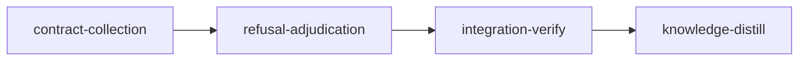

# Plan: Contract Phase Autonomy

## Overview

A contract stage in liquidmon (`fix-instance-lock`) could never freeze. The plan harnessed `src/main.rs` but not `src/device_lock/mod.rs`, the writer added `mod device_lock;`, and the freeze's format gate (`cargo fmt --all -- --check`) failed on the missing module file. The refusal parked the stage `WaitingForInput`, the dashboard showed only "awaiting input", and the writer asked the operator to pick between a command that does not exist (`loom stage amend` has no harness field) and one the relay refuses (a Contract session cannot dispute). Unblocking took several operator commands in a strict order.

Rule this plan enforces (`doc/loom/knowledge/mistakes/contract-phase-human-blocking.md`): a stage never waits on a human for something loom or an agent can resolve. Deterministic checks guide the agent. An agent never settles a disputed constraint itself: an independent adjudicator decides and justifies its verdict. A human is reached only after the dispute budget is spent, through one named command.

The plan does three things:

1. **Loom derives the test collection scaffold.** For each Rust contract, loom computes the `mod` declarations (and a declaration-only module root when none exists at base) that make the contract file part of a test target. The contract writer may make exactly those edits; they are checked strictly at freeze and are not frozen, so the implementer extends them. Liquidmon's case cannot recur.
2. **Completion proves each contract runs from its frozen file.** Today completion hashes frozen files and runs each contract by test name only (`cargo test <name> -- --exact`). An implementer who owns the module root can write `#[cfg(test)] #[path = "easy.rs"] mod contract_tests;`: the frozen file is never compiled and the name still passes. Completion now resolves each Rust contract's test path through the crate's `mod` chain from a test-enabled target root to the frozen file and fails on `#[path]`, `cfg_attr`, any `cfg` other than `test`, or a target that is not a libtest test target.
3. **A refused freeze is disputed and adjudicated, never parked.** Every refusal of a writer's freeze becomes a `freeze-refusal` dispute: the daemon files it when the refusal happens at the daemon, the writer's Stop hook files it when the writer stops with a local refusal on record. An adjudicator rejects (a fresh writer starts with its instructions), accepts with a justified amendment of the stage's `contracts`, `harness` or format-check acceptance, or asks for evidence. The writer's signal routes a plan-setup problem through the freeze instead of a question to the operator; a question it does ask still reaches the operator, since `AskUserQuestion` means a person is genuinely needed. Three refusal disputes exhaust the budget and send the stage to human review with one command.
4. **Direct-mode codex forwards are visible again.** Since 27a62e80 (2026-10-21) `codex-forward.sh` runs `codex exec` directly when the outer sandbox refuses a nested bubblewrap, which is every Linux stage. Direct mode creates no companion job, so `codex_lifecycle` reconcile marks every such forward Unknown (logging a warning every 5 s), never writes `lifecycle.jsonl`, and the stage's execution models drop `gpt-5.6-terra (requested)`. The forward receipts (`backend: "direct"`, `backend_id`, `state`, `exit_code`, `model`) already hold the evidence; reconcile and every other reader of companion evidence learn to use them (`mistakes/codex-direct-mode-invisible.md`).

## Goals

- No contract-phase state waits on the operator while an agent or loom can act.
- No agent accepts a disputed constraint on its own; the adjudicator's verdict carries a justification and is validated before it is recorded.
- Completion of a Rust contract proves the frozen file is the code that ran.
- A stage whose codex forwards run in direct mode shows their requested model in its execution models, and the daemon stops logging them as unknown.
- Non-goals: `AskUserQuestion`, `loom stage block` and a rejected criterion dispute keep reaching the operator: each means a person is genuinely needed. Scaffold derivation and the chain check cover Rust (`cargo-test`, `cargo-nextest`); every other adapter derives no scaffold and has no chain rule. `.cargo/config.toml` `runner` overrides and `build.rs` side effects remain open and are recorded as concerns.

## Decisions

1. **Scaffold, not harness, for collection wiring.** Harness globs freeze what they match, so harnessing a module root freezes the file the implementer must write. The scaffold set is derived by loom from the contract's file and test path, so no agent decides it. Name: "scaffold" (`wiring` already names the `wiring`/`wiring_tests` reachability checks).
2. **Strict scaffold diff.** Removing, per derived module, one `mod <name>;` line (optionally `pub` or `pub(crate)`) and at most one `#[cfg(test)]` line directly above it from the writer's version must leave exactly the base content (an existing declaring file) or only blank lines (a created module root). Position is free, so rustfmt's module ordering passes. Anything else is a refusal.
3. **Chain rules.** Every link from the target root to the contract file is an out-of-line `mod <name>;` item, declared exactly once in its conventional parent (`<dir>/mod.rs`, `<dir>.rs`, or the root's own directory), with attributes limited to `#[cfg(test)]`, `#[allow(..)]`, `#[expect(..)]` and doc comments. `include!` and macro-generated modules need no rule: a second declaration of the same module is a compile error, and a chain whose real declaration is removed fails the "declared exactly once" rule.
4. **Target model from `Cargo.toml`, parsed with the `toml` crate.** No `cargo metadata` (it can write `Cargo.lock` and spawns a process). Roots: `[lib] path` or `src/lib.rs`; `[[bin]] path` entries plus `src/main.rs`, `src/bin/<n>.rs`, `src/bin/<n>/main.rs` unless `autobins = false`; `[[test]] path` entries plus `tests/<n>.rs`, `tests/<n>/main.rs` unless `autotests = false`; `autolib = false` disables the implicit lib. A target with `test = false` or `harness = false` is not a libtest test target. The package is the nearest ancestor of the contract file whose `Cargo.toml` has a `[package]` table.
5. **Fail closed without tree-sitter.** Both the chain check and scaffold derivation parse Rust with `tree-sitter-rust`, behind the default-on `source-graph` feature (`loom/Cargo.toml`). A build without it reports "cannot verify Rust contract collection: loom was built without the source-graph feature" as a completion failure and a freeze refusal.
6. **One dispute kind for refusals: `freeze-refusal`.** `DisputeKind::FreezeRefusal { problems: Vec<String> }`, filed only by a Contract session (or the daemon on its behalf), only before a freeze record exists. The writer argues its case with `loom memory note "freeze-dispute: ..."` before freezing; the adjudication prompt quotes every memory entry the stage holds. No new CLI dispute command for the writer: it runs the freeze and stops.
7. **Verdicts.** `reject` + `justification` + `instructions` (the writer's files are at fault): feedback notice, stage requeued, a fresh Contract writer starts on the same worktree and reads the notice. `accept` + `justification` + non-empty `plan_patch` on `contracts`, `harness` or a format-check `acceptance` entry (the plan's setup is at fault): amendments applied through `apply_amendment`, stage requeued with the notice. `needs-more-evidence` as today. Validation at recording refuses (re-prompt) a missing justification, an accept without a patch, an `acceptance` patch on a non-format-check entry, and a harness value matching an existing production source file.
8. **No more contract-phase parks.** `refusal::park`, `refusal::park_refused_relay`, the `Standing::Refused` branch of `loom stage waiting`, and `commit-guard.sh`'s `park_contract_stage` are replaced by dispute filing.
9. **Harness becomes amendable.** `AmendmentField::Harness` (kebab `harness`), value a plain glob string, usable by `loom stage amend --field harness` and by verdicts; `resync_after_amendment` copies `harness`.
10. **Direct-mode evidence comes from forward receipts.** A codex authorization row whose matching forward receipt (same `agent_id`/`forwarder_agent_id` and `tool_use_id`, same stage and loom session) has `backend: "direct"` is reconciled from the receipt: `running` is live evidence, `succeeded`/`failed` with `exit_code` is terminal, and the lifecycle journal records it exactly as a companion job's outcome. No companion directory is read for it. Companion-mode forwards keep today's path. No new status field: the existing `execution_models` row, the TUI ledger and the web ledger show the requested model once the lifecycle record exists.

## Execution Diagram



## Stages

No knowledge-bootstrap: `architecture/contract-phase.md`, `mistakes/adjudication-autonomy-deadlock.md` and `mistakes/contract-phase-human-blocking.md` already describe the area.

### 1. contract-collection

Scaffold derivation, the strict scaffold check at freeze (CLI and daemon), the completion chain check, the contract signal's scaffold section, two plan-verify lints, the plan-writer guidance, and direct-mode codex visibility. Workers: W1 builds `verify::contracts::collection` (foundation); W2 integrates it; W3 updates docs; W4 fixes direct-mode codex reconciliation. W4's work shares no file with the others and needs no merge order, so the Stage Necessity Test merges it here instead of a stage of its own. Its proof is unit tests over the real liquidmon receipt rows (risk area 7, external data: the fixture is captured from the forwarder's actual output, not written from memory). Risk-checklist walk: untrusted input (the implementer and writer are adversaries of the frozen tests) → `chain-rejects-path-redirect`, `chain-rejects-non-target-root`, `scaffold-rejects-production-code`; the behaviour the stage adds → `scaffold-derives-new-module-root`; over-strictness that would block every in-module contract → `chain-accepts-cfg-test-declaration`, `scaffold-accepts-reordered-declaration`. Filesystem paths: the source closures read through `fs::safe_read` beneath the worktree root (unit-tested, no contract).

### 2. refusal-adjudication

Exists separately because of Q1 and Q2: its adjudication prompt quotes the derived scaffold (merged code from stage 1), and both stages edit `orchestrator/signals/contract.rs`. Workers: W3 harness amendment field and W4 writer-facing signal, hooks and docs (wave 1); W2 the `freeze-refusal` dispute kind, its admission and its adjudication (wave 2); W1 the refusal producers that file it (wave 3). Risk-checklist walk: untrusted input (a Contract session gains a dispute channel) → `refusal-dispute-filed-only-by-contract-writer`; configuration propagation (an amended harness must reach the stage record the freeze reads) → `harness-amendment-reaches-stage-record`; lifecycle (a requeued writer must not charge the crash budget, an escalation must retire the writer) → unit and e2e tests named in the briefs.

### Integration Verification

Full suite, clippy, fmt, rustdoc, the hook test scripts; review rounds; an end-to-end smoke of the liquidmon shape in a scratch crate: a contract stage whose contract file lives in a new module freezes with no operator action, and a planted `#[path]` redirect fails completion.

### Knowledge Distillation

Rewrites `architecture/contract-phase.md` to current truth (scaffold, chain check, adjudicated refusals, no parks); records the `.cargo/config.toml` runner and `build.rs` concerns; updates README.

---

<!-- loom METADATA -->

```yaml
loom:
  version: 2
  ratchet_files:
    - loom/maintainability-baseline.txt
    - doc/loom/knowledge/check-baseline.txt
  provision:
    - working_dir: "web"
      command: "test ! -e .npmrc && test ! -L .npmrc && bun install --frozen-lockfile --ignore-scripts --backend=copyfile --config=/dev/null"
  sandbox:
    enabled: true
    auto_allow: true
    filesystem:
      deny_read: ["~/.ssh/**", "~/.aws/**", "~/.config/gcloud/**", "~/.gnupg/**"]
    network:
      allowed_domains: ["crates.io", "index.crates.io", "static.crates.io", "registry.npmjs.org"]
      allow_local_binding: false
      allow_unix_sockets: []
  stages:
    - id: contract-collection
      name: "Derived test-collection scaffold, completion chain check, direct-mode codex visibility"
      summary: "Loom works out the mod declarations a Rust contract test needs, lets the contract writer add exactly those, proves at completion that each contract ran from its frozen file, and shows the codex model of direct-mode forwards again."
      stage_type: standard
      skills: ["loom-rust", "loom-security-audit"]
      implementers: ["claude"]
      subagent_timeout_secs: 900
      working_dir: "loom"
      dependencies: []
      before_stage:
        - command: "rg -qF 'pub mod collection' src/verify/contracts/mod.rs"
          exit_code: 1
          description: "no collection module before the stage"
      after_stage:
        - command: "rg -qF 'pub mod collection' src/verify/contracts/mod.rs"
          exit_code: 0
          description: "the collection module is declared after the stage"
      description: |
        Build stage 1 of the plan (doc/plans/PLAN-contract-phase-autonomy.md, renamed IN_PROGRESS-PLAN-contract-phase-autonomy.md once loom run starts). Its Decisions section is authoritative.
        Use parallel subagents and skills to maximize performance.
        PATHS: working_dir is loom/. YAML paths and the worker table are package-relative (../ for files outside the crate); brief paths are repo-relative from the worktree root.
        Every worker reads doc/plans/briefs/contract-phase-autonomy/contract-collection/common.md first (the pinned public API and rules), then its own brief.
        Territories are DISJOINT. Workers NEVER spawn subagents. Spawn BY AGENT TYPE (W1 loom-senior-software-engineer with effort xhigh; W2 loom-software-engineer; W3 loom-software-engineer with model haiku) with the fixed prompt plus "Your brief: <path>. Read it in full before anything else." Wait with one background loom subagents watch.
        WAVE 1: W1, W3 and W4 in ONE message (W4 is loom-software-engineer). WAVE 2: W2 after W1 returns (W2 calls W1's API).

        | Worker | Role | Tier | Files owned | Shared context | Brief path |
        | ------ | ---- | ---- | ----------- | -------------- | ---------- |
        | W1 | collection module | opus/xhigh | src/verify/contracts/collection/mod.rs; src/verify/contracts/collection/harness.rs; src/verify/contracts/collection/rust/mod.rs; src/verify/contracts/collection/rust/targets.rs; src/verify/contracts/collection/rust/items.rs; src/verify/contracts/collection/rust/scaffold.rs; src/verify/contracts/collection/tests.rs; src/verify/contracts/collection/rust/tests.rs; src/verify/contracts/mod.rs; src/context/rank_source/paths.rs | common.md | doc/plans/briefs/contract-phase-autonomy/contract-collection/w1-collection.md |
        | W2 | integration | sonnet | src/verify/contracts/completion.rs; src/verify/contracts/completion_tests.rs; src/commands/stage/contracts/freeze.rs; src/commands/stage/contracts/freeze_tests.rs; src/stage_service/contracts.rs; src/daemon/server/contracts_tests.rs; src/orchestrator/signals/contract.rs; src/orchestrator/signals/contract_tests.rs; src/plan/schema/validation/v2_lints/contracts.rs; src/plan/schema/validation/v2_lints/contracts_tests.rs | common.md | doc/plans/briefs/contract-phase-autonomy/contract-collection/w2-integration.md |
        | W3 | docs | haiku | ../skills/loom-plan-writer/references/v2-contracts.md; ../skills/loom-plan-writer/SKILL.md; ../README.md | common.md | doc/plans/briefs/contract-phase-autonomy/contract-collection/w3-docs.md |
        | W4 | direct-mode codex visibility | sonnet | src/codex_lifecycle.rs; src/codex_lifecycle/reconcile.rs; src/codex_lifecycle/direct.rs; src/codex_lifecycle/tests.rs; src/codex_lifecycle/test_support.rs; src/commands/subagents/wait/engine.rs; src/commands/subagents/wait/codex_binding.rs; src/commands/subagents/wait/stall.rs; src/commands/status/data/execution_models.rs | none | doc/plans/briefs/contract-phase-autonomy/contract-collection/w4-codex-visibility.md |

        CONTRACT SURFACE (the contract session writes tests/contract_collection_contracts.rs from this text before any code; every contract is a top-level #[test] fn, so its test value is the fn name; each fn at most 50 lines, the file at most 400 lines and rustfmt-clean; it builds fixtures as in-memory maps, never on disk, and calls only this API):
        - Module loom::verify::contracts::collection::rust, functions over a FileSource, `pub type FileSource<'a> = &'a dyn Fn(&str) -> Option<String>;` (exported from loom::verify::contracts::collection): a path relative to the source root with '/' separators maps to the file's content, None when absent.
        - pub fn chain_problems(source: FileSource<'_>, contract_file: &str, test: &str) -> Vec<String>: empty when `test` (a libtest path such as device_lock::contract_tests::rejects_x) is compiled from `contract_file` through a test-enabled target of its package; otherwise one message per problem.
        - pub fn derive_scaffold(base: FileSource<'_>, contracts: &[(&str, &str)]) -> Result<Vec<ScaffoldEdit>, String>: the (file, test) pairs' merged scaffold at base; Err names a contract whose test path does not start with its file's module path or whose file no target can reach.
        - pub fn scaffold_problems(edits: &[ScaffoldEdit], base: FileSource<'_>, current: FileSource<'_>) -> Vec<String>.
        - pub enum ScaffoldEdit { Declare { path: String, module: ScaffoldModule }, CreateRoot { paths: Vec<String>, modules: Vec<ScaffoldModule> } } and pub struct ScaffoldModule { pub name: String, pub test_only: bool }, both #[derive(Debug, Clone, PartialEq, Eq)] and exported from loom::verify::contracts::collection.
        - A fixture crate: "Cargo.toml" holding [package] name = "fx" with version and edition 2021, plus the .rs files the contract names. A bin-only crate has src/main.rs and no src/lib.rs.

        GATE: after the waves, cargo fmt --all, then cargo test --test maintainability, then one loom check contract-collection; route a failure to a fresh worker of the owning territory. No row of maintainability-baseline.txt changes; a file that outgrows 400 lines is split by its owner.
        MUTATION: the contracts freeze red because loom::verify::contracts::collection does not exist yet, which proves nothing about their assertions. Before the final review round, for each contract apply the wrong implementation its rejects text names (or revert the guarding lines), confirm it fails, restore from a saved copy (never git checkout), and record loom memory note "mutation: <contract id> red under <mutation>".
        MEMORY: record mistakes, decisions and surprises via loom memory immediately (subagents report theirs to you); NEVER loom knowledge in this stage; NEVER Claude Code auto-memory.
      acceptance:
        - command: "cargo test --lib verify::contracts::"
          timeout_secs: 1800
        - command: "cargo test --lib commands::stage::contracts::"
          timeout_secs: 1800
        - command: "cargo test --lib stage_service::contracts::"
          timeout_secs: 1800
        - command: "cargo test --lib orchestrator::signals::contract::"
          timeout_secs: 1800
        - command: "cargo test --lib plan::schema::validation::v2_lints::"
          timeout_secs: 1800
        - command: "cargo test --lib codex_lifecycle::"
          timeout_secs: 1800
        - command: "cargo test --lib commands::subagents::wait::"
          timeout_secs: 1800
        - command: "cargo test --lib commands::status::data::execution_models::"
          timeout_secs: 1800
        - command: "cargo test --lib direct_forward"
          timeout_secs: 1800
        - command: "cargo test --test maintainability"
          timeout_secs: 1800
        - command: "cargo clippy --all-targets -- -D warnings"
          timeout_secs: 1800
        - "cargo fmt --check"
        - "sh ../loom-hooks/tests/codex-forward-direct.sh"
      files: ["src/verify/contracts/**", "src/context/rank_source/paths.rs", "src/commands/stage/contracts/**", "src/stage_service/contracts.rs", "src/daemon/server/contracts_tests.rs", "src/orchestrator/signals/contract.rs", "src/orchestrator/signals/contract_tests.rs", "src/plan/schema/validation/v2_lints/**", "src/codex_lifecycle.rs", "src/codex_lifecycle/**", "src/commands/subagents/wait/**", "src/commands/status/data/execution_models.rs", "tests/contract_collection_contracts.rs", "../skills/loom-plan-writer/**", "../README.md"]
      artifacts:
        - "src/verify/contracts/collection/mod.rs"
        - "src/verify/contracts/collection/rust/mod.rs"
      wiring:
        - source: "src/verify/contracts/completion.rs"
          pattern: "chain_problems("
          literal: true
          description: "completion runs the chain check for every Rust contract"
        - source: "src/commands/stage/contracts/freeze.rs"
          pattern: "freeze_scaffold("
          literal: true
          description: "the writer's freeze pre-check admits and checks scaffold edits"
        - source: "src/stage_service/contracts.rs"
          pattern: "freeze_scaffold("
          literal: true
          description: "the daemon's freeze re-check admits and checks scaffold edits"
        - source: "src/orchestrator/signals/contract.rs"
          pattern: "append_scaffold("
          literal: true
          description: "the contract signal lists the derived scaffold edits"
        - source: "src/plan/schema/validation/v2_lints/contracts.rs"
          pattern: "harness_source_matches("
          literal: true
          description: "plan verify warns on a harness glob over production source"
      contracts:
        - id: chain-rejects-path-redirect
          file: tests/contract_collection_contracts.rs
          test: chain_rejects_path_redirect
          scenario: "fixture crate: src/lib.rs `mod device_lock;`, src/device_lock/mod.rs `#[cfg(test)]\\n#[path = \"easy.rs\"]\\nmod contract_tests;`, src/device_lock/contract_tests.rs and src/device_lock/easy.rs present; chain_problems(source, \"src/device_lock/contract_tests.rs\", \"device_lock::contract_tests::rejects_x\") must be non-empty and one message must contain \"path\""
          rejects: "a chain check that only confirms a `mod contract_tests;` declaration exists, so an implementer redirects the frozen tests to an easy file and completion passes"
        - id: chain-rejects-non-target-root
          file: tests/contract_collection_contracts.rs
          test: chain_rejects_non_target_root
          scenario: "fixture crate whose Cargo.toml adds `autobins = false` under [package] and `[[bin]] name = \"app\" path = \"src/app.rs\"`; src/main.rs declares `mod device_lock;`, src/device_lock/mod.rs declares `#[cfg(test)] mod contract_tests;`, src/app.rs is `fn main() {}`; chain_problems for src/device_lock/contract_tests.rs and device_lock::contract_tests::rejects_x must be non-empty"
          rejects: "a chain check that assumes src/main.rs or src/lib.rs is always a crate root without reading Cargo.toml, so a chain from a file cargo never compiles passes"
        - id: chain-accepts-cfg-test-declaration
          file: tests/contract_collection_contracts.rs
          test: chain_accepts_cfg_test_declaration
          scenario: "bin-only fixture crate (no src/lib.rs): src/main.rs holds `pub mod device_lock;` and `fn main() {}`, src/device_lock/mod.rs holds `pub fn try_lock_file() {}` and `#[cfg(test)]\\nmod contract_tests;`; chain_problems for src/device_lock/contract_tests.rs and device_lock::contract_tests::rejects_second_handle must be empty"
          rejects: "a chain check that refuses every attribute or requires src/lib.rs, which would fail every in-module contract of a binary crate such as liquidmon"
        - id: scaffold-derives-new-module-root
          file: tests/contract_collection_contracts.rs
          test: scaffold_derives_new_module_root
          scenario: "base: Cargo.toml and src/main.rs holding `mod devices;\\n\\nfn main() {}` and src/devices.rs; derive_scaffold(base, &[(\"src/device_lock/contract_tests.rs\", \"device_lock::contract_tests::rejects_x\")]) must contain Declare { path: \"src/main.rs\", module: device_lock (test_only false) } and a CreateRoot whose paths are exactly src/device_lock/mod.rs and src/device_lock.rs with modules [contract_tests (test_only true)]"
          rejects: "a derivation that only yields the contract module's own declaration and leaves the new module root to harness, the liquidmon freeze that could never pass"
        - id: scaffold-rejects-production-code
          file: tests/contract_collection_contracts.rs
          test: scaffold_rejects_production_code
          scenario: "edits from the scaffold-derives-new-module-root base; current = base with `mod device_lock;` added to src/main.rs and src/device_lock/mod.rs holding `#[cfg(test)]\\nmod contract_tests;\\n\\npub fn try_lock_file() {}\\n`; scaffold_problems(edits, base, current) must be non-empty"
          rejects: "a scaffold check that only confirms the declarations are present, so the contract writer slips implementation into the module root"
        - id: scaffold-accepts-reordered-declaration
          file: tests/contract_collection_contracts.rs
          test: scaffold_accepts_reordered_declaration
          scenario: "same base and edits; current src/main.rs is `mod device_lock;\\nmod devices;\\n\\nfn main() {}` (declaration inserted above the existing one, as rustfmt orders it) and src/device_lock.rs (the other allowed root) holds `#[cfg(test)]\\nmod contract_tests;\\n`; scaffold_problems must be empty"
          rejects: "a scaffold check that requires the declaration appended at the end of the file or only accepts the mod.rs root, so rustfmt-ordered or 2018-style scaffolds are refused"

    - id: refusal-adjudication
      name: "Refused freezes are disputed and adjudicated"
      summary: "Every refused contract freeze becomes a dispute an adjudicator decides with a justification, the contract writer can no longer park the stage on the operator, and harness becomes amendable."
      stage_type: standard
      skills: ["loom-rust", "loom-security-audit", "loom-ci-cd"]
      implementers: ["claude"]
      subagent_timeout_secs: 900
      working_dir: "loom"
      dependencies: ["contract-collection"]
      before_stage:
        - command: "rg -qF 'FreezeRefusal' src/models/dispute.rs"
          exit_code: 1
          description: "no freeze-refusal dispute kind before the stage"
      after_stage:
        - command: "rg -qF 'FreezeRefusal' src/models/dispute.rs"
          exit_code: 0
          description: "the freeze-refusal dispute kind exists after the stage"
      description: |
        Build stage 2 of the plan (doc/plans/IN_PROGRESS-PLAN-contract-phase-autonomy.md). Its Decisions section is authoritative.
        Use parallel subagents and skills to maximize performance.
        PATHS: working_dir is loom/. YAML paths and the worker table are package-relative (../ for files outside the crate); brief paths are repo-relative from the worktree root.
        Every worker reads doc/plans/briefs/contract-phase-autonomy/refusal-adjudication/common.md first, then its own brief. Read doc/loom/knowledge/mistakes/adjudication-autonomy-deadlock.md before any lifecycle edit: its prevention rules bind every path this stage adds.
        Territories are DISJOINT. Workers NEVER spawn subagents. Spawn BY AGENT TYPE (W1 and W2 loom-senior-software-engineer; W3 and W4 loom-software-engineer) with the fixed prompt plus "Your brief: <path>. Read it in full before anything else." Wait with one background loom subagents watch.
        WAVES (each leaves the crate compiling; the order follows type dependencies): WAVE 1: W3 and W4 in ONE message (W3 adds AmendmentField::Harness; W4 is independent). WAVE 2: W2 after W3 returns (W2 adds DisputeKind::FreezeRefusal with every match arm, its admission and its adjudication, and applies harness patches). WAVE 3: W1 after W2 returns (W1 makes every refusal file the dispute W2 defined).

        | Worker | Role | Tier | Files owned | Shared context | Brief path |
        | ------ | ---- | ---- | ----------- | -------------- | ---------- |
        | W1 | refusal producers | opus | src/relay/matrix.rs; src/relay/tests_matrix.rs; src/daemon/server/self_service.rs; src/daemon/server/self_service_tests.rs; src/orchestrator/core/inbox_drain/freeze.rs; src/orchestrator/core/inbox_drain/tests_matrix.rs; src/host_verify/freeze.rs; src/host_verify/tests_freeze.rs; src/verify/contracts/refusal.rs; src/commands/stage/state.rs; src/commands/stage/contracts.rs; src/commands/stage/contracts/dispute_refusal.rs; src/cli/types_stage.rs; src/cli/dispatch_stage.rs; ../loom-hooks/commit-guard.sh; ../loom-hooks/loom-relay.sh; ../loom-hooks/tests/loom-relay-kinds.sh; ../loom-hooks/tests/commit-guard-contract-session.sh | common.md | doc/plans/briefs/contract-phase-autonomy/refusal-adjudication/w1-filing.md |
        | W2 | dispute kind and adjudication | opus/xhigh | src/models/dispute.rs; src/models/dispute_tests.rs; src/models/stage/dispute_budgets.rs; src/stage_service/dispute_kinds.rs; src/daemon/server/dispute_kinds_tests.rs; src/commands/stage/dispute_transport.rs; src/orchestrator/core/inbox_drain/test_support.rs; src/orchestrator/adjudication/prompt.rs; src/orchestrator/adjudication/prompt/freeze_refusal.rs; src/orchestrator/adjudication/verdict_kinds.rs; src/orchestrator/adjudication/apply_kinds.rs; src/orchestrator/adjudication/apply_freeze_refusal.rs; src/orchestrator/adjudication/apply.rs; src/orchestrator/adjudication/mod.rs; src/orchestrator/adjudication/apply_freeze_refusal_tests.rs; tests/adjudication_e2e.rs | common.md | doc/plans/briefs/contract-phase-autonomy/refusal-adjudication/w2-judging.md |
        | W3 | harness amendment | sonnet | src/plan/amendment.rs; src/plan/amendment_fields.rs; src/plan/amendment_catch_up.rs; src/plan/amendment/journal.rs; src/plan/amendment/tests.rs; src/orchestrator/adjudication/apply_accept.rs; src/cli/types_stage_amend.rs | common.md | doc/plans/briefs/contract-phase-autonomy/refusal-adjudication/w3-harness-amendment.md |
        | W4 | writer signal and docs | sonnet | src/orchestrator/signals/contract.rs; src/orchestrator/signals/contract_tests.rs; ../skills/loom-plan-writer/references/v2-contracts.md; ../README.md | common.md | doc/plans/briefs/contract-phase-autonomy/refusal-adjudication/w4-writer.md |

        CONTRACT SURFACE (the contract session writes tests/refusal_adjudication_contracts.rs from this text before any code; every contract is a top-level #[test] fn, so its test value is the fn name; each fn at most 50 lines, the file at most 400 lines and rustfmt-clean):
        - loom::models::dispute::DisputeKind gains the variant FreezeRefusal { problems: Vec<String> } (serde tag "freeze-refusal") and the method pub fn filed_by(&self, session: loom::models::session::SessionType) -> bool: FreezeRefusal only by SessionType::Contract; every other kind only by SessionType::Stage.
        - loom::plan::AmendmentField gains Harness (kebab "harness"); an AmendmentRequest { stage_id, field: AmendmentField::Harness, patch: AmendmentPatch::Insert { index: 0, value: "tests/fixtures/**".into() }, reason, dispute_id: None } passed to loom::plan::apply_amendment(plan_path, work_dir, request) rewrites both the plan file and the stage file. Build the work dir and plan exactly as tests/plan_amendment_integration.rs setup() does (read it; reuse its shape, not its file), with a version: 2 plan whose standard stage carries one contract, and read the stage back with loom::verify::load_stage(stage_id, work_dir) (check its signature with loom map --find-all load_stage before writing).

        GATE: after the waves, cargo fmt --all, then cargo test --test maintainability, then sh ../loom-hooks/tests/loom-relay-kinds.sh and sh ../loom-hooks/tests/commit-guard-contract-session.sh, then one loom check refusal-adjudication; route a failure to a fresh worker of the owning territory. No row of maintainability-baseline.txt changes; a file that outgrows 400 lines (relay/matrix.rs, models/dispute.rs, adjudication/apply_kinds.rs are close) is split by its owner.
        MUTATION: before the final review round, for each contract apply the wrong implementation its rejects text names, confirm it fails, restore from a saved copy (never git checkout), and record loom memory note "mutation: <contract id> red under <mutation>".
        MEMORY: record mistakes, decisions and surprises via loom memory immediately (subagents report theirs to you); NEVER loom knowledge in this stage; NEVER Claude Code auto-memory.
      acceptance:
        - command: "cargo test --lib models::"
          timeout_secs: 1800
        - command: "cargo test --lib relay::"
          timeout_secs: 1800
        - command: "cargo test --lib stage_service::"
          timeout_secs: 1800
        - command: "cargo test --lib daemon::server::"
          timeout_secs: 1800
        - command: "cargo test --lib orchestrator::adjudication::"
          timeout_secs: 1800
        - command: "cargo test --lib orchestrator::core::inbox_drain::"
          timeout_secs: 1800
        - command: "cargo test --lib host_verify::"
          timeout_secs: 1800
        - command: "cargo test --lib plan::amendment"
          timeout_secs: 1800
        - command: "cargo test --lib commands::stage::"
          timeout_secs: 1800
        - command: "cargo test --lib cli::"
          timeout_secs: 1800
        - command: "cargo test --lib orchestrator::signals::contract::"
          timeout_secs: 1800
        - command: "cargo test --test adjudication_e2e freeze_refusal"
          timeout_secs: 1800
        - command: "cargo test --test maintainability"
          timeout_secs: 1800
        - command: "cargo clippy --all-targets -- -D warnings"
          timeout_secs: 1800
        - "cargo fmt --check"
        - "sh ../loom-hooks/tests/loom-relay-kinds.sh"
        - "sh ../loom-hooks/tests/commit-guard-contract-session.sh"
      files: ["src/models/**", "src/stage_service/**", "src/daemon/server/**", "src/relay/**", "src/orchestrator/core/inbox_drain/**", "src/host_verify/**", "src/verify/contracts/refusal.rs", "src/commands/stage/**", "src/cli/**", "src/orchestrator/adjudication/**", "src/plan/**", "src/orchestrator/signals/contract.rs", "src/orchestrator/signals/contract_tests.rs", "tests/adjudication_e2e.rs", "tests/refusal_adjudication_contracts.rs", "../loom-hooks/**", "../skills/loom-plan-writer/**", "../README.md"]
      artifacts:
        - "src/orchestrator/adjudication/prompt/freeze_refusal.rs"
        - "src/orchestrator/adjudication/apply_freeze_refusal.rs"
        - "src/commands/stage/contracts/dispute_refusal.rs"
      wiring:
        - source: "src/orchestrator/adjudication/apply_kinds.rs"
          pattern: "DisputeKind::FreezeRefusal"
          literal: true
          description: "verdicts on a freeze refusal are applied"
        - source: "src/orchestrator/adjudication/prompt.rs"
          pattern: "DisputeKind::FreezeRefusal"
          literal: true
          description: "the adjudicator is briefed on a freeze refusal"
        - source: "src/orchestrator/core/inbox_drain/freeze.rs"
          pattern: "file_refusal_dispute("
          literal: true
          description: "a relayed freeze the daemon refuses becomes a dispute"
        - source: "src/host_verify/freeze.rs"
          pattern: "file_refusal_dispute("
          literal: true
          description: "a host contract run that refuses the freeze becomes a dispute"
        - source: "src/orchestrator/signals/contract.rs"
          pattern: "read_feedback("
          literal: true
          description: "a requeued contract writer receives the adjudicator's notice"
      contracts:
        - id: refusal-dispute-filed-only-by-contract-writer
          file: tests/refusal_adjudication_contracts.rs
          test: refusal_dispute_filed_only_by_contract_writer
          scenario: "DisputeKind::FreezeRefusal { problems: vec![\"x\".into()] }.filed_by(SessionType::Contract) is true and .filed_by(SessionType::Stage) is false; DisputeKind::Contract { contract_id: \"c\".into() }.filed_by(SessionType::Contract) is false and .filed_by(SessionType::Stage) is true"
          rejects: "opening every file-dispute kind to Contract sessions, so a contract writer disputes its own frozen contracts, findings or integrity events"
        - id: harness-amendment-reaches-stage-record
          file: tests/refusal_adjudication_contracts.rs
          test: harness_amendment_reaches_stage_record
          scenario: "temp work dir and v2 plan as in tests/plan_amendment_integration.rs setup(); apply_amendment with AmendmentField::Harness insert of tests/fixtures/** at index 0; the reloaded stage's harness equals [\"tests/fixtures/**\"] and the plan file contains tests/fixtures/**"
          rejects: "a Harness variant whose plan-file patch lands but whose stage-file sync arm is missing, so the freeze keeps reading the old globs after an accepted verdict"

    - id: integration-verify
      name: "Integration Verification"
      summary: "Confirms on the merged tree that a liquidmon-shaped contract stage freezes with no operator action, that a path redirect fails completion, and that the full suite passes."
      stage_type: integration-verify
      skills: ["loom-rust", "loom-security-audit"]
      working_dir: "."
      dependencies: ["refusal-adjudication"]
      description: |
        Final verification of the plan (doc/plans/IN_PROGRESS-PLAN-contract-phase-autonomy.md). Verify FUNCTIONAL INTEGRATION, not only tests passing. NEVER Claude Code auto-memory.
        Use parallel subagents and skills to maximize performance.
        CONTEXT: read the plan, both common.md briefs under doc/plans/briefs/contract-phase-autonomy/, loom memory show --all, and doc/loom/knowledge/architecture/contract-phase.md and mistakes/adjudication-autonomy-deadlock.md.
        BUILD AND TEST (zero tolerance; nothing is pre-existing): every acceptance command below.
        FUNCTIONAL (from this session's shell, in a scratch directory under the worktree's target/ that you delete afterwards):
        - Make a scratch git repo holding a bin-only cargo crate shaped like liquidmon (src/main.rs with `mod devices;` and `fn main() {}`, src/devices.rs, one commit) and a one-stage v2 plan whose standard stage has a cargo-test contract in src/device_lock/contract_tests.rs with test device_lock::contract_tests::rejects_x and no harness. cargo run -q --manifest-path loom/Cargo.toml -- plan verify <plan> from that repo must report no scaffold error; with harness ["src/main.rs"] it must warn that the glob matches production source. Record both outputs in loom memory.
        - In the scratch crate, apply exactly the two scaffold edits the contract signal would list (mod device_lock; in src/main.rs, src/device_lock/mod.rs with #[cfg(test)] mod contract_tests;) plus a contract file, and confirm cargo fmt --check and cargo test --no-run succeed there: the liquidmon format-gate failure cannot recur.
        - Confirm the chain_rejects_path_redirect contract and the completion_tests redirect test pass on the merged tree (cargo test --manifest-path loom/Cargo.toml --test contract_collection_contracts and the completion module filter), and record the mutation notes stage 1 left.
        - Codex visibility: if the codex CLI and plugin are installed on this host, spawn one loom-codex-forwarder unit (a one-line comment edit in a scratch file under target/, reverted after) and confirm loom status --json lists "gpt-5.6-terra (requested)" in this stage's execution_models and the daemon log carries no "Codex lifecycle evidence is unknown" line for it. Without codex installed, record that the check was skipped and why, and rely on the direct_forward unit tests.
        - Walk the refusal path in the e2e test added by refusal-adjudication (cargo test --test adjudication_e2e freeze_refusal -- --nocapture): a refused freeze reaches NeedsAdjudication, an accept with a harness patch amends the stage and requeues a Contract writer, a reject requeues with the notice, the third refusal dispute escalates with one named command, and no path leaves the stage WaitingForInput.
        CODE REVIEW: parallel loom-code-reviewer subagents - security (the chain rules against Decision 3, every attribute and target edge in Decision 4, the scaffold diff rule, the new Contract dispute channel through relay matrix, socket self-service and confirm, verdict validation of harness patches), architecture (shared freeze_scaffold used by CLI and daemon, no orphaned park code, adjudication lifecycle against every prevention rule in mistakes/adjudication-autonomy-deadlock.md), test coverage (every contract and the mutation notes both stages recorded). Fix or dispute every finding; never defer one.
        SUGGESTIONS: weigh every pending reviewer suggestion the signal lists; resolve each one implemented with loom memory resolve <id> --outcome implemented --reason <what changed>.
        Record discoveries to loom memory for knowledge-distill, including any knowledge file the tree contradicts: loom memory note "stale-knowledge: ...".
      acceptance:
        - command: "cargo test --manifest-path loom/Cargo.toml --all-targets --no-fail-fast"
          timeout_secs: 3600
        - command: "cargo clippy --manifest-path loom/Cargo.toml --all-targets -- -D warnings"
          timeout_secs: 1800
        - "cargo fmt --manifest-path loom/Cargo.toml --check"
        - command: "RUSTDOCFLAGS='-D warnings' cargo doc --manifest-path loom/Cargo.toml --workspace --all-features --no-deps"
          timeout_secs: 1800
        - "sh loom-hooks/tests/loom-relay-kinds.sh"
        - "sh loom-hooks/tests/commit-guard-contract-session.sh"
        - "sh loom-hooks/tests/ask-user-hooks.sh"
        - "! rg -q 'park_refused_relay|park_contract_stage' loom/src loom-hooks"
      wiring:
        - source: "loom/src/verify/contracts/completion.rs"
          pattern: "chain_problems("
          literal: true
          description: "completion runs the chain check on the merged tree"
        - source: "loom/src/cli/dispatch_stage.rs"
          pattern: "dispute_refusal"
          literal: true
          description: "the refusal-dispute subcommand is dispatched"

    - id: knowledge-distill
      name: "Knowledge Distillation"
      summary: "Rewrites the contract-phase knowledge to the new scaffold, chain check, adjudicated refusals and direct-mode codex reconciliation."
      stage_type: knowledge-distill
      working_dir: "."
      dependencies: ["integration-verify"]
      description: |
        Curate all stage memories into permanent knowledge; update user docs. NEVER Claude Code auto-memory.
        SINGLE-AGENT: do NOT spawn subagents; memories are compact summaries; keep code spot-reads narrow.
        START with loom memory pending --group (corrections, mistakes, decisions, other); read the plan and the knowledge sections it touches.
        CORRECTIONS FIRST: apply every stale-knowledge memory in place with loom knowledge replace-section <file> "<heading>" "<body>", never loom knowledge update. Known ones: architecture/contract-phase.md "Contract Phase: A Second Writer Session Before the Implementer" (freeze step 1 now admits scaffold edits; completion runs the chain check), "A Refused Freeze Parks the Stage" (replace with the adjudicated refusal flow under a new heading; no park remains), and "Accepted Dispute Re-Freeze" (unchanged unless the tree says otherwise). The amendment cap note in plan/amendment.rs's module doc said 3 while the default is 10: confirm the stage fixed it or record it.
        Then curate: scaffold derivation and its strict diff rule, the chain rules and target model, the freeze-refusal dispute and its verdict validation, the harness amendment field, and direct-mode codex reconciliation from forward receipts (update architecture/codex-plugin.md and architecture/status-data-model.md "Execution Model Ledgers" to current truth). TIER ROUTING: findings ~40 lines or fewer go inline in the tier-1 file; larger findings go via loom knowledge update <category>/<slug> with a 2-4 line tier-1 summary + link, plus loom knowledge annotate --blurb for a new topic. INDEX.md regenerates on every knowledge write.
        CONCERNS to record (concerns/verification-v2-followups.md or a new topic): .cargo/config.toml runner overrides and build.rs can still fake or alter a cargo test run that the chain check does not see.
        DOCS: README sections on contracts and disputes (relevant sections only). Lint with bunx markdownlint-cli2 README.md WITHOUT --fix; a non-zero bunx exit with no "markdownlint-cli2 v" banner means the tool never ran.
        SUGGESTIONS: record every unimplemented reviewer suggestion (loom memory pending --group lists them) in concerns or the topic it belongs to, then resolve it promoted, merged or discarded.
        RECEIPTS: every memory taken into knowledge gets loom memory resolve <id> --outcome promoted|merged|discarded|deferred right after the write that used it; finish with loom memory pending --strict and resolve whatever it lists.
        LAST, if this stage removed structural issues, ratchet the baseline: loom knowledge check --write-baseline doc/loom/knowledge/check-baseline.txt
      acceptance:
        - "loom knowledge check --strict --baseline doc/loom/knowledge/check-baseline.txt"
        - "loom memory pending --strict"
        - "rg -q 'scaffold' doc/loom/knowledge/architecture/contract-phase.md"
        - "rg -q 'freeze-refusal' doc/loom/knowledge/architecture/contract-phase.md"
        - "! rg -q 'A Refused Freeze Parks the Stage' doc/loom/knowledge/architecture/contract-phase.md"
      files: ["doc/loom/knowledge/**", "README.md"]
```

<!-- END loom METADATA -->
