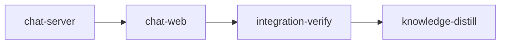

# Plan: `loom plan` chat and the review loop

Implements: section_08, section_10

## Overview

This plan builds the chat panel of `loom plan` and connects review to authoring. In the browser:
the panel docked on the right of every page (width, collapse, narrow-screen sheet), message
rendering with plan 3's Markdown renderer, tool rows with summaries, statuses, expansion,
grouping and nested subagent rows, the state line for every session state, tab-title and opt-in
desktop notifications, permission cards pinned above the composer, the composer with drafts,
limits, the queue, Stop and attachment chips, turn footers with changed files, Diff links,
rebuilt summaries and cost, starting and ending chats, read-only browsers, and the connection
error states. On the server: Restore and Restore all through plan 3's save path, Send to author
suggestions, open-question counts, document hashes and text at a git ref for "Changed since you
looked", the "Changed after … was built" marker, and the per-turn changed-section list the sent
chips need.

It is metaplan entry 9 (`doc/plans/metaplan-planner-ui.md`, "9. Chat and the review loop"). It
depends on plan 3 (renderer, diffs, selection control, save path, turn pins), plan 5 (concept
pages and their extension points), plan 7 (session model, commands, the `<loom-attachments>`
module) and plan 8 (offers' opening messages). Plans 10 and 11 add rows to its turn footer and
its pressure-run header through the extension points listed below.

**Size decision (metaplan open question "Plan 9's size").** The work fits four stages (two
feature stages, the two bookends): one Rust stage for every server route the review loop needs,
and one web stage whose six workers own disjoint files. The metaplan's threshold for splitting
the review loop into its own plan was "more than about eight stages"; it is not reached, so there is no
separate review-loop plan.

## Goals

- A reviewer attaches passages from either mode, writes a doubt, sends, reads the reply and the
  turn's footer, opens the diffs, and restores a wrong edit without a session.
- Every state, item and outcome in section 08's tables renders with words, never colour alone,
  and nothing from a transcript, a permission body or a suggestion is inserted as HTML.
- Read-only browsers see the same conversation live and can hand passages to the author.
- Non-goals: session lifetime, delivery and the queue's server side (plan 7), briefs and
  opening messages (plan 8), summary rebuild scheduling and cost attribution (plan 10), pressure
  runs (plan 11), the Share popover (plan 2 owns the Share route and its control).

## Cross-plan interfaces

Names by role first, with the producing plan's name (from its interface section and stage YAML).
The briefs say "confirm against the merged code; use the merged name": every producer has merged
before this plan runs.

Path forms (plan 2's rule for the planning wire): every wire field named `path` (plan 7's
`ChangedFile.path`, `Attachment.path`, `AttachmentInput.path` and every `rests_on` entry, this
plan's review routes) is repo-relative, `doc/...`; only plan 3's request parameters (`?path=`,
`SaveRequest.path`) and `/files/` addresses are relative to `doc/`. The browser converts with
plan 3's `docRel`/`repoRel` (`@/plan/files/address`); the server with plan 2's
`plan_server::wire::paths::{to_doc_rel, to_repo_rel}`, wrapped for Restore by
`review::restore::save_path_of`.

| Role | Producer | Name used here |
| --- | --- | --- |
| Loaded project: documents, sections, `Implements:` both ways, open questions, content hashes, locks, path checks | plan 1 | `loom::planning::project::{Project, ProjectDoc}` (`implemented_by`, `content_hash`, `docs[..].open_questions`), `loom::planning::sections::sections_of`, `loom::planning::paths::check_relpath_syntax` |
| Route registration, request context, roles, identity, presence, hub, WS dispatch | plan 2 | `plan_server::routes::{all_routes, install_all}`, `RouteSpec` (`role: Holder`), `ApiRequest` (`browser`), `PlanContext` (`authoring()`, `presence().name_of`, `hub().send_to_holder`, `send_to_browser`, `on_open`, `on_batch`, `extensions()`), `PlanMessage`/`ClientMessage` in `plan_server/wire/message.rs`, `plan_server/ws/dispatch.rs` |
| Planning app dock, header slot, WS client, API client, atoms, help keys | plan 2 | `web/src/plan/{dock.tsx, header-extras.tsx, help-keys.ts}`, `web/src/plan/api/{client.ts, socket.ts}`, `web/src/plan/state/atoms.ts` (`isHolderAtom`, `canAuthorAtom`, `presenceAtom`, `authoringAtom`, `serverInfoAtom`, `connectionAtom`) |
| Save path, turn pins, diff views, renderer, "Add to chat", tree-entry slot | plan 3 | `plan_server::files::save::save_document` (`SaveOutcome::{Saved, Conflict, Invalid}`, `SaveRefusal`), `plan_server::files::texts::TextStore` (`turn_pin`, `turn_end`), `<Markdown>`, `<DiffView>`, `openDiff`, `pendingAttachmentsAtom`, `addAttachmentAtom`, `AttachmentDraft`, `web/src/plan/files/tree-entry-extras.tsx` |
| Concept page extension points | plan 5 | `web/src/plan/concept/{page-header-extras, key-chip-extras, empty-offer}.tsx` |
| Chat model, frames, commands, the bridge, the attachment block module | plan 7 | `PlanMessage::Chat(ChatFrame { snapshot, delta, result, queue_returned })`, `ClientMessage::Chat(ChatCommand { start, send, withdraw, permission, interrupt, end })`, model types in `doc/plans/briefs/feat-planner-07-session-bridge/common.md` "The chat model", fixtures `web/src/plan/api/fixtures/chat-{snapshot,deltas,commands,frames}.json`, the `Bridge` (`sessions()`, `chat_session_id()`), turn pins keyed `<session id>/<turn id>`, `loom::plan_session::attachments::{format_message, Attachment, AttachmentInput}` with fixtures `loom/tests/fixtures/plan_session/attachments/`, `plan_session::input::check_delivered` (100,000 bytes) |
| Session brief, label, model and effort | plan 8 | `GET /api/session/brief?session=<id>` (`SessionBriefView { session_id, label, brief, model, effort, display_name }`, fixture `web/src/plan/api/fixtures/session-brief.json`); start ids `refine:<path>`, `refine-passage:<path>`, `knowledge`, `knowledge:<path>` beside plan 1's `Offer::id`s |
| Offer ids, labels, opening and closing messages | plans 1, 8 | `loom::planning::checklist::Offer::id`, `loom::planning::guidance::{opening_message, CLOSING_MESSAGE}` |

The `<loom-attachments>` block is a parse contract between plan 7's transcript mapper and this
plan's composer. Plan 7 owns the single Rust implementation (format and parse) and its fixture
set; the server's send path formats with it. The browser needs the formatted size before sending
(section 08, "Limits"), so `chat-web` adds a TypeScript port of `format_message` that is tested
against plan 7's fixtures byte for byte, so the browser and the server agree on one fixture set.
The browser sends plan 7's `AttachmentInput` (with the hash it saw at selection); the server
resolves `locked` and `changed-since-selected` itself.

What this plan publishes for later plans:

- `web/src/plan/chat/footer-extras.tsx`: `<TurnFooterExtras turn={turn} />`, the last block of
  every turn footer, `null` here. Plans 10 and 11 add their rows in their own modules and one
  line each here.
- `web/src/plan/chat/run-header.tsx`: `<RunHeader session={session} />`, rendered in place of
  the session line; here it renders the session line for every kind. Plan 11 adds its pressure
  header in its own module and one branch for `session.kind === "pressure"`.
- `web/src/plan/chat/composer-gate.ts`: `composerBlock(session): string | null`, the reason Send
  is disabled; plan 11 adds the Codex-step reason.
- `web/src/plan/chat/stop-control.tsx`: `<StopControl confirm?: string />`; plan 11 passes its
  run-stop confirmation.
- `web/src/plan/chat/session-divider.tsx`: `<SessionDivider previous={session} next={session} />`
  between two sessions' turns (here: "Chat ended at <time>"); plan 11 adds a branch naming the
  pressure step and its model.
- `web/src/plan/chat/rebuilt-summary-extras.tsx`: `<RebuiltSummaryExtras id={summaryId}
  turn={turn} />` at the end of each rebuilt-summary footer row, `null` here; plan 10 adds the
  per-summary tokens.
- Authoring offer handlers: this plan registers them in plan 2's offer registry
  (`web/src/plan/offers/actions.ts`, `registerOfferAction(kind, handler)`) from its own module
  `web/src/plan/chat/offer-handlers.ts`; plan 11 registers `pressure_test` and `start_run` the
  same way.
- End chat is hidden while `session.kind === "pressure"`.

## Decisions

1. **Restore is an HTTP save, never a WebSocket command.** `POST /api/restore` with
   `{ "session": <id>, "turn": <id>, "paths": [...], "force": false }` (plan 7 keys turn pins
   `<session id>/<turn id>`). The server takes each file's text from
   the turn-start pin (`TextStore::turn_pin`) and its opened hash from the turn-end pin's hash
   (`TextStore::turn_end`), never from the request, then calls `save_document`, so the shared path predicate refuses a locked plan, a path outside the
   write table and a symlink exactly as for a typed save. Refused while a turn runs, and for a
   file the turn created or deleted. A hash mismatch returns the current text and the turn-start
   text, and the browser opens plan 3's merge view.
2. **Suggestions are WebSocket commands** (`ClientMessage::Review`, kinds `suggest` and
   `suggestion_answer`) with server-side
   records: the sender's name comes from the server's browser record, the passage path passes
   plan 1's request-path check, the note is at most 1,000 characters (Unicode scalar values), at
   most 20 are pending, and a suggestion is delivered only to the holder's connections.
3. **"Changed since you looked"** keeps the checkpoint (`{ commit, hashes }`) in the browser's
   local storage, per project key, as section 10 says. The server supplies current hashes
   (`GET /api/hashes`, from `Project::content_hash`), a ref resolved to a commit (`GET /api/ref?name=`), the changed
   paths against a commit (`GET /api/compare?commit=`, from `git diff --name-status -z
   <commit> -- doc/` plus untracked files under `doc/`) and a document's text at a commit
   (`GET /api/at-commit?commit=&path=`). A typed ref is validated (no leading `-`, no
   control characters, at most 256 bytes) and resolved with `git rev-parse --verify --quiet
   --end-of-options <ref>^{commit}`; every later git call takes the resolved hex and passes paths
   after `--`.
4. **The "Changed after … was built" marker** reads the plan's run review, found through plan 1's
   discovery as the document of kind `RunReview { slug }` (directly in `doc/plans/` or under
   `doc/plans/archive/`, including `REVIEW-IN_PROGRESS-PLAN-<slug>.md`, which
   `loom/src/fs/plan_review/mod.rs` `generate` writes when `plan_id` carries the prefix; the
   newest stamp wins when several exist), its
   `**Generated:** YYYY-MM-DD HH:MM UTC` stamp (`render`, same file), and
   `git log -1 --format=%cI -- <path>` (now, when the file has uncommitted changes). The diff base
   is `git log -1 --format=%H --before=<build date> -- <path>`. A running plan gets the fixed
   note; a done plan without a review shows nothing.
5. **Per-turn changed sections** (`GET /api/turn-sections?turn=`) compare each changed file's
   pinned text and end text heading section by heading section with plan 1's `sections_of`, so a
   sent chip can say "changed in this turn" for its own anchor, not only its file.
6. **The chat model's browser side is this plan's.** Plan 7 has no web stage: `chat-web` writes
   the zod schemas `web/src/plan/api/schema-chat.ts` (over plan 7's `chat-*.json` fixtures) and
   `schema-session-brief.ts` (over plan 8's fixture) with vitest parse tests, and the store that
   applies snapshots and deltas. The fixtures belong to plans 7 and 8 and are never edited here.
   Pressure runs are plan 11's: it renders its header, step dividers and Codex item from its own
   `pressure_run` message, through this plan's `run-header.tsx` and `session-divider.tsx`.
7. **No browser harness** (as plan 5, Decision 6): the metaplan's browser test on a replayed
   transcript is a vitest test that drives the planning app with plan 7's recorded model fixtures
   through attach, send, a turn footer and Restore, plus an integration-verify smoke against a
   real server for the review routes.
8. **No knowledge-bootstrap**: the knowledge base maps this codebase and plans 1 to 8's distill
   stages record the planning modules.

## Execution Diagram



## Stages

### 1. chat-server (`working_dir: loom`)

The review-loop routes in `loom/src/plan_server/review/`. Stage necessity: Q1, the web stage needs
the merged wire types and fixtures; a different package.

Workers (briefs under `doc/plans/briefs/feat-planner-09-chat/chat-server/`). Codex takes C1 the wire types,
C2 the suggestion box, C3 open-question counts, C4 changed sections and C5 the pure restore
decision. Claude keeps W1 (fixtures, parity tests, message variants), W2 at opus (refs, compare,
text at a commit, built notes: the injection surface, against real git fixtures) and W3 (routes,
the production restore caller, WebSocket commands, registration, the operator test).

Risk checklist: untrusted input (a typed ref: `rejects-option-like-ref`; a suggestion note:
`note-limit-counts-characters`); paths (a document path reaching `git show`:
`text-at-refuses-escaping-path`; Restore reaches the shared path predicate only through plan 3's
save path, which the route passes as the save function and the security review checks);
lifecycle and concurrency (restore while a turn runs:
`restore-refused-while-working`; the pending cap: `twenty-first-suggestion-refused`); external
data (the run review's stamp and git output: `generated-stamp-parsed`,
`marker-after-build-date`); reachability (the wiring check on the router plus the
integration-verify smoke). Behaviour: `restore-writes-pinned-text`,
`restore-mismatch-returns-merge-texts`, `restore-refuses-created-file`,
`suggestion-reaches-holder-only`, `suggestion-refused-without-holder`.

### 2. chat-web (`working_dir: web`)

The chat panel and the review loop's browser side under `web/src/plan/chat/` and
`web/src/plan/review/`, the fills of plan 5's and plan 3's extension points, the panel's mount in
the planning shell, and the rebuilt bundle. Stage necessity: Q1 on chat-server.

Workers (briefs under `doc/plans/briefs/feat-planner-09-chat/chat-web/`). Codex takes ten units: the chat
and brief schemas (C1, C2), safe storage (C3), visible control characters (C4), the review route
client (C5), tool-row grouping (C6), the checkpoint (C7), the offer handlers (C8), the draft
(C9) and panel preferences (C10). Claude keeps W1 (model store, command lifecycle, the byte-exact
attachment formatter, which converges only against plan 7's fixtures) and W2 to W6 (the panel,
transcript, composer, footers and review UI).

Risk checklist: untrusted input (assistant Markdown, tool input and output, permission bodies,
suggestions: `assistant-html-not-rendered`, `tool-input-renders-as-text`); external data (plan
7's attachment fixtures: `formatter-matches-attachment-fixtures`); lifecycle (reload keeps the
draft: `draft-survives-reload`; Stop returns queued text: `stop-returns-queued-text`);
reachability (`panel-mounted-in-shell`). Behaviour: `tool-error-first-line`,
`tool-rows-fold-after-turn`, `permission-card-holder-and-viewer`,
`permission-timeout-outcome`, `slash-command-refused`, `send-disabled-over-limit`,
`eleventh-attachment-refused`, `outside-doc-file-no-diff`, `restore-all-confirms`,
`changed-since-checkpoint-listed`.

### 3. integration-verify

Full Rust suite, web check, bundle freshness, code review against section 12's threat model
(suggestions, restore, untrusted content), and a smoke of a real `loom plan` server on a fixture
project: the review routes answer, a ref starting with `-` is refused, and the panel's landmark
is in the served bundle.

### 4. knowledge-distill

Curates the stage memories (the review routes, the attachment-formatter parity, the extension
points) and adds a chat paragraph to `README.md`'s `loom plan` section.

---

<!-- loom METADATA -->

```yaml
loom:
  version: 2
  ratchet_files:
    - loom/maintainability-baseline.txt
    - doc/loom/knowledge/check-baseline.txt
  provision:
    - working_dir: "web"
      command: "test ! -e .npmrc && test ! -L .npmrc && bun install --frozen-lockfile --ignore-scripts --backend=copyfile --config=/dev/null"
  sandbox:
    enabled: true
    auto_allow: true
    filesystem:
      deny_read: ["~/.ssh/**", "~/.aws/**", "~/.config/gcloud/**", "~/.gnupg/**"]
    network:
      allowed_domains: ["crates.io", "index.crates.io", "static.crates.io", "registry.npmjs.org"]
      allow_local_binding: true
      allow_unix_sockets: []
  stages:
    - id: chat-server
      name: "Review-loop server routes"
      summary: "Adds the planning server's review-loop routes: Restore and Restore all, Send to author suggestions, open-question counts, hashes and text at a git ref, the changed-after-built marker, and per-turn changed sections."
      stage_type: standard
      skills: ["loom-rust", "loom-security-audit"]
      implementers: ["claude", "codex"]
      subagent_timeout_secs: 1200
      working_dir: "loom"
      dependencies: []
      description: |
        Build stage 1 of doc/plans/PLAN-feat-planner-09-chat.md (doc/plans/IN_PROGRESS-PLAN-feat-planner-09-chat.md once running). Read its "Cross-plan interfaces" and "Decisions" sections, doc/product/section_10.md and section_12.md "Suggestions and restores" first.
        Use parallel subagents and skills to maximize performance.
        PATHS: working_dir is loom/; YAML paths are package-relative; brief paths are repo-relative.
        PRODUCERS: plans 1 to 8 are merged. Confirm every producer name below with loom map --find-all before briefing: plan 2's request context, holder check, browser record (private id, public id, display name) and publisher; plan 3's save path and turn pins; plan 7's session state (is a turn running), turn ids and changed files. Put merged names in the briefs; amend files: through loom stage amend if a path moved. The planning server root is assumed src/plan_server/.
        PUBLIC SURFACE (the contract session writes tests/plan_review_contracts.rs from this text before any code; every function takes plain data so the contracts need no server):
        - pub mod review in the planning server module (loom::plan_server::review); wire types in loom::plan_server::wire::review.
        - restore.rs: pub struct PinnedFile { pub start_text: Option<String> /* None: the turn created it */, pub end_hash: Option<String> /* None: the turn deleted it */ }; pub enum SaveResult { Saved, HashMismatch { current_text: String, current_hash: String }, Invalid { errors: Vec<String> }, Refused(String) }; pub enum RestoreResult { Restored, Refused(String), Changed { current_text: String, current_hash: String, turn_start_text: String }, Invalid { errors: Vec<String> } }; pub fn restore_file(path: &str /* doc-relative, as SaveRequest takes */, pin: Option<&PinnedFile>, turn_running: bool, force: bool, save: &mut dyn FnMut(&str /* path */, &str /* text */, &str /* opened hash */, bool /* force */) -> SaveResult) -> RestoreResult. Rules: turn_running gives Refused("a turn is running") without calling save; no pin, start_text None or end_hash None gives Refused("the turn created or deleted this file; ask in chat") without calling save; otherwise save(path, start_text, end_hash, force) and map Saved to Restored, HashMismatch to Changed with turn_start_text = start_text, Invalid to Invalid, Refused to Refused.
        - suggest.rs: pub struct BrowserRef { pub id: String /* private cookie value */, pub public_id: String, pub name: String }; pub struct SuggestedPassage { pub path: String, pub anchor: String, pub text: String, pub lines: Option<(u32, u32)>, pub stage: Option<String>, pub summary_sentence: Option<String> }; pub struct SuggestionBox; impl SuggestionBox { pub fn new() -> Self; pub fn submit(&mut self, sender: &BrowserRef, holder: Option<&BrowserRef>, passage: SuggestedPassage, note: &str) -> Result<Delivery, SuggestRefusal>; pub fn answer(&mut self, by: &BrowserRef, holder: Option<&BrowserRef>, id: &str, action: SuggestionAction) -> Result<Delivery, SuggestRefusal>; pub fn pending(&self) -> usize }; pub enum SuggestionAction { Attach, Dismiss }; pub struct Delivery { pub to_browser: String /* private id the publisher routes by */, pub message: serde_json::Value }; SuggestRefusal::{NoHolder, SenderIsHolder, NotHolder, NoteTooLong, TooMany, BadPath(String), UnknownId}. Rules: holder None gives NoHolder; sender.id == holder.id gives SenderIsHolder; note longer than 1,000 chars (note.chars().count()) gives NoteTooLong; 20 pending gives TooMany on the 21st; passage.path through plan 1's check_relpath_syntax (BadPath); the Delivery goes to holder.id and its message is the serialised PlanMessage::Review {"type":"review","kind":"suggestion","id":..,"from":sender.name,"passage":..,"note":..} carrying no browser id; answer only by the holder (NotHolder), removes the entry, and delivers {"type":"review","kind":"suggestion_status","id":..,"state":"attached"|"dismissed"} to the sender's private id.
        - compare.rs: pub enum RefError { Invalid(String), Unknown(String) }; pub fn resolve_ref(root: &Path, raw: &str) -> Result<String /* 40 hex */, RefError>; Invalid when raw is empty, longer than 256 bytes, starts with '-', or holds a control character or whitespace; otherwise git rev-parse --verify --quiet --end-of-options <raw>^{commit} through crate::git::runner, Unknown on failure. pub fn changed_since(root: &Path, commit: &str) -> anyhow::Result<Vec<ChangedDoc>> (commit must be 40 hex); ChangedDoc { path, change: Added|Changed|Removed }; pub fn text_at(root: &Path, commit: &str, path: &str) -> anyhow::Result<Option<String>> (None when the path does not exist at the commit; path through check_relpath_syntax); pub fn commit_exists(root: &Path, commit: &str) -> bool.
        - built.rs: pub fn parse_generated(review: &str) -> Option<chrono::DateTime<chrono::Utc>> for the line "**Plan:** <id> | **Generated:** YYYY-MM-DD HH:MM UTC"; pub enum BuiltNote { ChangedAfter { slug: String, built: String, base_commit: Option<String> }, Running { slug: String } }; pub fn built_notes(project: &Project, section: &str) -> anyhow::Result<Vec<BuiltNote>> (section relative to doc/, git run in project.root): for each plan implementing the section (project.implemented_by): running gives Running; done with a run review (the project.tree document of kind DocKind::RunReview { slug }, in doc/plans/ or doc/plans/archive/, any REVIEW- spelling; the newest Generated stamp when several) whose Generated stamp is earlier than the section's change date (git log -1 --format=%cI -- <path>, or now when git status --porcelain -- <path> is non-empty) gives ChangedAfter with base_commit = git log -1 --format=%H --before=<built> -- <path>; done without a review, or changed before the build, gives nothing.
        - questions.rs: pub fn open_question_counts(project: &Project) -> BTreeMap<String /* doc/ path */, usize> from ProjectDoc.open_questions, for every product section, metaplan and plan whose sections include an Open questions heading (a count of 0 is kept so the header can link the empty heading).
        CONTRACT FIXTURES: git fixtures in a TempDir: git init, configure user.name/user.email locally, commit with fixed GIT_COMMITTER_DATE/GIT_AUTHOR_DATE through crate::git::runner or std::process::Command; builders in tests/plan_review_contracts/support.rs (#[path = "plan_review_contracts/support.rs"] mod support;). Keep fns under 50 lines, files under 400, rustfmt-clean.
        WAVES: WAVE 1, codex C1 (wire::review). WAVE 2, after C1 builds: spawn W1 (loom-software-engineer) and W2 (loom-senior-software-engineer, effort high) in the background first, then codex C2, C3, C4, C5 in the foreground in one message. WAVE 3, after wave 2 is green: W3 (loom-software-engineer, background); wait with one background loom subagents watch.
        CODEX LANE: spawn every codex unit as a loom-codex-forwarder subagent in the FOREGROUND, at most 6 at once over disjoint files, ALL of one wave in ONE message, each prompt saying: --model gpt-6.1-terra --effort high, an explicit Bash timeout of 600000 ms, and "Your brief: <path>. Read it in full before anything else." Never use codex:codex-rescue. After each codex wave run git status --short (a stray write outside the unit files is reverted from a saved copy, never with git checkout), then each unit proof command named in its brief, then the build; a failing unit is fixed by a fresh forward with the failure in the prompt, re-split if it timed out, and moved to a loom-software-engineer after a second failure. Codex units run compile-only checks; you run their tests.

        | Worker | Role | Tier | Files owned | Shared context | Brief path |
        | ------ | ---- | ---- | ----------- | -------------- | ---------- |
        | C1 | Wire types | codex terra | src/plan_server/wire/review.rs; src/plan_server/wire/review_tests.rs | common.md | doc/plans/briefs/feat-planner-09-chat/chat-server/c1-wire.md |
        | C2 | Suggestion box | codex terra | src/plan_server/review/suggest.rs; src/plan_server/review/suggest_tests.rs | common.md | doc/plans/briefs/feat-planner-09-chat/chat-server/c2-suggest.md |
        | C3 | Open-question counts | codex terra | src/plan_server/review/questions.rs; src/plan_server/review/questions_tests.rs | common.md | doc/plans/briefs/feat-planner-09-chat/chat-server/c3-questions.md |
        | C4 | Changed sections of a turn | codex terra | src/plan_server/review/sections.rs; src/plan_server/review/sections_tests.rs | common.md | doc/plans/briefs/feat-planner-09-chat/chat-server/c4-sections.md |
        | C5 | Restore decision | codex terra | src/plan_server/review/restore.rs; src/plan_server/review/restore_tests.rs | common.md | doc/plans/briefs/feat-planner-09-chat/chat-server/c5-restore.md |
        | W1 | Parity tests, fixtures, message variants | sonnet | src/plan_server/wire/tests_review.rs; src/plan_server/wire/message.rs; ../web/src/plan/api/fixtures/review-restore.json; ../web/src/plan/api/fixtures/review-compare.json; ../web/src/plan/api/fixtures/review-suggestion.json | common.md | doc/plans/briefs/feat-planner-09-chat/chat-server/w1-wire.md |
        | W2 | Git side: refs, compare, text at commit, built notes | opus | src/plan_server/review/compare.rs; src/plan_server/review/built.rs; src/plan_server/review/git_tests.rs | common.md | doc/plans/briefs/feat-planner-09-chat/chat-server/w2-git.md |
        | W3 | Routes, restore caller, WS commands, registration, operator test | sonnet | src/plan_server/review/mod.rs; src/plan_server/review/routes.rs; src/plan_server/review/commands.rs; src/plan_server/review/route_tests.rs; src/plan_server/routes.rs; src/plan_server/ws/dispatch.rs; tests/plan_chat_operator.rs | common.md | doc/plans/briefs/feat-planner-09-chat/chat-server/w3-routes.md |

        FOUNDATION (you, before C1): add `pub mod review;` to the planning server module root (src/plan_server/mod.rs) and `pub mod review;` plus `#[cfg(test)] mod tests_review;` and `#[cfg(test)] mod review_tests;` to src/plan_server/wire/mod.rs; create src/plan_server/review/mod.rs with a //! line and the module declarations (suggest, questions, compare, built, restore, sections, routes, commands, and the #[cfg(test)] suggest_tests, questions_tests, sections_tests, restore_tests, git_tests and route_tests), each new file holding one //! line; cargo test --lib --no-run.
        SHARED FILES (plan 2's, add-only): src/plan_server/wire/message.rs gets PlanMessage::Review(ReviewMessage) and ClientMessage::Review(ReviewCommand) (W1; the inner enums are tagged "kind" because the outer tag is "type"); src/plan_server/routes.rs one line each in all_routes() and install_all() (W3); src/plan_server/ws/dispatch.rs one match arm calling review::commands::dispatch( (W3).
        AFTER THE WAVES: cargo fmt --all; cargo test --test maintainability; one loom check chat-server; the review rounds (one reviewer briefed with section 12's "Suggestions and restores", "Paths in requests" and the git-argument rules of Decision 3). No maintainability-baseline.txt row changes.
        MEMORY: record mistakes, decisions and surprises via loom memory immediately (subagents too), including every producer name that differed; NEVER loom knowledge; NEVER Claude Code auto-memory.
      files:
        - "src/plan_server/review/**"
        - "src/plan_server/mod.rs"
        - "src/plan_server/routes.rs"
        - "src/plan_server/ws/dispatch.rs"
        - "src/plan_server/wire/review.rs"
        - "src/plan_server/wire/tests_review.rs"
        - "src/plan_server/wire/review_tests.rs"
        - "src/plan_server/wire/message.rs"
        - "src/plan_server/wire/mod.rs"
        - "tests/plan_review_contracts.rs"
        - "tests/plan_review_contracts/**"
        - "tests/plan_chat_operator.rs"
        - "../web/src/plan/api/fixtures/review-*.json"
      acceptance:
        - "cargo build"
        - "cargo test --lib plan_server::review::"
        - "cargo test --lib plan_server::wire::"
        - "cargo test --test plan_review_contracts"
        - "cargo test --test maintainability"
        - "cargo clippy --all-targets -- -D warnings"
        - "cargo fmt --check"
        - "RUSTDOCFLAGS='-D warnings' cargo doc --workspace --all-features --no-deps"
        - "cd ../web && node_modules/.bin/oxfmt --check src/plan/api/fixtures/review-restore.json src/plan/api/fixtures/review-compare.json src/plan/api/fixtures/review-suggestion.json"
      before_stage:
        - command: "cargo --version"
          description: "cargo on PATH"
        - command: "test -d src/plan_server/concept"
          description: "plan 5's concept module (implemented_by) is merged"
      after_stage:
        - command: 'rg -qF "review::routes()" src/plan_server/routes.rs'
          description: "the planning router registers the review routes"
      artifacts:
        - "src/plan_server/review/restore.rs"
        - "src/plan_server/review/suggest.rs"
        - "src/plan_server/review/compare.rs"
        - "src/plan_server/review/built.rs"
        - "src/plan_server/review/routes.rs"
      wiring:
        - source: "src/plan_server/routes.rs"
          pattern: "review::routes()"
          literal: true
          description: "all_routes registers the review-loop routes"
        - source: "src/plan_server/ws/dispatch.rs"
          pattern: "review::commands::dispatch("
          literal: true
          description: "the WebSocket dispatch hands review commands to the review module"
      harness: ["tests/plan_review_contracts/**"]
      contracts:
        - id: restore-writes-pinned-text
          file: tests/plan_review_contracts.rs
          test: restore_writes_pinned_text
          scenario: "restore_file with a PinnedFile { start_text: Some(\"old\"), end_hash: Some(\"sha256:e\") }, turn_running false, and a save closure that records its arguments and returns Saved"
          rejects: "a restore that saves text taken from elsewhere or opens with the current file hash, instead of save called once with (path, \"old\", \"sha256:e\", false) and Restored"
        - id: restore-refused-while-working
          file: tests/plan_review_contracts.rs
          test: restore_refused_while_working
          scenario: "restore_file with a valid pin and turn_running true"
          rejects: "a restore that writes while a session turn may be editing the same file, instead of Refused without calling save"
        - id: restore-refuses-created-file
          file: tests/plan_review_contracts.rs
          test: restore_refuses_created_file
          scenario: "restore_file with PinnedFile { start_text: None, end_hash: Some(..) }"
          rejects: "a restore that deletes or empties a file the turn created, instead of Refused without calling save"
        - id: restore-mismatch-returns-merge-texts
          file: tests/plan_review_contracts.rs
          test: restore_mismatch_returns_merge_texts
          scenario: "save closure returns HashMismatch { current_text: \"newer\", current_hash: \"sha256:n\" }"
          rejects: "a mismatch reported as a plain refusal, instead of Changed carrying current_text newer and turn_start_text from the pin so the browser can open the merge view"
        - id: text-at-refuses-escaping-path
          file: tests/plan_review_contracts.rs
          test: text_at_refuses_escaping_path
          scenario: "git fixture with a committed doc/product/section_01.md and a committed top-level secret.txt; text_at(root, <head hex>, \"../secret.txt\")"
          rejects: "a text_at that builds <commit>:doc/../secret.txt for git show and returns the file outside doc/, instead of an error from the request-path check"
        - id: note-limit-counts-characters
          file: tests/plan_review_contracts.rs
          test: note_limit_counts_characters
          scenario: "submit a note of 1,000 two-byte characters, then one of 1,001"
          rejects: "a byte-length check that refuses the 1,000-character note, or no check at all, instead of accepting the first and NoteTooLong on the second"
        - id: twenty-first-suggestion-refused
          file: tests/plan_review_contracts.rs
          test: twenty_first_suggestion_refused
          scenario: "submit 21 suggestions from one read-only browser while another holds authoring"
          rejects: "an unbounded pending list, instead of TooMany on the 21st and pending() == 20"
        - id: suggestion-reaches-holder-only
          file: tests/plan_review_contracts.rs
          test: suggestion_reaches_holder_only
          scenario: "submit from BrowserRef { id: s-secret, public_id: p1, name: Sam } with holder BrowserRef { id: h-secret, name: Dana }"
          rejects: "a delivery broadcast to every browser or carrying a browser id, instead of to_browser h-secret, from Sam, and no s-secret or h-secret anywhere in the message JSON"
        - id: suggestion-refused-without-holder
          file: tests/plan_review_contracts.rs
          test: suggestion_refused_without_holder
          scenario: "submit with holder None"
          rejects: "a suggestion queued for nobody, instead of NoHolder"
        - id: rejects-option-like-ref
          file: tests/plan_review_contracts.rs
          test: rejects_option_like_ref
          scenario: "resolve_ref on a git fixture with raw \"--output=x\" and with \"main\\n\""
          rejects: "a resolve_ref that passes the raw text to git (which reads --output=x as an option and may write a file), instead of RefError::Invalid for both and no file x in the fixture"
        - id: generated-stamp-parsed
          file: tests/plan_review_contracts.rs
          test: generated_stamp_parsed
          scenario: "parse_generated on text containing **Plan:** PLAN-a | **Generated:** 2026-10-20 14:05 UTC"
          rejects: "a parser expecting RFC 3339 that returns None, instead of 2026-10-20T14:05:00Z"
        - id: marker-after-build-date
          file: tests/plan_review_contracts.rs
          test: marker_after_build_date
          scenario: "git fixture: done plan doc/plans/archive/DONE-PLAN-a.md implementing section_02, its review doc/plans/archive/REVIEW-PLAN-a.md generated 2026-10-20 14:05 UTC, section_02 committed again 2026-10-21; plus running plan IN_PROGRESS-PLAN-b.md implementing it"
          rejects: "a marker computed from file mtimes, one that looks for the review only directly in doc/plans/, or one missing the running plan, instead of ChangedAfter for a with a base commit dated before the build and Running for b"
        - id: marker-finds-in-progress-named-review
          file: tests/plan_review_contracts.rs
          test: marker_finds_in_progress_named_review
          scenario: "git fixture: done plan doc/plans/DONE-PLAN-c.md implementing section_02 whose review is doc/plans/archive/REVIEW-IN_PROGRESS-PLAN-c.md (the name loom writes when the config's plan_id carries IN_PROGRESS-), generated before section_02's last commit"
          rejects: "a lookup that rebuilds the review file name as REVIEW-PLAN-<slug>.md, instead of finding the review through plan 1's DocKind::RunReview { slug: c } and returning ChangedAfter for c"
        - id: restore-path-from-changed-file
          file: tests/plan_review_contracts.rs
          test: restore_path_from_changed_file
          scenario: "save_path_of(\"doc/plans/PLAN-x.md\"), save_path_of(\"planning-omissions.md\") and save_path_of(\"doc/../x\")"
          rejects: "a restore that hands the repo-relative ChangedFile.path to plan 3's doc-relative SaveRequest (doc/doc/plans/PLAN-x.md, NotFound), instead of Some(plans/PLAN-x.md) for the first and None for the other two"

    - id: chat-web
      name: "Chat panel and review loop in the planning app"
      summary: "Adds the chat panel to every planning page: transcript, tool rows, state line, permission cards, composer, attachments, turn footers with Restore, read-only suggestions and changed-since-you-looked, and rebuilds the embedded bundle."
      stage_type: standard
      skills: ["loom-react", "loom-typescript", "loom-accessibility"]
      implementers: ["claude", "codex"]
      subagent_timeout_secs: 1200
      working_dir: "web"
      dependencies: ["chat-server"]
      description: |
        Build stage 2 of doc/plans/PLAN-feat-planner-09-chat.md (IN_PROGRESS- once running). Read its "Cross-plan interfaces" and "Decisions" sections and doc/product/section_08.md first; section_10.md for W5 and W6.
        Use parallel subagents and skills to maximize performance.
        PATHS: working_dir is web/; YAML paths are package-relative; brief paths are repo-relative.
        PRODUCERS: plans 2, 3, 5, 7 and 8 are merged. Confirm before briefing: plan 2's dock.tsx, header-extras.tsx, help-keys.ts, offers/actions.ts (registerOfferAction, runOffer, OfferButton, OfferView in checklistAtom), api/client.ts, api/socket.ts (subscribe, send, and the test seam its own tests use to deliver frames) and state/atoms.ts; plan 3's Markdown, DiffView, openDiff, requestEdit (web/src/plan/editor/request-edit.ts), AddToChat (no secondary prop) and registerSelectionSecondary, useSelectionAttachment, renderedViewProvenance, editorProvenance, diffProvenance, pendingAttachmentsAtom, addAttachmentAtom and tree-entry-extras.tsx; plan 5's page-header-extras.tsx, key-chip-extras.tsx, empty-offer.tsx and attachmentsFromSelection; plan 7's ChatFrame, ChatCommand, Item and ChatSnapshot (loom/src/plan_server/wire/chat.rs, doc/plans/briefs/feat-planner-07-session-bridge/common.md "The chat model"), its fixtures web/src/plan/api/fixtures/chat-{snapshot,deltas,commands,frames}.json, format_message and its attachment fixtures under loom/tests/fixtures/plan_session/attachments/; plan 8's GET /api/session/brief and web/src/plan/api/fixtures/session-brief.json. Put merged names in the briefs; amend files: if a path moved.
        Every worker reads doc/plans/briefs/feat-planner-09-chat/common.md and doc/loom/knowledge/conventions/web-dashboard-typography.md first, then its brief. Erasable TypeScript only; z from @/api/zod; no dangerouslySetInnerHTML anywhere in src/plan/chat or src/plan/review.
        WAVES: WAVE 1, codex C1 to C5 in the foreground in one message. WAVE 2: spawn W1 (loom-software-engineer, background) first, then codex C6 to C10 in the foreground in one message. WAVE 3, after wave 2 is green: W2 to W6 (loom-software-engineer each) in ONE message, background; wait with one background loom subagents watch. Codex units in web/ do not run oxfmt: run bun run format after every codex wave.
        CODEX LANE: spawn every codex unit as a loom-codex-forwarder subagent in the FOREGROUND, at most 6 at once over disjoint files, ALL of one wave in ONE message, each prompt saying: --model gpt-6.1-terra --effort high, an explicit Bash timeout of 600000 ms, and "Your brief: <path>. Read it in full before anything else." Never use codex:codex-rescue. After each codex wave run git status --short (a stray write outside the unit files is reverted from a saved copy, never with git checkout), then each unit proof command named in its brief, then the build; a failing unit is fixed by a fresh forward with the failure in the prompt, re-split if it timed out, and moved to a loom-software-engineer after a second failure. Codex units run compile-only checks; you run their tests.

        | Worker | Role | Tier | Files owned | Shared context | Brief path |
        | ------ | ---- | ---- | ----------- | -------------- | ---------- |
        | C1 | Chat model zod schema | codex terra | src/plan/api/schema-chat.ts; src/plan/api/schema-chat.test.ts | common.md | doc/plans/briefs/feat-planner-09-chat/chat-web/c1-schema-chat.md |
        | C2 | Session brief schema | codex terra | src/plan/api/schema-session-brief.ts; src/plan/api/schema-session-brief.test.ts | common.md | doc/plans/briefs/feat-planner-09-chat/chat-web/c2-schema-brief.md |
        | C3 | Safe storage | codex terra | src/plan/chat/storage.ts; src/plan/chat/storage.test.ts | common.md | doc/plans/briefs/feat-planner-09-chat/chat-web/c3-storage.md |
        | C4 | Visible control characters | codex terra | src/plan/chat/visible-controls.ts; src/plan/chat/visible-controls.test.ts | common.md | doc/plans/briefs/feat-planner-09-chat/chat-web/c4-visible-controls.md |
        | C5 | Review route client | codex terra | src/plan/review/api.ts; src/plan/review/api.test.ts | common.md | doc/plans/briefs/feat-planner-09-chat/chat-web/c5-review-api.md |
        | C6 | Tool row grouping | codex terra | src/plan/chat/tool-group.ts; src/plan/chat/tool-group.test.ts | common.md | doc/plans/briefs/feat-planner-09-chat/chat-web/c6-tool-group.md |
        | C7 | Changed-since checkpoint | codex terra | src/plan/review/checkpoint.ts; src/plan/review/checkpoint.test.ts | common.md | doc/plans/briefs/feat-planner-09-chat/chat-web/c7-checkpoint.md |
        | C8 | Authoring offer handlers | codex terra | src/plan/chat/offer-handlers.ts; src/plan/chat/offer-handlers.test.ts | common.md | doc/plans/briefs/feat-planner-09-chat/chat-web/c8-offer-handlers.md |
        | C9 | Composer draft | codex terra | src/plan/chat/drafts.ts; src/plan/chat/drafts.test.ts | common.md | doc/plans/briefs/feat-planner-09-chat/chat-web/c9-drafts.md |
        | C10 | Panel preferences | codex terra | src/plan/chat/prefs.ts; src/plan/chat/prefs.test.ts | common.md | doc/plans/briefs/feat-planner-09-chat/chat-web/c10-prefs.md |
        | W1 | Model store, commands, attachment formatter, live review counts | sonnet | src/plan/review/live.ts; src/plan/review/live.test.ts; src/plan/chat/model.ts; src/plan/chat/model.test.ts; src/plan/chat/commands.ts; src/plan/chat/format-attachments.ts; src/plan/chat/format-attachments.test.ts | common.md | doc/plans/briefs/feat-planner-09-chat/chat-web/w1-foundation.md |
        | W2 | Panel shell, state line, session line, connection states | sonnet | src/plan/chat/panel.tsx; src/plan/chat/panel.test.tsx; src/plan/chat/state-line.tsx; src/plan/chat/state-line.test.tsx; src/plan/chat/run-header.tsx; src/plan/chat/connection-banner.tsx; src/plan/chat/attention.ts; src/plan/chat/attention.test.ts; src/plan/chat/chat.css; src/plan/dock.tsx; src/plan/header-extras.tsx; src/components/terminal/terminal-notice.tsx | common.md | doc/plans/briefs/feat-planner-09-chat/chat-web/w2-panel.md |
        | W3 | Transcript items and tool rows | sonnet | src/plan/chat/transcript.tsx; src/plan/chat/transcript.test.tsx; src/plan/chat/items.tsx; src/plan/chat/tool-row.tsx; src/plan/chat/tool-row.test.tsx; src/plan/chat/patch-view.tsx | common.md | doc/plans/briefs/feat-planner-09-chat/chat-web/w3-transcript.md |
        | W4 | Composer, queue, chips, permission and suggestion cards | sonnet | src/plan/chat/composer.tsx; src/plan/chat/composer.test.tsx; src/plan/chat/composer-gate.ts; src/plan/chat/stop-control.tsx; src/plan/chat/queue-strip.tsx; src/plan/chat/chips.tsx; src/plan/chat/chips.test.tsx; src/plan/chat/permission-card.tsx; src/plan/chat/permission-card.test.tsx; src/plan/chat/suggestion-cards.tsx | common.md | doc/plans/briefs/feat-planner-09-chat/chat-web/w4-composer.md |
        | W5 | Turn footers, Restore, starting and ending chats, offer handlers | sonnet | src/plan/chat/session-divider.tsx; src/plan/chat/rebuilt-summary-extras.tsx; src/plan/chat/turn-footer.tsx; src/plan/chat/turn-footer.test.tsx; src/plan/chat/footer-extras.tsx; src/plan/chat/restore.tsx; src/plan/chat/restore.test.tsx; src/plan/chat/start-chat.tsx; src/plan/chat/start-chat.test.tsx; src/plan/chat/end-chat.tsx; src/plan/chat/brief-dialog.tsx; src/plan/concept/empty-offer.tsx; src/plan/chat/replay.test.tsx | common.md | doc/plans/briefs/feat-planner-09-chat/chat-web/w5-turns.md |
        | W6 | Send to author, changed since you looked, open questions, built marker | sonnet | src/plan/review/send-to-author.tsx; src/plan/review/send-to-author.test.tsx; src/plan/review/changed-since.tsx; src/plan/review/changed-since.test.tsx; src/plan/review/open-questions.tsx; src/plan/review/built-marker.tsx; src/plan/review/review.test.tsx; src/plan/concept/page-header-extras.tsx; src/plan/concept/key-chip-extras.tsx; src/plan/files/tree-entry-extras.tsx; src/plan/help-keys.ts | common.md | doc/plans/briefs/feat-planner-09-chat/chat-web/w6-review.md |

        CONTRACT SURFACE (the contract session writes src/plan/chat/chat.contracts.test.tsx before any code):
        - Every contract is one TOP-LEVEL it() (no describe) whose title is exactly the contract's test string.
        - Mount the planning app's real routes (plan 2's routes array through createMemoryRouter) and seed the chat model from plan 7's fixtures web/src/plan/api/fixtures/chat-snapshot.json and chat-deltas.json (deep-copied and edited per test) as PlanMessage chat frames through plan 2's socket test seam (the one plan 2's own tests use to deliver frames); stub fetch for the review routes from src/plan/api/fixtures/review-*.json. The formatter contract imports format-attachments through a namespace import (import * as fmt from "./format-attachments") and reads plan 7's attachment fixtures from ../loom/tests/fixtures/plan_session/attachments/ with node:fs.
        - Queries: the panel is role "complementary" named "Chat"; the transcript role "log"; the state line role "status"; the composer role "textbox" named "Message"; Send and Stop are buttons by name; a permission card is role "region" named "Permission: <tool>"; turn footers are role "group" named "Turn <n> changes"; attachment chips are buttons named by their label.
        - Import only modules that exist at the stage base; reach new behaviour through rendered output or namespace imports. A contract whose assertion already holds at the base carries a positive control that is red at freeze. The frozen file must be oxfmt- and oxlint-clean as written.
        AFTER THE WAVES: bun run format; bun run build so the rebuilt dist/ is in the tree the gate and the review see; one loom check chat-web; the review rounds (one reviewer on untrusted rendering per section 12 "Untrusted content in the browser", bidi and zero-width characters included; tell every reviewer dist/ is build output). After the last review fix, rebuild dist/ (bun run build), re-run loom check chat-web --criterion 5 (the fresh-build diff), and if the review gate reports the worktree changed since the latest round, run one more round told that only dist/ changed and that it is build output; then commit the feature, then dist/ as a separate chore(web) commit, last.
        MEMORY: record mistakes, decisions and surprises via loom memory immediately (subagents too); NEVER loom knowledge; NEVER Claude Code auto-memory.
      files:
        - "src/plan/chat/**"
        - "src/plan/api/schema-chat.ts"
        - "src/plan/api/schema-chat.test.ts"
        - "src/plan/api/schema-session-brief.ts"
        - "src/plan/api/schema-session-brief.test.ts"
        - "src/plan/review/**"
        - "src/plan/dock.tsx"
        - "src/plan/header-extras.tsx"
        - "src/plan/help-keys.ts"
        - "src/plan/concept/empty-offer.tsx"
        - "src/plan/concept/page-header-extras.tsx"
        - "src/plan/concept/key-chip-extras.tsx"
        - "src/plan/files/tree-entry-extras.tsx"
        - "src/components/terminal/terminal-notice.tsx"
        - "dist/**"
      acceptance:
        - "bun run typecheck"
        - "bun run lint"
        - "bun run format:check"
        - "bun run test"
        - 'd=$(mktemp -d "${TMPDIR:-/tmp}/chatdist.XXXXXX") && node_modules/.bin/vite build --outDir "$d" --emptyOutDir --logLevel error && diff -r "$d" dist'
      before_stage:
        - command: "bun --version"
          description: "bun on PATH"
      after_stage:
        - command: 'rg -qF "Changed since you looked" dist/assets'
          description: "the embedded bundle carries the review loop"
      artifacts:
        - "src/plan/chat/panel.tsx"
        - "src/plan/chat/transcript.tsx"
        - "src/plan/chat/composer.tsx"
        - "src/plan/chat/turn-footer.tsx"
        - "src/plan/chat/format-attachments.ts"
        - "src/plan/review/changed-since.tsx"
      wiring:
        - source: "src/plan/dock.tsx"
          pattern: "<ChatPanel"
          literal: true
          description: "the planning shell's dock mounts the chat panel on every page"
        - source: "src/plan/dock.tsx"
          pattern: "<ChatRegistrations"
          literal: true
          description: "offer handlers and Send to author are registered at every width, sheet open or closed"
        - source: "src/plan/chat/composer.tsx"
          pattern: "formatMessage("
          literal: true
          description: "the composer counts the formatted attachment block (the TypeScript port of plan 7's format_message) against the 100 KB cap"
        - source: "src/plan/concept/page-header-extras.tsx"
          pattern: "<OpenQuestionCount"
          literal: true
          description: "summary pages show the open-question count"
      contracts:
        - id: formatter-matches-attachment-fixtures
          file: src/plan/chat/chat.contracts.test.tsx
          test: chat attachment formatter matches the shared attachment fixtures
          scenario: "for every case in plan 7's attachment fixture set (spans across levels, a 2,001-character quote, a literal loom-attachments line in the user text), reads the case from ../loom/tests/fixtures/plan_session/attachments/ with node:fs (path from import.meta.dirname), calls fmt.formatMessage(text, attachments) and compares with the case's expected delivered text"
          rejects: "a TypeScript formatter written from section 10's example that differs from the Rust module in cut position, escaping or field order, so the browser's size check and the server disagree"
        - id: assistant-html-not-rendered
          file: src/plan/chat/chat.contracts.test.tsx
          test: chat assistant markdown with raw html renders no html elements
          scenario: "seeds a text item whose markdown is <script>x()</script> and a [link](javascript:alert(1))"
          rejects: "a renderer path that inserts raw HTML or keeps the javascript link, instead of no script or img element and no anchor with a javascript: href in the log"
        - id: tool-input-renders-as-text
          file: src/plan/chat/chat.contracts.test.tsx
          test: chat expanded tool row shows html input as text
          scenario: "seeds a Bash tool item whose input command is <b>rm</b> and expands the row"
          rejects: "a tool row that renders input as markup, instead of the literal <b>rm</b> characters in monospace"
        - id: tool-error-first-line
          file: src/plan/chat/chat.contracts.test.tsx
          test: chat tool row in error shows the first error line without expanding
          scenario: "seeds a tool item with status error and a two-line error result"
          rejects: "an error row that needs expanding to show anything, or shows both lines, instead of the first line under the collapsed row"
        - id: tool-rows-fold-after-turn
          file: src/plan/chat/chat.contracts.test.tsx
          test: chat ended turn folds three consecutive tool rows and keeps an error row outside
          scenario: "seeds an ended turn with four consecutive tool items (two Edit, one Read, one error) and no text between them"
          rejects: "a fold that swallows the error row or folds while the turn runs, instead of one row Used 3 tools · edited 2 files plus the error row visible"
        - id: permission-card-holder-and-viewer
          file: src/plan/chat/chat.contracts.test.tsx
          test: chat pending permission card shows allow and deny only to the holder
          scenario: "seeds a pending Bash permission; renders once as the holding browser and once as a read-only browser while Dana holds authoring"
          rejects: "buttons shown to every browser, or a card only in the transcript, instead of a pinned region with Allow and Deny for the holder and Waiting for Dana to decide without buttons for the viewer"
        - id: permission-timeout-outcome
          file: src/plan/chat/chat.contracts.test.tsx
          test: chat permission denied by timeout collapses to the automatic deny line
          scenario: "seeds a permission item with status denied and deny_reason timeout"
          rejects: "a generic Denied line, instead of Denied automatically after one hour: Bash"
        - id: slash-command-refused
          file: src/plan/chat/chat.contracts.test.tsx
          test: chat composer refuses slash commands other than compact
          scenario: "types /clear into the composer as the holder, then /compact"
          rejects: "a composer that sends /clear, instead of Send disabled with the slash command note for /clear and enabled for /compact"
        - id: send-disabled-over-limit
          file: src/plan/chat/chat.contracts.test.tsx
          test: chat composer disables send when the message with attachments exceeds the cap
          scenario: "types 60,000 characters and attaches a 50,000-character passage"
          rejects: "a size check on the typed text alone, instead of Send disabled with the excess stated, because the formatted block pushes the total over 100 KB"
        - id: eleventh-attachment-refused
          file: src/plan/chat/chat.contracts.test.tsx
          test: chat eleventh attachment is refused with a note
          scenario: "adds eleven attachments through plan 3's addAttachmentAtom"
          rejects: "an unbounded chip list, instead of ten chips and a note saying the limit"
        - id: stop-returns-queued-text
          file: src/plan/chat/chat.contracts.test.tsx
          test: chat stop puts queued messages back into the composer
          scenario: "holder with a working session and an empty composer clicks Stop; the server then sends the queue_returned frame with texts first and second"
          rejects: "queued messages dropped or delivered at the next idle, instead of the composer holding first and second joined by a blank line"
        - id: draft-survives-reload
          file: src/plan/chat/chat.contracts.test.tsx
          test: chat draft and chips survive a remount through local storage
          scenario: "types a draft and adds a chip, unmounts, mounts again in the same jsdom window"
          rejects: "a draft kept in component state only, instead of the text and the chip restored"
        - id: outside-doc-file-no-diff
          file: src/plan/chat/chat.contracts.test.tsx
          test: chat turn footer lists a file outside doc without a diff link
          scenario: "seeds an ended turn whose changed_files are doc/product/section_02.md and planning-omissions.md"
          rejects: "a Diff link for a path file mode cannot serve, instead of a warning glyph, the note outside doc/ and no Diff link on that row while section_02.md keeps its link"
        - id: restore-all-confirms
          file: src/plan/chat/chat.contracts.test.tsx
          test: chat restore all asks first and lists the files
          scenario: "seeds an idle session whose last turn modified two files, clicks Restore all"
          rejects: "a Restore all that posts at once, instead of a confirmation listing both paths and a POST to /api/restore only after confirming"
        - id: panel-mounted-in-shell
          file: src/plan/chat/chat.contracts.test.tsx
          test: chat panel is mounted on concept and file pages
          scenario: "renders the planning routes at /product and then at a /files path"
          rejects: "a panel built but never mounted in the shell, instead of the complementary region named Chat on both pages"
        - id: changed-since-checkpoint-listed
          file: src/plan/chat/chat.contracts.test.tsx
          test: chat changed since you looked lists documents whose hash differs from the checkpoint
          scenario: "stores a checkpoint with commit c1 and hashes for a and b, stubs /api/hashes so b differs and c is new, opens the header control"
          rejects: "a list built from git changes alone or from the browser's first visit, instead of Changed since you looked with a count of 2 listing b changed and c added"
        - id: permission-card-shows-bidi-controls
          file: src/plan/chat/chat.contracts.test.tsx
          test: chat permission card shows bidi and zero width characters as visible escapes
          scenario: "seeds a pending Bash permission whose input command is ls doc/ followed by U+202E and reversed text and a U+200B, renders as the holder"
          rejects: "a card that renders the command as plain text (the browser applies the bidi algorithm and shows a disguised command), instead of visible markers U+202E and U+200B in the card and no raw U+202E or U+200B character in its text content"
        - id: send-to-author-in-reading-column
          file: src/plan/chat/chat.contracts.test.tsx
          test: chat viewer selection in the file reading column offers send to author
          scenario: "renders the planning routes at a /files path as a read-only browser while Dana holds authoring, selects text in the rendered document"
          rejects: "a Send to author control that exists only as an isolated component or behind a canAuthor gate, instead of a Send to author button next to the selection and no Add to chat button"

    - id: integration-verify
      name: "Integration Verification"
      summary: "Confirms the chat panel and review loop work end to end on a real loom plan server, the embedded bundle is current, and the full Rust and web suites pass."
      stage_type: integration-verify
      skills: ["loom-rust", "loom-react", "loom-typescript", "loom-security-audit"]
      working_dir: "."
      dependencies: ["chat-web"]
      description: |
        Final verification of doc/plans/IN_PROGRESS-PLAN-feat-planner-09-chat.md. Verify FUNCTIONAL INTEGRATION, not only tests passing. NEVER Claude Code auto-memory.
        Use parallel subagents and skills to maximize performance.
        CONTEXT: read the plan, doc/plans/briefs/feat-planner-09-chat/common.md, loom memory show --all, and the knowledge sections the plan cites. This stage runs at the repository root; chat-server ran in loom/, chat-web in web/.
        BUILD AND TEST (zero tolerance; nothing is pre-existing): every acceptance command below, through one loom check integration-verify.
        CODE REVIEW: parallel loom-code-reviewer subagents: (1) security against doc/product/section_12.md's threat model rows for a read-only browser, a hostile web page and untrusted transcript content (suggestions, Restore, the ref and path parameters reaching git, every render path in src/plan/chat and src/plan/review), reading by name the codex-built loom/src/plan_server/review/suggest.rs (holder-only routing, no browser id in any message), loom/src/plan_server/review/restore.rs and src/plan/chat/visible-controls.ts; (2) correctness against section_08.md's tables (states, items, statuses, permission outcomes, delivery states) and section_10.md (attachments, Restore, checkpoint limits); (3) accessibility and layout against this checklist, which jsdom cannot measure: panel on --card with a --hairline left border and no coloured spine anywhere; message text Inter 14px/1.5, chrome 12-13px, monospace only for paths, commands and identifiers; user messages right-aligned at most 85% wide; every glyph with a text label and every state in words; log and status live regions and the assertive permission announcement; reduced motion; the narrow-screen sheet below lg and the header at 390px (the chat button visible); the collapse rail; the width drag at 20rem and 40rem; the composer area at maximum counts (20 suggestions, a queue of 3, a pinned card, 10 chips) with the textbox in view; bidi markers visible in a permission card; plan 2's bundle check (cd web && node scripts/bundle-check.mjs) showing no CodeMirror chunk in the planning entry's initial closure (tool-row diffs are plain text). Fix or dispute every finding; never defer one.
        FUNCTIONAL (one Bash invocation; each Bash call gets its own network namespace): build the binary (cargo build --manifest-path loom/Cargo.toml), bin=$PWD/loom/target/debug/loom; a fixture project H=$(mktemp -d "${TMPDIR:-/tmp}/chat.XXXXXX") with git init, a vision, two sections and a done plan with a REVIEW-PLAN-<slug>.md, committed with fixed dates; LOOM_HOME in a second mktemp dir; start (cd "$H" && exec "$bin" plan --no-open --port 0) with a kill trap; take the tokenized URL from its first output line and fetch it with curl --noproxy '*' -c jar; then with the jar and Origin header: GET /api/open-questions answers 200; GET /api/ref?name=--output=x answers 400 and no file x appears in $H; GET /api/ref?name=HEAD returns 40 hex; GET /api/compare?commit=<that hex> lists an uncommitted edit you make to a section; POST /api/restore with no turn answers 4xx; GET / and rg the served planning bundle for the "Chat" landmark label. Record the transcript summary in loom memory.
        OPERATOR (last step, after every criterion is green and every finding is closed): the real-session flow needs a logged-in Claude Code, tmux and a terminal session this stage does not have. File loom stage block integration-verify "Operator: from the repository root run cargo test --manifest-path loom/Cargo.toml --test plan_chat_operator -- --ignored --exact real_session_attach_send_restore (needs tmux, claude logged in; the test fails, never skips, when either is missing); then loom memory note \"operator: plan_chat_operator <pass|fail>: <first failing assertion or ok>\"; then loom stage retry integration-verify". On the retry read that memory: pass completes the stage; fail is a finding to fix here, then block again. Before relying on Claude Code behaviour the test asserts (Stop after an interrupt, the closing turn's Stop), the test itself checks it against the installed Claude Code and names the version in its failure message.
        Record discoveries to loom memory for knowledge-distill, including any knowledge file contradicted by the tree: loom memory note "stale-knowledge: ...".
      acceptance:
        - command: "cargo test --manifest-path loom/Cargo.toml --all-targets --no-fail-fast"
          timeout_secs: 3600
        - command: "cargo test --manifest-path loom/Cargo.toml --doc --workspace --all-features -- --test-threads=1"
          timeout_secs: 1200
        - "cargo clippy --manifest-path loom/Cargo.toml --all-targets -- -D warnings"
        - "cargo fmt --manifest-path loom/Cargo.toml --check"
        - "RUSTDOCFLAGS='-D warnings' cargo doc --manifest-path loom/Cargo.toml --workspace --all-features --no-deps"
        - "cd web && node_modules/.bin/tsc -b --noEmit && node_modules/.bin/oxlint --deny-warnings && node_modules/.bin/oxfmt --check && node_modules/.bin/vitest run"
        - 'cd web && d=$(mktemp -d "${TMPDIR:-/tmp}/chatdist.XXXXXX") && node_modules/.bin/vite build --outDir "$d" --emptyOutDir --logLevel error && diff -r "$d" dist'
      wiring:
        - source: "web/src/plan/dock.tsx"
          pattern: "<ChatPanel"
          literal: true
          description: "the planning shell mounts the chat panel"
        - source: "loom/src/plan_server/routes.rs"
          pattern: "review::routes()"
          literal: true
          description: "the planning server registers the review-loop routes"

    - id: knowledge-distill
      name: "Knowledge Distillation"
      summary: "Records what this plan learned about the chat panel and the review loop in the knowledge base and documents them in the README."
      stage_type: knowledge-distill
      working_dir: "."
      dependencies: ["integration-verify"]
      description: |
        Curate all stage memories into permanent knowledge; update user docs. NEVER Claude Code auto-memory.
        SINGLE-AGENT: do NOT spawn subagents; memories are compact summaries; keep code spot-reads narrow.
        START with loom memory pending --group (corrections, mistakes, decisions, other); read the plan and the knowledge sections it touches.
        CORRECTIONS FIRST: apply every stale-knowledge memory in place with loom knowledge replace-section <file> "<heading>" "<body>", never loom knowledge update.
        Then curate: the review-loop routes (Restore through the save path with pinned text; suggestions; ref resolution rules for git), the TypeScript attachment formatter's parity with plan 7's fixtures, the checkpoint in local storage, the extension points plans 10 and 11 fill, and every producer name that differed from the plan. TIER ROUTING: findings ~40 lines or fewer go inline in the tier-1 file; larger ones via loom knowledge update <category>/<slug> with a 2-4 line tier-1 summary + link and loom knowledge annotate --blurb for a new topic.
        DOCS: add a chat paragraph to README.md's loom plan section (the panel, attachments, permission cards, Restore, Send to author, changed since you looked). Lint with web/node_modules/.bin/markdownlint-cli2 README.md WITHOUT --fix; a non-zero exit with no "markdownlint-cli2 v" banner means the tool never ran.
        SUGGESTIONS: record every unimplemented reviewer suggestion in concerns or its topic, then resolve it promoted, merged or discarded.
        RECEIPTS: every memory taken into knowledge gets loom memory resolve <id> --outcome promoted|merged|discarded|deferred right after the write that used it; finish with loom memory pending --strict.
        INDEX BUDGET: doc/loom/knowledge/INDEX.md stays at or below 15,000 bytes (plan 1's distill trimmed it to that budget). Before and after adding a topic run wc -c doc/loom/knowledge/INDEX.md; when a new row would cross the budget, shorten the longest blurbs with loom knowledge annotate <category>/<slug> --blurb "<shorter>" or fold the finding into an existing topic; never delete a topic, and never use --write-baseline to absorb a budget issue.
        LAST, if this stage removed structural issues: loom knowledge check --write-baseline doc/loom/knowledge/check-baseline.txt
      acceptance:
        - "loom knowledge check --strict --baseline doc/loom/knowledge/check-baseline.txt"
        - 'test "$(wc -c < doc/loom/knowledge/INDEX.md)" -le 15000'
        - "loom memory pending --strict"
        - "web/node_modules/.bin/markdownlint-cli2 README.md"
        - "web/node_modules/.bin/markdownlint-cli2 README.md 2>&1 | rg -q 'markdownlint-cli2 v'"
      files: ["doc/loom/knowledge/**", "README.md"]
```

<!-- END loom METADATA -->
