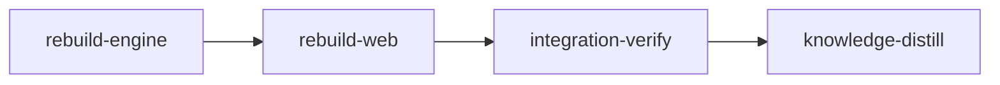

# Plan: Summary rebuilds and cost

Implements: section_04

## Overview

Plan 4 made summaries sealable from a terminal; this plan keeps them current without a manual step and makes their cost visible. After each watcher batch the planning server collects the summaries the batch made stale, incomplete or missing, starts one background summary session for up to five of them, and above five asks every browser first with the count, the list and a token estimate. It clears the claims of sessions and subagents that ended, stops a summary session once its claims are sealed or released or after ten minutes without a seal, measures every rebuild's tokens from its transcripts, logs them, and shows the running rebuild, the last cost, today's and the week's totals and the quota meters in a summary panel.

Product spec: `doc/product/section_04.md` "Who rebuilds what" (Background, Refinement's turn-end handoff), "Asking before a large rebuild", "Cost", "In read-only mode", and "Clearing claims" under "Sealing a summary"; `doc/product/section_05.md` "Sentences and their marks" (out-of-date reasons) and "Empty and partial states" (building progress, cost line); `doc/product/section_07.md` "Stopping `loom plan`" and "Crashes and kills" for summary sessions. Metaplan entry 10 of `doc/plans/metaplan-planner-ui.md`.

## Goals

- The anti-goal "background summarization whose token cost surprises the user" holds: no more than five summaries rebuild without a question, a first start with no summaries asks, a decline is remembered for the summaries it covered.
- The scheduler never races the authoring session: nothing starts while an authoring turn or a pressure run is active; at turn end what is still out of date goes to the queue.
- A failed rebuild leaves the last sealed text readable and marked; the summaries it held show as failed with the reason.
- Costs match `loom status`'s counts for the same transcripts, because they are computed by the same accumulator.
- Non-goals: the summary skills and agents (plan 8), the session bridge (plan 7), concept mode's rendering (plan 5).

## Sibling plans this plan consumes

Every name below is taken from the sibling's stage YAML and its common brief; the briefs repeat them with the file each lives in. The implementing stages re-read the merged code by symbol, never by line.

- Plan 1 (`PLAN-feat-planner-01-documents.md`): `planning::runtime::RuntimePaths`, `planning::watch::Batch`, `planning::project::Project`.
- Plan 2 (`PLAN-feat-planner-02-server.md`): `plan_server::context::PlanContext` (`on_batch`, `extensions`, `authoring`, `read_only`, `shutdown`, `hub`), route modules (`plan_server/<name>/mod.rs` with `routes()` and `install(ctx)`, one line each in `plan_server/routes.rs`), `RouteSpec`, `ApiRequest`, `ApiResponse`, `PlanMessage` (one variant per wire struct, in `plan_server/wire/<area>.rs`), wire fixture parity tests, `web/src/plan/header-extras.tsx`.
- Plan 4 (`PLAN-feat-planner-04-summary-store.md`): `planning::summary::{engine::EngineUpdate, evaluate::{Evaluation, SummaryState}, claims::{list_claims, clear_session_claims, release}, store::expected_ids}`.
- Plan 5 (`PLAN-feat-planner-05-concept-mode.md`): `plan_server/concept/state.rs::out_of_date_reason(id, state, &PageContext)`, `PageContext` and `progress(&PageContext)` in `plan_server/concept/page.rs`, `concept/routes.rs::page_context`, `web/src/plan/concept/page-header-extras.tsx` and `key-row-extras.tsx`; plan 5 owns the `SummaryEngine` and hands every `EngineUpdate` to subscribers through `ConceptState::subscribe`.
- Plan 7 (`PLAN-feat-planner-07-session-bridge.md`): `plan_session::bridge::Bridge` in `ctx.extensions()` (`start_session(StartRequest { kind, guidance, opening_origin, extra_env })`, `end(id, EndMode::Teardown, EndCause::Caller) -> Result<Vec<String>, BridgeError>` (the returned queue is empty for a summary session and dropped), `subscribe(Box<dyn Fn(&BridgeEvent)>)` with `TurnStarted`, `TurnEnded`, `Ended { outcome }`), the chat model's `Turn.summaries_rebuilding`, `SessionKind::Summary` (plan 6), `LOOM_PLAN_SESSION` in every session's environment, `BridgeEvent::SubagentStopped { id, agent_id }`, `Bridge::transcripts(id)` and the recorded transcripts in `loom/tests/fixtures/plan_session/transcripts/`.
- Plan 8 (`PLAN-feat-planner-08-guidance.md`): `planning::guidance::{render_session_guidance, SessionGuidanceKind::Summary, GuidanceModels::load}`.
- Plan 9 (`PLAN-feat-planner-09-chat.md`): `web/src/plan/chat/rebuilt-summary-extras.tsx` (`<RebuiltSummaryExtras id turn />`, ends each rebuilt-summary row plan 9 renders from `Turn.summaries_rebuilding`).
- Plan 11 (`PLAN-feat-planner-11-execution-handoff.md`) consumes `Rebuilds::suspend(SuspendReason::PressureRun)`.

Every name was confirmed by its producer while the plans were written; the stage still reads the merged code first and records any difference with `loom memory decision`.

## Decisions

1. **A pure scheduler behind a spawner trait.** `plan_server::summaries::scheduler::Scheduler` holds the queue, the declined set, the open question, the running rebuild and the failures, and takes every input as a call (`on_update`, `turn_started`, `turn_ended`, `suspend`, `claims_changed`, `session_ended`, `tick(now)`). It starts and stops sessions only through `trait SessionSpawner`, so every rule is tested with a stub spawner and an injected clock, which is the metaplan's acceptance.
2. **The count that triggers the question is the newly invalidated set.** `EngineUpdate::invalidated` (plan 4) already holds only the summaries that became stale, incomplete or missing in this batch; after a decline those ids join `declined` and stay out of later counts until they become current again or the user presses rebuild.
3. **The first start asks.** The engine's first update reports every out-of-date summary as invalidated, so twelve sections and eight plans with no summaries (22) exceed five and ask.
4. **Suspension is an RAII guard.** `Rebuilds::suspend(reason) -> SuspendGuard`; the scheduler starts nothing while any guard lives. Plan 10 holds an `AuthoringTurn` guard from plan 7's turn-start event to its turn-end event; plan 11 holds a `PressureRun` guard for a run. On the last drop the scheduler recomputes the out-of-date set from the latest evaluation (minus declined) and applies the threshold.
5. **A summary session ends three ways.** Plan 7's bridge tears it down at its first main-agent `Stop` with no subagent running (section 07); the scheduler also stops it once every claim it created has been sealed or released, and after `NO_SEAL_TIMEOUT` (10 minutes) since its start or its last seal, releasing its claims and marking the summaries it held as failed with the last `seal` error found in the session's tool results (else "no seal in 10 minutes").
6. **Claims are cleared by the server.** On a session's `BridgeEvent::Ended` (any outcome; the bridge emits it after its own process identity check), `clear_session_claims(paths, session)`; on `SubagentStopped`, the claims whose ids that subagent passed to `loom plan summary brief` are released. Which subagent ran which `brief` is read from the subagent's own transcript (its Bash `tool_use` input), the same record the PreToolUse hook event carries (section 04 names the hook event); the transcript needs no new hook payload and is already the cost source.
7. **Cost is counted by the token tracker's accumulator.** `tokens::accumulate::AgentState::{new, ingest}` (`loom/src/tokens/accumulate.rs:87`, `:117`, `pub(crate)`) consumes complete transcript lines with `tokens/claude_line.rs::parse_line` (`:21`) and the per-message merge, so a streamed message counts once with its final usage, as in `loom status`. A background session's subagent that built one summary is costed per summary; the session's own transcript is costed as one batch line for the overviews. Unknown fields stay absent, never zero.
8. **Estimates.** Per summary: its last recorded cost; otherwise the per-level median of cost per source byte across the log times the summary's source bytes; with no log line at that level, a fixed starting figure (`DOCUMENT_STARTING_TOKENS = 40_000`, `OVERVIEW_STARTING_TOKENS = 150_000`), labelled as such.
9. **Quota comes from the account-shared poller.** The server runs `quota::poller::spawn_quota_poller(runtime_dir, shutdown)` (`loom/src/quota/poller.rs:44`), which polls through `quota::shared` (one request per account across every daemon) and caches under `<runtime dir>/quota/`; the panel reads `quota::read_snapshot(runtime_dir)` (`quota/mod.rs:32`) and renders it with the dashboard's `QuotaMeters` (`web/src/components/quota-meters.tsx:40`).
10. **Read-only mode starts nothing** (section 04 "In read-only mode"): the scheduler is built with `read_only` from `ctx.read_only()`, never spawns or asks, and the panel shows the reason and fix.
11. **No knowledge-bootstrap**: plans 1 and 4 recorded the planning library in the knowledge base.

## Execution Diagram



## Stages

### 1. `rebuild-engine` (loom/)

Cost library, scheduler, the `Rebuilds` facade, claim clearing, cost attribution, the quota poller, routes, wire types and fixtures, and the concept-mode reason hooks. Lanes `["claude", "codex"]`: four codex units write the cost lines and log, the estimates, the wire types and the routes with their tests; Claude keeps the scheduler, facade, spawner and attribution (W2, opus at xhigh: concurrent state across threads) ; Sol/high takes the message variants, registration, fixtures and plan 5 hook edits (W3). Necessity: the Rust half; `rebuild-web` runs in `web/` (one working directory per stage) and needs this stage's wire fixtures merged (Q1).

Risk checklist: lifecycle and concurrency (the scheduler rules: `auto-rebuild-up-to-five`, `first-start-asks`, `decline-counts-only-new`, `no-start-during-turn`, `one-summary-session-at-a-time`, `stalled-session-stopped`, `session-stopped-when-claims-done`, `claims-cleared-on-session-end`), configuration propagation (`read-only-starts-nothing`), external data correctness (transcripts are Claude Code's format: `cost-matches-token-tracker` on recorded lines), untrusted input (`answer-only-by-holder-or-free`), reachability (`rebuild-route-starts-session`).

### 2. `rebuild-web` (web/)

The summary panel with quota meters, the budget question, the approval notice and rebuild buttons on concept-mode summary pages, and per-summary tokens in the chat's turn footer. Lanes `["claude", "codex"]`: codex writes the zod schemas and the per-row token figure; Claude (W1, sonnet) builds the panel, status control, question, notice and buttons, which are UI design. Necessity: Q1 (needs stage 1's wire fixtures) and the working-directory rule.

### Integration Verification

Full Rust and web gates, review subagents for architecture and test coverage, and an operator-run rebuild of this repository's summaries whose token cost the stage records in its memory (metaplan acceptance).

### Knowledge Distillation

The scheduler rules and cost model as a tier-2 topic; README note on the summary panel.

---

<!-- loom METADATA -->

```yaml
loom:
  version: 2
  ratchet_files:
    - loom/maintainability-baseline.txt
    - doc/loom/knowledge/check-baseline.txt
  provision:
    - working_dir: "web"
      command: "test ! -e .npmrc && test ! -L .npmrc && bun install --frozen-lockfile --ignore-scripts --backend=copyfile --config=/dev/null"
  sandbox:
    enabled: true
    auto_allow: true
    filesystem:
      deny_read: ["~/.ssh/**", "~/.aws/**", "~/.config/gcloud/**", "~/.gnupg/**"]
    network:
      allowed_domains: ["crates.io", "index.crates.io", "static.crates.io", "registry.npmjs.org"]
      allow_local_binding: false
      allow_unix_sockets: []
  stages:
    - id: rebuild-engine
      name: "Rebuild scheduler, claim clearing and cost"
      summary: "Adds the server's summary scheduler (auto-rebuild up to five, ask above five, one summary session at a time, suspended during authoring turns and pressure runs, stopped when done or stalled), clears claims of ended sessions, measures and logs each rebuild's tokens, and serves the summary panel's data."
      stage_type: standard
      skills: ["loom-rust", "loom-concurrency"]
      implementers: ["codex", "claude"]
      subagent_timeout_secs: 1200
      working_dir: "loom"
      dependencies: []
      sandbox:
        network:
          allowed_domains: ["crates.io", "index.crates.io", "static.crates.io", "registry.npmjs.org"]
          allow_local_binding: true
          allow_unix_sockets: []
      description: |
        Build stage 1 of doc/plans/PLAN-feat-planner-10-summary-rebuilds.md (doc/plans/IN_PROGRESS-PLAN-feat-planner-10-summary-rebuilds.md once loom run starts). Plans 1 to 9 are merged.
        Use parallel subagents and skills to maximize performance.
        PATHS: working_dir is loom/. YAML paths and the worker table are package-relative (../ for repository files); brief paths are repo-relative.
        FIRST (orchestrator): read doc/plans/briefs/feat-planner-10-summary-rebuilds/common.md, then confirm every sibling name its "Consumed interfaces" table marks with a grep of the merged tree (rg -n '<symbol>' src); for each one that differs, record loom memory decision "sibling-name: <assumed> is <actual> at <file:line>" and put the actual name in the workers' spawn prompts. This is the only place the plan tolerates drift; never edit a sibling's module beyond the lines the briefs name.
        Every worker reads doc/plans/briefs/feat-planner-10-summary-rebuilds/common.md first, then its own brief.
        Territories are DISJOINT across both lanes. Workers NEVER spawn subagents. Every prompt is the fixed prompt plus "Your brief: <path>. Read it in full before anything else."
        LANES: Use the ownership table: codex sol/high means --model gpt-6.1-sol --effort high; codex terra/high means --model gpt-6.1-terra --effort high. Spawn Codex workers as loom-codex-forwarder in the FOREGROUND, at most six per wave over disjoint files, with an explicit Bash timeout of 600000 ms and the row's brief path. Never use codex:codex-rescue. Workers never spawn subagents, run git, or write under .loom/. Workers run compile-only checks; the orchestrator runs the briefs' test commands and checks git status --short after each wave. For a broad worker territory, split the brief into ordered file-sized forwards within that territory before dispatch to fit the 540 s wrapper deadline; keep shared interfaces pinned and finish producers before consumers. A timed-out unit is re-split against its partial result, never re-forwarded unchanged. Retain the existing Claude fallback when Codex is unavailable and evidence-based escalation for failed fixes. Only rows marked opus use loom-senior-software-engineer in the background; wait for them with loom subagents watch. Each prompt says: Your brief: <path>. Read it in full before anything else.
        SEED (orchestrator, under 20 lines, after the contract freeze): the contract scaffold already declared `mod cost;` in src/planning/summary/mod.rs and a declaration-only src/planning/summary/cost.rs holding `#[cfg(test)] mod contract_tests;`: leave both to C1 (its brief makes the line `pub mod cost;` and keeps `mod contract_tests;`); add `pub mod summaries;` to src/plan_server/mod.rs (one line); create src/plan_server/summaries/mod.rs declaring `pub mod scheduler; pub mod rebuilds; pub mod spawner; pub mod attribution; pub mod routes;` and those files with only their `//!` line; `pub mod summaries;` in src/plan_server/wire/mod.rs with an empty src/plan_server/wire/summaries.rs. W2 owns plan_server/summaries/mod.rs afterwards, W3 the wire files.
        WAVES: (1) C1 and C2 in the foreground. (2) Spawn W2 (loom-senior-software-engineer, opus/xhigh) in the background; run C3 and W3 in the foreground using C1's TokenVector, CostLine and Trigger. Wait for W2 with loom subagents watch. (3) C4 after W2 and C3, using their Rebuilds API and wire types.
        AFTER THE WAVES: rustfmt --check --edition 2021 on the contract files (tests/plan_summary_rebuild_contracts.rs, src/planning/summary/cost/contract_tests.rs); cargo fmt --all; cargo test --test maintainability; one loom check.
        LEDGER: no row of maintainability-baseline.txt changes.
        MUTATION: for each contract apply the wrong implementation its rejects: names, confirm it fails, restore from a saved copy, record loom memory note "mutation: <id> red under <mutation>".

        | Worker | Role | Tier | Files owned | Shared context | Brief path |
        | ------ | ---- | ---- | ----------- | -------------- | ---------- |
        | C1 | Cost lines, log and transcript tokens | codex sol/high | src/planning/summary/cost.rs; src/planning/summary/cost/tests.rs; src/planning/summary/mod.rs | common.md | doc/plans/briefs/feat-planner-10-summary-rebuilds/rebuild-engine/c1-cost.md |
        | C2 | Estimates and totals | codex sol/high | src/planning/summary/cost/estimate.rs; src/planning/summary/cost/estimate_tests.rs | common.md | doc/plans/briefs/feat-planner-10-summary-rebuilds/rebuild-engine/c2-estimate.md |
        | W2 | Scheduler, Rebuilds, spawner, attribution | opus/xhigh | src/plan_server/summaries/mod.rs; src/plan_server/summaries/scheduler.rs; src/plan_server/summaries/scheduler/tests.rs; src/plan_server/summaries/rebuilds.rs; src/plan_server/summaries/spawner.rs; src/plan_server/summaries/attribution.rs; src/plan_server/summaries/attribution/tests.rs; src/plan_session/bridge/rebuilding.rs; src/plan_session/bridge/mod.rs | common.md | doc/plans/briefs/feat-planner-10-summary-rebuilds/rebuild-engine/w2-scheduler.md |
        | C3 | Wire types | codex terra/high | src/plan_server/wire/summaries.rs; src/plan_server/wire/tests_summaries.rs | common.md | doc/plans/briefs/feat-planner-10-summary-rebuilds/rebuild-engine/c3-wire.md |
        | C4 | Routes | codex sol/high | src/plan_server/summaries/routes.rs; src/plan_server/summaries/routes/tests.rs | common.md | doc/plans/briefs/feat-planner-10-summary-rebuilds/rebuild-engine/c4-routes.md |
        | W3 | Message variants, registration, fixtures, concept hooks | codex sol/high | src/plan_server/wire/mod.rs; src/plan_server/wire/message.rs; src/plan_server/routes.rs; src/plan_server/concept/state.rs; src/plan_server/concept/page.rs; src/plan_server/concept/routes.rs; ../web/src/plan/api/fixtures/summary-panel.json; ../web/src/plan/api/fixtures/summary-question.json; ../web/src/plan/api/fixtures/summary-turn-cost.json | common.md | doc/plans/briefs/feat-planner-10-summary-rebuilds/rebuild-engine/w3-routes.md |

        CONTRACT SURFACE (the contract session writes tests/plan_summary_rebuild_contracts.rs and src/planning/summary/cost/contract_tests.rs from this text and common.md before any code; top-level #[test] fns at most 50 lines, files at most 400 lines, rustfmt-clean):
        - loom::plan_server::summaries::scheduler::{Scheduler::new(config: SchedulerConfig { read_only: Option<String>, limit: usize, no_seal_timeout: Duration }) -> Scheduler, on_update(&mut self, invalidated: &[String], out_of_date: &[String], now: Instant, spawner: &dyn SessionSpawner) -> Vec<SchedulerEvent>, turn_started(&mut self), turn_ended(&mut self, out_of_date: &[String], now, spawner), suspend(&mut self, reason: SuspendReason) -> u64 /* token */, resume(&mut self, token: u64, out_of_date, now, spawner), answer(&mut self, question: &str, rebuild: bool, right: AnswerRight, now, spawner) -> Result<(), AnswerRefused>, claims_changed(&mut self, session: &str, held: &[String], now, spawner), seal_seen(&mut self, id: &str, now), session_ended(&mut self, session: &str, now, spawner), tick(&mut self, now: Instant, spawner) -> Vec<SchedulerEvent>, panel_state(&self) -> SchedulerView}
        - trait SessionSpawner { fn start_summary(&self, ids: &[String]) -> anyhow::Result<String>; fn stop(&self, session: &str, release_claims: bool); } (the real spawner's stop calls plan 7's bridge.end(session, EndMode::Teardown, EndCause::Caller) -> Result<Vec<String>, BridgeError> and drops the Vec; contracts use a stub spawner)
        - enum SchedulerEvent { Started { session: String, ids: Vec<String> }, Asked(QuestionView { id: String, ids: Vec<String> }), QuestionClosed { id: String }, Stopped { session: String, reason: StopReason }, Failed { ids: Vec<String>, error: String } }; enum AnswerRight { Holder, FreeAuthoring, NotAllowed }; enum SuspendReason { AuthoringTurn, PressureRun }
        - SchedulerView { running: Option<(String, Vec<String>)>, queue: Vec<String>, declined: Vec<String>, failed: Vec<(String, String)>, question: Option<QuestionView>, read_only: Option<String>, terminal_claims: Vec<String> }; Scheduler::authoring_state_idle(&mut self, session: &str, out_of_date, now, spawner) (releases an open AuthoringTurn suspension when the authoring session goes Idle or Ended without a TurnEnded)
        - loom::plan_server::summaries::attribution::Attribution::{new(paths: RuntimePaths), sweep_after_recovery(&mut self, live: &[&str], left_alone: &[&str]) -> anyhow::Result<Vec<String> /* terminal claim ids */>}; Rebuilds::new_for_test(spawner: Arc<dyn SessionSpawner>, read_only: Option<String>, broadcast: Arc<dyn Fn(&PlanMessage) + Send + Sync>) and Rebuilds::on_update(&self, update: &EngineUpdate); PlanMessage::ConceptChanged(loom::plan_server::wire::concept::ConceptChanged { pages: Vec<String>, out_of_date: Vec<String>, sources: Vec<String> }) with pages from loom::plan_server::concept::page_keys_for_summary(id, &Project)
        - In-crate (cost/contract_tests.rs, test path planning::summary::cost::contract_tests::<fn>): crate::planning::summary::cost::{transcript_tokens(path: &Path) -> anyhow::Result<TokenVector>, TokenVector { fresh_input, cache_write, cache_read, output: Option<u64> }, estimate(log: &[CostLine], pending: &[(String, Level, u64)]) -> Estimate { tokens: u64, per_summary: Vec<(String, u64)>, basis: EstimateBasis }, CostLine, Level::{Document, Overview}} and crate::tokens::accumulate::AgentState::{new, ingest} with crate::tokens::AgentKind::Main as the reference counter (read its pub(crate) total: TokenUsage).
        Contracts are red at freeze because the scheduler and cost modules do not exist.

        MEMORY: record mistakes, decisions and surprises via loom memory immediately (subagents too); NEVER loom knowledge (implementation stage); NEVER Claude Code auto-memory.
      files:
        - "src/planning/summary/mod.rs"
        - "src/planning/summary/cost.rs"
        - "src/planning/summary/cost/**"
        - "src/plan_server/summaries/**"
        - "src/plan_server/wire/summaries.rs"
        - "src/plan_server/wire/tests_summaries.rs"
        - "src/plan_server/wire/mod.rs"
        - "src/plan_server/wire/message.rs"
        - "src/plan_server/routes.rs"
        - "src/plan_server/mod.rs"
        - "src/plan_session/bridge/rebuilding.rs"
        - "src/plan_session/bridge/mod.rs"
        - "src/plan_server/concept/state.rs"
        - "src/plan_server/concept/page.rs"
        - "src/plan_server/concept/routes.rs"
        - "tests/plan_summary_rebuild_contracts.rs"
        - "../web/src/plan/api/fixtures/summary-panel.json"
        - "../web/src/plan/api/fixtures/summary-question.json"
        - "../web/src/plan/api/fixtures/summary-turn-cost.json"
      acceptance:
        - "cargo build"
        - "cargo test --lib planning::summary::cost::"
        - "cargo test --lib plan_server::summaries::"
        - "cargo test --lib plan_server::wire::"
        - "cargo test --lib plan_server::concept::"
        - "cargo test --lib plan_session::bridge::"
        - "cargo test --test plan_summary_rebuild_contracts"
        - "cargo test --test maintainability"
        - "cargo clippy --all-targets -- -D warnings"
        - "cargo fmt --check"
        - "RUSTDOCFLAGS='-D warnings' cargo doc --workspace --all-features --no-deps"
      before_stage:
        - command: 'rg -qF "pub fn start_session" src/plan_session'
          description: "plan 7's bridge is merged"
      after_stage:
        - command: 'rg -qF "summaries::" src/plan_server/routes.rs'
          description: "the summaries route module is registered"
      artifacts:
        - "src/planning/summary/cost.rs"
        - "src/plan_server/summaries/scheduler.rs"
        - "src/plan_server/summaries/rebuilds.rs"
        - "src/plan_server/summaries/spawner.rs"
        - "src/plan_server/summaries/attribution.rs"
        - "src/plan_server/summaries/routes.rs"
        - "src/plan_server/wire/summaries.rs"
      wiring:
        - source: "src/plan_server/routes.rs"
          pattern: "summaries::"
          literal: true
          description: "the summaries route module is registered and installed"
        - source: "src/plan_server/concept/state.rs"
          pattern: "AwaitingApproval"
          literal: true
          description: "concept mode's out-of-date reason reads the scheduler"
        - source: "src/plan_server/summaries/mod.rs"
          pattern: "spawn_quota_poller("
          literal: true
          description: "the planning server polls quota through the account-shared poller"
        - source: "src/plan_server/summaries/attribution.rs"
          pattern: "set_rebuilding("
          literal: true
          description: "rebuilt summaries are named on the authoring turn"
      reachable:
        - symbol: start_summary
          from: install
          description: "the real spawner is reached from the route module's install"
      contracts:
        - id: auto-rebuild-up-to-five
          file: tests/plan_summary_rebuild_contracts.rs
          test: auto_rebuild_up_to_five
          scenario: "a Scheduler with limit 5 and a recording stub spawner; on_update with 5 invalidated ids, then (fresh scheduler) with 6"
          rejects: "a threshold off by one or inverted (5 must start one session with all 5 ids and ask nothing; 6 must start nothing and emit Asked with the 6 ids)"
        - id: first-start-asks
          file: tests/plan_summary_rebuild_contracts.rs
          test: first_start_asks
          scenario: "a fresh Scheduler; the first on_update carries 22 invalidated ids (12 sections, 8 plans, 2 overviews, all missing)"
          rejects: "a scheduler that treats missing summaries as free and rebuilds them without asking"
        - id: decline-counts-only-new
          file: tests/plan_summary_rebuild_contracts.rs
          test: decline_counts_only_new
          scenario: "on_update with 8 ids -> Asked; answer(rebuild=false, Holder); then on_update with invalidated [n1, n2] and out_of_date = the 8 plus n1, n2"
          rejects: "a scheduler that counts the declined 8 again (it must start one session with exactly [n1, n2])"
        - id: no-start-during-turn
          file: tests/plan_summary_rebuild_contracts.rs
          test: no_start_during_turn
          scenario: "turn_started; on_update with 3 ids; then turn_ended with out_of_date of those 3 minus one that became current; and separately suspend(PressureRun), on_update with 2 ids, resume"
          rejects: "a scheduler that starts while an authoring turn or a pressure run is active, or forgets the queue at turn end (one start with the 2 still out of date after turn_ended; one start with 2 after resume)"
        - id: one-summary-session-at-a-time
          file: tests/plan_summary_rebuild_contracts.rs
          test: one_summary_session_at_a_time
          scenario: "on_update with [a, b] starts s1; on_update with [c] while s1 runs; session_ended(s1)"
          rejects: "a second concurrent session for c, or dropping c (c starts as the next batch only after s1 ends)"
        - id: stalled-session-stopped
          file: tests/plan_summary_rebuild_contracts.rs
          test: stalled_session_stopped
          scenario: "start s1 for [a, b] at t0; seal_seen(a) at t0+4 min; tick at t0+13 min; tick at t0+15 min"
          rejects: "a stall timer measured from the start instead of the last seal (no stop at +13), or one that never fires (stop with release_claims true at +15 and Failed { ids: [b] })"
        - id: session-stopped-when-claims-done
          file: tests/plan_summary_rebuild_contracts.rs
          test: session_stopped_when_claims_done
          scenario: "start s1 for [a, b]; claims_changed(s1, [a, b]); claims_changed(s1, [b]); claims_changed(s1, [])"
          rejects: "a scheduler that stops before claims are taken, or never stops once all claims are gone (stop exactly once, after the empty list)"
        - id: claims-cleared-on-session-end
          file: tests/plan_summary_rebuild_contracts.rs
          test: claims_cleared_on_session_end
          scenario: "loom::plan_server::summaries::attribution::Attribution with a TempDir RuntimePaths holding claim files for sessions s1 (a, b) and s2 (c); on_session_ended(s1); then on_subagent_stopped(s2, agent x, transcript) where the transcript file holds one assistant tool_use Bash block running `loom plan summary brief c`"
          rejects: "clearing every claim, or none (after s1 ends only c's claim remains; after agent x stops none remains)"
        - id: answer-only-by-holder-or-free
          file: tests/plan_summary_rebuild_contracts.rs
          test: answer_only_by_holder_or_free
          scenario: "an open question; answer with AnswerRight::NotAllowed, then FreeAuthoring"
          rejects: "a scheduler that lets a read-only browser answer while another holds authoring (NotAllowed is refused and the question stays open; FreeAuthoring is accepted)"
        - id: read-only-starts-nothing
          file: tests/plan_summary_rebuild_contracts.rs
          test: read_only_starts_nothing
          scenario: "SchedulerConfig { read_only: Some(\"tmux is not installed\"), .. }; on_update with 2 ids and with 9 ids; tick"
          rejects: "a read-only server that spawns or asks (no Started, no Asked; panel_state().read_only carries the reason)"
        - id: startup-sweeps-dead-claims
          file: tests/plan_summary_rebuild_contracts.rs
          test: startup_sweeps_dead_claims
          scenario: "a TempDir RuntimePaths holding claims for session dead1 (no live session), live1 (live), left1 (left alone by recovery) and a null-session terminal claim; Attribution::sweep_after_recovery(live: &[\"live1\"], left_alone: &[\"left1\"])"
          rejects: "a start-up that keeps claims of sessions that died with the last server (dead1's claim must be gone) or deletes live, left-alone or terminal claims (those three remain; the terminal claim id is returned for the panel's release action)"
        - id: turn-suspension-released-on-idle
          file: tests/plan_summary_rebuild_contracts.rs
          test: turn_suspension_released_on_idle
          scenario: "turn_started for authoring session a1; on_update with 2 ids; then authoring_state_idle(a1) with no turn_ended (an interrupt Claude Code closes without a Stop)"
          rejects: "a scheduler whose authoring suspension is released only by turn_ended, so background rebuilds stay suspended after an interrupt (one start with the 2 ids after authoring_state_idle)"
        - id: rebuild-state-change-notifies-concept
          file: tests/plan_summary_rebuild_contracts.rs
          test: rebuild_state_change_notifies_concept
          scenario: "Rebuilds::new_for_test with a recording broadcaster; on_update with 6 ids for product/section_01..06 (a question opens); answer rebuild=true"
          rejects: "a facade that changes out_of_date_reason or building without telling concept mode (each step broadcasts a ConceptChanged whose pages are page_keys_for_summary of those ids: product/section_01..06 and product, with out_of_date the six ids and sources empty)"
        - id: cost-matches-token-tracker
          file: src/planning/summary/cost/contract_tests.rs
          test: planning::summary::cost::contract_tests::cost_matches_token_tracker
          scenario: "a transcript copied from plan 7's recorded fixtures (loom/tests/fixtures/plan_session/transcripts/*.jsonl) plus two streamed lines sharing one message.id with growing output; transcript_tokens(path) versus an AgentState::new(AgentKind::Main, path) fed every line with ingest"
          rejects: "a cost reader that sums every assistant line (a streamed message counted twice) or reads usage its own way, so totals differ from loom status"
        - id: estimate-uses-log-or-starting-figure
          file: src/planning/summary/cost/contract_tests.rs
          test: planning::summary::cost::contract_tests::estimate_uses_log_or_starting_figure
          scenario: "estimate with an empty log for one document summary of 10_000 source bytes; then with a log holding one document line for plans/a (12_000 tokens, 6_000 bytes recorded) and pending [plans/a 6_000 bytes, plans/b 3_000 bytes]"
          rejects: "an estimate that returns zero with an empty log, or ignores a summary's last cost (expected basis starting with 40_000; then plans/a 12_000 and plans/b 6_000 by the per-byte median)"
        - id: rebuild-route-starts-session
          file: tests/plan_summary_rebuild_contracts.rs
          test: rebuild_route_starts_session
          scenario: "loom::plan_server::summaries::rebuilds::Rebuilds::new_for_test(stub spawner, read_only None); enqueue(vec![a; 9 ids], Trigger::Button)"
          rejects: "a rebuild button that goes through the budget question (Button must start at once even above the limit)"

    - id: rebuild-web
      name: "Summary panel, budget question and rebuild buttons"
      summary: "Adds the summary panel with the running rebuild, last cost, today and 7-day totals and the quota meters, the above-budget question every browser sees, rebuild buttons on summary pages, and per-summary tokens in the chat's turn footer."
      stage_type: standard
      skills: ["loom-react", "loom-typescript"]
      implementers: ["codex", "claude"]
      subagent_timeout_secs: 1200
      working_dir: "web"
      dependencies: ["rebuild-engine"]
      description: |
        Build stage 2 of doc/plans/PLAN-feat-planner-10-summary-rebuilds.md (IN_PROGRESS- once running).
        Use parallel subagents and skills to maximize performance.
        PATHS: working_dir is web/. Brief paths are repo-relative.
        Read doc/plans/briefs/feat-planner-10-summary-rebuilds/common.md. WAVES: C1 and C2 in one foreground wave, then W1 in the foreground. LANES: Use the ownership table: codex sol/high means --model gpt-6.1-sol --effort high; codex terra/high means --model gpt-6.1-terra --effort high. Spawn Codex workers as loom-codex-forwarder in the FOREGROUND, at most six per wave over disjoint files, with an explicit Bash timeout of 600000 ms and the row's brief path. Never use codex:codex-rescue. Workers never spawn subagents, run git, or write under .loom/. Workers run compile-only checks; the orchestrator runs the briefs' test commands and checks git status --short after each wave. For a broad worker territory, split the brief into ordered file-sized forwards within that territory before dispatch to fit the 540 s wrapper deadline; keep shared interfaces pinned and finish producers before consumers. A timed-out unit is re-split against its partial result, never re-forwarded unchanged. Retain the existing Claude fallback when Codex is unavailable and evidence-based escalation for failed fixes. Only rows marked opus use loom-senior-software-engineer in the background; wait for them with loom subagents watch. Each prompt says: Your brief: <path>. Read it in full before anything else. The orchestrator runs bun run format, bun run check and one loom check beside the final review round. DIST ORDER: after the gate and final review are green, commit the feature, then rebuild dist/ (bun run build) and commit dist/ last, staging every new file under dist/; never rebuild after the final review round.
        LEDGER: web files are not in loom/maintainability-baseline.txt; keep every new file under 400 lines anyway.

        | Worker | Role | Tier | Files owned | Shared context | Brief path |
        | ------ | ---- | ---- | ----------- | -------------- | ---------- |
        | C1 | Summary zod schemas | codex terra/high | src/plan/api/schema-summaries.ts; src/plan/api/schema-summaries.test.ts | common.md | doc/plans/briefs/feat-planner-10-summary-rebuilds/rebuild-web/c1-schema.md |
        | C2 | Per-row token figure | codex terra/high | src/plan/summaries/summary-tokens.tsx; src/plan/summaries/summary-tokens.test.tsx | common.md | doc/plans/briefs/feat-planner-10-summary-rebuilds/rebuild-web/c2-tokens.md |
        | W1 | Panel, status control, question, notice, buttons, mounts | codex sol/high | src/plan/summaries/summary-panel.tsx; src/plan/summaries/summary-status.tsx; src/plan/summaries/rebuild-question.tsx; src/plan/summaries/approval-notice.tsx; src/plan/summaries/rebuild-button.tsx; src/plan/summaries/state.ts; src/plan/summaries/summary-panel.test.tsx; src/plan/summaries/summary-status.test.tsx; src/plan/summaries/rebuild-question.test.tsx; src/plan/header-extras.tsx; src/plan/chat/rebuilt-summary-extras.tsx; src/plan/concept/page-header-extras.tsx; src/plan/concept/key-row-extras.tsx | common.md | doc/plans/briefs/feat-planner-10-summary-rebuilds/rebuild-web/w1-panel.md |

        CONTRACT SURFACE (the contract session writes src/plan/summaries/contracts.test.tsx from this text before any code; vitest with @testing-library/react as the existing web tests use; fixtures from src/plan/api/fixtures/summary-*.json):
        - <SummaryPanel panel={SummaryPanel} nowSecs={number} /> from src/plan/summaries/summary-panel.tsx
        - <RebuildQuestion question={SummaryQuestion} canAnswer={boolean} onAnswer={(rebuild: boolean) => void} /> from src/plan/summaries/rebuild-question.tsx
        - <SummaryTokens tokens={number | null} /> from src/plan/summaries/summary-tokens.tsx (the per-row token figure; "tokens unknown" for null)
        - <SummaryStatus compact?={boolean} /> from src/plan/summaries/summary-status.tsx (seeds from GET /api/summaries/panel, reseeds on plan 2's socket resync, auto-opens on a question without moving focus)
        - <ApprovalNotice question={SummaryQuestion} canAnswer={boolean} onAnswer={(rebuild: boolean) => void} /> from src/plan/summaries/approval-notice.tsx; <RebuildButton ids={string[]} /> from src/plan/summaries/rebuild-button.tsx (hidden when the jotai atom canAuthorAtom is false and authoring is held by another browser)
        Contracts are red at freeze because the components do not exist.

        MEMORY: record mistakes, decisions and surprises via loom memory immediately; NEVER loom knowledge; NEVER Claude Code auto-memory.
      files:
        - "src/plan/summaries/**"
        - "src/plan/api/schema-summaries.ts"
        - "src/plan/api/schema-summaries.test.ts"
        - "src/plan/header-extras.tsx"
        - "src/plan/chat/rebuilt-summary-extras.tsx"
        - "src/plan/concept/page-header-extras.tsx"
        - "src/plan/concept/key-row-extras.tsx"
        - "dist/**"
      acceptance:
        - "bun run typecheck"
        - "bun run lint"
        - "bun run format:check"
        - "bun run test"
        - 'd=$(mktemp -d "${TMPDIR:-/tmp}/rebuilddist.XXXXXX") && node_modules/.bin/vite build --outDir "$d" --emptyOutDir --logLevel error && diff -r "$d" dist && test -z "$(git ls-files --others --exclude-standard -- dist)" && git diff --quiet -- dist'
      before_stage:
        - command: "test -f src/plan/api/fixtures/summary-panel.json"
          description: "rebuild-engine's wire fixtures are merged"
      after_stage:
        - command: 'rg -qF "SummaryStatus" src/plan/header-extras.tsx'
          description: "the summary control is mounted"
      artifacts:
        - "src/plan/summaries/summary-panel.tsx"
        - "src/plan/summaries/rebuild-question.tsx"
        - "src/plan/summaries/summary-tokens.tsx"
        - "src/plan/summaries/summary-status.tsx"
        - "src/plan/api/schema-summaries.ts"
      wiring:
        - source: "src/plan/header-extras.tsx"
          pattern: "SummaryStatus"
          literal: true
          description: "the summary status control is mounted in the planning header"
        - source: "src/plan/chat/rebuilt-summary-extras.tsx"
          pattern: "SummaryTokens"
          literal: true
          description: "each rebuilt-summary row of a turn footer ends with its tokens"
        - source: "src/plan/concept/key-row-extras.tsx"
          pattern: "ApprovalNotice"
          literal: true
          description: "the above-budget notice sits in the concept key row"
      contracts:
        - id: panel-shows-costs-and-quota
          file: src/plan/summaries/contracts.test.tsx
          test: "panel shows running rebuild, last cost, totals and quota"
          runner: vitest
          scenario: "renders SummaryPanel with the summary-panel.json fixture (running rebuild of 3, last cost line, today and week totals, a quota snapshot with a 5h and a 7d window)"
          rejects: "a panel that omits the quota meters, shows fresh tokens as cache reads, or renders an absent token field as 0"
        - id: question-answerable-only-when-allowed
          file: src/plan/summaries/contracts.test.tsx
          test: "question offers rebuild only to a browser that may answer"
          runner: vitest
          scenario: "renders RebuildQuestion from summary-question.json with canAnswer false, then true, and clicks Not now"
          rejects: "a question whose buttons a read-only browser can press, or a Not now that calls onAnswer(true)"
        - id: turn-rows-name-summaries
          file: src/plan/summaries/contracts.test.tsx
          test: "rebuilt summary rows show tokens or tokens unknown"
          runner: vitest
          scenario: "renders SummaryTokens with tokens 12000 and with null"
          rejects: "a row that prints 0 or null for an unknown figure, or omits the known one (12,000 tokens; tokens unknown)"

        - id: panel-shows-read-only-reason
          file: src/plan/summaries/contracts.test.tsx
          test: "panel shows the read-only reason instead of controls"
          runner: vitest
          scenario: "renders SummaryPanel with the summary-panel.json fixture with read_only set to 'tmux is not installed', and RebuildButton inside a provider where the browser is read-only"
          rejects: "a panel that hides why nothing rebuilds, or offers a rebuild button that cannot work"
        - id: approval-notice-for-author
          file: src/plan/summaries/contracts.test.tsx
          test: "approval notice shows the stale count and an approve button only for the author"
          runner: vitest
          scenario: "renders ApprovalNotice from src/plan/summaries/approval-notice.tsx with the summary-question.json question, once with canAnswer true and once false"
          rejects: "a notice that omits the count, or shows a working approve button to a read-only browser (section 05 'Rebuild above the budget waiting for approval')"

        - id: arriving-question-keeps-focus
          file: src/plan/summaries/contracts.test.tsx
          test: "an arriving question opens the popover without taking focus"
          runner: vitest
          scenario: "renders SummaryStatus beside a focused textarea; delivers a summary_question message through the mocked socket"
          rejects: "a popover that moves focus to Rebuild all on open (the textarea keeps focus, the question text is in a polite live region, and pressing Enter does not call the answer route)"
        - id: panel-reseeds-on-resync
          file: src/plan/summaries/contracts.test.tsx
          test: "the panel reseeds after a reconnect"
          runner: vitest
          scenario: "SummaryStatus seeded from a mocked GET /api/summaries/panel showing a running rebuild; the socket reconnects (plan 2's resync fires) and the mocked GET now returns no running rebuild and no question"
          rejects: "a panel seeded once that keeps a finished rebuild or a closed question after a reconnect"
        - id: panel-load-error-shown
          file: src/plan/summaries/contracts.test.tsx
          test: "a failed panel fetch shows its error"
          runner: vitest
          scenario: "SummaryStatus whose GET /api/summaries/panel returns 500; open the popover"
          rejects: "a popover stuck on a skeleton or blank when the panel cannot load (the error line is shown with a retry)"
        - id: compact-header-control
          file: src/plan/summaries/contracts.test.tsx
          test: "the compact header control shows a glyph and count"
          runner: vitest
          scenario: "renders SummaryStatus compact with the summary-panel.json fixture (3 queued)"
          rejects: "a compact variant that renders the full text label (it shows the glyph, the count 3 and an accessible name naming the state)"

    - id: integration-verify
      name: "Integration Verification"
      summary: "Confirms automatic rebuilds, the budget question and the cost panel work end to end on the merged tree, records a real rebuild's token cost, and runs the full suites."
      stage_type: integration-verify
      skills: ["loom-rust", "loom-react"]
      working_dir: "web"
      dependencies: ["rebuild-web"]
      description: |
        Final verification of doc/plans/PLAN-feat-planner-10-summary-rebuilds.md. Verify FUNCTIONAL INTEGRATION, not only tests passing. NEVER Claude Code auto-memory.
        Use parallel subagents and skills to maximize performance.
        CONTEXT: working_dir is web/ (bun gates in their package; cargo through --manifest-path ../loom/Cargo.toml). Read the plan, doc/plans/briefs/feat-planner-10-summary-rebuilds/common.md, loom memory show --all.
        BUILD AND TEST (zero tolerance): every acceptance command below through one loom check.
        CODE REVIEW: parallel loom-code-reviewer subagents: architecture (the scheduler is pure and the facade only adapts; suspension guards are dropped on every path; no second token parser; quota through the account-shared poller only), concurrency (locks between the watcher thread, WS handlers, session event callbacks and the tick thread; no lock held across a spawn or a teardown), test coverage (every contract, section 04's "Who rebuilds what" and "Asking before a large rebuild" row by row, the mutation notes); security with Skill loom-security-audit, against section 12 "Requests that change something" (the rebuild and answer routes check holder-or-free and read-only mode before any scheduler call; no WS path starts a session) and claims handling (claim files deleted only through no-follow unlinkat under the claims dirfd, a symlinked claim file removes the link only, the start-up sweep deletes only claims of sessions that are neither live nor left alone by recovery); layout and accessibility, which jsdom cannot measure (build the bundle and inspect the rendered DOM: the summary popover and the question at 390px and 1280px, the compact header control below lg, focus never moved by an arriving question, the polite live region announcing it, every disabled control's reason reachable by keyboard, light and dark themes). Fix or dispute every finding; never defer one.
        OPERATOR-RUN REBUILD (metaplan acceptance; needs a logged-in Claude Code, tmux and the sandbox prerequisites on the host, none of which this session has): after every acceptance command and review round is green, and only if loom memory list holds no note starting "rebuild-cost:", run loom stage block integration-verify "Operator: create a scratch git repository outside this worktree holding doc/product/index.md listing sections 01 and 02, both section files, and doc/plans/metaplan-scratch.md naming one written plan (copy the shape of the summary contract fixtures); run <this worktree>/loom/target/debug/loom plan --no-open there; open the printed URL, answer the first-start question with Rebuild, wait until the summary panel shows no running rebuild; then run loom memory note 'rebuild-cost: <n> summaries, estimate <x> tokens, <every summary-cost.jsonl line>, today <t>, metaplan doc/plans/metaplan-scratch.md' in this worktree and loom stage retry integration-verify". On retry, confirm the note exists and its numbers are consistent (the jsonl lines sum to at most today's total). There is no other way to complete this step.
        SUGGESTIONS: weigh every pending reviewer suggestion; resolve implemented ones with loom memory resolve <id> --outcome implemented --reason <what changed>.
        Record discoveries to loom memory, including stale knowledge.
      acceptance:
        - "cargo build --manifest-path ../loom/Cargo.toml"
        - command: "cargo test --manifest-path ../loom/Cargo.toml --all-targets --no-fail-fast"
          timeout_secs: 3600
        - command: "cargo test --manifest-path ../loom/Cargo.toml --doc --workspace --all-features -- --test-threads=1"
          timeout_secs: 1200
        - "cargo clippy --manifest-path ../loom/Cargo.toml --all-targets -- -D warnings"
        - "cargo fmt --manifest-path ../loom/Cargo.toml --check"
        - "RUSTDOCFLAGS='-D warnings' cargo doc --manifest-path ../loom/Cargo.toml --workspace --all-features --no-deps"
        - "bun run check"
        - 'd=$(mktemp -d "${TMPDIR:-/tmp}/rebuilddist.XXXXXX") && node_modules/.bin/vite build --outDir "$d" --emptyOutDir --logLevel error && diff -r "$d" dist && test -z "$(git ls-files --others --exclude-standard -- dist)" && git diff --quiet -- dist'
      wiring:
        - source: "src/plan/header-extras.tsx"
          pattern: "SummaryStatus"
          literal: true
          description: "the summary panel is reachable from the header"

    - id: knowledge-distill
      name: "Knowledge Distillation"
      summary: "Records the rebuild scheduler's rules and the cost model in the knowledge base and notes the summary panel in the README."
      stage_type: knowledge-distill
      working_dir: "."
      dependencies: ["integration-verify"]
      description: |
        Curate all stage memories into permanent knowledge; update user docs. NEVER Claude Code auto-memory.
        SINGLE-AGENT: do NOT spawn subagents; keep code spot-reads narrow.
        START with loom memory pending --group; CORRECTIONS FIRST with loom knowledge replace-section.
        Curate: extend architecture/summary-store (plan 4's topic) with a "Rebuilds and cost" section via loom knowledge replace-section if the heading exists, else loom knowledge update architecture/summary-store: the scheduler rules (limit 5, newly invalidated counting, decline memory, suspension guards, one session at a time, the three ends of a summary session, claim clearing), the cost model (accumulator reuse, per-summary versus per-batch attribution, the log, estimates and starting figures), quota through the shared poller. Record the operator-run rebuild's measured cost from integration-verify's "rebuild-cost:" memory as a measured fact with its date and the scratch project's size (it exists: integration-verify cannot complete without it).
        DOCS: README.md: a short paragraph in the loom plan section on automatic summary rebuilds, the five-summary question, and where the summary panel shows cost and quota. Relevant sections only.
        INDEX BUDGET: plan 1 left doc/loom/knowledge/INDEX.md at most 15000 bytes; if this stage's writes push it past 15000 bytes (wc -c), shorten the longest topic blurbs with loom knowledge annotate <category>/<slug> --blurb "<shorter>" until it is back under; never delete a topic to save bytes, and never run loom knowledge check --write-baseline to absorb an INDEX size issue.
        SUGGESTIONS, RECEIPTS and the baseline ratchet as usual; finish with loom memory pending --strict.
      acceptance:
        - "loom knowledge check --strict --baseline doc/loom/knowledge/check-baseline.txt"
        - "loom memory pending --strict"
        - "rg -qF 'summary-cost.jsonl' doc/loom/knowledge/architecture/summary-store.md"
        - 'test "$(wc -c < doc/loom/knowledge/INDEX.md)" -le 15000'
      files: ["doc/loom/knowledge/**", "README.md"]
```

<!-- END loom METADATA -->
