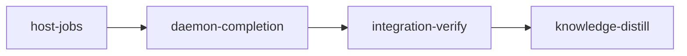

# Plan: Host Verification

## Overview

Every confined command a loom session triggers moves out of the session and onto the host:

- `loom check <stage>`, which the `loom-verifier` and every judge run;
- `loom stage complete <stage>`, from a stage or knowledge session;
- `loom stage contracts freeze <stage>`, from a contract session.

Each becomes a request the session relays. The loom daemon runs it as a child process on the host, under loom's own confinement: bubblewrap on Linux, `sandbox-exec` on macOS, never nested. The session reads per-criterion progress and the result from the state directory. The daemon completes a stage, or freezes its contracts, only from its own run. No pass or fail reported by a session reaches a stage transition any more.

The change applies to every project loom runs, on both platforms:

- Claude Code 2.1.306 refuses user namespaces inside its Linux sandbox, so in-session completion's nested bubblewrap fails every criterion before its command runs.
- Commit `d7ef6a8e` keeps loom working by emitting `sandbox.allowNestedUserNamespaces: true` in every Linux capsule. Claude Code documents that key as letting a sandboxed command bypass write, read and credential denies in any folder it may write. This plan removes it.
- On macOS, in-session criteria run unconfined inside the session's own Seatbelt, behind a daemon-socket grant and the `ValidateInheritedConfinement` RPC. This plan removes both, so the two platforms take one path.
- The completion broker (the PostToolUse hook, the `LOOM_CONTROL_EVIDENCE_V1` record, the `RecordCompletionEvidence` and `CompleteStage` RPCs) existed to carry a session's own verdict to the daemon. The daemon no longer needs that verdict, so the broker goes.

**Run order (operator decision, 2026-10-21).** This plan runs as soon as `PLAN-03-usage-evidence` completes, before plans 4-6 of the token-optimization programme. Its first stage's `before_stage` checks fail until plan 3 has completed and the interim opt-out is in the tree. Every session of this plan runs under the installed binary, which still nests with the opt-out, so the plan completes through today's in-session path. The new path takes effect after `./dev-install.sh`.

**Lanes (operator decision, 2026-10-21).** Claude only. The work is cross-cutting and security-sensitive (completion authority, the daemon's job lifecycle, deletion of the broker and of macOS-only code this machine cannot compile) and converges by running tests.

**Briefs** live under `doc/plans/briefs/host-verification/`: `common.md` (shared facts, pinned interfaces in section 3, the stage-2 additions in section 4) and one file per worker. Workers read `common.md` first. YAML is authoritative where it and the prose differ.

## Goals

- In a session, `loom check`, `loom stage complete` and `loom stage contracts freeze` run no confined command. They relay a request, and the daemon runs the job on the host. Outside a session the three commands keep their local behaviour.
- The daemon completes a stage only from a passing host job bound to the stage's committed content and policy. A failing job leaves the stage `Executing` and writes the completion checkpoint that block refusal and the blocker watch already read.
- One host job per stage at a time:
  - A request for the same head and tree joins the running job.
  - Any other request supersedes it.
  - Takedown, handoff, hung recovery, reset, retry and worktree removal cancel it.
  - A daemon restart marks a running job interrupted.
  - Every job has a deadline.
- Sessions on Linux and macOS lose every capability that existed only for nested confinement: the user-namespace opt-out, the macOS daemon socket, inherited confinement.
- The codex lane falls back to `codex exec --sandbox danger-full-access` on Linux when its nested sandbox is refused, as it already does on macOS.
- Doctrine, signals, skills, agent definitions, the judge prompt and the README describe the new flow.
- Non-goals:
  - an adjudication verdict for environment faults;
  - an opt-in to nested user namespaces for projects whose own in-session work needs them (rootless podman, `unshare`), to be added as a stage sandbox field when such a project appears;
  - per-plan host-job concurrency;
  - making the resolver's in-daemon `verify_resolved_completion` asynchronous;
  - changes to how `provision` and `before_stage` run (already on the host).

## What the tree shows (verified 2026-10-21 at `145d32ac`)

| Claim | Evidence | Consequence |
| --- | --- | --- |
| Claude Code 2.1.306 adds `--disable-userns` to its bubblewrap argv; 2.1.302 does not | `~/.local/share/claude/versions/2.1.306` holds `--disable-userns` three times, 2.1.302 none; the schema text of `sandbox.allowNestedUserNamespaces` names "a nested bubblewrap" | Nesting is refused by default from 2.1.306 |
| With the opt-out a sandboxed `bwrap --ro-bind / / --dev /dev true` exits 0; without it, 1 | measured with `claude -p --settings` on 2.1.306 (control and opt-out settings files) | `d7ef6a8e` works, at the documented cost |
| Every confined command funnels into one wrapper | `verify/criteria/confine.rs::prepare` → `confine_host.rs::wrap` (sole caller `confine.rs:273`) | Moving the callers moves all confinement |
| In-session callers | `commands/stage/complete.rs::complete` (acceptance, goal checks, after_stage, contracts, impact), `knowledge_complete.rs::verify_knowledge_for_broker`, `commands/verify.rs::execute` (`loom check`), `commands/stage/contracts/freeze.rs::checked_reports` and `check_formatting` | The three commands this plan reroutes |
| Judges run `loom check` in a sandboxed session | `orchestrator/adjudication/prompt/criterion.rs` step 1 (`loom check <stage> --no-cache`); every session kind gets the stage capsule (`orchestrator/terminal/native/launch.rs::write_capsule`); dispute 2 of `usage-accounting` failed this way | `check` must be admitted for adjudication sessions |
| The daemon trusts the session's criterion verdicts | `daemon/server/completion_evidence.rs::verify_evidence_bindings` checks identity, commit, policy and nonce; `passed` comes from the record the session printed | The broker path is the trust gap this plan closes |
| macOS in-session criteria run unwrapped | `confine_host.rs` inherits when `daemon::inherited::available`; `daemon/inherited.rs` returns false off macOS; the capsule grants the daemon socket on macOS only (`session_settings/contents.rs`, `#[cfg(target_os = "macos")]` block) | Both go once nothing confined runs in a session |
| The tick is single-threaded and relayed requests must settle in one pass | `orchestrator/core/run.rs::run_tick`; `inbox_drain/session_pass.rs::load_ledger` turns a lingering `Applying` into `UnknownAfterRestart` | Jobs run as children; a drain handler settles `Applied` when it queues |
| `commit` is the relay precedent; `freeze-contracts` already relays | `commands/stage/commit.rs::relay_commit`, `relay/kind.rs` (ten kinds), `inbox_drain/apply.rs::apply` | Two new kinds, `check` (subagents allowed) and `complete` (control) |
| Daemon-side verification without cwd exists | `commands/stage/complete_resolved.rs::verify_resolved_completion` | The host child follows it |
| A failed completion must leave a checkpoint | `stage_service/control_block.rs` refuses a block while the latest checkpoint is `ToolFailed` with a failing `acceptance-<i>`; `orchestrator/monitor/completion_blockers.rs` reads the same | The daemon writes `ToolFailed` checkpoints from job results |
| The codex lane nests on Linux | `codex.rs` (workspace-write "brings its own nested bubblewrap sandbox"); `../loom-hooks/codex-forward.sh` falls back to direct mode only when `sandbox-exec` is refused | A Linux probe joins the fallback |
| Sessions keep running as native processes on the host | the container backend is removed (`doc/loom/knowledge/entry-points/remote-control.md`, note) | Host jobs see the toolchain sessions see |
| Files at the 400-line limit | `orchestrator/core/orchestrator.rs` 399, `event_handler/stage_takedown.rs` 400, `commands/stage/control_session.rs` 393, `event_handler.rs` 385, `commands/stage/skip_retry.rs` 379, `cli/dispatch.rs` 375 (`dispatch` ledgered at 69 lines) | New logic goes in new files; edits there stay line-neutral or extract |
| The loom repository's own confinement tests need user namespaces | `bwrap --dev-bind / / --unshare-user --disable-userns -- cargo test --all-targets` at `85ed9b2c`: 128 failures (list: `doc/plans/briefs/host-verification/daemon-completion/no-userns-failures.txt`) | Loom-repo hygiene, not this plan's mechanism: these tests run where criteria run (the host). The list is recorded so the operator can decide on self-skip guards for this repository separately (After the plan) |

## Execution Diagram



## Stages

### 1. host-jobs (standard)

Builds the daemon's host-job machinery and routes the first caller through it: in-session `loom check`.

- **Records and store:** `src/host_verify/{mod,store}.rs`.
- **Submit/join/supersede/cancel:** `submit.rs`.
- **Runner:** `runner.rs`, holding children, deadlines and restart recovery.
- **Daemon glue:** the tick, the cancellation call sites and startup recovery.
- **Host child:** `loom stage verify-host`, with per-criterion progress.
- **Tree digest and session wait protocol:** `digest.rs`, `wait.rs`.
- **Relay:** the `check` relay kind, its matrix rows and drain handler.
- **Session read access:** `verification` in `STATE_READ_DIRS`.

Stage Necessity Test:

- Q1: no merge-order need inside the plan.
- Q2: no file is shared with stage 2 that the two would edit at once (stage 2 edits `host_verify` after this stage merges).
- Q3: yes. The job lifecycle (join, supersede, cancel, restart, deadline) is verified on `check` jobs, which change no stage state, before stage 2 lets the same runner decide completion. A lifecycle defect found here costs a check. Found in stage 2, it could complete a stage wrongly or strand every stage.
- Q4: yes. With stage 2's completion rewiring, broker deletion and doctrine, one session would pass 500,000 tokens.

| Worker | Role | Tier | Files owned | Shared context | Brief path |
| --- | --- | --- | --- | --- | --- |
| W1 | Runner and lifecycle | opus/xhigh | src/lib.rs; src/host_verify/mod.rs; src/host_verify/store.rs; src/host_verify/submit.rs; src/host_verify/runner.rs; src/host_verify/tests_store.rs; src/host_verify/tests_submit.rs; src/host_verify/tests_runner.rs; src/orchestrator/core/host_jobs.rs; src/orchestrator/core/mod.rs; src/orchestrator/core/run.rs; src/orchestrator/core/orchestrator.rs; src/orchestrator/core/event_handler.rs; src/orchestrator/core/event_handler/stage_takedown.rs; src/orchestrator/core/event_handler/recover_hung.rs; src/commands/stage/state.rs; src/commands/stage/skip_retry.rs; src/git/cleanup/batch.rs | common.md | doc/plans/briefs/host-verification/host-jobs/w1-runner.md |
| W2 | Host child | opus | src/host_verify/child.rs; src/host_verify/tests_child.rs; src/commands/stage/verify_host.rs; src/commands/stage/mod.rs; src/commands/stage/criterion_output.rs; src/commands/mod.rs; src/cli/types_stage.rs; src/cli/dispatch.rs; src/verify/criteria/config.rs; src/verify/criteria/runner.rs | common.md | doc/plans/briefs/host-verification/host-jobs/w2-child.md |
| W3 | Session check | sonnet | src/host_verify/digest.rs; src/host_verify/wait.rs; src/host_verify/tests_digest.rs; src/host_verify/tests_wait.rs; src/relay/kind.rs; src/relay/payload.rs; src/relay/matrix.rs; src/orchestrator/core/inbox_drain/apply.rs; src/orchestrator/core/inbox_drain/check.rs; src/orchestrator/core/inbox_drain/mod.rs; src/commands/verify.rs; src/sandbox/settings.rs | common.md | doc/plans/briefs/host-verification/host-jobs/w3-session-check.md |

Order:

1. Spawn W1, W2 and W3 in one message. Their interfaces are pinned in `common.md` section 3, so they write in parallel; the crate compiles once all three return.
2. Then `cargo fmt --all`, `cargo build`, and the module tests.
3. One `loom-verifier` round, review rounds, test integrity, commit, complete.

**Risk checklist walk.**

| Area | Applies | Covered by |
| --- | --- | --- |
| 1 Untrusted input | stage and job ids from relay payloads and from files a session can read but not write; the relay payload | `job-paths-refuse-traversal-and-symlinks`; the `deny_unknown_fields` payload decode (W3 unit tests) |
| 2 Filesystem paths and symlinks | the `verification/` tree under the state root | `job-paths-refuse-traversal-and-symlinks` |
| 3 Process I/O volume and scale | child output, progress lines, a criterion that never ends | progress and log caps (W1 tests); the deadline (`tests_runner.rs`) |
| 4 Configuration propagation | `no_cache` from the request to the child | W2 test: a `no_cache` job bypasses a cached pass |
| 5 Lifecycle and concurrency | join, supersede, cancel, restart, two stages at once | `same-request-joins-one-job`, `a-new-head-supersedes-the-queued-job`, `cancel-kills-the-running-child`, `restart-interrupts-a-running-job` |
| 6 Reachability | the session command must reach the daemon; the child must run the criteria | `in-session-check-relays-and-runs-nothing`, `verify-host-records-each-criterion`; `reachable` checks |
| 7 External data correctness | git porcelain v2 for the digest | W3 digest tests on real repositories (a tracked edit, an untracked file, a rename) |

**Expected integrity events.** `src/relay/kind.rs`'s test `is_control_matches_the_seven_control_kinds` and the `all()` length assertion change with the new kind: one `TI-edit-loom/src/relay/kind.rs`. Dispute it once, after the final review round, with the reason "a new request kind; every existing kind keeps its assertion".

### 2. daemon-completion (standard)

Routes `loom stage complete` (stage and knowledge sessions) and the contract freeze through host jobs. The daemon applies finished jobs: it completes, records a failure checkpoint, freezes, or parks. Then the stage removes what existed only for nested or session-trusted verification:

- the completion broker and its evidence record;
- the `RecordCompletionEvidence` and `CompleteStage` RPCs;
- the PostToolUse broker hook half;
- macOS inherited confinement and the macOS daemon-socket grant;
- the user-namespace opt-out.

It also adds the Linux codex direct mode and rewrites the doctrine. Stage Necessity Test: Q1 yes (it builds on stage 1's merged runner); Q4 as above.

| Worker | Role | Tier | Files owned | Shared context | Brief path |
| --- | --- | --- | --- | --- | --- |
| W4 | Completion | opus/xhigh | src/host_verify/mod.rs; src/host_verify/child.rs; src/host_verify/apply.rs; src/host_verify/tests_apply.rs; src/host_verify/tests_child.rs; src/commands/stage/complete.rs; src/commands/stage/complete_pipeline.rs; src/commands/stage/complete_verification.rs; src/commands/stage/complete_verification_v2.rs; src/commands/stage/knowledge_complete.rs; src/commands/stage/control_session.rs; src/commands/stage/complete_resolved.rs; src/commands/stage/tests/complete.rs; src/commands/stage/tests/complete_knowledge_tests.rs; src/relay/kind.rs; src/relay/payload.rs; src/relay/matrix.rs; src/orchestrator/core/inbox_drain/apply.rs; src/orchestrator/core/inbox_drain/complete.rs; src/orchestrator/core/inbox_drain/mod.rs; ../loom-hooks/loom-relay.sh | common.md | doc/plans/briefs/host-verification/daemon-completion/w4-completion.md |
| W5 | Freeze, apply glue, stall | opus | src/host_verify/freeze.rs; src/host_verify/tests_freeze.rs; src/commands/stage/contracts/freeze.rs; src/stage_service/types.rs; src/stage_service/contracts.rs; src/stage_service/mod.rs; src/daemon/server/contracts.rs; src/daemon/server/contracts_tests.rs; src/daemon/server/stage_control.rs; src/fs/stage_request/apply.rs; src/orchestrator/core/host_jobs.rs; src/orchestrator/monitor/stall_line.rs; src/orchestrator/monitor/hung_latch.rs; tests/host_verification_e2e.rs | common.md | doc/plans/briefs/host-verification/daemon-completion/w5-freeze-glue.md |
| W6 | Retire nested and session-trusted paths | sonnet | src/commands/stage/completion_evidence.rs; src/commands/stage/completion_evidence/**; src/commands/stage/control_complete.rs; src/commands/stage/tests/control_complete.rs; src/commands/stage/mod.rs; src/daemon/mod.rs; src/daemon/inherited.rs; src/daemon/inherited/**; src/daemon/protocol.rs; src/daemon/protocol_debug.rs; src/daemon/server/mod.rs; src/daemon/server/client.rs; src/daemon/server/client_tests.rs; src/daemon/server/client_dispatch.rs; src/daemon/server/self_service.rs; src/daemon/server/self_service_tests.rs; src/daemon/server/tests/self_service_client.rs; src/daemon/server/completion_evidence.rs; src/daemon/server/completion_content_tests.rs; src/daemon/server/completion_dispatch.rs; src/daemon/server/completion_dispatch/**; src/daemon/server/control_complete.rs; src/daemon/server/control_complete_tests.rs; src/verify/criteria/confine_host.rs; src/orchestrator/terminal/native/session_settings/contents.rs; src/sandbox/settings/policy.rs; src/sandbox/settings/policy/tests.rs; src/fs/permissions/hooks/config.rs; src/codex.rs; tests/completion_replay.rs; tests/completion_replay/**; maintainability-baseline.txt; ../loom-hooks/loom-control-complete.sh; ../loom-hooks/codex-forward.sh; ../loom-hooks/tests/loom-control-complete*.sh; ../loom-hooks/tests/codex-forward-direct.sh | common.md | doc/plans/briefs/host-verification/daemon-completion/w6-retire.md |
| W7 | Doctrine | sonnet | ../CLAUDE.md.template; ../AGENTS.md.template; ../README.md; ../agents/loom-verifier.md; ../agents/loom-software-engineer.md; ../skills/loom-orchestration/SKILL.md; ../skills/loom-plan-writer/SKILL.md; ../skills/loom-plan-writer/references/*.md; ../skills/loom-usage/SKILL.md; ../loom-hooks/_subagent-preamble.txt; ../loom-hooks/commit-guard.sh; src/orchestrator/signals/helpers.rs; src/orchestrator/signals/cache/blocks.rs; src/orchestrator/signals/format/**; src/orchestrator/signals/knowledge.rs; src/orchestrator/signals/cache.rs; src/orchestrator/signals/contract.rs; src/orchestrator/signals/tests_doctrine*.rs; src/orchestrator/adjudication/prompt/** | common.md | doc/plans/briefs/host-verification/daemon-completion/w7-doctrine.md |

Order:

1. Spawn W4, W5, W6 and W7 in one message. W4 and W5 meet at the pinned `host_verify::freeze::{run_freeze_job, apply_freeze_result}` and `host_verify::apply::apply_finished` (common.md 4.3, 4.4). W4 removes every call into the broker modules from the files it owns, and W6 deletes those modules. W7 writes from common.md 4.5.
2. Then `cargo fmt --all`, the build, the module tests, and the hook suites.
3. One `loom-verifier` round, review rounds, test integrity, commit, complete.

**Risk checklist walk.**

| Area | Applies | Covered by |
| --- | --- | --- |
| 1 Untrusted input | the `complete` and `freeze-contracts` payloads; a session can no longer supply reports | `freeze-request-carries-no-reports` |
| 2 Filesystem paths | unchanged from stage 1 | stage 1 contracts |
| 3 Process I/O | contract runs and full completion runs on the host | the stage 1 deadline; W5 freeze tests with a contract that never ends |
| 4 Configuration propagation | the capsule must stop carrying the opt-out on every enabled config | `capsules-carry-no-nested-userns-opt-out` |
| 5 Lifecycle and concurrency | the head moves between run and apply; a job ends after the session was retired | `a-passing-job-for-a-moved-head-is-not-completed`; W4 apply tests (session no longer owner) |
| 6 Reachability | the session command reaches the daemon; the daemon applies on its tick | `in-session-complete-relays-and-runs-nothing`; `tests/host_verification_e2e.rs`; `reachable` checks |
| 7 External data | none new | n/a |
| Authority (the plan's purpose) | a failed run must not complete; a subagent must not request completion | `a-failed-complete-job-leaves-the-stage-executing`, `subagents-cannot-relay-completion` |

**Expected integrity events.** The stage deletes the broker, the evidence protocol, the daemon completion RPCs, macOS inheritance and `tests/completion_replay*`. Their tests go with them: `TI-decl-rust` and `TI-assert-rust`. The stage changes the assertions of:

- `src/sandbox/settings/policy/tests.rs` (the opt-out test now asserts the key is absent);
- `src/relay/kind.rs` (one more kind);
- the signal and doctrine pins in `src/orchestrator/signals/tests_doctrine*.rs`;
- the adjudicator golden prompt (`TI-edit-*` for each).

It removes the ledger rows of deleted files from `maintainability-baseline.txt`, which raises `TI-ratchet-loom/maintainability-baseline.txt`. File one `dispute-integrity` naming every event `loom stage review integrity daemon-completion` lists, after the final review round. Reason: "the session-evidence completion path and macOS inherited confinement are removed with their tests; pins follow the new completion flow; the ledger loses only rows of deleted files". Any other event is a defect.

### 3. integration-verify

Runs the full gate on the merged tree, plus `tests/host_verification_e2e.rs` and both contract targets. Then:

- **Functional checks with the built binary:**
  - `loom stage verify-host` refuses inside a session environment;
  - `loom check` in a fixture session prints a `LOOM_RELAY_V1` line of kind `check`;
  - the generated capsule carries neither the opt-out nor, on Linux, any daemon-socket grant.
- **Review:** security (completion authority, the job store, the child's environment), lifecycle (cancel paths, restart), architecture (nothing orphaned) and doctrine accuracy.

The live proof is the next plan run after `./dev-install.sh`: every session of this plan still runs the installed binary.

### 4. knowledge-distill

Applies every `stale-knowledge:` memory first. Then it rewrites the knowledge this plan makes untrue, and records what the stages learned:

- execution containment;
- the completion broker and recovery;
- stage-daemon channels;
- verification v2 gates;
- the sandbox concerns about the opt-out and nested runners;
- the in-session completion gaps.

## Environment inventory

| Need | Stage | State |
| --- | --- | --- |
| crates.io (cargo builds; no new dependency is planned: `sha2`, `uuid`, `chrono`, `serde_json` are present) | all | allowed |
| `registry.npmjs.org` (the pre-commit hook's markdownlint on every commit) | all | allowed |
| `web/node_modules` for the repository's JS provision lint | all | provisioned |
| `bwrap` on the host (criteria and the contract tests that run the child) | 1, 2 | host tool, checked by `before_stage` |
| Nested user namespaces for this plan's own sessions | 1, 2, IV | provided by the installed binary's opt-out (`d7ef6a8e`); this plan removes it from the source only |
| Unix sockets | none: the e2e test drains in-process like `tests/integration/relay_commit_e2e.rs`, and the child skips the socket-backed gates (`daemon_gates`) | n/a |
| macOS compilation of the code W6 deletes | 2, IV | not available here (`rustup target list --installed` has no Apple target); CI's `test-macos` and `lint-macos` jobs (`.github/workflows/ci.yml`) compile it. The operator runs CI before installing (After the plan) |
| Credentials | none | n/a |

## Shared files and sibling plans

This plan runs before plans 4-6, all written on 2026-10-19 against `6fee4ecd`. Their line citations and size baselines in the files below will be out of date once this plan merges. Refresh each before its `loom init`:

| Sibling | Shared files | What changes here |
| --- | --- | --- |
| `PLAN-04-dependency-findings` | `src/orchestrator/signals/format/sections.rs` | W7 edits the one completion sentence |
| `PLAN-05-guidance-and-gate-output` | `../agents/loom-verifier.md`, `../CLAUDE.md.template`, `../skills/loom-orchestration/SKILL.md`, `src/orchestrator/signals/helpers.rs`, `src/orchestrator/signals/cache/blocks.rs` (`VERIFIER_GATE`), `tests_doctrine_v2.rs`, `tests_doctrine_prefixes.rs`, `../loom-hooks/loom-control-complete.sh`, `../loom-hooks/_subagent-preamble.txt`, `../README.md` | W7 rewrites the completion and verifier text under the constraints in its brief ("What plan 5 builds on"): no frozen template line touched, no fenced block in the verifier definition, the `VERIFIER_GATE` and completion phrases plan 5 uses as needles kept, no net growth. W6 removes the hook's PostToolUse half and keeps the PreToolUse heredoc functions plan 5 edits. The host job writes each criterion's full log, which plan 5's verifier recipe relies on. Plan 5 measures its baselines at its own base |
| `PLAN-06-sandbox-route-closure` | `session_settings/contents.rs`, `sandbox/settings/policy.rs`, `sandbox/settings/policy/tests.rs` | W6 removes the macOS socket block and the opt-out with its test |

## Deviations from the earlier proposal (the tree wins)

1. **Every confined in-session command moves, not only completion.** `loom check` (the verifier's gate and every judge's first step) and the contract freeze nested the same way; moving completion alone would leave both broken once the opt-out goes.
2. **The broker is removed rather than adapted.** With the daemon running the criteria, the session's evidence record carries nothing the daemon needs, and leaving its RPCs in place would keep a second, weaker completion route.
3. **Completion becomes "request, then wait" on the same pinned command.** `loom stage complete <stage>` stays the one command the PreToolUse hook pins and heartbeats. Repeated calls wait; exit 3 means "run it again" (common.md 3.7).

## Before `loom run` (operator)

- `PLAN-03-usage-evidence` has completed. Its stages ran on `d7ef6a8e` or later, so the installed binary carries the opt-out these sessions need.
- Commit this plan and every file under `doc/plans/briefs/host-verification/`.

## After the plan (operator)

- Push and let CI's `test-macos` and `lint-macos` jobs compile and test the macOS paths. Nothing in this plan's sessions compiles them.
- Run `./dev-install.sh`, then confirm the next plan's first `loom stage complete` relays and completes through the daemon.
- Refresh plans 4-6 (Shared files above).
- Decide on this repository's own confinement tests: 128 fail in a session that cannot nest (`daemon-completion/no-userns-failures.txt`; the 16 `completion_replay` lines are deleted by this plan). They pass on the host, where criteria now run. A self-skip guard (`process::sandbox_probe::confined_commands_runnable`) would keep in-session runs in this repository quiet.

---

<!-- loom METADATA -->

```yaml
loom:
  version: 2
  ratchet_files:
    - loom/maintainability-baseline.txt
    - doc/loom/knowledge/check-baseline.txt
  provision:
    - working_dir: "web"
      command: "test ! -e .npmrc && test ! -L .npmrc && bun install --frozen-lockfile --ignore-scripts --backend=copyfile --config=/dev/null"
  sandbox:
    enabled: true
    auto_allow: true
    filesystem:
      deny_read: ["~/.ssh/**", "~/.aws/**", "~/.config/gcloud/**", "~/.gnupg/**"]
    network:
      allowed_domains: ["crates.io", "index.crates.io", "static.crates.io", "registry.npmjs.org"]
      allow_local_binding: true
      allow_unix_sockets: []
  stages:
    - id: host-jobs
      name: "Host jobs: daemon-run verification, first caller loom check"
      summary: "Gives the daemon a host-job runner (one job per stage, join, supersede, cancel, restart recovery, deadlines), a host child that runs a stage's criteria with per-criterion progress, and routes in-session loom check through it."
      stage_type: standard
      skills: ["loom-rust"]
      implementers: ["claude"]
      subagent_timeout_secs: 900
      working_dir: "loom"
      dependencies: []
      description: |
        Implement stage 1 of doc/plans/PLAN-host-verification.md (renamed IN_PROGRESS-PLAN-host-verification.md once loom run starts).
        Use parallel subagents and skills to maximize performance.
        PATHS: working_dir is loom/; YAML and worker-table paths are package-relative (../ for files outside the crate); brief paths are repo-relative from the worktree root.
        Every worker reads doc/plans/briefs/host-verification/common.md first (section 3 pins the shared interfaces), then its own brief.

        MAIN AGENT, IN ORDER:
        1. SPAWN W1, W2 and W3 in ONE message, background, BY AGENT TYPE (W1: loom-senior-software-engineer with effort xhigh; W2: loom-senior-software-engineer; W3: loom-software-engineer), each with a short fixed prompt plus "Your brief: <path>. Read it in full before anything else." Wait with one background loom subagents watch. Territories are DISJOINT; workers never spawn subagents and never run git.
        2. AFTER ALL THREE RETURN: rustfmt --check --edition 2021 tests/host_verification_contracts.rs tests/host_verification_contracts/*.rs (a frozen file the formatter would rewrite fails completion; a failure is a dispute-contract, never an edit); cargo fmt --all; cargo build; cargo test --lib host_verify::; route any failure to a fresh worker of the owning territory with the failed report quoted.
        3. One loom-verifier round, briefed from loom/: cargo build; env -u GIT_INDEX_FILE -u GIT_DIR -u GIT_WORK_TREE cargo test --all-targets --no-fail-fast; cargo test --doc --workspace --all-features -- --test-threads=1; cargo clippy --all-targets -- -D warnings; cargo fmt --check; RUSTDOCFLAGS='-D warnings' cargo doc --workspace --all-features --no-deps; every acceptance and after_stage command below verbatim through loom check host-jobs; git diff --quiet -- maintainability-baseline.txt. Each FAIL becomes a fix brief to a fresh worker; then a FRESH verifier.
        4. REVIEW rounds per the signal (security: id validation, symlinks, the child's environment and its refusal inside a session; lifecycle: join, supersede, cancel, restart, deadline, a tick that never blocks); fix every finding through a fresh worker; edit nothing after the final round.
        5. TEST INTEGRITY after the final review round and before the commit: loom stage review integrity host-jobs. Expect exactly TI-edit-loom/src/relay/kind.rs (the new kind changes the kind-count tests). Commit first, then file ONE loom stage dispute-integrity host-jobs --event <the id verbatim> --reason "a new request kind; every existing kind keeps its assertion". Any other event is a defect to fix before the commit.

          | Worker | Role | Tier | Files owned | Shared context | Brief path |
          | W1 | Runner and lifecycle | opus/xhigh | src/lib.rs; src/host_verify/mod.rs; src/host_verify/store.rs; src/host_verify/submit.rs; src/host_verify/runner.rs; src/host_verify/tests_store.rs; src/host_verify/tests_submit.rs; src/host_verify/tests_runner.rs; src/orchestrator/core/host_jobs.rs; src/orchestrator/core/mod.rs; src/orchestrator/core/run.rs; src/orchestrator/core/orchestrator.rs; src/orchestrator/core/event_handler.rs; src/orchestrator/core/event_handler/stage_takedown.rs; src/orchestrator/core/event_handler/recover_hung.rs; src/commands/stage/state.rs; src/commands/stage/skip_retry.rs; src/git/cleanup/batch.rs | common.md | doc/plans/briefs/host-verification/host-jobs/w1-runner.md |
          | W2 | Host child | opus | src/host_verify/child.rs; src/host_verify/tests_child.rs; src/commands/stage/verify_host.rs; src/commands/stage/mod.rs; src/commands/stage/criterion_output.rs; src/commands/mod.rs; src/cli/types_stage.rs; src/cli/dispatch.rs; src/verify/criteria/config.rs; src/verify/criteria/runner.rs | common.md | doc/plans/briefs/host-verification/host-jobs/w2-child.md |
          | W3 | Session check | sonnet | src/host_verify/digest.rs; src/host_verify/wait.rs; src/host_verify/tests_digest.rs; src/host_verify/tests_wait.rs; src/relay/kind.rs; src/relay/payload.rs; src/relay/matrix.rs; src/orchestrator/core/inbox_drain/apply.rs; src/orchestrator/core/inbox_drain/check.rs; src/orchestrator/core/inbox_drain/mod.rs; src/commands/verify.rs; src/sandbox/settings.rs | common.md | doc/plans/briefs/host-verification/host-jobs/w3-session-check.md |

        CONTRACT SURFACE (the contract session writes tests/host_verification_contracts.rs and tests/host_verification_contracts/support.rs from this text before any code). Each contract is a top-level #[test] fn named after its id with underscores; every fn under 50 lines, every file under 400 lines, rustfmt-clean. The file declares `#[path = "integration/helpers.rs"] #[allow(dead_code)] mod helpers;` and `#[path = "host_verification_contracts/support.rs"] mod support;`, and spawns the loom binary only through helpers::loom_cmd() after helpers::clear_relay_env (tests/integration/binary_spawn_guard.rs fails any other spawn).
        - Fixture (support.rs): copy the shape of tests/integration/relay_commit_e2e.rs (build_fixture, init_repo_with_worktree, write_session_and_stage, Fixture::session_loom): a TempDir repository with one commit, a worktree .worktrees/stage-a on branch loom/stage-a, a state root <repo>/.loom/work holding stage-a (status executing, session session-a, working_dir ".", acceptance given per test) and a running stage session record session-a whose worktree is the stage worktree, and a scratch dir accepted by relay::emit's validate_session_dir. session_loom() runs the binary from the worktree with LOOM_SESSION_ID, LOOM_STAGE_ID, LOOM_SCRATCH_DIR, LOOM_SESSION_TYPE=stage, LOOM_WORKTREE_PATH and LOOM_WORK_DIR set.
        - Library calls use loom::host_verify::{JobKind, JobState, JobRecord}, loom::host_verify::store::{stage_dir, job_dir, load_current, save_current}, loom::host_verify::submit::{submit, cancel, SubmitRequest, Submission}, loom::host_verify::runner::{HostJobRunner, RunnerConfig, recover_after_restart}, loom::host_verify::digest::tree_digest, exactly as common.md section 3 pins them. A stage file for runner tests is written with the same helper (the runner reads the stage for its deadline).
        - Every contract fails at the base: host_verify does not exist (a build failure counts as red), and at the base in-session loom check runs the criteria in the session.

        MEMORY: record mistakes, decisions and surprises via loom memory immediately (subagents too), including any knowledge the tree contradicts as loom memory note "stale-knowledge: <file>#<heading> claims X; the tree does Y (file:line). Correction: <text>". NEVER loom knowledge (implementation stage); NEVER Claude Code auto-memory.
      files:
        - "src/lib.rs"
        - "src/host_verify/**"
        - "src/orchestrator/core/host_jobs.rs"
        - "src/orchestrator/core/mod.rs"
        - "src/orchestrator/core/run.rs"
        - "src/orchestrator/core/orchestrator.rs"
        - "src/orchestrator/core/event_handler.rs"
        - "src/orchestrator/core/event_handler/stage_takedown.rs"
        - "src/orchestrator/core/event_handler/recover_hung.rs"
        - "src/orchestrator/core/inbox_drain/apply.rs"
        - "src/orchestrator/core/inbox_drain/check.rs"
        - "src/orchestrator/core/inbox_drain/mod.rs"
        - "src/commands/stage/state.rs"
        - "src/commands/stage/skip_retry.rs"
        - "src/commands/stage/verify_host.rs"
        - "src/commands/stage/mod.rs"
        - "src/commands/stage/criterion_output.rs"
        - "src/commands/mod.rs"
        - "src/commands/verify.rs"
        - "src/cli/types_stage.rs"
        - "src/cli/dispatch.rs"
        - "src/git/cleanup/batch.rs"
        - "src/relay/kind.rs"
        - "src/relay/payload.rs"
        - "src/relay/matrix.rs"
        - "src/sandbox/settings.rs"
        - "src/verify/criteria/config.rs"
        - "src/verify/criteria/runner.rs"
        - "tests/host_verification_contracts.rs"
        - "tests/host_verification_contracts/**"
      before_stage:
        - command: "cargo --version"
          description: "cargo on PATH"
        - command: "bwrap --version"
          description: "bubblewrap on the host for the child's confined criteria"
        - command: "test -f ../doc/plans/token-optim/DONE-PLAN-03-usage-evidence.md"
          description: "plan 3 (usage evidence) completed"
        - command: "rg -qF 'allowNestedUserNamespaces' src/sandbox/settings/policy.rs"
          description: "the interim opt-out (d7ef6a8e) is in the tree"
      after_stage:
        - command: "rg -qF 'pub mod host_verify;' src/lib.rs"
          description: "the host_verify module is part of the crate"
        - command: "rg -qF '\"verification\"' src/sandbox/settings.rs"
          description: "sessions may read the verification state directory"
      acceptance:
        - "cargo build"
        - "cargo test --test host_verification_contracts"
        - "cargo test --lib host_verify::"
        - "cargo test --lib relay::"
        - "cargo test --lib orchestrator::core::inbox_drain::"
        - "cargo test --lib commands::verify"
        - "cargo test --lib commands::stage::"
        - "cargo test --lib verify::criteria::"
        - "cargo test --test maintainability"
        - "cargo test --doc --workspace --all-features -- --test-threads=1"
        - "cargo clippy --all-targets -- -D warnings"
        - "cargo fmt --check"
        - "RUSTDOCFLAGS='-D warnings' cargo doc --workspace --all-features --no-deps"
      artifacts:
        - "src/host_verify/store.rs"
        - "src/host_verify/submit.rs"
        - "src/host_verify/runner.rs"
        - "src/host_verify/child.rs"
        - "src/host_verify/digest.rs"
        - "src/host_verify/wait.rs"
        - "src/orchestrator/core/inbox_drain/check.rs"
      wiring:
        - source: "src/orchestrator/core/run.rs"
          pattern: "self.tick_host_jobs("
          literal: true
          description: "the orchestrator tick drives the host-job runner"
        - source: "src/orchestrator/core/inbox_drain/apply.rs"
          pattern: "RequestPayload::Check("
          literal: true
          description: "a relayed check reaches its drain handler"
        - source: "src/commands/verify.rs"
          pattern: "host_verify::wait::"
          literal: true
          description: "in-session loom check follows the session wait protocol"
      reachable:
        - symbol: "submit"
          from: "run_tick"
          description: "the drain submits a relayed check as a host job"
        - symbol: "run_job"
          from: "main"
          description: "loom stage verify-host runs the host child"
      contracts:
        - id: in-session-check-relays-and-runs-nothing
          file: tests/host_verification_contracts.rs
          test: in_session_check_relays_and_runs_nothing
          scenario: "the support fixture with stage-a's acceptance ['touch ran-in-session']; runs `loom check stage-a` through session_loom(); asserts exit code 3, the last stdout line starts with LOOM_RELAY_V1, exactly one ticket file exists under the scratch dir and its JSON kind is \"check\", the worktree holds no ran-in-session file, and the state root holds no verification/ and no acceptance-cache/ entry"
          rejects: "a loom check that still runs the criteria inside the session (at the base it creates ran-in-session and exits 0), or one that relays and then also runs them locally"
        - id: same-request-joins-one-job
          file: tests/host_verification_contracts.rs
          test: same_request_joins_one_job
          scenario: "a TempDir state root; submit() twice for stage-a, kind Check, the same head (40 x 'a'), tree_digest (64 x 'b') and no_cache false, request ids r1 then r2; asserts the first is Submission::Queued, the second Submission::Joined with the same id and requests == [r1, r2], load_current returns that record Queued, and stage_dir holds exactly one job directory"
          rejects: "a submit that queues a second job for an identical request, so the gate runs twice and two waiters read different results"
        - id: a-new-head-supersedes-the-queued-job
          file: tests/host_verification_contracts.rs
          test: a_new_head_supersedes_the_queued_job
          scenario: "submit() for head A (40 x 'a') then for head B (40 x 'c'), same stage, kind and digest; asserts Submission::Superseded whose cancelled record has state Cancelled, the first job's id and a detail containing the new job's id, and load_current returns the new job Queued with head B"
          rejects: "a submit that keeps the old job current, or queues the new one beside it so both run"
        - id: cancel-kills-the-running-child
          file: tests/host_verification_contracts.rs
          test: cancel_kills_the_running_child
          scenario: "a state root with stage-a's stage file; HostJobRunner::new with RunnerConfig { program: /bin/sh, args_prefix: [\"-c\", \"sleep 600\", \"sh\"], slots: 1 }; submit one Check job; tick() until load_current shows Running with a pid; cancel(work_dir, \"stage-a\", \"takedown\"); tick() once; asserts that within 5 s kill(pid, 0) reports no such process and the record is Cancelled with detail \"takedown\", and that this tick returned the record"
          rejects: "a cancel that only rewrites the record and leaves the child running until its deadline"
        - id: restart-interrupts-a-running-job
          file: tests/host_verification_contracts.rs
          test: restart_interrupts_a_running_job
          scenario: "save_current writes a Running Check record for stage-a whose pid is that of an already-reaped `true` process, and a Queued record for stage-b; recover_after_restart(work_dir); asserts stage-a's record is Interrupted with a detail containing \"restart\" and stage-b's stays Queued"
          rejects: "a recovery that leaves the record Running, so every waiter waits for a child that no longer exists, or that drops queued work"
        - id: job-paths-refuse-traversal-and-symlinks
          file: tests/host_verification_contracts.rs
          test: job_paths_refuse_traversal_and_symlinks
          scenario: "store::stage_dir(w, \"../x\") and store::job_dir(w, \"stage-a\", \"../../x\") and job_dir(w, \"stage-a\", \"ABC\") all return Err; then <w>/verification is created as a symlink to a second TempDir and save_current of a valid record returns Err with the second TempDir left empty"
          rejects: "a store that joins unvalidated ids into paths, or follows a symlinked verification directory out of the state root"
        - id: verify-host-records-each-criterion
          file: tests/host_verification_contracts.rs
          test: verify_host_records_each_criterion
          scenario: "the support fixture with stage-a's acceptance ['true', 'false']; save_current writes a Running Check record with head = the worktree HEAD and tree_digest = tree_digest(worktree); runs `loom stage verify-host stage-a --job <id>` through helpers::loom_cmd() with LOOM_WORK_DIR set and no session variables; asserts exit code 1, result.json has passed false and criteria labels [acceptance-0, acceptance-1] with passed [true, false], progress.jsonl has two lines, and the acceptance-1 outcome names a log file that exists in the job directory"
          rejects: "a child that writes only an overall verdict, or reads the criteria from anywhere but the stage file"
        - id: verify-host-refuses-inside-a-session
          file: tests/host_verification_contracts.rs
          test: verify_host_refuses_inside_a_session
          scenario: "the same fixture and record; runs `loom stage verify-host stage-a --job <id>` with LOOM_SESSION_ID=session-a set; asserts exit code 2, no result.json, and the record still Running"
          rejects: "a child a session can run itself to produce a result the daemon then trusts"
      harness:
        - "tests/host_verification_contracts/**"

    - id: daemon-completion
      name: "Daemon completion: complete and freeze as host jobs; retire nested and session-trusted paths"
      summary: "Routes loom stage complete and the contract freeze through host jobs, lets the daemon complete or freeze only from its own run, removes the completion broker, macOS inherited confinement and the user-namespace opt-out, and adds the Linux codex direct mode."
      stage_type: standard
      skills: ["loom-rust"]
      implementers: ["claude"]
      subagent_timeout_secs: 900
      working_dir: "loom"
      dependencies: ["host-jobs"]
      description: |
        Implement stage 2 of doc/plans/PLAN-host-verification.md (IN_PROGRESS- once running).
        Use parallel subagents and skills to maximize performance.
        PATHS: as stage 1. Every worker reads doc/plans/briefs/host-verification/common.md first (sections 3 and 4), then its own brief.

        MAIN AGENT, IN ORDER:
        1. RE-READ src/host_verify/ as stage 1 merged it. If any pinned name in common.md section 3 differs in the tree, tell every worker in its spawn prompt which name the tree uses.
        2. SPAWN W4, W5, W6 and W7 in ONE message, background, BY AGENT TYPE (W4: loom-senior-software-engineer with effort xhigh; W5: loom-senior-software-engineer; W6 and W7: loom-software-engineer), each with "Your brief: <path>. Read it in full before anything else." Wait with one background loom subagents watch. Territories are DISJOINT; workers never spawn subagents and never run git.
        3. AFTER ALL FOUR RETURN: rustfmt --check --edition 2021 tests/daemon_completion_contracts.rs tests/daemon_completion_contracts/*.rs; cargo fmt --all; cargo build; cargo test --lib host_verify::; cd .. && bash loom-hooks/tests/run-all.sh; route failures to a fresh worker of the owning territory.
        4. One loom-verifier round, briefed as in stage 1 plus the hook steps (../scripts/check-hook-syntax.sh; bash ../loom-hooks/tests/run-all.sh; LOOM_HOOK_TEST_BSD=1 bash ../loom-hooks/tests/run-all.sh) and markdownlint over every tracked markdown file this stage changed, from the repository root (list them with git diff --name-only against the stage's merge base, which loom stage review status daemon-completion prints, minus doc/plans/), through web/node_modules/.bin/markdownlint-cli2. maintainability-baseline.txt is expected to change (rows of deleted files only): the verifier checks that every removed row names a file that no longer exists and that no row was added or raised.
        5. REVIEW rounds (security: completion authority, nothing a session supplies reaches a transition, the removed RPCs leave no route, the child's environment; lifecycle: apply after session retirement, a moved head, a policy amendment mid-run; architecture: nothing orphaned, every reference to the broker, the evidence protocol and inherited confinement gone from code, hooks and doctrine). Fix every finding through a fresh worker; edit nothing after the final round.
        6. TEST INTEGRITY after the final review round: loom stage review integrity daemon-completion; commit first; file ONE dispute-integrity naming every listed event, with the reason given in the plan's "Expected integrity events" for this stage. Any event outside that description is a defect to fix before the commit.

          | Worker | Role | Tier | Files owned | Shared context | Brief path |
          | W4 | Completion | opus/xhigh | src/host_verify/mod.rs; src/host_verify/child.rs; src/host_verify/apply.rs; src/host_verify/tests_apply.rs; src/host_verify/tests_child.rs; src/commands/stage/complete.rs; src/commands/stage/complete_pipeline.rs; src/commands/stage/complete_verification.rs; src/commands/stage/complete_verification_v2.rs; src/commands/stage/knowledge_complete.rs; src/commands/stage/control_session.rs; src/commands/stage/complete_resolved.rs; src/commands/stage/tests/complete.rs; src/commands/stage/tests/complete_knowledge_tests.rs; src/relay/kind.rs; src/relay/payload.rs; src/relay/matrix.rs; src/orchestrator/core/inbox_drain/apply.rs; src/orchestrator/core/inbox_drain/complete.rs; src/orchestrator/core/inbox_drain/mod.rs; ../loom-hooks/loom-relay.sh | common.md | doc/plans/briefs/host-verification/daemon-completion/w4-completion.md |
          | W5 | Freeze, apply glue, stall | opus | src/host_verify/freeze.rs; src/host_verify/tests_freeze.rs; src/commands/stage/contracts/freeze.rs; src/stage_service/types.rs; src/stage_service/contracts.rs; src/stage_service/mod.rs; src/daemon/server/contracts.rs; src/daemon/server/contracts_tests.rs; src/daemon/server/stage_control.rs; src/fs/stage_request/apply.rs; src/orchestrator/core/host_jobs.rs; src/orchestrator/monitor/stall_line.rs; src/orchestrator/monitor/hung_latch.rs; tests/host_verification_e2e.rs | common.md | doc/plans/briefs/host-verification/daemon-completion/w5-freeze-glue.md |
          | W6 | Retire nested and session-trusted paths | sonnet | src/commands/stage/completion_evidence.rs; src/commands/stage/completion_evidence/**; src/commands/stage/control_complete.rs; src/commands/stage/tests/control_complete.rs; src/commands/stage/mod.rs; src/daemon/mod.rs; src/daemon/inherited.rs; src/daemon/inherited/**; src/daemon/protocol.rs; src/daemon/protocol_debug.rs; src/daemon/server/mod.rs; src/daemon/server/client.rs; src/daemon/server/client_tests.rs; src/daemon/server/client_dispatch.rs; src/daemon/server/self_service.rs; src/daemon/server/self_service_tests.rs; src/daemon/server/tests/self_service_client.rs; src/daemon/server/completion_evidence.rs; src/daemon/server/completion_content_tests.rs; src/daemon/server/completion_dispatch.rs; src/daemon/server/completion_dispatch/**; src/daemon/server/control_complete.rs; src/daemon/server/control_complete_tests.rs; src/verify/criteria/confine_host.rs; src/orchestrator/terminal/native/session_settings/contents.rs; src/sandbox/settings/policy.rs; src/sandbox/settings/policy/tests.rs; src/fs/permissions/hooks/config.rs; src/codex.rs; tests/completion_replay.rs; tests/completion_replay/**; maintainability-baseline.txt; ../loom-hooks/loom-control-complete.sh; ../loom-hooks/codex-forward.sh; ../loom-hooks/tests/loom-control-complete*.sh; ../loom-hooks/tests/codex-forward-direct.sh | common.md | doc/plans/briefs/host-verification/daemon-completion/w6-retire.md |
          | W7 | Doctrine | sonnet | ../CLAUDE.md.template; ../AGENTS.md.template; ../README.md; ../agents/loom-verifier.md; ../agents/loom-software-engineer.md; ../skills/loom-orchestration/SKILL.md; ../skills/loom-plan-writer/SKILL.md; ../skills/loom-plan-writer/references/*.md; ../skills/loom-usage/SKILL.md; ../loom-hooks/_subagent-preamble.txt; ../loom-hooks/commit-guard.sh; src/orchestrator/signals/helpers.rs; src/orchestrator/signals/cache/blocks.rs; src/orchestrator/signals/format/**; src/orchestrator/signals/knowledge.rs; src/orchestrator/signals/cache.rs; src/orchestrator/signals/contract.rs; src/orchestrator/signals/tests_doctrine*.rs; src/orchestrator/adjudication/prompt/** | common.md | doc/plans/briefs/host-verification/daemon-completion/w7-doctrine.md |

        CONTRACT SURFACE (tests/daemon_completion_contracts.rs and tests/daemon_completion_contracts/support.rs, same rules and fixture shape as stage 1's contract file; stage 1's support.rs may be copied, not shared).
        - Library calls use loom::host_verify::{JobKind, JobState, JobRecord, JobResult, CriterionOutcome}, loom::host_verify::store::{save_current, save_result}, loom::host_verify::apply::{apply_finished, Applied}, loom::relay::{RequestKind, decode_payload}, loom::handoff::generator::load_trusted_session_checkpoint, loom::handoff::schema::completion::CompletionPhase, loom::verify::transitions::load_stage, loom::sandbox::generate_settings_json and the config type it takes, exactly as common.md sections 3 and 4 pin them.
        - Every contract fails at the base: JobKind::Complete, apply, RequestKind::Complete and the payload shapes do not exist (a build failure counts as red), the base capsule carries the opt-out, and at the base in-session completion runs the criteria in the session.

        MEMORY: as stage 1.
      files:
        - "src/host_verify/**"
        - "src/commands/stage/complete.rs"
        - "src/commands/stage/complete_pipeline.rs"
        - "src/commands/stage/complete_verification.rs"
        - "src/commands/stage/complete_verification_v2.rs"
        - "src/commands/stage/knowledge_complete.rs"
        - "src/commands/stage/control_session.rs"
        - "src/commands/stage/complete_resolved.rs"
        - "src/commands/stage/tests/complete.rs"
        - "src/commands/stage/tests/complete_knowledge_tests.rs"
        - "src/commands/stage/completion_evidence.rs"
        - "src/commands/stage/completion_evidence/**"
        - "src/commands/stage/control_complete.rs"
        - "src/commands/stage/tests/control_complete.rs"
        - "src/commands/stage/mod.rs"
        - "src/commands/stage/contracts/freeze.rs"
        - "src/stage_service/types.rs"
        - "src/stage_service/contracts.rs"
        - "src/stage_service/mod.rs"
        - "src/fs/stage_request/apply.rs"
        - "src/relay/kind.rs"
        - "src/relay/payload.rs"
        - "src/relay/matrix.rs"
        - "src/orchestrator/core/inbox_drain/apply.rs"
        - "src/orchestrator/core/inbox_drain/complete.rs"
        - "src/orchestrator/core/inbox_drain/mod.rs"
        - "src/orchestrator/core/host_jobs.rs"
        - "src/orchestrator/monitor/stall_line.rs"
        - "src/orchestrator/monitor/hung_latch.rs"
        - "src/orchestrator/signals/**"
        - "src/orchestrator/adjudication/prompt/**"
        - "src/orchestrator/terminal/native/session_settings/contents.rs"
        - "src/daemon/**"
        - "src/verify/criteria/confine_host.rs"
        - "src/sandbox/settings/policy.rs"
        - "src/sandbox/settings/policy/tests.rs"
        - "src/fs/permissions/hooks/config.rs"
        - "src/codex.rs"
        - "maintainability-baseline.txt"
        - "tests/daemon_completion_contracts.rs"
        - "tests/daemon_completion_contracts/**"
        - "tests/host_verification_e2e.rs"
        - "tests/completion_replay.rs"
        - "tests/completion_replay/**"
        - "../loom-hooks/loom-relay.sh"
        - "../loom-hooks/loom-control-complete.sh"
        - "../loom-hooks/codex-forward.sh"
        - "../loom-hooks/_subagent-preamble.txt"
        - "../loom-hooks/commit-guard.sh"
        - "../loom-hooks/tests/**"
        - "../CLAUDE.md.template"
        - "../AGENTS.md.template"
        - "../README.md"
        - "../agents/loom-verifier.md"
        - "../agents/loom-software-engineer.md"
        - "../skills/loom-orchestration/SKILL.md"
        - "../skills/loom-plan-writer/**"
        - "../skills/loom-usage/SKILL.md"
      before_stage:
        - command: "cargo --version"
          description: "cargo on PATH"
        - command: "bwrap --version"
          description: "bubblewrap on the host"
        - command: "test -f src/host_verify/runner.rs"
          description: "stage host-jobs has merged"
      after_stage:
        - command: "! rg -qF 'allowNestedUserNamespaces' src"
          description: "no capsule carries the user-namespace opt-out"
        - command: "! rg -qF 'LOOM_CONTROL_EVIDENCE' src ../loom-hooks"
          description: "the session evidence protocol is gone"
      acceptance:
        - "cargo build"
        - "cargo test --test daemon_completion_contracts"
        - "cargo test --test host_verification_contracts"
        - "cargo test --test host_verification_e2e"
        - "cargo test --lib host_verify::"
        - "cargo test --lib commands::stage::"
        - "cargo test --lib relay::"
        - "cargo test --lib orchestrator::core::inbox_drain::"
        - "cargo test --lib orchestrator::monitor::"
        - "cargo test --lib orchestrator::signals::"
        - "cargo test --lib orchestrator::adjudication::"
        - "cargo test --lib stage_service::"
        - "cargo test --lib daemon::"
        - "cargo test --lib sandbox::settings"
        - "cargo test --test maintainability"
        - "cargo test --doc --workspace --all-features -- --test-threads=1"
        - "cargo clippy --all-targets -- -D warnings"
        - "cargo fmt --check"
        - "RUSTDOCFLAGS='-D warnings' cargo doc --workspace --all-features --no-deps"
        - "cd .. && ./scripts/check-hook-syntax.sh"
        - "cd .. && bash loom-hooks/tests/run-all.sh"
        - command: "cd .. && LOOM_HOOK_TEST_BSD=1 bash loom-hooks/tests/run-all.sh"
          timeout_secs: 900
        - "! rg -qF 'allowNestedUserNamespaces' src/sandbox/settings/policy.rs"
        - "! rg -q 'ValidateInheritedConfinement|RecordCompletionEvidence|CompleteStage \\{' src"
        - "test ! -e src/daemon/inherited.rs"
        - "test ! -e src/commands/stage/completion_evidence.rs"
      artifacts:
        - "src/host_verify/apply.rs"
        - "src/host_verify/freeze.rs"
        - "src/orchestrator/core/inbox_drain/complete.rs"
      wiring:
        - source: "src/orchestrator/core/host_jobs.rs"
          pattern: "apply_finished("
          literal: true
          description: "the tick applies every job that turned terminal"
        - source: "src/orchestrator/core/inbox_drain/apply.rs"
          pattern: "RequestPayload::Complete("
          literal: true
          description: "a relayed completion reaches its drain handler"
        - source: "src/host_verify/child.rs"
          pattern: "freeze::run_freeze_job("
          literal: true
          description: "the host child runs a freeze job's contracts"
      reachable:
        - symbol: "apply_finished"
          from: "run_tick"
          description: "finished host jobs are applied from the orchestrator tick"
        - symbol: "run_freeze_job"
          from: "main"
          description: "loom stage verify-host runs the contracts of a freeze job"
      contracts:
        - id: in-session-complete-relays-and-runs-nothing
          file: tests/daemon_completion_contracts.rs
          test: in_session_complete_relays_and_runs_nothing
          scenario: "the support fixture with a clean committed worktree and stage-a's acceptance ['touch ran-in-session']; runs `loom stage complete stage-a` through session_loom(); asserts exit code 3, the last stdout line starts with LOOM_RELAY_V1, exactly one scratch ticket whose kind is \"complete\", no ran-in-session file, and no LOOM_CONTROL_EVIDENCE_V1 anywhere in stdout"
          rejects: "an in-session completion that still runs the criteria and prints an evidence record for a broker (the base does both)"
        - id: a-failed-complete-job-leaves-the-stage-executing
          file: tests/daemon_completion_contracts.rs
          test: a_failed_complete_job_leaves_the_stage_executing
          scenario: "the support fixture; save_current writes a Failed Complete record for stage-a (session session-a, head = worktree HEAD) and save_result a result with passed false and criteria acceptance-0 passed, acceptance-1 failed; apply_finished(work_dir, &record); asserts Applied::Recorded, load_stage(stage-a) still Executing with no completed_commit, and load_trusted_session_checkpoint(stage-a, session-a) latest attempt has phase ToolFailed and a criterion acceptance-1 with passed false"
          rejects: "an apply that completes on any terminal job, or records no checkpoint so a later block is accepted while a criterion fails"
        - id: a-passing-job-for-a-moved-head-is-not-completed
          file: tests/daemon_completion_contracts.rs
          test: a_passing_job_for_a_moved_head_is_not_completed
          scenario: "the support fixture; records a Passed Complete job and result for head H; then commits one more change on loom/stage-a in the worktree; apply_finished; asserts Applied::Recorded, the stage still Executing, and the latest checkpoint phase DaemonRejected"
          rejects: "an apply that trusts the result's head instead of re-deriving the stage's committed content at apply time"
        - id: subagents-cannot-relay-completion
          file: tests/daemon_completion_contracts.rs
          test: subagents_cannot_relay_completion
          scenario: "asserts RequestKind::Complete.is_control(), !RequestKind::Check.is_control(), and that \"complete\".parse::<RequestKind>() and \"check\".parse::<RequestKind>() succeed and display back unchanged"
          rejects: "a complete kind left out of is_control, which the relay hook and the drain's admit would then accept from a subagent"
        - id: freeze-request-carries-no-reports
          file: tests/daemon_completion_contracts.rs
          test: freeze_request_carries_no_reports
          scenario: "decode_payload(RequestKind::FreezeContracts, &json!({\"request\": \"freeze_contracts\", \"reports\": []})) is Err, and decode_payload(RequestKind::FreezeContracts, &json!({\"request\": \"freeze_contracts\", \"head\": <40 x 'a'>, \"tree_digest\": <64 x 'b'>})) is Ok (StageRequest is #[serde(tag = \"request\", rename_all = \"snake_case\")], stage_service/types.rs)"
          rejects: "a freeze request that still lets the session hand the daemon its own contract run reports"
        - id: capsules-carry-no-nested-userns-opt-out
          file: tests/daemon_completion_contracts.rs
          test: capsules_carry_no_nested_userns_opt_out
          scenario: "builds an enabled sandbox config through loom::sandbox's public API (as tests/integration/capsule.rs does) and calls generate_settings_json; asserts json[\"sandbox\"][\"allowNestedUserNamespaces\"] is null"
          rejects: "a capsule that keeps the opt-out, so every Linux session can create a user namespace and bypass its write and read denies"
      harness:
        - "tests/daemon_completion_contracts/**"

    - id: integration-verify
      name: "Integration Verification"
      summary: "Confirms on the merged tree that the full suite and hook suites pass, that sessions relay check, complete and freeze to daemon-run host jobs, and that no nested or session-trusted verification path remains."
      stage_type: integration-verify
      skills: ["loom-rust", "loom-security-audit"]
      working_dir: "."
      dependencies: ["daemon-completion"]
      description: |
        Final verification of doc/plans/IN_PROGRESS-PLAN-host-verification.md. Verify FUNCTIONAL INTEGRATION, not only tests passing. NEVER Claude Code auto-memory.
        Use parallel subagents and skills to maximize performance.
        CONTEXT: read the plan, doc/plans/briefs/host-verification/common.md, loom memory show --all, doc/loom/knowledge/INDEX.md and only the sections the plan cites.
        BUILD AND TEST (zero tolerance; nothing is pre-existing): every acceptance command below, through the canonical verifier the signal names.
        FUNCTIONAL (this session's own shell; build first with cargo build --manifest-path loom/Cargo.toml and use bin=$PWD/loom/target/debug/loom, NOT the loom on PATH, which predates this plan):
        - LOOM_SESSION_ID=x LOOM_STAGE_ID=y "$bin" stage verify-host y --job 0123456789abcdef0123456789abcdef exits 2.
        - cargo test --manifest-path loom/Cargo.toml --test host_verification_e2e -- --nocapture passes and its output shows a relayed completion queued, run by the child and applied.
        - rg -n 'allowNestedUserNamespaces|LOOM_CONTROL_EVIDENCE|ValidateInheritedConfinement|loom-control-complete.sh.*PostToolUse' loom/src loom-hooks skills agents CLAUDE.md.template README.md finds nothing.
        - From the repository root, the pre-push steps confined acceptance cannot run: git ls-files '*.md' | rg -v '^doc/plans/|^loom/tests/fixtures/' | xargs web/node_modules/.bin/markdownlint-cli2, and ./scripts/flake-check.sh; both exit 0.
        CODE REVIEW: parallel loom-code-reviewer subagents. Security: no session-supplied value reaches a stage transition or a freeze; the child refuses session environments; the job store's id validation and symlink refusal; the child's environment strips session variables; the removed RPCs leave no route and self_service lists none. Lifecycle: every cancel path (takedown, handoff, hung recovery, reset, retry, worktree removal), restart recovery, deadlines, two stages at once, a job applied after its session was retired or the policy amended. Architecture: nothing orphaned; every Rust file at or under 400 lines. Doctrine: every completion, check, freeze and verifier text matches the shipped commands and exit codes (common.md 3.7, 4.5).
        SUGGESTIONS: weigh every pending reviewer suggestion the signal lists; resolve each one implemented with loom memory resolve <id> --outcome implemented --reason <what changed>.
        Record discoveries to loom memory for knowledge-distill, including any knowledge file the tree contradicts: loom memory note "stale-knowledge: ...".
      acceptance:
        - "cargo build --manifest-path loom/Cargo.toml"
        - command: "cargo test --manifest-path loom/Cargo.toml --all-targets --no-fail-fast"
          timeout_secs: 1800
        - "cargo test --manifest-path loom/Cargo.toml --doc --workspace --all-features -- --test-threads=1"
        - "cargo clippy --manifest-path loom/Cargo.toml --all-targets -- -D warnings"
        - "cargo fmt --manifest-path loom/Cargo.toml --check"
        - "RUSTDOCFLAGS='-D warnings' cargo doc --manifest-path loom/Cargo.toml --workspace --all-features --no-deps"
        - "./scripts/check-hook-syntax.sh"
        - "bash loom-hooks/tests/run-all.sh"
        - command: "LOOM_HOOK_TEST_BSD=1 bash loom-hooks/tests/run-all.sh"
          timeout_secs: 900
      wiring:
        - source: "loom/src/orchestrator/core/run.rs"
          pattern: "self.tick_host_jobs("
          literal: true
          description: "the tick drives host jobs on the merged tree"
        - source: "loom/src/commands/verify.rs"
          pattern: "host_verify::wait::"
          literal: true
          description: "in-session loom check waits on a host job"

    - id: knowledge-distill
      name: "Knowledge Distillation"
      summary: "Rewrites the knowledge on containment, completion and session-to-daemon channels to the host-job flow, and records the opt-out episode and what the stages learned."
      stage_type: knowledge-distill
      working_dir: "."
      dependencies: ["integration-verify"]
      description: |
        Curate all stage memories into permanent knowledge. NEVER Claude Code auto-memory.
        SINGLE-AGENT: do NOT spawn subagents; memories are compact summaries; keep code spot-reads narrow.
        START with loom memory pending --group; read the plan and the knowledge sections it touches.
        CORRECTIONS FIRST: apply every stale-knowledge memory in place with loom knowledge replace-section <file> "<heading>" "<body>", never loom knowledge update; read each replace-section result line (a non-matching heading appends and says so). Rewrite to current truth (history goes only to mistakes topics):
        - architecture/execution-containment.md: where confined commands run (the host child, never a session), macOS inheritance gone, the session sandbox needs no nested user namespaces.
        - architecture/verification-v2-gates.md and architecture/completion-recovery.md: completion is a host job the daemon applies; failure checkpoints come from job results; the broker, the evidence record and the completion RPCs are gone.
        - patterns/stage-daemon-channels.md: the check and complete relay kinds, the session wait protocol and exit codes, the verification/ state directory; drop the stale LOOM_CONTROL_VERIFICATION_PASSED and PINNED_COMMAND line citations.
        - concerns/sandbox-and-confinement-gaps.md: the "Claude Code 2.1.306+ Refuses the Nested Criteria Runner on Linux" section (the opt-out is gone; record the trade-off and the non-goal for projects whose own in-session work needs user namespaces) and "Tests and Criteria That Pass in a Session Fail Under the Confined Runner".
        - concerns/verification-v2-followups.md "In-Session Completion Gaps": resolved items go; keep what remains.
        - mistakes: add the episode (Claude Code's refusal, the interim opt-out, why the session-trusted path was replaced) to the completion-runner-blocks topic.
        Then curate every mistake and decision the stages recorded. TIER ROUTING: about 40 lines or fewer inline in the tier-1 file; larger via loom knowledge update <category>/<slug> with a 2-4 line tier-1 summary and link.
        README: stage 2 updated the confinement and completion text; confirm it matches the merged behaviour and record that with loom memory note.
        SUGGESTIONS: record every unimplemented reviewer suggestion in concerns or its topic, then resolve it promoted, merged or discarded.
        RECEIPTS: every memory taken into knowledge gets loom memory resolve <id> --outcome promoted|merged|discarded|deferred right after the write that used it; finish with loom memory pending --strict and resolve whatever it lists.
        LAST, if this stage removed structural issues: loom knowledge check --write-baseline doc/loom/knowledge/check-baseline.txt
      acceptance:
        - "loom knowledge check --strict --baseline doc/loom/knowledge/check-baseline.txt"
        - "loom memory pending --strict"
      files: ["doc/loom/knowledge/**"]
```

<!-- END loom METADATA -->
