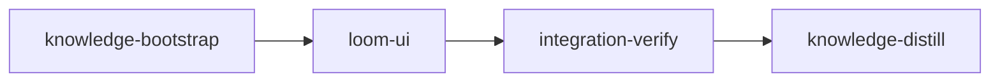

# Plan: Loom UI mods for Claude Code

## Overview

An engineer watching a Claude Code session today cannot see which loom stage it runs, how close it is to its context ceiling, what is left before `loom stage complete`, or what its subagents are doing. This plan adds a Claude Code plugin, `loom-ui`, that shows those things inside the session, plus the read-only loom command it reads them from, and makes `loom install-assets` (and so `install.sh` and `loom update`) install and enable it.

## Goals

- In a stage session only: a stage band above the prompt (stage, status, attempt, elapsed time, model and effort, dependencies, review state, attention), a context gauge in the status line measured against the stage's own ceiling tiers and summarizing running subagents, and a `/loom` pane with the full stage view and completion checklist. Outside a stage none of these appear.
- In every session, stage or not: a subagent band above the prompt while subagents run, one row each with type, task, running time, model and effort, and context use (tokens, and percent of the subagent ceiling in a stage or of the model window outside one), a `/loom-agents` pane with the same plus status, steps, tool calls and last tool, and a feed that names each loom guard denial as it happens.
- Installed and enabled by `loom install-assets`, so `install.sh` and `loom update` both deliver it with no extra step.
- Non-goals: desktop notifications (the web UI and Claude Code already raise them); anything that acts on loom (no complete, retry, approve or dispute buttons); any write to `~/.claude/settings.json`; a CI job for the plugin (CI has no `claude` binary).

## Before `loom run`

The operator commits `doc/plans/PLAN-loom-ui-mods.md`, `doc/plans/briefs/loom-ui-mods/**` and the knowledge corrections made while pressure-testing this plan (`doc/loom/knowledge/**`: the status-data-model, plugin-scope, codex-plugin and related stale-reference fixes) on main first. `loom run` refuses an uncommitted plan or brief bundle (`loom/src/commands/run/plan_inputs.rs`), and a stage worktree is cut from `HEAD`, so an untracked brief would not exist there (`doc/loom/knowledge/mistakes/verification-harness.md`, "Untracked Plan and Worker Briefs Leave a Worktree Stage Blind"). `loom run` then commits the rename to `doc/plans/IN_PROGRESS-PLAN-loom-ui-mods.md`; stage descriptions name both spellings.

## Sibling plans

- `PLAN-web-host-graft-followthrough.md` (its worker C) and `PLAN-model-router-hooks.md` (`router-core`) both own `loom/src/cli/dispatch*.rs`, `loom/src/cli/types_ops.rs` and `loom/maintainability-baseline.txt`, and web-host-graft splits `dispatch` into new files and removes ledger rows. Never run either at the same time as this plan; whichever runs second re-reads the merged tree. This plan therefore locates `dispatch_hook` with `rg -n 'fn dispatch_hook' loom/src/cli`, globs `src/cli/dispatch*.rs` in `files:` and wiring, and changes no ledger row.
- `IN_PROGRESS-PLAN-source-graph-mechanism.md` (named in progress, not loaded in `.loom/work` today): its `map-api-freshness` stage owns `src/cli/types_ops.rs` and `src/cli/dispatch*.rs` (the `HookCommands::ReconcileGraph` arm and a `--cancel` field), and its `retrieval-delivery` stage owns all of `src/commands/hook/**`, which covers this plan's edit to `src/commands/hook/mod.rs` and its new `src/commands/hook/ui_snapshot/` directory. The same rule applies: never run the two plans at the same time; whichever runs second re-reads the merged tree, finds `dispatch_hook` and the `HookCommands` enum by `rg`, never by line, and keeps the other plan's arms and fields. The new `hook/ui_snapshot/` and `claude-plugins/loom-ui/` namespaces are disjoint from every sibling's files.
  **BLOCKING sibling amendment (operator, before running either plan while the other is unmerged):** add `PLAN-loom-ui-mods.md` to the CROSS-PLAN note of source-graph-mechanism's `map-api-freshness` description as a co-owner of `cli/types_ops.rs` and `cli/dispatch*.rs` (one `HookCommands::UiSnapshot` variant and arm), and to `retrieval-delivery`'s as a co-owner of `src/commands/hook/mod.rs` (one `pub mod ui_snapshot;` line). Its stages otherwise do not know this plan exists.
- `PLAN-secure-distilled-loom-v2.md` (prose only, no stages yet) would replace the `user` setting source and direct reads of `.loom/work` that Decisions 3 and 4 rely on. When it is planned, loom-ui must be in its inner-policy plugin set, placed into the ephemeral home, and given a read of its own stage records or a brokered snapshot. knowledge-distill records this as a concern.
- No other sibling owns a file this plan writes (checked: state-confinement, merge-off-main-checkout, adopt-ecc-best-practices, codex-model-fallback, strengthen-verification). No sibling consumes `UiSnapshot`.

## Decisions

1. **One plugin, four features, each a `userConfig` toggle** (`stageBand`, `contextGauge`, `subagentTracking`, `guardFeed`, all on by default). Ten small plugins would cost ten installs and ten copies of the snapshot poller.
2. **Read-only, enforced by a script.** The plugin passes every observed event on unchanged and never denies, rewrites, spawns, registers a tool, or touches the prompt or the model; only its own `/loom` and `/loom-agents` commands and its own band and panes answer. `scripts/check-loom-ui-surface.sh` reads `claude plugin validate --json` and fails on any hook, `$` call or env read outside a fixed allowlist, and on any `$.process.run` other than the one `[loomBin, 'hook', 'ui-snapshot']` call. The stage gate also feeds the script a deliberately violating copy and requires it to fail.
3. **One data channel: `<LOOM_BIN> hook ui-snapshot`.** The plugin never parses `.loom/work` itself. It runs the loom binary named by `LOOM_BIN`, the daemon's verified binary every loom session carries, never a bare `loom`: Claude Code resolves `argv[0]` through the session PATH including relative entries, and the plugin's child must be treated as unsandboxed. The Rust command proves membership from records (session record, stage record and worktree must agree with the environment; presence of `LOOM_*` variables proves nothing), flattens every untrusted string with `inline_safe`, bounds every list, opens no socket, makes no network call, and always exits 0 with one JSON line. It writes nothing of its own; the status collector it reuses verifies the completion checkpoint, which reads (and creates once, if absent) the completion attestation key and runs one git `rev-parse` when a checkpoint carries a blocker, the same work `loom status` does. The key creation is accepted: it is the same random 0600 file at the same path the daemon would create on first use, created race-safe. When the key cannot be read or created (a symlink or non-regular file at its path, a denied read), the collector drops the checkpoint, so `completion_blocker` is `null` and the snapshot stays in stage, as `loom status` shows it in the same state; a W1 test pins that degrade. It lives under `loom hook` because `main.rs` already exempts that subcommand from terminal recovery (which would write ANSI bytes into the JSON) and from the update check (which would spawn a refresh child on every 5 s poll).
4. **Install = place the folder.** Claude Code 2.1.295 auto-loads a plugin folder at `~/.claude/skills/<name>/` as `<name>@skills-dir`, enabled at user scope (verified with `claude plugin list --json`, including under a relocated `CLAUDE_CONFIG_DIR`, and in headless sessions under every capsule shape loom passes). Loom-spawned sessions keep the `user` setting source (`orchestrator/terminal/native/capsule.rs`), so the plugin reaches stage sessions too. `install_all` writes the folder like a skill directory: symlinks replaced, never followed, at the plugin folder, at every directory below it and at every file leaf (a link at `hooks/register.tsx` is unlinked and replaced by a regular file, never written through and never kept because its target's bytes match); only changed regular files rewritten, through temp file plus rename (a watched skills-dir plugin hot-reloads in running sessions, so `loom update` reaches them without a restart and an unchanged install reloads nothing); stale files pruned; a `.claude-plugin/types/` subtree left alone (Claude Code documents writing it into watched mods and `--plugin-dir` folders; no write into a skills-dir folder was observed, so the skip is defensive).
5. **Subagent context comes from Claude Code, not loom ledgers.** Each `turn.step` carries `agentId` and its result `usage` (nullable); the resident context of a subagent is its last request's input plus cache-write plus cache-read tokens. The same step carries the model and effort it runs with. This works outside stages and needs no session-writable ledger. Claude Code exposes no context window per subagent, so outside a stage a subagent's percent is shown only when it runs the main loop's model (whose window `$.session.usage()` gives); otherwise its tokens alone.
6. **The JSON schema is pinned on both sides by one fixture.** `loom/tests/fixtures/loom_ui_snapshot_fixture.ts` is written by the contract session and frozen; a Rust contract compares it with the serializer's `fixture_snapshot()`, a second contract ties the real collector to the same key set and enum strings, and W2 copies the file byte for byte to `claude-plugins/loom-ui/hooks/fixtures/snapshot-fixture.ts`, which the plugin's tests parse (`cmp` gates the copy). Plugin modules cannot import `.json` (checked with `claude plugin validate`), hence the `.ts` wrapper; the harness lives in the crate because `harness:` paths reject `..` (Decision 8).
7. **A narrow knowledge-bootstrap.** The knowledge base already maps this codebase, so the bootstrap explores nothing: it records the Claude Code plugin facts verified while planning and pressure-testing (skills-dir enable, the module rules `validate` enforces, offline validate and test and where they write, `$.process.run` resolution and environment, the criteria environment), so the loom-ui stage's knowledge brief carries them.
8. **The loom-ui stage runs in `loom/`.** Loom runs each contract as `cargo test <name> -- --exact` from the stage working directory (`loom/src/testrun/adapters/cargo_test.rs` `single_test_command`, `loom/src/verify/contracts/site.rs` `stage_site`); the repository root has no `Cargo.toml`, so `working_dir: "."` would make every contract exit 101 (`doc/loom/knowledge/mistakes/verification-v2-delivery.md`, "A Rust Plan With Contracts Ran From the Repository Root"). Every YAML path of that stage is package-relative (`src/...`, `tests/...`); paths outside the crate are `../...` and appear only in `files:`, the worker table and shell commands, because `artifacts`, `wiring.source`, `harness` and contract `file` reject `..`. Plugin-side deliverables are therefore proven by acceptance commands. Brief and prose paths stay repo-relative. integration-verify and the knowledge stages keep `working_dir: "."`.
9. **Every `claude` command in a gate sets a scratch `CLAUDE_CONFIG_DIR`.** `claude plugin validate`, `test` and `list` rewrite `$HOME/.claude.json` and add a backup under `$HOME/.claude/backups/` (strace, 2.1.295); criteria keep `HOME` but not `CLAUDE_CONFIG_DIR` (`loom/src/process/environment.rs` `STAGE_HOST_ENV_ALLOWLIST`), so an unconfined criterion would mutate the operator's real file. The gates use `loom/target/claude-cfg`, created on demand.

## Execution Diagram



## Stages

### 1. Knowledge Bootstrap

Writes one tier-2 topic, `architecture/claude-code-plugins`, from facts verified on 2026-10-09 and 2026-10-10; no exploration. Sonnet override: nothing here needs more.

### 2. loom-ui (standard)

One stage, `working_dir: "loom"` (Decision 8). Q1-Q4 force no split: the Rust command, the plugin and the installer share no file, the plugin's only dependency on the command is the frozen fixture (a compile-order fact the contract session settles before any worker starts), and the three workers fit one session. Workers and their briefs (`doc/plans/briefs/loom-ui-mods/loom-ui/`, each worker reads `common.md` first):

| Worker | Role | Tier | Brief |
| --- | --- | --- | --- |
| W1 | `loom hook ui-snapshot` | opus | `w1-snapshot.md` |
| W2 | `loom-ui` plugin and surface script | opus | `w2-plugin.md` |
| W3 | Embed, install, report, smoke script | sonnet | `w3-installer.md` |

Wave 1 runs W1 and W2 in parallel; wave 2 runs W3 once BOTH have returned: the build embeds whatever `claude-plugins/` holds, and W3's `cargo test` compiles W1's module (they share the crate even though they share no file, so W3 must not build against a half-written W1, nor W1 against W3's in-flight `InstallReport` change). W2 is opus because it builds against an early-access plugin API whose authority is a 21,000-line declaration file plus rules only `claude plugin validate` reports. W1 is opus because the membership check is security-sensitive.

Gate: the acceptance list runs the repository's canonical gate (`loom/.githooks/pre-push`, adapted to `loom/`): `cargo test --all-targets --no-fail-fast`, clippy with `-D warnings`, `cargo fmt --check` (in the stage's own acceptance, so the contract freeze's formatter discovery runs it, `loom/src/verify/contracts/format_gate.rs`), `cargo doc` with `-D warnings`, and markdownlint WITHOUT `--fix` on the new plugin README, run from the repository root so `.markdownlint.json` applies, plus a banner check because a bunx that cannot reach `registry.npmjs.org` (allowed in this plan's sandbox) exits without linting. Two pre-push steps are left out on purpose: `cargo audit` (this plan adds no dependency, so its verdict cannot change, and its advisory fetch needs a host the sandbox does not allow) and `scripts/flake-check.sh` (it re-runs fixed timing-sensitive tests, none of which this plan touches). The two module filters stay beside the full run as zero-test guards that W1 and W3 wrote tests. `loom plan verify` warns about the unfiltered suite in a standard stage; that warning is accepted on purpose, as in `IN_PROGRESS-PLAN-source-graph-mechanism.md`: a scoped subset lets a stage break tests it neither owns nor runs (W3 changes `groups()`, the `prune_dir` chain and `InstallReport`; W1 adds module docs `cargo doc -D warnings` checks), and the full run also builds every test binary before completion runs the contracts. Every deliverable the prose promises has an acceptance line: the plugin files and manifest toggles, the fixture copy (`cmp`), the eleven named plugin tests `[c1]`-`[c11]` (each Goals feature maps to one: stage band `[c2]`/`[c3]`, gauge `[c4]`, subagent band `[c5]`, polling `[c6]`, `/loom-agents` `[c7]`, guard feed `[c8]`, process identity `[c9]`, `/loom` command and pane `[c10]`, agent lifecycle `[c11]`; plugin modules sit outside the crate, where `artifacts:` cannot name them, so these tests and the files check are their proof), the surface script both passing on the plugin and failing on a violating copy, the smoke install, `install.sh` syntax and its new lines, the CI filter and the ignore rule.

Implementation lane: Claude only. Codex is installed (`codex@openai-codex` enabled), but no piece fits a codex unit: the plugin converges by running `claude plugin validate` and `claude plugin test` repeatedly against an API codex has no skill for, W1's identity logic is security work, and W3's change spans eleven files that move together.

Risk-checklist walk (snapshot contracts live in `loom/tests/loom_ui_contracts.rs`, install contracts in `loom/tests/loom_ui_install_contracts.rs`; two files keep each under the 400-line cap):

| Area | Applies because | Contract or gate |
| --- | --- | --- |
| Untrusted input | stage, plan, review and criterion text reach the JSON and a UI | `ui-snapshot-flattens-untrusted-stage-text`, `ui-snapshot-rejects-session-of-another-stage`, `ui-snapshot-rejects-env-knowledge-claim`, `ui-snapshot-rejects-stage-record-id-mismatch` |
| Filesystem paths and symlinks | the installer writes and prunes under `~/.claude/skills` | `install-replaces-symlinked-plugin-dir`, `install-replaces-symlinked-plugin-leaf` |
| Process I/O volume and scale | dependents scan every stage record; the plugin runs one child per poll | W1's cap tests and W2's `[c6]` no-overlap and rejection test; no contract (the child's output is one bounded line) |
| Process identity | the plugin executes a binary every 5 s | W2's `[c9]` (`LOOM_BIN` absolute or no poll) and the surface script's argv check |
| Configuration propagation | the stage's `context_ceiling_tokens` override; the workspace plan source; the plugin's `userConfig` | `ui-snapshot-uses-stage-ceiling-override`; `ui-snapshot-real-collection-emits-schema-strings` (plan name read through the same work dir membership used); W2's `[c3]` |
| Lifecycle | reinstall over an older install, an engine-written `types/` subtree, hot reload, rejected polls, a resumed subagent | `install-prunes-stale-plugin-files-keeps-engine-types`; W3's mtime test; W2's `[c6]` and `[c11]` |
| Reachability | a hidden subcommand, an install step nothing else calls, a slash command | `ui-snapshot-cli-reports-no-stage-env`, `install-places-loom-ui-plugin`, plus `reachable: install_plugins`; W2's `[c10]` runs `/loom` through the real registration |
| External data | the plugin parses JSON a different language writes | `ui-snapshot-fixture-matches-serializer`, `ui-snapshot-real-collection-emits-schema-strings`, the fixture `cmp` |

Operator check after merge (needs the real `~/.claude`, so no stage can run it): `./dev-install.sh`, then `claude plugin list | rg -A3 loom-ui` shows it loaded, and a new session inside a running stage shows the band.

### 3. Integration Verification

Full Rust suite, clippy, fmt, doc, markdownlint on the plugin README, the plugin's validate and test runs, the surface script, the install smoke script, and the out-of-stage snapshot. Its session is itself a stage session, so it also runs `cargo run -q --manifest-path loom/Cargo.toml -- hook ui-snapshot` from its own shell and confirms `in_stage: true` with its own stage id (an acceptance criterion cannot prove this: criteria run with the stage environment rebuilt from a host allowlist that carries no `LOOM_*` variable, `loom/src/process/environment.rs` `apply_stage_environment`). Parallel reviews: security (membership check, sanitization, the plugin's surface, its `LOOM_BIN` use and its display of untrusted text, installer symlink handling), architecture, test coverage.

### 4. Knowledge Distillation

Curates the stage memories (the plugin API facts W2 found, the skills-dir enable mechanism, the snapshot schema and where it is pinned), adds `claude-plugins/` and the plugin step to the asset-root and install descriptions, links the new plugin topic from the plugin-scope convention, and documents `loom-ui` in `README.md`. (The stale "Heartbeat and Activity" and plugin-scope sections found by the pressure test were corrected on main before this plan runs.)

---

<!-- loom METADATA -->

```yaml
loom:
  version: 2
  ratchet_files:
    - loom/maintainability-baseline.txt
    - doc/loom/knowledge/check-baseline.txt
  provision:
    - working_dir: "web"
      command: "test ! -e .npmrc && test ! -L .npmrc && bun install --frozen-lockfile --ignore-scripts --backend=copyfile --config=/dev/null"
  sandbox:
    enabled: true
    auto_allow: true
    filesystem:
      deny_read: ["~/.ssh/**", "~/.aws/**", "~/.config/gcloud/**", "~/.gnupg/**"]
    network:
      allowed_domains: ["crates.io", "index.crates.io", "static.crates.io", "registry.npmjs.org"]
      allow_local_binding: false
      allow_unix_sockets: []
  stages:
    - id: knowledge-bootstrap
      name: "Record verified Claude Code plugin facts"
      summary: "Writes the Claude Code plugin facts verified while planning into the knowledge base, so the implementation stage's knowledge brief carries them."
      stage_type: knowledge
      model: "sonnet"
      working_dir: "."
      dependencies: []
      description: |
        The knowledge base already maps this codebase; do NOT re-map it. This stage only records facts verified on 2026-10-09 and 2026-10-10 against Claude Code 2.1.295, so retrieval hands them to the loom-ui stage. model is overridden to sonnet because the stage writes a handful of already-verified facts and explores nothing.
        Use parallel subagents and skills to maximize performance. (Single agent is enough here: no subagents.)
        Run loom knowledge sync first. Then write ONE new tier-2 topic with loom knowledge update architecture/claude-code-plugins "<entry>", annotate it with loom knowledge annotate architecture/claude-code-plugins --blurb "Claude Code plugins: load, enable, test, limits", and add a 2-4 line summary plus link to architecture.md with loom knowledge update architecture "<entry>". Facts to record, each as current truth:
        - A folder at ~/.claude/skills/<name>/ holding .claude-plugin/plugin.json is auto-loaded as <name>@skills-dir and enabled at user scope (claude plugin list --json reports id, scope "user", enabled true); the same under a relocated CLAUDE_CONFIG_DIR. The id comes from the manifest name, not the folder; an unparsable manifest lists with enabled false; the folder needs no SKILL.md and is not treated as a skill. Headless sessions load it with --setting-sources user,project, with or without a --settings capsule carrying enabledPlugins; only enabledPlugins {"<name>@skills-dir": false} disables it. Interactive sessions watch it and hot-reload on change: a reload drops the plugin's timers, keeps its $.state and fires session.start again.
        - Loom-spawned sessions pass --setting-sources user,project (orchestrator/terminal/native/capsule.rs), so user-scope plugins load in stage sessions.
        - Module rules claude plugin validate enforces: a hooks module and every file it imports must be .ts/.tsx/.js/.jsx/.mjs/.cjs/.mts/.cts; importing a .json file fails; import() is refused; hooks.json names exactly one module; $ is never passed across an import, destructured, indexed or used as a value ($ calls are spelled literally in a hook callback or a same-file function); an event may have at most one hook without a matcher in the whole plugin ("registered twice without a matcher"); turn.step must be an async generator; every $.state key must be declared in the manifest's types contract (PluginState); each userConfig field needs type, title and description.
        - claude plugin validate [--strict] [--json] <dir> and claude plugin test <dir> run offline in under a second and write nothing into the plugin folder. validate and list write $HOME/.claude.json plus a backup under $HOME/.claude/backups/; test writes $HOME/.claude.json; with CLAUDE_CONFIG_DIR set the writes go there instead; with HOME read-only they still exit 0. plugin test discovers every *.test.ts/*.test.tsx, prints (pass)/(fail) <name> per test, and exits 1 on a failure or when there are no tests. --strict fails on a missing author field; --json lists the registered module's hooks (with matchers in braces), $ calls (with " (via <fn>)" suffixes) and env reads as contents[].notes strings.
        - $.process.run(argv, { cwd?, env?, stdin?, timeoutMs? }) children inherit the claude process environment (env entries are set over it) and the session cwd; argv[0] is resolved through PATH, relative entries included, against the session cwd; with sandbox settings on, a probe child still wrote outside its cwd and reached the network (observed headless, without a model turn), so treat the child as unsandboxed. It rejects when the executable cannot start and on timeout; a non-zero exit resolves with exitCode. A plugin that runs loom uses the absolute path in LOOM_BIN, as loom's own hooks do.
        - A command.run answer { text } becomes a transcript row the model reads; $.ui.toast and $.ui.log never reach the model.
        - Acceptance criteria run with the environment rebuilt from a host allowlist (loom/src/process/environment.rs apply_stage_environment, STAGE_HOST_ENV_ALLOWLIST): HOME and PATH survive; CLAUDE_CONFIG_DIR, LOOM_STAGE_ID, LOOM_SESSION_ID and LOOM_WORK_DIR do not.
        Use loom knowledge CLI, NOT Write/Edit. NEVER Claude Code auto-memory.
      acceptance:
        - "loom knowledge check --strict --baseline doc/loom/knowledge/check-baseline.txt"
        - "rg -q 'skills-dir' doc/loom/knowledge/architecture/claude-code-plugins.md"
        - "rg -q 'registered twice without a matcher' doc/loom/knowledge/architecture/claude-code-plugins.md"
        - "rg -q 'LOOM_BIN' doc/loom/knowledge/architecture/claude-code-plugins.md"
        - "rg -q 'apply_stage_environment' doc/loom/knowledge/architecture/claude-code-plugins.md"
      files: ["doc/loom/knowledge/**"]
      artifacts:
        - "doc/loom/knowledge/architecture/claude-code-plugins.md"

    - id: loom-ui
      name: "loom-ui plugin, snapshot command and installer"
      summary: "Adds the read-only loom hook ui-snapshot command, the loom-ui Claude Code plugin (stage band and context gauge in stage sessions, subagent band and /loom-agents pane everywhere, /loom pane, guard-denial feed), and installs the plugin into ~/.claude/skills/loom-ui through loom install-assets."
      stage_type: standard
      skills: ["loom-rust", "loom-typescript", "loom-ci-cd"]
      implementers: ["claude"]
      subagent_timeout_secs: 900
      working_dir: "loom"
      dependencies: ["knowledge-bootstrap"]
      description: |
        Build the three parts of stage 2 of the plan (doc/plans/PLAN-loom-ui-mods.md, renamed doc/plans/IN_PROGRESS-PLAN-loom-ui-mods.md once loom run has started).
        Use parallel subagents and skills to maximize performance.
        PATHS: working_dir is loom/ because loom runs each contract as `cargo test <name> -- --exact` from it and the repository root has no Cargo.toml. YAML paths and the worker table are package-relative (../ for files outside the crate); brief paths are repo-relative from the worktree root. Every command below runs from loom/.
        Every worker reads doc/plans/briefs/loom-ui-mods/loom-ui/common.md first, then its own brief. common.md is authoritative for the JSON schema, the out-of-stage reason codes, the security rules and the fixture text.
        Territories are DISJOINT. Workers NEVER spawn subagents. Spawn every worker BY AGENT TYPE (W1 and W2 loom-senior-software-engineer; W3 loom-software-engineer) in the background with the fixed prompt plus "Your brief: <path>. Read it in full before anything else." Wait with one background loom subagents watch.
        WAVE 1: W1 and W2 in ONE message. WAVE 2: W3 after BOTH W1 and W2 have returned (the build embeds claude-plugins/, so W3 needs the finished plugin folder; W1 and W3 share the crate, so neither may build against the other's half-written code).
        AFTER THE WAVES: first rustfmt --check --edition 2021 tests/loom_ui_contracts.rs tests/loom_ui_install_contracts.rs (a frozen file the formatter would rewrite fails completion's frozen-hash check; a failure here is a dispute-contract, never an edit); then cargo fmt --all once; then cargo test --test maintainability; route any failure to a fresh worker of the owning territory; then one loom-verifier round over the acceptance list. No row of maintainability-baseline.txt changes except under LEDGER.
        LEDGER: only a frozen contract over a size limit (a function over 50 lines or the file over 400) gets a line in maintainability-baseline.txt, plus ONE dispute-integrity after the final review round naming every ledger change.
        MUTATION: the contracts freeze red only because ui_snapshot does not compile yet, which proves nothing about their assertions. Before the final review round, for each contract apply the implementation its rejects: text describes (or revert the key line it guards), confirm that contract fails, restore from a saved copy (never git checkout), and record loom memory note "mutation: <contract id> red under <mutation>".

        | Worker | Role | Tier | Files owned | Shared context | Brief path |
        | ------ | ---- | ---- | ----------- | -------------- | ---------- |
        | W1 | Snapshot command | opus | src/commands/hook/ui_snapshot/mod.rs; src/commands/hook/ui_snapshot/scope.rs; src/commands/hook/ui_snapshot/model.rs; src/commands/hook/ui_snapshot/collect.rs; src/commands/hook/ui_snapshot/tests.rs; src/commands/hook/mod.rs; src/cli/types_ops.rs; src/cli/dispatch.rs; src/commands/status/data/collector.rs; src/commands/status/data/sanitize.rs; src/commands/status/data/mod.rs | common.md | doc/plans/briefs/loom-ui-mods/loom-ui/w1-snapshot.md |
        | W2 | Plugin | opus | ../claude-plugins/loom-ui/.claude-plugin/plugin.json; ../claude-plugins/loom-ui/hooks/hooks.json; ../claude-plugins/loom-ui/hooks/*.ts; ../claude-plugins/loom-ui/hooks/*.tsx; ../claude-plugins/loom-ui/hooks/fixtures/*; ../claude-plugins/loom-ui/types/index.d.ts; ../claude-plugins/loom-ui/README.md; ../scripts/check-loom-ui-surface.sh | common.md | doc/plans/briefs/loom-ui-mods/loom-ui/w2-plugin.md |
        | W3 | Installer | sonnet | build/assets.rs; src/assets/mod.rs; src/assets/install.rs; src/assets/install/claude.rs; src/assets/install/placement.rs; src/assets/install/placement_plugin_tests.rs; src/commands/install_assets.rs; ../install.sh; ../.github/workflows/ci.yml; ../.gitignore; ../scripts/smoke-loom-ui-install.sh | common.md | doc/plans/briefs/loom-ui-mods/loom-ui/w3-installer.md |

        W1's dispatch edit goes in whichever src/cli/dispatch*.rs file holds fn dispatch_hook (rg -n 'fn dispatch_hook' src/cli); a sibling plan may have split dispatch.rs.

        CONTRACT SURFACE (the contract session writes tests/loom_ui_contracts.rs (the eight ui-snapshot-* contracts), tests/loom_ui_install_contracts.rs (the four install-* contracts) and the harness fixture from this text before any code; every contract is a top-level #[test] fn, so its test value is the fn name; keep every contract fn at most 50 lines and each file at most 400 lines and rustfmt-clean, because cargo test --test maintainability scans tests/ and a frozen file cannot be edited):
        - Fixture: write tests/fixtures/loom_ui_snapshot_fixture.ts with EXACTLY the text of common.md section "Snapshot fixture" (comment line, then "export const SNAPSHOT_FIXTURE = " followed by the JSON object to end of file, no semicolon). W2 later copies it byte for byte into the plugin.
        - Snapshot API: loom::commands::hook::ui_snapshot::{SnapshotScope, collect_snapshot, fixture_snapshot, UiSnapshot}. SnapshotScope has pub fields stage_id: String, session_id: String, work_dir: PathBuf, session_type: Option<String>, worktree_path: Option<PathBuf>, cwd: PathBuf. collect_snapshot(scope: Option<&SnapshotScope>) -> UiSnapshot never fails. UiSnapshot: serde::Serialize. Out of stage it serializes to exactly {"schema":1,"in_stage":false,"reason":"<code>"}; codes and in-stage fields are in common.md.
        - Fixture work dirs: a tempfile::TempDir <tmp> whose work dir is <tmp>/.loom/work (create_dir_all; WorkDir::new on a bare TempDir resolves to a nonexistent <tmp>/.loom/work and every status read silently comes back empty), holding stage records written with loom::verify::save_stage(&Stage, &Path) and session records written with loom::fs::session_files::save_session(&Session, &Path); scope.work_dir is that <tmp>/.loom/work; a non-knowledge session's worktree_path is an existing directory <tmp>/.worktrees/<stage-id> and the scope's cwd is that directory; session_type and worktree_path in the scope mirror the session record (Some("stage"), Some(worktree)).
        - CLI: env!("CARGO_BIN_EXE_loom") with args hook ui-snapshot.
        - Install: env!("CARGO_BIN_EXE_loom") install-assets --claude-dir <tmp>/claude --codex-dir <tmp>/codex --skills core, with HOME set to the TempDir, LOOM_HOME set to <tmp>/loom-home holding config.toml with "[update]\ncheck = false\n" (install-assets is not update-silent; a release-versioned build would otherwise write an update lock and spawn a fetcher), and LOOM_CLAUDECODE_INSTALL_DIR / LOOM_CODEX_INSTALL_DIR removed (loom/tests/integration/install_assets.rs gets the same through its loom_cmd helper, which this separate test binary cannot use). The plugin lands at <claude>/skills/loom-ui/.
        The contracts are red at freeze because ui_snapshot does not exist (BuildFailed counts as red); the install contracts are also red on their own because nothing places the plugin.

        MEMORY: record mistakes, decisions and surprises via loom memory immediately (subagents too); NEVER loom knowledge (implementation stage); NEVER Claude Code auto-memory.
      files:
        - "src/commands/hook/**"
        - "src/cli/types_ops.rs"
        - "src/cli/dispatch*.rs"
        - "src/commands/status/data/collector.rs"
        - "src/commands/status/data/sanitize.rs"
        - "src/commands/status/data/mod.rs"
        - "build/assets.rs"
        - "src/assets/**"
        - "src/commands/install_assets.rs"
        - "tests/loom_ui_contracts.rs"
        - "tests/loom_ui_install_contracts.rs"
        - "tests/fixtures/loom_ui_snapshot_fixture.ts"
        - "maintainability-baseline.txt"
        - "../claude-plugins/**"
        - "../scripts/check-loom-ui-surface.sh"
        - "../scripts/smoke-loom-ui-install.sh"
        - "../install.sh"
        - "../.github/workflows/ci.yml"
        - "../.gitignore"
      acceptance:
        - "cargo build"
        - "cargo test --all-targets --no-fail-fast"
        - "cargo test --lib commands::hook::ui_snapshot::"
        - "cargo test --lib assets::install::placement::plugin_tests::"
        - "cargo clippy --all-targets -- -D warnings"
        - "cargo fmt --check"
        - "RUSTDOCFLAGS='-D warnings' cargo doc --workspace --all-features --no-deps"
        - "cmp tests/fixtures/loom_ui_snapshot_fixture.ts ../claude-plugins/loom-ui/hooks/fixtures/snapshot-fixture.ts"
        - "CLAUDE_CONFIG_DIR=target/claude-cfg claude plugin validate --strict ../claude-plugins/loom-ui"
        - >-
          CLAUDE_CONFIG_DIR=target/claude-cfg claude plugin test ../claude-plugins/loom-ui > target/loom-ui-tests.log 2>&1
          && for c in 1 2 3 4 5 6 7 8 9 10 11; do rg -qF "(pass) [c$c]" target/loom-ui-tests.log || exit 1; done
        - "sh ../scripts/check-loom-ui-surface.sh | rg -q 'loom-ui surface ok: [1-9][0-9]* hooks, [1-9][0-9]* calls'"
        - >-
          rm -rf target/surface-probe && cp -R ../claude-plugins/loom-ui target/surface-probe
          && printf '%s\n' "// \$.process.run(['sh'])" >> target/surface-probe/hooks/register.tsx
          && sh ../scripts/check-loom-ui-surface.sh target/surface-probe 2>&1 | rg -qF 'surface violation'
        - "sh ../scripts/smoke-loom-ui-install.sh"
        - "bash -n ../install.sh"
        - "rg -qF 'skills/loom-ui' ../install.sh"
        - >-
          rg -qF '"claude-plugins/**"' ../.github/workflows/ci.yml
        - "rg -qxF 'claude-plugins/*/.claude-plugin/types/' ../.gitignore"
        - >-
          jq -e '.userConfig | has("stageBand") and has("contextGauge") and has("subagentTracking") and has("guardFeed")' ../claude-plugins/loom-ui/.claude-plugin/plugin.json
        - "rg -qF './register.tsx' ../claude-plugins/loom-ui/hooks/hooks.json"
        - >-
          rg -qF "[loomBin, 'hook', 'ui-snapshot']" ../claude-plugins/loom-ui/hooks -g '!*.test.ts' -g '!*.test.tsx' -g '!fixtures'
        - "test -s ../claude-plugins/loom-ui/README.md && test -f ../claude-plugins/loom-ui/hooks/register.tsx && test -f ../claude-plugins/loom-ui/types/index.d.ts"
        - "cd .. && bunx markdownlint-cli2 claude-plugins/loom-ui/README.md"
        - "cd .. && bunx markdownlint-cli2 claude-plugins/loom-ui/README.md 2>&1 | rg -q 'markdownlint-cli2 v'"
      before_stage:
        - command: "claude --version"
          description: "Claude Code CLI on PATH (plugin validate and test)"
        - command: "jq --version"
          description: "jq on PATH (surface and smoke scripts)"
        - command: "rg --version"
          description: "ripgrep on PATH (surface and smoke scripts)"
      after_stage:
        - command: 'rg -qF "HookCommands::UiSnapshot =>" src/cli'
          description: "ui-snapshot dispatched"
        - command: "test -f ../claude-plugins/loom-ui/.claude-plugin/plugin.json"
          description: "plugin manifest present"
      artifacts:
        - "src/commands/hook/ui_snapshot/mod.rs"
        - "src/commands/hook/ui_snapshot/scope.rs"
        - "src/commands/hook/ui_snapshot/model.rs"
        - "src/commands/hook/ui_snapshot/collect.rs"
        - "src/assets/install/placement_plugin_tests.rs"
      wiring:
        - source: "src/cli/dispatch*.rs"
          pattern: "HookCommands::UiSnapshot =>"
          literal: true
          description: "ui-snapshot is dispatched from loom hook"
        - source: "src/assets/install.rs"
          pattern: "claude::install_plugins("
          literal: true
          description: "install_all places the plugin"
      reachable:
        - symbol: install_plugins
          from: install_all
          description: "install_all calls the plugin placement step"
      harness: ["tests/fixtures/loom_ui_snapshot_fixture.ts"]
      contracts:
        - id: ui-snapshot-cli-reports-no-stage-env
          file: tests/loom_ui_contracts.rs
          test: ui_snapshot_cli_reports_no_stage_env
          scenario: "runs the loom binary as `loom hook ui-snapshot` with LOOM_STAGE_ID, LOOM_SESSION_ID and LOOM_WORK_DIR removed from its environment and asserts exit 0 with stdout exactly {\"schema\":1,\"in_stage\":false,\"reason\":\"no-stage-env\"} plus a newline"
          rejects: "a command that is not dispatched, exits non-zero, or prints human-readable text when the session is not a stage session"
        - id: ui-snapshot-rejects-session-of-another-stage
          file: tests/loom_ui_contracts.rs
          test: ui_snapshot_rejects_session_of_another_stage
          scenario: "a fixture work dir holds stage alpha whose session is s-1 and session record s-1 whose stage_id is beta; collect_snapshot with a scope claiming stage alpha and session s-1"
          rejects: "a snapshot that trusts LOOM_STAGE_ID and reports stage alpha (any stage key in the JSON) instead of in_stage false with reason session-mismatch"
        - id: ui-snapshot-rejects-env-knowledge-claim
          file: tests/loom_ui_contracts.rs
          test: ui_snapshot_rejects_env_knowledge_claim
          scenario: "stage alpha owned by session s-1, whose record is SessionType::Stage with worktree_path <tmp>/.worktrees/alpha; collect_snapshot with a scope for stage alpha and session s-1 whose session_type is Some(\"knowledge\") and whose cwd is <tmp> (the main project root, outside the worktree)"
          rejects: "a membership check that takes the knowledge branch from LOOM_SESSION_TYPE instead of the session record and reports stage alpha, instead of in_stage false with reason session-mismatch"
        - id: ui-snapshot-rejects-stage-record-id-mismatch
          file: tests/loom_ui_contracts.rs
          test: ui_snapshot_rejects_stage_record_id_mismatch
          scenario: "a stage record whose id is beta and whose session is s-1, saved with save_stage and then renamed to <work>/stages/alpha.md (find_stage_file accepts the unprefixed name), plus session record s-1 for stage alpha with a valid worktree and cwd; collect_snapshot with a scope claiming stage alpha and session s-1"
          rejects: "a snapshot that trusts the stage file name and reports stage beta or alpha, instead of in_stage false with reason stage-missing"
        - id: ui-snapshot-flattens-untrusted-stage-text
          file: tests/loom_ui_contracts.rs
          test: ui_snapshot_flattens_untrusted_stage_text
          scenario: "a valid stage session whose stage status is needs-human-review, whose stage name is \"evil\\u{1b}[31m\\u{202e}name\\nline\", whose review_reason is \"why\\u{1b}[2J\\u{200b}\\nnext\" and whose one acceptance criterion is \"cargo test\\u{7}\\nrm -rf x\"; serialize collect_snapshot, assert review_reason is a non-null string, and inspect every JSON string value, including attention and review_reason"
          rejects: "a snapshot that copies stage-file strings into the JSON raw, leaving ESC, BEL, U+202E, U+200B or a newline in a value, or that drops review_reason so the review path is never exercised"
        - id: ui-snapshot-uses-stage-ceiling-override
          file: tests/loom_ui_contracts.rs
          test: ui_snapshot_uses_stage_ceiling_override
          scenario: "a valid stage session whose stage record sets context_ceiling_tokens to 200000 with no workspace [context] section; read context from collect_snapshot"
          rejects: "a snapshot that reports the default 800000 tiers instead of ceiling 200000, warn 120000, red 180000, backstop 250000"
        - id: ui-snapshot-fixture-matches-serializer
          file: tests/loom_ui_contracts.rs
          test: ui_snapshot_fixture_matches_serializer
          scenario: "reads tests/fixtures/loom_ui_snapshot_fixture.ts relative to CARGO_MANIFEST_DIR, parses the text after `export const SNAPSHOT_FIXTURE = ` as JSON and compares it with serde_json::to_value(fixture_snapshot())"
          rejects: "a Rust serializer whose field names, nesting or enum strings drift from the schema the plugin parses"
        - id: ui-snapshot-real-collection-emits-schema-strings
          file: tests/loom_ui_contracts.rs
          test: ui_snapshot_real_collection_emits_schema_strings
          scenario: "a valid stage session (StageStatus::Executing, StageType::Standard, session record SessionType::Stage, no verification run) whose work dir's config.toml holds [plan] source_path = \"doc/plans/PLAN-fixture.md\" and whose <tmp>/doc/plans/PLAN-fixture.md begins \"# Plan: Fixture plan\"; serde_json::to_value(collect_snapshot(..)) has stage.plan \"Fixture plan\" (proving the collector reads the same work dir membership checked), stage.status \"executing\", stage.stage_type \"standard\", stage.session_type \"stage\", checklist.verification_status \"not-run\", and the same key set as the JSON parsed from tests/fixtures/loom_ui_snapshot_fixture.ts at the top level and inside stage, context, checklist and daemon"
          rejects: "a collector that builds its WorkDir from a different root than the membership check (stage.plan null), that renders enums with Debug or Display (\"Executing\", \"Standard\", \"NotRun\"), or that skips or renames a field the fixture carries, which ui-snapshot-fixture-matches-serializer cannot see because fixture_snapshot() is hand-built"
        - id: install-places-loom-ui-plugin
          file: tests/loom_ui_install_contracts.rs
          test: install_places_loom_ui_plugin
          scenario: "runs loom install-assets into a TempDir and inspects <claude>/skills/loom-ui and <claude>"
          rejects: "an embed that skips the dot-prefixed .claude-plugin directory (no plugin.json named loom-ui), that installs *.test.ts files or the fixtures directory, or an installer that creates <claude>/settings.json"
        - id: install-replaces-symlinked-plugin-dir
          file: tests/loom_ui_install_contracts.rs
          test: install_replaces_symlinked_plugin_dir
          scenario: "before install, <claude>/skills/loom-ui is a symlink to a TempDir directory holding keep.txt; then runs loom install-assets"
          rejects: "an installer that writes or prunes through the symlink, deleting keep.txt or adding plugin files to the link target, instead of replacing the link with a real directory"
        - id: install-replaces-symlinked-plugin-leaf
          file: tests/loom_ui_install_contracts.rs
          test: install_replaces_symlinked_plugin_leaf
          scenario: "before install, <claude>/skills/loom-ui/hooks/ is a real directory and hooks/register.tsx is a symlink to <tmp>/outside/keep.txt holding the text keep; then runs loom install-assets and inspects keep.txt and hooks/register.tsx with symlink_metadata"
          rejects: "an installer that writes the embedded module through the leaf link (keep.txt no longer reads keep) or leaves register.tsx a symlink, instead of replacing the link with a regular file"
        - id: install-prunes-stale-plugin-files-keeps-engine-types
          file: tests/loom_ui_install_contracts.rs
          test: install_prunes_stale_plugin_files_keeps_engine_types
          scenario: "before install, <claude>/skills/loom-ui holds hooks/stale.ts and .claude-plugin/types/claude-code/index.d.ts; then runs loom install-assets"
          rejects: "an installer that leaves stale.ts behind, or that prunes the .claude-plugin/types subtree Claude Code may write itself"

    - id: integration-verify
      name: "Integration Verification"
      summary: "Confirms the snapshot command, the plugin and the installer work together on the merged tree and that the full suite passes."
      stage_type: integration-verify
      skills: ["loom-rust", "loom-typescript", "loom-security-audit"]
      working_dir: "."
      dependencies: ["loom-ui"]
      description: |
        Final verification of the plan (doc/plans/IN_PROGRESS-PLAN-loom-ui-mods.md). Verify FUNCTIONAL INTEGRATION, not only tests passing. NEVER Claude Code auto-memory.
        Use parallel subagents and skills to maximize performance.
        CONTEXT: read the plan, doc/plans/briefs/loom-ui-mods/loom-ui/common.md, loom memory show --all, and the knowledge sections the plan cites. This stage's working_dir is the repository root; the loom-ui stage ran in loom/.
        BUILD AND TEST (zero tolerance; nothing is pre-existing): every acceptance command below. Every claude command sets CLAUDE_CONFIG_DIR=loom/target/claude-cfg so it never rewrites the operator's ~/.claude.json.
        FUNCTIONAL (run from this session's own shell, which carries this stage's LOOM_* variables, unlike acceptance criteria):
        - test -x "$LOOM_BIN" and the path is absolute: the plugin polls only through it.
        - cargo run -q --manifest-path loom/Cargo.toml -- hook ui-snapshot prints one JSON line with in_stage true, stage.id integration-verify, a non-zero context.ceiling_tokens and dependencies listing loom-ui. Record the line in loom memory.
        - The same with LOOM_STAGE_ID set to another stage id prints in_stage false (session-mismatch or stage-not-owned).
        - Time ten runs; record the median. Above 500 ms, file a finding (the plugin polls every 5 s).
        - sh scripts/smoke-loom-ui-install.sh proves install-assets places a folder Claude Code loads and enables.
        CODE REVIEW: parallel loom-code-reviewer subagents - security (scope.rs membership against common.md, including the record-based knowledge branch and the stage.id check; every inline_safe site; the attestation-key and git reads the collector performs, against common.md "Security rules"; the plugin's allowlisted surface, its LOOM_BIN-only process call and its handling of snapshot text, including that no command.run answer carries snapshot text; the installer's symlink handling at the folder, every directory and every file leaf, its prune and write-if-changed paths), architecture (reuse of status data and placement helpers, the hook-subcommand placement, plugin module split under validate's one-hook-per-event and no-$-across-imports rules), test coverage (every contract, the plugin tests [c1]-[c11] of w2-plugin.md, including that [c10] drives /loom through the real registration and [c11] covers a resumed subagent, the userConfig non-default case, the mutation notes the loom-ui stage recorded). Fix or dispute every finding; never defer one.
        SUGGESTIONS: weigh every pending reviewer suggestion the signal lists; resolve each one implemented with loom memory resolve <id> --outcome implemented --reason <what changed>.
        Record discoveries to loom memory for knowledge-distill, including any knowledge file the tree contradicts: loom memory note "stale-knowledge: ...".
      acceptance:
        - "cargo test --manifest-path loom/Cargo.toml --all-targets --no-fail-fast"
        - "cargo clippy --manifest-path loom/Cargo.toml --all-targets -- -D warnings"
        - "cargo fmt --manifest-path loom/Cargo.toml --check"
        - "RUSTDOCFLAGS='-D warnings' cargo doc --manifest-path loom/Cargo.toml --workspace --all-features --no-deps"
        - "cmp loom/tests/fixtures/loom_ui_snapshot_fixture.ts claude-plugins/loom-ui/hooks/fixtures/snapshot-fixture.ts"
        - "CLAUDE_CONFIG_DIR=loom/target/claude-cfg claude plugin validate --strict claude-plugins/loom-ui"
        - "CLAUDE_CONFIG_DIR=loom/target/claude-cfg claude plugin test claude-plugins/loom-ui"
        - "sh scripts/check-loom-ui-surface.sh | rg -q 'loom-ui surface ok: [1-9][0-9]* hooks, [1-9][0-9]* calls'"
        - "sh scripts/smoke-loom-ui-install.sh"
        - "bunx markdownlint-cli2 claude-plugins/loom-ui/README.md"
        - 'env -u LOOM_STAGE_ID -u LOOM_SESSION_ID -u LOOM_WORK_DIR cargo run -q --manifest-path loom/Cargo.toml -- hook ui-snapshot | jq -e ''.schema == 1 and .in_stage == false and .reason == "no-stage-env"'''
      wiring:
        - source: "loom/src/cli/dispatch*.rs"
          pattern: "HookCommands::UiSnapshot =>"
          literal: true
          description: "ui-snapshot is dispatched from loom hook"
        - source: "loom/src/assets/install.rs"
          pattern: "claude::install_plugins("
          literal: true
          description: "install_all places the plugin"

    - id: knowledge-distill
      name: "Knowledge Distillation"
      summary: "Records what this plan learned about Claude Code plugins, the snapshot schema and plugin installation, and documents loom-ui in the README."
      stage_type: knowledge-distill
      working_dir: "."
      dependencies: ["integration-verify"]
      description: |
        Curate all stage memories into permanent knowledge; update user docs. NEVER Claude Code auto-memory.
        SINGLE-AGENT: do NOT spawn subagents; memories are compact summaries; keep code spot-reads narrow.
        START with loom memory pending --group (corrections, mistakes, decisions, other); read the plan and the knowledge sections it touches.
        CORRECTIONS FIRST: apply every stale-knowledge memory in place with loom knowledge replace-section <file> "<heading>" "<body>", never loom knowledge update. Known ones: conventions/git-and-build-workflow.md (the asset-root list in the CI paths section) and architecture/skill-catalog.md (the install_all description) predate the claude-plugins/ asset root and the install_plugins step; add both. Link architecture/claude-code-plugins from conventions/guidance-channels-and-plugin-scope.md "Claude Code Plugin Scope in Loom Repos" rather than restating the scope rules there.
        Then curate: the loom-ui architecture (snapshot command, schema 1 and its fixture pin with the plugin-side copy, the plugin's read-only surface and its enforcement script, LOOM_BIN as the only executable, subagent context from turn.step usage), the skills-dir install mechanism (folder under ~/.claude/skills enables the plugin; write-if-changed placement because skills-dir plugins hot-reload; .claude-plugin/types left alone defensively; loom-spawned sessions keep the user setting source), and every plugin-API fact W2 recorded. TIER ROUTING: findings ~40 lines or fewer go inline in the tier-1 file; larger findings go via loom knowledge update <category>/<slug> with a 2-4 line tier-1 summary + link, plus loom knowledge annotate --blurb for a new topic. INDEX.md regenerates on every knowledge write.
        DOCS: add a short loom-ui section to README.md (what it shows, /loom and /loom-agents, the four userConfig toggles by name, installed by install.sh and loom update). Relevant sections only. Lint with bunx markdownlint-cli2 README.md WITHOUT --fix; a non-zero bunx exit with no "markdownlint-cli2 v" banner means the tool never ran.
        SUGGESTIONS: record every unimplemented reviewer suggestion (loom memory pending --group lists them) in concerns or the topic it belongs to, then resolve it promoted, merged or discarded. Also record as concerns: CI cannot run the plugin's tests (no claude binary); PLAN-secure-distilled-loom-v2 must carry loom-ui into its inner-policy plugin set and give it a read of its own stage records or a brokered snapshot; whether Claude Code writes .claude-plugin/types/ into a skills-dir folder is unverified (no interactive session was observed).
        RECEIPTS: every memory taken into knowledge gets loom memory resolve <id> --outcome promoted|merged|discarded|deferred right after the write that used it; finish with loom memory pending --strict and resolve whatever it lists.
        LAST, if this stage removed structural issues, ratchet the baseline: loom knowledge check --write-baseline doc/loom/knowledge/check-baseline.txt
      acceptance:
        - "loom knowledge check --strict --baseline doc/loom/knowledge/check-baseline.txt"
        - "loom memory pending --strict"
        - "rg -q 'loom-ui' README.md"
        - "rg -qF '/loom-agents' README.md"
        - "rg -q 'subagentTracking' README.md"
        - "bunx markdownlint-cli2 README.md"
        - "bunx markdownlint-cli2 README.md 2>&1 | rg -q 'markdownlint-cli2 v'"
        - "rg -q 'claude-plugins' doc/loom/knowledge/conventions/git-and-build-workflow.md"
        - "rg -q 'claude-code-plugins' doc/loom/knowledge/conventions/guidance-channels-and-plugin-scope.md"
      files: ["doc/loom/knowledge/**", "README.md"]
```

<!-- END loom METADATA -->
