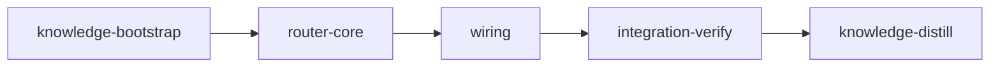

# Plan: Local-Classifier Model/Agent Routing Hooks

## Overview

Add an **opt-in, fail-open** system that uses a **local OpenAI-compatible classifier** (e.g. qwen/gemma served at `localhost`) to nudge Claude Code toward the right subagent + thinking effort for each task. Two global Claude Code hooks call the classifier and inject **advisory** routing guidance:

- **`UserPromptSubmit`** — classifies each user prompt (the kickoff prompt, in autonomous loom sessions) plus recent history, and injects an upfront *routing posture* the agent follows when it delegates.
- **`PreToolUse` matching the subagent-spawn tool** — fires right before each subagent spawn, classifies the spawn's task text, and attaches an advisory note if the chosen `subagent_type`/effort disagrees with the classifier. **It never blocks and never rewrites parameters.**

This extends loom's existing, proven `skill-trigger.sh` `UserPromptSubmit` pattern (same install pipeline, same `additionalContext` injection mechanism). The only real lever a hook controls is **which `subagent_type` the main agent delegates to** (subagents carry their own model); the effort recommendation is an advisory "think harder/lighter" nudge layered on top.

## Goals

- Ship a local-classifier-driven routing **hook** + **config** + **CLI** — no loom orchestration changes (no opus-pinning, no delegate-by-default defaults).
- Route between the two shipped agent definitions: `loom-software-engineer` (Sonnet, cheaper) vs `loom-senior-software-engineer` (Opus), plus a `reasoning_effort` recommendation, **biased by cost/history**.
- **Opt-in:** disabled until an endpoint+model are configured. If unconfigured, unreachable, slow, or the response is malformed → the hook exits 0 with no output. It must **never** delay or block a user's turn.
- Global scope: works in all Claude Code sessions (interactive and loom-orchestrated), like `skill-trigger.sh`.

**Non-goals:** changing per-stage model defaults; blocking/denying tool calls; rewriting tool parameters; bundling a model runtime (the user runs their own llama.cpp/vLLM/LM Studio/Ollama-compat server).

## Security posture (baked into every stage)

- **Untrusted classifier output:** parse the model's JSON into fixed enums; build the injected `additionalContext` from **hard-coded canonical templates** keyed by those enums. The model's free-text rationale may appear only as a short (≤120 char), clearly-labeled, truncated note — **never as an instruction**. This prevents prompt-injection via the local model.
- **No shell injection:** Python stdlib (`json`, `urllib`) only — never interpolate prompt/transcript text into a shell.
- **Fail open everywhere:** timeout (default 2s), unreachable endpoint, bad/non-JSON response, missing config, missing `transcript_path` → exit 0, no output.
- **Secret hygiene:** optional API key read from env/config; never logged, never echoed.
- **Bounded payload:** cap history messages and prompt length sent to the classifier.

## Execution Diagram



Each node is a worktree stage. `router-core` runs two parallel subagents internally (Python hook + Rust CLI/config) with no file overlap.

---

## Stages

### 1. Knowledge Bootstrap

**Purpose:** Confirm the exact integration points before implementation — these are load-bearing and easy to get wrong.

**Tasks:**

- Verify the **real subagent-spawn tool name** in the Claude Code versions loom targets (the `PreToolUse` matcher must match it — confirm it is `Task`, and note any alias). Search loom's signal/prompt text and Claude Code docs/behavior.
- Confirm the global-hook install pipeline: `loom/src/fs/permissions/constants.rs` (`include_str!` + `LOOM_HOOKS` array), `loom/src/fs/permissions/hooks.rs` (`loom_hooks_config_for_dir` registration), and the `skill-trigger.sh` precedent (`loom-hooks/skill-trigger.sh`).
- Confirm both agent definitions exist and their models (`loom-software-engineer` = Sonnet, `loom-senior-software-engineer` = Opus).
- Confirm an HTTP client pattern to reuse for the CLI `status` probe (`loom/src/commands/self_update/client.rs`).
- Record findings via `loom knowledge update` (these are durable system facts).

**Files:** `doc/loom/knowledge/**`

**Acceptance:** knowledge files contain the recorded integration points.

---

### 2. Router Core (Python hook + Rust CLI/config)

**Purpose:** Implement the classifier hook script and the configuration surface (global file + env + `loom router` CLI). Two parallel subagents, no file overlap, sharing one documented config schema.

**Shared config contract (both subagents MUST agree):**

Global file `~/.claude/hooks/loom/router.json`:

    {
      "enabled": true,
      "endpoint": "http://localhost:8080/v1/chat/completions",
      "model": "qwen2.5:3b-instruct",
      "api_key": null,
      "timeout_ms": 2000,
      "max_history_messages": 6
    }

Env overrides (take precedence over the file): `LOOM_ROUTER_ENABLED` (0/1), `LOOM_ROUTER_ENDPOINT`, `LOOM_ROUTER_MODEL`, `LOOM_ROUTER_API_KEY`, `LOOM_ROUTER_TIMEOUT_MS`, `LOOM_ROUTER_MAX_HISTORY`. Resolution order: env > file > built-in default. If not enabled OR no endpoint → fail open.

Classifier response contract (strict JSON the script requests and parses):

    {"agent": "loom-software-engineer" | "loom-senior-software-engineer",
     "reasoning_effort": "low" | "medium" | "high" | "xhigh",
     "confidence": 0.0,
     "rationale": "short string"}

**Subagent A — Python hook (`loom-senior-software-engineer`; prompt-engineering + security judgment):**

Owns `loom-hooks/model-router.py` (repo-root `loom-hooks/`, alongside `skill-trigger.sh`). One script, registered on two events; branches on the `hook_event_name` field from stdin JSON:

- Read stdin JSON. For `UserPromptSubmit`: use `prompt` + tail of `transcript_path` (last `max_history_messages` text turns) + a cheap cost signal (assistant-turn count). For `PreToolUse`: read `tool_input` (the spawn's task description + chosen `subagent_type`).
- Resolve config (env > file). If disabled/unconfigured → exit 0 silently.
- Build an OpenAI-compatible `/v1/chat/completions` request: a system prompt defining the two agents, the four effort levels, and a **cost bias** (prefer `loom-software-engineer` unless the task genuinely needs Opus judgment); request strict JSON. Use `urllib` with the configured timeout.
- Parse the JSON into the fixed enums. On any failure (timeout, connection refused, non-JSON, unknown enum) → exit 0 silently.
- Emit `hookSpecificOutput.additionalContext` from a **canonical template** keyed by the parsed enums. For `UserPromptSubmit`: a routing posture. For `PreToolUse`: an advisory note comparing the classifier's pick to the agent's chosen `subagent_type` (agree → brief confirm or nothing; disagree → "classifier suggests X"). **Never** set a blocking/deny decision; **never** echo `rationale` as an instruction (only as a labeled, truncated ≤120-char note).
- Use the same robust stdin/`isatty`/JSON-guard structure as `loom-hooks/skill-trigger.sh`.
- Tests: a self-contained test (a tiny Python `http.server` stub returning canned JSON, or a fixture-driven dry-run) covering: UserPromptSubmit posture output, PreToolUse agree/disagree output, and **fail-open** paths (stub down, unset config, malformed JSON).

**Subagent B — Rust CLI + global config (`loom-software-engineer`; execution):**

Owns `loom/src/commands/router/` (new module), and edits `loom/src/cli/types.rs` + `loom/src/cli/dispatch.rs`. Read-only: `loom/src/commands/self_update/client.rs` (HTTP pattern), `loom/src/claude.rs`, `loom/src/remote_control.rs` (config-struct precedent).

- Add a `RouterCommands` subcommand enum (`set`, `status`, `show`, `disable`) in `cli/types.rs` and a dispatch arm in `cli/dispatch.rs` (mirror the existing 3-file subcommand registration pattern).
- `commands/router/mod.rs` (+ `config.rs` if needed): `RouterConfig` struct (serde) with the fields above; read/write the global `~/.claude/hooks/loom/router.json` via `dirs::home_dir()` (mirror the hooks-dir resolution in `fs/permissions/hooks.rs`); env-override resolution helper.
- `loom router set --endpoint <url> --model <name> [--api-key <k>] [--timeout-ms <n>] [--enable|--disable]` writes the file (create parent dir if missing).
- `loom router status` prints the resolved config (redacting any api_key) and probes the endpoint via a short-timeout request (reuse the `self_update/client.rs` client pattern with `user_agent("loom-router")`), reporting reachable/unreachable. `loom router show` prints config; `loom router disable` sets `enabled=false`.
- Tests: config round-trip write/read, env-override precedence, `set` produces the documented JSON, api_key redaction in `status`/`show`.

**Files:** `loom-hooks/model-router.py`, `loom/src/commands/router/**`, `loom/src/cli/types.rs`, `loom/src/cli/dispatch.rs`

**Acceptance:** Rust builds + tests pass; `loom router --help` lists subcommands; the Python script runs fail-open with no config.

**Verification:** `loom-hooks/model-router.py` and `loom/src/commands/router/mod.rs` exist; `loom router` is wired into the CLI.

---

### 3. Wiring (register the hook globally)

**Purpose:** Register `model-router.py` so `loom init` installs it and configures it on both hook events. Depends on `router-core` (the script file must exist for `include_str!` to compile). Rust-only, mechanical — detailed for Sonnet.

**Tasks:**

- In `loom/src/fs/permissions/constants.rs`: add `pub const HOOK_MODEL_ROUTER: &str = include_str!("../../../../loom-hooks/model-router.py");` next to `HOOK_SKILL_TRIGGER`, and add `("model-router.py", HOOK_MODEL_ROUTER),` to the `LOOM_HOOKS` array.
- In `loom/src/fs/permissions/hooks.rs` `loom_hooks_config_for_dir()`: add a second entry to the existing `"UserPromptSubmit"` array for `model-router.sh`... — use `model-router.py` path `format!("{hooks_dir}/model-router.py")`; and add a new `"PreToolUse"` matcher entry for the subagent-spawn tool (the tool name confirmed in knowledge-bootstrap, expected `Task`) pointing at the same script. (This is a **global** hook — do **not** touch the `HookEvent` enum in `loom/src/hooks/config.rs`, which is for per-session worktree hooks only.)
- Ensure the script is installed with execute permissions by the existing `install_hook_script` path (it already chmods scripts; `.py` files have a shebang like `skill-trigger.sh`).

**Files:** `loom/src/fs/permissions/constants.rs`, `loom/src/fs/permissions/hooks.rs`

**Acceptance:** Rust builds + tests pass; registration present for both events.

**Verification:** `constants.rs` references `HOOK_MODEL_ROUTER` and lists `model-router.py` in `LOOM_HOOKS`; `hooks.rs` registers `model-router.py` on `UserPromptSubmit` and on a `PreToolUse` matcher.

---

### 4. Integration Verification

**Purpose:** Prove the feature is wired and functional end-to-end, with a security-focused review. Tests passing ≠ feature working.

**Tasks:**

- Build (`cargo build`), full test suite, and `cargo clippy -- -D warnings` — fix ALL warnings/errors (zero tolerance).
- **Functional e2e:** start a local OpenAI-compatible **stub server** (small Python `http.server` returning canned classification JSON); `loom router set --endpoint <stub> --model test --enable`; feed the installed `model-router.py` a simulated `UserPromptSubmit` stdin and a simulated `PreToolUse`(subagent-spawn) stdin → assert the canonical routing text appears in `additionalContext`. Then stop the stub and assert the hook produces **no output and exit 0** (fail-open).
- Verify install wiring: run `loom init` (or the hook-install path) in a scratch repo and confirm `model-router.py` is installed to the hooks dir and registered on both events in the generated settings.
- **Code review** (parallel `loom-code-reviewer` subagents): security (never-block guarantee, injection-safety of classifier output handling, no shell interpolation, secret/api-key hygiene, fail-open completeness), architecture, and test coverage. Fix all findings.
- Record discoveries to `loom memory` for the distill stage.

**Files:** (no doc changes here — handled by knowledge-distill)

**Acceptance:** build + tests + clippy clean; stub-driven hook outputs routing context; fail-open verified.

**Verification:** `loom router --help` works; `model-router.py` installed and registered on both events.

---

### 5. Knowledge Distillation

**Purpose:** Curate stage memories into permanent knowledge and update user-facing docs.

**Tasks:**

- Read all stage memories and `doc/loom/knowledge/*.md`; curate the routing-hook integration points, the never-block/fail-open invariant, and the untrusted-classifier-output rule into knowledge (patterns/mistakes/architecture).
- Update `README.md`/`CONTRIBUTING.md` to document the `loom router` command and the opt-in local-classifier routing feature (only the relevant sections).
- Run `loom review`; remove stale entries.

**Files:** `doc/loom/knowledge/**`, `README.md`, `CONTRIBUTING.md`

**Acceptance:** knowledge files contain the new sections.

---

<!-- loom METADATA -->

```yaml
loom:
  version: 1
  sandbox:
    enabled: true
    auto_allow: true
    excluded_commands:
      - "loom"
    filesystem:
      deny_read:
        - "~/.ssh/**"
        - "~/.aws/**"
        - "~/.config/gcloud/**"
        - "~/.gnupg/**"
      deny_write:
        - ".work/stages/**"
    network:
      allowed_domains:
        - "crates.io"
        - "static.crates.io"
        - "index.crates.io"
        - "github.com"
      allow_local_binding: true
      allow_unix_sockets: []
  stages:
    - id: knowledge-bootstrap
      name: "Bootstrap Knowledge Base"
      stage_type: knowledge
      model: "sonnet"
      reasoning_effort: "high"
      description: |
        Confirm the exact integration points for the routing hooks before implementation.
        Knowledge already exists in doc/loom/knowledge/ — this stage VERIFIES and records the
        specific facts the implementation depends on. Do NOT re-map the whole codebase.

        Use parallel subagents and skills to maximize performance.

        VERIFY AND RECORD (via loom knowledge update):
        1. The real subagent-spawn tool name that PreToolUse must match in the Claude Code
           versions loom targets. Expected: Task. Confirm and note any alias. This is
           load-bearing — the PreToolUse matcher is useless if the name is wrong.
        2. The global-hook install pipeline:
           - loom/src/fs/permissions/constants.rs: include_str! consts + the LOOM_HOOKS array
           - loom/src/fs/permissions/hooks.rs: loom_hooks_config_for_dir() registration (note the
             existing UserPromptSubmit entry for skill-trigger.sh)
           - loom-hooks/skill-trigger.sh: the precedent UserPromptSubmit hook (stdin JSON ->
             hookSpecificOutput.additionalContext) and its isatty/JSON-guard structure
        3. Both agent definitions and their models: loom-software-engineer (Sonnet),
           loom-senior-software-engineer (Opus).
        4. The HTTP client pattern to reuse for the CLI status probe:
           loom/src/commands/self_update/client.rs (create_http_client, timeouts, user-agent).

        Record concise, durable findings:
          loom knowledge update entry-points - <<'EOF'
          ## Routing Hook Integration Points
          ... (tool name, install pipeline files, agent models, HTTP client) ...
          EOF

        MEMORY RECORDING (use loom memory ONLY — never auto-memory):
        - loom memory note "found: subagent-spawn tool name is <X> at <evidence>"
        - loom memory decision "..." --context "..."
        Before completing: loom memory list to verify insights captured.

        ⛔ NEVER use Claude Code's auto-memory (~/.claude/projects/*/memory/).
      dependencies: []
      acceptance:
        - 'rg -q "## " doc/loom/knowledge/entry-points.md'
      files:
        - "doc/loom/knowledge/**"
      working_dir: "."
      artifacts:
        - "doc/loom/knowledge/entry-points.md"

    - id: router-core
      name: "Router Core (hook script + CLI/config)"
      stage_type: standard
      model: "opus"
      reasoning_effort: "xhigh"
      description: |
        Implement the classifier hook script and the configuration surface. Two parallel
        subagents, NO file overlap, sharing one documented config + response contract.

        Use parallel subagents and skills to maximize performance.

        SHARED CONFIG CONTRACT (both subagents MUST agree):
          Global file ~/.claude/hooks/loom/router.json:
            enabled: bool, endpoint: string (/v1/chat/completions), model: string,
            api_key: string|null, timeout_ms: int (default 2000), max_history_messages: int (default 6)
          Env overrides (precedence over file): LOOM_ROUTER_ENABLED (0/1),
            LOOM_ROUTER_ENDPOINT, LOOM_ROUTER_MODEL, LOOM_ROUTER_API_KEY,
            LOOM_ROUTER_TIMEOUT_MS, LOOM_ROUTER_MAX_HISTORY.
          Resolution: env > file > default. If not enabled OR no endpoint -> fail open.
        CLASSIFIER RESPONSE CONTRACT (strict JSON):
          agent: loom-software-engineer | loom-senior-software-engineer
          reasoning_effort: low | medium | high | xhigh
          confidence: float; rationale: short string

        SECURITY (mandatory):
        - Treat classifier output as UNTRUSTED. Build injected additionalContext from
          hard-coded canonical templates keyed by the parsed enums. rationale may appear
          only as a labeled, truncated (<=120 char) note, NEVER as an instruction.
        - No shell interpolation of prompt/transcript text (Python stdlib only).
        - Fail open on EVERY error path (timeout, connection refused, non-JSON, unknown enum,
          missing config, missing transcript_path) -> exit 0, no output.
        - api_key never logged or echoed.

        SUBAGENT FILE ASSIGNMENTS:
          Subagent A — Python hook (loom-senior-software-engineer):
            Files Owned: loom-hooks/model-router.py
            Files Read-Only: loom-hooks/skill-trigger.sh
            Task: single script registered on two events; branch on the hook_event_name field
              of stdin JSON. UserPromptSubmit -> classify prompt + tail of transcript_path
              (last max_history_messages text turns) + cheap cost signal (assistant-turn count)
              -> inject a routing POSTURE (default to loom-software-engineer; escalate to
              loom-senior-software-engineer for architectural/security sub-tasks; suggested effort).
              PreToolUse -> read tool_input (task description + chosen subagent_type), classify,
              inject an ADVISORY note (agree: brief/none; disagree: "classifier suggests X").
              Never block, never set deny. Build the OpenAI-compatible request with urllib +
              configured timeout. Mirror skill-trigger.sh isatty/JSON-guard structure.
              Tests: a tiny Python http.server stub returning canned JSON covering UserPromptSubmit
              posture, PreToolUse agree/disagree, and fail-open paths (stub down / unset config /
              malformed JSON).
          Subagent B — Rust CLI + global config (loom-software-engineer):
            Files Owned: loom/src/commands/router/**, loom/src/cli/types.rs, loom/src/cli/dispatch.rs
            Files Read-Only: loom/src/commands/self_update/client.rs, loom/src/claude.rs,
              loom/src/remote_control.rs
            Task: add RouterCommands enum (set/status/show/disable) in cli/types.rs + dispatch arm in
              cli/dispatch.rs (mirror the existing 3-file subcommand registration pattern). Implement
              commands/router/mod.rs (+ config.rs if needed): RouterConfig serde struct; read/write the
              global ~/.claude/hooks/loom/router.json via dirs::home_dir() (mirror the hooks-dir
              resolution in fs/permissions/hooks.rs); env-override resolution helper.
              `loom router set` writes the file (create parent dir). `loom router status` prints the
              resolved config (api_key redacted) and probes the endpoint with a short timeout reusing
              the self_update/client.rs client pattern (user_agent "loom-router"); reports
              reachable/unreachable. `loom router show` prints config; `loom router disable` sets
              enabled=false. Tests: config round-trip, env precedence, set output shape, api_key redaction.

        NO FILE OVERLAP between subagents confirmed (Python at loom-hooks/, Rust under loom/src/).

        MEMORY RECORDING (use loom memory ONLY — never loom knowledge, never auto-memory):
        - MISTAKE: loom memory note "mistake: tried X, failed because Y, fixed by Z"
        - DECISION: loom memory decision "chose X" --context "Y because Z"
        SUBAGENT MEMORY — both subagents must record mistakes/decisions/surprises via loom memory
        (not procedural actions). ⛔ NEVER use Claude Code's auto-memory.
      dependencies: ["knowledge-bootstrap"]
      acceptance:
        - "cargo build --manifest-path loom/Cargo.toml"
        - "cargo test --manifest-path loom/Cargo.toml router"
        - "python3 loom-hooks/model-router.py < /dev/null"
      files:
        - "loom-hooks/model-router.py"
        - "loom/src/commands/router/**"
        - "loom/src/cli/types.rs"
        - "loom/src/cli/dispatch.rs"
      working_dir: "."
      artifacts:
        - "loom-hooks/model-router.py"
        - "loom/src/commands/router/mod.rs"
      wiring:
        - source: "loom/src/cli/dispatch.rs"
          pattern: "[Rr]outer"
          description: "loom router subcommand dispatched"
        - source: "loom-hooks/model-router.py"
          pattern: "additionalContext"
          description: "Hook injects routing guidance via additionalContext"

    - id: wiring
      name: "Register Router Hook Globally"
      stage_type: standard
      model: "sonnet"
      reasoning_effort: "high"
      description: |
        Register model-router.py so loom installs it and configures it on both hook events.
        Rust-only, mechanical. The script file already exists from router-core.

        Use parallel subagents and skills to maximize performance.

        STEP 1 — loom/src/fs/permissions/constants.rs:
        - Next to the HOOK_SKILL_TRIGGER const, add:
            pub const HOOK_MODEL_ROUTER: &str = include_str!("../../../../loom-hooks/model-router.py");
          (Verify the relative path matches the existing HOOK_SKILL_TRIGGER include_str! — same
          ../../../../loom-hooks/ prefix.)
        - In the LOOM_HOOKS array, add an entry:
            ("model-router.py", HOOK_MODEL_ROUTER),

        STEP 2 — loom/src/fs/permissions/hooks.rs, function loom_hooks_config_for_dir():
        - In the existing "UserPromptSubmit" array, add a second matcher object alongside
          skill-trigger.sh:
            {"matcher": "*", "hooks": [{"type": "command",
              "command": format!("{hooks_dir}/model-router.py")}]}
        - Add a new top-level "PreToolUse" entry (the function already has a PreToolUse array) with a
          matcher for the subagent-spawn tool name confirmed in knowledge-bootstrap (expected "Task"):
            {"matcher": "Task", "hooks": [{"type": "command",
              "command": format!("{hooks_dir}/model-router.py")}]}
        - Do NOT modify loom/src/hooks/config.rs HookEvent enum — this is a GLOBAL hook, not a
          per-session worktree hook.

        STEP 3 — confirm install: the existing install_hook_script path chmods scripts; model-router.py
        has a shebang like skill-trigger.sh, so it is installed executable automatically. No change needed
        unless a test reveals otherwise.

        Update/extend the existing hooks_tests.rs assertions to cover the new registration.

        MEMORY RECORDING (loom memory ONLY — never loom knowledge, never auto-memory):
        - Record any surprise about include_str! paths or settings-merge behavior.
        ⛔ NEVER use Claude Code's auto-memory.
      dependencies: ["router-core"]
      acceptance:
        - "cargo build --manifest-path loom/Cargo.toml"
        - "cargo test --manifest-path loom/Cargo.toml hooks"
        - 'rg -q "HOOK_MODEL_ROUTER" loom/src/fs/permissions/constants.rs'
      files:
        - "loom/src/fs/permissions/constants.rs"
        - "loom/src/fs/permissions/hooks.rs"
      working_dir: "."
      wiring:
        - source: "loom/src/fs/permissions/constants.rs"
          pattern: "model-router.py"
          description: "Router script embedded and listed in LOOM_HOOKS"
        - source: "loom/src/fs/permissions/hooks.rs"
          pattern: "model-router.py"
          description: "Router hook registered on UserPromptSubmit and PreToolUse"

    - id: integration-verify
      name: "Integration Verification"
      stage_type: integration-verify
      model: "opus"
      reasoning_effort: "xhigh"
      description: |
        Final verification after all stages complete. Verify FUNCTIONAL INTEGRATION, not just tests.

        Use parallel subagents and skills to maximize performance.

        ⛔ NEVER use Claude Code's auto-memory (~/.claude/projects/*/memory/).
        ALL memory/knowledge goes through loom memory and loom knowledge commands.

        CONTEXT GATHERING (FIRST):
        - Read the plan file from doc/plans/ (check .work/config.toml source_path)
        - Read ALL stage memories: loom memory show --all
        - Read doc/loom/knowledge/*.md

        BUILD & TEST (zero tolerance — fix ALL warnings/errors, nothing is "pre-existing"):
        - cargo build --manifest-path loom/Cargo.toml
        - cargo test --manifest-path loom/Cargo.toml
        - cargo clippy --manifest-path loom/Cargo.toml -- -D warnings

        FUNCTIONAL E2E (MANDATORY):
        - Start a local OpenAI-compatible stub server (small Python http.server returning canned
          classification JSON on /v1/chat/completions).
        - loom router set --endpoint <stub-url> --model test --enable
        - Pipe a simulated UserPromptSubmit stdin JSON into loom-hooks/model-router.py and assert the
          canonical routing posture appears in hookSpecificOutput.additionalContext.
        - Pipe a simulated PreToolUse (subagent-spawn) stdin JSON and assert an advisory note appears
          and NO blocking/deny decision is emitted.
        - Stop the stub; re-run both and assert NO output + exit 0 (fail-open).
        - Run the hook-install path (e.g. loom init in a scratch dir) and confirm model-router.py is
          installed and registered on BOTH events in the generated settings.

        CODE REVIEW (MANDATORY — parallel loom-code-reviewer subagents):
        - Security (use /loom-security-audit): never-block guarantee, injection-safety of classifier
          output handling, no shell interpolation, api_key/secret hygiene, fail-open completeness.
        - Architecture: module organization, reuse of existing patterns (HTTP client, config helpers).
        - Test coverage: fail-open paths, env precedence, agree/disagree branches, redaction.
        - Fix ALL findings with loom-senior-software-engineer / loom-software-engineer
          (loom-code-reviewer is read-only).

        Record discoveries to loom memory so knowledge-distill can curate them.
      dependencies: ["wiring"]
      acceptance:
        - "cargo build --manifest-path loom/Cargo.toml"
        - "cargo test --manifest-path loom/Cargo.toml"
        - "cargo clippy --manifest-path loom/Cargo.toml -- -D warnings"
        - "python3 loom-hooks/model-router.py < /dev/null"
      files:
        - "loom-hooks/**"
        - "loom/src/**"
      working_dir: "."
      truths:
        - "python3 loom-hooks/model-router.py < /dev/null"
      wiring:
        - source: "loom/src/fs/permissions/hooks.rs"
          pattern: "model-router.py"
          description: "Router hook registered on UserPromptSubmit and PreToolUse"

    - id: knowledge-distill
      name: "Knowledge Distillation"
      stage_type: knowledge-distill
      model: "sonnet"
      reasoning_effort: "high"
      description: |
        Curate all stage memories into permanent knowledge and update user-facing docs.

        ⛔ NEVER use Claude Code's auto-memory (~/.claude/projects/*/memory/).
        ALL memory/knowledge goes through loom memory and loom knowledge commands.

        CONTEXT GATHERING (FIRST):
        - Read the plan file from doc/plans/ (check .work/config.toml source_path)
        - Read ALL stage memories: loom memory show --all
        - Read doc/loom/knowledge/*.md for current state

        MEMORY CURATION:
        - Curate the routing-hook integration points, the never-block/fail-open invariant, and the
          untrusted-classifier-output rule into knowledge (patterns/mistakes/architecture).
        - loom knowledge update mistakes/patterns/architecture as appropriate.
        - Run loom review; remove stale entries.

        DOCUMENTATION UPDATE (MANDATORY):
        - Update README.md / CONTRIBUTING.md to document the `loom router` command and the opt-in
          local-classifier routing feature (only the relevant sections — do NOT rewrite whole files).
        - If nothing user-facing changed, skip and record WHY in memory (it DID change here).
      dependencies: ["integration-verify"]
      acceptance:
        - 'rg -q "## " doc/loom/knowledge/architecture.md'
        - 'rg -q "## " doc/loom/knowledge/patterns.md'
      files:
        - "doc/loom/knowledge/**"
        - "README.md"
        - "CONTRIBUTING.md"
      working_dir: "."
```

<!-- END loom METADATA -->
