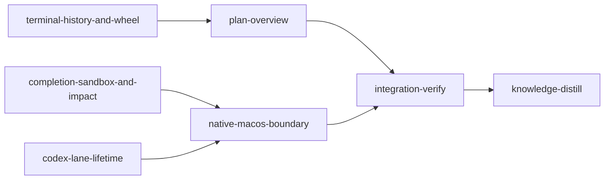

# Plan: Open GitHub Issues #30, #35, #36, #40, #41 and Native Codex on macOS

Implements: none

## Overview

Five open GitHub issues plus one operator-added fix, all on macOS-first evidence:

| Issue | Problem | Stage |
| --- | --- | --- |
| #41 | A two-finger trackpad swipe never pages the View-mode stage terminal: the wheel pager needs a full viewport (about 750 px) per page and never resets between gestures (`web/src/components/terminal/viewer-wheel.ts:42-45`, `pager.reset()` unused on the wheel path) | `terminal-history-and-wheel` |
| #35 | A session that runs Claude Code with `tui: fullscreen` draws on the alternate screen, so tmux keeps no scrollback, yet the web UI offers "Terminal history" (`loom/src/status/data/stopped.rs:43-63`, `web/src/components/terminal/terminal-glyph.tsx:26-30`) | `terminal-history-and-wheel` |
| #36 | After a plan finishes, the web token sidebar and the TUI pane show the last stage's sample; there is no plan-wide view | `plan-overview` |
| #40 | The macOS completion sandbox denies signalling own children, binding localhost ports and listing directories above the worktree (`loom/src/verify/criteria/confine_seatbelt.rs:271`); denials are reported as test failures; an accepted impact-tests dispute stores a 64-name truncation and never matches a larger selection (`loom/src/verify/impact_tests/failure.rs:142`, `accepted.rs:87-94`); the base comparison has no installed dependencies and stands as a failure (`base.rs:209-244`) | `completion-sandbox-and-impact` |
| #30 | Lane doctrine still routes every piece that needs exploration to Claude although Codex carries the navigation kit; a native Codex worker whose startup hangs is never timed out (`native_worker/machine/turns.rs:159`); `loom subagents watch` shows no progress state. The 540 s cancellation named in the issue is gone (commit `ea6d3d32c`, 1500 s now) | `codex-lane-lifetime` |
| operator | The default native Codex backend refuses every non-Linux host (`loom/src/native_worker/boundary/probe.rs:33-36`), so on macOS every codex lane falls back to Claude | `native-macos-boundary` |

Issue #29 (Codex as a stage-orchestrator runtime) is out of scope by the operator's decision.

## Goals

- Each issue's acceptance in its GitHub text holds, with the decisions below.
- No backward-compatibility or migration code (unreleased project, `CLAUDE.md`).
- No standard stage edits `loom/maintainability-baseline.txt` (three stages run at once): every changed file stays at or under its ledger row and every new file under 400 lines; a ledgered file that must grow moves lines out first. Integration-verify alone may lower rows.
- Non-goals: #29; Codex as a stage orchestrator; a global statistics view (this plan only writes the per-plan records it will read).

## Decisions (settled with the operator)

1. **#36 view.** A modal dialog, never the sidebar, in layout A of the mockup committed at `doc/plans/briefs/open-github-issues/plan-overview/mockup.html`: header with lock note, five totals (wall time, stage execution, fresh tokens, cache hit, all tokens), token mix bar, timeline, models table with a colour key, footer naming the saved stats file and a Copy summary button. The dialog cannot be closed (no close control, Escape and outside clicks do nothing). The TUI replaces its ledger with the same three blocks when the plan finishes; `q` still quits.
2. **#36 timeline.** Each stage bar runs from its first start to completion and is split into contract writing, executing, dispute and adjudication, retry, and waiting or merge. Skipped stages show as skipped.
3. **#36 trigger and lifetime.** The overview appears once every stage is Completed or Skipped. It stays while the UI is open; `loom clean` and `loom init` remove it with `.loom/work` as they do now.
4. **#36 statistics.** Every finished plan writes one versioned JSON record to `<loom home>/stats/plans/`, where `<loom home>` is the directory holding the user `config.toml` (`user_config::config_path()`, which honours `LOOM_HOME`), and the same record to `.loom/work/plan-stats.json`, which the UIs read. Records under `<loom home>` survive `loom clean` and `loom init`.
5. **#40 sandbox.** The macOS profile allows signals to the command's own sandbox only (`(allow signal (target same-sandbox))`), bind and inbound on localhost only, and a listing (names only) of every directory above the tree; Cargo files above the tree stay hidden. A sandbox denial in a failing run's output is reported as an environment failure, not a test failure.
6. **#40 base comparison.** The base checkout is provisioned with the plan's `loom.provision` entries before the confined base run. A provision failure, or an environment still missing afterwards, is a note naming the reason ("base not runnable: ..."), not a failure. Integration-verify's full suite remains the backstop for a selection noted this way.
7. **#40 accepted disputes.** An accepted impact-tests record matches a later failure by id, failure kind and a digest of the full selected-test list; the 64-name list stays for display.
8. **macOS native Codex isolation.** Loom's own macOS sandbox wraps the whole Codex app-server: writes only to the worktree and a private temp directory, `.git`, `.loom`, `.claude` and `.codex` read-only, network only through loom's proxy (443 to the four allowed hosts). Codex commands run without their own sandbox (macOS refuses a nested profile), so they share that allowlist and can read the private Codex home's auth file.
9. **macOS quiescence.** The worker runs in its own session; teardown kills its process group, then scans every process for the session id, process-group id and a loom environment marker, retrying until none remain. A process that calls `setsid` and rewrites its environment can escape the scan; it still cannot leave the sandbox's write limits. Linux keeps the pid-namespace proof.
10. **Lanes.** Every stage runs on Claude only (`implementers: ["claude"]`): the native Codex lane is unavailable on macOS until this plan's `native-macos-boundary` stage ships, so the plan does not depend on it. Workers are `loom-software-engineer` (sonnet), `loom-software-developer` (haiku) for the fully specified doctrine text, and `loom-senior-software-engineer` (opus) for security-sensitive boundary and sandbox code. Verification and code review stay with Claude opus.

## Relation to other plans

- `doc/plans/IN_PROGRESS-PLAN-contract-and-criterion-dispute-guards.md` is executing and owns `loom/src/verify/impact_tests/base.rs` (stage `criterion-narrowing-evidence`, worker `base-run`), `loom/src/verify/review/verdict_records.rs` and `loom/src/stage_service/dispute_admission.rs`. **Run this plan only after that plan is complete and merged**, and reinstall the binary (`./dev-install.sh`) first. Its `criterion-narrowing-evidence` stage adds `loom/src/stage_cache/base_checkout.rs` and `loom/src/host_verify/child_base.rs`; the `base-provision` worker calls its provision helper there too when those files exist.

## Operator prerequisites

- Review tier: the first review round of each stage runs on opus (`models.code_reviewer_model`); later rounds use `models.code_reviewer_followup_model`, sonnet by default. Set that key to opus to keep every round on opus.
- After the plan: from a plain (unsandboxed) shell on macOS run `LOOM_TEST_REQUIRE_SANDBOX_FREE=1 cargo test --manifest-path loom/Cargo.toml --lib -- seatbelt kernel native_macos` . macOS refuses a nested sandbox, so no stage session or completion job can prove a new profile in the kernel; the stages prove the generated policy, and this run proves the kernel enforces it.

## Execution Diagram



`terminal-history-and-wheel`, `completion-sandbox-and-impact` and `codex-lane-lifetime` start together.

## Stages

Knowledge bootstrap is skipped: the tier-1 files describe this codebase and `loom knowledge check --strict --baseline doc/loom/knowledge/check-baseline.txt` exits 0 at HEAD.

### 1. `terminal-history-and-wheel` (#41, #35)

Why a stage: Q2. It writes `loom/src/status/data/mod.rs`, `loom/src/commands/status/web/model.rs`, `web/src/api/schema.ts` and the snapshot fixtures, which `plan-overview` also writes, so `plan-overview` depends on it.

- **#41**: gestures are grouped by an idle gap of 250 ms (`event.timeStamp`); the pager resets at each gesture start; the first page of a gesture needs a lead of `max(3, ceil(rows / 4))` lines, each further page a full viewport, at most 3 pages per gesture and ±1 per event; a View-mode alternate-screen wheel event with `deltaY === 0` is still cancelled. Control mode is unchanged.
- **#35**: the monitor samples `#{alternate_on}` for running tmux sessions each poll; the first `1` sets `Session.fullscreen_seen` and, while the pane is on the alternate screen, each poll saves the visible screen. At teardown a fullscreen session keeps its saved last screen. Status carries `terminal_history_kind: "history" | "last_screen"`; the web UI then says "Last screen" everywhere and never "history".

Risk walk: untrusted input (none new); lifecycle (the save at teardown must not overwrite a last screen with the main screen: contract `fullscreen-keeps-visible-capture`); reachability (labels reach every consumer: contract `last-screen-labels` plus wiring on `stage.tsx`); behaviour (contracts on the wheel).

### 2. `plan-overview` (#36)

Why a stage: Q2 (shared status files with stage 1, so it depends on it).

Stage phase spans are recorded in the single persistence choke point (`verify/transitions/persistence.rs::update_stage_file_locked`, where before and after status and session type are visible). When orchestration finishes successfully the daemon flushes the token tracker, builds a `PlanStatsRecord`, writes `.loom/work/plan-stats.json` and publishes the record once to `<loom home>/stats/plans/`. The status collector exposes the record as `StatusData.plan_stats`; the web dialog and the TUI overview render it.

Risk walk: lifecycle (exactly-once publish on a daemon restart: contract `plan-stats-published-once`); configuration propagation (`LOOM_HOME` honoured: contract `plan-stats-under-loom-home`); lifecycle (contract and adjudication phases recorded when only the session type changes: contract `phase-spans-follow-session-type`); reachability (dialog non-dismissable: contract `plan-overview-dialog-stays-open`; TUI overview replaces the ledger: contract `tui-shows-plan-overview`; `reachable` from `finish_orchestration`).

### 3. `completion-sandbox-and-impact` (#40)

Why a stage: Q1. `native-macos-boundary` reuses its Seatbelt helpers and must start from them merged.

Risk walk: security (signal and bind limited: contracts `signals-only-own-sandbox`, `binds-only-localhost`, `ancestors-listed-not-read`); external data (denial markers from real runner output: contract `sandbox-denial-is-environment`); lifecycle (accepted dispute survives the next run: contract `accepted-impact-matches-full-selection`); configuration (provision entries actually run on the base: contract `base-provision-failure-is-note`).

### 4. `codex-lane-lifetime` (#30)

Why a stage: Q2. It writes `loom/src/native_worker/supervisor/mod.rs` and `machine/turns.rs`, which `native-macos-boundary` also writes.

Doctrine allows Codex a bounded exploratory assignment within its owned files, located with the navigation kit, when its ownership, sandbox and acceptance match a Claude executor's; debugging a bug of unknown cause, fixture-backed test convergence, verification, review and planning stay with Claude. The native worker gets a startup deadline (initialize and thread start within 120 s) and `loom subagents watch` reports a progress age.

Risk walk: lifecycle (startup hang settles TimedOut: contract `startup-hang-times-out`); behaviour (watch prints progress: contract `watch-reports-progress`); doctrine pin (contract `doctrine-licenses-bounded-exploration`).

### 5. `native-macos-boundary` (operator)

Why a stage: Q1 on stages 3 and 4 (reuses their merged files) and Q4 (security design, 1,000-1,500 lines).

Risk walk: filesystem paths and symlinks (profile denies `.git`/`.loom`/`.claude`/`.codex` writes and every write outside the worktree and private temp: contract `macos-profile-confines-writes`); untrusted network (only the proxy socket and the localhost bridge: contract `macos-profile-network-only-proxy`); lifecycle (quiescence scan finds a session member that changed its process group: contract `quiescence-scan-finds-session-members`); configuration (macOS qualification no longer refused by OS: contract `macos-qualifies`).

### 6. Integration Verification

Full Rust suite, clippy, fmt, the web check script and build; parallel opus reviewers; functional proof of each issue's fix.

### 7. Knowledge Distillation

Curates the plan's memories, applies stale-knowledge corrections first, records unimplemented reviewer suggestions.

---

<!-- loom METADATA -->

```yaml
loom:
  version: 2
  sandbox:
    enabled: true
    auto_allow: true
    allow_unsandboxed_escape: false
    excluded_commands: []
    filesystem:
      deny_read:
      - ~/.ssh/**
      - ~/.aws/**
      - ~/.config/gcloud/**
      - ~/.gnupg/**
      deny_write:
      - ../../**
      allow_write: []
    network:
      allowed_domains:
      - crates.io
      - index.crates.io
      - static.crates.io
      - registry.npmjs.org
      additional_domains: []
      allow_local_binding: false
      allow_unix_sockets: []
      allow_all_unix_sockets: false
    linux:
      enable_weaker_nested: false
    command_confinement: confined
  ratchet_files:
  - loom/maintainability-baseline.txt
  - doc/loom/knowledge/check-baseline.txt
  provision:
  - working_dir: web
    command: >-
      test ! -e .npmrc && test ! -L .npmrc && bun install --frozen-lockfile
      --ignore-scripts --backend=copyfile --config=/dev/null
  stages:
  - id: terminal-history-and-wheel
    name: "Trackpad paging and fullscreen last screen"
    summary: "A gentle trackpad swipe pages the View-mode terminal, and a session that ran fullscreen shows its last screen instead of claiming terminal history."
    stage_type: standard
    skills: ["loom-rust", "loom-react", "loom-typescript"]
    implementers: ["claude"]
    working_dir: "."
    dependencies: []
    description: |
      Read doc/plans/PLAN-open-github-issues.md sections Overview, Decisions and stage 1 first
      (YAML is authoritative where they differ). Issues #41 and #35.
      Use parallel subagents and skills to maximize performance.

      PUBLIC SURFACE (contracts are written from this before any code):
        web/src/components/terminal/viewer-wheel.ts
          installViewerWheel(terminal, host, scroll) keeps its signature. Gesture rule: a wheel
          event more than 250 ms (event.timeStamp) after the previous one starts a new gesture and
          resets the pager. Within a gesture the first page needs max(3, ceil(terminal.rows / 4))
          lines of movement, each further page terminal.rows lines; at most 3 pages per gesture,
          at most one page per event. Pixel deltas convert with terminalLineHeight (unchanged).
          In View mode on the alternate screen every non-ctrl wheel event is preventDefault-ed,
          deltaY === 0 included. Control mode unchanged.
        web/src/components/terminal/history-labels.ts (new)
          export type HistoryKind = "history" | "last_screen";
          export function historyLabels(kind: HistoryKind): { button: string; aria: string;
            eyebrow: string; footer: string; link: string; missing: string; failed: string; title: string }
          "history" returns today's strings exactly; "last_screen" returns: button "Last screen",
          aria "open last screen", eyebrow "Last screen", footer
          "read-only · the session ended · this is its last screen", link "View last screen",
          missing "This session left no saved screen.", failed "The saved screen could not be loaded.",
          title "The session ended; its last screen opens read-only". No last_screen string
          contains the word history (any case).
        Rust:
          crate::orchestrator::terminal::tmux::history::CaptureMode { Full, Visible }
          crate::orchestrator::terminal::tmux::history::capture_mode(fullscreen_seen: bool,
            alternate_now: Option<bool>) -> Option<CaptureMode>
            fullscreen_seen false and alternate_now not Some(true) -> Some(Full);
            alternate_now Some(true) -> Some(Visible);
            fullscreen_seen true and alternate_now not Some(true) -> None (keep the last screen
            already saved while the pane was on the alternate screen).
          Session.fullscreen_seen: bool (serde default, skip when false), set once, never cleared.
          crate::status::data::HistoryKind { History, LastScreen } serialized "history" / "last_screen".
          StageSummary.terminal_history_kind: Option<HistoryKind>, Some exactly when
          terminal_history_session is Some; LastScreen when the named session has fullscreen_seen.
          The web attention entry gains terminal_history_kind beside terminal_history.

      WORKERS (one ownership table; spawn all in one message):
      | Worker | Role | Tier | Files owned | Shared context | Brief path |
      | --- | --- | --- | --- | --- | --- |
      | wheel | #41 gesture paging | loom-software-engineer | web/src/components/terminal/viewer-wheel.ts, web/src/components/terminal/viewer-wheel.test.ts | public surface above | doc/plans/briefs/open-github-issues/terminal-history-and-wheel/wheel.md |
      | fullscreen-rust | #35 detection, save, status | loom-software-engineer | loom/src/models/session/types.rs, loom/src/models/session/methods.rs, loom/src/fs/session_files/exact.rs, loom/src/orchestrator/terminal/tmux/capture.rs, loom/src/orchestrator/terminal/tmux/history.rs, loom/src/orchestrator/terminal/tmux/fullscreen.rs, loom/src/orchestrator/terminal/tmux/mod.rs, loom/src/orchestrator/terminal/tmux/tests_history.rs, loom/src/orchestrator/monitor/core.rs, loom/src/status/data/stopped.rs, loom/src/status/data/mod.rs, loom/src/status/attention_model.rs, loom/src/commands/status/web/model.rs, loom/src/commands/status/web/model_tests.rs, web/src/api/fixtures/snapshot.json, web/src/api/fixtures/statuses.json | public surface above | doc/plans/briefs/open-github-issues/terminal-history-and-wheel/fullscreen-rust.md |
      | fullscreen-web | #35 labels in the UI | loom-software-engineer | web/src/components/terminal/history-labels.ts, web/src/components/terminal/terminal-glyph.tsx, web/src/routes/stage.tsx, web/src/components/stage-modal.tsx, web/src/components/terminal/history-view.tsx, web/src/components/attention-blocked.tsx, web/src/routes/terminal.tsx, web/src/api/schema.ts, web/src/components/terminal/terminal-glyph.test.tsx, web/src/components/stage-modal-history.test.tsx, web/src/components/terminal/history-view.test.tsx, web/src/components/attention-panel.test.tsx, web/src/api/schema.test.ts | public surface above | doc/plans/briefs/open-github-issues/terminal-history-and-wheel/fullscreen-web.md |
      Run oxfmt in web/ after the web workers return.
      GATE: loom check terminal-history-and-wheel once beside the final review.
      INTEGRITY: TI-edit on web/src/components/terminal/viewer-wheel.test.ts is expected where a
      pinned threshold expectation changes to the lead-distance rule; the mouse-notch and
      reversal expectations must keep asserting no page.
      MEMORY: record mistakes, decisions and surprises with loom memory immediately; NEVER loom
      knowledge (implementation stage); NEVER Claude Code auto-memory.
    files:
    - "web/src/components/terminal/**"
    - "web/src/routes/stage.tsx"
    - "web/src/routes/terminal.tsx"
    - "web/src/components/stage-modal.tsx"
    - "web/src/components/stage-modal-history.test.tsx"
    - "web/src/components/attention-blocked.tsx"
    - "web/src/components/attention-panel.test.tsx"
    - "web/src/api/schema.ts"
    - "web/src/api/schema.test.ts"
    - "web/src/api/fixtures/**"
    - "loom/src/models/session/**"
    - "loom/src/fs/session_files/**"
    - "loom/src/orchestrator/terminal/tmux/**"
    - "loom/src/orchestrator/monitor/core.rs"
    - "loom/src/status/data/**"
    - "loom/src/status/attention_model.rs"
    - "loom/src/commands/status/web/**"
    before_stage:
    - command: "test -f loom/src/host_verify/child_base.rs"
      description: "PLAN-contract-and-criterion-dispute-guards is merged"
    after_stage:
    - command: "rg -qF 'alternate_on' loom/src/orchestrator/terminal/tmux/fullscreen.rs"
      description: "the monitor samples the alternate screen"
    acceptance:
    - "cargo test --manifest-path loom/Cargo.toml --lib status::data::"
    - "cargo test --manifest-path loom/Cargo.toml --lib orchestrator::terminal::tmux::"
    - "cargo test --manifest-path loom/Cargo.toml --lib commands::status::web::"
    - "cargo clippy --manifest-path loom/Cargo.toml --all-targets -- -D warnings"
    - command: "cd web && ./node_modules/.bin/vitest run src/components/terminal src/components/stage-modal-history.test.tsx src/components/attention-panel.test.tsx src/api/schema.test.ts src/routes"
      timeout_secs: 900
    - command: "cd web && ./node_modules/.bin/tsc -b --noEmit && ./node_modules/.bin/oxlint --deny-warnings && ./node_modules/.bin/oxfmt --check"
      timeout_secs: 600
    artifacts:
    - "web/src/components/terminal/history-labels.ts"
    - "loom/src/orchestrator/terminal/tmux/fullscreen.rs"
    wiring:
    - source: "web/src/routes/stage.tsx"
      pattern: "historyLabels("
      literal: true
      description: "the stage actions take their labels from the history kind"
    - source: "web/src/components/attention-blocked.tsx"
      pattern: "historyLabels("
      literal: true
      description: "the attention link takes its label from the history kind"
    reachable:
    - symbol: capture_mode
      from: kill_session
      description: "the teardown save decides its capture through capture_mode"
    contracts:
    - id: gentle-swipe-pages-once
      file: web/src/components/terminal/viewer-wheel.contract.test.ts
      cwd: web
      runner: vitest
      test: viewer wheel gestures a gentle trackpad swipe sends one page
      scenario: "View mode, alternate screen, 45 rows, 18 px line height fallback; 20 pixel-mode wheel events of deltaY 15 at 16 ms timeStamp spacing"
      rejects: "a pager that still needs a full viewport (about 810 px) per page and sends nothing"
    - id: slow-notch-sends-no-page
      file: web/src/components/terminal/viewer-wheel.contract.test.ts
      cwd: web
      runner: vitest
      test: viewer wheel gestures a single slow mouse notch sends no page
      scenario: "View mode, alternate screen, 45 rows; one pixel-mode wheel event of deltaY 40, then 600 ms later another of deltaY 40"
      rejects: "a lead distance so short, or a remainder carried across gestures, that two separated notches send a page"
    - id: flick-is-bounded
      file: web/src/components/terminal/viewer-wheel.contract.test.ts
      cwd: web
      runner: vitest
      test: viewer wheel gestures a hard flick sends at most three pages one per event
      scenario: "View mode, alternate screen, 45 rows; 120 pixel-mode events of deltaY 120 at 16 ms spacing"
      rejects: "a pager that sends one page per viewport of travel without a per-gesture cap, or more than one page per event"
    - id: fullscreen-keeps-visible-capture
      file: loom/src/orchestrator/terminal/tmux/history_contract_tests.rs
      cwd: loom
      test: orchestrator::terminal::tmux::history_contract_tests::a_fullscreen_session_keeps_its_last_screen_at_teardown
      scenario: "calls capture_mode(true, Some(false)) and capture_mode(true, None), then capture_mode(false, Some(true)) and capture_mode(false, None)"
      rejects: "a teardown that captures the whole scrollback (Full) for a session that ran fullscreen and has left the alternate screen"
    - id: fullscreen-session-names-last-screen
      file: loom/src/status/data/stopped_contract_tests.rs
      cwd: loom
      test: status::data::stopped_contract_tests::a_fullscreen_session_is_named_as_its_last_screen
      scenario: "a work dir whose newest ended tmux session of the stage has fullscreen_seen true and a saved history file"
      rejects: "a status producer that names the session but reports HistoryKind::History"
    - id: last-screen-labels
      file: web/src/components/terminal/history-labels.contract.test.ts
      cwd: web
      runner: vitest
      test: history labels a last screen never mentions history
      scenario: "calls historyLabels with last_screen and with history"
      rejects: "labels that keep Terminal history wording for a last_screen kind"

  - id: plan-overview
    name: "Plan overview dialog, TUI screen and saved statistics"
    summary: "When every stage is done, the dashboard and the TUI show a locked plan overview with totals, a phase timeline and model rows, and loom saves the statistics under the loom home."
    stage_type: standard
    skills: ["loom-rust", "loom-react", "loom-typescript"]
    implementers: ["claude"]
    working_dir: "."
    dependencies: ["terminal-history-and-wheel"]
    description: |
      Read doc/plans/PLAN-open-github-issues.md sections Overview, Decisions (items 1-4) and
      stage 2 first (YAML is authoritative where they differ). Issue #36. The visual reference is
      doc/plans/briefs/open-github-issues/plan-overview/mockup.html (layout A; its numbers are
      example data). Use parallel subagents and skills to maximize performance.

      PUBLIC SURFACE (contracts are written from this before any code):
        crate::models::stage::phases (new module, loom/src/models/stage/phases.rs):
          #[derive(Serialize, Deserialize, Clone, Copy, PartialEq, Eq, Debug)]
          #[serde(rename_all = "snake_case")]
          pub enum Phase { Contract, Executing, Adjudication, Retry, Waiting }
          #[derive(Serialize, Deserialize, Clone, PartialEq, Eq, Debug)]
          pub struct PhaseSpan { pub phase: Phase, pub started_at: DateTime<Utc>,
                                 pub ended_at: Option<DateTime<Utc>> }
          pub fn phase_for(status: StageStatus, session_type: Option<SessionType>,
                           retry_count: u32) -> Option<Phase>
            Executing + Contract session -> Contract; Executing + Stage session -> Executing when
            retry_count == 0, Retry otherwise; NeedsAdjudication -> Adjudication; Completed,
            Skipped, WaitingForDeps before any span -> None (no span); every other status after
            the first span -> Waiting.
          pub fn record(spans: &mut Vec<PhaseSpan>, phase: Option<Phase>, at: DateTime<Utc>)
            closes the open span when the phase changes and opens the new one; None closes only.
            At 512 spans a new span extends the last one instead (documented limit).
          Stage.phases: Vec<PhaseSpan> (serde default, skip when empty). types.rs must stay at
          or under its ledger row in loom/maintainability-baseline.txt (591 lines): move lines
          out to make room, never raise the row.
          verify::transitions::persistence::update_stage_file_locked calls record() whenever the
          status, the session or the session type changed, with Utc::now().
        crate::plan_stats (new module, loom/src/plan_stats/):
          pub const SCHEMA_VERSION: u32 = 1;
          pub struct PlanStatsRecord { schema_version, plan_id: String, plan_name: String,
            started_at: DateTime<Utc>, ended_at: DateTime<Utc>, wall_secs: i64,
            execution_secs: i64, totals: TokenUsage, stages: Vec<StageStats>,
            models: Vec<ModelStats> }   (Serialize, Deserialize, Clone, Debug, PartialEq)
          pub struct StageStats { id, name, stage_type: String, status: String,
            started_at: Option<DateTime<Utc>>, completed_at: Option<DateTime<Utc>>,
            execution_secs: i64, model: Option<String>, effort: Option<String>,
            phases: Vec<PhaseSpan>, tokens: TokenUsage }
          pub struct ModelStats { model: String, effort: Option<String>, lane: String
            ("claude" | "codex"), agents: u32, tokens: TokenUsage }
          pub fn build(work_dir: &Path) -> anyhow::Result<PlanStatsRecord>
          pub fn file_name(record: &PlanStatsRecord) -> String
            "<started_at %Y%m%dT%H%M%SZ>-<plan_id>.json"; plan_id is the plan file stem without
            its IN_PROGRESS-/DONE- prefix, reduced to [a-z0-9-].
          pub enum Published { Written(PathBuf), AlreadyPublished(PathBuf) }
          pub fn publish(record: &PlanStatsRecord, loom_home: &Path) -> anyhow::Result<Published>
            writes <loom_home>/stats/plans/<file_name> with create-new semantics through
            fs::cache_io (0700 dirs, no-follow temp); an existing file is left as it is.
          pub fn loom_home() -> anyhow::Result<PathBuf>   (parent of user_config::config_path())
          pub fn write_current(work_dir: &Path, record: &PlanStatsRecord) -> anyhow::Result<()>
            atomic write of <work_dir>/plan-stats.json
          pub fn read_current(work_dir: &Path) -> Option<PlanStatsRecord>  (bounded no-follow read)
          pub fn finish_plan(work_dir: &Path) -> anyhow::Result<Published>
            flushes the token tracker (tokens::tracker::scan_pass), then build, write_current,
            publish(loom_home()).
          daemon/server/orchestrator.rs::finish_orchestration calls plan_stats::finish_plan on
          the success branch (also reached from finish_foreground); a failure is logged and never
          changes the TerminalOutcome.
        StatusData.plan_stats: Option<PlanStatsRecord>, from plan_stats::read_current, not
          freshness gated. StageSummary gains phases: Vec<PhaseSpan> and completed_at.
        Web: web/src/components/plan-overview/plan-overview-dialog.tsx exports
          PlanOverviewDialog({ record }: { record: PlanStats }) rendering a Dialog with
          open always true, showCloseButton false, onEscapeKeyDown and onInteractOutside calling
          preventDefault, role alertdialog, heading "Plan complete" eyebrow plus plan name, and a
          Copy summary button. Mounted in web/src/routes/shell.tsx when status.plan_stats exists.
          web/src/api/schema.ts gains planStatsSchema (strict) matching the Rust record.
        TUI: loom/src/commands/status/ui/tui/plan_overview.rs (new) renders the overview; app.rs
          render() draws it instead of the ledger when the status data carries plan_stats, before
          the ledger call and after the completion_summary branch; q still quits.

      WORKERS (one ownership table). Waves follow real
      dependencies: wave 1 phases and web-dialog; wave 2 plan-stats and wire (both need
      Stage.phases on disk); wave 3 tui-overview (needs StatusData.plan_stats).
      | Worker | Role | Tier | Files owned | Shared context | Brief path |
      | --- | --- | --- | --- | --- | --- |
      | phases | phase spans on the stage | loom-software-engineer | loom/src/models/stage/phases.rs, loom/src/models/stage/phases_tests.rs, loom/src/models/stage/mod.rs, loom/src/models/stage/types.rs, loom/src/verify/transitions/persistence.rs | public surface above | doc/plans/briefs/open-github-issues/plan-overview/phases.md |
      | web-dialog | dialog, timeline, models table | loom-software-engineer | web/src/components/plan-overview/**, web/src/routes/shell.tsx, web/src/api/schema.ts, web/src/api/schema.test.ts | mockup.html; public surface | doc/plans/briefs/open-github-issues/plan-overview/web-dialog.md |
      | plan-stats | record, publish, finish hook | loom-software-engineer | loom/src/plan_stats/mod.rs, loom/src/plan_stats/record.rs, loom/src/plan_stats/build.rs, loom/src/plan_stats/publish.rs, loom/src/plan_stats/tests.rs, loom/src/lib.rs, loom/src/daemon/server/orchestrator.rs | public surface above | doc/plans/briefs/open-github-issues/plan-overview/plan-stats.md |
      | wire | status data and fixtures | loom-software-engineer | loom/src/status/data/mod.rs, loom/src/status/data/collector.rs, loom/src/status/data/collector_snapshot.rs, loom/src/commands/status/web/feed_split.rs, loom/src/commands/status/web/feed_split_tests.rs, loom/src/commands/status/web/model_tests.rs, web/src/api/fixtures/snapshot.json, web/src/api/fixtures/statuses.json, web/src/api/frames.ts | public surface above | doc/plans/briefs/open-github-issues/plan-overview/wire.md |
      | tui-overview | TUI overview screen | loom-software-engineer | loom/src/commands/status/ui/tui/plan_overview.rs, loom/src/commands/status/ui/tui/plan_overview_tests.rs, loom/src/commands/status/ui/tui/mod.rs, loom/src/commands/status/ui/tui/app.rs | public surface; mockup TUI tab | doc/plans/briefs/open-github-issues/plan-overview/tui-overview.md |
      After each wave compile once: cargo build --manifest-path loom/Cargo.toml --all-targets.
      GATE: loom check plan-overview once beside the final review.
      MEMORY: record mistakes, decisions and surprises with loom memory immediately; NEVER loom
      knowledge (implementation stage); NEVER Claude Code auto-memory.
    files:
    - "loom/src/models/stage/phases.rs"
    - "loom/src/models/stage/phases_tests.rs"
    - "loom/src/models/stage/phases_contract_tests.rs"
    - "loom/src/models/stage/mod.rs"
    - "loom/src/models/stage/types.rs"
    - "loom/src/verify/transitions/persistence.rs"
    - "loom/src/plan_stats/**"
    - "loom/src/lib.rs"
    - "loom/src/daemon/server/orchestrator.rs"
    - "loom/src/status/data/**"
    - "loom/src/commands/status/web/**"
    - "loom/src/commands/status/ui/tui/**"
    - "web/src/components/plan-overview/**"
    - "web/src/routes/shell.tsx"
    - "web/src/api/**"
    before_stage:
    - command: "rg -qF 'terminal_history_kind' loom/src/status/data/mod.rs"
      description: "terminal-history-and-wheel is merged"
    after_stage:
    - command: "rg -qF 'plan_stats::finish_plan' loom/src/daemon/server/orchestrator.rs"
      description: "the orchestration finish writes the plan statistics"
    acceptance:
    - "cargo test --manifest-path loom/Cargo.toml --lib models::stage::"
    - "cargo test --manifest-path loom/Cargo.toml --lib plan_stats::"
    - "cargo test --manifest-path loom/Cargo.toml --lib status::data::"
    - "cargo test --manifest-path loom/Cargo.toml --lib commands::status::"
    - "cargo test --manifest-path loom/Cargo.toml --lib verify::transitions::"
    - "cargo clippy --manifest-path loom/Cargo.toml --all-targets -- -D warnings"
    - command: "cd web && ./node_modules/.bin/vitest run src/components/plan-overview src/api src/routes"
      timeout_secs: 900
    - command: "cd web && ./node_modules/.bin/tsc -b --noEmit && ./node_modules/.bin/oxlint --deny-warnings && ./node_modules/.bin/oxfmt --check"
      timeout_secs: 600
    artifacts:
    - "loom/src/models/stage/phases.rs"
    - "loom/src/plan_stats/publish.rs"
    - "loom/src/commands/status/ui/tui/plan_overview.rs"
    - "web/src/components/plan-overview/plan-overview-dialog.tsx"
    wiring:
    - source: "web/src/routes/shell.tsx"
      pattern: "<PlanOverviewDialog"
      literal: true
      description: "the dialog is mounted in the app shell"
    reachable:
    - symbol: finish_plan
      from: finish_orchestration
      description: "the finished plan's statistics are written from the orchestration finish"
    - symbol: read_current
      from: collect_status_data
      description: "the status collector reads the plan statistics record"
    contracts:
    - id: plan-stats-published-once
      file: loom/src/plan_stats/contract_tests.rs
      cwd: loom
      test: plan_stats::contract_tests::a_second_publish_keeps_the_first_record
      scenario: "publishes a record into a TempDir loom home, then publishes a changed record with the same plan_id and started_at"
      rejects: "a publish that overwrites the first file or writes a second one, so a daemon restart after finishing duplicates or rewrites the record"
    - id: plan-stats-under-loom-home
      file: loom/src/plan_stats/contract_tests.rs
      cwd: loom
      test: plan_stats::contract_tests::the_loom_home_follows_the_user_config_location
      scenario: "redirects the user config to <TempDir>/elsewhere/config.toml with user_config::redirect::redirect_user_config, then calls loom_home() and publish"
      rejects: "a loom_home that uses dirs::home_dir()/.loom and ignores the configured location"
    - id: phase-spans-follow-session-type
      file: loom/src/models/stage/phases_contract_tests.rs
      cwd: loom
      test: models::stage::phases_contract_tests::contract_writing_and_adjudication_get_their_own_spans
      scenario: "creates a stage file in a TempDir work dir, then update_stage to Executing with a Contract session, to Executing with a Stage session, to NeedsAdjudication, to Executing, to Completed"
      rejects: "recording spans only on status changes, which folds the contract session into executing because the status stays Executing"
    - id: plan-overview-dialog-stays-open
      file: web/src/components/plan-overview/plan-overview.contract.test.tsx
      cwd: web
      runner: vitest
      test: plan overview dialog stays open on escape and outside clicks and offers no close control
      scenario: "renders PlanOverviewDialog with a two-stage record, presses Escape, clicks the overlay"
      rejects: "a dialog with a close button or one that closes on Escape or an outside click"
    - id: tui-shows-plan-overview
      file: loom/src/commands/status/ui/tui/plan_overview_contract_tests.rs
      cwd: loom
      test: commands::status::ui::tui::plan_overview_contract_tests::a_finished_plan_replaces_the_ledger_with_its_overview
      scenario: "renders the TUI app into a ratatui TestBackend with status data carrying a plan_stats record of two stages"
      rejects: "a TUI that still draws the ledger and its no-active-agent token pane after the plan finished"

  - id: completion-sandbox-and-impact
    name: "Completion sandbox grants and impact-test disputes that hold"
    summary: "Ordinary test suites run under the macOS completion sandbox, sandbox denials are reported as environment failures, and an accepted impact-tests dispute stops the loop."
    stage_type: standard
    skills: ["loom-rust"]
    implementers: ["claude"]
    working_dir: "."
    dependencies: []
    description: |
      Read doc/plans/PLAN-open-github-issues.md sections Overview, Decisions (items 5-7),
      Relation to other plans and stage 3 first (YAML is authoritative where they differ).
      Issue #40. Use parallel subagents and skills to maximize performance.

      PUBLIC SURFACE (contracts are written from this before any code):
        macOS profile (loom/src/verify/criteria/confine_seatbelt.rs platform_command): adds
          (allow signal (target same-sandbox)) and
          (allow network-bind network-inbound (local ip "localhost:*")) for Denied and Provision
          network modes; never an unqualified (allow signal) or (allow network*).
          loom/src/verify/criteria/confine_ancestors.rs adds (allow file-read* (literal "<dir>"))
          for every ancestor directory of the tree except "/" (in every spelling seatbelt_spellings
          yields), while Cargo.toml and .cargo/config.toml above the tree stay denied.
          The contracts read the profile through the existing test accessor
          crate::verify::criteria::confined_policy(spec, tree, cache) (the -p argument of
          /usr/bin/sandbox-exec).
        crate::verify::environment (new, loom/src/verify/environment.rs):
          pub fn sandbox_denial(output: &str) -> Option<String>
            the first output line carrying a sandbox denial: "operation not permitted", "EPERM",
            "sandbox_apply", "deny(1)", "CouldntReadCurrentDirectory", bwrap:, case-insensitive;
            None for ordinary assertion failures. ENVIRONMENT_MARKERS of
            commands/plan/verify/dry_run_classify.rs move here and dry_run_classify uses them.
          A failing acceptance criterion whose output has a denial is reported
          "environment failure (sandbox denial: <line>)" and names
          loom stage dispute-criteria --criterion-index; it still fails.
          A failing impact selection whose output has a denial becomes a note
          "environment failure: <line>; the full suite runs in integration-verify".
        Impact acceptance (loom/src/verify/impact_tests/):
          ImpactFailure gains selection_digest: String, sha256 hex of the sorted, deduplicated
          full selected-test list, computed before bounded() truncates tests to 64 names.
          AcceptedFailure gains selection_digest. AcceptedImpact::standing matches id, kind and
          selection_digest; the name list is display only. apply_impact.rs copies the digest and
          its module comment says "exactly as accepted" (it says "no worse" today, which is wrong).
        Base provisioning (loom/src/verify/impact_tests/base.rs):
          pub(crate) fn provision_with<F>(entries: &[ProvisionEntry], root: &Path, run: F)
            -> Result<(), String> where F: FnMut(&ProvisionEntry, &Path) -> Result<(), String>
          compare() provisions the base checkout with the provision snapshot
          (orchestrator::provision::read_provision_snapshot) through
          orchestrator::provision::run_provision_in_stage before the confined base run. A
          provision Err(reason), or a selection still Inconclusive for a missing environment, is
          a note "base not runnable: <reason>", never a standing failure. A build failure or
          unreadable output at base still stands. When loom/src/host_verify/child_base.rs exists
          (added by the in-progress plan), its base checkout is provisioned the same way.

      WORKERS (one ownership table; all start together):
      | Worker | Role | Tier | Files owned | Shared context | Brief path |
      | --- | --- | --- | --- | --- | --- |
      | seatbelt-grants | signal, localhost bind, ancestor listing | loom-senior-software-engineer | loom/src/verify/criteria/confine_seatbelt.rs, loom/src/verify/criteria/confine_seatbelt_tests.rs, loom/src/verify/criteria/confine_ancestors.rs, loom/src/verify/criteria/confine_host_tests.rs | public surface above | doc/plans/briefs/open-github-issues/completion-sandbox-and-impact/seatbelt-grants.md |
      | denial-classification | environment failures | loom-software-engineer | loom/src/verify/environment.rs, loom/src/verify/environment_tests.rs, loom/src/verify/mod.rs, loom/src/commands/plan/verify/dry_run_classify.rs, loom/src/verify/criteria/criterion_eval.rs, loom/src/verify/impact_tests/runs.rs, loom/src/verify/impact_tests/runs_tests.rs | public surface above | doc/plans/briefs/open-github-issues/completion-sandbox-and-impact/denial-classification.md |
      | impact-acceptance | digest-matched acceptance | loom-software-engineer | loom/src/verify/impact_tests/failure.rs, loom/src/verify/impact_tests/accepted.rs, loom/src/verify/impact_tests/observed.rs, loom/src/verify/impact_tests/observed_tests.rs, loom/src/verify/impact_tests/report.rs, loom/src/verify/impact_tests/report_tests.rs, loom/src/orchestrator/adjudication/apply_impact.rs, loom/src/orchestrator/adjudication/apply_impact_tests.rs | public surface above | doc/plans/briefs/open-github-issues/completion-sandbox-and-impact/impact-acceptance.md |
      | base-provision | provisioned base checkout | loom-software-engineer | loom/src/verify/impact_tests/base.rs, loom/src/verify/impact_tests/base_tests.rs, loom/src/verify/impact_tests.rs, loom/src/host_verify/child_base.rs | public surface above | doc/plans/briefs/open-github-issues/completion-sandbox-and-impact/base-provision.md |
      The Seatbelt kernel tests skip inside this stage (macOS refuses a nested sandbox); the
      contracts assert the generated policy. Record that limit in loom memory.
      GATE: loom check completion-sandbox-and-impact once beside the final review.
      INTEGRITY: TI-edit on loom/src/verify/impact_tests/report_tests.rs is expected where a test
      builds an accepted record without a digest; an_accepted_selection_that_grew_a_test_is_judged_again
      must keep asserting a re-judge.
      MEMORY: record mistakes, decisions and surprises with loom memory immediately; NEVER loom
      knowledge (implementation stage); NEVER Claude Code auto-memory.
    files:
    - "loom/src/verify/criteria/**"
    - "loom/src/verify/impact_tests/**"
    - "loom/src/verify/impact_tests.rs"
    - "loom/src/verify/environment.rs"
    - "loom/src/verify/environment_tests.rs"
    - "loom/src/verify/environment_contract_tests.rs"
    - "loom/src/verify/mod.rs"
    - "loom/src/commands/plan/verify/dry_run_classify.rs"
    - "loom/src/orchestrator/adjudication/apply_impact.rs"
    - "loom/src/orchestrator/adjudication/apply_impact_tests.rs"
    - "loom/src/host_verify/child_base.rs"
    before_stage:
    - command: "test -f loom/src/host_verify/child_base.rs"
      description: "PLAN-contract-and-criterion-dispute-guards is merged"
    after_stage:
    - command: "rg -qF 'same-sandbox' loom/src/verify/criteria/confine_seatbelt.rs"
      description: "the macOS profile limits signals to the command's own sandbox"
    acceptance:
    - "cargo test --manifest-path loom/Cargo.toml --lib verify::impact_tests::"
    - "cargo test --manifest-path loom/Cargo.toml --lib verify::criteria::"
    - "cargo test --manifest-path loom/Cargo.toml --lib verify::environment"
    - "cargo test --manifest-path loom/Cargo.toml --lib apply_impact"
    - "cargo test --manifest-path loom/Cargo.toml --lib commands::plan::verify::"
    - "cargo clippy --manifest-path loom/Cargo.toml --all-targets -- -D warnings"
    artifacts:
    - "loom/src/verify/environment.rs"
    reachable:
    - symbol: sandbox_denial
      from: run_impact_tests
      description: "impact selections classify sandbox denials"
    - symbol: provision_with
      from: run_impact_tests
      description: "the base comparison provisions its checkout"
    contracts:
    - id: signals-only-own-sandbox
      file: loom/src/verify/criteria/seatbelt_grant_contract_tests.rs
      cwd: loom
      test: verify::criteria::seatbelt_grant_contract_tests::a_confined_command_may_signal_only_its_own_sandbox
      scenario: "builds confined_policy for a sh -c command in a TempDir tree with a StageCache and reads the sandbox-exec -p profile"
      rejects: "a profile with no signal rule (kill of an own child gets EPERM) or an unqualified (allow signal) that reaches the daemon"
    - id: binds-only-localhost
      file: loom/src/verify/criteria/seatbelt_grant_contract_tests.rs
      cwd: loom
      test: verify::criteria::seatbelt_grant_contract_tests::a_confined_command_may_bind_only_localhost
      scenario: "reads the same profile"
      rejects: "a profile without a localhost bind rule (port 0 listeners fail) or one that allows network-outbound or binds every address"
    - id: ancestors-listed-not-read
      file: loom/src/verify/criteria/seatbelt_grant_contract_tests.rs
      cwd: loom
      test: verify::criteria::seatbelt_grant_contract_tests::ancestor_directories_are_listed_but_cargo_files_above_stay_hidden
      scenario: "a tree at <TempDir>/a/b/tree with Cargo.toml in <TempDir>/a; reads the profile"
      rejects: "a subpath read grant on an ancestor (exposes every file under it) or a profile that drops the Cargo file denies"
    - id: sandbox-denial-is-environment
      file: loom/src/verify/environment_contract_tests.rs
      cwd: loom
      test: verify::environment_contract_tests::sandbox_denials_are_named_and_assertion_failures_are_not
      scenario: "calls sandbox_denial on captured outputs: bun's error: CouldntReadCurrentDirectory, EPERM: operation not permitted, kill, sandbox_apply: Operation not permitted, and a vitest AssertionError expected 1 to be 2"
      rejects: "a classifier that misses the bun or EPERM lines, or flags an ordinary assertion failure as an environment failure"
    - id: accepted-impact-matches-full-selection
      file: loom/src/verify/impact_tests/accepted_contract_tests.rs
      cwd: loom
      test: verify::impact_tests::accepted_contract_tests::an_accepted_failure_over_721_tests_covers_the_same_failure_next_run
      scenario: "builds an ImpactFailure over 721 selected tests with 6 failures, records AcceptedFailure::of its bounded() copy, then asks standing for the same id, kind and full 721-name list"
      rejects: "a match on the 64-name truncation, which never equals the full selection and judges the failure again every run"
    - id: base-provision-failure-is-note
      file: loom/src/verify/impact_tests/base_contract_tests.rs
      cwd: loom
      test: verify::impact_tests::base_contract_tests::a_base_whose_provision_fails_is_noted_not_failed
      scenario: "calls provision_with with one entry and a runner closure that records the call and returns Err(\"lockfile mismatch\"), then judges a failing selection whose base could not be provisioned"
      rejects: "a base comparison that never runs the provision entries, or that keeps the selection as a standing failure when the base cannot be provisioned"

  - id: codex-lane-lifetime
    name: "Codex exploration doctrine and native worker lifetime"
    summary: "Codex may take bounded exploratory work, a native Codex worker that hangs at startup is timed out, and the subagent watch reports progress."
    stage_type: standard
    skills: ["loom-rust"]
    implementers: ["claude"]
    working_dir: "."
    dependencies: []
    description: |
      Read doc/plans/PLAN-open-github-issues.md sections Overview, Decisions (item 10) and stage 4
      first (YAML is authoritative where they differ). Issue #30. Its 540 s claim is stale: both
      lanes allow 1500 s since commit ea6d3d32c; do not change the deadline.
      Use parallel subagents and skills to maximize performance.

      PUBLIC SURFACE (contracts are written from this before any code):
        Doctrine: BLOCK_B in loom/src/orchestrator/signals/tests_doctrine_blocks.rs and its
          byte-identical copy in skills/loom-orchestration/SKILL.md replace "review, planning,
          exploration, debugging and iteration on failing tests stay with Claude." with
          "Codex may take a bounded exploratory piece: an unfamiliar path inside the files it
          owns, located with the navigation kit, under the same ownership, sandbox and
          acceptance as a Claude executor. Verification, review, planning, debugging a bug of
          unknown cause and iteration on failing tests stay with Claude." The same rule replaces
          the exploration routing in skills/loom-plan-writer/SKILL.md (Implementation lanes),
          skills/loom-plan-writer/references/codex-implementers.md (lines 7 and 201 and the
          Per-stage lane rule's first Claude bullet), loom/src/models/stage/implementers.rs doc
          comments, loom/src/models/stage/defaults.rs:105, CLAUDE.md.template (Rule 7 table row
          for loom-software-engineer) and agents/loom-software-engineer.md description.
        Native worker startup: crate::native_worker::machine gains
          pub const STARTUP_DEADLINE_SECS: u64 = 120;
          the reducer arms a startup deadline when the worker starts (before initialize) and
          settles TimedOut with reason "startup deadline" if no thread has started by then; the
          unit deadline (1500 s) still arms at thread start. supervisor/mod.rs delivers the
          startup deadline input.
        Watch progress: commands/subagents/wait/native.rs outcome_for returns Active with the
          seconds since last progress; the wait output prints "progress <n>s ago" for an active
          codex worker and "no progress yet" before the first progress event.

      WORKERS (one ownership table; all start together):
      | Worker | Role | Tier | Files owned | Shared context | Brief path |
      | --- | --- | --- | --- | --- | --- |
      | doctrine | lane routing text | loom-software-developer | loom/src/orchestrator/signals/mod.rs, loom/src/orchestrator/signals/tests_doctrine_blocks.rs, loom/src/orchestrator/signals/tests_doctrine.rs, skills/loom-orchestration/SKILL.md, skills/loom-plan-writer/SKILL.md, skills/loom-plan-writer/references/codex-implementers.md, loom/src/models/stage/implementers.rs, loom/src/models/stage/defaults.rs, CLAUDE.md.template, agents/loom-software-engineer.md | public surface above | doc/plans/briefs/open-github-issues/codex-lane-lifetime/doctrine.md |
      | startup-deadline | startup watchdog | loom-software-engineer | loom/src/native_worker/machine/mod.rs, loom/src/native_worker/machine/turns.rs, loom/src/native_worker/machine/tests_cancel.rs, loom/src/native_worker/machine/tests.rs, loom/src/native_worker/supervisor/mod.rs, loom/src/native_worker/supervisor/tests.rs | public surface above | doc/plans/briefs/open-github-issues/codex-lane-lifetime/startup-deadline.md |
      | watch-progress | progress in the wait | loom-software-engineer | loom/src/commands/subagents/wait/mod.rs, loom/src/commands/subagents/wait/native.rs, loom/src/commands/subagents/wait/output.rs, loom/src/commands/subagents/wait/native_tests.rs, loom/src/commands/subagents/wait/tests.rs | public surface above | doc/plans/briefs/open-github-issues/codex-lane-lifetime/watch-progress.md |
      Stale knowledge to record with loom memory note "stale-knowledge: ...":
      doc/loom/knowledge/patterns/subagent-hierarchy.md line 18 (Claude keeps exploration).
      GATE: loom check codex-lane-lifetime once beside the final review.
      INTEGRITY: TI-edit on loom/src/native_worker/machine/tests_cancel.rs is expected:
      deadline_before_first_turn_is_ignored pins the startup gap this stage closes; its
      replacement must assert the unit deadline is still ignored before the first turn while
      the startup deadline is not.
      MEMORY: record mistakes, decisions and surprises with loom memory immediately; NEVER loom
      knowledge (implementation stage); NEVER Claude Code auto-memory.
    files:
    - "loom/src/orchestrator/signals/**"
    - "skills/loom-orchestration/SKILL.md"
    - "skills/loom-plan-writer/**"
    - "loom/src/models/stage/implementers.rs"
    - "loom/src/models/stage/defaults.rs"
    - "CLAUDE.md.template"
    - "agents/loom-software-engineer.md"
    - "loom/src/native_worker/machine/**"
    - "loom/src/native_worker/supervisor/**"
    - "loom/src/commands/subagents/wait/**"
    acceptance:
    - "cargo test --manifest-path loom/Cargo.toml --lib orchestrator::signals::"
    - "cargo test --manifest-path loom/Cargo.toml --lib native_worker::machine::"
    - "cargo test --manifest-path loom/Cargo.toml --lib native_worker::supervisor::"
    - "cargo test --manifest-path loom/Cargo.toml --lib commands::subagents::wait::"
    - "cargo test --manifest-path loom/Cargo.toml --lib models::stage::"
    - "cargo clippy --manifest-path loom/Cargo.toml --all-targets -- -D warnings"
    consumer_deferred: "doctrine text and watch output are read by agents and operators, not by other code"
    contracts:
    - id: doctrine-licenses-bounded-exploration
      file: loom/src/orchestrator/signals/exploration_doctrine_contract_tests.rs
      cwd: loom
      test: orchestrator::signals::exploration_doctrine_contract_tests::codex_may_take_bounded_exploration_and_debugging_stays_with_claude
      scenario: "reads BLOCK_B, skills/loom-plan-writer/SKILL.md and skills/loom-plan-writer/references/codex-implementers.md from the checkout"
      rejects: "doctrine that still lists exploration among the Claude-only work on any of those surfaces, or that drops debugging from Claude"
    - id: startup-hang-times-out
      file: loom/src/native_worker/machine/startup_contract_tests.rs
      cwd: loom
      test: native_worker::machine::startup_contract_tests::a_worker_whose_thread_never_starts_times_out_at_the_startup_deadline
      scenario: "drives the native worker reducer from its start through a deadline input STARTUP_DEADLINE_SECS later with no initialize or thread/start response"
      rejects: "a reducer that arms its only deadline at thread start, so a hung initialize never settles"
    - id: watch-reports-progress
      file: loom/src/commands/subagents/wait/progress_contract_tests.rs
      cwd: loom
      test: commands::subagents::wait::progress_contract_tests::an_active_codex_worker_reports_its_progress_age
      scenario: "a native worker record that is running with last_progress_at 42 seconds before now, rendered through the wait's active line"
      rejects: "an active line that says only active, so progress cannot be told from a quiet worker"

  - id: native-macos-boundary
    name: "Native Codex workers on macOS"
    summary: "The default native Codex backend runs on macOS inside a loom-generated macOS sandbox, so Codex lanes no longer fall back to Claude there."
    stage_type: standard
    skills: ["loom-rust"]
    implementers: ["claude"]
    working_dir: "."
    dependencies: ["completion-sandbox-and-impact", "codex-lane-lifetime"]
    description: |
      Read doc/plans/PLAN-open-github-issues.md sections Overview, Decisions (items 8-9) and
      stage 5 first (YAML is authoritative where they differ). Read
      doc/loom/knowledge/architecture/native-codex-workers.md (Boundary and Proxy) and
      doc/loom/knowledge/architecture/execution-containment.md (the macOS sections) by heading.
      Use parallel subagents and skills to maximize performance.
      Linux behaviour must not change: every Linux path keeps bubblewrap and the pid-namespace
      proof; macOS gets a new branch.

      PUBLIC SURFACE (contracts are written from this before any code). These are compiled on
      every platform (pure functions), so their tests run anywhere; only the spawn is
      cfg(target_os = "macos"):
        crate::native_worker::boundary::seatbelt_profile (new, boundary/seatbelt_profile.rs):
          pub struct SeatbeltBoundarySpec { pub worktree: PathBuf, pub tmp: PathBuf,
            pub codex_home: PathBuf, pub read_roots: Vec<PathBuf>, pub protected: Vec<PathBuf>,
            pub hidden: Vec<PathBuf>, pub proxy_socket: PathBuf, pub bridge_port: u16 }
          pub fn profile(spec: &SeatbeltBoundarySpec) -> anyhow::Result<String>
            (version 1)(deny default); process*, sysctl-read, mach-lookup; file-read* subpath
            for read_roots, worktree, tmp, codex_home; file-write* subpath for worktree, tmp,
            codex_home/sessions only; deny file-write* subpath for each protected path
            (<worktree>/.git, .loom, .claude, .codex) after the allows; deny file-read* for each
            hidden path (<worktree>/.loom/work except the map store roots the Linux mounts
            expose); network: (allow network-bind network-inbound (local ip "localhost:<port>"))
            for the bridge, (allow network-outbound (remote ip "localhost:<port>")) and
            (allow network-outbound (remote unix-socket (path-literal "<proxy_socket>"))) in every
            /var and /private/var spelling; no other network rule. Paths are quoted through the
            existing Seatbelt quoting (a control character is refused).
        crate::native_worker::boundary::quiescence_scan (new, boundary/quiescence_scan.rs):
          pub struct ProcEntry { pub pid: u32, pub ppid: u32, pub pgid: u32, pub sid: u32,
                                 pub marker: Option<String> }
          pub struct BoundaryMark { pub sid: u32, pub pgid: u32, pub marker: String }
          pub fn survivors(table: &[ProcEntry], mark: &BoundaryMark) -> Vec<u32>
            every pid whose sid, pgid or marker equals the mark's, plus every descendant (by ppid)
            of such a pid; sorted, deduplicated.
          macOS reads the table with sysctl KERN_PROC_ALL and KERN_PROCARGS2 (the
          LOOM_NATIVE_BOUNDARY=<invocation id> environment entry); teardown kills the process
          group (SIGTERM, then SIGKILL after 5 s) and rescans until survivors is empty or 30 s
          pass; empty -> quiescent, otherwise Unverified with the pids.
        crate::native_worker::boundary::probe:
          pub trait MacHostProbes { fn sandbox_exec(&self) -> Result<(), String>;
            fn payload_boundary(&self) -> Result<(), String>;
            fn codex_home_honoured(&self) -> Result<(), String>; }
          pub fn qualify_macos_from(host: &impl MacHostProbes) -> Result<(), String>
          On macOS qualify() runs qualify_macos_from(RealMacHost); the refusal
          "native Codex workers need Linux" is removed; other platforms keep refusing.
        Codex turn policy on macOS: protocol/wire.rs sends dangerFullAccess (loom's profile is
          the only boundary; Decisions item 8); Linux keeps workspaceWrite.
        Codex home on macOS: a private directory under the stage cache holding only sessions/,
          the auth files and AGENTS.md, passed as CODEX_HOME (the Linux tmpfs layout, by copy).

      WORKERS (one ownership table; all start together, interfaces pinned above):
      | Worker | Role | Tier | Files owned | Shared context | Brief path |
      | --- | --- | --- | --- | --- | --- |
      | macos-profile | profile, launch, environment, policy | loom-senior-software-engineer | loom/src/native_worker/boundary/seatbelt_profile.rs, loom/src/native_worker/boundary/seatbelt_profile_tests.rs, loom/src/native_worker/boundary/macos.rs, loom/src/native_worker/boundary/mod.rs, loom/src/native_worker/boundary/environment.rs, loom/src/native_worker/boundary/launch.rs, loom/src/native_worker/protocol/wire.rs, loom/src/verify/criteria/confine_read_roots.rs | public surface above | doc/plans/briefs/open-github-issues/native-macos-boundary/macos-profile.md |
      | macos-quiescence | process scan and teardown | loom-senior-software-engineer | loom/src/native_worker/boundary/quiescence_scan.rs, loom/src/native_worker/boundary/quiescence_scan_tests.rs, loom/src/native_worker/boundary/quiescence.rs, loom/src/process/macos_procs.rs, loom/src/process/mod.rs, loom/src/native_worker/supervisor/teardown.rs, loom/src/native_worker/supervisor/mod.rs | public surface above | doc/plans/briefs/open-github-issues/native-macos-boundary/macos-quiescence.md |
      | macos-qualify | qualification probes | loom-software-engineer | loom/src/native_worker/boundary/probe.rs, loom/src/native_worker/boundary/probe_host.rs, loom/src/native_worker/boundary/probe_tests.rs, loom/src/native_worker/supervisor/preflight.rs | public surface above | doc/plans/briefs/open-github-issues/native-macos-boundary/macos-qualify.md |
      Kernel enforcement cannot be proven inside this stage (nested sandbox, exit 71). Add
      kernel tests behind confined_commands_runnable that a plain shell runs with
      LOOM_TEST_REQUIRE_SANDBOX_FREE=1 (names contain native_macos), and record that the
      operator must run them (Operator prerequisites in the plan).
      Stale knowledge to record with loom memory note "stale-knowledge: ...":
      native-codex-workers.md and concerns/native-codex-qualification.md say native needs Linux.
      GATE: loom check native-macos-boundary once beside the final review.
      MEMORY: record mistakes, decisions and surprises with loom memory immediately; NEVER loom
      knowledge (implementation stage); NEVER Claude Code auto-memory.
    files:
    - "loom/src/native_worker/**"
    - "loom/src/process/**"
    - "loom/src/verify/criteria/confine_read_roots.rs"
    before_stage:
    - command: "rg -qF 'STARTUP_DEADLINE_SECS' loom/src/native_worker/machine/mod.rs"
      description: "codex-lane-lifetime is merged"
    after_stage:
    - command: "rg -qF 'qualify_macos_from' loom/src/native_worker/boundary/probe.rs"
      description: "macOS hosts are qualified instead of refused"
    acceptance:
    - "cargo test --manifest-path loom/Cargo.toml --lib native_worker::"
    - "cargo test --manifest-path loom/Cargo.toml --lib process::"
    - "cargo test --manifest-path loom/Cargo.toml --lib codex_backend"
    - "cargo clippy --manifest-path loom/Cargo.toml --all-targets -- -D warnings"
    artifacts:
    - "loom/src/native_worker/boundary/seatbelt_profile.rs"
    - "loom/src/native_worker/boundary/quiescence_scan.rs"
    reachable:
    - symbol: qualify_macos_from
      from: codex_lane
      description: "lane selection qualifies the macOS boundary"
    - symbol: survivors
      from: verify_quiescent
      description: "the quiescence proof scans for boundary survivors"
    contracts:
    - id: macos-profile-confines-writes
      file: loom/src/native_worker/boundary/seatbelt_profile_contract_tests.rs
      cwd: loom
      test: native_worker::boundary::seatbelt_profile_contract_tests::writes_reach_only_the_worktree_tmp_and_codex_sessions
      scenario: "builds profile() for a spec rooted in a TempDir with protected .git, .loom, .claude and .codex paths"
      rejects: "a profile that allows file-write* on the whole worktree without denying .git and .loom after it, or allows writes outside worktree, tmp and codex_home/sessions"
    - id: macos-profile-network-only-proxy
      file: loom/src/native_worker/boundary/seatbelt_profile_contract_tests.rs
      cwd: loom
      test: native_worker::boundary::seatbelt_profile_contract_tests::network_reaches_only_the_bridge_and_the_proxy_socket
      scenario: "builds profile() with bridge_port 43117 and a proxy socket under /var/folders"
      rejects: "a profile with (allow network*) or (allow network-outbound) without a remote filter, or one that names only one spelling of the socket path"
    - id: quiescence-scan-finds-session-members
      file: loom/src/native_worker/boundary/quiescence_scan_contract_tests.rs
      cwd: loom
      test: native_worker::boundary::quiescence_scan_contract_tests::a_member_that_left_the_process_group_is_still_a_survivor
      scenario: "a process table where one boundary child changed its pgid but kept the sid, one changed sid but kept the marker, one grandchild has neither but its parent is a member, and an unrelated process shares nothing"
      rejects: "a scan that checks only the process group, so a child that called setpgid is reported quiescent"
    - id: macos-qualifies
      file: loom/src/native_worker/boundary/probe_contract_tests.rs
      cwd: loom
      test: native_worker::boundary::probe_contract_tests::a_macos_host_whose_probes_pass_qualifies
      scenario: "calls qualify_macos_from with a fake host whose three probes pass, then with one whose codex_home_honoured probe fails"
      rejects: "a qualification that still refuses every non-Linux host, or passes when a probe fails"

  - id: integration-verify
    name: "Integration Verification"
    summary: "Confirms each issue's fix is reachable in the running tool and the full suite, lint and web build pass."
    stage_type: integration-verify
    skills: ["loom-rust", "loom-react", "loom-typescript"]
    working_dir: "."
    dependencies: ["plan-overview", "native-macos-boundary"]
    description: |
      Final verification after all stages. Verify FUNCTIONAL INTEGRATION, not just tests passing.
      Use parallel subagents and skills to maximize performance. NEVER Claude Code auto-memory.
      CONTEXT: read the plan's Overview, Decisions and stage sections by line range
      (doc/plans/), loom memory show --all, doc/loom/knowledge/INDEX.md and only the sections it
      points to.
      BUILD & TEST (zero tolerance, fix ALL warnings and errors): run loom check
      integration-verify once (full Rust suite, clippy as errors, fmt, the web check script and
      build).
      CODE REVIEW: spawn parallel loom-code-reviewer subagents: (1) security of the macOS native
      boundary profile, quiescence scan and the completion Seatbelt grants (signal and bind
      limits, ancestor literals, proxy-only network, nothing writable beyond the grant);
      (2) lifecycle of plan statistics (exactly once, LOOM_HOME, flush before build) and phase
      spans; (3) impact acceptance and base provisioning (digest, notes vs failures, no
      fail-open beyond the decided note); (4) web and TUI (dialog cannot close, keyboard focus,
      both themes, history labels, wheel gesture rule). Fix ALL findings with ONE Claude fix
      worker per round (loom-senior-software-engineer for a finding in boundary, sandbox or
      quiescence code, loom-software-engineer otherwise). Fix or dispute every finding, never
      defer one.
      SUGGESTIONS: weigh every pending reviewer suggestion the signal lists; resolve each one
      implemented with loom memory resolve <id> --outcome implemented --reason <what changed>.
      FUNCTIONAL: prove each fix is wired: loom subagents watch --help still parses; a status
      snapshot with a plan-stats.json renders the dialog (vite build bundle contains
      PlanOverviewDialog) and the TUI overview test passes; the doctrine surfaces agree
      (block_b_agrees_across_every_surface); the impact-test, provisioning and Seatbelt contract
      suites pass. Kernel proofs of the macOS profiles are the operator's (plan Operator
      prerequisites); record that they were not run here.
      Record discoveries to loom memory for knowledge-distill, including any knowledge file the
      tree now contradicts: loom memory note "stale-knowledge: <file>#<heading> claims X; the tree does Y".
    acceptance:
    - command: "cargo test --manifest-path loom/Cargo.toml --all-targets --no-fail-fast"
      timeout_secs: 3600
    - "cargo clippy --manifest-path loom/Cargo.toml --all-targets -- -D warnings"
    - "cargo fmt --manifest-path loom/Cargo.toml --all -- --check"
    - command: "cd web && ./node_modules/.bin/tsc -b --noEmit && ./node_modules/.bin/oxlint --deny-warnings && ./node_modules/.bin/oxfmt --check && ./node_modules/.bin/vitest run"
      timeout_secs: 1200
    - command: "cd web && ./node_modules/.bin/tsc -b && ./node_modules/.bin/vite build"
      timeout_secs: 600
    files:
    - "loom/src/**"
    - "loom/tests/**"
    - "loom/maintainability-baseline.txt"
    - "web/src/**"
    - "skills/**"
    - "agents/**"
    - "CLAUDE.md.template"

  - id: knowledge-distill
    name: "Knowledge Distillation"
    summary: "Records what this plan changed about terminal history, the plan overview, completion sandboxing, impact disputes and native Codex on macOS."
    stage_type: knowledge-distill
    working_dir: "."
    dependencies: ["integration-verify"]
    description: |
      Curate all stage memories into permanent knowledge. NEVER Claude Code auto-memory.
      SINGLE-AGENT: do NOT spawn subagents; memories are compact summaries, so keep code
      spot-reads narrow.
      START with loom memory pending --group (corrections, mistakes, decisions, other); read the
      plan's Overview and Decisions by line range (doc/plans/) and the knowledge sections it
      touches.
      CORRECTIONS FIRST: apply every stale-knowledge: memory in place with
      loom knowledge replace-section <file> "<heading>" "<body>", never loom knowledge update.
      Expected: architecture/native-codex-workers.md and concerns/native-codex-qualification.md
      (macOS now qualifies; the boundary model and quiescence limits of Decisions items 8-9);
      patterns/subagent-hierarchy.md (bounded Codex exploration); architecture/terminal-backends.md
      (Terminal History: fullscreen sessions keep a last screen); architecture/verification-v2-gates.md
      (accepted impact records match by digest; base checkouts are provisioned; base not
      runnable is a note); architecture/execution-containment.md (macOS completion grants);
      architecture/web-terminal.md (gesture paging); architecture/status-data-model.md and
      architecture/token-flow-sources.md (plan_stats, phase spans, the stats directory).
      Then curate mistakes, patterns, decisions and conventions via loom knowledge update.
      TIER ROUTING: findings of about 40 lines or fewer go inline in the tier-1 file; larger ones
      go via loom knowledge update <category>/<slug> with a 2-4 line tier-1 summary and link.
      INDEX.md regenerates on every knowledge write.
      Update README.md for the plan overview and native Codex on macOS (relevant sections only).
      SUGGESTIONS: record every unimplemented reviewer suggestion in concerns or its topic, then
      resolve it promoted, merged or discarded.
      RECEIPTS: every Note/Decision/Question taken into knowledge gets loom memory resolve <id>
      --outcome promoted|merged|discarded|deferred right after the write that used it; finish
      with loom memory pending --strict and resolve whatever it lists.
      LAST, if this stage removed structural issues, ratchet the baseline:
      loom knowledge check --write-baseline doc/loom/knowledge/check-baseline.txt
    acceptance:
    - "loom knowledge check --strict --baseline doc/loom/knowledge/check-baseline.txt"
    - "loom memory pending --strict"
    files:
    - "doc/loom/knowledge/**"
    - "README.md"
    - "CONTRIBUTING.md"
```

<!-- END loom METADATA -->
