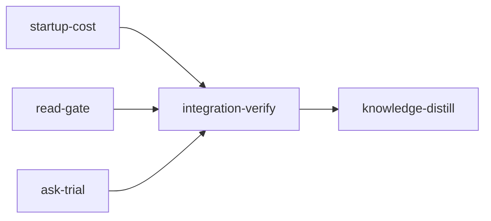

# Plan: Token savings inspired by Portal by Spotify

Implements: none

## Overview

This plan implements the decisions in `doc/portal-by-spotify-inspiration.md`. It attributes loom's token cost by what entered context, gives mechanical work a smaller worker type, denies the first whole read of a large file in stages, gives Markdown a real outline, and ships a one-shot read worker for an evaluation before any agent is told to use it.

Evidence behind the design, from the 14 days to 2026-11-02:

- Engineer subagents start at about 36,700 resident tokens and reviewers at about 22,200.
- The first-request attachments account for most of that gap: `skill_listing` at 7,751 tokens and `sandbox_instructions` at 1,771 appear on engineers and never on reviewers. Tool schemas probably account for the rest.
- 72% of the read guard's "not covered by the source graph" warnings are for `.md` files.
- A probe of `claude -p` with no tools and no setting sources started at 610 tokens on the operator's subscription. A probe of `codex exec` started at 20,200 input tokens. `claude --bare` is unusable here because it reads only API-key credentials.

## Goals

- `loom usage` explains where cost goes, including startup composition per agent type.
- `loom usage` attributes agent types when the hook ledger is absent, as it is under `--all`.
- Mechanical work runs on a `loom-mechanical-engineer` that carries no skill listing.
- In a live stage, the first whole read of a file over 400 lines is denied with an outline, and a repeat is allowed.
- `loom map --outline` returns headings for Markdown without the source graph.
- `loom ask` answers a question over files in one worker call, on the Claude or Codex lane, and `loom ask --eval` reports whether it clears the accuracy bar.

## Non-goals

- No agent is told to use `loom ask`, and no hook routes to it. That needs the evaluation result and the replays the `optim-token` metaplan requires, and belongs to a later plan.
- No local models.
- Sonnet and Opus engineers keep their tool lists and doctrine. Decision 3 starts with mechanical workers only.
- Review, debugging and verification are never routed to a cheaper worker.

## Implementers

Sonnet and Opus only, by operator decision. No stage spawns a Haiku or Codex implementer, and every standard stage lists `implementers: ["claude"]`. The Haiku agent type this plan creates and the Codex lane of `loom ask` are products of the plan, not implementers of it. The main sessions and reviewers keep their configured defaults.

## Execution Diagram



The three feature stages share no files and run concurrently. There is no knowledge-bootstrap stage: the tier-1 files already describe this codebase.

## Stages

### 1. Startup cost (`startup-cost`)

Adds the `loom usage` attribution section, the agent-type sidecar fallback, and the `loom-mechanical-engineer` agent with its doctrine. **Exists by Q4:** merged with either other stage, its doctrine pins, contract session and review round would risk passing 500,000 tokens across unrelated subsystems. Attribution and the mechanical worker share a stage because attribution is what measures the worker's saving.

Risk walk:

| Area | Contract |
| --- | --- |
| Filesystem paths and symlinks | `symlinked-sidecar-is-ignored` |
| External data | `sidecar-fills-missing-agent-type`, written from the real `agentType` key |
| Lifecycle (two sources for one fact) | `ledger-outranks-sidecar` |
| Reachability | `report-carries-attribution` |
| The stage's own behaviour | `tool-result-counts-admission-and-replay`, `startup-attachments-are-not-double-counted`, `mechanical-worker-carries-no-skill-tool` |

### 2. Read gate (`read-gate`)

Adds deny-once to rule 1 of the read discipline and the Markdown outline fast path. **Exists by Q4,** and because the gate changes tool-call behaviour in every stage, a checkpoint on it should not be mixed with unrelated review findings (Q3).

Risk walk:

| Area | Contract |
| --- | --- |
| Untrusted input | `fenced-headings-are-not-outlined` |
| Filesystem paths and symlinks | `symlinked-markdown-gets-no-rows` |
| Configuration propagation | `read-gate-false-only-warns` |
| Lifecycle and retries | `first-whole-read-denied-then-repeat-allowed`, `unrecordable-denial-fails-open` |
| Session identity | `outside-a-live-stage-only-warns` |
| Doctrine collisions | `control-inputs-are-exempt` |

Changing the existing rule 1 tests raises `TI-edit` events, because `uncovered_file_warns_and_allows_even_with_deny_on` asserts the behaviour this stage replaces. The stage expects to file `dispute-integrity` with that reason.

### 3. Ask trial (`ask-trial`)

Adds `loom ask` and `loom ask --eval` with frozen fixtures. **Exists by Q4,** and it is a self-contained command with no shared files.

Risk walk:

| Area | Contract |
| --- | --- |
| Untrusted input | `worker-has-no-tools-and-no-settings` |
| Filesystem paths and symlinks | `refuses-paths-outside-the-project`, `refuses-credential-files` |
| Process I/O volume | `large-payload-goes-through-stdin` |
| Process lifetime | `timeout-kills-the-worker` |
| External data | `parses-captured-claude-output`, `parses-captured-codex-output` |
| Reachability and the stage's own behaviour | `eval-exits-nonzero-below-the-bar` |

### Integration Verification

Full suite, lint, docs and both hook-suite runs, parallel reviews, and functional proof that all three features are reachable.

### Knowledge Distillation

Curates memories, rewrites the knowledge sections these changes make stale, clears the five knowledge-check issues the baseline does not cover at `12c33d2a`, and updates the README and the inspiration report.

## After merge (operator)

Stage sessions run installed assets, so the agent and hook changes take effect only after install. The evaluation spends provider tokens and needs network, so no stage can run it.

```bash
./dev-install.sh
loom ask --eval loom/tests/fixtures/ask_eval/cases.json --backend claude
loom ask --eval loom/tests/fixtures/ask_eval/cases.json --backend codex
loom usage --all --since 14d
```

Read the Attribution section after a run that used `loom-mechanical-engineer`, and compare its median first-request resident with `loom-software-engineer`. To turn the read gate off during the trial, set `read_gate = false` under `[hooks]` in `.loom/work/config.toml`.

---

<!-- loom METADATA -->

```yaml
loom:
  version: 2
  ratchet_files:
    - loom/maintainability-baseline.txt
    - doc/loom/knowledge/check-baseline.txt
  provision:
    - working_dir: "web"
      command: "test ! -e .npmrc && test ! -L .npmrc && bun install --frozen-lockfile --ignore-scripts --backend=copyfile --config=/dev/null"
  sandbox:
    enabled: true
    auto_allow: true
    filesystem:
      deny_read: ["~/.ssh/**", "~/.aws/**", "~/.config/gcloud/**", "~/.gnupg/**"]
    network:
      allowed_domains: ["crates.io", "index.crates.io", "static.crates.io", "registry.npmjs.org"]
  stages:
    - id: startup-cost
      name: "Startup cost attribution and mechanical worker"
      summary: "Shows where token cost goes in loom usage, fixes agent-type attribution, and adds a smaller worker type for mechanical edits."
      stage_type: standard
      implementers: ["claude"]
      skills: ["loom-rust"]
      dependencies: []
      working_dir: "."
      description: |
        Implement the attribution section, the agent-type sidecar fallback, and the
        loom-mechanical-engineer agent. Implementers are Sonnet and Opus only: spawn no Haiku or
        Codex worker in this stage. The file-level detail is in the briefs below.

        Use parallel subagents and skills to maximize performance.

        | Worker | Role | Tier | Files owned | Shared context | Brief path |
        | --- | --- | --- | --- | --- | --- |
        | attribution | Usage attribution and sidecar | sonnet | loom/src/commands/usage/** | none | doc/plans/briefs/portal-token-savings/startup-cost/attribution.md |
        | mechanical | Agent and doctrine | sonnet | agents/loom-mechanical-engineer.md, CLAUDE.md.template, README.md, skills/loom-orchestration/SKILL.md, skills/loom-plan-writer/**, loom/src/orchestrator/signals/**, loom-hooks/spawn-guard.sh | none | doc/plans/briefs/portal-token-savings/startup-cost/mechanical.md |

        PUBLIC SURFACE the contracts call (all in the lib crate):

        crate::commands::usage::agent_sidecar::agent_type_from_sidecar(transcript_path: &Path)
        -> Option<String> reads <dir>/<stem>.meta.json beside a subagent transcript through
        crate::fs::safe_read::read_bounded (no-follow, 64 KiB cap) and returns its top-level
        "agentType" string when non-empty. crate::commands::usage::parse_all (existing, private,
        reachable from the child module) sets Transcript.agent_type from the hook ledger first and
        from the sidecar only when the ledger has no row. The sidecar never sets stage_id,
        loom_session_id or requested_model.

        crate::commands::usage::transcript_types::Transcript gains
        pub attachments: Vec<AttachmentEntry>, with AttachmentEntry { requests_before: usize,
        kind: String, chars: usize }. kind is the row's attachment.type; chars is the length of the
        serialized attachment object. requests_before counts the distinct requests earlier in the
        file. Rows older than the --since cutoff are dropped like entries.

        crate::commands::usage::sections::attribution::build(&[Transcript]) -> Attribution, with
        Attribution { total_s2: f64, startup_s2: f64, output_s2: f64, assistant_replay_s2: f64,
        residual_s2: f64, rows: Vec<AttributionRow>, startup_by_agent: Vec<StartupRow> };
        AttributionRow { class: String, items: u64, chars: u64, s2: f64 }; StartupRow { agent_type:
        String, transcripts: u64, median_resident: u64, kinds: Vec<StartupKind> }; StartupKind {
        kind: String, median_tokens: u64 }. Attribution derives serde::Serialize.
        sections::Report gains pub attribution: attribution::Attribution, and sections::render
        prints a section headed "Attribution" through attribution::render, including when there is
        no data.

        DEFINITIONS, exact, for a transcript of n requests. Weights are the S2 weights from
        commands/usage/accounting.rs. An item admitted after k requests, with k >= 1, costs
        chars / 4 * (1.25 + 0.1 * (n - k)). Anything admitted at k == 0 is startup and never enters
        rows: it is already inside the first request's resident context. startup_s2 =
        first.resident * 0.1 * n + 1.25 * first.cache_creation. output_s2 = sum(output) * 5.
        assistant_replay_s2 = sum over request i, 1-based, of output_i * (1.25 + 0.1 * (n - i)),
        labelled an upper bound because thinking may not be replayed. residual_s2 = max(total_s2 -
        startup_s2 - output_s2 - assistant_replay_s2 - sum(rows.s2), 0).

        MEMORY: record mistakes, decisions and surprises via loom memory immediately; NEVER loom
        knowledge in this stage; NEVER Claude Code auto-memory.
      acceptance:
        - "cargo test --manifest-path loom/Cargo.toml --lib commands::usage::"
        - "cargo test --manifest-path loom/Cargo.toml --lib orchestrator::signals::"
        - "cargo test --manifest-path loom/Cargo.toml --lib assets::"
        - "cargo clippy --manifest-path loom/Cargo.toml --all-targets -- -D warnings"
      before_stage:
        - command: "rg --version"
          description: "ripgrep on PATH for the doctrine surface sweep"
      after_stage:
        - command: "test -s agents/loom-mechanical-engineer.md"
          description: "the mechanical worker agent exists"
        - command: "test -s loom/src/commands/usage/sections/attribution/mod.rs"
          description: "the attribution section exists"
      files:
        - "loom/src/commands/usage/**"
        - "loom/tests/mechanical_worker_contracts.rs"
        - "agents/loom-mechanical-engineer.md"
        - "CLAUDE.md.template"
        - "README.md"
        - "skills/loom-orchestration/SKILL.md"
        - "skills/loom-plan-writer/**"
        - "loom/src/orchestrator/signals/**"
        - "loom-hooks/spawn-guard.sh"
      artifacts:
        - "agents/loom-mechanical-engineer.md"
        - "loom/src/commands/usage/agent_sidecar/mod.rs"
        - "loom/src/commands/usage/sections/attribution/mod.rs"
      wiring:
        - source: "loom/src/commands/usage/sections/mod.rs"
          pattern: "attribution::build(transcripts)"
          literal: true
          description: "the attribution section is built into the usage report"
        - source: "loom/src/commands/usage/sections/mod.rs"
          pattern: "attribution::render(&report.attribution)"
          literal: true
          description: "the attribution section is rendered"
        - source: "loom/src/commands/usage/mod.rs"
          pattern: "agent_sidecar::agent_type_from_sidecar"
          literal: true
          description: "parse_all consults the sidecar"
        - source: "loom-hooks/spawn-guard.sh"
          pattern: "loom-mechanical-engineer"
          literal: true
          description: "the spawn guard names the new agent type in its typed-agent guidance"
        - source: "CLAUDE.md.template"
          pattern: "`loom-mechanical-engineer`"
          literal: true
          description: "Rule 7's agent table routes mechanical work to the new type"
      contracts:
        - id: sidecar-fills-missing-agent-type
          file: loom/src/commands/usage/agent_sidecar/tests.rs
          test: commands::usage::agent_sidecar::tests::sidecar_fills_missing_agent_type
          scenario: "writes agent-a1.jsonl and agent-a1.meta.json holding {\"agentType\":\"loom-code-reviewer\"} under <session>/subagents in a TempDir, with no starts ledger, then calls parse_all with work_dir None"
          rejects: "a fix that only changes the agent-type ledger counter or reads the sidecar under a guessed snake_case key, leaving Transcript.agent_type None"
        - id: ledger-outranks-sidecar
          file: loom/src/commands/usage/agent_sidecar/tests.rs
          test: commands::usage::agent_sidecar::tests::ledger_outranks_sidecar
          scenario: "gives the same subagent a starts.jsonl row with type loom-advisor and a sidecar saying loom-code-reviewer, then calls parse_all with that work_dir"
          rejects: "a parse_all that lets the sidecar overwrite the authoritative hook ledger"
        - id: symlinked-sidecar-is-ignored
          file: loom/src/commands/usage/agent_sidecar/tests.rs
          test: commands::usage::agent_sidecar::tests::symlinked_sidecar_is_ignored
          scenario: "makes agent-a1.meta.json a symlink to a JSON file outside the subagents directory holding a valid agentType, then calls agent_type_from_sidecar"
          rejects: "an implementation using fs::read_to_string, which follows the symlink and returns the outside file's value"
        - id: tool-result-counts-admission-and-replay
          file: loom/src/commands/usage/sections/attribution/tests.rs
          test: commands::usage::sections::attribution::tests::tool_result_counts_admission_and_replay
          scenario: "builds a Transcript of 5 requests with a Read tool use in request 2 and a 400-character result entry after it, then asserts the Read row's s2 is 155.0 (100 tokens * (1.25 + 0.1 * 3))"
          rejects: "a build that counts only the admission cost, or uses the transcript's total request count instead of the requests remaining"
        - id: startup-attachments-are-not-double-counted
          file: loom/src/commands/usage/sections/attribution/tests.rs
          test: commands::usage::sections::attribution::tests::startup_attachments_are_not_double_counted
          scenario: "builds a Transcript with a skill_listing attachment at requests_before 0 and a hook_success attachment at requests_before 2, then asserts rows has hook_success and no skill_listing, and startup_by_agent lists skill_listing"
          rejects: "a build that adds startup attachments to rows as well as startup_s2, charging them twice and shrinking the residual"
        - id: report-carries-attribution
          file: loom/src/commands/usage/sections/attribution/tests.rs
          test: commands::usage::sections::attribution::tests::report_carries_attribution
          scenario: "calls sections::build with one Transcript and serializes the Report to JSON, then asserts the attribution object is present with total_s2 above zero"
          rejects: "an attribution module that compiles and passes its unit tests but is never added to the usage Report"
        - id: mechanical-worker-carries-no-skill-tool
          file: loom/tests/mechanical_worker_contracts.rs
          test: mechanical_worker_carries_no_skill_tool
          scenario: "reads agents/loom-mechanical-engineer.md through CARGO_MANIFEST_DIR and parses its frontmatter, asserting model is haiku, tools is exactly Read, Edit, Write, Glob, Grep, Bash, and the file is under 2,000 bytes"
          rejects: "an agent that copies loom-software-engineer's tools line, which keeps Skill and so keeps the 7,751-token skill listing the agent exists to remove"

    - id: read-gate
      name: "Deny-once read gate and Markdown outlines"
      summary: "In stages, the first whole read of a large file is denied with an outline and a repeat is allowed; Markdown gets a heading outline with no source graph."
      stage_type: standard
      implementers: ["claude"]
      skills: ["loom-rust"]
      dependencies: []
      working_dir: "."
      description: |
        Implement the gate and the outline. Implementers are Sonnet and Opus only: spawn no Haiku
        or Codex worker in this stage. The file-level detail is in the briefs below.

        Use parallel subagents and skills to maximize performance.

        | Worker | Role | Tier | Files owned | Shared context | Brief path |
        | --- | --- | --- | --- | --- | --- |
        | gate | Deny-once in the hook core | opus | loom-hooks/_read_discipline.sh, loom-hooks/_read_ledger.sh, loom-hooks/_containment.sh, loom-hooks/read-guard.sh, loom/tests/integration/hooks_read_guard.rs, loom/tests/integration/hooks_read_guard_cases.rs, loom/tests/integration/hooks_read_guard_repeat.rs, loom/tests/integration/hooks_poll_guard_reads.rs | none | doc/plans/briefs/portal-token-savings/read-gate/gate.md |
        | outline | Markdown outline | sonnet | loom/src/commands/map.rs, loom/src/map/views/** | none | doc/plans/briefs/portal-token-savings/read-gate/outline.md |

        BEHAVIOUR the contracts pin. The contracts run the real hook scripts and the real binary.

        GATE: rule 1 of loom_read_discipline_check applies to an unbounded read over
        READ_GUARD_LINE_LIMIT (400, unchanged) lines. In a live stage, meaning LOOM_STAGE_ID and
        LOOM_MAIN_AGENT_PID are both set and the PID is a live ancestor (is_ancestor), the first
        such read by one agent of one path exits 2 with the message on stderr, whether or not the
        graph covers the file and with no dependence on deny_enabled. The message includes the
        outline when one exists and says that repeating the read is allowed. A second whole read of
        that path by that agent, through Read or through Bash cat, is allowed. Denials are keyed on
        (agent, absolute path) and recorded through _loom_ledger_file with kind read-denials.
        Outside a live stage, or with read_gate = false under [hooks] in $LOOM_WORK_DIR/config.toml,
        rule 1 only warns. A denial that cannot be recorded warns instead of denying, so an agent
        can never be denied forever. deny_enabled keeps its meaning for poll-guard's own rules.

        EXEMPT from rule 1, with no denial: skills and INDEX.md (rules 0 and 0b, unchanged), tier-1
        knowledge (rule 3 stays a warning), anything under a .loom/ directory or $LOOM_WORK_DIR
        (signals and handoffs), and worker briefs under doc/plans/**/briefs/.

        OUTLINE: loom map --outline <path> with a .md or .markdown extension (case-insensitive), as
        the only requested view and without --census, is served in execute_graph_views after the
        project root resolves and before load_graph, so it needs no graph and works on an untracked
        file. It prints the existing header line, one row per ATX heading in the existing format
        "L<a>-L<b>  heading  <scope>  <signature>", then "coverage: markdown headings". A path
        outside the project root, or one that read_bounded refuses, prints the header and a coverage
        line with no rows, so the hook falls through to its no-outline message.

        Changing the existing rule 1 tests raises TI-edit events: test
        uncovered_file_warns_and_allows_even_with_deny_on asserts behaviour this stage replaces.
        Expect to file dispute-integrity with that reason.

        MEMORY: record mistakes, decisions and surprises via loom memory immediately; NEVER loom
        knowledge in this stage; NEVER Claude Code auto-memory.
      acceptance:
        - "cargo test --manifest-path loom/Cargo.toml --lib map::"
        - "cargo test --manifest-path loom/Cargo.toml --test integration hooks_read_guard"
        - "cargo test --manifest-path loom/Cargo.toml --test integration hooks_poll_guard"
        - "cargo clippy --manifest-path loom/Cargo.toml --all-targets -- -D warnings"
        - "./scripts/check-hook-syntax.sh"
      before_stage:
        - command: "jq --version"
          description: "jq on PATH for the hook scripts"
      after_stage:
        - command: "test -s loom/src/map/views/markdown_outline.rs"
          description: "the Markdown outline exists"
      files:
        - "loom-hooks/_read_discipline.sh"
        - "loom-hooks/_read_ledger.sh"
        - "loom-hooks/_containment.sh"
        - "loom-hooks/read-guard.sh"
        - "loom/src/commands/map.rs"
        - "loom/src/map/views/**"
        - "loom/tests/read_gate_contracts.rs"
        - "loom/tests/integration/hooks_read_guard.rs"
        - "loom/tests/integration/hooks_read_guard_cases.rs"
        - "loom/tests/integration/hooks_read_guard_repeat.rs"
        - "loom/tests/integration/hooks_poll_guard_reads.rs"
      artifacts:
        - "loom/src/map/views/markdown_outline.rs"
      wiring:
        - source: "loom/src/commands/map.rs"
          pattern: "markdown_outline::"
          literal: true
          description: "the map command serves Markdown outlines"
        - source: "loom-hooks/_read_discipline.sh"
          pattern: "loom_read_deny_once"
          literal: true
          description: "rule 1 calls the deny-once gate"
      contracts:
        - id: first-whole-read-denied-then-repeat-allowed
          file: loom/tests/read_gate_contracts.rs
          test: first_whole_read_denied_then_repeat_allowed
          scenario: "copies the hooks to a TempDir, sets LOOM_STAGE_ID and LOOM_MAIN_AGENT_PID to the test process, leaves deny_enabled unset, and sends read-guard.sh the same whole Read of a 500-line file twice for one agent"
          rejects: "a gate still conditioned on deny_enabled, which never denies by default, or one that denies every attempt and leaves no way to read the file"
        - id: outside-a-live-stage-only-warns
          file: loom/tests/read_gate_contracts.rs
          test: outside_a_live_stage_only_warns
          scenario: "sends the same read with LOOM_STAGE_ID set and LOOM_MAIN_AGENT_PID naming a dead process, then with neither set"
          rejects: "a gate keyed on LOOM_STAGE_ID alone, which leaks into plain sessions from an exporting shell and would block ordinary work"
        - id: unrecordable-denial-fails-open
          file: loom/tests/read_gate_contracts.rs
          test: unrecordable_denial_fails_open
          scenario: "in a live stage, makes the read-denials directory for the session a symlink, so _loom_ledger_append refuses to write, then sends the read"
          rejects: "a gate that denies without confirming the denial was recorded, which would deny that read on every retry"
        - id: control-inputs-are-exempt
          file: loom/tests/read_gate_contracts.rs
          test: control_inputs_are_exempt
          scenario: "in a live stage, creates three 500-line Markdown files in a TempDir, one under .loom/work/signals, one under a briefs directory directly below doc/plans, and one under a briefs directory one level deeper, then sends a whole read of each"
          rejects: "a gate that denies the stage signal or a worker brief, which every session is told to read in full, wasting a request on every start"
        - id: read-gate-false-only-warns
          file: loom/tests/read_gate_contracts.rs
          test: read_gate_false_only_warns
          scenario: "in a live stage, writes [hooks] read_gate = false to $LOOM_WORK_DIR/config.toml, sends the read and asserts exit 0 with a warning, then rewrites the value to read_gate = true and asserts exit 2"
          rejects: "a switch that is documented but never read, leaving the gate on when the operator turned it off"
        - id: fenced-headings-are-not-outlined
          file: loom/tests/read_gate_contracts.rs
          test: fenced_headings_are_not_outlined
          scenario: "in a fresh git repository with no graph and no .loom state, writes an untracked .md with a real heading, a fenced bash block holding '# comment', a ~~~ block holding '## also code', and a heading whose text carries an ANSI escape, then runs the loom binary with map --outline"
          rejects: "a line scan that outlines fenced comments as headings, or one that loads the graph and so reports no rows for an untracked file"
        - id: symlinked-markdown-gets-no-rows
          file: loom/tests/read_gate_contracts.rs
          test: symlinked_markdown_gets_no_rows
          scenario: "makes link.md in the repository a symlink to a Markdown file outside it, then runs map --outline link.md"
          rejects: "an outline that follows the symlink and prints headings from a file outside the project"

    - id: ask-trial
      name: "One-shot read worker for evaluation"
      summary: "Adds loom ask, which answers a question over files in one worker call, and an evaluation command that reports whether it is accurate enough to adopt."
      stage_type: standard
      implementers: ["claude"]
      skills: ["loom-rust"]
      dependencies: []
      working_dir: "."
      harness: ["loom/tests/fixtures/ask/**"]
      description: |
        Implement loom ask. Implementers are Sonnet and Opus only: spawn no Haiku or Codex worker in
        this stage. The worker's Codex lane is a product feature; it is tested with fake binaries
        and no stage calls a provider. The file-level detail is in the briefs below. Spawn core
        first and cases once it returns: the self-check test imports core's case parser.

        Use parallel subagents and skills to maximize performance.

        | Worker | Role | Tier | Files owned | Shared context | Brief path |
        | --- | --- | --- | --- | --- | --- |
        | core | Command, payload, backends, evaluation runner | opus | loom/src/commands/ask/mod.rs, loom/src/commands/ask/payload.rs, loom/src/commands/ask/backend.rs, loom/src/commands/ask/run.rs, loom/src/commands/ask/eval.rs, loom/src/commands/mod.rs, loom/src/cli/types.rs, loom/src/cli/dispatch.rs | none | doc/plans/briefs/portal-token-savings/ask-trial/core.md |
        | cases | Frozen evaluation fixtures and their self-check | sonnet | loom/src/commands/ask/eval_tests.rs, loom/tests/fixtures/ask_eval/** | core's case parser | doc/plans/briefs/portal-token-savings/ask-trial/eval.md |

        CLI, for the contracts:

        loom ask --question <Q> --paths <P>... [--backend claude|codex] [--model <M>]
        [--timeout-secs <N>] [--json]

        loom ask --eval <CASES.json> [--backend claude|codex] [--model <M>] [--timeout-secs <N>]

        Defaults: backend claude, model haiku on claude and gpt-6-luna on codex, timeout 180 s.
        --question and --eval are mutually exclusive. Exit 0 on an answer; nonzero with a stderr
        message on a refused path, an oversized payload, a timeout, a worker failure or an error
        result.

        CLAUDE LANE: spawn the binary loom/src/claude.rs resolves, with args
        -p --model <M> --tools "" --setting-sources "" --strict-mcp-config
        --disable-slash-commands --no-session-persistence --system-prompt <MODE_PROMPT>
        --output-format json. Never --bare: it reads only API-key credentials, and the operator uses
        OAuth. CODEX LANE: spawn what crate::codex::find_codex_path resolves, with args
        exec --json --sandbox read-only --skip-git-repo-check --ephemeral -m <M>
        -c model_reasoning_effort=low. On both lanes the payload goes on stdin, and the child's cwd
        is a fresh tempfile::TempDir so no project instructions are discovered.

        --json prints one object: backend, model, answer, input_tokens, cache_read_tokens,
        cache_write_tokens, output_tokens, latency_ms. Text mode prints the answer on stdout and one
        usage line on stderr. For Claude the tokens are usage.input_tokens,
        usage.cache_read_input_tokens, usage.cache_creation_input_tokens, usage.output_tokens, and
        is_error true or a non-success subtype is a failure. For Codex they come from the
        turn.completed row: cache_read_tokens is cached_input_tokens, cache_write_tokens is
        cache_write_input_tokens, and input_tokens is input_tokens minus both, because Codex counts
        cached tokens inside input_tokens. The answer is the last item.completed agent_message.

        PATHS: each path canonicalizes under the project root and is read through
        crate::fs::safe_read::read_bounded. Refused: anything outside the root, a symlink, and a
        basename matching .env*, *.pem, *.key, id_rsa*, id_ed25519* or credentials*. Total file
        bytes are capped at 400,000.

        EVAL: --eval reads a JSON array of { id, question, paths, must_contain, must_not_contain },
        with paths relative to the cases file. A case passes when the answer contains every
        must_contain string and no must_not_contain string, ignoring ASCII case. The report prints
        per-case results, accuracy, worker tokens by kind, latency p50 and p90, and estimated direct
        tokens (file chars / 4). Exit 0 when accuracy is at least 0.90, else exit 1.

        Tests use fake claude and codex scripts on PATH and make no provider call. No doctrine,
        hook or skill mentions loom ask in this plan: see the plan's non-goals.

        The real provider outputs captured on 2026-11-02 are in
        doc/plans/briefs/portal-token-savings/ask-trial/captured/. The contract session copies them
        to loom/tests/fixtures/ask/ and builds the fake binaries from them. Never write these
        fixtures from memory.

        MEMORY: record mistakes, decisions and surprises via loom memory immediately; NEVER loom
        knowledge in this stage; NEVER Claude Code auto-memory.
      acceptance:
        - "cargo test --manifest-path loom/Cargo.toml --lib commands::ask::"
        - "cargo run -q --manifest-path loom/Cargo.toml -- ask --help"
        - "cargo clippy --manifest-path loom/Cargo.toml --all-targets -- -D warnings"
      before_stage:
        - command: "cargo --version"
          description: "cargo on PATH"
      after_stage:
        - command: "test -s loom/tests/fixtures/ask_eval/cases.json"
          description: "the evaluation cases exist"
      files:
        - "loom/src/commands/ask/**"
        - "loom/src/commands/mod.rs"
        - "loom/src/cli/types.rs"
        - "loom/src/cli/dispatch.rs"
        - "loom/tests/ask_contracts.rs"
        - "loom/tests/fixtures/ask/**"
        - "loom/tests/fixtures/ask_eval/**"
      artifacts:
        - "loom/src/commands/ask/mod.rs"
        - "loom/src/commands/ask/eval.rs"
        - "loom/tests/fixtures/ask_eval/cases.json"
      wiring:
        - source: "loom/src/cli/dispatch.rs"
          pattern: "Commands::Ask { args } =>"
          literal: true
          description: "loom ask is dispatched from the CLI"
      contracts:
        - id: large-payload-goes-through-stdin
          file: loom/tests/ask_contracts.rs
          test: large_payload_goes_through_stdin
          scenario: "writes a 300,000-byte file, puts on PATH a fake claude that records its argv, sleeps one second, reads stdin to EOF, checks it holds the file's last line, and prints the captured result, then runs loom ask with a 30 s timeout"
          rejects: "passing the payload on argv, which fails above Linux's 128 KiB single-argument limit, or writing stdin on the waiting thread, which deadlocks once the pipe buffer fills"
        - id: worker-has-no-tools-and-no-settings
          file: loom/tests/ask_contracts.rs
          test: worker_has_no_tools_and_no_settings
          scenario: "runs loom ask with a fake claude recording argv and cwd, over a file whose text says to run a shell command, then asserts --tools with an empty value, --setting-sources with an empty value, and a cwd outside the project"
          rejects: "a worker spawned with its default tools or project settings, where instructions planted in a read file could act and startup cost returns to tens of thousands of tokens"
        - id: refuses-paths-outside-the-project
          file: loom/tests/ask_contracts.rs
          test: refuses_paths_outside_the_project
          scenario: "in a git repository, runs loom ask with ../outside.md, then with link.md, a symlink to that file, using a fake claude that records whether it ran"
          rejects: "a read that resolves .. or follows the symlink and sends a file from outside the project to a provider"
        - id: refuses-credential-files
          file: loom/tests/ask_contracts.rs
          test: refuses_credential_files
          scenario: "runs loom ask with .env.local inside the project using a fake claude that records whether it ran"
          rejects: "an implementation that confines paths to the project but still uploads its secrets"
        - id: timeout-kills-the-worker
          file: loom/tests/ask_contracts.rs
          test: timeout_kills_the_worker
          scenario: "puts on PATH a fake claude that writes its pid to a file and sleeps 60 s, runs loom ask with --timeout-secs 1, then asserts a nonzero exit within 10 s and that the pid is gone"
          rejects: "a timeout that returns while leaving the worker running and spending tokens"
        - id: parses-captured-claude-output
          file: loom/tests/ask_contracts.rs
          test: parses_captured_claude_output
          scenario: "a fake claude prints the captured ask-claude.json; loom ask --json must report answer ok, input_tokens 2, cache_read_tokens 0, cache_write_tokens 608 and output_tokens 4; a second run with is_error set true in that output must exit nonzero"
          rejects: "a parser written from a remembered shape that misses the cache fields, or one that reports an error result as an answer"
        - id: parses-captured-codex-output
          file: loom/tests/ask_contracts.rs
          test: parses_captured_codex_output
          scenario: "a fake codex prints the captured ask-codex.jsonl; loom ask --backend codex --json must report answer ok, input_tokens 8680, cache_read_tokens 11520, cache_write_tokens 0 and output_tokens 5"
          rejects: "a parser that reports input_tokens as 20200, counting cached tokens twice in any total"
        - id: eval-exits-nonzero-below-the-bar
          file: loom/tests/ask_contracts.rs
          test: eval_exits_nonzero_below_the_bar
          scenario: "writes a cases file of two cases whose must_contain the fake worker's fixed answer satisfies only once, runs loom ask --eval and asserts exit 1 and accuracy 0.50 in stdout, then a file where all pass and asserts exit 0"
          rejects: "an evaluation that always exits 0, so a worker below the bar reads as passing"

    - id: integration-verify
      name: "Integration Verification"
      summary: "Confirms all three features are reachable in the running program and the full test suite, lint and hook suites pass."
      stage_type: integration-verify
      dependencies: ["startup-cost", "read-gate", "ask-trial"]
      working_dir: "."
      description: |
        Final verification after all stages. Verify FUNCTIONAL INTEGRATION, not just tests passing.
        NEVER Claude Code auto-memory.
        CONTEXT: read the plan, loom memory show --all, doc/loom/knowledge/INDEX.md and only the
        relevant sections.
        BUILD AND TEST (zero tolerance): run loom check integration-verify once.
        CODE REVIEW: spawn parallel loom-code-reviewer subagents (security, architecture, test
        coverage). Have them examine in particular: whether the read gate can deny a path an agent
        is told to read in full; bash 3.2 compatibility and set -u safety in the changed hooks;
        whether attribution double-counts anything; and whether loom ask can send a file the
        operator did not name. Fix ALL findings with a Sonnet or Opus engineer agent; every finding
        is fixed or disputed, never deferred.
        SUGGESTIONS: weigh every pending reviewer suggestion the signal lists; resolve each one
        implemented with loom memory resolve <id> --outcome implemented --reason <what changed>;
        leave the rest pending.
        FUNCTIONAL: the acceptance list proves the three features reachable. No provider call runs
        here; the evaluation is an operator step after merge.
        Record discoveries to loom memory for knowledge-distill, including any knowledge file
        contradicted by the tree: loom memory note "stale-knowledge: ...".
      acceptance:
        - "cargo test --manifest-path loom/Cargo.toml --all-targets --no-fail-fast"
        - "cargo test --manifest-path loom/Cargo.toml --doc --workspace --all-features -- --test-threads=1"
        - "cargo clippy --manifest-path loom/Cargo.toml --all-targets -- -D warnings"
        - "cargo fmt --manifest-path loom/Cargo.toml --check"
        - "RUSTDOCFLAGS='-D warnings' cargo doc --manifest-path loom/Cargo.toml --workspace --all-features --no-deps"
        - "./scripts/check-hook-syntax.sh"
        - "bash loom-hooks/tests/run-all.sh"
        - "LOOM_HOOK_TEST_BSD=1 bash loom-hooks/tests/run-all.sh"
        - "cargo run -q --manifest-path loom/Cargo.toml -- ask --help"
        - "cargo run -q --manifest-path loom/Cargo.toml -- map --outline README.md | rg -q 'heading'"
        - "cargo run -q --manifest-path loom/Cargo.toml -- usage --since 1d --claude-root loom/tests/fixtures | rg -q 'Attribution'"
      wiring:
        - source: "loom/src/cli/dispatch.rs"
          pattern: "Commands::Ask { args } =>"
          literal: true
          description: "loom ask is dispatched from the CLI"
        - source: "loom/src/commands/usage/sections/mod.rs"
          pattern: "attribution::render(&report.attribution)"
          literal: true
          description: "attribution is rendered in the usage report"

    - id: knowledge-distill
      name: "Knowledge Distillation"
      summary: "Records what this plan learned in the knowledge base, and updates the README and the Portal inspiration report."
      stage_type: knowledge-distill
      dependencies: ["integration-verify"]
      working_dir: "."
      description: |
        Curate all stage memories into permanent knowledge; update user docs. NEVER Claude Code
        auto-memory. SINGLE-AGENT: do NOT spawn subagents.
        START with loom memory pending --group, then read the plan and the knowledge sections it
        touches.
        CORRECTIONS FIRST: apply every stale-knowledge memory in place with loom knowledge
        replace-section <file> "<heading>" "<body>", never with loom knowledge update.
        THESE SECTIONS GO STALE and must state the new truth:
        architecture/token-accounting-and-receipts.md "Read Advisories and Reread Measurement" (rule
        1 is now deny-once by default in a live stage); patterns/subagent-hierarchy.md, the
        haiku line in its model playbook section; architecture/hook-system.md wherever it describes
        read-guard behaviour; architecture/source-graph-view.md or the closest outline section
        (Markdown outlines bypass the graph). Add a new topic for loom ask with its evaluation
        status, and a concerns entry stating that no agent may be told to use it until the
        evaluation and replays pass.
        BASELINE: at 12c33d2a, loom knowledge check --strict --baseline reports 5 issues new since
        the baseline, including mistakes/planner-ui-repair.md's source reference to
        next-step.test.tsx. Fix all of them; the acceptance below cannot pass otherwise.
        Then curate mistakes, patterns, decisions and conventions via loom knowledge update.
        TIER ROUTING: findings of about 40 lines or fewer go inline in the tier-1 file; larger ones
        go via loom knowledge update <category>/<slug> with a 2-4 line tier-1 summary and link.
        README: document loom ask (evaluation only), loom-mechanical-engineer, the [hooks]
        read_gate switch, and the Attribution section.
        REPORT: update doc/portal-by-spotify-inspiration.md: mark what this plan built, and keep its
        Follow-ups section accurate.
        SUGGESTIONS: record every unimplemented reviewer suggestion in concerns or its topic, then
        resolve it promoted, merged or discarded.
        RECEIPTS: every Note, Decision or Question taken into knowledge gets loom memory resolve
        <id> --outcome promoted|merged|discarded|deferred right after the write that used it; finish
        with loom memory pending --strict and resolve whatever it lists.
        LAST, if this stage removed structural issues, ratchet the baseline: loom knowledge check
        --write-baseline doc/loom/knowledge/check-baseline.txt
      acceptance:
        - "loom knowledge check --strict --baseline doc/loom/knowledge/check-baseline.txt"
        - "loom memory pending --strict"
      files:
        - "doc/loom/knowledge/**"
        - "README.md"
        - "doc/portal-by-spotify-inspiration.md"
```

<!-- END loom METADATA -->
