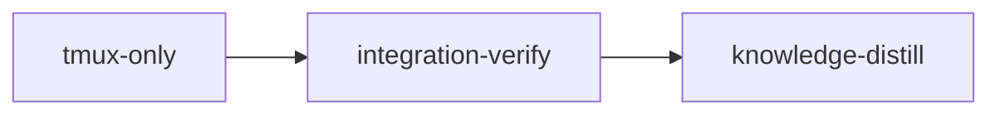

# Plan: Run every Loom session in tmux

Implements: none

Source: `doc/PROPOSAL-2026-11-21-tmux-only-terminal-sessions.md`, narrowed to a clean removal (see Decisions).

## Overview

Loom starts each orchestrated Claude Code session (stage, contract writer, merge resolver, knowledge,
adjudication) through `SessionBackend`, which dispatches to a native terminal-emulator lane or a tmux
lane. This plan deletes the native lane and everything that selects it: emulator detection, window
titles and AppleScript/X11 window control, the `[terminal]` config section and `terminal.backend` key,
the `--backend` flag on `loom init` / `loom run`, the init prompt, the planner's backend radio, the
daemon's `LOOM_TERMINAL` forwarding, `SessionBackendKind` and `Session.backend`. The shared launch
machinery that today lives under `orchestrator/terminal/native/` (capsule, session settings, wrapper,
build cache, PID tracking and the PID wait) moves to `orchestrator/terminal/launch/` and the tmux lane
keeps its current behaviour.

## Goals

- One spawn path: tmux. A missing tmux fails `loom run` before the daemon starts, and fails any direct
  spawn (manual merge resolver), with `Loom needs tmux on PATH to start sessions. Install tmux and retry.`
- No terminal selector anywhere: CLI, `loom config`, dashboard Settings, planner Run dialog.
- Shared launch helpers keep their exact behaviour (tracking key, PID-file path, session id,
  environment allowlists, wrapper text) after the move.
- Non-goals: `codex.backend`, `plan.summary_backend`, `loom ask --backend`, planning-chat tmux servers,
  notifications, browser opening and the browser-terminal view/control modes are unchanged.

## Decisions

YAML is authoritative where it and this prose differ.

| Proposal item | This plan | Why |
| --- | --- | --- |
| Deserialize adapter for legacy `execution: {backend: native}` in plan YAML | Dropped | The project forbids compatibility routines at this stage; today's schema already rejects those forms, so nothing changes for plans |
| Hidden `--backend native\|tmux` on init/run | Deleted; clap rejects the flag as unknown | Same rule |
| Inert `[terminal]` key, `loom config -k terminal.backend` returning `tmux`, no-op writes | Key leaves the registry; nothing reads `[terminal]` | `UserConfig` parses per key (`user_config/mod.rs::parse_document`) and `Session`/work-dir config readers ignore sections they do not ask for, so a leftover section is ignored without code; a write to the removed key fails as an unknown key |
| `POST /api/run/start` tolerating `backend`, `GET /api/run/state` keeping `backends` | Deleted from both wire types and the client | Same rule; the web client ships in the same binary |
| Stored-session policy for live/dead/unverifiable native sessions at upgrade | Dropped | `Session` does not deny unknown fields, so an old record's `backend` key is ignored; operators finish native sessions before upgrading (CHANGELOG says so) |
| `session_backend` in the status payload | Deleted; the dashboard gates terminals on `session_alive` | Every live session is a tmux session |
| `SessionBackend` facade | Kept as a thin wrapper over `TmuxBackend` | 20+ call sites already hold it; a facade with one lane removes the dispatcher without touching them |

## Execution Diagram



No knowledge-bootstrap stage: the tier-1 files already describe this codebase.

## Stages

### 1. tmux-only (Remove the native terminal lane)

The only implementation stage: Rust, web and operator docs share no files across the three territories,
and none needs another merged first, so the Stage Necessity Test gives one stage. It runs at the repo
root (`working_dir: "."`) like the other plans here, using `--manifest-path loom/Cargo.toml` and
`cd web`.

Workers (territories are disjoint; briefs are authoritative for each worker):

| Worker | Role | Tier | Files owned | Shared context | Brief path |
| --- | --- | --- | --- | --- | --- |
| terminal-core | Move shared launch code to `terminal/launch/`, delete the native lane, collapse `SessionBackend`, delete `SessionBackendKind` | loom-senior-software-engineer (opus, medium) | loom/src/orchestrator/terminal/**, loom/src/orchestrator/mod.rs, loom/src/orchestrator/spawner.rs, loom/src/models/session/**, loom/src/orchestrator/orphan_candidates.rs, loom/src/orchestrator/session_registry.rs, loom/src/orchestrator/session_registry/identityless.rs, loom/src/orchestrator/core/orchestrator.rs, loom/tests/e2e/tmux_backend.rs | Pinned interface in every brief | doc/plans/briefs/tmux-only-terminal-sessions/tmux-only/terminal-core.md |
| config-cli | Remove `[terminal]`, `terminal.backend`, `--backend`, the init prompt, run backend resolution, daemon terminal forwarding, the config API entry | loom-software-engineer (sonnet) | loom/src/user_config/**, loom/src/fs/work_dir.rs, loom/src/fs/work_dir/**, loom/src/commands/config/**, loom/src/cli/**, loom/src/commands/init/**, loom/src/commands/run/**, loom/src/completions/**, loom/src/daemon/server/launch.rs, loom/src/daemon/server/launch/**, loom/src/daemon/server/environment.rs, loom/src/commands/status/web/config_api.rs, loom/src/commands/status/web/config_api/**, loom/src/commands/status/web/tests/config_api.rs, loom/tests/e2e/daemon_config/** | Pinned interface | doc/plans/briefs/tmux-only-terminal-sessions/tmux-only/config-cli.md |
| surfaces | Planner run wire and init args, dashboard child, attach, status payload, merge attention, web-terminal resolver, resolver stop | loom-software-engineer (sonnet) | loom/src/plan_server/run/**, loom/src/plan_server/wire/run.rs, loom/src/plan_server/wire/tests_run.rs, loom/src/plan_server/router.rs, loom/src/commands/attach/**, loom/src/status/**, loom/src/commands/status/web/terminal/**, loom/src/commands/status/web/model_tests_stages.rs, loom/src/commands/status/ui/**, loom/src/commands/status/render/**, loom/src/commands/stage/merge_resolver.rs, loom/src/orchestrator/core/merge_handler/resolver_stop.rs, loom/src/orchestrator/signals/merge_launch.rs, loom/src/orchestrator/core/completion_handler.rs, loom/src/orchestrator/core/mod.rs | Pinned interface | doc/plans/briefs/tmux-only-terminal-sessions/tmux-only/surfaces.md |
| web | Remove `session_backend`, the Run dialog backend radio, native hints and fixtures | loom-software-engineer (sonnet) | web/src/** | Pinned wire shapes | doc/plans/briefs/tmux-only-terminal-sessions/tmux-only/web.md |
| docs | README, CHANGELOG, installer advisory, product spec, contributor docs, retrieval eval case | loom-software-engineer (sonnet) | README.md, CHANGELOG.md, install.sh, CONTRIBUTING.md, doc/sandbox-release-checklist.md, doc/product/feat-planner/section_11.md, loom/eval/retrieval-cases.yaml | Pinned operator-visible strings | doc/plans/briefs/tmux-only-terminal-sessions/tmux-only/docs.md |
| compile-sweep | After the first three return: make every remaining Rust file compile and pass clippy (test fixtures, import paths, `LOOM_TERMINAL` guards, `from_config` callers), trim the maintainability baseline | loom-software-engineer (sonnet) | loom/src/**, loom/tests/**, loom/maintainability-baseline.txt (runs after the Rust workers return) | Pinned interface | doc/plans/briefs/tmux-only-terminal-sessions/tmux-only/compile-sweep.md |

terminal-core, config-cli, surfaces, web and docs start together in one message; each brief pins the
interface the others depend on, so none waits. compile-sweep starts when the three Rust workers have
returned. The longest chain is two workers (terminal-core then compile-sweep); terminal-core may run
past 30 minutes because it moves about 40 files.

Risk-checklist walk (the areas that apply, and the contract covering each):

- Configuration propagation: a stale `[terminal] backend = "native"` must not select anything
  (`stale-native-setting-still-requires-tmux`); a retired user key must not reset other settings
  (`retired-user-key-keeps-other-settings`).
- Untrusted input / boundary: the CLI rejects `--backend` on init and run but keeps `loom ask --backend`
  (`retired-backend-flag-rejected`); the run-start request takes `plan` and `clean` only
  (`run-start-takes-plan-and-clean`, `run-dialog-posts-plan-and-clean`).
- Failure path: missing tmux yields the one actionable message (`missing-tmux-message`).
- Environment: the daemon child no longer gets a terminal hint (`daemon-child-has-no-terminal-hint`).
- Reachability: `require_tmux` reached from `loom run` (`reachable`); the dashboard gate opens a live
  stage with no backend field (`terminal-gate-without-backend-field`).

### 2. Integration Verification

Full Rust suite, clippy, fmt and the web check script; rebuild the tracked `web/dist` so the binary serves
the new UI; review; prove on the built binary that `--backend` is gone.

### 3. Knowledge Distillation

Rewrite the terminal-backend, web-terminal, daemon-launch and entry-point knowledge to the tmux-only tree
and curate the memories.

---

<!-- loom METADATA -->

```yaml
loom:
  version: 2
  sandbox:
    enabled: true
    auto_allow: true
    filesystem:
      deny_read:
        - "~/.ssh/**"
        - "~/.aws/**"
        - "~/.config/gcloud/**"
        - "~/.gnupg/**"
      deny_write:
        - "../../**"
      allow_write: []
    network:
      allowed_domains:
        - crates.io
        - index.crates.io
        - static.crates.io
        - registry.npmjs.org
      allow_local_binding: false
      allow_unix_sockets: []
      allow_all_unix_sockets: false
  ratchet_files:
    - doc/loom/knowledge/check-baseline.txt
  provision:
    - working_dir: web
      command: >-
        test ! -e .npmrc && test ! -L .npmrc && bun install --frozen-lockfile
        --ignore-scripts --backend=copyfile --config=/dev/null
  stages:
    - id: tmux-only
      name: "Remove the native terminal lane; run every session in tmux"
      summary: >-
        Deletes native terminal-window support and the backend selector from the CLI,
        config, dashboard and planner, moves the shared launch code to a launch module,
        and makes a missing tmux one clear error.
      stage_type: standard
      skills: ["loom-rust", "loom-react", "loom-typescript"]
      implementers: ["claude"]
      subagent_timeout_secs: 900
      description: |
        Read doc/plans/PLAN-tmux-only-terminal-sessions.md sections Overview, Goals,
        Decisions and Stages/1 first (YAML is authoritative where they differ).
        Use parallel subagents and skills to maximize performance.

        PUBLIC SURFACE (the contract session writes from this before any code; every
        worker brief repeats it):
          crate::orchestrator::terminal::backend::TMUX_MISSING_MESSAGE: &str
            = "Loom needs tmux on PATH to start sessions. Install tmux and retry."
          crate::orchestrator::terminal::backend::require_tmux(
              tmux_available: impl Fn() -> bool) -> anyhow::Result<()>
            Err whose Display is exactly TMUX_MISSING_MESSAGE when the probe is false.
            Re-exported as crate::orchestrator::terminal::require_tmux. Called by the
            run preflight (commands/run) and by every SessionBackend spawn.
          crate::orchestrator::terminal::SessionBackend::new(work_dir: PathBuf) -> Self
            Infallible; replaces from_config; reads no configuration.
          #[cfg(test)] pub(crate) SessionBackend::with_tmux_probe(work_dir: PathBuf,
              tmux_available: fn() -> bool) -> Self
          SessionBackend::spawn_session / spawn_contract_session /
            spawn_merge_session_in_worktree / spawn_knowledge_session /
            spawn_adjudication_session keep their current signatures; each returns
            Err(require_tmux error) before touching tmux when the probe is false.
          crate::orchestrator::terminal::launch (replaces terminal::native): every item
            native/mod.rs re-exported keeps its name, except NativeBackend,
            detect_terminal, spawn_in_terminal and the window functions, which are
            deleted. launch::tracking_and_pid_key(session: &Session)
            -> Option<(String, String)> replaces NativeBackend::window_title_and_pid_key
            with identical values. launch::await_session_pid(work_dir, pid_key, workdir,
            session_id) -> Result<u32> (no fallback parameter).
          Deleted: crate::models::session::{SessionBackendKind, TerminalConfig},
            Session.backend, Session.native_window_title,
            crate::fs::work_dir::{read_terminal_config, write_terminal_config},
            orchestrator::terminal::{emulator, native}, user_config terminal_backend
            accessors and the "terminal.backend" KeySpec.
          daemon::server::launch::daemon_command(exe: &Path, work_root: &Path,
              config: &DaemonConfig, env: &DaemonEnvironment) -> Command
            (terminal parameter removed); DaemonEnvironment::capture_from no longer
            admits LOOM_TERMINAL (LOOM_HOOKS_DIR stays).
          crate::plan_server::wire::run::RunStartRequest { plan: String, clean: bool };
            RunStateView without backends/default_backend; enum Backend deleted.
          crate::cli::Cli: `init`, `run` and `run --foreground` have no --backend
            option; `loom ask --backend claude|codex` is unchanged.
          StageSummary (status payload) has no session_backend field; the web client's
            stage schema has none either, and terminalGate(terminals, stage) returns
            null when terminals is true and stage.session_alive is true.
          The planner Run dialog posts {"plan": <path>, "clean": <bool>} to
            /api/run/start and renders no backend choice.

        WORKERS: see the worker table in the plan prose (Stages/1). Spawn
        terminal-core, config-cli, surfaces, web and docs BY AGENT TYPE in ONE message,
        each with: "Your brief: <path>. Read it in full before anything else."
        When terminal-core, config-cli and surfaces have all returned, spawn
        compile-sweep with its brief. Workers never spawn subagents.
        Run cargo fmt --manifest-path loom/Cargo.toml --all before the final review
        round. A check that fails only in the host job is reproduced with
        loom check tmux-only --criterion <n>; hand the output to a worker.
        INTEGRITY: deleting native-lane tests (emulator, window_ops, backend native
        cases, init backend prompt, terminal_config) and the four maintainability
        baseline entries for deleted files is expected test removal for deleted code.
        MEMORY: record mistakes, decisions and surprises with loom memory immediately
        (subagents report theirs to you); never loom knowledge (implementation stage);
        never Claude Code auto-memory.
      dependencies: []
      working_dir: "."
      files:
        - "loom/src/**"
        - "loom/tests/**"
        - "loom/eval/retrieval-cases.yaml"
        - "loom/maintainability-baseline.txt"
        - "web/src/**"
        - "README.md"
        - "CHANGELOG.md"
        - "CONTRIBUTING.md"
        - "install.sh"
        - "doc/sandbox-release-checklist.md"
        - "doc/product/feat-planner/section_11.md"
      before_stage:
        - command: "test -d loom/src/orchestrator/terminal/native"
          description: "the native lane this stage removes is present at the stage's base"
      after_stage:
        - command: "rg -qF 'on PATH to start sessions. Install' loom/src/orchestrator/terminal/backend.rs"
          description: "the single missing-tmux message lives at the spawn boundary"
      acceptance:
        - command: "cargo test --manifest-path loom/Cargo.toml --lib -- orchestrator::terminal:: orchestrator::session_registry user_config:: commands::config:: commands::run:: commands::init:: commands::attach:: daemon::server:: plan_server::run plan_server::wire:: status:: cli::"
          timeout_secs: 2400
        - command: "cargo test --manifest-path loom/Cargo.toml --test maintainability"
          timeout_secs: 900
        - command: "cargo clippy --manifest-path loom/Cargo.toml --all-targets -- -D warnings"
          timeout_secs: 1200
        - "cargo fmt --manifest-path loom/Cargo.toml --all -- --check"
        - command: "cd web && ./node_modules/.bin/tsc -b --noEmit && ./node_modules/.bin/oxlint --deny-warnings && ./node_modules/.bin/vitest run src/components src/routes src/plan/run src/plan/api src/api"
          timeout_secs: 1200
        - "test ! -e loom/src/orchestrator/terminal/native && test ! -e loom/src/orchestrator/terminal/emulator.rs"
        - '! rg -q -g "!**/*contract_tests.rs" -g "!**/*.contract.test.tsx" "SessionBackendKind|NativeBackend|TerminalEmulator|TerminalConfig\b|detect_terminal|native_window_title|LOOM_TERMINAL\b|session_backend|read_terminal_config|window_title_and_pid_key" loom/src loom/tests web/src'
        - '! rg -qF -g "!**/*contract_tests.rs" -g "!**/*.contract.test.tsx" -e "--backend native" -e "--backend tmux" -e "terminal.backend" loom/src loom/tests web/src install.sh doc/product/feat-planner/section_11.md'
        - '! rg -qF -e "--backend native" -e "--backend tmux" -e "native|tmux" README.md'
      artifacts:
        - "loom/src/orchestrator/terminal/launch/mod.rs"
        - "loom/src/orchestrator/terminal/launch/pid_wait.rs"
      reachable:
        - symbol: require_tmux
          from: execute_background
          description: "loom run's background path refuses to start without tmux"
      contracts:
        - id: missing-tmux-message
          file: loom/src/orchestrator/terminal/contract_tests.rs
          test: orchestrator::terminal::contract_tests::missing_tmux_names_the_one_fix
          scenario: "calls require_tmux(|| false) and require_tmux(|| true); asserts the first is Err whose to_string() equals TMUX_MISSING_MESSAGE and that constant equals \"Loom needs tmux on PATH to start sessions. Install tmux and retry.\", and the second is Ok"
          rejects: "a message that still offers [terminal] backend = \"native\" as the remedy, or a probe result that is ignored"
        - id: stale-native-setting-still-requires-tmux
          file: loom/src/orchestrator/terminal/contract_tests.rs
          test: orchestrator::terminal::contract_tests::stale_native_setting_cannot_bypass_tmux
          scenario: "in a TempDir work dir writes config.toml with a [terminal] section holding backend = \"native\"; builds SessionBackend::with_tmux_probe(work_dir, || false); calls spawn_knowledge_session with Stage::new(\"s\".into(), None) given id \"s\", Session::new_knowledge(\"s\"), a signal file and the TempDir as repo root; asserts Err whose chain contains TMUX_MISSING_MESSAGE and that no PID or wrapper file was created under the work dir"
          rejects: "a SessionBackend that still reads [terminal] and launches through another lane, or one that starts writing launch files before checking for tmux"
        - id: retired-user-key-keeps-other-settings
          file: loom/src/user_config/contract_tests.rs
          test: user_config::contract_tests::retired_terminal_key_leaves_other_settings_in_force
          scenario: "parses with crate::user_config::parse_document a document holding [terminal] backend = \"kitty\" and [update] check = false; asserts Ok and update_check() is false; asserts crate::user_config::keys::spec(\"terminal.backend\") is Err"
          rejects: "a parser that still validates the retired key, so UserConfig::load falls back to all defaults, or a registry that still lists terminal.backend"
        - id: daemon-child-has-no-terminal-hint
          file: loom/src/daemon/server/launch/contract_tests.rs
          test: daemon::server::launch::contract_tests::daemon_child_never_receives_a_terminal_hint
          scenario: "captures DaemonEnvironment::capture_from with LOOM_TERMINAL=kitty, TERM=xterm-256color and HOME=/home/user; builds daemon_command(Path::new(\"/usr/bin/loom\"), Path::new(\"/repo/.loom/work\"), &DaemonConfig::default(), &env); asserts get_envs() has no LOOM_TERMINAL entry and keeps TERM"
          rejects: "a launcher that still detects or forwards the caller's terminal emulator to the daemon child"
        - id: run-start-takes-plan-and-clean
          file: loom/src/plan_server/wire/run_contract_tests.rs
          test: plan_server::wire::run_contract_tests::run_start_request_is_plan_and_clean
          scenario: "deserializes {\"plan\":\"doc/plans/PLAN-x.md\",\"clean\":true} into RunStartRequest and asserts the fields; serializes RunStartRequest { plan, clean: false } with serde_json and asserts the object's keys are exactly plan and clean"
          rejects: "a request type that still requires or emits a backend field"
        - id: retired-backend-flag-rejected
          file: loom/src/cli/contract_tests.rs
          test: cli::contract_tests::retired_backend_flag_is_rejected_on_init_and_run
          scenario: "Cli::try_parse_from on [loom, init, p.md, --backend, tmux], [loom, run, --backend, native] and [loom, run, --foreground, --backend, tmux] each returns Err of kind clap::error::ErrorKind::UnknownArgument; [loom, init, p.md] and [loom, run] parse; [loom, ask, --question, q, --paths, a.rs, --backend, codex] parses"
          rejects: "keeping a hidden --backend on init or run, or removing loom ask --backend along with it"
        - id: terminal-gate-without-backend-field
          file: web/src/tmux-only.contract.test.tsx
          cwd: web
          runner: vitest
          test: "tmux only terminal gate opens a live stage without a backend field"
          scenario: "takes a stage from src/api/fixtures/snapshot.json, deletes its session_backend key, sets session_alive true, parses it with stageSummarySchema from src/api/schema.ts, imports terminalGate from src/components/terminal/terminal-glyph.tsx and asserts terminalGate(true, stage) is null; with session_alive false asserts it is \"No live session\""
          rejects: "a schema that still requires session_backend, or a gate that still refuses a live session for lack of a tmux backend value"
        - id: run-dialog-posts-plan-and-clean
          file: web/src/tmux-only.contract.test.tsx
          cwd: web
          runner: vitest
          test: "tmux only run dialog starts a run with plan and clean alone"
          scenario: "renders the planner Run dialog the way src/plan/run/run-dialog.test.tsx does, with a run-state fixture whose JSON has no backends or default_backend keys; starts the run; asserts the captured POST /api/run/start body deep-equals {plan: <the preselected plan>, clean: false} and no radio or text named Native or tmux is rendered"
          rejects: "a dialog that still renders a backend choice or posts a backend field"

    - id: integration-verify
      name: "Integration Verification"
      summary: >-
        Runs the full Rust and web suites, rebuilds the embedded dashboard bundle, reviews
        the removal, and checks on the built binary that the backend flag is gone.
      stage_type: integration-verify
      description: |
        Final verification after all stages. Verify FUNCTIONAL INTEGRATION, not just
        tests passing. NEVER Claude Code auto-memory.
        CONTEXT: read the plan's Overview, Goals and Decisions by line range
        (doc/plans/), loom memory show --all, doc/loom/knowledge/INDEX.md and only the
        relevant sections (architecture/terminal-backends.md, architecture/web-terminal.md).
        WEB BUNDLE: from web/, run bun run build once from the final web sources and
        include every changed, new and removed tracked file under web/dist in this
        stage; Cargo embeds that directory. Then build a second time into the
        worktree scratch directory (vite build --outDir <scratch>) and confirm it
        matches web/dist.
        BUILD & TEST (zero tolerance): run loom check integration-verify once. A test
        that needs a capability the host job lacks (AF_UNIX for tmux) gets the
        existing sandbox_probe guard, never a --skip; the real-tmux e2e runs in CI with
        LOOM_E2E_REQUIRE_TMUX=1, which .github/workflows/ci.yml already sets.
        CODE REVIEW: spawn parallel loom-code-reviewer subagents: (1) launch-path
        integrity: the moved capsule, session settings, wrapper environment
        allowlists, tracking key, PID-file path and teardown after a partial tmux
        spawn are byte-for-byte the old behaviour; no spawn path skips require_tmux;
        (2) removal completeness: no dead code left behind by the deletion (orphaned
        helpers, unused config readers, stale comments naming the native lane), no
        surviving consumer of codex.backend, plan.summary_backend or loom ask
        --backend broken; (3) web and planner: Run dialog, terminal gate, Settings and
        fixtures. Fix ALL findings with an engineer agent; every finding is fixed or
        disputed, never deferred. Weigh every pending reviewer suggestion.
        FUNCTIONAL: build loom/target/debug/loom and confirm `init --help` and
        `run --help` print no --backend, `config --help` and the key list name no
        terminal.backend, and `run --backend tmux` exits non-zero with clap's
        unexpected-argument error. Record discoveries for knowledge-distill, including
        stale knowledge: loom memory note "stale-knowledge: ...".
      dependencies: ["tmux-only"]
      working_dir: "."
      files:
        - "loom/src/**"
        - "loom/tests/**"
        - "loom/maintainability-baseline.txt"
        - "web/src/**"
        - "web/dist/**"
      acceptance:
        - command: "cargo test --manifest-path loom/Cargo.toml --all-targets --no-fail-fast"
          timeout_secs: 3600
        - command: "cargo clippy --manifest-path loom/Cargo.toml --all-targets -- -D warnings"
          timeout_secs: 1200
        - "cargo fmt --manifest-path loom/Cargo.toml --all -- --check"
        - command: "cd web && ./node_modules/.bin/tsc -b --noEmit && ./node_modules/.bin/oxlint --deny-warnings && ./node_modules/.bin/oxfmt --check && ./node_modules/.bin/vitest run"
          timeout_secs: 1500
        - '! rg -qF -e "--backend tmux" -e "native terminal window" web/dist'

    - id: knowledge-distill
      name: "Knowledge Distillation"
      summary: >-
        Rewrites the terminal-backend, web-terminal and daemon-launch knowledge to the
        tmux-only tree and records what this plan learned.
      stage_type: knowledge-distill
      description: |
        Curate all stage memories into permanent knowledge. NEVER Claude Code
        auto-memory. SINGLE-AGENT: do NOT spawn subagents.
        START with loom memory pending --group; read the plan's Overview, Goals and
        Decisions by line range, and the knowledge sections below.
        CORRECTIONS FIRST: apply every stale-knowledge memory in place with
        loom knowledge replace-section, never with loom knowledge update.
        REWRITE to the new truth, with replace-section (current truth only, no
        "was"/"removed" narrative outside the mistakes files):
          architecture/terminal-backends.md: one tmux lane behind SessionBackend;
            require_tmux and its message; terminal/launch/ module contents; delete the
            sections Two Lanes Behind One Dispatcher, Configuration and Lane
            Resolution, Session-Recorded Backend Dispatch and macOS Terminal
            Detection Priority, and update Terminal Backend Entry Points.
          architecture/web-terminal.md and architecture/web-dashboard.md: the gate is
            session_alive; no session_backend.
          architecture/daemon-launch.md: no terminal detection, no LOOM_TERMINAL.
          entry-points/orchestrator-daemon-and-sessions.md and
            entry-points/cli-and-plan-pipeline.md: moved paths, removed --backend.
          concerns/platform-and-commit-gaps.md: drop native-emulator concerns.
          Any section `rg -n "terminal/native|NativeBackend|SessionBackendKind|--backend tmux|terminal.backend|LOOM_TERMINAL" doc/loom/knowledge`
            still finds outside mistakes files.
        Then curate mistakes, patterns, decisions and conventions. TIER ROUTING: about
        40 lines or fewer inline in the tier-1 file; larger through
        loom knowledge update <category>/<slug> with a 2-4 line tier-1 summary and link.
        SUGGESTIONS: record every unimplemented reviewer suggestion in concerns or the
        topic it belongs to, then resolve it.
        RECEIPTS: every memory taken into knowledge gets loom memory resolve right after
        the write that used it; finish with loom memory pending --strict.
        LAST, if this stage removed structural issues:
        loom knowledge check --write-baseline doc/loom/knowledge/check-baseline.txt
      dependencies: ["integration-verify"]
      working_dir: "."
      files: ["doc/loom/knowledge/**"]
      acceptance:
        - "loom knowledge check --strict --baseline doc/loom/knowledge/check-baseline.txt"
        - "loom memory pending --strict"
```

<!-- END loom METADATA -->
