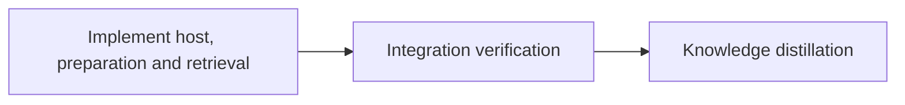

# Configurable Web UI host and Graft follow-through

## Outcome

Enable `loom status --web --host 0.0.0.0` with authenticated remote access;
keep `127.0.0.1` as the default and preserve the existing port-selection behavior.
Apply the still-useful Graft ideas to today's implementation: prepare bounded
memory batches before semantic curation, preserve every contributing event ID,
and improve natural-language retrieval using reproducible answer-recall tests.

This is an execution plan against `85bac617fd51721f484bfee18ba7db0a3624f61a`,
inspected on 2026-09-13. Planning changes only this plan and its supporting briefs.
The August report and September evaluation are historical inputs; current source
and the knowledge index's topic pointers establish what already exists.

## Report decisions

The [comparison audit](briefs/web-host-graft-followthrough/graft-audit.md)
contains implementation evidence, current limitations and migration boundaries.

| Idea from the report                                         | Today's position                                                               | Decision in this plan                                                       |
| ------------------------------------------------------------ | ------------------------------------------------------------------------------ | --------------------------------------------------------------------------- |
| Native source graph, hashes, conservative edges and coverage | Shipped, including four language extractors and source retrieval               | Retain; no repeat parser project or Graft dependency                        |
| H2 catalog, lexical ranking, graph expansion, bounded briefs | Shipped through the common retrieval path                                      | Improve demonstrated natural-language answer recall                         |
| Structural hooks and per-worktree graph state                | Shipped substantially                                                          | Preserve; no model calls in hooks or new shared mutable cache               |
| Structured observations and processing outcomes              | IDs, evidence, spool, pending and resolve exist                                | Reuse; add deterministic preparation and full duplicate lineage             |
| Cheap mechanical prepass before semantic judgment            | Distill still repeatedly reads every journal                                   | Implement bounded prepare/resolve cycles and wire both distill surfaces     |
| Source-linked claim identity and durable operation receipts  | Current journal receipts do not provide transactional knowledge publication    | Defer this larger migration; concrete design and prerequisites in the audit |
| Incremental semantic summaries and source-centered excerpts  | No model meaning layer; current “semantic refresh” reconciles source structure | Defer default activation pending independent recall/value evidence          |
| Measure quality and actual usage                             | Eval, telemetry and provider counters exist                                    | Add hermetic held-out tests; make no token-savings claim                    |
| Embeddings, LSP, SQLite, extra transports                    | Optional extensions                                                            | No demonstrated prerequisite for the selected work                          |

The useful Graft distinction is between cheap deterministic preparation and
expensive judgment. This plan advances that distinction without changing where
durable knowledge lives. A processing disposition remains different from proof
that knowledge and its provenance were atomically committed.

## Behavior contracts

`--host HOST` accepts IP literals and `localhost`; omission means IPv4 loopback.
DNS names, reverse-proxy configuration, TLS termination and persistent bind-host
configuration are outside this first CLI surface. Wildcard binds print the actual
listening address and a usable bootstrap URL, explaining how to use a reachable
machine IP. A wildcard address is not advertised as a remote destination.

Automatic ports still start at 7373 and advance only on `AddrInUse`. Explicit
ports bind exactly; zero requests an ephemeral port. Binding is atomic.
All non-loopback listeners require a process token, including listeners passed
directly to public `serve`. Authenticate every remote HTTP and WS route. Preserve
CSRF/body controls and validate Host against the accepted local endpoint and
Origin against that authority. Terminal control remains opt-in. See the
[web brief](briefs/web-host-graft-followthrough/web-host.md) for the full matrix.

`loom memory prepare [--stage ID] [--budget-tokens N] [--json]` observes existing
memory read-only, groups exact equivalents, prioritizes corrections and retains
every original event ID. Default budget: 2000 estimated tokens, including rendered
metadata. Omitted work remains pending; oversized first candidates produce an
explicit failure and required larger budget. Preparation never performs semantic
deduplication, writes knowledge, or issues receipts. Deferred retains its existing
terminal disposition for this run. The [memory brief](briefs/web-host-graft-followthrough/delta-preparation.md)
defines replay, diagnostics, output budgeting and the live curator workflow.

The [retrieval brief](briefs/web-host-graft-followthrough/retrieval-eval.md)
requires actual answer recall under corpus growth and question-quotation
contamination. Expected answers must not be supplied as required IDs, which would
force their inclusion and invalidate the test. Exact lookup, abstention, cache
parity and the existing delivery-budget rules remain required regressions.

## Execution and model allocation



Knowledge already has substantial content; `loom knowledge sync` completed
cleanly at planning time. Omit bootstrap. One implementation stage is the minimum
useful stage; no extra standard stage passes the necessity test Q1–Q4. The shared
CLI creates a compile-order dependency, handled by a serial wiring worker after
the independent implementations, without another worktree or merge.

Use the operator's configured stage orchestrators: omit stage `model` and
`reasoning_effort`. The user's model selection applies to execution workers:
GPT-6 Luna for simple fixtures/tests, Terra for most implementation, Sol for
architecture, algorithm selection and debugging. Sol is a supported forwarder
model in current `codex.rs` and `loom-hooks/codex-forward.sh`. The Codex CLI and
enabled user-scope plugin were found during planning. All Codex forwards use
`--effort xhigh`, foreground invocation and a 600000 ms tool timeout.

Read the exact brief before work. Workers never spawn subagents, run git, edit
outside their territory, or run verification. The orchestrator keeps one ownership
table and runs the prescribed checks; receipts/learning use supported Loom CLI
channels, never direct state-file edits. No stage writes control-state paths.

| Worker | Role                                        | Tier  | Files owned                                       | Shared context                       | Brief                             |
| ------ | ------------------------------------------- | ----- | ------------------------------------------------- | ------------------------------------ | --------------------------------- |
| D      | Access/prepass design review                | Sol   | Read-only                                         | Web and memory contracts             | web-host.md; delta-preparation.md |
| W      | Web runtime                                 | Terra | Exact web set in brief, excluding access_tests.rs | Existing HTTP/config/terminal guards | web-host.md                       |
| M      | Memory preparation and distill doctrine     | Terra | Exact memory/signal/command set in brief          | Existing pending/resolve readers     | delta-preparation.md              |
| R      | Retrieval algorithm and hermetic regression | Sol   | Exact ranking/evaluation/test set in brief        | Source candidacy and prompt floors   | retrieval-eval.md                 |
| L1     | Date-independent baseline fixture           | Luna  | usage/discovery_tests.rs                          | Existing time-range filtering        | luna-tests.md, early assignment   |
| C      | Shared CLI and ledger integration           | Terra | Exact CLI/test/ledger set in brief                | Completed W/M interfaces             | cli-and-gates.md                  |
| L2     | Pure access-policy tests                    | Luna  | New web/access_tests.rs only                      | Completed W access API               | luna-tests.md, late assignment    |

Brief paths above resolve under `doc/plans/briefs/web-host-graft-followthrough/`;
all exact paths within the briefs are authoritative ownership assignments.
Run D first and incorporate its grounded corrections in worker briefs. Then
spawn W/M/R/L1 in one wave (subject to runtime capacity); after they finish,
spawn C/L2 in one wave. Do not overlap writes between waves. Escalate a failed
Terra assignment to Sol with the failure evidence; never blindly repeat it.

## Sibling plans and validation limits

`PLAN-secure-distilled-loom-v2.md` proposes broad event/WAL/receipt and semantic
work, but contains no executable Loom metadata. It is not an upstream dependency
or evidence that those interfaces exist. This plan neither executes nor rewrites
that program. Its future memory adapter can consume the preparation contract.
`PLAN-loom-state-confinement.md` owns changing the recording/relay transport and
also touches CLI dispatch. Integrate its committed dispatch changes if present;
do not run overlapping CLI writers concurrently. This plan leaves recording,
relay, daemon completion and work-directory resolution read-only.
The executable `IN_PROGRESS-PLAN-loop-recovery.md` also owns
`signals/tests_doctrine.rs` and the maintainability ledger in `worker-evidence`;
`PLAN-model-router-hooks.md` owns CLI dispatch in `router-core`. Schedule this
plan after those overlapping stages, or leave them unscheduled while this plan
owns those files. Re-read their merged changes before W/M/C work; preserve their
behavior and exact ledger rows. No new API from either sibling is required.

Baseline evidence from this checkout:

- Web unit filter: 147 passed.
- Build all targets, Clippy all targets with warnings denied, and format check: passed.
- Full all-target suite: one failing date-sensitive usage fixture. Re-running
  with only that named test excluded passed all targets; the implementation
  stage owns the fixture repair. Final acceptance has no exclusion.
- Knowledge strict check: zero issues, with advisory evidence/review notes.
- Read-only `loom repair`: no issues.

These checks ran in the main checkout, not an orchestrated worktree. Graph and
knowledge commands encountered a sandbox `wait-timeout` signal-handler EPERM and
worked with host permissions; this is not represented as a verified stage-sandbox
baseline. Do not embed graph/context-refresh commands in stage acceptance.
The plan verifier establishes schema/DAG validity, not these future behaviors.
Validation passes with three documented advisories: populated knowledge makes
bootstrap unnecessary; explicit artifact/behavior tests replace optional
before/after duplication; integration licenses Codex specifically for delegated
fixes under the user's requested model split. The full suite runs once at the
final integration gate; standard acceptance covers its changed subsystems.

The execution sandbox permits local binding for temporary server tests and the
existing Rust build workflow. No new dependencies are planned. Registry access
is restricted to Cargo domains; Codex runtime access uses Loom's existing lane
configuration. Never run the dashboard smoke against operator configuration.
New tests must use isolated roots and restore cwd/environment with RAII.

## Final stages

Integration verifies the full merged implementation, reviews the access boundary,
preparation lineage and retrieval regressions, and fixes findings through workers
within the same source territory. Its binary CLI fixture proves the flags and
command are reachable; library tests alone do not establish that. Record results
and remaining limits in `doc/web-host-graft-verification.md`.

Knowledge-distill uses the installed CLI's existing pending/list/show commands
with one curator for this run. The running orchestrator and installed CLI are
not hot-swapped: the prepare workflow takes effect after the resulting binary
and assets are installed through the normal release/install workflow. Binary
integration tests exercise it now. Correct stale knowledge in place before adding new material; record
each event's outcome and finish with strict pending/check. Update the relevant
knowledge topics and publish `doc/web-host-and-distillation.md` with CLI examples,
remote HTTP/token limitations, preparation behavior and the deferred roadmap.
Do not grow the already oversized README as part of this task.

<!-- loom METADATA -->

```yaml
loom:
  version: 1
  sandbox:
    enabled: true
    auto_allow: true
    filesystem:
      deny_read:
        ["~/.ssh/**", "~/.aws/**", "~/.config/gcloud/**", "~/.gnupg/**"]
      allow_write:
        [
          "loom/src/**",
          "loom/tests/**",
          "loom/target/**",
          "loom/eval/**",
          "loom/maintainability-baseline.txt",
          "commands/distill.md",
          "doc/**",
        ]
    network:
      allowed_domains: ["crates.io", "index.crates.io", "static.crates.io"]
      allow_local_binding: true
      allow_unix_sockets: []
  stages:
    - id: implement-host-and-context
      name: "Configurable host and deterministic context follow-through"
      stage_type: standard
      implementers: ["codex"]
      subagent_timeout_secs: 900
      working_dir: "."
      dependencies: []
      description: |
        Implement the behavior contracts and worker briefs in this plan.
        Use parallel subagents and skills to maximize performance.
        One stage: independent territories plus serial CLI wiring; no merge-order checkpoint needed.
        Preserve exact ownership and the two execution waves; workers never run git or verification.
        Spawn loom-codex-forwarder workers with their brief path, exact model and xhigh effort.
        Foreground forwards use an explicit 600000 ms timeout. D is read-only design review first.
        | Worker | Role | Tier | Files owned | Shared context | Brief path |
        | D | Contract review | gpt-6-sol | | web and memory contracts | doc/plans/briefs/web-host-graft-followthrough/web-host.md; doc/plans/briefs/web-host-graft-followthrough/delta-preparation.md |
        | W | Web runtime | gpt-5.6-terra | loom/src/commands/status/web/mod.rs; loom/src/commands/status/web/listener.rs; loom/src/commands/status/web/connection.rs; loom/src/commands/status/web/http.rs; loom/src/commands/status/web/access.rs; loom/src/commands/status/web/auth.rs; loom/src/commands/status/web/auth_tests.rs; loom/src/commands/status/web/config_api/request.rs; loom/src/commands/status/web/terminal/upgrade.rs; loom/src/commands/status/web/terminal/token.rs; loom/src/commands/status/web/terminal/mod.rs; loom/src/commands/status/web/terminal/tests_upgrade.rs; loom/src/commands/status/web/terminal/tests_upgrade/shutdown.rs; loom/src/commands/status/web/tests.rs; loom/src/commands/status/web/tests/ports.rs; loom/src/commands/status/web/tests/pure.rs; loom/src/commands/status/web/tests/remote.rs; loom/tests/e2e/web_terminal.rs | HTTP/config/terminal guards | doc/plans/briefs/web-host-graft-followthrough/web-host.md |
        | M | Prepass/doctrine | gpt-5.6-terra | loom/src/commands/memory/mod.rs; loom/src/commands/memory/handlers/mod.rs; loom/src/commands/memory/handlers/pending.rs; loom/src/commands/memory/handlers/prepare.rs; loom/src/commands/memory/handlers/prepare/model.rs; loom/src/commands/memory/handlers/prepare/group.rs; loom/src/commands/memory/handlers/prepare/render.rs; loom/src/commands/memory/handlers/tests_prepare.rs; loom/src/commands/memory/handlers/tests_resolve_pending.rs; loom/src/orchestrator/signals/cache.rs; loom/src/orchestrator/signals/cache/knowledge_distill.rs; loom/src/orchestrator/signals/cache/tests.rs; loom/src/orchestrator/signals/cache/distill_ordering.rs; loom/src/orchestrator/signals/tests_doctrine.rs; commands/distill.md | pending/resolve | doc/plans/briefs/web-host-graft-followthrough/delta-preparation.md |
        | R | Lexical retrieval | gpt-6-sol | loom/src/context/rank/corpus/stopwords.rs; loom/src/context/rank/corpus.rs; loom/src/context/rank.rs; loom/src/context/rank/corpus/topic_coverage.rs; loom/src/context/tests/retrieval_natural_language.rs; loom/src/context/tests/retrieval_natural_language_fixtures.rs; loom/src/context/tests/mod.rs; loom/src/context/tests/rank_stopwords_rescue.rs; loom/eval/retrieval-cases.yaml | candidacy/packing | doc/plans/briefs/web-host-graft-followthrough/retrieval-eval.md |
        | L1 | Baseline fixture | gpt-6-luna | loom/src/commands/usage/discovery_tests.rs | time range | doc/plans/briefs/web-host-graft-followthrough/luna-tests.md |
        | C | Serial CLI/ledger | gpt-5.6-terra | loom/src/cli/mod.rs; loom/src/cli/dispatch.rs; loom/src/cli/dispatch_memory.rs; loom/src/cli/dispatch_commands.rs; loom/src/cli/types_status_web.rs; loom/src/cli/types_memory.rs; loom/src/cli/tests_web_host_graft.rs; loom/tests/web_host_graft.rs; loom/maintainability-baseline.txt | completed W/M APIs | doc/plans/briefs/web-host-graft-followthrough/cli-and-gates.md |
        | L2 | Pure access tests | gpt-6-luna | loom/src/commands/status/web/access_tests.rs | completed W API | doc/plans/briefs/web-host-graft-followthrough/luna-tests.md |
        After D, run W/M/R/L1, then C/L2. Territories are disjoint; workers never spawn workers.
        Repair the known expiring usage fixture; do not retain the planning-time test exclusion.
        Split touched oversized units and remove only resolved maintainability ledger rows via C.
        MEMORY: record substantive findings through loom memory immediately, never auto-memory.
      files:
        - "loom/src/cli/**"
        - "loom/src/commands/status/web/**"
        - "loom/tests/e2e/web_terminal.rs"
        - "loom/tests/web_host_graft.rs"
        - "loom/src/commands/memory/**"
        - "loom/src/orchestrator/signals/cache.rs"
        - "loom/src/orchestrator/signals/cache/**"
        - "loom/src/orchestrator/signals/tests_doctrine.rs"
        - "commands/distill.md"
        - "loom/src/context/rank.rs"
        - "loom/src/context/rank/**"
        - "loom/src/context/tests/**"
        - "loom/eval/retrieval-cases.yaml"
        - "loom/src/commands/usage/discovery_tests.rs"
        - "loom/maintainability-baseline.txt"
      artifacts:
        - "loom/src/commands/status/web/listener.rs"
        - "loom/src/commands/status/web/access.rs"
        - "loom/src/commands/status/web/auth.rs"
        - "loom/src/commands/memory/handlers/prepare.rs"
        - "loom/src/context/tests/retrieval_natural_language.rs"
        - "loom/tests/web_host_graft.rs"
      wiring:
        - source: "loom/src/cli/dispatch_commands.rs"
          pattern: 'status::web::execute\('
          description: "Status dispatch passes the selected host to the server"
        - source: "loom/src/cli/dispatch_memory.rs"
          pattern: 'memory::prepare\('
          description: "Memory Prepare reaches its production handler"
        - source: "commands/distill.md"
          pattern: "loom memory prepare"
          description: "Interactive distillation consumes bounded candidates"
      acceptance:
        - "cargo build --manifest-path loom/Cargo.toml --all-targets"
        - "cargo clippy --manifest-path loom/Cargo.toml --all-targets -- -D warnings"
        - "cargo fmt --manifest-path loom/Cargo.toml --all -- --check"
        - "cargo test --manifest-path loom/Cargo.toml --lib commands::status::web::"
        - "cargo test --manifest-path loom/Cargo.toml --lib commands::memory::"
        - "cargo test --manifest-path loom/Cargo.toml --lib context::"
        - "cargo test --manifest-path loom/Cargo.toml --lib orchestrator::signals::"
        - "cargo test --manifest-path loom/Cargo.toml --lib cli::"
        - "cargo test --manifest-path loom/Cargo.toml --lib commands::usage::discovery::tests::explicit_root_discovers_old_mtime_file_without_home_fallback -- --exact"
        - "cargo test --manifest-path loom/Cargo.toml --test web_host_graft"
        - "cargo test --manifest-path loom/Cargo.toml --test maintainability"

    - id: integration-verify
      name: "Verify runtime, lineage and retrieval"
      stage_type: integration-verify
      implementers: ["codex"]
      working_dir: "."
      dependencies: ["implement-host-and-context"]
      description: |
        Use parallel subagents and skills to maximize performance.
        Review the merged implementation for access control, memory lineage and ranking correctness.
        Reviewers are read-only; fixes use the same disjoint ownership from implementation.
        Run the full suite once, build and lint; fix failures, do not lower gates or skip the expiring fixture.
        Exercise the built binary via web_host_graft, including wildcard auth and prepare/resolve/pending.
        Confirm socket tests executed where local binding is available; never label a skip as remote proof.
        Inspect held-out per-case outcomes and cache parity, not just aggregate retrieval scores.
        Write doc/web-host-graft-verification.md with results and environmental limits.
        MEMORY: record findings via loom memory for the final curator; no knowledge curation here.
        Codex is explicitly licensed for fixes to honor the user's model selection.
        Verification stays with the orchestrator; delegated fixes use Luna/Terra/Sol by task.
      files:
        - "loom/src/cli/**"
        - "loom/src/commands/status/web/**"
        - "loom/tests/e2e/web_terminal.rs"
        - "loom/tests/web_host_graft.rs"
        - "loom/src/commands/memory/**"
        - "loom/src/orchestrator/signals/cache.rs"
        - "loom/src/orchestrator/signals/cache/**"
        - "loom/src/orchestrator/signals/tests_doctrine.rs"
        - "commands/distill.md"
        - "loom/src/context/rank.rs"
        - "loom/src/context/rank/**"
        - "loom/src/context/tests/**"
        - "loom/eval/retrieval-cases.yaml"
        - "loom/src/commands/usage/discovery_tests.rs"
        - "loom/maintainability-baseline.txt"
        - "doc/web-host-graft-verification.md"
      acceptance:
        - "cargo build --manifest-path loom/Cargo.toml --all-targets"
        - "cargo clippy --manifest-path loom/Cargo.toml --all-targets -- -D warnings"
        - "cargo fmt --manifest-path loom/Cargo.toml --all -- --check"
        - "cargo test --manifest-path loom/Cargo.toml --all-targets"
      artifacts: ["doc/web-host-graft-verification.md"]

    - id: knowledge-distill
      name: "Distill verified outcomes and document usage"
      stage_type: knowledge-distill
      working_dir: "."
      dependencies: ["integration-verify"]
      description: |
        Use parallel subagents and skills to maximize performance.
        Exception: this curator runs single-agent; do not spawn subagents.
        Read this plan and verification report. This run uses the existing installed CLI.
        Start with loom memory pending --json and pull relevant journals using memory show --stage.
        Do not assume the just-built prepare command exists on PATH; never replace a live orchestrator.
        Corrections first: replace stale sections in place through loom knowledge replace-section.
        Verify each source-backed claim before curation; preserve the distinction between index currency and truth.
        Resolve every original event ID through the existing receipt syntax, then inspect pending again.
        Deferred remains a terminal disposition for this run; do not claim a durable deferred backlog.
        Never record an outcome before the knowledge write it describes succeeds.
        Route small findings to tier-1 and larger ones to topics; use the knowledge CLI, never direct edits.
        Update web-dashboard/web-terminal, memory-spool and retrieval topics and relevant tier-1 pointers.
        Publish doc/web-host-and-distillation.md with exact CLI examples and limits, using the audited roadmap.
        Run loom review and resolve outstanding dispositions before strict pending/check.
        No auto-memory, no new runtime changes, no all-journal reads as the routine workflow.
      files: ["doc/loom/knowledge/**", "doc/web-host-and-distillation.md"]
      acceptance:
        - "loom knowledge check --strict"
        - "loom memory pending --strict"
      artifacts: ["doc/web-host-and-distillation.md"]
```

<!-- END loom METADATA -->
