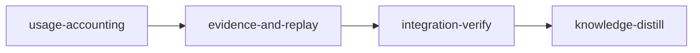

# Plan: Usage Evidence

## Overview

Plans 4 and 5 of the token-optimization programme are judged on a deterministic replay, and plan 4 also on frozen single-stage replays compared with `loom usage --compare`. `loom usage` and `--compare` exist, but the evidence they produce today is wrong or missing: removed stage worktrees are not read, Codex rows are not scoped to a project, forward receipts never form, the token verdict knows only dominance, a candidate 1 ms slower in one pair is rejected, nothing writes the `RunEvidence` the comparison reads, quota continuity reads the 1 s `resets_at` jitter as a reset, and several sections count requests without tokens. This plan fixes the accounting, adds a declared net-total and latency rule, writes `RunEvidence`, and builds the replay harness. It is plan 2 of the metaplan (`doc/plans/optim-token-metaplan.md`, section 2) and targets the evidence later plans are judged on; it claims no saving itself.

- **Run order and dependencies.** Canonical order: 3 (`PLAN-01-doctrine-truth-and-plan-guards`), 1 (`PLAN-02-delivery-truth`), then this plan, then 4 (`PLAN-04-dependency-findings`), 5 (`PLAN-05-guidance-and-gate-output`) and 7 (`PLAN-06-sandbox-route-closure`). One checkout runs one plan. This plan depends on plans 3 and 1 having merged: both edit `loom-hooks/post-tool-use.sh`, plan 1 edits `src/cli/types_ops.rs` and `src/cli/dispatch.rs`, and the replay reads plan 1's worker-brief delegate. The first stage's `before_stage` checks fail fast when either plan has not completed: the `DONE-` plan files prove each plan finished, including its knowledge-distill, and the two code probes prove the merged code. This is a deviation from the metaplan's "either order" (deviation 12). Plans 4 and 5 depend on this plan's replay and check for it with `test -f tests/signal_replay.rs` from `loom/`. A grep for `signal_with_metrics` under `tests/` cannot serve as that check: plan 3's `tests/doctrine_guard_contracts.rs:17,157` already names `format_signal_with_metrics`, so `rg -qF 'signal_with_metrics' tests` (PLAN-04 and PLAN-05 `before_stage`) passes before this plan runs. Those two plans must change their guard to the `test -f` form.
- **`loom plan verify --strict` accepts no warning.** Plan 3 moved the knowledge-bootstrap heuristic to `check_knowledge_recommendations` (`plan/schema/validation/knowledge_recommendations.rs`), and it is silent for this knowledge tree. The provision lint (`plan/schema/validation/v2_lints/js_provision.rs`) considers only packages whose `package.json` git tracks, so untracked trees in the operator's checkout do not affect it.
- **Where the pre-push gate runs.** The metaplan requires every code stage to run the full pre-push gate (`loom/.githooks/pre-push`), plus the hook steps when it edits `loom-hooks/`. The hook runs fmt, clippy, doc and the unfiltered suite (`pre-push:28,97,107,126`), markdownlint over tracked markdown (`:36-93`), `cargo audit` (`:115-122`) and `scripts/flake-check.sh` (`:135-146`, whose default filters include `quota::`). `loom plan verify` warns on an unfiltered `cargo test` in a standard stage's acceptance (`warn_full_suite_outside_integration_verify`, `plan/schema/validation_suite.rs`), so each code stage runs the pre-push gate, minus the exceptions named here, in its `loom-verifier` round, with the suite as the hook runs it (`env -u GIT_INDEX_FILE -u GIT_DIR -u GIT_WORK_TREE cargo test --all-targets --no-fail-fast`, `pre-push:126`) and markdownlint judged by its `markdownlint-cli2 v` banner as well as its exit status (`pre-push:52-58`), and its acceptance keeps the other cargo steps (and the hook steps in `usage-accounting`) plus filters that select the stage's own tests. Confined acceptance runs with no network and scratch package caches (`verify/criteria/confine.rs:214-216`), so markdownlint (`bunx`) and flake-check run only in verifier rounds: `evidence-and-replay` runs both because it edits `README.md` and `src/quota/`; `usage-accounting` edits neither tracked markdown nor a module under flake-check's default filters (`quota::`, `process::`, `verdict_apply_tests::`, `stalled_judge_tests::`, `scripts/flake-check.sh:29-30`), so neither applies there. `cargo audit` is not run by any stage: no stage changes a dependency, and its advisory host is not in the allowed domains; the operator's own push runs it. The verifier rounds are therefore the pre-push gate with these named exceptions, never "the full gate verbatim". Integration-verify's acceptance runs the unfiltered suite, and its session runs markdownlint and flake-check. This follows plan 3 (`DONE-PLAN-01`, verifier round) and plan 1 (flake-check dropped only for want of quota, process or verdict changes).
- **Lanes (operator decision 2026-10-19: Claude plus Codex where it fits).** `usage-accounting`: `["claude", "codex"]`. The discovery, completeness and Codex-scope work crosses the usage pipeline and converges on fixture-backed tests (Claude); the forward-receipt change edits a hook and converges on hook tests (Claude); the sections work iterates on tests (Claude); `spawn_join.rs` and the Bash-output part of `tools.rs` are single files with their tests and pinned interfaces (codex). `evidence-and-replay`: `["claude", "codex"]`. The verdict wiring and the producer cross several files (Claude); the replay converges only by running fixture tests (Claude); `comparison_net.rs` and `comparison_latency.rs` are single files with pinned interfaces and mechanical acceptance (codex). Licensing codex adds the Codex hosts to the stage sandbox (`sandbox/settings/policy.rs:78-86`, `CODEX_SANDBOX_DOMAINS`).
- **Before `loom run` (operator).** (1) Commit this plan and every file under `doc/plans/token-optim/briefs/usage-evidence/`. (2) Commit `doc/plans/archive/DONE-PLAN-token-flow.md`, the replay's frozen-plan source: nothing under `doc/plans/archive/` is tracked today (`git ls-files doc/plans/archive` is empty), and `git ls-files --error-unmatch doc/plans/archive/DONE-PLAN-token-flow.md` must succeed. (3) Confirm plan 1's `briefs/delivery-truth/delivery-fixes/replay-payload.json` and plan 4's `briefs/dependency-findings/dependency-findings/fixtures/token-core.md` are committed (both are today); the replay requires all three, and the `evidence-and-replay` `before_stage` checks fail fast without them. (4) Run `./dev-install.sh` from the tree with plan 1 merged, so the installed spawn guard, hooks and binary carry plan 1's 5 s bound and capped worker query; plan 1's operator check (below) is read from this run's workers. `extract_brief_paths` (`loom/src/plan/schema/structural_checks.rs:78`) and the committed-input bundle (`loom/src/commands/run/plan_inputs/discovery.rs:22`) recognise only `doc/plans/briefs/`, so neither `loom plan verify` nor `loom run` notices an uncommitted file under `doc/plans/token-optim/`, and a stage worktree is cut from HEAD.
- **Evidence class.** None of this changes what agents are given; the plan builds the instruments. The replay spends no provider tokens.
- **Operator steps.** The live paired-trial protocol below is operator procedure; no stage runs it. After merge, run `./dev-install.sh`: the installed `post-tool-use.sh` must be the one that pipes the payload, because the installed binary no longer accepts `hook forward-receipt --transcript`. This plan's `usage-accounting` run is also where plan 1's post-merge operator check is made (`PLAN-02-delivery-truth.md`, overview, "Operator check after merge": a worker transcript carrying the brief marker and the first pack item verbatim, and a bound `worker-<hex>.json` record); the operator records the result with `loom memory note`.

## Goals

- `loom usage --project <dir>` and the default selection read every `<slug>--worktrees-*` transcript directory, live or removed; `--since` accepts RFC3339 instants; each provider reads `measured` or `partial` with reasons.
- Forward receipts form from the PostToolUse payload; a project's Codex totals hold only the threads its receipts name; a receipt whose thread has no rollout in the window reads `partial`.
- `--compare` keeps every current verdict when an artifact declares nothing, except that its quota checks gain the jitter and interval tolerances below for every artifact (a fix, not an opt-in: an undeclared candidate whose `resets_at` is 1 s off the baseline's now reads continuous, contract `compare-tolerates-quota-jitter-and-interval`), and supports a declared per-provider net-total rule with sample variance and a declared latency tolerance judged across pairs.
- `loom usage --run-evidence <declaration.json>` writes `RunEvidence` that `--compare` reads back.
- `tools`, `polling`, `lifecycle` and `agents` report Bash output bytes by command, tokens on observation-only requests, orientation for main sessions and subagents, and requested models.
- Quota continuity and the comparison's quota checks tolerate 300 s of `resets_at` jitter and one poll interval (180 s) of interval length.
- A test-only replay prints per-section signal bytes, worker-brief bytes and asset sizes for a frozen fixture.
- Non-goals: everything in metaplan section 6; the dropped items listed under "Coverage"; a subscription verdict in any acceptance; widening `exact_forward_argv` for `loom subagents` (recorded for knowledge-distill).

## Execution Diagram



## Stages

### 1. usage-accounting (`working_dir: loom`)

Steps 1, 2 and 5 of the metaplan, and the plan's first implementation stage; stage 2 splits from it by Q2 and Q4 (below). The main agent re-reads the files plans 3 and 1 changed, spawns three Claude workers in the background and forwards two codex units in the foreground, runs the gate through a `loom-verifier`, runs the review rounds and commits.

| Worker              | Lane and tier  | Territory                                                                                                                                                                                                                                 |
| ------------------- | -------------- | ----------------------------------------------------------------------------------------------------------------------------------------------------------------------------------------------------------------------------------------- |
| W1 accounting       | Claude, sonnet | `UsageArgs` moved to `args.rs` first; worktree slugs in discovery; `--since` instants; `completeness.rs`; `codex_scope.rs`; `forward_join.rs` thread accessors; `provider.rs`, `provider_types.rs`, `provider_report.rs`; `mod.rs` wiring |
| W2 forward receipts | Claude, sonnet | `models/forward_receipt/payload.rs`; `forward_argv` in `models/forward_receipt/transcript/argv.rs`; `hook/forward_receipt.rs` reads stdin; the CLI variant; `post-tool-use.sh` pipes the payload; unit and hook tests                     |
| W3 sections         | Claude, sonnet | Observation tokens in `polling.rs`; `lifecycle_orientation.rs`; requested model in `agents.rs`; the `Transcript.requested_model` field and its literals                                                                                   |
| W4 spawn join       | codex terra    | `spawn_join.rs` and its test                                                                                                                                                                                                              |
| W5 Bash output      | codex terra    | `tools.rs` Bash output by command and its test                                                                                                                                                                                            |

Risk-checklist walk (v2):

| Area                     | Applies                                                                                                                                                                        | Covered by                                                                                                                                                                                                                                                                       |
| ------------------------ | ------------------------------------------------------------------------------------------------------------------------------------------------------------------------------ | -------------------------------------------------------------------------------------------------------------------------------------------------------------------------------------------------------------------------------------------------------------------------------- |
| Untrusted input          | The PostToolUse payload and its command string; session records; receipts files                                                                                                | `forward-receipt-forms-from-the-posttooluse-payload`; W2 payload tests for every rejected argv form                                                                                                                                                                              |
| Filesystem paths         | The receipts append keeps its `O_NOFOLLOW` writer; discovery lists directories under an explicit root                                                                          | unchanged writer; `removed-worktree-transcripts-are-counted` rejects the sibling-prefix slug                                                                                                                                                                                     |
| Process I/O and scale    | The hook pipes the payload into a bounded delegate; stdin read capped at 4 MiB                                                                                                 | W2 `read_payload` tests (exactly the limit is read, one byte over is refused); W2 hook test                                                                                                                                                                                      |
| Configuration            | `--since` gains a form; no new setting                                                                                                                                         | `since-accepts-an-rfc3339-instant`                                                                                                                                                                                                                                               |
| Lifecycle                | Receipts now form, which makes `loom subagents wait --receipt`, `resolve_wait_codex_execution` (`commands/subagents/wait/codex_binding.rs:57-75`) and poll-guard guidance live. Each call is seen once (no transcript rescan), so a forward the wrapper times out must still write a terminal line; a damaged receipt journal now fails every wait (`codex_binding.rs:242-245`) | W2: a companion END `timed_out` writes `timed_out`/124 (amendment A2.4) with a test; integration-verify functional check through the real hook and binary; integration-verify review (no existing wait test covers a payload-formed receipt plus its companion job) |
| Reachability             | Everything is reached through `loom usage` or `loom hook forward-receipt`                                                                                                      | every contract drives the built binary                                                                                                                                                                                                                                           |
| External data            | Claude transcripts, Codex rollouts, Claude Code's PostToolUse payload, the companion job record                                                                                | fixtures follow the in-tree shapes captured from real data (`tests/token_flow_contracts/support.rs:65-88`, `src/commands/usage/codex_provider_tests.rs:31-63`, `src/commands/hook/tests_forward_receipt.rs:83-114`) and the payload fields `codex-forward-result.sh:31-46` reads |
| Behaviour the stage adds | Codex membership, completeness, the four section outputs                                                                                                                       | `codex-totals-hold-only-the-project-threads`, `codex-scope-is-open-under-all-and-unavailable-without-loom-state`, `unread-session-transcript-reads-partial`, `receipt-without-a-rollout-reads-partial`, `sections-report-bash-output-observation-orientation-and-requested-model`, `damaged-evidence-reads-partial` (evidence loss, A1.4) |

### 2. evidence-and-replay (`working_dir: loom`)

Steps 3, 4, 6 and 7. Separate from stage 1 by Q4 and Q2: one stage would hold ten workers' reports, two waves and two review rounds over a diff of about 4,000 lines, past the 500,000-token budget; and both stages edit `src/commands/usage/mod.rs` and `args.rs`, which stage 1 creates. The producer reads stage 1's completeness and Codex scope, so this stage needs stage 1 merged.

| Worker               | Lane and tier  | Territory                                                                                                                                                                                                  |
| -------------------- | -------------- | ---------------------------------------------------------------------------------------------------------------------------------------------------------------------------------------------------------- |
| W1 verdict and quota | Claude, sonnet | Declared rules in `comparison_schema.rs` and `comparison_eval.rs`; `Serialize` on `RunEvidence`; quota tolerance in `quota/history.rs`, `comparison_quota.rs`, `tokens/quota_points.rs`, `quota/poller.rs` |
| W2 net total         | codex terra    | `comparison_net.rs` and its test                                                                                                                                                                           |
| W3 latency           | codex terra    | `comparison_latency.rs` and its test                                                                                                                                                                       |
| W4 producer          | Claude, sonnet | `run_evidence.rs`, `run_evidence_stages.rs`, the `--run-evidence` flag, `mod.rs` wiring, README                                                                                                            |
| W5 replay            | Claude, sonnet | `tests/signal_replay.rs`, its helpers under `tests/signal_replay/`, and the frozen fixture under `tests/fixtures/signal_replay/`                                                                           |

Risk-checklist walk (v2):

| Area                     | Applies                                                       | Covered by                                                                                                                                                           |
| ------------------------ | ------------------------------------------------------------- | -------------------------------------------------------------------------------------------------------------------------------------------------------------------- |
| Untrusted input          | The declaration file; artifacts with new optional fields      | `deny_unknown_fields` on the declaration; `run-evidence-carries-the-measured-run`                                                                                    |
| Configuration            | `token_rule` and `latency_tolerance_ms` are declared settings | `declared-latency-tolerance-judges-the-mean` sets a non-default tolerance; the three net-total contracts set the non-default rule                                    |
| Lifecycle                | none                                                          | none needed                                                                                                                                                          |
| Reachability             | `--run-evidence`, `--compare`                                 | the contracts drive the binary                                                                                                                                       |
| External data            | Quota history rows                                            | `quota-jitter-reads-as-one-interval` uses the six real rows observed in `.loom/work/quota/history/claude.jsonl` at `6fee4ecd`                                        |
| Behaviour the stage adds | Net-total verdict and its effect on `.verdict`, the comparison's quota tolerances, the replay report format, producer round trip | `net-total-supports-a-known-reduction` (asserts `.verdict`), `net-total-reads-an-aa-set-inconclusive`, `single-pair-reads-insufficient-pairs`, `compare-tolerates-quota-jitter-and-interval`, the replay acceptance that reads `SIGNAL_REPLAY_OUT`, `run-evidence-round-trips-through-compare`; the producer's undeclared-provider refusal and window-bounded stage set: `run-evidence-refuses-an-undeclared-provider`, stage-z in `run-evidence-carries-the-measured-run` |

### 3. integration-verify (`working_dir: .`)

The full gate on the merged tree with the hook steps and the replay, parallel reviews, and the functional checks in the YAML.

### 4. knowledge-distill (`working_dir: .`)

Rewrites the knowledge sections that describe the old accounting, receipts and verdict, records the replay harness and the live protocol, and applies the stale-knowledge corrections this plan found.

## Replay harness contract (for plans 4 and 5)

- **Path and test.** `loom/tests/signal_replay.rs`, test `signal_replay`, marked `#[ignore]`. Later plans locate it by path: `test -f tests/signal_replay.rs` from `loom/` is the merged check. A grep cannot locate it, because `tests/doctrine_guard_contracts.rs` (plan 3) also names `format_signal_with_metrics`.
- **Invocation.** From `loom/`: `cargo test --test signal_replay -- --ignored --nocapture`. With `SIGNAL_REPLAY_OUT=<file>` set, the report is also written to that file.
- **Input.** Frozen copies under `loom/tests/fixtures/signal_replay/` (markdownlint skips `loom/tests/fixtures/`, so the pre-commit `--fix` pass never rewrites them): PLAN-token-flow's archived plan (stage records come from it through `parse_plan` and `Stage::from_definition`), the seven tier-1 knowledge files, token-core's archived journal, one recorded worker spawn, and recorded request counts. Signals render through `generate_signal_with_metrics` (the production context build, then `format_signal_with_metrics`) and `generate_signal_with_skills` with no skill index; worker queries run through `loom hook worker-brief`.
- **Frozen-plan identity.** `parse_plan_content` takes the plan id from the file stem (`plan/parser/mod.rs:40-44`), so the harness copies the committed `tests/fixtures/signal_replay/plan.md` to `<R>/doc/plans/PLAN-token-flow.md` and parses that path. Every `stage.plan_id` then reads `PLAN-token-flow`, as in production, and plan 1's `worker_material` filter drops `doc/plans/PLAN-*` items from worker briefs as it does there. The skipped knowledge stage is still set `Completed` with `merged = true` (through `loom::verify::transitions::update_stage`), so its dependents see a merged dependency. Stage status changes go through `update_stage`: `save_stage` is an alias of `create_stage` and refuses an existing stage (`verify/transitions/persistence.rs:45-47,68-70`).
- **Output.** Between `=== signal-replay v1 ===` and `=== end signal-replay ===`, tab-separated records: `signal` (stable prefix, semi-stable, dynamic, recitation, total and file bytes per stage), `worker` (query, brief and envelope bytes per query), `asset` (template, preamble, agents and skills file sizes), and `total`. `resident_estimate` multiplies bytes by the recorded requests after the admission point and is labelled an estimate. The header line after the opening marker is `signal-replay v1 plan=PLAN-token-flow estimate=bytes-times-recorded-requests`; the closing record is `total signal_bytes=<n> file_bytes=<n> brief_bytes=<n> asset_bytes=<n> resident_estimate=<n>`, every field separated by one tab. The `SIGNAL_REPLAY_OUT` file holds exactly the printed lines, both marker lines included; the stage-2 and integration-verify acceptance read that file. The full format is in `doc/plans/token-optim/briefs/usage-evidence/evidence-and-replay/w5-replay.md`.
- **Use.** Run it at the base and candidate revisions on the same host and diff the two reports. Skill recommendations are left out of the signals, so a skill-catalog change does not show; the asset lines report skill files by size.

## Live protocol (operator procedure; no stage runs it)

For a change that needs live evidence (plan 4's frozen replays, and a section 6 question that qualifies). Live trials consume subscription quota, so each needs operator scheduling and authority, and runs from an ordinary shell with no other Claude or Codex session open: a stage session cannot run `loom run`, and its own consumption would be concurrent use (`comparison_quota.rs:130-131`).

1. Each run gets a new clone at `<experiment-root>/<intervention>-<arm>-<run>`, outside this repository, so no two runs share a `~/.claude/projects` slug. Reset the clone's checked-out branch to the pinned revision and use it as the plan's base branch; no branch is created. Write the same `.loom/config.toml` into every clone of an experiment (`.loom/` is gitignored, `.gitignore:61`): no intervention dimension covers configuration, so its digest is part of the environment identity, and an intervention that is a configuration change ships as a revision that changes the default.
2. A clone isolates only `.loom/work` and `.loom/config.toml`. The `loom` binary, the hooks under `~/.claude/hooks/loom/`, the agents, the skills and `~/.claude/CLAUDE.md` are shared, so arms run one at a time, and before each arm `./dev-install.sh` installs that arm's revision from its clone. The declaration's `environment_id` is a digest of what must not vary between arms: host and OS, the `claude` and `codex` CLI versions, `~/.loom/config.toml`, the clones' shared `.loom/config.toml`, and `~/.claude/settings.json` unless `./dev-install.sh` rewrites it (then its digest is provenance, below). It never includes the installed binary's revision or the installed assets: those come from the arm's revision, which is the declared `implementation_revision` (the `implementation-revision` dimension), and `--compare` requires `environment_id` equal (`incomparable-environment`, `comparison_eval.rs:98-102`), so an identity carrying them makes every implementation-change pair incomparable. Record the installed binary's revision and the installed assets' digests per run in a provenance file beside its `RunEvidence` (`<run>/provenance.json`), and check that the binary's revision equals the declared `implementation_revision` before the run starts.
3. Freeze the workload fixtures, the source-input revision and digest, the acceptance contract, the required commands, the review dimensions, and the providers, models and effort. Name the one intervention; the manifest lists one changed dimension, because an empty `changed_dimensions` is invalid.
4. Include successful work, expected failures and review-heavy work, with the same checks and independent review in both arms. A clone at a new path starts cold; a warm start is a second run in the same clone inside the first run's cache TTL, started only after the first run's evidence is produced and saved (step 7). Its window must not overlap the first run's: the producer takes a run's stages by window (amendment A7.5), so the first run's stage records in the same `.loom/work` stay out of the second run's evidence.
5. Interleave baseline and candidate order across repetitions, and keep every outcome, including failures, retries, fixes and incomplete runs. A missing measurement is unknown, never zero.
6. Only `measured-canonical` rows of `loom usage --provider all --since <start> --until <end> --json` are measurements. `duplicate-exact`, `ambiguous-conflict`, `fallback-coverage`, `synthetic` and `unknown-usage` rows, and every absent dimension, go into the artifact as missing. A clone isolates Claude slugs only; Codex rollouts share `~/.codex/sessions`, so copy each run's rollouts out at the end of the run (they are not retained), and rely on forward-receipt scoping to keep another arm's threads out. Stage ledgers written before 2026-09-13 (`.loom/work/subagents/<stage>/codex.jsonl`) contain fake forward records that hook tests appended, and are never provenance.
7. Produce each run's evidence with `loom usage --run-evidence <declaration.json> --project <clone> --since <start> --until <end>` as soon as the run ends, before the next run starts in any clone, and keep the file: that file is the run's evidence and is never produced again later, because review rounds and dispute rulings recorded afterwards change `open_findings`. The declaration names every provider the run used: the producer refuses a run with in-scope usage from an undeclared provider (A7.4). The independent reviewer replaces the local finding ids (`<stage>:F-<round>-<k>`) with cross-arm ids and keeps the README's severity mapping. Assemble the pairs into an artifact that declares `"token_rule": "net-total"` and a `"latency_tolerance_ms"`, fix the pair count and the stopping rule before the first pair, and run every retained artifact through `loom usage --compare <artifact> --json`. Any new defect, omitted requirement, weakened check or review, failed semantic completion, or latency regression beyond the tolerance rejects the candidate, whatever the average. A rejected candidate is reverted through the operator's ordinary deployment procedure, and its evidence is kept. The net-total rule needs at least 3 pairs per artifact; fewer read `insufficient-pairs`. It judges the mean difference against 2 standard errors; a check that asks for a median (plan 4's) computes it from `.pairs[].baseline_provider_tokens` and `.pairs[].candidate_provider_tokens` of the `--compare --json` report. Quantities `RunEvidence` does not carry are read from `loom usage --project <clone> --since <start> --until <end> --json` over the same window: API calls from `.provider_ledger.providers[].coverage.measured_responses`, cache read and cache write from the provider token vectors, tokens before the first edit from `.lifecycle.orientation`. A window opened before the clone's last `loom init` cannot be measured: Codex scope and session-record completeness read only the current `.loom/work`.

## Coverage of metaplan section 2

| Metaplan item                                                                                                                                                                                                                                                                      | Where                                                                                                                                                                                                                                                                                                                                                                               |
| ---------------------------------------------------------------------------------------------------------------------------------------------------------------------------------------------------------------------------------------------------------------------------------- | ----------------------------------------------------------------------------------------------------------------------------------------------------------------------------------------------------------------------------------------------------------------------------------------------------------------------------------------------------------------------------------- |
| Bullet: `--project` reads only its own slug; 38 slugs, 0 live worktrees                                                                                                                                                                                                            | usage-accounting W1; contract `removed-worktree-transcripts-are-counted`                                                                                                                                                                                                                                                                                                            |
| Bullet: Codex rows not scoped; forward receipts never form                                                                                                                                                                                                                         | usage-accounting W1 (scope), W2 (receipts); contracts `codex-totals-hold-only-the-project-threads`, `forward-receipt-forms-from-the-posttooluse-payload`                                                                                                                                                                                                                            |
| Bullet: `--since`/`--until` take no instant                                                                                                                                                                                                                                        | usage-accounting W1 (`--since`); `--until` already takes only RFC3339 (deviation 2); contract `since-accepts-an-rfc3339-instant`                                                                                                                                                                                                                                                    |
| Bullet: dominance verdict, worst-pair aggregation, 1 ms latency rejection, no notification producer                                                                                                                                                                                | evidence-and-replay W1, W2, W3; contracts `net-total-*`, `single-pair-reads-insufficient-pairs`, `declared-latency-tolerance-judges-the-mean`                                                                                                                                                                                                                                       |
| Bullet: nothing writes `RunEvidence`                                                                                                                                                                                                                                               | evidence-and-replay W4; contracts `run-evidence-carries-the-measured-run`, `run-evidence-round-trips-through-compare`, `run-evidence-refuses-an-undeclared-provider` |
| Bullet: quota jitter and exact `resets_at`/interval comparison                                                                                                                                                                                                                     | evidence-and-replay W1; contract `quota-jitter-reads-as-one-interval`                                                                                                                                                                                                                                                                                                               |
| Bullet: no Bash output by command; observation requests carry no tokens; orientation subagent-only in requests; `agent_type: unknown`                                                                                                                                              | usage-accounting W5, W3, W4; the `unknown` rows come from discovery (deviation 4), fixed by W1; contract `sections-report-bash-output-observation-orientation-and-requested-model`                                                                                                                                                                                                  |
| Step 1 Discovery                                                                                                                                                                                                                                                                   | usage-accounting W1                                                                                                                                                                                                                                                                                                                                                                 |
| Step 2 Forward receipts                                                                                                                                                                                                                                                            | usage-accounting W2 (payload), W1 (membership filter); Codex rollout copying is protocol step 6                                                                                                                                                                                                                                                                                     |
| Step 3 Verdict                                                                                                                                                                                                                                                                     | evidence-and-replay W1, W2, W3                                                                                                                                                                                                                                                                                                                                                      |
| Step 4 Producer, with `UsageArgs`/`ProviderSelection` moved to `args.rs` first                                                                                                                                                                                                     | usage-accounting W1 (the move), evidence-and-replay W4 (the producer)                                                                                                                                                                                                                                                                                                               |
| Step 5 Sections                                                                                                                                                                                                                                                                    | usage-accounting W3, W4, W5                                                                                                                                                                                                                                                                                                                                                         |
| Step 6 Quota                                                                                                                                                                                                                                                                       | evidence-and-replay W1                                                                                                                                                                                                                                                                                                                                                              |
| Step 7 Replay                                                                                                                                                                                                                                                                      | evidence-and-replay W5; "Replay harness contract" above                                                                                                                                                                                                                                                                                                                             |
| Live protocol steps 1-7                                                                                                                                                                                                                                                            | "Live protocol" above; knowledge-distill records it in knowledge                                                                                                                                                                                                                                                                                                                    |
| Acceptance: checked-in fixture corpus (transcripts incl. a removed worktree, a stage directory, review rounds, quota excerpt with jitter, a forward call with its PostToolUse payload)                                                                                             | the contract harnesses `tests/usage_accounting_contracts/**` and `tests/usage_evidence_contracts/**`, written by the contract sessions (deviation 6)                                                                                                                                                                                                                                |
| Acceptance: removed worktree counted; missed transcript `Partial`; jitter one interval; receipt from payload; arm A/B/unrelated Codex isolation; missing thread `Partial`; producer round trip                                                                                     | the contracts named above                                                                                                                                                                                                                                                                                                                                                           |
| Acceptance: three synthetic artifacts (known reduction supported, A/A inconclusive, one pair `insufficient-pairs`)                                                                                                                                                                 | `net-total-supports-a-known-reduction`, `net-total-reads-an-aa-set-inconclusive`, `single-pair-reads-insufficient-pairs`                                                                                                                                                                                                                                                            |
| Acceptance: replay runs on the fixture and prints per-section bytes                                                                                                                                                                                                                | `cargo test --test signal_replay -- --ignored --nocapture` in evidence-and-replay and integration-verify acceptance                                                                                                                                                                                                                                                                 |
| Acceptance: the gate with the hook steps; files near limits (`forward_join.rs` 351, `sections/agents.rs` 335, `comparison_validation.rs` 313, `config_sections.rs` 358, `models/stage/types.rs` 696 in the ledger)                                                                 | both code stages' verifier rounds (the pre-push gate minus the exceptions the overview names) and acceptance (every other gate step, the hook steps in `usage-accounting`, filtered tests); integration-verify acceptance (unfiltered suite and hook steps); briefs cap `forward_join.rs` at 380 and `agents.rs` at 360; `comparison_validation.rs` and `fs/work_dir/config_sections.rs` are not edited; no `Stage` field is added |
| Dropped: `[experiment]` table and `[plan] base_revision`; `Admitted` telemetry; run-metrics sidecar and `run_metrics.rs`; policy `InterventionDimension`; `exp/<id>/<arm>` branches; main-agent stage attribution and the `--stage` slug match; the tracker's defects in `tokens/` | Not built, for the metaplan's reasons (artifact fields carry the ids and the tooling records `git rev-parse HEAD`; transcripts and the replay hold admitted bytes; existing sections are extended; `comparable` compares no configuration; the clone's own branch serves; both sit outside the evidence path; `loom usage` does not read the tracker)                               |

Disposition rows naming plan 2:

| Source row                                                                                                                            | Where                                                                                                                        |
| ------------------------------------------------------------------------------------------------------------------------------------- | ---------------------------------------------------------------------------------------------------------------------------- |
| Evaluation document retired; "the paired canary protocol to plan 2"                                                                   | "Live protocol" above; knowledge-distill                                                                                     |
| 2026-09-12 #1 accounting repair residual: quota jitter, no record producers, dominance-only verdict, forward receipts that never form | evidence-and-replay W1, W4, W2/W3; usage-accounting W2                                                                       |
| 2026-09-12 §7 subscription weights, wake-up reliability, successor rereads                                                            | subscription claims stay out of every acceptance here; idle-turn tokens: usage-accounting W3; successor rereads are plan 4's |
| 2026-09-18 2g by-command Bash volume                                                                                                  | usage-accounting W5                                                                                                          |
| 2026-09-18 9c before/after artifact per token change                                                                                  | evidence-and-replay W5 (replay), W4 (producer)                                                                               |
| Review P0 subscription interpretation and intervention attribution                                                                    | net-total rule with per-provider columns and `cross-provider-transfer`; no subscription acceptance                           |
| Review P3 measured effect of typed delegation                                                                                         | usage-accounting W4 and W3 (requested model per agent type)                                                                  |
| Review P5 size caps are ceilings, not measurements                                                                                    | evidence-and-replay W5 (bytes per section)                                                                                   |
| Review P9 lifecycle proxies and deferred TTL                                                                                          | usage-accounting W3 (orientation); the TTL half is section 6 (E4)                                                            |
| Review P11 idle turns under owned waits                                                                                               | usage-accounting W3 (`polling.rs` tokens)                                                                                    |
| Review "what the existing measurements establish"                                                                                     | no percentage target is set; the instruments above                                                                           |
| Review "evaluation and order of work; subscription-claim conditions"                                                                  | "Live protocol" above; evidence-and-replay W1 (quota tolerance)                                                              |

## Deviations from the metaplan

1. **Forward receipts need a wider argv parser too.** `exact_forward_argv` (`models/forward_receipt/transcript/argv.rs`, `exact_forward_argv` and `exact_forward_argv_in`; the helpers moved out of `transcript.rs` after `6fee4ecd`) accepts only the 8-word wrapper argv, while forwarders write `--unit-id` (10 words; 8 of 8 recent recorded forwards) and `codex-forward-guard.sh` rewrites the command to 12 words (`emit_authorized_input`). The payload path gets its own parser, `forward_argv`, beside `exact_forward_argv` in `argv.rs`, for the 8, 10 and 12-word forms the guard authorizes (`is_exact_forward_command`), with word 0 checked by the same `is_forward_wrapper` the transcript parser uses. `exact_forward_argv` is left alone because `commands/subagents/forward_jobs_transcript.rs` reads transcripts through it and widening it changes `loom subagents` classification; the gap is recorded for knowledge-distill.
2. **`--until` already takes an instant.** `time_range.rs::parse_until` (`:37-42`) accepts only RFC3339; only `--since` gains the instant form.
3. **No provider `Measured` state existed.** The metaplan says the totals "still read `Measured`"; no such field exists in `ProviderReport` (`provider_types.rs:284-297`); the render heading says "measured tokens". The plan adds `completeness` with `measured`/`partial` and reasons.
4. **`agent_type: unknown` comes from discovery.** `starts.jsonl` already joins by parent session and agent id (`provider_data/ledger.rs:120-127`); with token-core's removed-worktree transcripts discovered, 14 of 14 subagents matched (probe on 2026-10-19). The default selection reads only live worktrees, so PLAN-token-flow's subagents were never read. Step 1 fixes the cause; the spawns-to-starts join still adds the requested model per agent.
5. **The default selection reads removed worktree slugs too,** the same fix at the shared owner, since it misses them for the same reason (`discovery.rs:108-119`).
6. **No transcript or rollout content is copied into the repository.** Copying recorded transcripts, Codex rollouts, plugin job records and `.loom/work` state into committed fixtures was refused by this session's permission classifier as sensitive-source provenance. The contract fixtures are synthesized in the shapes the tree's own tests already pin from real data, the quota excerpt carries only the observed numbers, and the replay fixture is copied from committed files (the archived plan, which the operator commits before the run, tier-1 knowledge, plan 4's captured journal, plan 1's captured spawn payload). The replay's worker queries are therefore one recorded spawn plus one query per worker-table row of the frozen plan; the metaplan asked for every recorded spawn.
7. **`format_signal_with_metrics` is at `orchestrator/signals/format/mod.rs:68`;** `:97-98` is where it builds `SignalMetrics`.
8. **Review rounds and disputes reach `RunEvidence` through `unresolved_findings`:** `verify::review::store::open_findings` (`:206-211`) folds rounds, dispute rulings and carried findings. `RunEvidence` gains no field.
9. **Main-session orientation also ends at the first spawn.** A stage main session delegates everything beyond a small change, so without that end event its whole run before the commit reads as orientation. Read-only roles (`loom-code-reviewer`, `loom-verifier`, `loom-advisor`, `Explore`) are skipped: their recorded round or verdict is their last act.
10. **The declared rules are opt-in fields of the intervention manifest** (`token_rule`, `latency_tolerance_ms`), so every existing artifact, the fixture matrix and the knowledge page's "no averaging" rule keep their meaning when nothing is declared. The one exception is the quota tolerance (Goals): it applies to undeclared artifacts too, because a 1 s `resets_at` jitter is the same reset whatever the artifact declares; no artifact in the fixture matrix differs by less than the tolerance, so `cargo test --test token_optimization_comparison` still passes unedited. Under the net-total rule an inconclusive subscription verdict does not block support; a subscription rejection still rejects.
11. **The metaplan's "existing open plans" section is superseded** by operator decision: the other open plans in `doc/plans/` are not sequenced around.
12. **Plan 1 is a hard prerequisite.** The metaplan's plan map gives this plan "Depends on: none" and "either order" with plan 1. Both plans edit `post-tool-use.sh`, `types_ops.rs` and `dispatch.rs`, and the replay runs plan 1's worker-brief delegate, so this plan runs after plan 1 completes.
13. **The completeness reasons leave out fallback-coverage rows.** `classify_mixed_file` (`commands/usage/codex_provider.rs:295-315`) tags `token_count` rows `FallbackCoverage` only in a file that also holds `token_usage_record` rows, where they duplicate the direct rows; every current Codex rollout is such a file (a 2-day probe: 366 measured responses, 366 fallback rows, 48 mixed files). A `fallback-coverage-rows` reason would make every real Codex report `partial` and exclude every Codex-assigned run from the net-total rule. The rows stay a coverage count.

## Shared files and sibling plans

| File                                                                                                                                                                            | Other plan                     | What this plan assumes, and the anchor                                                                                                                                                                                                                                                                                                                                                                                                     |
| ------------------------------------------------------------------------------------------------------------------------------------------------------------------------------- | ------------------------------ | ------------------------------------------------------------------------------------------------------------------------------------------------------------------------------------------------------------------------------------------------------------------------------------------------------------------------------------------------------------------------------------------------------------------------------------------ |
| `loom-hooks/post-tool-use.sh`                                                                                                                                                   | 3 and 1 (before), 5 (after)    | Plan 3 renamed `remind_knowledge_update` to `remind_memory_capture` and trimmed its box, nothing else; plan 1 deleted the `READ_FILE_PATH` lines and the `read-receipt --complete` block and kept the `forward-receipt` block. Anchor: the comment `# Rust revalidates this bounded, best-effort forward lifecycle notification.` and the `hook forward-receipt --transcript` call under it. Plan 5 expects this block to pipe the payload |
| `loom-hooks/tests/run-all.sh`                                                                                                                                                   | 3 (before)                     | Not edited; the forward-receipt test keeps its `run_test` line                                                                                                                                                                                                                                                                                                                                                                             |
| `loom/src/cli/types_ops.rs`, `loom/src/cli/dispatch.rs`                                                                                                                         | 1 (before)                     | Plan 1 deleted `ReadReceipt` and the `WorkerBrief` bind flags. Anchor: the `ForwardReceipt {` variant and the `HookCommands::ForwardReceipt { transcript } =>` arm                                                                                                                                                                                                                                                                         |
| `loom/src/commands/hook/worker_brief.rs`                                                                                                                                        | 1 (before), 4 (after)          | Read only, through `loom hook worker-brief` in the replay; plan 1's query cap and records apply. Plan 4 edits only `tests_worker_brief.rs` and `worker_brief/test_support.rs`, and changes brief content through `StageQuery::dependency_paths`, so the replay's `worker` bytes move with plan 4                                                                                                                                         |
| `README.md`                                                                                                                                                                     | 3 (before); 4, 5 and 7 (after) | Only the `loom usage` lines under `### Other Commands`, one paragraph after that block, and the sentence "any quality or latency regression rejects the candidate" in the token-comparison section (README:325 today), which becomes "any quality regression, or a latency regression beyond a declared tolerance, rejects the candidate"                                                                                                   |
| `doc/plans/token-optim/briefs/delivery-truth/delivery-fixes/replay-payload.json`, `doc/plans/token-optim/briefs/dependency-findings/dependency-findings/fixtures/token-core.md` | 1, 4                           | Copied once into the replay fixture when present; never edited                                                                                                                                                                                                                                                                                                                                                                             |
| `loom/maintainability-baseline.txt`                                                                                                                                             | every code plan                | Not changed by this plan (a ratchet file)                                                                                                                                                                                                                                                                                                                                                                                                  |
| `doc/loom/knowledge/architecture/token-accounting-and-receipts.md`, `concerns/token-accounting-and-proof-defects.md`, `architecture/hook-system.md`, `entry-points.md`, `architecture/signal-generation.md`, `architecture/quota-poller.md` | 1 (before); 4, 5 (after) | Plan 1's distill removed the read-receipt and bind text and kept every forward-receipt sentence for this plan; this plan's knowledge-distill rewrites only the sections it names, by heading |
| `loom/tests/doctrine_guard_contracts.rs` | 3 (before) | Read only. It names `format_signal_with_metrics`, which is why later plans locate the replay with `test -f tests/signal_replay.rs`; PLAN-04 and PLAN-05 must replace their `rg -qF 'signal_with_metrics' tests` guards |

## Environment inventory

| Need                                                       | State                                                                                                  |
| ---------------------------------------------------------- | ------------------------------------------------------------------------------------------------------ |
| crates registry for a cold build                           | allowed (`crates.io`, `index.crates.io`, `static.crates.io`)                                           |
| `bunx markdownlint-cli2` in the repository pre-commit hook | allowed (`registry.npmjs.org`)                                                                         |
| `web/` dependencies (v2 provision lint)                    | provisioned (hardened `bun install`)                                                                   |
| localhost binding by the full suite                        | allowed (`allow_local_binding: true`)                                                                  |
| Codex hosts for the codex lane                             | added by the sandbox when a stage licenses codex (`CODEX_SANDBOX_DOMAINS`)                             |
| tmux e2e sockets                                           | not granted; those tests self-skip under a session sandbox                                             |
| `rg`, `jq`, `bash` for the hook tests                      | host tools, checked by `before_stage`                                                                  |
| `HOME` for fixtures                                        | each contract and the replay set `HOME` and `LOOM_HOME` to a scratch dir with `[update] check = false` |

## Baselines and measurements (2026-10-19, host shell, `6fee4ecd`)

- `~/.claude/projects` holds 38 `-home-dkaponis-src-loom--worktrees-*` directories; `.worktrees/` holds none.
- `loom usage --since 2026-10-14 --until 2026-10-15T06:00:00Z --json`: 54 subagent transcripts, 0 ledger matches; `by_agent_model` held `unknown` rows for sonnet (1,456 requests) and opus (1,053) and one prompt-inferred `loom-codex-forwarder` row (105); only the main slug was read. The same window with `--claude-root` pointing the repository slug at token-core's worktree directory: 14 of 14 matched.
- `.loom/work/quota/history/claude.jsonl`, first six rows: five-hour `resets_at` alternates 1792013399/1792013400 and seven-day 1792349999/1792350000 between polls 180-181 s apart.
- Recorded main-session requests of PLAN-token-flow (unique assistant message ids): token-core 83, tui-tokens 95, web-tokens 45, integration-verify 139, knowledge-distill 105, knowledge-bootstrap 14. token-core's 14 worker transcripts: 2, 2, 2, 2, 2, 2, 8, 11, 12, 14, 16, 20, 22, 67 requests (median 9.5).
- `loom plan verify doc/plans/archive/DONE-PLAN-token-flow.md`: 0 errors, 19 warnings at `6fee4ecd`; on 2026-10-20 it adds the host provision-lint error for the untracked `output/` tree. The replay is unaffected: `parse_plan` runs only metadata validation (`plan/parser/validation.rs:35-57`). The file is untracked until the operator commits it.
- The cargo gate and the hook suites were not run while authoring (the authoring session does not build). Plan 1 recorded `./scripts/check-hook-syntax.sh` clean over 160 scripts and 102 of 102 hook tests passing on both runs at `6fee4ecd`. Each stage's first verifier round establishes its own base; a failure at the stage's base is reported before any edit is blamed.

## Brief amendments (binding over the briefs)

A pressure test checked the briefs against the tree at `7170a07e`. Where an amendment below and a brief differ, the amendment wins. Each stage's main agent quotes a worker's amendments verbatim into that worker's spawn prompt, after "Your brief: <path>", and into every fix brief for the same territory.

**usage-accounting, `common.md` (every worker):**

- A1.1 The completeness reason codes, in this order when several apply: `missing-roots`, `unreadable-files`, `malformed-rows`, `unreadable-session-records`, `missed-session-transcripts`, `unknown-usage-rows`, `ambiguous-rows`, `codex-scope-unavailable`, `malformed-forward-receipts`, `forward-thread-missing`, `forward-receipt-unthreaded`. This list replaces the one in `common.md` section 4 and `w1-accounting.md` step 4. There is no `fallback-coverage-rows` reason (deviation 13); `fallback_coverage_rows` stays a coverage count. There is no missing-timestamp reason either: Claude's `missing_timestamp_rows` (`transcript.rs`, `scan_value`) counts every row type without a timestamp, not only usage rows, and read 29,986 over a real 3-day window on 2026-10-20, so it would make every Claude report partial; it stays a diagnostic (recorded for knowledge-distill).
- A1.4 Evidence loss reaches completeness (`assess`): `malformed-rows` when `diagnostics.malformed_rows > 0` (a transcript or rollout line that does not decode: `transcript.rs::decoded_line`, `codex_provider.rs` `json_line`; a line still being appended reads malformed, so a window with a live session reads partial, as it should; a malformed line in an unrelated rollout of the shared Codex store also makes the Codex report partial, because the line's thread cannot be known); `unreadable-session-records` when `diagnostics.unreadable_session_records > 0`; `malformed-forward-receipts`, on the Codex report only, when `malformed_forward_receipts + truncated_forward_receipt_files > 0` (a damaged receipt line can hide a project thread, whose rows then read foreign; Claude totals do not depend on receipts). `ProviderDiagnostics` gains `unreadable_session_records: usize`, added in `merge`. `missed_claude_transcripts` returns `#[derive(Debug, Default, Clone, Copy, PartialEq, Eq)] pub(crate) struct SessionInventory { pub(crate) missed: usize, pub(crate) unreadable: usize }` instead of `usize`: an `enumerate_sessions` error gives `unreadable: 1` (with the stderr warning), and each record that cannot be read or parsed adds 1 to `unreadable` (it is never skipped as zero). `assess` gains the provider: `pub(crate) fn assess(provider: Provider, coverage: &CoverageCounts, diagnostics: &ProviderDiagnostics) -> Completeness` (both call sites, `provider_report::build` and the A3.3 recompute, pass `report.provider`). `ProviderEventInput.claude_missed_transcripts` becomes `claude_sessions: SessionInventory`; `normalize_provider_events` sets `missed_session_transcripts` and `unreadable_session_records` from it; the two test literals pass `SessionInventory::default()`. `completeness_tests.rs`: "an unparseable record 0" becomes "an unparseable record gives missed 0, unreadable 1"; add an enumerate error giving unreadable 1, and `assess` cases for `malformed-rows`, `unreadable-session-records` and `malformed-forward-receipts` (the last on a Codex report, never on a Claude one). Contract `damaged-evidence-reads-partial` proves it through the binary.
- A1.2 `#[derive(Debug, Clone, Serialize)] pub(crate) struct Completeness`; `#[derive(Debug, Clone, Copy, PartialEq, Eq, Serialize)] #[serde(rename_all = "kebab-case")] pub(crate) enum CompletenessState`. Stage 2 compares the state with `==`.
- A1.3 File sizes: the hard limit is 400 lines (`cargo test --test maintainability`, `FILE_LINE_LIMIT`). The briefs' per-file caps (`forward_join.rs` 380, `sections/agents.rs` 360) override the general 10% margin. `discovery.rs` (326 today) stays at or under 380; if the slug scan would pass that, W1 puts it in `src/commands/usage/discovery_slugs.rs` (W1's territory).

**usage-accounting W1 (`w1-accounting.md`):**

- A3.1 `CodexScope::for_selection`: the thread set is the thread ids of every loaded receipt, whatever its `observed_at`; rollout rows are already windowed by `codex_provider::normalize`. Windowing receipts by `observed_at` would drop a forward that finishes after `--until` (its receipt time is the PostToolUse time, after the forward ended) and turn its in-window rows foreign. `CodexScope::Threads` gains `in_window: BTreeSet<String>`, the members of `threads` whose receipt `observed_at` lies in the window; `missing_threads` counts `in_window` members no kept row carries, and `unthreaded` counts in-window receipts only. `ReceiptThread` keeps `observed_at` for those two counts.
- A3.2 `completeness::missed_claude_transcripts(work_dir: Option<&Path>, read: &[PathBuf], range: &TimeRange, stages: Option<&HashSet<String>>) -> SessionInventory` (A1.4). A session record counts only when `stages` is `None` or contains its `stage_id`. `mod.rs` passes `{stage}` for `--stage`, the plan's stage set for `--plan` (an empty set when `plan_stage_ids` returns `None`), and `None` otherwise. `completeness_tests.rs` adds: a stage-b record is not counted when the selection is stage-a. The wiring pattern `completeness::missed_claude_transcripts(` is unchanged.
- A3.3 After `forward_join.join_ledger(&mut normalized.ledger)`, recompute `report.completeness = completeness::assess(report.provider, &report.coverage, &report.diagnostics)` for every report: `join_ledger` merges receipt-load diagnostics (`unreadable_files`, `missing_forward_receipt_roots`, `truncated_forward_receipt_files`, `forward_join.rs:110-116`) after `provider_report::build`. Keep the call in `build` so unit tests see a value.
- A3.5 Membership and the missing-thread check, refining A3.1. A payload-formed receipt stamps every observation of one call with the PostToolUse instant (A2.2), after the forward ended, so a receipt time is an end time and never a start; the wrapper's unit deadline is 540 s (`codex-forward.sh`, `--timeout-ms 540000`). Membership stays every loaded receipt's thread, whatever its time; rows are windowed only by their own timestamps. `in_window` (the set `missing_threads` checks) holds the threads whose receipt `observed_at` lies in `[range.since + MAX_FORWARD_SECS, until]`, `const MAX_FORWARD_SECS: i64 = 600` in `codex_scope.rs`, so a forward that ended just after `--since` with all its rows before it is not called missing; `unthreaded` counts receipts with `observed_at` in `[since, until]` and no thread id. Build the scope through `pub(crate) fn from_receipt_threads(threads: &[ReceiptThread], range: &TimeRange) -> CodexScope`, which `for_selection` calls after its `Unscoped`/`Unavailable` checks, so tests need no `ForwardJoin`. `codex_scope_tests.rs` adds: (a) a receipt observed at 10:40 whose thread has a row at 10:05, window until 10:30: the row is kept, 0 foreign, 0 missing; (b) the same thread's scope built from its 10:00 running observation alone and from the folded receipt after the 10:40 terminal observation keeps the same rows (appending a terminal receipt past the cutoff never removes in-window usage or turns it foreign); (c) a receipt observed 60 s after `--since` whose thread has no row in the window counts 0 missing; (d) one observed 700 s after `--since` with no row counts 1 missing.
- A3.4 Trap: Codex scope and missed-session completeness read only the current `.loom/work`. `loom init` archives and removes it (`commands/init/cleanup.rs:177-187`), so a window before the last `loom init` reads 0 Codex tokens. Record this with `loom memory note` for knowledge-distill; the live protocol is unaffected (one clone per run).

**usage-accounting W2 (`w2-forward-receipts.md`):**

- A2.1 The argv helpers live in `src/models/forward_receipt/transcript/argv.rs` (`exact_forward_argv`, `exact_forward_argv_in`, `is_forward_wrapper`, `safe_shell_syntax`, `bounded_diagnostic`), pulled in by `mod argv;` in `transcript.rs`, which re-exports only `exact_forward_argv`; `collect_strings` is still in `transcript.rs`. Add `pub fn forward_argv(command: &str) -> Option<(String, String)>` (the 8, 10 and 12-word forms) to `argv.rs`, reusing those helpers, and re-export it from `transcript.rs` beside `exact_forward_argv`. Word 0 is accepted only by `is_forward_wrapper(command, &words[0], &crate::assets::install::claude_hooks_dir()?)` (`claude_hooks_dir` returns `Option<PathBuf>`), as `exact_forward_argv_in` does (the absolute `<hooks_dir>/codex-forward.sh` or the bare `~/.claude/hooks/loom/codex-forward.sh`, never `$`). The brief's "word 0 contains `/` and its file name is `codex-forward.sh`" is wrong: it would let any `./x/codex-forward.sh` whose output carries markers mint a receipt naming a thread of its choosing. `collect_strings` becomes `pub(super)` in `transcript.rs`; nothing else there changes. `payload.rs` calls `super::transcript::forward_argv`. Tests in `argv_tests.rs` add the 10 and 12-word forms and the rejected word 0 cases `./x/codex-forward.sh` and `$HOME/.claude/hooks/loom/codex-forward.sh`. `exact_forward_argv` is not changed. For tests, split it as the tree splits `exact_forward_argv`: `pub(super) fn forward_argv_in(command: &str, hooks_dir: &Path) -> Option<(String, String)>` holds the logic and `forward_argv` calls it with `claude_hooks_dir()?`. New test fns (the two existing word-0 tests stay byte-for-byte, so no test-integrity event is raised): `forward_argv_in` accepts the 8, 10 and 12-word forms with word 0 as the bare tilde path and as `<hooks_dir>/codex-forward.sh`; for the 10 and 12-word forms it returns `None` for every word 0 that `a_quoted_or_escaped_tilde_is_not_the_wrapper` lists (quoted and escaped tildes) and every foreign path `the_absolute_path_is_accepted_in_any_quoting_and_nothing_else_is` lists (`/tmp/codex-forward.sh`, the `../` traversal, `x/codex-forward.sh` under the hooks dir, another tree's `hooks/loom/codex-forward.sh`, the bare file name).
- A2.2 `fn process(raw: &str, config: &Config, now: DateTime<Utc>) -> Result<()>`; `forward_receipt()` passes `Utc::now()`; each test passes one fixed instant. `encode_new_observations` skips an observation when `existing` already holds one with the same `receipt_id`, `state`, `exit_code`, `codex_thread_id` and `locator`, ignoring `observed_at`. Without this, `rerun_is_idempotent_and_raw_result_is_not_persisted` (`tests_forward_receipt.rs`) gets 4 lines where it asserts 2, and a hook retry double-appends. Add a test that processes the identical payload at two distinct instants (`t0`, then `t0 + 60 s`): the file holds exactly 2 lines and both carry `observed_at == t0`; the existing rerun test stays as it is.
- A2.3 Extract `fn read_payload(reader: impl Read, limit: u64) -> Result<String>` (limit 4 MiB in production); tests in `tests_forward_receipt.rs`: exactly `limit` bytes is read, `limit + 1` bytes is refused without echoing payload text.
- A2.4 `terminal_evidence` (`commands/hook/forward_receipt.rs`), companion backend: an END marker with outcome `timed_out` records `ForwardState::TimedOut` with the END exit code, whatever the job record reads. The wrapper cancels a job at its cap, so the record reads `cancelled` (or still `running` if the cancel has not landed), and today's `end.outcome == state` match drops the terminal line, leaving the receipt `running` for good: `poll-guard.sh` then advises `loom subagents wait --receipt` on a unit the stage has re-delegated. Test: a companion payload whose END is `timed_out`/124 with a job record `cancelled` writes a `running` line and a `timed_out` line with exit code 124.
- A2.5 The test-integrity event id is `TI-edit-loom/src/commands/hook/tests_forward_receipt.rs` (ids carry repository-root paths, `verify/integrity/count.rs` lists base files with `git ls-tree --full-tree`). The main agent files the dispute after the final review round; W2 files nothing.
- A2.6 The ledger row for `dispatch` reads 69 (`maintainability-baseline.txt`), not 73; W2 does not touch `dispatch`.
- A2.7 A PostToolUse payload whose stdout Claude Code replaced with a "Full output saved to:" notice decodes as `Absent` (`marker.rs` needs START on line 0), so no receipt forms; `codex-forward-result.sh` handles that case and the payload writer does not. Report it for knowledge-distill.

**usage-accounting W3 (`w3-sections.md`):**

- A4.1 `totals_tests.rs` has two `Transcript` literals; both gain the field. Anchor the other literals by function: `fn transcript` in `agents_tests.rs`, `fn subagent` in `lifecycle_tests.rs`.
- A4.2 `polling::render` returns early (`polling.rs:37-40`) when there are no repeated commands and no sleeps, which would hide observation tokens from the text report of a run that only waited. Extract `fn has_data(polling: &Polling) -> bool` (repeated commands, sleeps or `observation.requests > 0`) and return early only when it is false; `polling_tests.rs` adds: a `Polling` with no repeats, no sleeps and one observation request has data, and an empty one has none.

**usage-accounting W4 (`w4-spawn-join.md`):** A5.1 Read at most 4 MiB per file, the cap of the pattern the brief cites (`provider_data/ledger.rs:13`).

**evidence-and-replay W1 (`w1-verdict-and-quota.md`):**

- A6.1 `tokens/quota_points.rs` names the shared constant by the path `crate::quota::RESET_TOLERANCE_SECS`, and the `starts_period` doc link to `RESET_SLACK_SECS` becomes `` [`crate::quota::RESET_TOLERANCE_SECS`] ``; a dangling link fails `RUSTDOCFLAGS='-D warnings' cargo doc`, and leftover text fails the after_stage check.
- A6.2 Tests add: observation intervals of 100 s and 200 s compare; 100 s and 281 s read `quota-interval-mismatch`. The existing reset test is named `either_window_reset_starts_a_reset_segment` (`quota/history_store_tests.rs`); anchor by that name.
- A6.3 `comparison_rules_tests.rs` adds the environment-identity boundary the live protocol relies on (step 2): `valid_improvement.json` as it is (baseline `base-rev`, candidate `candidate-rev`, both `linux-x86-test`) carries no `incomparable-environment`; the same artifact with only the candidate's `environment_id` changed carries `incomparable-environment`. No test pins either today (`incomparable-environment` appears only in `comparison_eval.rs`).

**evidence-and-replay W4 (`w4-producer.md`):**

- A7.1 `--run-evidence` rejects a `--since` or `--until` that does not parse with `chrono::DateTime::parse_from_rfc3339`, naming the flag, before building the range with `TimeRange::parse`: clap's `requires_all` makes the flags present, not RFC3339, and a relative window cannot be reproduced.
- A7.2 No stage records gives `critical_path_ms: None`.
- A7.4 Undeclared providers. After normalizing with `ProviderSelection::All`, the producer refuses (an error, non-zero exit, nothing on stdout) when any provider absent from the declaration's `assignments` keeps at least one row in the scoped ledger, whatever its provenance; the message names each such provider and its row count, one line per provider, pinned as `undeclared provider <provider>: <n> in-scope usage rows; assign it in the declaration`. Otherwise a Claude-only declaration hides a candidate's Codex work: both artifacts stay internally consistent, `comparison_validation.rs:207-223` can only check the keys the producer wrote, and the cross-provider-transfer check never sees the transfer. An undeclared provider with no kept row (for example a Codex report that reads `codex-scope-unavailable` or `missing-roots`) does not refuse. Test in `run_evidence_tests.rs` and contract `run-evidence-refuses-an-undeclared-provider`.
- A7.5 Run boundary. `stage_evidence(work_dir: &Path, range: &TimeRange) -> Result<StageEvidence>` (the brief's one-argument form is replaced; `produce` passes the RFC3339 range of A7.1). The run's members are the records from `list_all_stages` whose `started_at` lies in `[since, until]`. Left out: a record with no `started_at` (it never ran), one that started after `until`, and one that started before `since` and either completed before `since` or has no `completed_at` (an earlier run's stage; the operator opens a run's window before its first stage starts). Abort, with an error naming the stage and the flag it straddles: a record that started before `since` and completed at or after it, and a member whose `completed_at` is after `until`. `retry_count`, `fix_count`, `critical_path_ms` (whose existing rule already reads `None` when a member names a dependency outside the members) and `unresolved_findings` read members only. `run_evidence_tests.rs` adds: a stage recorded a day before the window is left out of every count; a stage straddling `--since` aborts. Review state is mutable (`open_findings` folds later rounds and rulings), so the produced file is the run's evidence, captured at the end of the run (live protocol step 7); the producer never re-reads a past run.
- A7.3 README: the paragraph says "unknown or ambiguous rows" where the brief says "unknown or fallback rows" (deviation 13), and lists the evidence-loss reasons of A1.4 among the `partial` causes (unparseable lines, unreadable session records, a damaged forward receipt); it states that `--run-evidence` refuses usage from a provider the declaration does not assign, and the sentence "any quality or latency regression rejects the candidate" (README:325 today) becomes "any quality regression, or a latency regression beyond a declared tolerance, rejects the candidate".

**evidence-and-replay W5 (`w5-replay.md`):**

- A8.1 All four fixture sources are required; delete both "skip if absent" clauses. The stage's `before_stage` proves each source exists.
- A8.2 Stage status changes use `loom::verify::transitions::update_stage(&stage.id, &work_dir, |s| { s.status = StageStatus::Executing; Ok(()) })` and, after rendering, `|s| { s.status = StageStatus::Completed; s.merged = true; Ok(()) }`. `save_stage` is an alias of `create_stage`, which bails with "Stage already exists".
- A8.3 Worker-table rows: a trimmed row of at least six `|`-separated cells whose first cell matches `^[WC][0-9]+$`. The header row `| Worker | Role | ...` (three in the frozen plan) is not a worker.
- A8.4 Copy `tests/fixtures/signal_replay/plan.md` to `<R>/doc/plans/PLAN-token-flow.md`, write `source_path = "<R>/doc/plans/PLAN-token-flow.md"` in the config, and run `parse_plan` on that path, so `stage.plan_id` is `PLAN-token-flow`. The committed fixture keeps the name `plan.md`.
- A8.5 A skipped `StageType::Knowledge` stage is set `Completed` with `merged = true` (A8.2) before the next stage renders.
- A8.6 Self-check 3 becomes: at least one worker delivery record under `<R>/.loom/work` (plan 1's `DeliveryRecord`, `context/delivery.rs`) has a non-empty `delivered` list; the failure message names every query and its envelope. A non-empty brief proves nothing: plan 1's `issue()` returns a brief whenever the stage declares skills, and every standard stage of the frozen plan does.
- A8.7 Self-check 4: the first and last report lines are the two markers; the second is the header line; every other line splits on tab into a pinned record kind with its pinned keys; there is one `signal` line per plan stage, exactly one carrying `skipped=knowledge-signal`; `asset` lines are sorted and non-empty; each `total` field equals the sum over the lines above. The `SIGNAL_REPLAY_OUT` file holds exactly the printed lines, both markers included.
- A8.8 The module doc names `format_signal_with_metrics`, but later plans locate the harness by path (`test -f tests/signal_replay.rs`); do not describe the grep as the locator.

## Briefs

- `doc/plans/token-optim/briefs/usage-evidence/usage-accounting/common.md`
- `doc/plans/token-optim/briefs/usage-evidence/usage-accounting/w1-accounting.md`
- `doc/plans/token-optim/briefs/usage-evidence/usage-accounting/w2-forward-receipts.md`
- `doc/plans/token-optim/briefs/usage-evidence/usage-accounting/w3-sections.md`
- `doc/plans/token-optim/briefs/usage-evidence/usage-accounting/w4-spawn-join.md`
- `doc/plans/token-optim/briefs/usage-evidence/usage-accounting/w5-bash-output.md`
- `doc/plans/token-optim/briefs/usage-evidence/evidence-and-replay/common.md`
- `doc/plans/token-optim/briefs/usage-evidence/evidence-and-replay/w1-verdict-and-quota.md`
- `doc/plans/token-optim/briefs/usage-evidence/evidence-and-replay/w2-net-total.md`
- `doc/plans/token-optim/briefs/usage-evidence/evidence-and-replay/w3-latency.md`
- `doc/plans/token-optim/briefs/usage-evidence/evidence-and-replay/w4-producer.md`
- `doc/plans/token-optim/briefs/usage-evidence/evidence-and-replay/w5-replay.md`

YAML is authoritative where it and this prose differ.

---

<!-- loom METADATA -->

```yaml
loom:
  version: 2
  ratchet_files:
    - loom/maintainability-baseline.txt
    - doc/loom/knowledge/check-baseline.txt
  provision:
    - working_dir: "web"
      command: "test ! -e .npmrc && test ! -L .npmrc && bun install --frozen-lockfile --ignore-scripts --backend=copyfile --config=/dev/null"
  sandbox:
    enabled: true
    auto_allow: true
    filesystem:
      deny_read:
        ["~/.ssh/**", "~/.aws/**", "~/.config/gcloud/**", "~/.gnupg/**"]
    network:
      allowed_domains:
        [
          "crates.io",
          "index.crates.io",
          "static.crates.io",
          "registry.npmjs.org",
        ]
      allow_local_binding: true
      allow_unix_sockets: []
  stages:
    - id: usage-accounting
      name: "Usage accounting: removed worktrees, completeness, forward receipts, Codex scope, sections"
      summary: "Makes loom usage read removed stage worktrees, report each provider as measured or partial, form forward receipts from the hook payload, count only a project's own Codex threads, and report Bash output, observation tokens, orientation and requested models."
      stage_type: standard
      skills: ["loom-rust"]
      implementers: ["claude", "codex"]
      subagent_timeout_secs: 900
      working_dir: "loom"
      dependencies: []
      description: |
        Implement stage 1 of doc/plans/token-optim/PLAN-03-usage-evidence.md (renamed IN_PROGRESS-PLAN-03-usage-evidence.md once loom run starts): metaplan plan 2, steps 1, 2 and 5.
        Use parallel subagents and skills to maximize performance.
        PATHS: working_dir is loom/ because loom runs each contract as `cargo test <name> -- --exact` from it. YAML paths and the worker table are package-relative (../ for files outside the crate); brief paths are repo-relative from the worktree root.
        Every worker reads doc/plans/token-optim/briefs/usage-evidence/usage-accounting/common.md first, then its own brief. common.md section 2 lists what plans 3 and 1 changed in the shared files; section 3 pins the interfaces workers share; section 4 pins the JSON the contracts read.
        BRIEF AMENDMENTS: the plan's "Brief amendments (binding over the briefs)" section overrides the briefs. Read it before spawning. Quote A1.1-A1.4 into every spawn prompt of this stage, and each worker's own amendments (W1: A3.x, W2: A2.x, W3: A4.x, W4: A5.1) into its spawn prompt and into every fix brief for its territory, after "Your brief: <path>".

        MAIN AGENT, IN ORDER:
        1. RE-READ the shared files plans 3 and 1 changed before this plan: ../loom-hooks/post-tool-use.sh (the forward-receipt block), src/cli/types_ops.rs and src/cli/dispatch.rs (the ForwardReceipt variant and arm). If a block a brief names is gone or moved, tell the owning worker in its spawn prompt.
        2. SPAWN W1, W2 and W3 in ONE message, background, BY AGENT TYPE (loom-software-engineer), each with a short fixed prompt plus "Your brief: <path>. Read it in full before anything else." and its amendments. In the same message forward W4 and W5 as loom-codex-forwarder subagents in the FOREGROUND, each told to run --model gpt-5.6-terra --effort xhigh with an explicit Bash timeout of 600000 ms, task text "Your brief: <path>. Read it in full before anything else." plus its amendments. Codex units run no git. The Claude workers write in the background at the same time, so after each codex run check that every path git status --short lists lies inside the union of the five territories and that the unit's own two files are among them; once every worker has returned, git diff --stat -- <each other territory's files> confirms no codex unit wrote outside its own two files. If codex is unavailable or a unit times out (exit 124), give the unit's brief to a loom-software-engineer instead; never re-forward it unchanged. Wait for the Claude workers with one background loom subagents watch. Territories are DISJOINT; workers never spawn subagents and never run git.
        3. AFTER ALL FIVE RETURN: rustfmt --check --edition 2021 tests/usage_accounting_contracts.rs tests/usage_accounting_contracts/*.rs (a frozen file the formatter would rewrite fails completion; a failure is a dispute-contract, never an edit); cargo fmt --all; then cargo test --lib commands::usage:: and cargo test --lib forward_receipt; route any failure to a fresh worker for the owning territory, quoting the failed report. Then one loom-verifier round briefed with the repository's pre-push gate (loom/.githooks/pre-push) minus the exceptions named at the end of this step, run from loom/: cargo build; env -u GIT_INDEX_FILE -u GIT_DIR -u GIT_WORK_TREE cargo test --all-targets --no-fail-fast (as pre-push:126 runs it); cargo test --doc --workspace --all-features -- --test-threads=1; cargo clippy --all-targets -- -D warnings; cargo fmt --check; RUSTDOCFLAGS='-D warnings' cargo doc --workspace --all-features --no-deps; the hook steps this stage needs because it edits loom-hooks/ (../scripts/check-hook-syntax.sh; bash ../loom-hooks/tests/run-all.sh; LOOM_HOOK_TEST_BSD=1 bash ../loom-hooks/tests/run-all.sh); every acceptance and after_stage command below verbatim; and `git diff --quiet -- maintainability-baseline.txt` (the 400-line file limit is enforced by `cargo test --test maintainability`; do not brief a `wc -l` check, whose total line always exceeds 400). Named exceptions: this stage edits no tracked markdown and no module under flake-check's default filters (quota::, process::, verdict_apply_tests::, stalled_judge_tests::), so markdownlint and flake-check do not apply; cargo audit is out because no dependency changes and its advisory host is not allowed (the operator's push runs it). Do not describe this round as the full gate. The unfiltered suite lives in that round and in integration-verify, not in this stage's acceptance, because loom plan verify warns on an unfiltered suite outside integration-verify. Each FAIL becomes a fix brief to a fresh worker of the owning territory; then a FRESH verifier.
        4. REVIEW rounds per the signal; fix every finding through a fresh worker; edit nothing after the final round.
        5. TEST INTEGRITY, after the final review round and before the commit (filing a dispute moves the stage to adjudication and ends this session, so it never comes earlier): run loom stage review integrity usage-accounting. W2's conversion of src/commands/hook/tests_forward_receipt.rs from transcript fixtures to payload fixtures changes the text of one assertion line (`assert!(process(...).is_err())` in symlinked_receipts_file_is_refused), which raises TI-edit-loom/src/commands/hook/tests_forward_receipt.rs (ids carry repository-root paths). Expect exactly that event; commit first (stage the specific files, loom stage commit), then file ONE loom stage dispute-integrity usage-accounting --event <the id copied verbatim from the integrity output> --reason "the hook input moved from a transcript path to the PostToolUse payload; every scenario and assertion is kept". Any other integrity event is a defect to fix before the commit. With no event, commit and complete.

          | Worker | Role | Tier | Files owned | Shared context | Brief path |
          | W1 | Accounting | sonnet | src/commands/usage/args.rs; src/commands/usage/mod.rs; src/commands/usage/time_range.rs; src/commands/usage/time_range_tests.rs; src/commands/usage/discovery.rs; src/commands/usage/discovery_slugs.rs (only if A1.3 needs it); src/commands/usage/discovery_tests.rs; src/commands/usage/completeness.rs; src/commands/usage/completeness_tests.rs; src/commands/usage/codex_scope.rs; src/commands/usage/codex_scope_tests.rs; src/commands/usage/provider.rs; src/commands/usage/provider_types.rs; src/commands/usage/provider_report.rs; src/commands/usage/provider_report_tests.rs; src/commands/usage/forward_join.rs; src/commands/usage/usage_tests.rs; src/commands/usage/quota_history_tests.rs | common.md | doc/plans/token-optim/briefs/usage-evidence/usage-accounting/w1-accounting.md |
          | W2 | Forward receipts | sonnet | src/models/forward_receipt/payload.rs; src/models/forward_receipt/payload_tests.rs; src/models/forward_receipt.rs; src/models/forward_receipt/transcript.rs; src/models/forward_receipt/transcript/argv.rs; src/models/forward_receipt/transcript/argv_tests.rs; src/commands/hook/forward_receipt.rs; src/commands/hook/tests_forward_receipt.rs; src/cli/types_ops.rs; src/cli/dispatch.rs; ../loom-hooks/post-tool-use.sh; ../loom-hooks/tests/post-tool-use-forward-receipt.sh | common.md | doc/plans/token-optim/briefs/usage-evidence/usage-accounting/w2-forward-receipts.md |
          | W3 | Sections | sonnet | src/commands/usage/sections/polling.rs; src/commands/usage/sections/polling_tests.rs; src/commands/usage/sections/lifecycle.rs; src/commands/usage/sections/lifecycle_orientation.rs; src/commands/usage/sections/lifecycle_tests.rs; src/commands/usage/sections/agents.rs; src/commands/usage/sections/agents_tests.rs; src/commands/usage/sections/mod.rs; src/commands/usage/transcript_types.rs; src/commands/usage/transcript.rs; src/commands/usage/forward_join_tests.rs; src/commands/usage/sections/rewrites_tests.rs; src/commands/usage/sections/totals_tests.rs; src/commands/usage/sections/by_model_tests.rs; src/commands/usage/sections/windows_tests.rs; src/commands/usage/sections/peaks_tests.rs | common.md | doc/plans/token-optim/briefs/usage-evidence/usage-accounting/w3-sections.md |
          | W4 | Spawn join | codex terra | src/commands/usage/spawn_join.rs; src/commands/usage/spawn_join_tests.rs | common.md | doc/plans/token-optim/briefs/usage-evidence/usage-accounting/w4-spawn-join.md |
          | W5 | Bash output | codex terra | src/commands/usage/sections/tools.rs; src/commands/usage/sections/tools_tests.rs | common.md | doc/plans/token-optim/briefs/usage-evidence/usage-accounting/w5-bash-output.md |

        CONTRACT SURFACE (the contract session writes tests/usage_accounting_contracts.rs and tests/usage_accounting_contracts/support.rs from this text before any code). Each contract is a top-level #[test] fn named after its id with underscores. Every fn under 50 lines, every file under 400 lines and rustfmt-clean. The file declares `#[path = "integration/helpers.rs"] #[allow(dead_code)] mod helpers;` and `#[path = "usage_accounting_contracts/support.rs"] mod support;`, spawns the loom binary only through helpers::loom_cmd() (tests/integration/binary_spawn_guard.rs fails any other spawn) after helpers::clear_relay_env, with HOME and LOOM_HOME set to a TempDir holding config.toml "[update]\ncheck = false\n" and that TempDir as current_dir, as tests/token_optimization_comparison.rs:155-182 does.
        - Usage runs: `usage --json --claude-root <C> [--codex-root <X>] --project <P> --since <..> --until <..> [--provider codex]`; parse stdout as JSON; read `.provider_ledger.providers[]` by `.provider` ("claude"/"codex"): `.totals.output.value`, `.coverage.measured_responses`, `.completeness.state` ("measured"/"partial"), `.completeness.reasons` (the reason codes of amendment A1.1, which replaces the list in common.md section 4).
        - Projects: P is a TempDir subdirectory holding `.loom/work/`. The project slug is fs::canonicalize(P) with every '/' and '.' replaced by '-'; stage transcripts live in `<C>/<slug>--worktrees-<stage>/`. Claude rows follow claude_line and subagent_line in tests/token_flow_contracts/support.rs:65-88 (type, sessionId, timestamp, message.id, message.model, message.usage with input_tokens, cache_creation_input_tokens, cache_read_input_tokens, output_tokens); every JSONL file ends with a newline. Every Claude row of one run has a distinct message.id: `classify_by_id` (provider_normalization.rs) turns a reused id with different tokens into an ambiguous-conflict row that leaves the totals.
        - Section rows (the sections contract): assistant rows carrying tool_use content and user rows carrying tool_result content in the shapes src/commands/usage/transcript_tests.rs builds; a spawns row `{"ts":..,"stage_id":..,"session_id":<loom session>,"agent_type":..,"model":..}` and a starts row `{"agent_id":..,"agent_type":..,"parent_session_id":<transcript session id>,"loom_session_id":..,"ts":..}` in `<P>/.loom/work/subagents/<stage>/spawns.jsonl` and `starts.jsonl` (the producers are spawn-guard.sh and subagent-start.sh; timestamps `%Y-%m-%dT%H:%M:%S.000Z`).
        - Session records: `<P>/.loom/work/sessions/<id>.md` = "---\nid: <id>\nstage_id: <stage>\nstatus: completed\ncontext_tokens: 0\ntranscript_path: <path>\ncreated_at: \"2026-10-14T06:00:00Z\"\nlast_active: \"2026-10-14T07:00:00Z\"\nsession_type: stage\n---\n\n# Session: <id>\n".
        - Codex rollouts: `<X>/sessions/2026/10/14/rollout-<name>.jsonl` with a session_meta row {"timestamp":..,"type":"session_meta","payload":{"id":<thread>,"cwd":"/clones/<name>"}} then token_usage_record rows shaped like the token_usage_record helper in src/commands/usage/codex_provider_tests.rs (the in-tree session_meta carries neither cwd nor timestamp; the parser accepts both). Every token_usage_record across one store has a distinct payload.response_id.
        - Forward receipts for a project: built with loom::models::forward_receipt::{ForwardIdentity, ForwardObservation, ForwardBackend, ForwardState, FORWARD_RECEIPT_SCHEMA, receipts_path}: ForwardIdentity::new(parent, agent, tool_use, stage, loom_session) then two ForwardObservation lines (state Running with exit_code None, then Succeeded with exit_code Some(0)) with schema FORWARD_RECEIPT_SCHEMA, receipt_id = identity.receipt_id(), the identity fields copied into the observation, backend Direct, backend_id = codex_thread_id = the thread, locator None, observed_at inside the window, model Some("gpt-5.6-terra"), effort Some("xhigh"), each written with encode_line() to receipts_path(<P>/.loom/work, stage), where stage equals the identity's stage (load_root drops a receipt whose stage differs from its directory). ForwardObservation is deny_unknown_fields with every key required.
        - Hook run: helpers::loom_cmd() with args `hook forward-receipt`, env LOOM_WORK_DIR=<W> (an existing dir), LOOM_STAGE_ID=stage-a, LOOM_SESSION_ID=session-a, LOOM_HOOK_CONTEXT=1, HOME=<H>, CLAUDE_PLUGIN_DATA removed, the payload on stdin. A companion job record at <H>/.claude/plugins/data/codex-openai-codex/state/ws-replay/jobs/task-replay-1.json = {"id":"task-replay-1","status":"completed","phase":"done","threadId":"thread-replay-1"} (the write_job shape at src/commands/hook/tests_forward_receipt.rs:83-94).
        - The contracts at freeze: all nine fail at runtime against the base behaviour (an unparsed --since instant, an unread worktree slug, no completeness field (twice), a missing --transcript argument, unscoped Codex totals, no codex_scope_unavailable diagnostic, no bash_output, observation, orientation or requested_model keys).

        MEMORY: record mistakes, decisions and surprises via loom memory immediately (subagents too; codex units report theirs in the final message and you record them), including any knowledge file the tree contradicts as loom memory note "stale-knowledge: <file>#<heading> claims X; the tree does Y (file:line). Correction: <text>", and W2's report that exact_forward_argv still rejects the 10-word forward. NEVER loom knowledge (implementation stage); NEVER Claude Code auto-memory.
      files:
        - "src/commands/usage/args.rs"
        - "src/commands/usage/mod.rs"
        - "src/commands/usage/time_range.rs"
        - "src/commands/usage/time_range_tests.rs"
        - "src/commands/usage/discovery.rs"
        - "src/commands/usage/discovery_slugs.rs"
        - "src/commands/usage/discovery_tests.rs"
        - "src/commands/usage/completeness.rs"
        - "src/commands/usage/completeness_tests.rs"
        - "src/commands/usage/codex_scope.rs"
        - "src/commands/usage/codex_scope_tests.rs"
        - "src/commands/usage/provider.rs"
        - "src/commands/usage/provider_types.rs"
        - "src/commands/usage/provider_report.rs"
        - "src/commands/usage/provider_report_tests.rs"
        - "src/commands/usage/forward_join.rs"
        - "src/commands/usage/forward_join_tests.rs"
        - "src/commands/usage/usage_tests.rs"
        - "src/commands/usage/quota_history_tests.rs"
        - "src/commands/usage/spawn_join.rs"
        - "src/commands/usage/spawn_join_tests.rs"
        - "src/commands/usage/transcript_types.rs"
        - "src/commands/usage/transcript.rs"
        - "src/commands/usage/sections/**"
        - "src/models/forward_receipt.rs"
        - "src/models/forward_receipt/payload.rs"
        - "src/models/forward_receipt/payload_tests.rs"
        - "src/models/forward_receipt/transcript.rs"
        - "src/models/forward_receipt/transcript/argv.rs"
        - "src/models/forward_receipt/transcript/argv_tests.rs"
        - "src/commands/hook/forward_receipt.rs"
        - "src/commands/hook/tests_forward_receipt.rs"
        - "src/cli/types_ops.rs"
        - "src/cli/dispatch.rs"
        - "tests/usage_accounting_contracts.rs"
        - "tests/usage_accounting_contracts/**"
        - "../loom-hooks/post-tool-use.sh"
        - "../loom-hooks/tests/post-tool-use-forward-receipt.sh"
      before_stage:
        - command: "cargo --version"
          description: "cargo on PATH"
        - command: "jq --version"
          description: "jq on PATH for the hook tests"
        - command: "rg --version"
          description: "rg on PATH for the hook tests"
        - command: "test ! -e src/context/read_receipts.rs"
          description: "plan 1 (delivery truth) has merged: the read-receipt module is gone"
        - command: "rg -qF 'memory list --stage' ../loom-hooks/session-start.sh"
          description: "plan 3 (doctrine truth) has merged: the re-anchor names the stage journal"
        - command: "test -f ../doc/plans/token-optim/DONE-PLAN-02-delivery-truth.md"
          description: "plan 1 completed, including its integration-verify and knowledge-distill (the stage code probe alone turns true at its first merge)"
        - command: "test -f ../doc/plans/token-optim/DONE-PLAN-01-doctrine-truth-and-plan-guards.md"
          description: "plan 3 completed"
      after_stage:
        - command: "! rg -q 'pub struct UsageArgs' src/commands/usage/mod.rs"
          description: "UsageArgs moved out of usage/mod.rs"
        - command: "! rg -qF -- '--transcript' ../loom-hooks/post-tool-use.sh"
          description: "post-tool-use.sh no longer hands the receipt writer a transcript path"
      acceptance:
        - "cargo build"
        - "cargo test --test usage_accounting_contracts"
        - "cargo test --lib commands::usage::"
        - "cargo test --lib commands::usage::completeness"
        - "cargo test --lib commands::usage::codex_scope"
        - "cargo test --lib commands::usage::spawn_join"
        - "cargo test --lib commands::usage::sections::tools"
        - "cargo test --lib commands::usage::sections::polling"
        - "cargo test --lib models::forward_receipt::"
        - "cargo test --lib models::forward_receipt::payload"
        - "cargo test --lib commands::hook::"
        - "cargo test --lib cli::"
        - "cargo test --test maintainability"
        - "cargo test --doc --workspace --all-features -- --test-threads=1"
        - "cargo clippy --all-targets -- -D warnings"
        - "cargo fmt --check"
        - "RUSTDOCFLAGS='-D warnings' cargo doc --workspace --all-features --no-deps"
        - "cd .. && ./scripts/check-hook-syntax.sh"
        - "cd .. && bash loom-hooks/tests/run-all.sh"
        - command: "cd .. && LOOM_HOOK_TEST_BSD=1 bash loom-hooks/tests/run-all.sh"
          timeout_secs: 900
        - "! rg -qF -- '--transcript' ../loom-hooks/post-tool-use.sh"
        - 'rg -qF ''"${LOOM_BIN:-loom}" hook forward-receipt >/dev/null'' ../loom-hooks/post-tool-use.sh'
        - 'rg -q ''printf .%s. "\$INPUT_JSON" \| .*hook forward-receipt >/dev/null'' ../loom-hooks/post-tool-use.sh'
      artifacts:
        - "src/commands/usage/args.rs"
        - "src/commands/usage/completeness.rs"
        - "src/commands/usage/codex_scope.rs"
        - "src/commands/usage/spawn_join.rs"
        - "src/commands/usage/sections/lifecycle_orientation.rs"
        - "src/models/forward_receipt/payload.rs"
      wiring:
        - source: "src/commands/usage/provider.rs"
          pattern: "codex_scope::apply("
          literal: true
          description: "Codex rows are filtered to the project's receipt threads before the reports are built"
        - source: "src/commands/usage/mod.rs"
          pattern: "completeness::missed_claude_transcripts("
          literal: true
          description: "the usage pipeline checks session records for unread transcripts"
        - source: "src/commands/usage/mod.rs"
          pattern: "RequestedModels::load("
          literal: true
          description: "parse_all joins spawns to starts for the requested model"
        - source: "src/commands/usage/sections/lifecycle.rs"
          pattern: "lifecycle_orientation::build("
          literal: true
          description: "the lifecycle section builds orientation for main sessions and subagents (behaviour proven by the sections contract)"
        - source: "src/commands/usage/mod.rs"
          pattern: "CodexScope::for_selection("
          literal: true
          description: "normalize_usage builds the Codex scope from the selection (behaviour proven by the two scope contracts)"
      contracts:
        - id: since-accepts-an-rfc3339-instant
          file: tests/usage_accounting_contracts.rs
          test: since_accepts_an_rfc3339_instant
          scenario: "writes <C>/<slug(P)>/s1.jsonl with two assistant rows at 2026-10-14T06:00:00Z (output 5) and 2026-10-14T07:00:00Z (output 7); runs usage --project P --claude-root C --since 2026-10-14T06:30:00Z --until 2026-10-14T23:00:00Z --json; asserts exit 0 and claude totals.output.value == 7"
          rejects: "a --since parser that accepts only a date or a duration (6fee4ecd exits 1 with Invalid --since value), or one that keeps only the date of an instant and counts 12"
        - id: removed-worktree-transcripts-are-counted
          file: tests/usage_accounting_contracts.rs
          test: removed_worktree_transcripts_are_counted
          scenario: "P has no .worktrees directory; writes <C>/<slug>/s1.jsonl (one row, output 5), <C>/<slug>--worktrees-stage-a/s2.jsonl (one row, output 7), <C>/<slug>--worktrees-stage-a/s2/subagents/agent-a1.jsonl (one subagent row, output 11) and <C>/<slug>-other/s3.jsonl (one row, output 100), all on 2026-10-14; runs usage --project P --claude-root C --since 2026-10-14 --until 2026-10-15T00:00:00Z --json; asserts claude totals.output.value == 23 and coverage.measured_responses == 3"
          rejects: "discovery that reads only the project's own slug (6fee4ecd: 5), or a prefix match without the --worktrees- separator that also reads the sibling project (123)"
        - id: unread-session-transcript-reads-partial
          file: tests/usage_accounting_contracts.rs
          test: unread_session_transcript_reads_partial
          scenario: 'the removed-worktree layout above plus <P>/.loom/work/sessions/session-a-1.md naming s2.jsonl; a first run asserts claude completeness.state == "measured"; then writes session-b-1.md naming <C>/<slug>--worktrees-stage-b/s4.jsonl (absent) with activity inside the window; a second run asserts completeness.state == "partial" and completeness.reasons contains "missed-session-transcripts"'
          rejects: "a completeness judged from the parsed rows alone, which reads measured because every discovered file parsed, or a provider ledger with no completeness at all (6fee4ecd)"
        - id: forward-receipt-forms-from-the-posttooluse-payload
          file: tests/usage_accounting_contracts.rs
          test: forward_receipt_forms_from_the_posttooluse_payload
          scenario: 'writes the companion job record task-replay-1 (threadId thread-replay-1) under <H>; pipes to hook forward-receipt the payload {"session_id":"parent-1","agent_id":"fwd-1","tool_use_id":"toolu_replay_1","cwd":"/w","hook_event_name":"PostToolUse","tool_name":"Bash","tool_input":{"command":"~/.claude/hooks/loom/codex-forward.sh task ''work'' --model gpt-5.6-terra --effort xhigh --write --unit-id unit-a --invocation-id inv-0123456789abcdef0123456789abcdef"},"tool_response":{"stdout":<the START and END companion markers for task-replay-1 with outcome succeeded and exit_code 0, the --- LOOM-FORWARD-OUTPUT --- separator and a line done>,"stderr":"","interrupted":false,"isImage":false}} with no transcript file anywhere; asserts exit 0 and that <W>/subagents/stage-a/forward-receipts.jsonl holds a line with state running and a line with state succeeded, codex_thread_id thread-replay-1 and tool_use_id toolu_replay_1'
          rejects: "a writer that still reads the transcript at PostToolUse (6fee4ecd requires --transcript and the result row does not exist yet), or one that parses only the 8-word wrapper argv and drops the guard's 12-word command"
        - id: codex-totals-hold-only-the-project-threads
          file: tests/usage_accounting_contracts.rs
          test: codex_totals_hold_only_the_project_threads
          scenario: "one rollout store <X> with three rollouts, threads thread-a, thread-b and thread-x, one token_usage_record each at 2026-10-14T10:00:00Z, 10:00:30Z and 10:01:00Z with output_tokens 11, 13 and 17; project A's receipts name thread-a, project B's name thread-b; runs usage --project A --provider codex --codex-root X --claude-root <empty> --since 2026-10-14 --until 2026-10-15T00:00:00Z --json, then the same for B; asserts codex totals.output.value == 11 for A and 13 for B, and codex diagnostics.foreign_codex_rows == 2 for each"
          rejects: "Codex totals that admit every rollout in the window (6fee4ecd: 41 for both projects), or a filter applied after the reports were built, which labels rows but leaves the totals at 41"
        - id: receipt-without-a-rollout-reads-partial
          file: tests/usage_accounting_contracts.rs
          test: receipt_without_a_rollout_reads_partial
          scenario: 'project A with receipts naming thread-a and thread-missing; the store holds only thread-a''s rollout; runs usage --project A --provider codex --codex-root X --since 2026-10-14 --until 2026-10-15T00:00:00Z --json; asserts codex totals.output.value == 11, completeness.state == "partial" and completeness.reasons contains "forward-thread-missing"'
          rejects: "a scope that silently reports a smaller measured total when a named thread has no rollout in the window"
        - id: codex-scope-is-open-under-all-and-unavailable-without-loom-state
          file: tests/usage_accounting_contracts.rs
          test: codex_scope_is_open_under_all_and_unavailable_without_loom_state
          scenario: 'the three-rollout store <X> of codex-totals-hold-only-the-project-threads; first runs usage --all --provider codex --codex-root X --claude-root <empty> --since 2026-10-14 --until 2026-10-15T00:00:00Z --json and asserts codex totals.output.value == 41 and diagnostics.foreign_codex_rows == 0; then runs usage --project N --provider codex --codex-root X --claude-root <empty> with the same window, N a TempDir subdirectory without .loom/work, and asserts codex diagnostics.foreign_codex_rows == 3, diagnostics.codex_scope_unavailable == 1, completeness.state == "partial" and completeness.reasons contains "codex-scope-unavailable"'
          rejects: "a scope applied under --all, or an empty thread set read as measured when no receipts can be read"
        - id: sections-report-bash-output-observation-orientation-and-requested-model
          file: tests/usage_accounting_contracts.rs
          test: sections_report_bash_output_observation_orientation_and_requested_model
          scenario: 'P holds <P>/.loom/work/subagents/stage-a/spawns.jsonl with one row {"ts":"2026-10-14T06:00:01.000Z","stage_id":"stage-a","session_id":"session-a","agent_type":"loom-software-engineer","model":"sonnet"} and starts.jsonl with one row {"agent_id":"a1","agent_type":"loom-software-engineer","parent_session_id":"s1","loom_session_id":"session-a","ts":"2026-10-14T06:00:02.000Z"}; <C>/<slug>--worktrees-stage-a/s1.jsonl (session s1) holds, on 2026-10-14 and in this order, an assistant request with one Bash tool_use `cargo test --lib x` (id tu1), a user tool_result for tu1 whose content is 100 ASCII bytes, an assistant request with one Bash tool_use `loom subagents watch --timeout 60` (id tu2) whose message.usage is input_tokens 40, cache_creation_input_tokens 0, cache_read_input_tokens 0 and output_tokens 3, and its tool_result, and an assistant request with one Agent tool_use; <C>/<slug>--worktrees-stage-a/s1/subagents/agent-a1.jsonl holds one request with one Edit tool_use; runs usage --project P --claude-root C --since 2026-10-14 --until 2026-10-15T00:00:00Z --json; asserts .tools.bash_output.by_command contains {"command":"cargo test","calls":1,"output_bytes":100}, .polling.observation.by_kind contains an entry with kind "subagents-wait", requests 1 and resident_input_tokens 40, .polling.observation.requests == 1 and .polling.observation.output_tokens == 3, .lifecycle.orientation.main.samples == 1 and .lifecycle.orientation.main.median_requests == 2, and .agents.by_agent_model contains a row with agent_type "loom-software-engineer" and requested_model "sonnet"'
          rejects: "sections that never fill the new fields, observation counts without their tokens, a RequestedModels load whose result is dropped, or orientation built from subagents only (the base has none of these keys)"
        - id: damaged-evidence-reads-partial
          file: tests/usage_accounting_contracts.rs
          test: damaged_evidence_reads_partial
          scenario: 'P with <P>/.loom/work/; <C>/<slug>/s1.jsonl holds one valid assistant row on 2026-10-14 (output 5) followed by the line {not json and a newline; project receipts for thread-a (built as the Forward receipts bullet says) plus one more line {not json in the same forward-receipts.jsonl; the rollout store <X> holds thread-a''s rollout (output 11); runs usage --project P --claude-root C --codex-root X --provider all --since 2026-10-14 --until 2026-10-15T00:00:00Z --json; asserts claude totals.output.value == 5, claude completeness.state == "partial" with reasons containing "malformed-rows", codex totals.output.value == 11, codex completeness.state == "partial" with reasons containing "malformed-forward-receipts", and the claude reasons not containing "malformed-forward-receipts"'
          rejects: "a completeness judged only from rows that survived parsing, which reads measured with one valid row beside a dropped one, or a damaged receipt journal that leaves the Codex report measured while a thread it may name is read as foreign"
      harness:
        - "tests/usage_accounting_contracts/**"

    - id: evidence-and-replay
      name: "Net-total and latency verdicts, RunEvidence producer, quota tolerance, signal replay"
      summary: "Adds the declared net-total and latency rules to usage --compare, tolerates quota reset jitter, writes RunEvidence from a measured run, and builds the replay that later plans are judged on."
      stage_type: standard
      skills: ["loom-rust"]
      implementers: ["claude", "codex"]
      subagent_timeout_secs: 900
      working_dir: "loom"
      dependencies: ["usage-accounting"]
      description: |
        Implement stage 2 of doc/plans/token-optim/PLAN-03-usage-evidence.md (renamed IN_PROGRESS-PLAN-03-usage-evidence.md once loom run starts): metaplan plan 2, steps 3, 4, 6 and 7.
        Use parallel subagents and skills to maximize performance.
        PATHS: working_dir is loom/. YAML paths and the worker table are package-relative (../ for files outside the crate); brief paths are repo-relative from the worktree root.
        Every worker reads doc/plans/token-optim/briefs/usage-evidence/evidence-and-replay/common.md first, then its own brief. common.md section 2 pins the shared interfaces; section 3 pins the JSON the contracts read. The usage-accounting stage moved UsageArgs to src/commands/usage/args.rs; anchor by symbol.
        BRIEF AMENDMENTS: the plan's "Brief amendments (binding over the briefs)" section overrides the briefs. Read it before spawning. Quote each worker's amendments (W1: A6.x, W4: A7.x, W5: A8.x) into its spawn prompt and into every fix brief for its territory, after "Your brief: <path>". The usage-accounting stage dropped the fallback-coverage-rows completeness reason (deviation 13).

        MAIN AGENT, IN ORDER:
        1. SPAWN W1, W4 and W5 in ONE message, background, BY AGENT TYPE (loom-software-engineer), each with a short fixed prompt plus "Your brief: <path>. Read it in full before anything else." and its amendments. In the same message forward W2 and W3 as loom-codex-forwarder subagents in the FOREGROUND, each told to run --model gpt-5.6-terra --effort xhigh with an explicit Bash timeout of 600000 ms, task text "Your brief: <path>. Read it in full before anything else." Codex units run no git. The Claude workers write in the background at the same time, so after each codex run check that every path git status --short lists lies inside the union of the five territories and that the unit's own two files are among them; once every worker has returned, git diff --stat -- <each other territory's files> confirms no codex unit wrote outside its own two files. If codex is unavailable or a unit times out (exit 124), give the unit's brief to a loom-software-engineer; never re-forward it unchanged. Wait for the Claude workers with one background loom subagents watch. Territories are DISJOINT; workers never spawn subagents and never run git.
        2. AFTER ALL FIVE RETURN: rustfmt --check --edition 2021 tests/usage_evidence_contracts.rs tests/usage_evidence_contracts/*.rs (a frozen file the formatter would rewrite fails completion; a failure is a dispute-contract, never an edit); cargo fmt --all; then cargo test --lib commands::usage:: , cargo test --lib quota:: and cargo test --test token_optimization_comparison (the existing matrix must pass with no edit); route any failure to a fresh worker for the owning territory, quoting the failed report. Then one loom-verifier round briefed with the repository's pre-push gate (loom/.githooks/pre-push) minus the named exceptions below, run from loom/: cargo build; env -u GIT_INDEX_FILE -u GIT_DIR -u GIT_WORK_TREE cargo test --all-targets --no-fail-fast (as pre-push:126 runs it); cargo test --doc --workspace --all-features -- --test-threads=1; cargo clippy --all-targets -- -D warnings; cargo fmt --check; RUSTDOCFLAGS='-D warnings' cargo doc --workspace --all-features --no-deps; every acceptance and after_stage command below verbatim; `git diff --quiet -- maintainability-baseline.txt` (the 400-line file limit is enforced by `cargo test --test maintainability`; do not brief a `wc -l` check, whose total line always exceeds 400); and, because this stage edits README.md and src/quota/, the two pre-push steps confined acceptance cannot run (no network, scratch package caches): `cd .. && git ls-files '*.md' | rg -v '^doc/plans/|^loom/tests/fixtures/' | xargs bunx markdownlint-cli2` (it passes only when it exits 0 AND its output carries the `markdownlint-cli2 v` banner, the pre-push proof that the linter ran, pre-push:52-58) and `../scripts/flake-check.sh`. Named exception: cargo audit is not briefed, because no dependency changes and its advisory host is not allowed (the operator's push runs it). Do not describe this round as the full gate. No loom-hooks file changes, so the hook steps do not apply. The unfiltered suite lives in that round and in integration-verify, not in this stage's acceptance, because loom plan verify warns on an unfiltered suite outside integration-verify. Each FAIL becomes a fix brief to a fresh worker of the owning territory; then a FRESH verifier.
        3. EVIDENCE: run cargo test --test signal_replay -- --ignored --nocapture once and record its `total` line with loom memory note "evidence: signal-replay v1 at evidence-and-replay: <total line>".
        4. REVIEW rounds per the signal; fix every finding through a fresh worker; edit nothing after the final round.
        5. TEST INTEGRITY, after the final review round: run loom stage review integrity evidence-and-replay. No event is expected (the stage adds tests and edits no existing assertion line); any event is a defect to fix before the commit. Then commit and complete.

          | Worker | Role | Tier | Files owned | Shared context | Brief path |
          | W1 | Verdict and quota | sonnet | src/commands/usage/comparison_schema.rs; src/commands/usage/comparison_eval.rs; src/commands/usage/comparison_rules_tests.rs; src/commands/usage/comparison_quota.rs; src/commands/usage/comparison_token.rs; src/quota/mod.rs; src/quota/history.rs; src/quota/poller.rs; src/quota/history_store_tests.rs; src/quota/history_tests.rs; src/tokens/quota_points.rs | common.md | doc/plans/token-optim/briefs/usage-evidence/evidence-and-replay/w1-verdict-and-quota.md |
          | W2 | Net total | codex terra | src/commands/usage/comparison_net.rs; src/commands/usage/comparison_net_tests.rs | common.md | doc/plans/token-optim/briefs/usage-evidence/evidence-and-replay/w2-net-total.md |
          | W3 | Latency | codex terra | src/commands/usage/comparison_latency.rs; src/commands/usage/comparison_latency_tests.rs | common.md | doc/plans/token-optim/briefs/usage-evidence/evidence-and-replay/w3-latency.md |
          | W4 | Producer | sonnet | src/commands/usage/run_evidence.rs; src/commands/usage/run_evidence_stages.rs; src/commands/usage/run_evidence_tests.rs; src/commands/usage/args.rs; src/commands/usage/mod.rs; ../README.md | common.md | doc/plans/token-optim/briefs/usage-evidence/evidence-and-replay/w4-producer.md |
          | W5 | Replay | sonnet | tests/signal_replay.rs; tests/signal_replay/**; tests/fixtures/signal_replay/** | common.md | doc/plans/token-optim/briefs/usage-evidence/evidence-and-replay/w5-replay.md |

        CONTRACT SURFACE (the contract session writes tests/usage_evidence_contracts.rs and tests/usage_evidence_contracts/support.rs from this text before any code). Each contract is a top-level #[test] fn named after its id with underscores; every fn under 50 lines, every file under 400 lines and rustfmt-clean; the file declares `#[path = "integration/helpers.rs"] #[allow(dead_code)] mod helpers;` and `#[path = "usage_evidence_contracts/support.rs"] mod support;`, spawns the binary only through helpers::loom_cmd() after helpers::clear_relay_env, with HOME and LOOM_HOME set to a TempDir holding config.toml "[update]\ncheck = false\n" and that TempDir as current_dir (tests/token_optimization_comparison.rs:155-182).
        - Artifacts: start from tests/fixtures/token_optimization/comparison/valid_improvement.json (one pair; baseline claude resident 150, output 40; candidate resident 130, output 35; critical_path_ms 1000 and 900; notification_latency_ms 100 and 90), clone its pair with distinct work_unit_id and run_id values per pair, set intervention fields `"token_rule": "net-total"` or `"latency_tolerance_ms": <n>` as a scenario says, write the artifact to the TempDir and run `usage --compare <file> --json`; read `.verdict`, `.reason_codes`, `.net_total.verdict`, `.net_total.reason_codes`, `.net_total.providers[]`, `.latency.verdict`, `.latency.critical_path.mean_increase_ms`.
        - Producer runs: `usage --run-evidence <decl> --project <P> --since 2026-10-14T00:00:00Z --until 2026-10-15T00:00:00Z --claude-root <C> --codex-root <X>`; stdout is one RunEvidence JSON object. The declaration holds run_id, workload_id, fixture_id, source_input_revision, source_input_digest, environment_id, acceptance_contract_digest, implementation_revision, assignments [{"provider":"claude","model":"claude-sonnet-5-5","effort":"medium"}], accepted true, required_checks [{"command_id":"gate","contract_id":"c1","verdict":"passed"}], reviewed_dimensions [{"dimension":"correctness","independent":true,"verdict":"passed"}], omitted_requirements [], semantic_completion "passed", quota_observations null.
        - Producer fixture P: stage records written with loom::verify::transitions::create_stage into <P>/.loom/work: stage-a (Completed, started_at 2026-10-14T06:00:00Z, completed_at 06:10:00Z, retry_count 1, fix_attempts 2, no dependencies) and stage-b (Completed, depends on stage-a, 06:12:00Z to 06:20:00Z, retry_count 0, fix_attempts 1), plus stage-z, an earlier run's stage outside the window (Completed, 2026-10-13T06:00:00Z to 06:10:00Z, retry_count 5, fix_attempts 4, no dependencies), each built from loom::models::stage::Stage::default() with id, name, status and fields set; one review round written with loom::verify::review::store::write_round(&work_dir, "stage-a", &ReviewRound { version: 1, round: 1, agent_id, harvested_at, fingerprint "sha256:" + 64 hex, files empty, malformed None, findings [RecordedFinding { id "F-1-1", finding: Finding { severity "major", file "src/lib.rs", line 3, claim, scenario Some(..), rule None } }], resolved, unresolved and suggestion_memory_ids empty }); one Claude row in <C>/<slug(P)>--worktrees-stage-a/s1.jsonl at 06:05:00Z with output 7 (row shape: tests/token_flow_contracts/support.rs:65-75).
        - Codex evidence (the undeclared-provider contract only): a forward receipt for thread-p in <P>/.loom/work/subagents/stage-a/forward-receipts.jsonl, built with loom::models::forward_receipt::{ForwardIdentity, ForwardObservation, ForwardBackend, ForwardState, FORWARD_RECEIPT_SCHEMA, receipts_path}: ForwardIdentity::new(parent, agent, tool_use, "stage-a", loom_session), then two ForwardObservation lines (Running with exit_code None, then Succeeded with exit_code Some(0)), schema FORWARD_RECEIPT_SCHEMA, receipt_id = identity.receipt_id(), the identity fields copied in, backend Direct, backend_id = codex_thread_id = "thread-p", locator None, observed_at 2026-10-14T06:06:00Z, model Some("gpt-5.6-terra"), effort Some("xhigh"), each written with encode_line() to receipts_path(<P>/.loom/work, "stage-a") (ForwardObservation is deny_unknown_fields with every key required); and <X>/sessions/2026/10/14/rollout-p.jsonl with a session_meta row {"timestamp":"2026-10-14T06:05:30Z","type":"session_meta","payload":{"id":"thread-p","cwd":"/clones/p"}} and one token_usage_record row at 06:05:50Z with output_tokens 9, shaped like the token_usage_record helper in src/commands/usage/codex_provider_tests.rs.
        - Exit status: `usage --compare` exits 2 when the verdict is inconclusive (comparison_schema.rs, mod.rs), and the contracts read stdout. A scenario that names an exit status asserts it; the others assert none.
        - Quota fixture: <P>/.loom/work/quota/history/claude.jsonl with six rows {"schema_version":1,"observed_at":T,"windows":[{"kind":"five-hour","used_percent":U,"resets_at":R5},{"kind":"seven-day","used_percent":83.0,"resets_at":R7}],"plan":null}, T = 1792001698, 1792001878, 1792002059, 1792002240, 1792002420, 1792002601; U = 16, 16, 17, 17, 17, 17; R5 alternating 1792013399 and 1792013400; R7 alternating 1792349999 and 1792350000 (the values .loom/work/quota/history/claude.jsonl held at 6fee4ecd).
        - The contracts at freeze: all nine fail at runtime (an unknown artifact field reads malformed-input, --run-evidence is an unknown flag, continuity reads reset on every jittered point, an exact resets_at and interval comparison reads quota-interval-mismatch).

        MEMORY: record mistakes, decisions and surprises via loom memory immediately (subagents too; codex units report theirs and you record them), including any knowledge file the tree contradicts as loom memory note "stale-knowledge: <file>#<heading> claims X; the tree does Y (file:line). Correction: <text>". NEVER loom knowledge (implementation stage); NEVER Claude Code auto-memory.
      files:
        - "src/commands/usage/comparison_schema.rs"
        - "src/commands/usage/comparison_eval.rs"
        - "src/commands/usage/comparison_rules_tests.rs"
        - "src/commands/usage/comparison_quota.rs"
        - "src/commands/usage/comparison_token.rs"
        - "src/commands/usage/comparison_net.rs"
        - "src/commands/usage/comparison_net_tests.rs"
        - "src/commands/usage/comparison_latency.rs"
        - "src/commands/usage/comparison_latency_tests.rs"
        - "src/commands/usage/run_evidence.rs"
        - "src/commands/usage/run_evidence_stages.rs"
        - "src/commands/usage/run_evidence_tests.rs"
        - "src/commands/usage/args.rs"
        - "src/commands/usage/mod.rs"
        - "src/quota/mod.rs"
        - "src/quota/history.rs"
        - "src/quota/poller.rs"
        - "src/quota/history_store_tests.rs"
        - "src/quota/history_tests.rs"
        - "src/tokens/quota_points.rs"
        - "tests/signal_replay.rs"
        - "tests/signal_replay/**"
        - "tests/fixtures/signal_replay/**"
        - "tests/usage_evidence_contracts.rs"
        - "tests/usage_evidence_contracts/**"
        - "../README.md"
      before_stage:
        - command: "test -f src/commands/usage/args.rs"
          description: "the usage-accounting stage has merged: UsageArgs lives in usage/args.rs"
        - command: "test -f ../doc/plans/archive/DONE-PLAN-token-flow.md"
          description: "the replay's frozen-plan source is committed (the worktree is cut from HEAD)"
        - command: "test -f ../doc/plans/token-optim/briefs/delivery-truth/delivery-fixes/replay-payload.json"
          description: "the replay's recorded spawn payload is committed"
        - command: "test -f ../doc/plans/token-optim/briefs/dependency-findings/dependency-findings/fixtures/token-core.md"
          description: "the replay's token-core journal is committed"
      after_stage:
        - command: "! rg -qF 'RESET_SLACK_SECS' src/tokens/quota_points.rs"
          description: "the tracker drops its private constant"
        - command: "rg -qF 'quota::RESET_TOLERANCE_SECS' src/tokens/quota_points.rs"
          description: "the tracker reads the shared constant"
        - command: "test -f tests/fixtures/signal_replay/plan.md"
          description: "the replay's frozen plan is in the tree"
      acceptance:
        - "cargo build"
        - "cargo test --test usage_evidence_contracts"
        - "cargo test --lib commands::usage::"
        - "cargo test --lib commands::usage::comparison_net"
        - "cargo test --lib commands::usage::comparison_latency"
        - "cargo test --lib commands::usage::run_evidence"
        - "cargo test --lib quota::"
        - "cargo test --lib tokens::"
        - "cargo test --test token_optimization_comparison"
        - "cargo test --test maintainability"
        - "cargo test --doc --workspace --all-features -- --test-threads=1"
        - "cargo clippy --all-targets -- -D warnings"
        - "cargo fmt --check"
        - "RUSTDOCFLAGS='-D warnings' cargo doc --workspace --all-features --no-deps"
        - "cargo test --test signal_replay -- --ignored --nocapture"
        - "out=\"$(mktemp)\" && SIGNAL_REPLAY_OUT=\"$out\" cargo test --test signal_replay -- --ignored --nocapture >/dev/null && test \"$(head -n1 \"$out\")\" = '=== signal-replay v1 ===' && test \"$(tail -n1 \"$out\")\" = '=== end signal-replay ===' && rg -q '^total\\tsignal_bytes=[0-9]+\\tfile_bytes=[0-9]+\\tbrief_bytes=[0-9]+\\tasset_bytes=[0-9]+\\tresident_estimate=[0-9]+$' \"$out\""
        - "rg -qF -- '--since <duration|date|rfc3339>' ../README.md"
        - "rg -qF -- 'loom usage --run-evidence <declaration.json>' ../README.md"
        - "rg -qF 'beyond a declared tolerance' ../README.md"
      artifacts:
        - "src/commands/usage/comparison_net.rs"
        - "src/commands/usage/comparison_latency.rs"
        - "src/commands/usage/run_evidence.rs"
        - "src/commands/usage/run_evidence_stages.rs"
        - "tests/signal_replay.rs"
      wiring:
        - source: "src/commands/usage/comparison_eval.rs"
          pattern: "comparison_net::evaluate("
          literal: true
          description: "the comparison applies the declared net-total rule"
        - source: "src/commands/usage/comparison_eval.rs"
          pattern: "comparison_latency::evaluate("
          literal: true
          description: "the comparison judges latency across pairs when a tolerance is declared"
        - source: "src/commands/usage/mod.rs"
          pattern: "run_evidence::produce("
          literal: true
          description: "loom usage dispatches --run-evidence to the producer"
        - source: "src/quota/history.rs"
          pattern: "RESET_TOLERANCE_SECS"
          literal: true
          description: "quota continuity tolerates resets_at jitter"
        - source: "src/commands/usage/comparison_quota.rs"
          pattern: "RESET_TOLERANCE_SECS"
          literal: true
          description: "the comparison's reset check tolerates resets_at jitter (behaviour proven by compare-tolerates-quota-jitter-and-interval)"
        - source: "src/commands/usage/comparison_quota.rs"
          pattern: "POLL_INTERVAL"
          literal: true
          description: "interval lengths compare within one poll interval"
        - source: "tests/signal_replay.rs"
          pattern: "format_signal_with_metrics"
          literal: true
          description: "the replay harness renders through format_signal_with_metrics (later plans locate the harness by path, not by this name)"
      contracts:
        - id: quota-jitter-reads-as-one-interval
          file: tests/usage_evidence_contracts.rs
          test: quota_jitter_reads_as_one_interval
          scenario: "writes the six quota rows of the quota fixture into <P>/.loom/work/quota/history/claude.jsonl; runs usage --project P --claude-root <empty dir> --since 2026-10-14 --until 2026-10-15T00:00:00Z --json; asserts the claude entry of .provider_ledger.quota_history.providers has six points, the first with continuity initial and the other five same-reset"
          rejects: "a continuity check that compares resets_at exactly (6fee4ecd: both windows alternate on every row, so points two to six all read reset)"
        - id: net-total-supports-a-known-reduction
          file: tests/usage_evidence_contracts.rs
          test: net_total_supports_a_known_reduction
          scenario: "four pairs cloned from valid_improvement.json with candidate claude output_tokens 30, 28, 32 and 29, quota_observations null in every run, and the intervention declaring token_rule net-total; asserts .net_total.verdict == supported-candidate, .net_total.providers has one claude entry with pairs 4 and classification reduction, and .verdict == supported-candidate (without the declared rule the missing quota telemetry leaves the subscription verdict, and so the overall verdict, inconclusive)"
          rejects: "an artifact reader that refuses the declared rule (6fee4ecd reads malformed-input), a verdict that stays dominance-only and never reports net_total, or a net_total summary computed but never combined into .verdict"
        - id: net-total-reads-an-aa-set-inconclusive
          file: tests/usage_evidence_contracts.rs
          test: net_total_reads_an_aa_set_inconclusive
          scenario: "four pairs whose candidate run equals the baseline run except run_id, with candidate_revision and every implementation_revision equal to the baseline revision, changed_dimensions [implementation-revision] and token_rule net-total; asserts exit status 2, .net_total.verdict == inconclusive and .net_total.reason_codes contains net-total-within-noise"
          rejects: "a net-total rule that supports any candidate whose total does not rise, so an unchanged candidate reads supported"
        - id: single-pair-reads-insufficient-pairs
          file: tests/usage_evidence_contracts.rs
          test: single_pair_reads_insufficient_pairs
          scenario: "valid_improvement.json with token_rule net-total and its one reducing pair; asserts exit status 2, .net_total.verdict == inconclusive and .net_total.reason_codes contains insufficient-pairs"
          rejects: "a variance rule that treats one pair as having zero standard error and supports the candidate"
        - id: declared-latency-tolerance-judges-the-mean
          file: tests/usage_evidence_contracts.rs
          test: declared_latency_tolerance_judges_the_mean
          scenario: "two pairs cloned from valid_improvement.json with candidate critical_path_ms 1001 and 997 against baseline 1000, intervention latency_tolerance_ms 0; asserts .latency.verdict == supported-candidate, .latency.critical_path.mean_increase_ms == -1.0, .reason_codes does not contain critical-path-regression, and .verdict == supported-candidate"
          rejects: "per-pair latency judgement that rejects the candidate for the pair 1 ms slower (6fee4ecd), a tolerance field that is parsed and never read, or a latency summary that never reaches .verdict"
        - id: compare-tolerates-quota-jitter-and-interval
          file: tests/usage_evidence_contracts.rs
          test: compare_tolerates_quota_jitter_and_interval
          scenario: "valid_improvement.json with no declared rule, its candidate quota_observations[0] changed to resets_at 2001 and observed_end_at 1400 (baseline: resets_at 2000, interval 1000-1100 = 100 s; candidate: interval 1200-1400 = 200 s; candidate consumption 2 points against baseline 4, precision 0.25); asserts .reason_codes contains neither quota-reset-crossing nor quota-interval-mismatch, and .verdict == supported-candidate"
          rejects: "an exact resets_at comparison (1 s apart) or an exact interval comparison (100 s against 200 s); 6fee4ecd reads quota-interval-mismatch"
        - id: run-evidence-carries-the-measured-run
          file: tests/usage_evidence_contracts.rs
          test: run_evidence_carries_the_measured_run
          scenario: "the producer fixture P and a declaration with run_id run-a and implementation_revision base-rev; runs the producer; asserts exit 0 and the JSON has run_id run-a, retry_count 1, fix_count 3, critical_path_ms 1080000, notification_latency_ms null, unresolved_findings [{finding_id stage-a:F-1-1, severity high}], provider_tokens.claude.output_tokens 7, accounting_provenance measured and accounting_complete true"
          rejects: "a producer that counts stage wall time including the wait between stages (1,200,000 ms), sums every stored stage including stage-z outside the window (retry_count 6, fix_count 7), copies review-local finding ids or the review severity word unchanged, or reports a run measured while an assigned provider has no measured row"
        - id: run-evidence-refuses-an-undeclared-provider
          file: tests/usage_evidence_contracts.rs
          test: run_evidence_refuses_an_undeclared_provider
          scenario: "the producer fixture P plus the Codex evidence (a receipt naming thread-p, a rollout for thread-p with output 9 inside the window), and the Claude-only declaration of the Producer runs bullet; runs the producer with --codex-root X; asserts a non-zero exit, empty stdout, and stderr containing undeclared provider codex: 1 in-scope usage rows (6fee4ecd rejects --run-evidence as an unknown flag, whose message carries no such line)"
          rejects: "a producer that builds provider_tokens only for the declared assignments and drops the scoped Codex work, so a Claude-only declaration makes a candidate that moved work to Codex read cheaper"
        - id: run-evidence-round-trips-through-compare
          file: tests/usage_evidence_contracts.rs
          test: run_evidence_round_trips_through_compare
          scenario: "produces A from P (run-a, base-rev) and B from a second fixture project that holds the same stage records and review round as P and whose one Claude row has output 5 (run-b, cand-rev); writes {schema_version 1, intervention {intervention_id rt, baseline_revision base-rev, candidate_revision cand-rev, changed_dimensions [implementation-revision]}, pairs [{work_unit_id unit-1, baseline A, candidate B}]} and runs usage --compare on it; asserts exit status 2 (notification_latency_ms is null in produced runs, so the pair reads missing-latency-evidence and inconclusive), .reason_codes contains neither malformed-input nor incomparable-environment (both declarations carry the same environment_id and different implementation revisions, as live protocol step 2 prescribes), .pairs has one entry, and its baseline_provider_tokens and candidate_provider_tokens equal the provider_tokens of A and B"
          rejects: "a producer whose output the comparison refuses under deny_unknown_fields (a renamed or extra field), or one that writes a ProviderLedger instead of RunEvidence"
      harness:
        - "tests/usage_evidence_contracts/**"

    - id: integration-verify
      name: "Integration Verification"
      summary: "Confirms on the merged tree that the full suite, the hook suites and the replay pass, that loom usage reports completeness and forms forward receipts from the payload, and that the removed --transcript flag is gone."
      stage_type: integration-verify
      skills: ["loom-rust", "loom-security-audit"]
      working_dir: "."
      dependencies: ["evidence-and-replay"]
      description: |
        Final verification of doc/plans/token-optim/IN_PROGRESS-PLAN-03-usage-evidence.md. Verify FUNCTIONAL INTEGRATION, not only tests passing. NEVER Claude Code auto-memory.
        Use parallel subagents and skills to maximize performance.
        CONTEXT: read the plan, both common.md files under doc/plans/token-optim/briefs/usage-evidence/, loom memory show --all, doc/loom/knowledge/INDEX.md and only the sections the plan cites.
        BUILD AND TEST (zero tolerance; nothing is pre-existing): every acceptance command below, through the canonical verifier the signal names.
        FUNCTIONAL (this session's own shell). Build first (cargo build --manifest-path loom/Cargo.toml) and use bin=$PWD/loom/target/debug/loom, NOT the loom on PATH: the installed binary predates this plan, the sanctioned exception to "loom from PATH" as in PLAN-token-flow's integration-verify.
        - "$bin" usage --project . --provider all --since 7d --json exits 0 and every entry of .provider_ledger.providers carries completeness.state.
          It proves the field is emitted; from inside .worktrees/integration-verify the project slug carries the worktree suffix, so removed-worktree discovery on real data is proven by the contracts, not by this check.
        - "$bin" hook forward-receipt --transcript x < /dev/null exits 2 (clap rejects the removed flag).
        - The real hook drives the real binary: in scratch dirs H and W (mktemp -d), write the companion job record of the forward-receipt-forms-from-the-posttooluse-payload contract under H, then printf '%s' "$payload" | LOOM_BIN="$bin" LOOM_STAGE_ID=stage-a LOOM_SESSION_ID=session-a LOOM_WORK_DIR="$W" HOME="$H" bash loom-hooks/post-tool-use.sh, with $payload that contract's PostToolUse payload; then jq -se 'any(.state == "succeeded")' "$W/subagents/stage-a/forward-receipts.jsonl" exits 0. The hook test uses a stub loom and the contract calls the binary directly, so only this check joins the two.
        - "$bin" usage --project . --since 7d --json | jq -e '.tools.bash_output and .polling.observation and .lifecycle.orientation.main and .lifecycle.orientation.subagent and (.agents.by_agent_model | all(has("requested_model")))' exits 0.
        - From the repository root, the two pre-push steps confined acceptance cannot run: git ls-files '*.md' | rg -v '^doc/plans/|^loom/tests/fixtures/' | xargs bunx markdownlint-cli2, and ./scripts/flake-check.sh. Both exit 0, and the markdownlint output carries the `markdownlint-cli2 v` banner (pre-push:52-58). cargo audit is the one pre-push step no session runs: no dependency changes and its advisory host is not allowed; the operator's push runs it.
        - cargo test --manifest-path loom/Cargo.toml --test signal_replay -- --ignored --nocapture prints the report; record the total line with loom memory note "evidence: signal-replay v1 at integration-verify: <total line>" (the base later plans diff against).
        CODE REVIEW: parallel loom-code-reviewer subagents. Security: the PostToolUse payload parsed from stdin in a hook (bounded read, argv check, no echo of payload text), the receipts append (O_NOFOLLOW, lock, regular-file checks), the declaration file read. Correctness: the net-total arithmetic (sample variance with n-1, standard error, the 2 SE rule), the declared-rule combination in comparison_eval.rs and the undeclared path (unchanged apart from the quota tolerances), the 300 s and 180 s tolerances, the completeness reasons (including the evidence-loss reasons malformed-rows, unreadable-session-records, and malformed-forward-receipts on the Codex report only), the missing-thread window [since + 600 s, until] in codex_scope.rs, the producer's undeclared-provider refusal and its window-bounded stage set (a stage straddling the window aborts), the Codex scope (rows removed before the reports are built; Unavailable when receipts cannot be read; the thread set taken from every loaded receipt, not only in-window ones), completeness recomputed after join_ledger, the --stage/--plan filter on missed session transcripts, the spawns-to-starts order join, the forward_argv word-0 check through is_forward_wrapper, the observed_at-insensitive receipt dedupe, and the companion timed_out terminal line. Integration: forward receipts now form, which makes loom subagents wait --receipt, resolve_wait_codex_execution (loom/src/commands/subagents/wait/codex_binding.rs:57-75, exactly one match after dedupe), poll-guard's receipt guidance and the token tracker's legacy receipt threads live; confirm none double-counts or fails on a real receipt. No existing wait test covers a payload-formed receipt plus its companion job: confirm by reading codex_binding.rs (identity dedupe) that the pair resolves to exactly one execution, and that a damaged receipt journal failing every wait (codex_binding.rs receipt_matches) is acceptable or recorded as a concern. Architecture: nothing orphaned; every Rust file at or under 400 lines; maintainability-baseline.txt unchanged. Test coverage: each contract fails against the behaviour it rejects.
        SUGGESTIONS: weigh every pending reviewer suggestion the signal lists; resolve each one implemented with loom memory resolve <id> --outcome implemented --reason <what changed>.
        Record discoveries to loom memory for knowledge-distill, including any knowledge file the tree contradicts: loom memory note "stale-knowledge: ...".
      acceptance:
        - "cargo build --manifest-path loom/Cargo.toml"
        - command: "cargo test --manifest-path loom/Cargo.toml --all-targets --no-fail-fast"
          timeout_secs: 1200
        - "cargo test --manifest-path loom/Cargo.toml --doc --workspace --all-features -- --test-threads=1"
        - "cargo clippy --manifest-path loom/Cargo.toml --all-targets -- -D warnings"
        - "cargo fmt --manifest-path loom/Cargo.toml --check"
        - "RUSTDOCFLAGS='-D warnings' cargo doc --manifest-path loom/Cargo.toml --workspace --all-features --no-deps"
        - "./scripts/check-hook-syntax.sh"
        - "bash loom-hooks/tests/run-all.sh"
        - command: "LOOM_HOOK_TEST_BSD=1 bash loom-hooks/tests/run-all.sh"
          timeout_secs: 900
        - "cargo test --manifest-path loom/Cargo.toml --test signal_replay -- --ignored --nocapture"
        - "out=\"$(mktemp)\" && SIGNAL_REPLAY_OUT=\"$out\" cargo test --manifest-path loom/Cargo.toml --test signal_replay -- --ignored --nocapture >/dev/null && test \"$(head -n1 \"$out\")\" = '=== signal-replay v1 ===' && test \"$(tail -n1 \"$out\")\" = '=== end signal-replay ===' && rg -q '^total\\tsignal_bytes=[0-9]+\\tfile_bytes=[0-9]+\\tbrief_bytes=[0-9]+\\tasset_bytes=[0-9]+\\tresident_estimate=[0-9]+$' \"$out\""
      wiring:
        - source: "loom/src/cli/dispatch.rs"
          pattern: "HookCommands::ForwardReceipt => hook::forward_receipt::forward_receipt()"
          literal: true
          description: "the hook CLI dispatches the stdin-reading forward-receipt writer"

    - id: knowledge-distill
      name: "Knowledge Distillation"
      summary: "Rewrites the knowledge pages on loom usage, forward receipts, the comparison verdict and quota continuity to the new behaviour, and records the replay harness and the live paired-trial protocol."
      stage_type: knowledge-distill
      working_dir: "."
      dependencies: ["integration-verify"]
      description: |
        Curate all stage memories into permanent knowledge. NEVER Claude Code auto-memory.
        SINGLE-AGENT: do NOT spawn subagents; memories are compact summaries; keep code spot-reads narrow.
        START with loom memory pending --group (corrections, mistakes, decisions, other); read the plan and the knowledge sections it touches.
        CORRECTIONS FIRST: apply every stale-knowledge memory in place with loom knowledge replace-section <file> "<heading>" "<body>", never loom knowledge update; read each replace-section result line (a non-matching heading appends and says so). Known sections, each rewritten to current truth (history goes only to mistakes topics):
        - architecture/token-accounting-and-receipts.md: "Provider Ledger (`loom usage`)" (removed worktree slugs read; completeness measured or partial with its reason codes, including the evidence-loss reasons for unparseable lines, unreadable session records and damaged forward receipts; Codex rows scoped to the threads a project's forward receipts name, Unavailable without readable receipts, --all unscoped; --since takes an instant; UsageArgs lives in usage/args.rs; --run-evidence, its window-bounded stage set, its refusal of an undeclared provider's in-scope usage, and the severity mapping; fallback-coverage rows are a coverage count, never a completeness reason; Codex scope and missed-session completeness read only the current .loom/work, so a window before the last loom init reads 0 Codex tokens), "Offline Comparison (`loom usage --compare`)" (the declared token_rule net-total with sample variance and the 2 SE rule, cross-provider-transfer, insufficient-pairs below 3 pairs; latency_tolerance_ms judged on the mean across pairs; notification latency reported unmeasured; the comparison's quota checks tolerate 300 s of resets_at jitter and one poll interval of interval length; "no averaging" holds only when the artifact declares no rule; has_explicit_selection now lives in usage/args.rs, so the section's usage/mod.rs:147-160 citation is wrong; drop the "Known gaps" sentence the plan resolved), "Hook Phases" (the PostToolUse row becomes `forward-receipt` with the payload on stdin, bound 5 s; the `forward-receipt --transcript` row is wrong), "Forward Receipt Lifecycle and Exact Wait Authority" (Writer: loom hook forward-receipt reads the PostToolUse payload on stdin, accepts the guard's 8, 10 and 12-word forms through forward_argv in transcript/argv.rs with is_forward_wrapper on word 0, dedupes observations ignoring observed_at, and records a companion timed_out END as timed_out/124; the claim that its parser is the 8-word argv matching the guard exactly is wrong; drop the dated "owned-waits contract, 2026-09-13, supersedes" wording from "Who waits"), "Open Runtime Uncertainties" (the forward-receipt bullet).
        - architecture/hook-system.md: the "**The delegates**" paragraph under "Prompt-Submit Hooks and the `loom hook` Delegates" (forward-receipt reads the PostToolUse payload on stdin; no --transcript). If replace-section cannot address a paragraph inside a section, rewrite the whole section with replace-section, keeping its other text.
        - concerns/token-accounting-and-proof-defects.md: "Delivery-Proof and Quota-Continuity Defects" (the forward-receipt and quota-continuity bullets are resolved and go; add the remaining gaps: exact_forward_argv, which loom subagents reads transcripts through, still rejects the 10-word forward with --unit-id; a PostToolUse stdout replaced by a "Full output saved to:" notice decodes as Absent and forms no receipt; and the plan-verify provision lint scans untracked trees such as output/, so a stray package directory fails loom plan verify --strict; Claude's missing_timestamp_rows counts every row type without a timestamp, so it is not a completeness reason and a usage row without a timestamp is dropped without reading partial).
        - architecture/quota-poller.md: "History consumers" (continuity_from_windows tolerates RESET_TOLERANCE_SECS 300; the token tracker's own segmentation in tokens/quota_points.rs uses the same constant).
        - entry-points.md: the loom usage entry (args in usage/args.rs; completeness.rs, codex_scope.rs, spawn_join.rs, comparison_net.rs, comparison_latency.rs, run_evidence.rs).
        Then add: the replay harness (path loom/tests/signal_replay.rs, test signal_replay, invocation, output format signal-replay v1, frozen fixture and its provenance) to architecture/signal-generation.md, or a tier-2 topic linked from it if past about 40 lines; and the live paired-trial protocol from the plan's "Live protocol" section as a tier-2 topic (for example conventions/live-paired-trials.md, annotated with a blurb and linked from conventions.md), since the plan file is archived after the run. Curate every mistake the stages recorded. TIER ROUTING: findings about 40 lines or fewer go inline in the tier-1 file; larger ones via loom knowledge update <category>/<slug> with a 2-4 line tier-1 summary and link. INDEX.md regenerates on every knowledge write.
        README: the evidence-and-replay stage updated the loom usage lines and paragraph; confirm they match the merged behaviour and record that with loom memory note.
        SUGGESTIONS: record every unimplemented reviewer suggestion in concerns or the topic it belongs to, then resolve it promoted, merged or discarded.
        RECEIPTS: every memory taken into knowledge gets loom memory resolve <id> --outcome promoted|merged|discarded|deferred right after the write that used it; finish with loom memory pending --strict and resolve whatever it lists.
        LAST, if this stage removed structural issues, ratchet the baseline: loom knowledge check --write-baseline doc/loom/knowledge/check-baseline.txt
      acceptance:
        - "loom knowledge check --strict --baseline doc/loom/knowledge/check-baseline.txt"
        - "loom memory pending --strict"
      files: ["doc/loom/knowledge/**"]
```

<!-- END loom METADATA -->
