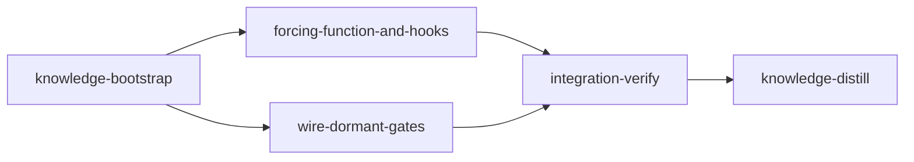

# Plan: Anti-Slop Thoroughness — Forcing-Function + Repair Existing Gates

## Overview

Stop loom-driven agents from producing apologise-after-the-fact slop ("areas left
untouched", "I guessed, should have checked"). loom's thoroughness guidance is
aspirational prose that isn't enforced and isn't re-asserted after a context reset, so
agents drift. This plan (1) adds a **forcing-function** — an "understand-first" ladder +
a banned-excuses list — to both `CLAUDE.md.template` and the prompts loom generates, and
(2) **repairs three existing loom mechanisms that are present but broken** so the
guidance actually bites: the dead post-compaction reminder, dormant `before_stage`
checks, and dormant `code_review` dimensions.

Guiding principle: **understand and fix what loom already has; do not duplicate it.**
loom already has a handoff mechanism (we reuse it) and already has `before_stage` /
`code_review` schema (we wire it, rather than inventing new gates).

## Goals

- Add a forcing-function (ladder + banned-list, no persona) to the static template and
  the four generated signal prefixes via one shared helper.
- Make knowledge-bootstrap demand an *exhaustive* codebase map.
- Revive the dead post-compaction reminder via `SessionStart(source=compact)` so the
  agent re-reads the handoff it already has (no new re-anchoring mechanism).
- Wire the dormant `before_stage` checks so `loom knowledge check` can gate
  "understand-first".
- Wire the dormant `code_review` dimensions so a duplication/reuse review reaches the
  integration-verify agent.

**Non-goals / explicitly out of scope:** no persona one-liner; no persistent `loom:`
code comments or assumption-harvest (rejected — leaves cleanup we can't guarantee;
agents use `loom memory` instead); no new re-anchoring mechanism; no anti-slop in the
conflict-resolution signals (deliberately narrow scope).

**Verification reality:** changes to loom's own orchestration code (signal generation,
`before_stage` execution, `code_review` consumption, hooks) do NOT take effect for the
`loom run` executing this plan — the daemon uses the installed binary. So these are
verified by **in-tree `cargo` tests**; live confirmation (e.g. the compaction digest
actually firing) is a manual post-reinstall step, noted where relevant.

## Execution Diagram



The two implementation stages are **file-disjoint** and run in parallel:
`forcing-function-and-hooks` owns the template, the prose in `signals/cache.rs` +
`signals/format/sections.rs`, `commands/knowledge/bootstrap.rs`, and `hooks/`;
`wire-dormant-gates` owns `orchestrator/core/` (before_stage) and
`signals/generate.rs` (code_review) — and must NOT touch `cache.rs`/`sections.rs`.

---

## Stages

### 1. Knowledge Bootstrap (refresh for this plan's subsystems)

Knowledge exists; refresh/gap-fill the subsystems this plan touches so implementers
understand them: signal generation (`orchestrator/signals/`), hook lifecycle
(`hooks/` + `fs/permissions/`), the dormant schema (`before_stage`/`code_review` in
`plan/schema` + `models/stage`), and the stage-spawn flow (`orchestrator/core/`).

### 2. Forcing-function + hooks (sonnet, 4 parallel subagents)

Add the ladder + banned-list to the template and the four generated prefixes (one shared
helper), strengthen bootstrap to demand an exhaustive map, and revive the dead
post-compaction reminder via SessionStart. All file-disjoint — four subagents.

### 3. Wire dormant gates (opus — architectural)

Repair two parsed-but-never-run schema surfaces: execute `before_stage` checks at stage
spawn (reusing the existing truth-check runner), and consume `code_review` dimensions in
signal generation so they reach the integration-verify agent.

### 4. Integration Verification

Build/test/clippy, code review, and confirm the new behaviors via in-tree tests (live
behavior requires reinstall — out of scope to run here). Dogfoods the new `code_review`
duplication dimension on itself.

### 5. Knowledge Distillation

Curate stage memories into knowledge; update `README.md`/`CONTRIBUTING.md` for the new
guidance + revived gates.

---

<!-- loom METADATA -->

```yaml
loom:
  version: 1
  sandbox:
    enabled: true
    auto_allow: true
    excluded_commands:
      - "loom"
    filesystem:
      deny_read:
        - "~/.ssh/**"
        - "~/.aws/**"
        - "~/.config/gcloud/**"
        - "~/.gnupg/**"
    network:
      allowed_domains:
        - "crates.io"
        - "static.crates.io"
        - "index.crates.io"
        - "github.com"
      allow_local_binding: false
      allow_unix_sockets: []
  stages:
    - id: knowledge-bootstrap
      name: "Bootstrap Knowledge (plan subsystems)"
      stage_type: knowledge
      model: "sonnet"
      reasoning_effort: "high"
      description: |
        Knowledge already exists; refresh and gap-fill the subsystems this plan touches
        so implementation agents fully understand them before acting.

        Use parallel subagents and skills to maximize performance.

        Step 0 - CHECK EXISTING KNOWLEDGE:
          Run: loom knowledge check
          If coverage is low or architecture is INCOMPLETE for the areas below, run:
          loom map --deep

        Step 1 - PARALLEL EXPLORATION (spawn Explore subagents in ONE message):
          Subagent 1 - Signal generation: how orchestrator/signals/ builds agent
            prompts. Map: the four stable-prefix generators in
            loom/src/orchestrator/signals/cache.rs (generate_stable_prefix:174,
            generate_integration_verify_stable_prefix:313,
            generate_knowledge_distill_stable_prefix:447,
            generate_knowledge_stable_prefix:527), the shared append_* helpers
            (cache.rs:51-169), the semi-stable section in
            loom/src/orchestrator/signals/format/sections.rs, the per-session assembler
            loom/src/orchestrator/signals/generate.rs, and the recovery signal in
            recovery_format.rs. Output: loom knowledge update architecture/entry-points.
          Subagent 2 - Hook lifecycle: how hooks are generated, embedded, and fired.
            Map: hooks/*.sh (especially session-start.sh, pre-compact.sh,
            post-tool-use.sh), embedding in loom/src/fs/permissions/constants.rs, and
            registration in loom/src/hooks/config.rs + loom/src/fs/permissions/hooks.rs.
            Note which LOOM_* env vars reach hooks. Output: loom knowledge update.
          Subagent 3 - Dormant schema + spawn flow: the before_stage/after_stage and
            code_review fields. Map: TruthCheck (loom/src/models/stage/types.rs:280-303),
            StageDefinition before_stage/after_stage/code_review
            (loom/src/plan/schema/types.rs ~100-227), where after_stage runs today
            (loom/src/commands/stage/complete.rs:866-887), the truth-check runner
            (loom/src/verify/goal_backward/truths.rs:16-134), and the stage-spawn path
            in loom/src/orchestrator/core/stage_executor.rs. Confirm before_stage and
            code_review are parsed but never executed/consumed. Output: loom knowledge
            update concerns + architecture.

        Before completing, review doc/loom/knowledge/mistakes.md.

        MEMORY & KNOWLEDGE: record findings via loom knowledge update (this is a
        knowledge stage). NEVER use Claude Code auto-memory (~/.claude/projects/*/memory/).
      dependencies: []
      acceptance:
        - "loom knowledge check"
        - 'rg -q "## " doc/loom/knowledge/architecture.md'
        - 'rg -q "## " doc/loom/knowledge/entry-points.md'
      files:
        - "doc/loom/knowledge/**"
      working_dir: "."
      artifacts:
        - "doc/loom/knowledge/architecture.md"
        - "doc/loom/knowledge/entry-points.md"

    - id: forcing-function-and-hooks
      name: "Forcing-function + revive compaction reminder"
      stage_type: standard
      model: "sonnet"
      reasoning_effort: "high"
      description: |
        Add the anti-slop forcing-function to the static template and the generated
        signal prefixes, strengthen bootstrap mapping, and revive the dead
        post-compaction reminder. All four subagents own DISJOINT files.

        Use parallel subagents and skills to maximize performance.

        SUBAGENT FILE ASSIGNMENTS:
          Subagent 1 - Template (loom-software-engineer):
            Files Owned: CLAUDE.md.template
            Task: In Engineering Discipline A "Think Before Coding" (~lines 37-41),
              append, as plain prose (NO persona line):
              (a) an "UNDERSTAND-FIRST LADDER (before writing code)" numbered list:
                  1. Read doc/loom/knowledge/ fully; if absent/sparse for your area,
                     build it (loom knowledge bootstrap) BEFORE implementing.
                  2. Map the area: call paths, data flow, every caller/consumer; know
                     the blast radius.
                  3. Search for existing functions/utilities/patterns to REUSE first.
                  4. Only then implement — minimal and surgical.
                  5. Cannot verify a fact you rely on? Do NOT guess. Check it. If you
                     genuinely cannot (autonomous stage), record via loom memory
                     decision/note and proceed against the most defensible reading of
                     acceptance — never silently.
              (b) a "BANNED — self-reject and redo before reporting done:" list with the
                  literal phrases: "areas left untouched", "I guessed / should have
                  checked", "that is on me, I should have checked", and "reporting
                  unverified work as done".
              The block MUST contain the exact string: Understand before acting; do not guess.
              Add a one-line cross-reference from Critical Reminders (~line 557, reminder 7).
          Subagent 2 - Generated prefixes (loom-software-engineer):
            Files Owned: loom/src/orchestrator/signals/cache.rs,
              loom/src/orchestrator/signals/format/sections.rs,
              loom/src/orchestrator/signals/tests_cache.rs
            Files Read-Only: loom/src/orchestrator/signals/generate.rs
            Task:
              1. Add a shared helper fn append_anti_slop_guidance(content: &mut String)
                 to the "Shared content blocks" cluster (cache.rs:51-169), same builder
                 pattern as append_common_footer (cache.rs:127). Its text is the ladder +
                 banned-list and MUST contain the exact string:
                 Understand before acting; do not guess.
              2. Call it from ALL FOUR generators — generate_stable_prefix:174,
                 generate_integration_verify_stable_prefix:313,
                 generate_knowledge_distill_stable_prefix:447,
                 generate_knowledge_stable_prefix:527 — placed AFTER the execution-rules
                 intro and BEFORE the Delegation/Completion block. Do NOT place it before
                 a prefix's identity block (e.g. integration-verify "ZERO TOLERANCE").
              3. In generate_knowledge_stable_prefix "Your Mission" (~cache.rs:545-560),
                 change step 1 to demand EXHAUSTIVE mapping: "Exhaustively map the
                 codebase (hierarchically) — entry points, every module, data flow,
                 patterns, conventions; leave no major area unmapped."
              4. In sections.rs "Exploration Order" (~209-220) add a line: cover ALL
                 areas you touch — no sampling.
              5. Update tests: add asserts for the new substring to the four
                 *_contains_required_sections tests in cache.rs and the content test in
                 tests_cache.rs; keep existing asserts green.
              Do NOT edit generate.rs (owned by the parallel wire-dormant-gates stage).
          Subagent 3 - Bootstrap mapping prompts (loom-software-engineer):
            Files Owned: loom/src/commands/knowledge/bootstrap.rs
            Task: In build_system_prompt() (~103-128) and build_initial_prompt()
              (~131-146), require an EXHAUSTIVE map (every major component/module, full
              data flow, all entry points, blast radius of areas the plan will change) —
              "go beyond the auto loom map". Strengthen Agent 1 (Architecture) to
              "exhaustively map ALL components and their relationships" and the synthesis
              pass to confirm no major area was left unmapped.
          Subagent 4 - Compaction reminder (loom-software-engineer):
            Files Owned: hooks/session-start.sh, hooks/post-tool-use.sh,
              hooks/tests/session-start-compact.sh, hooks/tests/run-all.sh
            Task:
              1. In hooks/session-start.sh: keep the heartbeat write for all sources;
                 ADDITIONALLY parse the SessionStart stdin JSON for .source (use jq —
                 already used by other hooks; keep the existing stdin-drain/timeout
                 guard) and, when .source is "compact" or "resume", emit a
                 hookSpecificOutput.additionalContext JSON on stdout (precedent:
                 hooks/prefer-modern-tools.sh) containing a short re-anchor pointer:
                 re-read ${LOOM_WORK_DIR}/signals/${LOOM_SESSION_ID}.md, run
                 "loom memory list", read the latest .work/handoffs/ file, and the line
                 "Understand before acting; do not guess." For startup/clear, emit nothing extra.
              2. In hooks/post-tool-use.sh: remove the now-dead compaction-recovery
                 stderr reminder branch (~lines 128-144) it replaces.
              3. Add hooks/tests/session-start-compact.sh: pipe {"source":"compact"} with
                 LOOM_WORK_DIR and LOOM_SESSION_ID set, assert the additionalContext +
                 the resolved signal path appear on stdout; register it in
                 hooks/tests/run-all.sh.

        NO FILE OVERLAP between subagents confirmed. NO overlap with wire-dormant-gates
        (which owns orchestrator/core/ and signals/generate.rs only).

        MEMORY RECORDING (use loom memory ONLY — never loom knowledge, never auto-memory):
        - MISTAKE: loom memory note "mistake: ... because ... fixed by ..."
        - DECISION: loom memory decision "..." --context "..."
        SUBAGENT MEMORY — include in every subagent prompt: record mistakes/decisions/
        surprises via loom memory; do NOT record procedural actions.
      dependencies: ["knowledge-bootstrap"]
      acceptance:
        - "cargo test --manifest-path loom/Cargo.toml"
        - "cargo clippy --manifest-path loom/Cargo.toml -- -D warnings"
        - 'rg -q "Understand before acting" CLAUDE.md.template'
        - 'rg -q "Understand before acting" loom/src/orchestrator/signals/cache.rs'
        - "bash hooks/tests/run-all.sh"
      files:
        - "CLAUDE.md.template"
        - "loom/src/orchestrator/signals/cache.rs"
        - "loom/src/orchestrator/signals/format/sections.rs"
        - "loom/src/orchestrator/signals/tests_cache.rs"
        - "loom/src/commands/knowledge/bootstrap.rs"
        - "hooks/**"
      working_dir: "."
      artifacts:
        - "CLAUDE.md.template"
        - "loom/src/orchestrator/signals/cache.rs"
        - "loom/src/commands/knowledge/bootstrap.rs"
        - "hooks/session-start.sh"
        - "hooks/tests/session-start-compact.sh"
      wiring:
        - source: "loom/src/orchestrator/signals/cache.rs"
          pattern: "append_anti_slop_guidance"
          description: "Anti-slop helper is defined and called by the prefix generators"
        - source: "hooks/session-start.sh"
          pattern: "compact"
          description: "session-start hook branches on the compaction source"

    - id: wire-dormant-gates
      name: "Repair before_stage + code_review (dead schema)"
      stage_type: standard
      model: "opus[1m]"
      reasoning_effort: "xhigh"
      description: |
        Two of loom's enforcement surfaces are parsed but never run. Wire both so the
        forcing-function can be enforced. This is architectural — it threads dormant
        config through orchestrator internals; make correct integration decisions and
        record them.

        Use parallel subagents and skills to maximize performance.

        IMPORTANT BOUNDARY: own ONLY loom/src/orchestrator/core/** (before_stage) and
        loom/src/orchestrator/signals/generate.rs (code_review). Do NOT edit cache.rs or
        format/sections.rs — they belong to the parallel forcing-function-and-hooks
        stage. If code_review rendering seems to belong in the stable prefix, instead
        render it in generate.rs (it is stage-specific/dynamic, not stable-cacheable).

        SUBAGENT FILE ASSIGNMENTS:
          Subagent 1 - Execute before_stage checks (loom-senior-software-engineer):
            Files Owned: loom/src/orchestrator/core/stage_executor.rs (and, only if
              strictly necessary, sibling files in loom/src/orchestrator/core/)
            Files Read-Only: loom/src/verify/goal_backward/truths.rs,
              loom/src/commands/stage/complete.rs (see how after_stage runs at 866-887),
              loom/src/plan/schema/types.rs, loom/src/models/stage/types.rs
            Task: before_stage checks (TruthCheck list) are defined but executed nowhere
              (only after_stage runs, at complete.rs:866-887). Run them at stage spawn:
              reuse verify::goal_backward::truths::verify_truth_checks (truths.rs:16-134),
              mirroring the after_stage call site, but BEFORE the session is spawned in
              the start/spawn path of stage_executor.rs. On any gap, do NOT spawn — hold
              the stage (transition to Blocked) with the gap message. Add unit tests
              proving a failing before_stage check blocks spawn and a passing one allows
              it (mirror the after_stage tests in loom/src/verify/before_after.rs).
          Subagent 2 - Consume code_review dimensions (loom-senior-software-engineer):
            Files Owned: loom/src/orchestrator/signals/generate.rs
            Files Read-Only: loom/src/plan/schema/types.rs (CodeReviewConfig ~100-115),
              loom/src/orchestrator/signals/cache.rs
            Task: StageDefinition.code_review (dimensions: Vec<String>, require_all) is
              parsed but never surfaced to the integration-verify agent. Thread it into
              signal generation and render a "## Review Dimensions" section into the
              integration-verify signal in generate.rs, honoring require_all (list each
              dimension as a checkbox the agent must address). Add a unit test asserting
              the rendered signal contains the configured dimensions and reflects
              require_all. If code_review must be threaded through an embedded-context
              struct, make that change in generate.rs's own types or signals/types.rs —
              NOT in cache.rs/sections.rs.

        NO FILE OVERLAP between subagents, and NONE with forcing-function-and-hooks.

        NOTE: these changes affect the loom binary, not the running daemon. Verify via
        cargo tests here; live effect requires a reinstall (out of scope).

        MEMORY RECORDING (loom memory ONLY — never loom knowledge, never auto-memory):
        - DECISION: loom memory decision "where before_stage runs / how code_review is
          threaded" --context "why"
        - GOTCHA: loom memory note "gotcha: ..."
        SUBAGENT MEMORY — include in both subagent prompts.
      dependencies: ["knowledge-bootstrap"]
      acceptance:
        - "cargo test --manifest-path loom/Cargo.toml"
        - "cargo clippy --manifest-path loom/Cargo.toml -- -D warnings"
      files:
        - "loom/src/orchestrator/core/**"
        - "loom/src/orchestrator/signals/generate.rs"
      working_dir: "."
      artifacts:
        - "loom/src/orchestrator/core/stage_executor.rs"
        - "loom/src/orchestrator/signals/generate.rs"
      wiring:
        - source: "loom/src/orchestrator/core/stage_executor.rs"
          pattern: "before_stage"
          description: "before_stage checks are executed in the stage-spawn path"
        - source: "loom/src/orchestrator/signals/generate.rs"
          pattern: "code_review"
          description: "code_review dimensions are consumed and rendered into the signal"

    - id: integration-verify
      name: "Integration Verification"
      stage_type: integration-verify
      model: "opus[1m]"
      reasoning_effort: "xhigh"
      description: |
        Final verification after both implementation stages merge.

        Use parallel subagents and skills to maximize performance.

        ⛔ NEVER use Claude Code's auto-memory (~/.claude/projects/*/memory/).
        ALL memory goes through loom memory.

        CONTEXT GATHERING (FIRST):
        - Read the plan file from doc/plans/ (check .work/config.toml for source_path)
        - Read ALL stage memories: loom memory show --all
        - Read doc/loom/knowledge/*.md for architecture context and known mistakes

        ⛔ ZERO TOLERANCE: fix ALL compiler warnings, clippy errors, test failures.
        Nothing is "pre-existing".

        BUILD & TEST:
        1. cargo test --manifest-path loom/Cargo.toml (full suite)
        2. cargo clippy --manifest-path loom/Cargo.toml -- -D warnings
        3. cargo build --manifest-path loom/Cargo.toml
        4. bash hooks/tests/run-all.sh

        CODE REVIEW (spawn parallel loom-code-reviewer subagents; fix all findings with
        loom-senior-software-engineer):
        5. duplication/reuse — did any change reinvent an existing utility? (dogfoods
           the new code_review dimension on this very stage)
        6. architecture/quality and security review of the hook + orchestrator changes

        FUNCTIONAL VERIFICATION (in-tree — live behavior needs reinstall, do NOT attempt
        a live compaction here):
        7. Confirm the anti-slop text reaches all four generated prefixes (the
           cache.rs *_contains_required_sections tests) and the template
           (rg "Understand before acting" CLAUDE.md.template).
        8. Confirm before_stage execution is covered by a test that blocks spawn on a
           failing check, and code_review rendering by a test asserting dimensions appear.
        9. Confirm hooks/tests/session-start-compact.sh passes.

        Record discoveries to loom memory for knowledge-distill. Do NOT use loom knowledge here.
      dependencies: ["forcing-function-and-hooks", "wire-dormant-gates"]
      acceptance:
        - "cargo test --manifest-path loom/Cargo.toml"
        - "cargo clippy --manifest-path loom/Cargo.toml -- -D warnings"
        - "cargo build --manifest-path loom/Cargo.toml"
        - "bash hooks/tests/run-all.sh"
        - 'rg -q "Understand before acting" CLAUDE.md.template'
        - 'rg -q "Understand before acting" loom/src/orchestrator/signals/cache.rs'
      code_review:
        require_all: true
        dimensions:
          - "duplication/reuse"
          - "architecture"
          - "security"
      working_dir: "."
      truths:
        - "cargo test --manifest-path loom/Cargo.toml"
      wiring:
        - source: "loom/src/orchestrator/core/stage_executor.rs"
          pattern: "before_stage"
          description: "before_stage execution merged and present"
        - source: "loom/src/orchestrator/signals/generate.rs"
          pattern: "code_review"
          description: "code_review consumption merged and present"

    - id: knowledge-distill
      name: "Knowledge Distillation"
      stage_type: knowledge-distill
      model: "sonnet"
      reasoning_effort: "high"
      description: |
        Curate stage memories into permanent knowledge and update user-facing docs.

        ⛔ NEVER use Claude Code's auto-memory (~/.claude/projects/*/memory/).

        CONTEXT GATHERING (FIRST):
        1. Read the plan file from doc/plans/ (check .work/config.toml for source_path)
        2. Read ALL stage memories: loom memory show --all
        3. Read doc/loom/knowledge/*.md

        MEMORY CURATION:
        4. Curate mistakes as actionable prevention rules (loom knowledge update mistakes).
        5. Record the two dead-schema findings in concerns.md: before_stage and
           code_review were parsed-but-unrun before this plan; note to flag any other
           parsed-but-unused schema. Also note the still-dead post-commit stderr
           reminder in post-tool-use.sh (separate follow-up).
        6. Curate the signal/hook architecture changes into architecture.md.
        7. Run: loom review; remove stale entries.

        DOCUMENTATION UPDATE (MANDATORY):
        8. Update README.md / CONTRIBUTING.md to reflect: the new anti-slop guidance,
           the revived before_stage gate (plans can now use before_stage checks), and
           code_review dimensions now being surfaced to integration-verify. Only update
           relevant sections — do NOT rewrite whole files. If no user-facing behavior
           changed for a doc, skip and record WHY in memory.
      dependencies: ["integration-verify"]
      acceptance:
        - 'rg -q "## " doc/loom/knowledge/architecture.md'
        - 'rg -q "## " doc/loom/knowledge/concerns.md'
      files:
        - "doc/loom/knowledge/**"
        - "README.md"
        - "CONTRIBUTING.md"
      working_dir: "."
```

<!-- END loom METADATA -->
