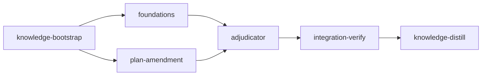

# Plan: Autonomous Criteria Adjudication

## Overview

Loom today has two escape hatches when acceptance criteria can't be satisfied — `loom stage complete --no-verify` (agent bypasses criteria with no audit) and `loom stage dispute-criteria` (transitions to `NeedsHumanReview`, a human-only terminal). Neither delivers software autonomously when the criteria themselves are wrong (typo'd paths, stale assertions, environmental mismatches). This plan installs an autonomous adjudication layer between dispute and completion.

The shape: all verification bypasses (`--no-verify`, `--force-unsafe`, `--assume-merged`) are gated behind an RPC capability check against an admin token stored OUTSIDE `.work/` (in a host-only daemon-runtime directory unreachable from any container mount). Agents _can_ dispute via a structured evidence schema (criterion index, failure output, agent's reasoning, commit SHA of the work the agent thinks satisfies intent). Disputes are submitted via the existing daemon RPC channel — the daemon writes the request file, NOT the agent — so the trust boundary between request and verdict is filesystem-enforced. The daemon adjudicates by a **synchronous Anthropic API call** from a worker thread — no spawned Claude Code session, no terminal, no orchestrator dispatcher changes. The adjudicator receives the dispute payload + plan + criterion + agent's diff inline in a single message and returns a structured verdict (validated by JSON schema). Verdicts include **citations** (specific file:line evidence supporting the verdict) — if the adjudicator cannot cite, it must demand more evidence rather than guess. Verdicts route through three buckets: `accept` amends the plan AND the stage file then re-queues the stage; `reject` re-queues with rejection feedback in the agent's next signal; `needs_more_evidence` re-queues the agent with specific questions (capped at 2 rounds before escalation to `NeedsHumanReview`). Each dispute lives in a per-id directory `.work/disputes/<stage>/<n>/` with separate request.md (agent-attestable), verdict.md (daemon-only), and applied.marker (daemon-only) files for offline audit.

## Goals

- Block agents from invoking `--no-verify` (admin-token capability gate; the existing `Capability::Admin` from harden-foundation is the mechanism)
- Replace dispute-criteria's "free-text reason → NeedsHumanReview" with a structured evidence payload persisted to `.work/disputes/<stage>/<n>/request.md` (agent-attestable, written by the daemon on behalf of the agent's RPC request)
- Introduce `StageStatus::NeedsAdjudication` as a non-terminal state with `NeedsHumanReview` reserved as the final fallback
- Adjudicate disputes via a synchronous Anthropic API call from a daemon worker thread (NOT a spawned session) — see Architectural Constraints for rationale
- Allow runtime plan amendment — but only of `acceptance` / `wiring` arrays on a single stage (the only two criterion arrays in `StageDefinition` — `loom/src/plan/schema/types.rs:316,336`), never structural changes (dependencies, DAG topology, stage IDs). Versioned with audit metadata. `before_stage` / `after_stage` (TruthCheck arrays) and `artifacts` (file-existence list) are deferred to v2 — they're amendable in principle but each carries semantic subtleties (delta-proof checks, file-existence guarantees) that v1 deliberately scopes out.
- Bound the loop: per-stage dispute budget (default 3); per-stage amendment cap (default 3 — absolute, not percentage); evidence-demand loop iterations capped at 2 before escalation

## Non-Goals

- Removing the human-review fallback entirely. `NeedsHumanReview` remains as the final terminal state for genuinely unresolvable disputes.
- Adjudicating non-criteria failures: real bugs, build failures, missing wiring, **environmental failures** (cargo missing in container, hook EROFS, wrong `working_dir`). The adjudicator amends ONLY the `acceptance` / `wiring` arrays of a single stage. Environmental failures are out of scope by design — they are solved architecturally elsewhere (e.g., stage 4 of container-security-hardening moves acceptance host-side).
- Plan structural amendments (changing dependencies, adding/removing stages, renaming IDs, changing `working_dir`, `model`, `sandbox`) — only criteria-array contents are amendable. The type system enforces this; see `AmendmentField` enum in Stage 3.
- Replacing `--no-verify` for human operators. The flag stays; only its capability gate changes.
- Spawning Claude Code sessions for adjudication. The adjudicator is a synchronous function call from a worker thread — no terminal, no spawn lifecycle, no orphan recovery for adjudicators.

## Architectural Constraints

**The adjudicator is a synchronous Anthropic API call, NOT a spawned session.** Reasons:

- Adjudication is a single-shot decision with all evidence inlined upfront. There is no iterative tool use, no follow-up tool calls, no shell access. A Claude Code instance is overkill.
- Loom's existing terminal backends spawn interactive terminal windows. A headless backend would be substantial new infrastructure for one consumer.
- Eliminates spawn lifecycle, orphan recovery, signal-template machinery, dispatcher trait changes, and the `loom stage adjudicate` external command surface — collapses ~6 implementation gaps in one move.
- `reqwest::blocking::Client` is already a dependency (used by `commands/self_update/client.rs`); `ANTHROPIC_API_KEY` is already known to the sandbox layer (`sandbox/settings.rs:20`). No new dependencies.

**Worker thread, not blocking the main loop.** Each `NeedsAdjudication` transition triggers `std::thread::spawn` of an adjudicator worker. The worker makes the blocking HTTP call (~30-90s of Claude latency), writes the verdict to `.work/disputes/<stage>/<n>/verdict.md`, and signals the orchestrator via an `mpsc::Sender<WorkerCompletion>`. The main loop polls verdict files on each tick (and drains the completion channel for thread joining) — same pattern as session-file polling. Worker crashes leave the dispute in `NeedsAdjudication` with no verdict; the `.inflight` marker has a timestamp so the main loop detects staleness (>10 minutes) and re-fires the worker, bounded by `adjudicator_attempt_count` (cap 3).

**Plan amendments edit the IN_PROGRESS plan file directly, with versioned snapshots.** No symlinks; no `current.md` pointer. The amendment flow:

1. Acquire `.work/plan_versions/.lock` (file lock; serializes all amendments)
2. Compute new plan content in memory
3. Atomic-write `.work/plan_versions/<n>.md` with the full new plan content (the snapshot)
4. Append to `.work/plan_versions/audit.md` (O_APPEND atomic for small rows)
5. Atomic temp+rename of the IN_PROGRESS plan file to the new content
6. Release lock

Recovery semantics: on daemon startup, scan audit.md for the latest amendment; verify the IN_PROGRESS file's content matches `<n>.md`. If mismatch, restore from `<n>.md` (treating the version file as the authoritative state). If `<n>.md` is missing but audit shows it was written, treat as a crash between steps 3 and 4 — discard the audit row, leave plan as `<n-1>.md`'s state.

**The adjudicator is NOT in the plan DAG.** It's an out-of-band reaction to a dispute, not a stage. No `stage_type: adjudicator`. No user-declared adjudicator config in plans.

## Sandbox / Environment Assumptions

- **Network:** the daemon's adjudicator worker thread needs `api.anthropic.com` egress. The host daemon already has this allowlisted in the harden-foundation sandbox config; no new entries.
- **Build tools:** cargo (we're modifying loom itself; the host has it).
- **Sensitive deny:** standard — `~/.ssh`, `~/.aws`, `~/.gnupg`, `~/.config/gcloud`.
- **Adjudicator credential:** reads `ANTHROPIC_API_KEY` from the daemon's process environment (`std::env::var`). If absent at daemon startup, adjudication is permanently disabled for that daemon run. When a dispute fires under disabled adjudication, the daemon does NOT spawn a worker and does NOT write a `verdict.md` — it transitions the stage directly to `NeedsHumanReview` with `close_reason = "ANTHROPIC_API_KEY not set; adjudication disabled — apply your decision via 'loom stage human-review'"`. No verdict file means the file system reflects: "this dispute was never adjudicated." There is NO `NeedsHumanReview` variant on the `DisputeVerdict` enum — the state transition is the only human-review signal.

## Execution Diagram



`foundations` and `plan-amendment` are file-disjoint and run concurrently. `adjudicator` consumes the dispute schema (from foundations) and the amendment API (from plan-amendment).

---

## Stages

### 1. Knowledge Bootstrap

**Purpose:** Refresh knowledge before implementation. The orchestrator main loop, daemon RPC, signal-generator, plan-parser, and safe_fs surfaces are the load-bearing areas — they need up-to-date mappings in `architecture.md` and `entry-points.md` for the implementation subagents to navigate cleanly. (Stage 4 does NOT introduce a new session type — adjudication is a worker thread inside the daemon, not a spawned Claude Code session. The session-spawn machinery surface is unchanged.)

**Tasks:**

- Run `loom knowledge check` and `loom map --deep` if coverage is incomplete
- Re-map the orchestrator's main-loop tick sequence (`orchestrator/core/orchestrator.rs`) — Stage 4 inserts `check_pending_disputes` and `apply_pending_verdicts` between `sync_queued_status_to_files` and `spawn_merge_resolution_sessions`; locate the exact line numbers (they shift with refactors)
- Re-map the daemon RPC surface (`daemon/protocol.rs`, `daemon/server/*`) — Stage 2 adds `Request::DisputeCriteria` / `Response::DisputeCreated` and a server-side handler; document existing `Stop`-style capability checks for reuse
- Re-map the signal generator (`orchestrator/signals/generate.rs` — actual builders `generate_signal`, `generate_signal_with_skills`, `generate_signal_with_metrics`) — Stage 4 injects adjudicator-feedback content here
- Re-map the plan parser/schema/graph surface (`plan/parser/extraction.rs`, `plan/schema/types.rs`, `plan/graph/loader.rs`) — Stage 3 adds byte-range extraction and edits both plan file AND stage files; loader prefers `.work/stages/` over plan file (`graph/loader.rs:60-86`)
- Re-map the safe_fs surface (`fs/safe_fs.rs`) — Stage 3 adds new helpers; current `safe_create_new_in_workdir` has signature `(dirfd, relpath, content)` (no mode); document this so the new helpers use distinct names and don't change existing call sites
- Re-map work_dir helpers (`fs/work_dir.rs`, `fs/mod.rs::resolve_source_path`) — Stage 2/3 need symlink-safe `.work` resolution from worktrees; current API has `WorkDir::root()` + `project_root()` and module-level `resolve_source_path`, but NO `canonical_path()` — document what exists and what's missing
- Read existing mistakes.md and disputes-related entries; flag prior misadventures
- Identify all current writers of `.work/disputes/` (probably zero) and the existing `.work/handoffs/` pattern as a template for `.work/plan_versions/`

**Files:** `doc/loom/knowledge/**`

**Acceptance:** Coverage ≥ 50%, all four knowledge files (architecture, entry-points, patterns, conventions) have `##` sections.

---

### 2. Foundations (2 parallel subagents)

**Purpose:** Lock down `--no-verify` and replace dispute-criteria's free-text payload with structured evidence + a `NeedsAdjudication` state. File-disjoint between the two subagents.

**Dependencies:** knowledge-bootstrap

**Subagents:**

| Subagent                                                       | Files Owned (write)                                                                                                                                                                                                                                                                                                                                                                             | Files Read-Only                                                           |
| -------------------------------------------------------------- | ----------------------------------------------------------------------------------------------------------------------------------------------------------------------------------------------------------------------------------------------------------------------------------------------------------------------------------------------------------------------------------------------- | ------------------------------------------------------------------------- |
| A — Admin Token Gate (loom-software-engineer)                  | `loom/src/commands/stage/complete.rs`, `loom/src/commands/stage/knowledge_complete.rs`, `loom/src/commands/stage/tests/complete.rs`                                                                                                                                                                                                                                                             | `loom/src/daemon/server/client.rs`, `loom/src/daemon/server/lifecycle.rs` |
| B — Structured Dispute + State (loom-senior-software-engineer) | `loom/src/commands/stage/dispute_criteria.rs`, `loom/src/models/stage/types.rs`, `loom/src/models/stage/transitions.rs`, `loom/src/models/stage/methods.rs`, `loom/src/models/dispute.rs` (new), `loom/src/cli/types_stage.rs`, `loom/src/cli/dispatch.rs`, `loom/src/fs/work_dir.rs` (add BOTH `disputes_dir()` AND `plan_versions_dir()` helpers — stage 3 reads but doesn't write this file) | `loom/src/commands/stage/complete.rs`, `loom/src/parser/frontmatter.rs`   |

NO FILE OVERLAP between subagents confirmed.

#### Subagent A — Admin Token Gate on ALL Verification Bypasses

Today three flags can bypass verification or state-machine paths from any caller:

- `--no-verify` (`loom/src/commands/stage/complete.rs:323`, `knowledge_complete.rs:32`)
- `--force-unsafe` (`complete.rs:116, 184, 204, 360, 370, 507`; `knowledge_complete.rs:44`)
- `--assume-merged` (paired with `--force-unsafe` at `complete.rs:184`)

Stage agents inside containers have `user.token`; the operator has `admin.token`. All three flags must require admin capability. Limiting the gate to `--no-verify` (as the v1 review caught) leaves `--force-unsafe` as an open bypass with strictly larger effect.

**Admin proof — what NOT to do.** The earlier draft said "token presence is sufficient because containers can't mount `admin.token`." That assumption is wrong:

- Normal containerized stages mount `/repo` ro (`orchestrator/terminal/container/mod.rs:281`); `/repo/.work/admin.token` is therefore visible inside the container as a readable file
- `admin.token` mode is `0600` on the host (`daemon/server/lifecycle.rs:179`), but the loom container user runs at UID 1000 by default (matching the host operator's typical UID), so mode bits do NOT prevent the agent from reading it
- Mere file-presence checking is therefore NOT a capability boundary; an agent that can read the file (or just `stat` it) trivially satisfies the check

**Admin proof — the actual mechanism.** Use RPC challenge against an _un-mounted_ host-only token file. Specifically:

1. Move `admin.token` OUT of `.work/` and into a daemon-only location that the container mount layer never touches. Proposed path: `$XDG_RUNTIME_DIR/loom/admin.token` (Linux) / `~/Library/Application Support/loom/admin.token` (macOS), mode 0600, created at daemon start.
2. **Update `daemon/server/lifecycle.rs:170-180`** to write `admin.token` to the new path; update the container mount layer to confirm the new path is NOT mountable into containers (it's outside the project root and outside `.work`).
3. **CLI-side proof:** `loom stage complete --no-verify` (or `--force-unsafe`) reads the token from the new path and sends it to the daemon via an RPC capability check (`verify_for_capability(work_dir, &token, Capability::Admin)`) — same pattern as `Stop`. The CLI bails if the file is unreadable.
4. **Container-side rejection:** if the CLI is invoked from inside a container, the new path doesn't exist there, so `read_admin_token` returns `None` and the operation is rejected. (We may also probe `/proc/1/cgroup` to detect "running inside container" for a clearer error message — but the path-unreachable check is the actual security boundary, not the cgroup heuristic.)

This is a structural change with scope beyond just the CLI gate — it touches the daemon's token-writing logic AND the container mount layer. A new subagent assignment is needed:

**Revised Subagent A scope** (files owned):

- `loom/src/commands/stage/complete.rs` — gate all three flags
- `loom/src/commands/stage/knowledge_complete.rs` — gate all three flags
- `loom/src/commands/stage/tests/complete.rs` — tests for the new gates
- `loom/src/daemon/server/lifecycle.rs` — relocate admin.token write to host-only path
- `loom/src/daemon/server/client.rs` — add `read_admin_token_from_host_path()` helper and revise `token_path_for(Capability::Admin)`
- `loom/src/orchestrator/terminal/container/mod.rs` — add a build-time / spawn-time assertion that the admin token's host path is NOT in the mount list

**Implementation steps:**

1. Relocate `admin.token` (lifecycle.rs + client.rs). Path resolution: `dirs::runtime_dir().unwrap_or_else(|| dirs::data_dir().unwrap()).join("loom").join("admin.token")`. Mode 0600. Created at daemon start; deleted at daemon stop.
2. Add `require_admin_capability(work_dir) -> Result<()>` helper in `commands/stage/complete.rs` that:
   - Reads the token from the host-only path
   - On absent/unreadable: bail with `"--no-verify, --force-unsafe, and --assume-merged require the admin token from the host's daemon runtime directory. Agents inside containers cannot invoke these flags; use 'loom stage dispute-criteria' to request a criterion change."`
3. Call `require_admin_capability` at every CLI entry where `--no-verify`, `--force-unsafe`, or `--assume-merged` is true. In `complete.rs` that's the top of `execute()` after argument parsing, BEFORE `handle_force_unsafe_completion` (`complete.rs:79`) and BEFORE `run_acceptance_phase` (`complete.rs:442`). In `knowledge_complete.rs` that's the top of `execute()` (`knowledge_complete.rs:32`).
4. **Container-side guard in `container/mod.rs::build_mounts`** — add a debug assertion that no mount source contains the relocated admin token path. This prevents future refactors from accidentally re-exposing the token.
5. Tests in `commands/stage/tests/complete.rs`:
   - `no_verify_succeeds_with_admin_token_at_host_path`
   - `no_verify_rejected_when_admin_token_absent`
   - `force_unsafe_rejected_when_admin_token_absent`
   - `assume_merged_rejected_when_admin_token_absent`
   - `verify_path_succeeds_without_admin_token`
   - `container_mount_does_not_include_admin_token_host_path` (in `orchestrator/terminal/container/mod.rs` tests — Stage 1's knowledge-bootstrap should map this test location)
   - `cli_invoked_from_within_container_fails_admin_check` (simulate by setting the runtime-dir env var to a missing path)

**MEMORY RECORDING:**
⛔ NEVER use Claude Code's auto-memory (`~/.claude/projects/*/memory/`)
⛔ NEVER use `loom knowledge update` (reserved for knowledge-bootstrap/integration-verify/knowledge-distill)

- MISTAKE: `loom memory note "mistake: tried X, failed because Y, fixed by Z"`
- DECISION: `loom memory decision "chose X" --context "Y was worse because Z"`

#### Subagent B — Structured Dispute Schema + NeedsAdjudication State

Replace the current `dispute_criteria(stage_id, reason)` signature with a structured payload, **split persistence by authority** (agent-authored request vs. daemon-authored verdict and apply state), and introduce a new `StageStatus::NeedsAdjudication` variant that is non-terminal (transitions to `Queued` after adjudicator verdict applies, or to `NeedsHumanReview` when adjudication exhausts).

**Trust boundary — split file ownership.** If the agent can both file a dispute AND see the verdict get applied from the same file, the agent can pre-write a `verdict: Accept` block and `applied: false` and effectively self-approve. The original schema collapsed these into one file, which was a critical security gap. Split into:

| File             | Authority                                                                          | Contents                                                                                                                        | Where                                       |
| ---------------- | ---------------------------------------------------------------------------------- | ------------------------------------------------------------------------------------------------------------------------------- | ------------------------------------------- |
| `request.md`     | Agent-writable (via `loom stage dispute-criteria`)                                 | id, stage_id, criterion_index, reason, evidence_commit, failure_output, fix_attempts_at_dispute, created_at                     | `.work/disputes/<stage>/<n>/request.md`     |
| `verdict.md`     | Daemon-only (worker thread on host writes; container has no rw mount to this path) | verdict, citations, reasoning, plan_patch (Accept), questions (NeedsMoreEvidence), adjudicator_attempt_count, created_at, model | `.work/disputes/<stage>/<n>/verdict.md`     |
| `applied.marker` | Daemon-only (zero-byte file; written after side effects commit)                    | (none)                                                                                                                          | `.work/disputes/<stage>/<n>/applied.marker` |

**Container mount enforcement:** the disputes subtree is included in `.work` ro mount by default. The agent needs to WRITE `request.md` (and only that file). Either:

- Option A: mount `.work/disputes/<stage>/<n>/request.md` rw single-file (one entry per dispute) — but the dispute number isn't known at container spawn time. Hard.
- Option B: have `loom stage dispute-criteria` (running inside the container as a CLI process) send the request to the daemon via the existing client socket (`daemon/server/client.rs`). The daemon writes `request.md`. Container has NO rw mount to `.work/disputes/` at all. **This is the right answer** — same trust pattern as `loom memory note`, `loom stage complete`, etc.

So `dispute_criteria` becomes a thin client that sends a `DisputeRequest` RPC message; the daemon handler writes `request.md` and transitions the stage. The container's rw mount list (Stage 1 reviewed this for the harden-container-mod plan) does NOT need `.work/disputes/` rw.

**Dispute schema (new file `loom/src/models/dispute.rs`):**

pub struct DisputeRequest {
pub id: u32, // sequential within stage, starts at 1; daemon assigns
pub stage_id: String,
pub criterion_index: usize, // index into stage.acceptance
pub reason: String, // agent's argument
pub evidence_commit: Option<String>, // SHA of commit agent claims satisfies intent
pub failure_output: Option<String>, // last failure's stderr/stdout (truncated to 4KB)
pub fix_attempts_at_dispute: u32, // captured by daemon from current stage.fix_attempts
pub created_at: chrono::DateTime<chrono::Utc>,
}

pub struct DisputeVerdictRecord {
pub id: u32, // matches DisputeRequest.id
pub stage_id: String,
pub verdict: DisputeVerdict, // accept | reject | needs_more_evidence
pub adjudicator_attempt_count: u32, // increments each time worker fires (orphan recovery counter)
pub created_at: chrono::DateTime<chrono::Utc>,
pub model: String, // which Claude model produced this verdict
}

pub enum DisputeVerdict {
Accept {
plan_patch: PlanPatch, // typed, not raw JSON — see AmendmentField/AmendmentPatch in Stage 3
citations: Vec<Citation>, // REQUIRED — at least one; empty Vec is a schema-validation failure
reasoning: String,
},
Reject {
citations: Vec<Citation>, // REQUIRED — point at the part of the agent's diff that fails the criterion
reasoning: String,
},
NeedsMoreEvidence {
questions: Vec<String>, // non-empty
},
}

pub struct Citation {
pub file: String, // path relative to repo root
pub line: Option<u32>, // optional — file-level citation OK if line is genuinely irrelevant
pub excerpt: String, // 1-3 lines of literal content; reviewer's grep target
pub claim: String, // what this citation proves (e.g., "template emits ${GO_VERSION}, not the literal go1.23")
}

Notes on the schema:

- **No `confidence` field.** Self-reported confidence from LLMs is poorly calibrated. We use citations as a structural proxy: if the adjudicator can cite specific evidence, it's confident; if it can't, it MUST emit `NeedsMoreEvidence`. Empty `citations` on `Accept`/`Reject` is a schema-validation failure that gets coerced to `NeedsMoreEvidence` with the validation error as the question.
- **`PlanPatch` is typed.** No raw `serde_json::Value`. The adjudicator's output must shape-conform to `AmendmentField` + `AmendmentPatch` (defined in Stage 3). Schema mismatch → coerce to `NeedsMoreEvidence`.
- **The `applied.marker` file is the idempotency guard.** Apply state is signaled by the existence (not contents) of a zero-byte daemon-only file at `.work/disputes/<stage>/<n>/applied.marker`. Orchestrator checks `!applied_marker_exists()` before applying. `.applying` (also daemon-only) is created at the start of apply_verdict and removed last; recovery: if `.applying` exists but `applied.marker` doesn't, the previous attempt crashed — re-apply.
- **`adjudicator_attempt_count` tracks worker retries.** Lives in the daemon-only `verdict.md` (placeholder file with `verdict: None` and a count, written before the HTTP call) so it's persisted across worker crashes. The main loop's poll detects `verdict.md` with `verdict: None` AND no fresh `.inflight` marker, increments the count, and re-fires the worker. Cap at 3; after that, the daemon transitions the stage to `NeedsHumanReview` and writes a final verdict file with that count.

Serde frontmatter-style markdown (same pattern as `Stage` / `Session`). Parse helpers in `parser/frontmatter.rs` already work for any `Deserialize` type via `parse_from_markdown<T>`.

**State machine changes (`models/stage/types.rs`, `transitions.rs`, `methods.rs`):**

Add `StageStatus::NeedsAdjudication` between `Executing` and `NeedsHumanReview`. Valid transitions:

- `Executing` → `NeedsAdjudication` (when agent files dispute)
- `CompletedWithFailures` → `NeedsAdjudication` (when agent files dispute after failed acceptance)
- `NeedsAdjudication` → `Queued` (adjudicator emitted accept or reject, stage re-runs)
- `NeedsAdjudication` → `NeedsAdjudication` (adjudicator demanded more evidence; stays in state)
- `NeedsAdjudication` → `NeedsHumanReview` (adjudication exhausted: too many evidence-demand rounds OR per-stage dispute budget exceeded)

Add `try_request_adjudication(reason: String, criterion_index: usize)` method on `Stage`. Add `dispute_budget_exhausted(&self) -> bool` helper that returns true when `stage.dispute_count >= max_disputes_per_stage()` (default 3, configurable via `.work/config.toml::[adjudication].max_disputes_per_stage`).

Add the following fields to `Stage` struct:

- `pub dispute_count: u32` (default 0) — incremented each time a dispute is filed; never decremented
- `pub evidence_rounds: u32` (default 0) — incremented when adjudicator emits `NeedsMoreEvidence`; reset to 0 when a new dispute is filed (`try_request_adjudication`)
- `pub amendments_applied: u32` (default 0) — incremented each time an Accept verdict's plan patch lands; checked against `max_amendments_per_stage` (default 3)

**Dispute records are NOT embedded in the Stage struct** — they live exclusively in `.work/disputes/<stage_id>/<n>.md`. The stage just tracks counts. This avoids ballooning stage files with multi-KB failure-output blobs and keeps dispute history queryable as separate files.

**Command signature change (`commands/stage/dispute_criteria.rs`):**

Replace `pub fn dispute_criteria(stage_id: String, reason: String)` with:

pub fn dispute_criteria(
stage_id: String,
criterion_index: usize,
reason: String,
evidence_commit: Option<String>,
failure_output_path: Option<PathBuf>, // file containing captured stderr/stdout
) -> Result<()>

**Client-side body (the agent's CLI invocation):**

- Validate `criterion_index >= 0` locally for early-fail UX
- Read failure_output_path (if any), truncate to 4KB locally
- Send `DaemonRequest::DisputeCriteria { stage_id, criterion_index, reason, evidence_commit, failure_output }` over the daemon socket (existing client pattern from `loom memory note` / `loom stage complete`)
- Daemon's response is the assigned dispute ID (echoed for the user) or a structured error

**Daemon-side handler** (new RPC variant in `daemon/protocol.rs`; handler in `daemon/server/`):

- Acquire a per-stage dispute lock at `.work/disputes/<stage>/.lock` (flock, exclusive, blocking) — serializes the entire read-modify-write transaction so two concurrent disputes cannot allocate the same ID
- Load stage; validate `criterion_index < stage.acceptance.len()`; validate `!stage.dispute_budget_exhausted()`
- Compute next dispute id `n` by reading the directory listing of `.work/disputes/<stage>/`: `n = max(existing numeric subdir names) + 1` (defaults to 1 if empty). This is robust to crashes between stage-counter updates and file writes.
- Create dir `.work/disputes/<stage>/<n>/` via the new `safe_create_new_dir_in_workdir` (with `mkdirat` + `O_EXCL` semantics emulated by checking existence under the dirfd). If creation fails because the dir already exists, recompute `n` and retry; cap retries at 3.
- Construct `DisputeRequest` (with `id: n`, `created_at: Utc::now()`, etc.)
- Write `.work/disputes/<stage>/<n>/request.md` via `safe_create_new_in_workdir` (O_EXCL) so we never silently overwrite
- Increment `stage.dispute_count`; reset `stage.evidence_rounds = 0`; transition stage to `NeedsAdjudication`; save stage
- Release the dispute lock
- Return `Response::DisputeCreated { id: n }` to the client

If budget exhausted: bail with message pointing at `NeedsHumanReview` path.

**CLI surface (`cli/types_stage.rs`):**

Update `StageCommands::DisputeCriteria` variant to take `--criterion-index` (required), `--reason` (required), `--evidence-commit` (optional), `--failure-output` (optional path).

**fs/work_dir.rs:** add BOTH helpers in this stage (foundations owns the file):

- `disputes_dir(&self) -> PathBuf` returning `<work>/disputes`
- `plan_versions_dir(&self) -> PathBuf` returning `<work>/plan_versions` (used by Stage 3's plan-amendment module)

Mirror the `sessions_dir` / `handoffs_dir` pattern for both. Stage 3 reads `fs/work_dir.rs` to call these helpers but does NOT write to it.

**Tests in `dispute_criteria.rs`:**

- `dispute_persists_record_to_work_dir`
- `dispute_transitions_to_needs_adjudication`
- `dispute_rejects_when_budget_exhausted` (3 prior disputes → 4th errors out)
- `dispute_rejects_invalid_criterion_index`
- `dispute_with_failure_output_truncates_at_4kb`
- `dispute_resets_evidence_rounds_to_zero` (filing a new dispute clears the prior dispute's evidence-round count)

**MEMORY RECORDING:** same block as A.

#### Stage 2 Skill Hints

Subagent A: `loom-software-engineer` is fine — this is mechanical capability-gating. Use `/loom-rust`, `/loom-auth` (the auth skill covers token verification patterns) and `/loom-testing` for the new tests.

Subagent B: `loom-senior-software-engineer` because of the state machine + schema design judgment. Use `/loom-rust`, `/loom-serialization` (for the markdown-with-frontmatter pattern), `/loom-testing`.

#### Stage 2 Functional Verification (in the integration-verify stage)

- `loom stage complete --no-verify <id>` fails when run without admin.token
- `loom stage dispute-criteria <id> --criterion-index N --reason "..."` succeeds, writes `.work/disputes/<id>/1.md`, transitions stage to NeedsAdjudication
- `loom stage dispute-criteria` rejects 4th dispute when budget is 3

---

### 3. Plan Amendment Infrastructure

**Purpose:** Make plans mutable at runtime — but ONLY for `acceptance` / `wiring` array contents of a single stage, never structural changes. Versioned with audit trail; atomic apply with rollback.

⚠️ **Critical architectural decision:** Loom's graph loader prefers `.work/stages/<id>.md` files over the plan file when stage files exist (`loom/src/plan/graph/loader.rs:60-86`). The orchestrator's main loop syncs from those stage files each tick (`orchestrator/core/orchestrator.rs:274-281`, `recovery.rs:179-223`). **An amendment that only touches the plan file does not reach the running stage.** Therefore `apply_amendment` must update BOTH the plan-file snapshot AND the affected stage's `.work/stages/<n>-<id>.md` file. The plan-file edit preserves history and audit; the stage-file edit is what the runtime actually consumes. See implementation specifics below.

**Dependencies:** knowledge-bootstrap

**Model:** `opus` — this is architectural work. Plans were immutable invariant; making them mutable touches reload semantics, in-flight stage reconciliation, and concurrent-amendment serialization. Judgment required.

**Files:**

| Subagent                                                   | Files Owned (write)                                                                                                                                                                                                                                                                                      | Files Read-Only                                                                                                                                       |
| ---------------------------------------------------------- | -------------------------------------------------------------------------------------------------------------------------------------------------------------------------------------------------------------------------------------------------------------------------------------------------------- | ----------------------------------------------------------------------------------------------------------------------------------------------------- |
| Single agent (no parallel subagents — tight code coupling) | `loom/src/plan/amendment.rs` (new), `loom/src/plan/mod.rs`, `loom/src/plan/parser.rs`, `loom/src/plan/schema/types.rs`, `loom/src/orchestrator/core/persistence.rs`, `loom/src/plan/tests/amendment.rs` (new), `loom/tests/plan_amendment_integration.rs` (new — separate file-locking concurrency test) | `loom/src/orchestrator/core/orchestrator.rs`, `loom/src/orchestrator/core/recovery.rs`, `loom/src/fs/work_dir.rs` (read-only — foundations owns this) |

#### Amendment API

New module `loom/src/plan/amendment.rs`:

pub struct AmendmentRequest {
pub stage_id: String,
pub field: AmendmentField, // Acceptance | Wiring (v1 scope)
pub patch: AmendmentPatch, // Replace | Insert | Delete by index
pub reason: String,
pub dispute_id: u32,
}

pub enum AmendmentField { Acceptance, Wiring }
// NOTE: `truths` is NOT a field on StageDefinition (verify via
// `loom/src/plan/schema/types.rs:304-390`). TruthCheck is only used
// inside `AcceptanceCriterion::Extended`, `before_stage`, and
// `after_stage`. Deferring `BeforeStage` / `AfterStage` / `Artifacts`
// amendments to v2.

pub enum AmendmentPatch {
Replace { index: usize, new_value: serde_yaml::Value },
Insert { index: usize, new_value: serde_yaml::Value },
Delete { index: usize },
}

pub struct AmendmentResult {
pub version: u32,
pub plan_path: PathBuf, // path to the LIVE plan file (IN_PROGRESS-PLAN-\*.md)
pub snapshot_path: PathBuf, // .work/plan_versions/<n>.md
pub diff: String, // unified diff of YAML metadata block
}

pub fn apply_amendment(
plan_path: &Path, // IN_PROGRESS-PLAN-\*.md (live plan)
work_dir: &Path,
request: &AmendmentRequest,
) -> Result<AmendmentResult>;

pub fn verify_plan_versions_consistency(plan_path: &Path, work_dir: &Path) -> Result<()>;
// Called from Orchestrator::startup. Reconciles audit.md against snapshot
// files and the live plan file. See recovery semantics in Architectural
// Constraints.

**Implementation specifics:**

1. **Resolve the live plan path.** Read `.work/config.toml::source_path` (which tracks IN_PROGRESS / DONE renames; see `commands/init/mod.rs` for the pattern). Use that as `plan_path`. The amendment edits the live file directly; versioned snapshots in `.work/plan_versions/` are write-only history.
2. **Acquire the amendment lock.** Open `.work/plan_versions/.lock` with `flock` (exclusive, blocking). Hold for the duration of steps 3-10. This serializes all amendments AND prevents `Orchestrator::sync_graph_with_stage_files` from racing during the multi-file update.
3. **Load the plan** via `plan::parser::parse_plan(plan_path)`. Also load the target stage file from `.work/stages/<n>-<stage_id>.md` via existing `Persistence::load_stage` — we'll write back to it in step 9e.
4. **Validate the patch is criteria-only.** Already enforced by `AmendmentField` enum type. Belt-and-suspenders: assert the target field exists on the named stage.
5. **Validate the patch is structurally sound by deserializing into the actual schema types.** For Replace/Delete: `index < array.len()`. For Insert: `index <= array.len()`. The new value must deserialize into the existing Rust type for that field — do NOT hand-roll a simplified shape:
   - `Acceptance` items: `serde_yaml::from_value::<AcceptanceCriterion>(value)` must succeed. AcceptanceCriterion is `untagged` and accepts either `Simple(String)` or `Extended(TruthCheck)`; TruthCheck has `command: String`, `stdout_contains: Vec<String>`, `stdout_not_contains: Vec<String>`, `stderr_empty: Option<bool>`, `exit_code: Option<i32>`, `description: Option<String>` (`loom/src/plan/schema/types.rs:412-449`).
   - `Wiring` items: `serde_yaml::from_value::<WiringCheck>(value)` must succeed. (See `WiringCheck` in `loom/src/plan/schema/types.rs`.)
     Reject with `InvalidPatchValue` on mismatch.
6. **Per-stage amendment cap.** Read the target stage's `amendments_applied` field (added in Stage 2). If `>= max_amendments_per_stage()` (default 3, configurable via `.work/config.toml::[adjudication].max_amendments_per_stage`), return `Err(StageAmendmentCapExceeded)`. The orchestrator increments `amendments_applied` AFTER apply_amendment succeeds.
7. **Apply the patch in-memory** to BOTH a clone of the parsed plan AND a clone of the loaded stage definition (they hold the same field; both must change in lockstep).
8. **Serialize the amended plan markdown.** Use `serde_yaml::to_string` for the YAML block, then splice into the markdown's loom-METADATA block (the HTML-comment-delimited region — names escaped here so the plan validator's metadata-block scanner doesn't match this prose). Preserve the human-readable section byte-for-byte. **Requires new parser API** (see Implementation Step 0 below).
9. **Atomic write sequence:**
   a. Compute `n = previous_version + 1` (where `previous_version` = count of existing `.work/plan_versions/<k>.md` files; missing → 0).
   b. Write snapshot to `.work/plan_versions/<n>.md.tmp` via the new `safe_create_new_in_workdir` (O_EXCL), fsync, then `safe_rename_in_workdir` to `<n>.md` (atomic on same filesystem).
   c. Append to `.work/plan_versions/audit.md` via O_APPEND with a single `write_all` call (atomic for entries under PIPE_BUF / 4KB). Row format:
   | <n> | <iso8601 utc> | <stage_id> | <field> | <patch summary> | <dispute_id> | <reason oneliner> |
   d. **Write the new plan content** via the new `safe_replace_outside_workdir` helper (specified below): validates that the path is under the project root via the resolved `source_path`, opens the parent dir with `O_NOFOLLOW | O_DIRECTORY`, creates `<plan_path>.tmp` with `O_EXCL`, writes content, fsyncs file and parent dir, atomic-renames to the final name.
   e. **Write the updated stage file** at `.work/stages/<n>-<stage_id>.md` via existing `Persistence::save_stage` — this is what the runtime actually reads. The orchestrator's per-tick `sync_graph_with_stage_files` (`orchestrator/core/recovery.rs:179`) will pick up the new criteria on the next tick.
10. **Release the lock** by dropping the `flock`.
11. **Return `AmendmentResult`** with the snapshot path AND a unified diff of the YAML metadata block (for inclusion in the dispute record's audit trail).

**Implementation Step 0 (parser API additions required first):**
The current `extract_yaml_metadata` returns only a trimmed YAML String, not byte offsets (`loom/src/plan/parser/extraction.rs:27-61`). To preserve prose byte-for-byte, add:

pub struct ExtractedMetadata {
pub yaml: String, // existing return value
pub metadata_block_range: Range<usize>, // byte range of the loom-METADATA HTML-comment-delimited region
pub yaml_fence_range: Range<usize>, // byte range of the inner `yaml ...` fence
}
pub fn extract_yaml_metadata_with_ranges(content: &str) -> Result<ExtractedMetadata>;

`extract_yaml_metadata` becomes a thin shim returning `.yaml` only. New unit tests cover odd fence lengths (4 backticks), repeated `loom METADATA` strings in prose, and CRLF line endings.

**File ops helpers required (specified in Stage 3 — see "Safe FS helper additions" below):**

// EXISTING — keep signature unchanged (loom/src/fs/safe_fs.rs:338):
// pub fn safe_create_new_in_workdir(dirfd: RawFd, relpath: &Path, content: &[u8]) -> Result<()>;
// No mode argument. O_EXCL semantics. CALLERS pass relative path under dirfd.

// NEW — additive helpers with distinct names:
pub fn safe_create_new_dir_in_workdir(dirfd: RawFd, relpath: &Path, mode: u32) -> Result<()>;
// mkdirat under dirfd with O_EXCL semantics; fails with EEXIST if dir exists.

pub fn safe_rename_in_workdir(dirfd: RawFd, from: &Path, to: &Path) -> Result<()>;
// renameat2 under dirfd; both from and to are dirfd-relative.

// Outside .work tree (live plan file lives at <project_root>/<source_path>)
pub fn safe_replace_outside_workdir(target: &Path, project_root: &Path, content: &[u8]) -> Result<()>;
// Asserts target.starts_with(project_root); opens target.parent() with
// O_NOFOLLOW | O_DIRECTORY; creates "<target_name>.tmp" with O_EXCL;
// writes; fsync(file); fsync(dir); renameat(dir, ".tmp", dir, target_name).

**Worktree symlink handling.** Worktrees create `.work -> ../../.work` symlinks (`loom/src/git/worktree/settings.rs:19`); `safe_open_dirfd` refuses symlink bases by design (`loom/src/fs/safe_fs.rs:55`). When `dispute_criteria` or amendment code runs from a worktree, resolve the canonical project `.work` BEFORE calling `safe_open_dirfd`. The right primitives already exist in the codebase:

- `work_dir.root().canonicalize()` — works directly on the `WorkDir` (`loom/src/fs/work_dir.rs:331`)
- `fs::resolve_source_path(work_dir)` — for plan source path resolution (`loom/src/fs/mod.rs:101`)

There is NO `WorkDir::canonical_path()` — earlier drafts named a non-existent API. Use `work_dir.root().canonicalize()?` directly. Add a regression test in Stage 2: `dispute_criteria_works_from_a_worktree_symlinked_work`.

**Recovery semantics on daemon startup (`verify_plan_versions_consistency`):**

- If audit.md's latest row references version N but `<N>.md` is missing: crashed between 9a/9b and 9c. Discard the audit row (truncate audit.md to remove the orphaned row). Live plan and stage file are still at version N-1's state — no action needed.
- If `<N>.md` exists but audit.md doesn't reference N: crashed between 9b and 9c. Append the audit row from the snapshot's metadata header (each snapshot starts with a YAML comment containing the audit row's payload — implementer adds this).
- If `<N>.md` exists, audit row exists, but live plan file content matches `<N-1>.md` instead of `<N>.md`: crashed between 9c and 9d. Re-do step 9d (copy `<N>.md`'s content to plan_path via temp+rename).
- If `<plan_path>.tmp` exists: crashed mid-step-9d. Remove the .tmp file; check audit + snapshots; restore plan_path from the latest consistent snapshot.
- If `<N>.md` exists and live plan matches but the stage file `.work/stages/<n>-<stage_id>.md` doesn't reflect the amendment: crashed between 9d and 9e. Re-apply step 9e from the snapshot's stage definition.

#### Plan Reload — REMOVED FROM SCOPE

The previous version of this plan proposed `Orchestrator::reload_plan` to rebuild the in-memory `ExecutionGraph` from the amended plan file. **This is removed for v1** because:

1. `ExecutionGraph::StageNode` does not carry `wiring`, `artifacts`, `wiring_tests`, `dead_code_check`, `before_stage`, `after_stage`, sandbox, or model fields (`loom/src/plan/graph/nodes.rs:8-39`). A graph rebuild cannot adopt all amended fields.
2. The runtime source-of-truth is the stage file (`.work/stages/<n>-<id>.md`), not the graph (`loom/src/plan/graph/loader.rs:60-86`, `orchestrator/core/recovery.rs:179`). The graph holds DAG topology + minimal state; per-stage detail lives in stage files.

Instead, the amendment writes the updated stage file directly (step 9e above). The orchestrator's existing per-tick `sync_graph_with_stage_files` (`orchestrator/core/orchestrator.rs:274-281`) automatically picks up the new criteria. No reload API needed; no graph node expansion needed for v1.

**If v2 needs graph-level reload** (e.g., for sandbox/model amendments), expand `StageNode` first as a prerequisite — out of scope here.

#### Tests in `plan/tests/amendment.rs`

- `apply_replace_acceptance_succeeds_and_writes_snapshot`
- `apply_delete_acceptance_then_reload_orchestrator_sees_shorter_array`
- `apply_insert_wiring_succeeds`
- `amendment_field_enum_compile_blocks_dependencies_amendment` (negative test: type system rejection)
- `reject_amendment_when_per_stage_cap_exceeded` (absolute 3-amendment cap, not percentage)
- `reject_amendment_with_invalid_yaml_value_shape`
- `apply_amendment_preserves_human_readable_section_verbatim` (byte-for-byte equality on the non-YAML portion)
- `audit_log_appended_with_reason_dispute_id_and_diff`
- `recovery_handles_crash_between_snapshot_and_audit` (simulate by writing snapshot, calling `verify_plan_versions_consistency`, assert audit row is reconstructed)
- `recovery_handles_crash_between_audit_and_plan_swap` (simulate by writing snapshot + audit but not plan_path, assert recovery copies snapshot into plan_path)

#### Tests in `loom/tests/plan_amendment_integration.rs` (NEW separate integration-test file)

This file holds the file-locking-and-serialization tests that need real OS file locks. Kept out of `src/plan/tests/` to avoid the lib-test runner's working-directory constraints:

- `serial_amendments_under_lock_write_strictly_increasing_versions` (spawn two threads BOTH calling `apply_amendment`; assert version numbers are 1, 2 — not 1, 1; not failure on either)
- `concurrent_amendments_serialize_stage_file_writes` (start amendment in one thread; in another thread, read `.work/stages/<n>-<id>.md` AND wait on the lock; assert the reader observes either the pre- or post-amendment state, never a partial write)
- `audit_log_rows_appear_in_completion_order` (4 concurrent amendments → 4 rows, each version number unique)

**Functional verification (in integration-verify):**

- After an `apply_amendment` call, `loom plan verify <plan_path>` succeeds
- `.work/plan_versions/audit.md` contains a row for the amendment with the dispute_id and reason
- The target stage file `.work/stages/<n>-<id>.md` reflects the amended criteria immediately after `apply_amendment` returns (the runtime's `sync_graph_with_stage_files` picks it up on the next tick — no reload API)
- `verify_plan_versions_consistency` is wired into daemon startup (`orchestrator/core/orchestrator.rs::start` calls it before the main loop begins)

**MEMORY RECORDING:** same block as Stage 2 subagents.

**Skill hints:** `/loom-rust`, `/loom-serialization` (YAML round-trip is tricky), `/loom-concurrency` (file locking), `/loom-error-handling` (recovery semantics), `/loom-testing`.

---

### 4. Adjudicator

**Purpose:** Worker-thread-based adjudication: on each `NeedsAdjudication` transition, the orchestrator spawns a worker thread that issues a single synchronous Anthropic API call with all evidence inlined, parses the structured verdict, and writes it back to the dispute file. The orchestrator's main loop polls dispute files for new verdicts and applies them (with idempotency guards).

**Dependencies:** foundations, plan-amendment

**Model:** `opus` — architectural integration: HTTP client design, thread lifecycle, schema validation under adversarial-LLM-output assumptions, orchestrator state machine wiring, idempotent verdict application.

**Files owned (write):**

- `loom/src/orchestrator/adjudication/mod.rs` (new) — public API + main-loop hooks
- `loom/src/orchestrator/adjudication/client.rs` (new) — Anthropic HTTP client (reqwest::blocking)
- `loom/src/orchestrator/adjudication/prompt.rs` (new) — prompt template + evidence-bundling
- `loom/src/orchestrator/adjudication/verdict.rs` (new) — schema validation + coercion of malformed outputs
- `loom/src/orchestrator/adjudication/worker.rs` (new) — `std::thread::spawn` lifecycle
- `loom/src/orchestrator/adjudication/feedback.rs` (new) — feedback-file management for the agent's next signal
- `loom/src/orchestrator/adjudication/tests.rs` (new)
- `loom/tests/adjudication_e2e.rs` (new) — end-to-end test with mocked HTTP server
- `loom/src/orchestrator/core/orchestrator.rs` — additive main-loop hooks (`check_pending_disputes`, `apply_pending_verdicts`); no file overlap with stages 2 or 3
- `loom/src/orchestrator/signals/generate.rs` — extension to inject adjudicator feedback into stage signals. (`mod.rs` is module re-exports; the actual builders are `generate_signal` / `generate_signal_with_skills` / `generate_signal_with_metrics` in `generate.rs`.)

**Files read-only:**

- `loom/src/models/dispute.rs` (foundations owns)
- `loom/src/plan/amendment.rs` (plan-amendment owns)
- `loom/src/models/stage/**` (foundations owns the new fields)
- `loom/src/fs/work_dir.rs` (foundations owns)

**NO new `SessionType::Adjudicator`.** No spawn-trait method. No `loom stage adjudicate` CLI command. The adjudicator is not a session.

#### Worker-thread lifecycle

// adjudication/worker.rs (sketch — implementer fills in)
pub fn spawn*worker(
work_dir: PathBuf,
plan_path: PathBuf,
stage: Stage,
request: DisputeRequest,
api_key: String,
cancellation: Arc<AtomicBool>,
done_tx: mpsc::Sender<WorkerCompletion>, // see Cancellation/shutdown below
) -> JoinHandle<()> {
thread::spawn(move || {
// 1. Write .work/disputes/<stage>/<n>/.inflight with timestamp + worker ID
// (atomic O_EXCL create). If the file already exists with a RECENT
// timestamp, another worker is in progress — exit immediately.
// If it exists but is STALE (age > INFLIGHT_TIMEOUT), the orchestrator
// has already removed it before respawning, so we should never see this
// branch — but defensively remove + recreate it.
let \_guard = InflightGuard::new(&work_dir, &request, std::process::id())?;
// 2. Bundle evidence into a single prompt.
let prompt = prompt::build(&plan_path, &stage, &request, &work_dir)?;
// 3. Synchronous HTTP call (~30-90s). Cancellation is via reqwest's
// 300s read timeout AND a 1s ping-poll on the AtomicBool between
// request-send and response-headers (cooperative; see client.rs).
let raw = client::call_anthropic(&api_key, &prompt, &cancellation)?;
// 4. Parse + validate; coerce malformed to NeedsMoreEvidence.
let verdict = verdict::parse_and_validate(&raw);
// 5. Persist verdict.md (daemon-authored, O_EXCL create) + appended
// audit row. The orchestrator's apply_pending_verdicts will see it
// on the next tick.
dispute::persist_verdict(&work_dir, &request, &verdict)?;
// 6. Notify done_tx (so orchestrator can drop the JoinHandle).
// \_guard dropped → .inflight removed.
let* = done_tx.send(WorkerCompletion { request_id: request.id, stage_id: stage.id.clone() });
})
}

**Stale .inflight recovery (H12).** `InflightGuard::new` and the orchestrator's poll BOTH check the marker's age:

// .work/disputes/<stage>/<n>/.inflight contents:
// <unix_timestamp> <worker_pid>
// Format is human-readable; daemon may inspect via `cat` for debugging.

const INFLIGHT_TIMEOUT: Duration = Duration::from_secs(10 \* 60); // 10 minutes; HTTP call is <5 min + safety margin

fn is_inflight_active(marker_path) -> bool {
let (ts, pid) = parse_marker(marker_path)?;
let age = Utc::now() - ts;
if age > INFLIGHT_TIMEOUT { return false; } // stale; ignore
// Optional: check pid is still alive (kill -0). If our worker registry
// has the JoinHandle, that's an even better signal.
true
}

`check_pending_disputes` removes stale .inflight markers before re-spawning. This prevents the deadlock the review identified.

**Cancellation & shutdown (H14).** The orchestrator owns a worker registry:

// orchestrator/core/orchestrator.rs additions:
struct AdjudicatorRegistry {
handles: HashMap<(StageId, DisputeId), JoinHandle<()>>,
cancel: Arc<AtomicBool>,
done_rx: mpsc::Receiver<WorkerCompletion>,
done_tx: mpsc::Sender<WorkerCompletion>,
}
impl Orchestrator {
adjudicators: AdjudicatorRegistry,
}

When a worker is spawned, its `JoinHandle` is stored in the map. On each main-loop tick, drain `done_rx` and `.join()` finished handles (non-blocking since they've signaled). On daemon shutdown:

fn shutdown*adjudicators(&mut self, deadline: Instant) {
self.adjudicators.cancel.store(true, Ordering::SeqCst);
// Drain done_rx then poll-join with a deadline. Workers
// observe `cancel` and exit at the next HTTP-poll boundary
// (typically <1s).
while Instant::now() < deadline && !self.adjudicators.handles.is_empty() {
// Check done_rx with a short timeout
if let Ok(completion) = self.adjudicators.done_rx.recv_timeout(Duration::from_millis(100)) {
if let Some(handle) = self.adjudicators.handles.remove(&(completion.stage_id, completion.request_id)) {
let* = handle.join();
}
}
}
// After deadline: orphaned workers will exit on their own when their
// reqwest call returns or times out. Their .inflight markers will go
// stale and be cleaned up by the next daemon start.
}

This replaces the earlier "join_timeout(5s)" hand-wave with a real channel-based cooperative shutdown. `std::thread::JoinHandle` has no native timeout-join; we use the channel completion signal as the timeout primitive.

**Main loop polling (H15 — corrected insertion point):**

The orchestrator main loop's per-tick sequence is (see `orchestrator/core/orchestrator.rs:258-281` and successors):

1. `reconcile_and_update_graph()` (~line 267)
2. `sync_graph_with_stage_files()` (~line 273)
3. `sync_queued_status_to_files()` (~line 281)
4. `spawn_merge_resolution_sessions()` (~line 285 ish)
5. `start_ready_stages()` (~line 300 ish)

`recover_orphaned_sessions()` runs ONCE _before_ the loop (`~line 231`), not per-tick — the v1 plan's "after recover_orphaned_sessions each tick" instruction was wrong (Stage 1's knowledge-bootstrap should confirm the exact line numbers from the live tree).

The two adjudication hooks insert per-tick:

- `check_pending_disputes(&mut self)` — AFTER `sync_queued_status_to_files()` and BEFORE `spawn_merge_resolution_sessions()`. We need synced stage state to know which stages are in `NeedsAdjudication`; we want to spawn workers BEFORE selecting which stages get a session slot this tick.
- `apply_pending_verdicts(&mut self)` — at the SAME insertion point, immediately AFTER `check_pending_disputes`. Applying a verdict may flip a stage to `Queued`; `spawn_merge_resolution_sessions` / `start_ready_stages` in the same tick can then pick it up.

The knowledge-bootstrap stage explicitly maps these line numbers — the implementer reads the current tree and inserts the calls at the correct sites, not at hand-coded lines.

// Sketch of the insertion in orchestrator.rs (line numbers are illustrative):
fn run_loop_tick(&mut self) -> Result<()> {
self.reconcile_and_update_graph()?;
self.sync_graph_with_stage_files()?;
self.sync_queued_status_to_files()?;
// NEW: adjudication
self.check_pending_disputes()?;
self.apply_pending_verdicts()?;
// existing
self.spawn_merge_resolution_sessions()?;
self.start_ready_stages()?;
Ok(())
}

`check_pending_disputes` and `apply_pending_verdicts` live in `orchestrator/adjudication/mod.rs` and are called as `Orchestrator` methods via a trait impl (matching the existing `Persistence` / `Recovery` pattern).

**API key absence — single canonical behavior (H13).** When the daemon starts without `ANTHROPIC_API_KEY`:

- Log a warning at INFO level: `"ANTHROPIC_API_KEY not set; adjudication disabled. Disputes will transition stages to NeedsHumanReview immediately."`
- Set `self.adjudicators.cancel.store(true, ...)` permanently — workers cannot spawn
- In `check_pending_disputes`: when adjudication is disabled, instead of spawning a worker, transition the disputed stage directly to `NeedsHumanReview` with `close_reason = "ANTHROPIC_API_KEY not configured; adjudication disabled"`. No verdict file is written.
- `DisputeVerdict` enum does NOT need a `NeedsHumanReview` variant. The state transition is what carries the human-review signal; verdict files exist only when adjudication actually ran.

#### Apply-verdict logic

The split-file model: `request.md` is the agent-attestable input,
`verdict.md` is the daemon-only adjudicator output, `applied.marker` is
the daemon-only applied-state signal. No `applied: bool` field
anywhere. Resolution of the live plan path goes through
`fs::resolve_source_path(work_dir)` (existing helper at
`loom/src/fs/mod.rs:101`), not a non-existent `self.plan_path`.

fn apply_verdict(&mut self, stage_id: &str, dispute_id: u32) -> Result<()> {
let dispute_dir = self.work_dir.join("disputes").join(stage_id).join(dispute_id.to_string());
let applied_marker = dispute_dir.join("applied.marker");

      // Idempotency: applied.marker existing is the signal.
      if applied_marker.exists() {
          return Ok(());
      }

      // Daemon-only apply guard: create .applying via safe_create_new_in_workdir
      // (O_EXCL → if another daemon iteration races, the second exits).
      let _applying = ApplyingGuard::new(&self.work_dir, stage_id, dispute_id)?;

      // Load request (agent-attestable) and verdict (daemon-authored).
      // Both files MUST exist before apply_verdict is invoked. If verdict.md
      // is missing or is a placeholder with `verdict: None`, this function
      // is being called from the wrong path — bail.
      let request = dispute::load_request(&self.work_dir, stage_id, dispute_id)?;
      let verdict_record = dispute::load_verdict(&self.work_dir, stage_id, dispute_id)?;
      let verdict = verdict_record.verdict;  // DisputeVerdict enum value

      let mut stage = self.load_stage(stage_id)?;
      // Resolve live plan path via existing helper, NOT self.plan_path.
      let plan_path = crate::fs::resolve_source_path(&self.work_dir)?
          .ok_or_else(|| anyhow!("no plan source_path in .work/config.toml"))?;

      let outcome: ApplyOutcome = match verdict {
          DisputeVerdict::Accept { plan_patch, citations: _, reasoning } => {
              let req = amendment::AmendmentRequest {
                  stage_id: stage_id.to_string(),
                  field: plan_patch.field,
                  patch: plan_patch.patch,
                  reason: reasoning.clone(),
                  dispute_id,
              };
              match amendment::apply_amendment(&plan_path, &self.work_dir, &req) {
                  Ok(result) => {
                      // apply_amendment writes the stage file in step 10
                      // (see Stage 3), so the runtime will see the new
                      // criteria on the next sync_graph_with_stage_files
                      // tick. No reload needed.
                      stage.amendments_applied = stage.amendments_applied.saturating_add(1);
                      stage.try_mark_queued()?;
                      stage.fix_attempts = 0;
                      stage.failure_info = None;
                      stage.close_reason = Some(format!(
                          "criterion amended via dispute #{} (v{}): {}",
                          dispute_id, result.version, reasoning
                      ));
                      ApplyOutcome::Amended { version: result.version }
                  }
                  Err(amendment::Error::StageAmendmentCapExceeded) => {
                      ApplyOutcome::Escalated { reason: format!(
                          "amendment cap exceeded on dispute #{dispute_id}"
                      )}
                  }
                  Err(e) => {
                      ApplyOutcome::Escalated { reason: format!("amendment failed: {e}") }
                  }
              }
          }
          DisputeVerdict::Reject { citations, reasoning } => {
              feedback::append_rejection(&self.work_dir, stage_id, &reasoning, &citations)?;
              stage.try_mark_queued()?;
              stage.fix_attempts = 0;
              ApplyOutcome::AgentRetry
          }
          DisputeVerdict::NeedsMoreEvidence { questions } => {
              stage.evidence_rounds = stage.evidence_rounds.saturating_add(1);
              if stage.evidence_rounds >= max_evidence_rounds() {
                  ApplyOutcome::Escalated { reason: format!(
                      "evidence-demand loop exhausted on dispute #{dispute_id}"
                  )}
              } else {
                  feedback::append_questions(&self.work_dir, stage_id, &questions)?;
                  stage.try_mark_queued()?;
                  ApplyOutcome::AgentRetry
              }
          }
      };

      // Apply the outcome to the stage state.
      match outcome {
          ApplyOutcome::Escalated { reason } => {
              stage.try_request_human_review(reason)?;
          }
          _ => {} // try_mark_queued already applied above
      }
      self.save_stage(&stage)?;

      // LAST: atomic-create applied.marker (O_EXCL zero-byte file).
      // This is the only persisted signal that apply_verdict completed.
      // If we crash before this, .applying exists; on next tick the
      // orchestrator sees .applying without applied.marker and re-runs
      // apply_verdict. The side effects are individually idempotent:
      //   - amendment applied: cap check + snapshot existence prevent
      //     double-amend (apply_amendment's own startup recovery catches
      //     "snapshot N exists but stage file is at N-1" and re-applies)
      //   - try_mark_queued: idempotent (Queued → Queued is a no-op)
      //   - feedback::append_*: idempotent if the same content is
      //     re-appended (deduplicate by dispute_id at read time, OR
      //     accept that re-runs may double-write — questions/rejection
      //     reads from the file have a unique-line stage filter)
      crate::fs::safe_fs::safe_create_new_in_workdir(
          self.work_dirfd,
          &applied_marker_relpath(stage_id, dispute_id),
          &[],
      )?;
      // _applying dropped → .applying removed.

      Ok(())

}

enum ApplyOutcome {
Amended { version: u32 },
AgentRetry,
Escalated { reason: String },
}

`max_amendments_per_stage()` and `max_evidence_rounds()` read from `.work/config.toml::[adjudication]` with defaults 3 and 2 respectively.

#### Prompt template (`adjudication/prompt.rs`)

The prompt is constructed dynamically per dispute. Body skeleton:

SYSTEM:
You are a criteria adjudicator. Your job is to decide whether ONE
specific acceptance criterion in a plan is mechanically wrong (typo,
stale path, wrong literal, wrong assertion shape) OR whether the agent's
code is wrong and they are asking you to weaken a valid criterion.

You will return a SINGLE JSON object matching the schema below. No prose
outside the JSON. No tool calls. No follow-up messages.

Schema (Rust types shown for clarity; emit JSON):
{
"verdict": "accept" | "reject" | "needs_more_evidence",
"reasoning": "<one paragraph>",
"citations": [
{
"file": "<repo-relative path>",
"line": <optional u32>,
"excerpt": "<1-3 lines of literal content>",
"claim": "<what this proves>"
}
],
"plan_patch": { // ONLY when verdict=accept
"field": "acceptance" | "wiring",
"patch": {
"op": "replace" | "insert" | "delete",
"index": <usize>,
"value": <yaml-shaped value>
// For "acceptance": either a plain string (Simple)
// OR an object matching TruthCheck shape:
// { command: <str>, stdout_contains?: [<str>...],
// stdout_not_contains?: [<str>...],
// stderr_empty?: <bool>, exit_code?: <int>,
// description?: <str> }
// For "wiring": object matching WiringCheck shape:
// { source: <str>, pattern: <str>, description: <str> }
}
},
"questions": ["..."] // ONLY when verdict=needs_more_evidence
}

RULES:

- CITATIONS ARE REQUIRED for accept and reject. At least one. Each must
  quote 1-3 lines of literal content from a file you reference. If you
  cannot cite, emit needs_more_evidence with specific questions.
- Accept ONLY when you can identify the specific mechanical defect:
  wrong path (cite: ls of the directory shows no such file), wrong
  literal (cite: grep of the source shows the actual literal), wrong
  flag (cite: man/help output for the tool).
- Reject when the criterion is mechanically sound and the agent's diff
  doesn't satisfy it. Cite the specific line of the agent's diff that
  fails to address the criterion's requirement.
- Never accept a dispute whose argument is "the test fails so the test
  must be wrong." That is the entropy ratchet this system exists to
  prevent.
- For wrong-path disputes, the cited evidence must be a directory
  listing or a `test -e` result showing the path doesn't exist.
- For wrong-literal disputes, the cited evidence must be the file
  content showing the actual literal.
- For agent-code-wrong disputes, cite the part of the agent's diff that
  fails the requirement.

USER:
PLAN (full content):

---

<full plan markdown, including all stages' YAML>

---

STAGE UNDER DISPUTE: <stage_id>
Stage definition (from plan):
<pretty-printed stage YAML>

DISPUTED CRITERION (index <N> in acceptance array):
<criterion text>

AGENT'S REASON:
<reason verbatim>

FAILURE OUTPUT (truncated to 4KB):
<stderr/stdout>

AGENT'S EVIDENCE COMMIT: <sha>
DIFF AT THAT COMMIT:

---

<git show output for the commit, full diff>

---

WORKTREE FILE LISTING (depth 3, types only — for path-validity checks):

---

<output of `find <worktree> -maxdepth 3 -type f -o -type d` reduced>

---

Return your verdict.

Prompt is built via `prompt::build(plan_path, &stage, &dispute, &work_dir) -> Result<String>`. The function reads the plan, the disputed stage, the dispute record, runs `git show <evidence_commit>` (read-only), and assembles the user message. ~10-50KB depending on plan size and diff size.

#### HTTP client (`adjudication/client.rs`)

pub fn call_anthropic(
api_key: &str,
prompt: &Prompt,
cancellation: &AtomicBool,
) -> Result<String> {
// POST <https://api.anthropic.com/v1/messages>
// Headers:
// x-api-key: <api_key>
// anthropic-version: 2023-06-01
// content-type: application/json
// Body:
// model: "claude-opus-4-8" (or whatever the current Opus model is)
// max_tokens: 4096
// system: <prompt.system>
// messages: [{role: "user", content: prompt.user}]
// temperature: 0.2
// Returns: raw text of response.content[0].text (the JSON verdict)
//
// Errors:
// - 401 (bad API key) → AdjudicationError::Auth
// - 429 (rate limit) → retry with backoff up to 3 times
// - 5xx → retry with backoff up to 3 times
// - timeout (300s) → AdjudicationError::Timeout
// - parse failure → propagate (caller coerces)
let client = reqwest::blocking::Client::builder()
.timeout(Duration::from_secs(300))
.build()?;
// ...
}

Reuses the `reqwest::blocking::Client` pattern already in `commands/self_update/client.rs`. Model ID is a constant `ADJUDICATOR_MODEL: &str = "claude-opus-4-8"` — bump when newer Opus ships; this is a configuration knob the human operator may want to override via `.work/config.toml::[adjudication].model`.

#### Verdict validator (`adjudication/verdict.rs`)

pub fn parse_and_validate(raw: &str) -> DisputeVerdict {
// 1. Parse as JSON; on failure → NeedsMoreEvidence { questions:
// vec!["Your response was not valid JSON. Re-emit a single JSON
      //         object matching the schema."] }
// 2. Validate the verdict variant.
// 3. For Accept/Reject: validate citations non-empty; each citation
// has non-empty file + non-empty excerpt + non-empty claim.
// Empty citations → coerce to NeedsMoreEvidence with question
// naming the specific schema violation.
// 4. For Accept: validate plan_patch shape (field is valid enum,
// patch.op is valid, index is non-negative, value is yaml-shape-
// compatible with field). Shape mismatch → coerce to
// NeedsMoreEvidence with question.
// 5. For NeedsMoreEvidence: validate questions is non-empty. Empty
// → coerce to AdjudicationFailure (escalate to human; this is a
// pathological LLM output).
}

The "coerce to NeedsMoreEvidence" pattern is the self-correction loop: bad output → demand more evidence with a specific question → adjudicator gets the schema feedback in the next round.

#### Feedback file management (`adjudication/feedback.rs`)

The agent's next stage signal must include the adjudicator's feedback (rejection text or evidence-demand questions). Feedback lives at `.work/disputes/<stage>/feedback.md` and is read by the existing signal generator (extended in this stage). Functions:

pub fn append_rejection(work_dir, stage_id, reasoning, citations) -> Result<()>;
pub fn append_questions(work_dir, stage_id, questions: &[String]) -> Result<()>;
pub fn read_feedback(work_dir, stage_id) -> Result<Option<String>>; // None if no feedback
pub fn clear_feedback(work_dir, stage_id) -> Result<()>; // called when stage transitions to Completed

Signal generator extension in `orchestrator/signals/generate.rs` — extend `generate_signal` (and its `with_skills` / `with_metrics` variants) so when generating a signal for a stage that has `dispute_count > 0`, the function reads `.work/disputes/<stage>/feedback.md` and appends:

## Adjudicator Feedback (from your prior dispute)

  <verbatim feedback content>

This is the only signal change. The rest of the signal stays as-is.

#### Tests in `adjudication/tests.rs`

- `prompt_builder_includes_plan_stage_dispute_evidence_diff_listing`
- `prompt_builder_caps_total_prompt_at_100kb` (truncate diffs / failure output if needed)
- `verdict_parser_round_trips_accept_with_citations`
- `verdict_parser_round_trips_reject_with_citations`
- `verdict_parser_round_trips_needs_more_evidence`
- `verdict_parser_coerces_invalid_json_to_needs_more_evidence`
- `verdict_parser_coerces_accept_without_citations_to_needs_more_evidence`
- `verdict_parser_coerces_accept_with_invalid_plan_patch_to_needs_more_evidence`
- `verdict_parser_coerces_empty_questions_to_human_review` (pathological LLM)
- `apply_verdict_accept_calls_amendment_and_increments_amendments_applied`
- `apply_verdict_accept_amendment_cap_exceeded_escalates_to_human_review`
- `apply_verdict_reject_appends_feedback_and_requeues`
- `apply_verdict_needs_more_evidence_increments_round_counter`
- `apply_verdict_evidence_rounds_exhausted_escalates_to_human_review`
- `apply_verdict_is_idempotent_when_applied_is_true` (call twice; second is no-op)
- `apply_verdict_after_crash_during_amendment_is_safe` (simulate crash: amendment applied but `dispute.applied=false`; re-run apply_verdict; verify no double-amendment)
- `feedback_appended_then_read_then_cleared`
- `signal_generator_injects_feedback_when_dispute_count_gt_zero`

#### Tests in `loom/tests/adjudication_e2e.rs` (NEW)

End-to-end with a **mock HTTP server** standing in for api.anthropic.com (using `wiremock` or `httpmock` crate; both are common Rust HTTP-mock libs — add as dev-dependency in `Cargo.toml`):

- `e2e_dispute_to_amendment_to_pass`: full loop with mocked Accept verdict; assert plan amended, stage re-runs, passes
- `e2e_dispute_to_reject_to_agent_retry`: mocked Reject verdict; assert feedback appended, stage re-queued, NO plan amendment
- `e2e_dispute_to_evidence_demand_to_second_dispute`: mocked NeedsMoreEvidence then mocked Accept on retry; assert evidence_rounds increments then resets correctly
- `e2e_dispute_budget_exhausted_escalates`: 4 disputes; 4th errors out before reaching HTTP layer
- `e2e_amendment_cap_exhausts_within_dispute_budget`: 3 disputes, each accepted; 4th amendment within budget but caps out; escalation
- `e2e_evidence_rounds_exhausted_escalates`: 3 mocked NeedsMoreEvidence in sequence; assert escalation to NeedsHumanReview after 2nd
- `e2e_anthropic_api_unavailable_escalates_after_worker_retries`: mock returns 500 thrice; worker exhausts retries; stage escalates
- `e2e_anthropic_api_key_missing_transitions_to_human_review_without_verdict`: unset ANTHROPIC_API_KEY before daemon start; file a dispute; assert NO worker spawned, NO `verdict.md` written, stage transitions directly to `NeedsHumanReview` with close_reason mentioning the missing key
- `e2e_idempotent_under_daemon_restart`: simulate daemon restart mid-apply; assert verdict is applied exactly once

#### Functional verification (in integration-verify)

The integration-verify stage runs the same e2e tests but checks they're integrated into the orchestrator's main loop (not just unit-callable). See Stage 5.

**MEMORY RECORDING:** same block.

**Skill hints:** `/loom-rust`, `/loom-event-driven` (the orchestrator's loop / state machine), `/loom-prompt-engineering` (signal design — adjudicator prompt has narrow scope rules), `/loom-testing`, `/loom-error-handling`.

---

### 5. Integration Verification

**Purpose:** Build / clippy / test the entire surface, run review subagents, AND execute the bad-criteria end-to-end smoke test that proves the system delivers software without human intervention.

**Dependencies:** adjudicator

**Tasks:**

_Context gathering (FIRST):_

- Read the plan file from `doc/plans/`
- Read all stage memories: `loom memory show --all`
- Read `doc/loom/knowledge/*.md` for architecture context

_Build & test (zero tolerance — fix every warning):_

- `cargo test` in `loom/` — all tests, not just affected
- `cargo clippy -- -D warnings` in `loom/`
- `cargo build` in `loom/`

_Code review (MANDATORY — parallel review subagents):_

- **Security review** (loom-code-reviewer + `/loom-security-audit`): The adjudicator runs host-side with rw access to plan files and `.work/plan_versions/`. Audit the trust boundary. Can a malicious stage agent forge a dispute that the adjudicator might honor? Can plan amendments escape the criteria-only constraint? Are dispute records / verdict files vulnerable to TOCTOU? Is the admin-token gate watertight?
- **Architecture review** (loom-code-reviewer): adjudicator worker-thread lifecycle (registry, cancellation channel, completion signaling) — is it consistent with the daemon's other long-running thread patterns? Are amendment writes thread-safe under concurrent disputes (single-writer via `.work/plan_versions/.lock`)? Are the state transitions on `NeedsAdjudication` sound? Is the per-stage dispute lock at `.work/disputes/<stage>/.lock` correctly serializing ID allocation?
- **Test coverage** (loom-code-reviewer): all the test names listed in stages 2/3/4 must exist and pass. Verify the bad-criteria end-to-end smoke test ACTUALLY exercises the path (no mocking the amendment step away).

Fix ALL issues found by reviewers using loom-senior-software-engineer or loom-software-engineer.

_Functional verification (CRITICAL — the autonomy proof):_

Build a deterministic end-to-end test that proves the system unsticks itself without human intervention:

1. **Construct a test plan** with a single stage whose acceptance is `["test -f intentionally_wrong_path/marker.txt"]`. The path doesn't and won't exist in the worktree.
2. **Initialize:** `loom init <test-plan>` in an isolated test workdir.
3. **Start the daemon with a mocked Anthropic endpoint.** The mock (wiremock or httpmock) responds to `POST /v1/messages` with a pre-canned `Accept` verdict whose `plan_patch` replaces `acceptance[0]` with `"true"`.
4. **Run the stage** to a `CompletedWithFailures` state (1 fix attempt).
5. **File a dispute** via `loom stage dispute-criteria <stage> --criterion-index 0 --reason "path 'intentionally_wrong_path/marker.txt' doesn't exist in the repo — criterion is mechanically wrong" --evidence-commit <head>`. The daemon allocates dispute id 1, writes `.work/disputes/<stage>/1/request.md`, transitions stage to NeedsAdjudication.
6. **Wait for the daemon's worker thread** to call the mocked endpoint, receive the canned verdict, validate it, and write `.work/disputes/<stage>/1/verdict.md`.
7. **Wait for the next main-loop tick** to call `apply_pending_verdicts`, which invokes `apply_amendment`. Stage 3's amendment writes `.work/plan_versions/1.md` (snapshot), appends to audit.md, atomic-renames the IN_PROGRESS plan file, and updates `.work/stages/<n>-<stage>.md`.
8. **Verify:** `.work/plan_versions/1.md` exists; audit has a row; live plan file's metadata reflects amendment; stage file's `acceptance[0]` is `"true"`; the stage re-runs (a fresh session is spawned with `fix_attempts=0`) and now passes; `applied.marker` exists at `.work/disputes/<stage>/1/applied.marker`.
9. **Dispute budget enforcement:** synthetic test with 4 disputes; the 4th fails with `dispute budget exhausted` (max_disputes_per_stage default 3); stage transitions to `NeedsHumanReview`.
10. **Amendment cap enforcement:** synthetic test with `max_amendments_per_stage=2` (override via test config). Two accepted amendments via mocked Accept; third dispute's Accept verdict triggers `StageAmendmentCapExceeded` in `apply_amendment` → `apply_verdict` escalates the stage to `NeedsHumanReview`.

NOTE: knowledge distillation and documentation updates are handled by `knowledge-distill`. Focus this stage on BUILD, CODE REVIEW, and FUNCTIONAL VERIFICATION. Record your own discoveries to `loom memory` so `knowledge-distill` can curate them.

**Files:** (no documentation changes — that's knowledge-distill)

**Acceptance:** see YAML for full list, including the e2e smoke test as a `cargo test adjudication::e2e::dispute_to_amendment_to_pass` invocation.

---

### 6. Knowledge Distillation

**Purpose:** Curate stage memories into permanent knowledge files; update user-facing documentation to reflect the new dispute / adjudication flow.

**Dependencies:** integration-verify

**Tasks:**

_Context gathering (FIRST):_

- Read the plan file from `doc/plans/`
- Read all stage memories: `loom memory show --all`
- Read `doc/loom/knowledge/*.md` for current state

_Memory curation:_

- Synthesize mistakes as actionable prevention rules → `loom knowledge update mistakes`
- Document the adjudicator pattern → `loom knowledge update patterns`
- Document the new state machine (`NeedsAdjudication` between `Executing` and `NeedsHumanReview`) → `loom knowledge update architecture`
- Document conventions for dispute record schema → `loom knowledge update conventions`

_Knowledge review:_

- `loom review`
- Remove stale entries about the old human-only dispute flow

_Documentation update (MANDATORY):_

- Update `README.md` and `CONTRIBUTING.md` to document the dispute flow from the agent's POV (when to dispute, what evidence to provide, what happens next)
- Update `doc/loom/knowledge/entry-points.md` with the new `loom stage dispute-criteria` signature (criterion-index, evidence-commit, failure-output flags)
- Document the ANTHROPIC_API_KEY requirement for the daemon when adjudication is enabled
- Add a short section to documentation explaining the adjudicator's trust model and the `.work/disputes/` / `.work/plan_versions/` audit trail
- Note: adjudication does NOT fix environmental failures (missing tooling, wrong working_dir) — those are out of scope by design

**Files:** `doc/loom/knowledge/**`, `README.md`, `CONTRIBUTING.md`

---

<!-- loom METADATA -->

```yaml
loom:
  version: 1
  sandbox:
    enabled: true
    auto_allow: true
    excluded_commands:
      - "loom"
    filesystem:
      deny_read:
        - "~/.ssh/**"
        - "~/.aws/**"
        - "~/.config/gcloud/**"
        - "~/.gnupg/**"
      deny_write:
        # .work/** is denied by default; no need to enumerate subtrees here.
        - "doc/loom/knowledge/**"
      allow_write:
        - "loom/src/**"
        - "loom/tests/**"
        - "doc/plans/**"
    network:
      allowed_domains:
        - "api.anthropic.com"
        - "crates.io"
        - "index.crates.io"
        - "static.crates.io"
        - "github.com"
        - "api.github.com"
        - "raw.githubusercontent.com"
      allow_local_binding: false
      allow_unix_sockets: []
  stages:
    - id: knowledge-bootstrap
      name: "Bootstrap Knowledge Base"
      stage_type: knowledge
      model: "sonnet"
      reasoning_effort: "high"
      description: |
        MANDATORY first stage. Read existing doc/loom/knowledge AND .work/memory files first.

        Use parallel subagents and skills to maximize performance.

        Step 0 — CHECK EXISTING KNOWLEDGE:
          Run: loom knowledge check
          Review output to identify gaps.

          IF coverage < 50% OR architecture shows INCOMPLETE:
            Run: loom map --deep

        Step 1 — TARGETED RE-MAP (load-bearing surfaces for this plan):
          - orchestrator/core/orchestrator.rs and persistence.rs — main
              loop polling cadence + plan loading (adjudicator hooks into
              the main loop; plan-amendment touches persistence/reload)
          - plan/parser.rs, plan/schema/, plan/graph/ — plan
              load/validate pipeline (amendment edits plan structure)
          - daemon/server/client.rs — admin/user token capability surface
              (already in place from harden-foundation)
          - commands/self_update/client.rs — existing reqwest::blocking
              pattern that the adjudicator HTTP client should mirror
          - sandbox/settings.rs:20 — ANTHROPIC_API_KEY filter (ensures
              env var stays in daemon and doesn't leak to agents)
          - hooks/post-tool-use.sh — pattern for atomic file marker
              creation (referenced by .inflight / .applying markers)

        Step 2 — PARALLEL EXPLORATION (Explore subagents for semantic gaps):
          Subagent 1 — Orchestrator main-loop polling:
            Map the main loop tick cadence in orchestrator.rs. Document
            where recover_orphaned_sessions / sync_graph_with_stage_files /
            spawn_ready_stages are invoked. The adjudicator's
            check_pending_disputes / apply_pending_verdicts need a stable
            slot in that sequence.

          Subagent 2 — Plan load + reload semantics:
            Map plan::parser::parse_plan and the ExecutionGraph build path.
            Document everywhere the plan is read; find every consumer of
            the in-memory plan (orchestrator, persistence, signal generator).
            Note: plans are CURRENTLY immutable post-load — that's the
            invariant we are deliberately relaxing.

          Subagent 3 — Dispute / human-review surface:
            Map dispute_criteria.rs, human_review.rs, NeedsHumanReview state.
            Find every reference to the current dispute flow. Document the
            existing fix_attempts counter and how it relates to the new
            dispute_count / evidence_rounds / amendments_applied fields.

          Subagent 4 — HTTP / sandbox audit:
            Map commands/self_update/client.rs (the reusable reqwest
            pattern). Document the existing ANTHROPIC_API_KEY filter in
            sandbox/settings.rs:20 and the network allowlist for
            api.anthropic.com from harden-foundation.

          Spawn these as parallel Task tool calls.

        CRITICAL: Use loom knowledge CLI commands, NOT Write/Edit tools.

        MEMORY & KNOWLEDGE RECORDING:
        - loom memory note for insights as you go
        - loom memory decision for non-obvious choices
        - loom knowledge update mistakes for errors made
        - Before completing: loom memory list (verify insights captured)

        ⛔ NEVER use Claude Code's auto-memory (~/.claude/projects/*/memory/).
      dependencies: []
      acceptance:
        - "loom knowledge check --min-coverage 50"
        - 'rg -q "## " doc/loom/knowledge/architecture.md'
        - 'rg -q "## " doc/loom/knowledge/entry-points.md'
        - 'rg -q "## " doc/loom/knowledge/patterns.md'
        - 'rg -q "## " doc/loom/knowledge/conventions.md'
      files:
        - "doc/loom/knowledge/**"
      working_dir: "."
      artifacts:
        - "doc/loom/knowledge/architecture.md"
        - "doc/loom/knowledge/entry-points.md"
        - "doc/loom/knowledge/patterns.md"
        - "doc/loom/knowledge/conventions.md"

    - id: foundations
      name: "Foundations: admin gate + structured dispute"
      stage_type: standard
      model: "opus"
      reasoning_effort: "xhigh"
      description: |
        Lock ALL verification bypasses (--no-verify, --force-unsafe,
        --assume-merged) behind an RPC capability check against an admin
        token stored OUTSIDE .work/. Replace dispute-criteria with a thin
        CLI client + daemon RPC handler; split dispute persistence into
        agent-attestable request.md + daemon-only verdict.md +
        applied.marker. Introduce StageStatus::NeedsAdjudication state.
        Two parallel subagents, file-disjoint.

        Use parallel subagents and skills to maximize performance.

        SUBAGENT FILE ASSIGNMENTS:
          Subagent A — Admin Capability Gate + Token Relocation
                       (loom-senior-software-engineer):
            Files Owned:
              loom/src/commands/stage/complete.rs
              loom/src/commands/stage/knowledge_complete.rs
              loom/src/commands/stage/tests/complete.rs
              loom/src/daemon/server/lifecycle.rs
              loom/src/daemon/server/client.rs
              loom/src/orchestrator/terminal/container/mod.rs
                                                       (additive: mount-list assertion only)
              loom/src/orchestrator/terminal/container/mod.rs tests
                                                       (additive)
            Files Read-Only:
              loom/src/orchestrator/terminal/container/lifecycle.rs
            Task (per Stage 2 Subagent A prose in human-readable section):
              1. Relocate admin.token OUT of .work/ to a host-only daemon-
                 runtime path. Path resolution:
                   dirs::runtime_dir()
                     .unwrap_or_else(|| dirs::data_dir().unwrap())
                     .join("loom")
                     .join("admin.token")
                 Mode 0o600. Created in `daemon/server/lifecycle.rs`
                 startup (currently writes to .work/admin.token at line
                 179). Deleted at daemon stop.
              2. Update `daemon/server/client.rs::token_path_for(Capability::Admin)`
                 to return the new path. user.token stays in .work as
                 today (user.token is supposed to be mounted into
                 containers — only admin.token must NOT be).
              3. Add `require_admin_capability(work_dir) -> Result<()>`
                 helper in `commands/stage/complete.rs`:
                   - reads the token from the host-only path via
                     `read_admin_token` (now reads from the new
                     location)
                   - bails on absent/unreadable with:
                     "--no-verify, --force-unsafe, and --assume-merged
                     require the admin token from the host's daemon
                     runtime directory. Agents inside containers cannot
                     invoke these flags; use 'loom stage dispute-criteria'
                     to request a criterion change."
              4. Call `require_admin_capability` at every CLI entry where
                 --no-verify, --force-unsafe, or --assume-merged is true:
                   - complete::execute (BEFORE handle_force_unsafe_completion
                     and BEFORE run_acceptance_phase)
                   - knowledge_complete::execute (top of execute when
                     no_verify true; force_unsafe handling is inside this
                     function — also gate it)
              5. Container-side guard in `container/mod.rs::build_mounts`:
                 add a debug assertion that no mount source contains the
                 relocated admin token path. Tests verify this guard.
              6. Add a TODO comment near the gate referencing the future
                 `Request::CompleteStageContainer` daemon RPC (stage 4 of
                 container-security-hardening plan) so that author wires
                 the same admin-capability check before honoring
                 no_verify / force_unsafe.
              Tests in tests/complete.rs (and container/mod.rs tests):
                - no_verify_succeeds_with_admin_token_at_host_path
                - no_verify_rejected_when_admin_token_absent
                - force_unsafe_rejected_when_admin_token_absent
                - assume_merged_rejected_when_admin_token_absent
                - verify_path_succeeds_without_admin_token
                - container_mount_does_not_include_admin_token_host_path
                  (in container/mod.rs::tests)
                - cli_invoked_from_within_container_fails_admin_check
                  (simulate by setting the runtime-dir env var to a
                  missing path)

          Subagent B — Structured Dispute (RPC) + NeedsAdjudication State
                       (loom-senior-software-engineer):
            Files Owned:
              loom/src/commands/stage/dispute_criteria.rs
              loom/src/models/stage/types.rs
              loom/src/models/stage/transitions.rs
              loom/src/models/stage/methods.rs
              loom/src/models/dispute.rs              (new file)
              loom/src/cli/types_stage.rs
              loom/src/cli/dispatch.rs
              loom/src/fs/work_dir.rs                  (adds BOTH disputes_dir AND plan_versions_dir helpers)
              loom/src/daemon/protocol.rs             (additive: new Request/Response variants)
              loom/src/daemon/server/dispute.rs       (new — daemon-side handler)
              loom/src/daemon/server/mod.rs           (additive: register handler)
              loom/src/daemon/server/client.rs        (additive: new client method send_dispute_criteria)
            Files Read-Only:
              loom/src/commands/stage/complete.rs
              loom/src/parser/frontmatter.rs
              loom/src/fs/safe_fs.rs                  (CALLS safe_create_new_in_workdir; uses existing signature)
            Task: implement everything described in the human-readable
            plan section for Stage 2 Subagent B:
              - Two distinct record types in loom/src/models/dispute.rs:
                  DisputeRequest {
                      id, stage_id, criterion_index, reason,
                      evidence_commit, failure_output,
                      fix_attempts_at_dispute, created_at
                  }
                  DisputeVerdictRecord {
                      id, stage_id, verdict, adjudicator_attempt_count,
                      created_at, model
                  }
                There is NO single DisputeRecord — request and verdict
                are PHYSICALLY SEPARATE files written by different
                authorities. There is NO `applied: bool` field — apply
                state is signaled by the existence of a daemon-only
                `applied.marker` zero-byte file at
                `.work/disputes/<stage>/<n>/applied.marker`.
              - DisputeVerdict enum: Accept { plan_patch, citations, reasoning },
                Reject { citations, reasoning }, NeedsMoreEvidence { questions }
                There is NO `NeedsHumanReview` verdict variant —
                missing-API-key and other escalations transition the
                STAGE to NeedsHumanReview directly without writing a
                verdict file.
              - Citation struct: file, line: Option<u32>, excerpt, claim
              - PlanPatch struct: forward-declares the AmendmentField +
                AmendmentPatch shape from Stage 3 (serde-untagged or
                pre-amendment placeholder; typed connection lands when
                Stage 3 merges).
              - NO `confidence` field — citations are the structural proxy
              - All Serialize + Deserialize via serde; markdown-frontmatter
                persistence (Session/Stage pattern)
              - StageStatus::NeedsAdjudication variant; valid transitions:
                  Executing → NeedsAdjudication
                  CompletedWithFailures → NeedsAdjudication
                  NeedsAdjudication → Queued (verdict applied)
                  NeedsAdjudication → NeedsAdjudication (evidence loop)
                  NeedsAdjudication → NeedsHumanReview (escalation)
              - Stage struct fields:
                  dispute_count: u32 (default 0)
                  evidence_rounds: u32 (default 0)
                  amendments_applied: u32 (default 0)
                Disputes are NOT embedded in Stage — they live in the
                per-dispute directory .work/disputes/<stage>/<n>/ with
                separate request.md (agent-attestable), verdict.md
                (daemon-only), and applied.marker (daemon-only) files.
              - Stage methods: try_request_adjudication,
                dispute_budget_exhausted (returns
                dispute_count >= max_disputes_per_stage())
              - Replace dispute_criteria CLI entry with a THIN CLIENT
                that sends DaemonRequest::DisputeCriteria over the
                existing socket; the DAEMON handler does the actual
                file writes (request.md) AND state transition. This
                puts the trust boundary at the daemon, not at agent-
                writable filesystem paths. CLI signature:
                  pub fn dispute_criteria(
                      stage_id: String,
                      criterion_index: usize,
                      reason: String,
                      evidence_commit: Option<String>,
                      failure_output_path: Option<PathBuf>,
                  ) -> Result<()>
                Body: read failure_output (truncate to 4KB), build
                DisputeRequest payload, send via DaemonClient::dispute_criteria,
                print returned dispute id.
                Daemon-side handler (new in daemon/server/dispute.rs):
                  - capability check: user.token (this is a normal
                    agent operation; admin not required)
                  - resolve canonical .work path via existing
                    `work_dir.root().canonicalize()?` (NOT a
                    non-existent WorkDir::canonical_path); this handles
                    worktree symlinks where .work -> ../../.work
                  - acquire .work/disputes/<stage>/.lock flock
                  - validate criterion_index < stage.acceptance.len()
                  - validate !stage.dispute_budget_exhausted()
                  - allocate next id by reading the dir listing of
                    .work/disputes/<stage>/ and taking max+1; if zero
                    entries, id = 1
                  - create dir .work/disputes/<stage>/<n>/ via the new
                    helper safe_create_new_dir_in_workdir(dirfd,
                    relpath, mode) (added in Stage 3 — same stage that
                    introduces the helper; Stage 2 calls it after Stage
                    3 merges). If creation fails with EEXIST, recompute
                    n and retry (cap 3).
                  - write .work/disputes/<stage>/<n>/request.md via
                    EXISTING `safe_create_new_in_workdir(dirfd, relpath,
                    content)` — three args, no mode. (The existing
                    signature is `(RawFd, &Path, &[u8])`, see
                    `loom/src/fs/safe_fs.rs:338`; do NOT change this
                    signature.)
                  - increment stage.dispute_count, reset
                    stage.evidence_rounds = 0, transition stage to
                    NeedsAdjudication via try_request_adjudication,
                    save stage
                  - release lock; respond Response::DisputeCreated { id }
                  - NOTE: the dispute lock prevents concurrent ID
                    allocation across multiple agent clients. The
                    existing daemon request queue serializes RPC
                    handlers anyway, but the flock is belt-and-
                    suspenders against future concurrent handlers.
              - daemon/protocol.rs: add Request::DisputeCriteria
                variant + Response::DisputeCreated variant
              - daemon/server/mod.rs: register dispute handler in the
                request dispatcher (additive)
              - cli/types_stage.rs: update DisputeCriteria CLI variant
                to take --criterion-index (usize, required), --reason
                (String, required), --evidence-commit (Option<String>),
                --failure-output (Option<PathBuf>).
              - fs/work_dir.rs: add BOTH disputes_dir() AND
                plan_versions_dir() helpers in THIS stage. Stage 3 will
                read but not write fs/work_dir.rs.
              - Six new tests in dispute_criteria.rs / daemon/server/dispute.rs:
                  dispute_persists_request_md_in_per_id_directory
                  dispute_does_not_create_verdict_md_or_applied_marker
                  dispute_transitions_to_needs_adjudication
                  dispute_rejects_when_budget_exhausted
                  dispute_rejects_invalid_criterion_index
                  dispute_with_failure_output_truncates_at_4kb
                  dispute_works_from_worktree_with_symlinked_work
                  concurrent_disputes_allocate_distinct_ids_under_flock

        NO FILE OVERLAP between subagents confirmed.

        Use /loom-rust for both subagents. Subagent A uses /loom-auth
        (token-verification patterns) and /loom-testing. Subagent B uses
        /loom-serialization (frontmatter pattern) and /loom-testing.

        MEMORY RECORDING (loom memory ONLY — never loom knowledge,
        never auto-memory):
        ⛔ NEVER use Claude Code auto-memory (~/.claude/projects/*/memory/)
        ⛔ NEVER use loom knowledge update during implementation
        Record IMMEDIATELY:
        - MISTAKE: loom memory note "mistake: tried X, failed because Y, fixed by Z"
        - DECISION: loom memory decision "chose X" --context "Y was worse because Z"
        - SURPRISE: loom memory note "found: description in file:line"
        - GOTCHA: loom memory note "gotcha: X seems right but actually Y"

        SUBAGENT MEMORY: include the same recording rules in each
        subagent Task prompt. Subagent context is lost on completion;
        memory is the only way to preserve insights.
      dependencies: ["knowledge-bootstrap"]
      acceptance:
        - "cargo test --lib commands::stage::complete::"
        - "cargo test --lib commands::stage::dispute_criteria::"
        - "cargo test --lib daemon::server::dispute::"
        - "cargo test --lib models::stage::"
        - "cargo test --lib models::dispute::"
        - "cargo test --lib orchestrator::terminal::container::"
        - "cargo clippy --lib -- -D warnings"
      files:
        - "loom/src/commands/stage/complete.rs"
        - "loom/src/commands/stage/knowledge_complete.rs"
        - "loom/src/commands/stage/dispute_criteria.rs"
        - "loom/src/commands/stage/tests/complete.rs"
        - "loom/src/models/stage/types.rs"
        - "loom/src/models/stage/transitions.rs"
        - "loom/src/models/stage/methods.rs"
        - "loom/src/models/dispute.rs"
        - "loom/src/cli/types_stage.rs"
        - "loom/src/cli/dispatch.rs"
        - "loom/src/fs/work_dir.rs"
        - "loom/src/daemon/server/lifecycle.rs"
        - "loom/src/daemon/server/client.rs"
        - "loom/src/daemon/server/mod.rs"
        - "loom/src/daemon/server/dispute.rs"
        - "loom/src/daemon/protocol.rs"
        - "loom/src/orchestrator/terminal/container/mod.rs"
      working_dir: "loom"
      artifacts:
        - "src/models/dispute.rs"
        - "src/daemon/server/dispute.rs"
      before_stage:
        - command: '! rg -q "require_admin_capability" src/commands/stage/complete.rs'
          description: "Admin-capability gate not yet present"
        - command: "! test -f src/models/dispute.rs"
          description: "Dispute model file does not yet exist"
        - command: '! rg -q "NeedsAdjudication" src/models/stage/types.rs'
          description: "NeedsAdjudication variant not yet present"
        - command: "! test -f src/daemon/server/dispute.rs"
          description: "Daemon dispute handler file does not yet exist"
        - command: '! rg -q "DisputeCriteria" src/daemon/protocol.rs'
          description: "Daemon RPC variant not yet defined"
      after_stage:
        - command: 'rg -q "require_admin_capability" src/commands/stage/complete.rs'
          description: "Admin-capability gate wired into complete.rs"
        - command: 'rg -q "require_admin_capability" src/commands/stage/knowledge_complete.rs'
          description: "Admin-capability gate wired into knowledge_complete.rs"
        - command: 'rg -q "force_unsafe.*require_admin_capability|require_admin_capability.*force_unsafe" src/commands/stage/complete.rs'
          description: "--force-unsafe path is also gated by admin capability"
        - command: "test -f src/models/dispute.rs"
          description: "Dispute model file exists"
        - command: 'rg -q "DisputeRequest" src/models/dispute.rs'
          description: "DisputeRequest struct exists (split from verdict)"
        - command: 'rg -q "DisputeVerdictRecord" src/models/dispute.rs'
          description: "DisputeVerdictRecord struct exists (split from request)"
        - command: '! rg -q "applied: bool" src/models/dispute.rs'
          description: "No applied: bool field — applied state is the applied.marker file"
        - command: 'rg -q "NeedsAdjudication" src/models/stage/types.rs'
          description: "NeedsAdjudication state variant exists"
        - command: 'rg -q "criterion_index" src/cli/types_stage.rs'
          description: "DisputeCriteria CLI takes criterion_index"
        - command: 'rg -q "disputes_dir" src/fs/work_dir.rs'
          description: "disputes_dir helper exists"
        - command: 'rg -q "plan_versions_dir" src/fs/work_dir.rs'
          description: "plan_versions_dir helper exists (used by stage 3)"
        - command: "test -f src/daemon/server/dispute.rs"
          description: "Daemon dispute handler file exists"
        - command: 'rg -q "DisputeCriteria" src/daemon/protocol.rs'
          description: "Daemon Request::DisputeCriteria variant exists"
        - command: 'rg -q "DisputeCreated" src/daemon/protocol.rs'
          description: "Daemon Response::DisputeCreated variant exists"
        - command: '! rg -q "fn write_admin_token.*\\.work" src/daemon/server/lifecycle.rs'
          description: "admin.token write target is NOT inside .work (regex-scoped to writer fn)"
        - command: 'rg -q "runtime_dir|data_dir" src/daemon/server/lifecycle.rs'
          description: "admin.token target uses host-only runtime/data dir"
      wiring:
        - source: "src/commands/stage/complete.rs"
          pattern: "require_admin_capability"
          description: "Admin-capability gate is wired before run_acceptance_phase + force_unsafe + assume_merged"
        - source: "src/daemon/server/dispute.rs"
          pattern: "DisputeCreated"
          description: "Daemon dispute handler emits Response::DisputeCreated"
        - source: "src/daemon/protocol.rs"
          pattern: "DisputeCriteria"
          description: "Daemon protocol exposes Request::DisputeCriteria"
        - source: "src/models/dispute.rs"
          pattern: "DisputeRequest"
          description: "DisputeRequest (agent-attestable) is distinct from DisputeVerdictRecord"
        - source: "src/models/stage/types.rs"
          pattern: "NeedsAdjudication"
          description: "New StageStatus variant exists"
        - source: "src/cli/types_stage.rs"
          pattern: "criterion_index"
          description: "DisputeCriteria CLI variant takes criterion_index"

    - id: plan-amendment
      name: "Runtime Plan Amendment Infrastructure"
      stage_type: standard
      model: "opus"
      reasoning_effort: "xhigh"
      description: |
        Make plans mutable at runtime, but ONLY for `acceptance` and
        `wiring` arrays on a single stage. Versioned, atomic, with audit
        trail. The amendment writes BOTH the live plan file AND the
        target stage's `.work/stages/<n>-<id>.md` file — the runtime
        reads stage files, not the plan file, so amending one without
        the other leaves stale criteria in effect.

        Use parallel subagents and skills to maximize performance.
        (Implementation is tightly coupled; use parallel subagents for
        the test file vs the implementation files only if scoping is
        clean — otherwise single agent.)

        FILES OWNED:
          loom/src/plan/amendment.rs                  (new)
          loom/src/plan/mod.rs
          loom/src/plan/parser.rs                     (existing)
          loom/src/plan/parser/extraction.rs          (add extract_yaml_metadata_with_ranges)
          loom/src/plan/schema/types.rs
          loom/src/fs/safe_fs.rs                      (add new helpers — see below)
          loom/src/plan/tests/amendment.rs            (new)
          loom/tests/plan_amendment_integration.rs    (new — separate integration-test file for file-locking)
        FILES READ-ONLY:
          loom/src/orchestrator/core/orchestrator.rs
          loom/src/orchestrator/core/persistence.rs   (no edits — runtime reads stage files via existing sync_graph_with_stage_files)
          loom/src/orchestrator/core/recovery.rs
          loom/src/fs/work_dir.rs                     (foundations stage owns; this stage CALLS work_dir.plan_versions_dir())
          loom/src/verify/transitions/persistence.rs  (read; this stage CALLS save_stage)

        Implement per the human-readable section for Stage 3:
        - AmendmentRequest, AmendmentField (Acceptance | Wiring),
          AmendmentPatch, AmendmentResult types
        - apply_amendment(plan_path, work_dir, request) -> AmendmentResult
          Steps (all under flock on .work/plan_versions/.lock):
            1. Resolve plan_path from .work/config.toml::source_path
            2. Parse plan + load target stage file (.work/stages/<n>-<id>.md)
            3. Validate patch by deserializing the proposed value into the
               REAL Rust type (AcceptanceCriterion or WiringCheck) — do
               NOT hand-roll a simplified shape; index bounds checked
            4. Per-stage absolute amendment cap (default 3, configurable
               via [adjudication].max_amendments_per_stage)
            5. Apply patch in-memory; clone-and-mutate plan AND stage
            6. Serialize amended YAML; splice into markdown's metadata
               block using new extract_yaml_metadata_with_ranges API;
               preserve human-readable section byte-for-byte
            7. Write snapshot to .work/plan_versions/<n>.md.tmp via
               safe_create_new_in_workdir + safe_rename_in_workdir
            8. Append row to .work/plan_versions/audit.md via O_APPEND
            9. Write new plan content to plan_path via
               safe_replace_outside_workdir (validates path under
               project root; opens parent dirfd; O_EXCL .tmp; fsync;
               renameat)
            10. Save the updated stage definition via existing
                Persistence::save_stage to .work/stages/<n>-<id>.md.
                This is what the runtime actually consumes; without
                this step, sync_graph_with_stage_files keeps reading
                the old criteria.
          Release lock; return AmendmentResult.
        - verify_plan_versions_consistency(plan_path, work_dir) — called
          from orchestrator startup; reconciles audit/snapshot/plan/
          stage-file state per the recovery semantics in the
          human-readable section.

        Safe FS helper additions (in src/fs/safe_fs.rs):
          // KEEP the existing signature unchanged:
          //   pub fn safe_create_new_in_workdir(dirfd: RawFd, relpath: &Path, content: &[u8]) -> Result<()>
          //   (see loom/src/fs/safe_fs.rs:338; do NOT add a `mode` arg)
          // NEW helpers (additive, distinct names):
          pub fn safe_create_new_dir_in_workdir(dirfd, relpath, mode)
            // mkdirat with O_EXCL semantics; fails with EEXIST if dir exists
          pub fn safe_rename_in_workdir(dirfd, from, to)
            // renameat under the workdir dirfd
          pub fn safe_replace_outside_workdir(target, project_root, content)
            // For the live plan file (lives in <project_root>/doc/plans/,
            // OUTSIDE .work). Validates target.starts_with(project_root);
            // opens target.parent() with O_NOFOLLOW | O_DIRECTORY; creates
            // "<target_name>.tmp" with O_EXCL; writes; fsync(file);
            // fsync(dir); renameat(dir, ".tmp", dir, target_name).

        Parser API additions (in src/plan/parser/extraction.rs):
          pub struct ExtractedMetadata { yaml: String, metadata_block_range, yaml_fence_range }
          pub fn extract_yaml_metadata_with_ranges(content: &str) -> Result<ExtractedMetadata>
        The existing extract_yaml_metadata becomes a thin shim returning
        only the YAML string. Tests cover 4-backtick fences, repeated
        loom-METADATA-like strings in prose, and CRLF.

        NO Orchestrator::reload_plan — the previous draft proposed a
        graph rebuild, but Loom's runtime reads stage files (not the
        graph) for per-stage detail. Amending the stage file directly
        (step 10) is sufficient; reload is unnecessary.

        Tests:
        - plan/tests/amendment.rs: 12 tests (Replace/Insert/Delete for
          acceptance and wiring; enum-blocks-bad-amendment; absolute cap
          exceeded; invalid value shape rejected via real type
          deserialization; human-readable preservation byte-for-byte;
          audit log content; recovery after snapshot-without-audit;
          recovery after audit-without-plan-swap; recovery after
          plan-swap-without-stage-file-update; CRLF preservation).
        - loom/tests/plan_amendment_integration.rs: 4 file-locking tests
          (concurrent threads call apply_amendment under flock; assert
          versions are strictly increasing; assert sync_graph_with_stage_files
          observes the amended criteria after step 10 commits; assert
          audit rows in completion order).

        Use /loom-rust, /loom-serialization (YAML round-trip),
        /loom-concurrency (file locking), /loom-testing,
        /loom-data-validation (the AmendmentField enum + value-shape check
        IS the validator surface).

        MEMORY RECORDING:
        ⛔ NEVER use Claude Code auto-memory
        ⛔ NEVER use loom knowledge update during implementation
        Record IMMEDIATELY (mistakes, decisions, surprises, gotchas) via
        loom memory note / loom memory decision.
      dependencies: ["knowledge-bootstrap"]
      acceptance:
        - "cargo test --lib plan::amendment::"
        - "cargo test --lib plan::tests::amendment::"
        - "cargo clippy --lib -- -D warnings"
      files:
        - "loom/src/plan/amendment.rs"
        - "loom/src/plan/mod.rs"
        - "loom/src/plan/parser.rs"
        - "loom/src/plan/schema/types.rs"
        - "loom/src/orchestrator/core/persistence.rs"
        - "loom/src/plan/tests/amendment.rs"
        - "loom/tests/plan_amendment_integration.rs"
      working_dir: "loom"
      artifacts:
        - "src/plan/amendment.rs"
        - "src/plan/tests/amendment.rs"
        - "tests/plan_amendment_integration.rs"
      before_stage:
        - command: "! test -f src/plan/amendment.rs"
          description: "Amendment module does not yet exist"
        - command: '! rg -q "fn apply_amendment" src/plan/'
          description: "apply_amendment function not yet defined"
        - command: '! rg -q "fn safe_create_new_dir_in_workdir" src/fs/safe_fs.rs'
          description: "safe_create_new_dir_in_workdir helper not yet defined"
        - command: '! rg -q "fn safe_replace_outside_workdir" src/fs/safe_fs.rs'
          description: "safe_replace_outside_workdir helper not yet defined"
        - command: '! rg -q "extract_yaml_metadata_with_ranges" src/plan/parser/extraction.rs'
          description: "byte-range extraction API not yet defined"
      after_stage:
        - command: "test -f src/plan/amendment.rs"
          description: "Amendment module file created"
        - command: 'rg -q "fn apply_amendment" src/plan/amendment.rs'
          description: "Public apply_amendment function exists"
        - command: 'rg -q "fn verify_plan_versions_consistency" src/plan/amendment.rs'
          description: "Startup recovery function exists"
        - command: 'rg -q "fn safe_create_new_dir_in_workdir" src/fs/safe_fs.rs'
          description: "Exclusive dir-creation helper exists"
        - command: 'rg -q "fn safe_rename_in_workdir" src/fs/safe_fs.rs'
          description: "renameat-under-workdir helper exists"
        - command: 'rg -q "fn safe_replace_outside_workdir" src/fs/safe_fs.rs'
          description: "Live-plan-file safe-replace helper exists"
        - command: 'rg -q "extract_yaml_metadata_with_ranges" src/plan/parser/extraction.rs'
          description: "byte-range metadata extraction API exists"
        - command: '! rg -q "fn reload_plan" src/orchestrator/core/'
          description: "reload_plan is INTENTIONALLY absent — amendments write stage files directly"
        - command: "test -f tests/plan_amendment_integration.rs"
          description: "File-locking integration test file exists"
      wiring:
        - source: "src/plan/mod.rs"
          pattern: "pub mod amendment"
          description: "Amendment module is exported from plan/"
        - source: "src/plan/amendment.rs"
          pattern: "fn apply_amendment"
          description: "Public apply_amendment function exists"
        - source: "src/plan/amendment.rs"
          pattern: "fn verify_plan_versions_consistency"
          description: "Startup recovery function exists"
        - source: "src/plan/amendment.rs"
          pattern: "save_stage"
          description: "Amendment updates the target stage file (not just plan)"
        - source: "src/fs/safe_fs.rs"
          pattern: "fn safe_replace_outside_workdir"
          description: "Safe live-plan-file replace helper exists"

    - id: adjudicator
      name: "Worker-Thread Adjudicator (Anthropic API)"
      stage_type: standard
      model: "opus"
      reasoning_effort: "xhigh"
      description: |
        Build the adjudicator: a worker-thread system that, on each
        NeedsAdjudication transition, makes a synchronous Anthropic API
        call with all evidence inlined, parses a JSON verdict, validates
        the schema, and writes the verdict back to the dispute file. The
        orchestrator main loop polls dispute files for new verdicts and
        applies them idempotently.

        NO new SessionType. NO new spawn trait method. NO new CLI
        subcommand. The adjudicator is NOT a Claude Code session — it is
        a direct HTTP call from a daemon worker thread.

        Use parallel subagents and skills to maximize performance.
        The implementation is tightly coupled but splits cleanly into
        independent modules; the implementing agent MAY spawn parallel
        subagents for these file groups (each owns exclusive write
        access):
          Subagent 1 — Prompt + Client (loom-senior-software-engineer):
            owns: adjudication/prompt.rs, adjudication/client.rs
            read-only: models/dispute.rs, plan/amendment.rs
          Subagent 2 — Verdict + Worker + Feedback (loom-senior-software-engineer):
            owns: adjudication/verdict.rs, adjudication/worker.rs,
                  adjudication/feedback.rs
            read-only: models/dispute.rs, plan/amendment.rs
          Subagent 3 — Orchestrator wiring + Signal extension (loom-senior-software-engineer):
            owns: adjudication/mod.rs, orchestrator/core/orchestrator.rs,
                  orchestrator/signals/generate.rs
            read-only: ALL adjudication/* files from subagents 1+2,
                       models/dispute.rs, plan/amendment.rs
          Subagent 4 — Tests (loom-software-engineer):
            owns: adjudication/tests.rs, loom/tests/adjudication_e2e.rs
            read-only: ALL adjudication/* files (subagents 1+2+3)
        NO FILE OVERLAP between subagents confirmed.

        FILES OWNED (this stage, aggregated across subagents):
          loom/src/orchestrator/adjudication/mod.rs          (new)
          loom/src/orchestrator/adjudication/client.rs       (new — reqwest::blocking)
          loom/src/orchestrator/adjudication/prompt.rs       (new)
          loom/src/orchestrator/adjudication/verdict.rs      (new)
          loom/src/orchestrator/adjudication/worker.rs       (new — std::thread::spawn)
          loom/src/orchestrator/adjudication/feedback.rs     (new)
          loom/src/orchestrator/adjudication/tests.rs        (new)
          loom/tests/adjudication_e2e.rs                     (new — wiremock/httpmock-based e2e)
          loom/src/orchestrator/core/orchestrator.rs         (additive: check_pending_disputes, apply_pending_verdicts hooks)
          loom/src/orchestrator/signals/generate.rs               (additive: inject feedback.md into stage signals)
        FILES READ-ONLY:
          loom/src/models/dispute.rs                         (foundations owns)
          loom/src/plan/amendment.rs                         (plan-amendment owns)
          loom/src/models/stage/types.rs                     (foundations owns)
          loom/src/models/stage/methods.rs                   (foundations owns)
          loom/src/models/stage/transitions.rs               (foundations owns)
          loom/src/fs/work_dir.rs                            (foundations owns)
          loom/src/orchestrator/core/persistence.rs          (plan-amendment owns)

        Cargo.toml: Cargo dep `wiremock` (or `httpmock`) MUST be added as
        a dev-dependency in [dev-dependencies] for the e2e tests. Subagent 4
        is responsible for this edit; the change is additive (single new
        line in dev-dependencies block) and does NOT conflict with other
        Cargo.toml changes.

        IMPLEMENT (full detail in human-readable Stage 4 section):

        adjudication/prompt.rs:
          pub fn build(plan_path, &stage, &dispute, work_dir) -> Result<Prompt>
          - Reads plan markdown, runs `git show <evidence_commit>` for
            diff, runs `find -maxdepth 3` for worktree listing
          - Assembles SYSTEM + USER messages per the template in the
            human-readable section
          - Truncates total prompt to <100KB (truncate diff and failure
            output from the tail if needed)

        adjudication/client.rs:
          pub fn call_anthropic(api_key, prompt, cancellation) -> Result<String>
          - POST https://api.anthropic.com/v1/messages
          - reqwest::blocking::Client with 300s timeout
          - Retries on 429/5xx up to 3 times with exponential backoff
          - Model: ADJUDICATOR_MODEL constant (default
            "claude-opus-4-8"; overridable via
            .work/config.toml::[adjudication].model)
          - Returns response.content[0].text (the raw JSON)

        adjudication/verdict.rs:
          pub fn parse_and_validate(raw: &str) -> DisputeVerdict
          - Parses JSON; on parse failure → NeedsMoreEvidence with
            question naming the parse error
          - Validates schema; on shape mismatch → coerce to
            NeedsMoreEvidence with question naming the violation
          - Empty citations on Accept/Reject → coerce to NeedsMoreEvidence
          - Empty questions on NeedsMoreEvidence → escalate to
            NeedsHumanReview (pathological LLM output; not self-correctable)

        adjudication/worker.rs:
          pub fn spawn_worker(work_dir, plan_path, stage, dispute, api_key,
                              cancellation) -> JoinHandle<()>
          - Creates .work/disputes/<stage>/<n>.inflight marker before
            HTTP call (atomic create-if-missing; prevents main-loop
            re-spawn while in-flight)
          - Calls prompt::build, client::call_anthropic, verdict::parse_and_validate
          - Persists verdict to dispute file
          - Drops InflightGuard (removes .inflight marker)
          - On panic: thread exits, .inflight remains → main loop's
            next tick re-fires the worker (adjudicator_attempt_count
            increments; cap at 3 → NeedsHumanReview escalation)

        adjudication/feedback.rs:
          pub fn append_rejection(work_dir, stage_id, reasoning, citations) -> Result<()>
          pub fn append_questions(work_dir, stage_id, questions) -> Result<()>
          pub fn read_feedback(work_dir, stage_id) -> Result<Option<String>>
          pub fn clear_feedback(work_dir, stage_id) -> Result<()>
          - All operate on .work/disputes/<stage>/feedback.md

        adjudication/mod.rs:
          pub fn check_pending_disputes(&mut self) -> Result<()>
            // Scan .work/disputes/<stage>/<n>/ for request.md but no
            // verdict.md; check .inflight (skip if fresh, ignore+rerun
            // if stale per INFLIGHT_TIMEOUT); check
            // attempt_count < MAX_WORKER_RETRIES; for each: increment
            // attempt_count (in verdict.md placeholder or stage field),
            // spawn worker via spawn_worker; store JoinHandle in
            // adjudicators.handles.
          pub fn apply_pending_verdicts(&mut self) -> Result<()>
            // Scan .work/disputes/<stage>/<n>/ for verdict.md but no
            // applied.marker
            // For each: apply_verdict (per pseudocode in human-readable section)
          pub fn apply_verdict(&mut self, stage_id, dispute_id) -> Result<()>
            // The big match-on-verdict logic from the human-readable section,
            // including .applying marker for idempotency under crash.

        orchestrator/core/orchestrator.rs:
          - Add daemon-startup: read ANTHROPIC_API_KEY from env; if absent,
            log a warning and disable adjudication (disputes route directly
            to NeedsHumanReview with reason "ANTHROPIC_API_KEY not set")
          - Add daemon-startup: call plan::amendment::verify_plan_versions_consistency
          - Add daemon-startup: read ANTHROPIC_API_KEY; if absent,
            permanently disable adjudication for this daemon run (workers
            never spawn; disputes route directly to NeedsHumanReview)
          - Add daemon-startup: create the AdjudicatorRegistry
            (HashMap<(StageId, DisputeId), JoinHandle<()>>,
             Arc<AtomicBool> cancellation flag,
             mpsc::Sender/Receiver<WorkerCompletion> for completion signaling)
          - In the main loop tick — concrete insertion point: AFTER
            sync_queued_status_to_files() and BEFORE
            spawn_merge_resolution_sessions():
              self.check_pending_disputes()?;
              self.apply_pending_verdicts()?;
              self.drain_completed_adjudicator_workers()?;
            (Knowledge-bootstrap is responsible for mapping the exact
            current line numbers — see Stage 1.)
          - In the daemon shutdown path: cooperative shutdown via
            channel, NOT join_timeout:
              self.adjudicators.cancel.store(true, Ordering::SeqCst);
              while Instant::now() < deadline && !handles.is_empty() {
                  if let Ok(c) = done_rx.recv_timeout(Duration::from_millis(100)) {
                      handles.remove(&(c.stage_id, c.request_id))
                             .map(|h| h.join().ok());
                  }
              }
              // After deadline: log orphaned workers; they exit on their
              // own when reqwest finishes/times out. Their .inflight
              // markers will go stale and be cleaned on next daemon start.
            (std::thread::JoinHandle has no native timeout-join; the
            mpsc channel completion signal is our timeout primitive.)

        orchestrator/signals/generate.rs:
          - When generating a stage signal AND stage.dispute_count > 0
            AND feedback::read_feedback returns Some, append a section
            "## Adjudicator Feedback (from your prior dispute)\n\n<text>"
            to the signal before writing

        TESTS:
        - adjudication/tests.rs: 18 unit tests covering prompt building,
          verdict parsing, malformed-output coercion, apply_verdict for
          each verdict variant, idempotency, evidence-rounds exhaustion,
          amendment-cap exhaustion, feedback file lifecycle (full list
          in the human-readable section).
        - loom/tests/adjudication_e2e.rs: 9 integration tests with
          wiremock-mocked Anthropic API (full list in the human-readable
          section). Tests include daemon-restart-mid-apply idempotency.

        Use /loom-rust, /loom-prompt-engineering (prompt structure +
        anti-chatty rules), /loom-event-driven (main-loop polling +
        worker threads), /loom-error-handling (HTTP failure / retry /
        coercion patterns), /loom-testing, /loom-data-validation
        (schema validation + coercion of malformed LLM output),
        /loom-serialization (JSON parsing of verdicts).

        MEMORY RECORDING: same rules as foundations stage.
        Each subagent's Task prompt MUST include the same MEMORY
        RECORDING block — subagent context is lost on completion.
      dependencies: ["foundations", "plan-amendment"]
      acceptance:
        - "cargo test --lib orchestrator::adjudication::"
        - "cargo test --test adjudication_e2e"
        - "cargo clippy --lib -- -D warnings"
        - "cargo build --lib"
      files:
        - "loom/src/orchestrator/adjudication/**"
        - "loom/src/orchestrator/core/orchestrator.rs"
        - "loom/src/orchestrator/signals/generate.rs"
        - "loom/tests/adjudication_e2e.rs"
        - "loom/Cargo.toml"
      working_dir: "loom"
      artifacts:
        - "src/orchestrator/adjudication/mod.rs"
        - "src/orchestrator/adjudication/client.rs"
        - "src/orchestrator/adjudication/prompt.rs"
        - "src/orchestrator/adjudication/verdict.rs"
        - "src/orchestrator/adjudication/worker.rs"
        - "src/orchestrator/adjudication/feedback.rs"
        - "tests/adjudication_e2e.rs"
      before_stage:
        - command: "! test -d src/orchestrator/adjudication"
          description: "Adjudication module dir does not yet exist"
        - command: '! rg -q "check_pending_disputes" src/orchestrator/core/orchestrator.rs'
          description: "Main-loop dispute check not yet wired"
        - command: '! rg -q "apply_pending_verdicts" src/orchestrator/core/orchestrator.rs'
          description: "Main-loop verdict apply not yet wired"
        - command: "! test -f tests/adjudication_e2e.rs"
          description: "E2E test file does not yet exist"
      after_stage:
        - command: "test -d src/orchestrator/adjudication"
          description: "Adjudication module dir created"
        - command: "test -f src/orchestrator/adjudication/client.rs"
          description: "HTTP client file exists"
        - command: "test -f src/orchestrator/adjudication/worker.rs"
          description: "Worker thread module exists"
        - command: 'rg -q "check_pending_disputes" src/orchestrator/core/orchestrator.rs'
          description: "Main loop wires dispute polling"
        - command: 'rg -q "apply_pending_verdicts" src/orchestrator/core/orchestrator.rs'
          description: "Main loop wires verdict apply"
        - command: 'rg -q "api.anthropic.com" src/orchestrator/adjudication/client.rs'
          description: "HTTP client targets Anthropic API"
        - command: 'rg -q "thread::spawn" src/orchestrator/adjudication/worker.rs'
          description: "Worker runs in spawned thread"
        - command: "test -f tests/adjudication_e2e.rs"
          description: "E2E test file with mocked HTTP server exists"
      wiring:
        - source: "src/orchestrator/core/orchestrator.rs"
          pattern: "check_pending_disputes"
          description: "Orchestrator main loop invokes dispute check per tick"
        - source: "src/orchestrator/core/orchestrator.rs"
          pattern: "apply_pending_verdicts"
          description: "Orchestrator main loop applies pending verdicts per tick"
        - source: "src/orchestrator/adjudication/client.rs"
          pattern: "api.anthropic.com"
          description: "HTTP client targets Anthropic API endpoint"
        - source: "src/orchestrator/adjudication/worker.rs"
          pattern: "thread::spawn"
          description: "Adjudication runs in a worker thread, not blocking main loop"
        - source: "src/orchestrator/signals/generate.rs"
          pattern: "Adjudicator Feedback"
          description: "Signal generator injects adjudicator feedback into stage signals"

    - id: integration-verify
      name: "Integration Verification"
      stage_type: integration-verify
      model: "opus"
      reasoning_effort: "xhigh"
      description: |
        Final integration check across all hardening. Includes a
        deterministic end-to-end "bad criteria" smoke test that proves
        the system delivers software without human intervention.

        Use parallel subagents and skills to maximize performance.

        ⛔ NEVER use Claude Code's auto-memory (~/.claude/projects/*/memory/).
        ALL memory/knowledge goes through loom memory and loom knowledge commands.

        CONTEXT GATHERING (FIRST — before any verification):
        - Read the plan file from doc/plans/ (check .work/config.toml for source_path)
        - Read ALL stage memories: loom memory show --all
        - Read doc/loom/knowledge/*.md for architecture context

        ⛔ ZERO TOLERANCE: ALL compiler warnings, linter errors, test
        failures must be FIXED (not suppressed). Nothing is
        "pre-existing" or "too trivial."

        BUILD & TEST:
          1. cargo test in loom/ — full suite, all tests
          2. cargo clippy --all-targets -- -D warnings in loom/
          3. cargo build in loom/

        CODE REVIEW (MANDATORY — parallel review subagents via
        loom-code-reviewer):
          - SECURITY review (loom-code-reviewer + /loom-security-audit):
              Audit the adjudicator's trust boundary. Can a malicious
              stage agent forge a dispute payload that the adjudicator
              honors? Can the adjudicator escape the criteria-only
              amendment constraint (e.g., by emitting a patch that
              mutates dependencies, or by writing files outside
              .work/plan_versions/)? Is the admin-token gate on
              --no-verify watertight (no path where an agent-side
              process can construct a valid Capability::Admin call)?
              Are dispute records / verdict files protected from
              TOCTOU (paths must be safe_fs-checked)? Is the
              ANTHROPIC_API_KEY only read in the daemon process and
              never leaked into agent environments (cross-check the
              ENV_ALLOW allowlist from harden-foundation)?
          - ARCHITECTURE review (loom-code-reviewer): Is the worker-thread
              lifecycle clean under daemon shutdown (AtomicBool cancellation
              + mpsc completion channel + bounded wait loop, NOT a
              non-existent join_timeout)? Are concurrent amendments thread-
              safe (single-writer via .work/plan_versions/.lock flock)?
              Are dispute writes thread-safe (per-stage .work/disputes/
              <stage>/.lock flock)? Are the new state transitions
              (NeedsAdjudication ↔ Queued ↔ NeedsAdjudication
              ↔ NeedsHumanReview) free of orphan paths? Does the
              evidence-loop bound terminate? Is apply_verdict truly
              idempotent under crash-mid-apply (the .applying marker
              recovery path)?
          - TEST COVERAGE review (loom-code-reviewer): every test name
              listed in the human-readable sections for stages 2 / 3 / 4
              exists and passes. The mocked-Anthropic e2e tests
              actually exercise plan amendment end-to-end (no shortcut
              that bypasses apply_amendment).

        Fix ALL issues found by reviewers via loom-senior-software-engineer
        or loom-software-engineer. loom-code-reviewer is read-only.

        FUNCTIONAL VERIFICATION (MANDATORY — the autonomy proof):

        All e2e tests for adjudication live in
        loom/tests/adjudication_e2e.rs (added by Stage 4). They use a
        mocked Anthropic HTTP server (wiremock/httpmock). This stage
        verifies they all pass and additionally:

        End-to-end test
        `cargo test --test adjudication_e2e dispute_to_amendment_to_pass`:
          - Constructs a single-stage test plan with acceptance
            ["test -f intentionally_wrong_path/marker.txt"]
          - loom init in an isolated test workdir
          - Runs stage to CompletedWithFailures
          - File a dispute (criterion-index 0, reason "path X does not
            exist — criterion is mechanically wrong", evidence-commit
            HEAD)
          - Mock server returns Accept verdict with plan_patch replacing
            acceptance[0] with "true" and a citation
          - Assert: .work/plan_versions/1.md exists with the new
            criterion; .work/plan_versions/audit.md has a row;
            stage.amendments_applied incremented; live plan file's
            metadata block reflects the amendment; stage re-runs and
            passes.

        Second e2e test `dispute_budget_exhausted`:
          File 3 disputes (each accepted via mocked Accept); attempt 4th —
          dispute command errors out with "dispute budget exhausted"; stage
          transitions to NeedsHumanReview.

        Third e2e test `amendment_cap_exceeded`:
          Stage configured with max_amendments_per_stage=2 (override via
          test config). Two accepted amendments via mocked Accept; third
          dispute Accept verdict triggers cap → apply_verdict escalates
          to NeedsHumanReview.

        Fourth e2e test `evidence_rounds_exhausted_escalates`:
          Single dispute; mocked responses: NeedsMoreEvidence, then
          NeedsMoreEvidence again. Assert escalation to NeedsHumanReview
          after the second round (default max_evidence_rounds = 2).

        Fifth e2e test `idempotent_under_daemon_restart`:
          Simulate daemon restart between verdict write and apply by
          calling apply_verdict, then setting `applied=false` in the
          dispute record (simulating pre-applied state), then calling
          apply_verdict again. Assert no double-amendment.

        LIVE-LLM TEST (manual, NOT in automated suite):
        The implementer must run ONE live-LLM smoke test with a real
        ANTHROPIC_API_KEY and record the result in loom memory:
          - Construct a plan with the same wrong-path criterion
          - Set ANTHROPIC_API_KEY in the daemon env
          - File a dispute; wait ~60s for the worker thread
          - Inspect the dispute file for the actual LLM-produced verdict
          - Verify the citations are non-empty and the plan_patch shape
            is valid
        Why not in automated CI: requires real API key (cost), is
        non-deterministic across model updates. The mocked tests prove
        the integration; the live test proves Claude actually produces
        usable verdicts on real disputes.

        NOTE: knowledge distillation and documentation updates are
        handled by knowledge-distill. Focus this stage on BUILD,
        CODE REVIEW, and FUNCTIONAL VERIFICATION only. Record discoveries
        to loom memory.
      dependencies: ["adjudicator"]
      acceptance:
        - "cargo test"
        - "cargo clippy --all-targets -- -D warnings"
        - "cargo build"
        - "cargo test --test adjudication_e2e"
      files:
        - "loom/tests/**"
      working_dir: "loom"
      # NOTE: `truths` is NOT a field on StageDefinition. The original draft
      # had `truths:` here; serde_yaml silently dropped it, producing a
      # false-positive verification signal. Moved to after_stage (which IS
      # a real field — Vec<TruthCheck>).
      artifacts:
        - "tests/adjudication_e2e.rs"
      after_stage:
        - command: 'loom stage dispute-criteria --help | rg -q "criterion-index"'
          description: "CLI exposes the new structured dispute flags"
        - command: "test -f tests/adjudication_e2e.rs"
          description: "End-to-end test file landed"
      wiring:
        - source: "src/orchestrator/core/orchestrator.rs"
          pattern: "check_pending_disputes"
          description: "Orchestrator main loop wires dispute polling"
        - source: "src/orchestrator/core/orchestrator.rs"
          pattern: "apply_pending_verdicts"
          description: "Orchestrator main loop applies verdicts each tick"
        - source: "src/orchestrator/adjudication/client.rs"
          pattern: "api.anthropic.com"
          description: "Adjudicator targets the Anthropic API"

    - id: knowledge-distill
      name: "Knowledge Distillation"
      stage_type: knowledge-distill
      model: "sonnet"
      reasoning_effort: "high"
      description: |
        Knowledge distillation — curate all stage memories into permanent
        knowledge and update user-facing documentation.

        ⛔ NEVER use Claude Code's auto-memory (~/.claude/projects/*/memory/).
        ALL memory/knowledge goes through loom memory and loom knowledge commands.

        CONTEXT GATHERING (FIRST):
          - Read the plan file from doc/plans/
          - Read ALL stage memories: loom memory show --all
          - Read doc/loom/knowledge/*.md for current state

        MEMORY CURATION:
          - Synthesize mistakes as actionable prevention rules via
            loom knowledge update mistakes "..."
          - Document the adjudicator pattern via loom knowledge update
            patterns "..." — focus on the trust boundary, the
            evidence-loop, the structured-output contract
          - Document the new state (NeedsAdjudication between Executing
            and NeedsHumanReview) via loom knowledge update architecture
          - Document the dispute record schema conventions via loom
            knowledge update conventions

        KNOWLEDGE REVIEW:
          - loom review
          - Remove stale entries about the old human-only dispute flow

        DOCUMENTATION UPDATE (MANDATORY):
          - README.md: add a short section on the dispute / adjudication
            flow (from the agent's POV: when to dispute, what evidence
            to provide, what happens next)
          - CONTRIBUTING.md: document the new dispute flow and the daemon's adjudicator (no user-facing `loom stage adjudicate` command — adjudication is internal to the daemon)
            and the updated `loom stage dispute-criteria` signature
          - doc/loom/knowledge/entry-points.md: register the new CLI
            commands
          - Add a paragraph about the adjudicator's trust model and the
            .work/disputes/ + .work/plan_versions/ audit trail
          - Only update relevant sections — do NOT rewrite entire files
      dependencies: ["integration-verify"]
      acceptance:
        - 'rg -q "## " doc/loom/knowledge/architecture.md'
        - 'rg -q "## " doc/loom/knowledge/patterns.md'
        - 'rg -q "dispute" README.md'
        - 'rg -q "adjudicate" CONTRIBUTING.md'
      files:
        - "doc/loom/knowledge/**"
        - "README.md"
        - "CONTRIBUTING.md"
      working_dir: "."
```

<!-- END loom METADATA -->
