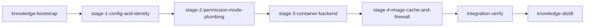

# Plan: Container Backend for Loom Sessions

## Overview

Add a `BackendType::Container` implementation of `TerminalBackend` so that every stage runs Claude Code in its own per-stage container with the worktree topology preserved, network egress firewalled, and host credentials excluded by default — unlocking `bypassPermissions` safely. Also replace the hard-coded `acceptEdits` Claude Code permission setting with a per-stage-type resolved `permission_mode` (foundation prerequisite).

Sourced from `container-backend.md`, then **rewritten in response to the pressure-test in `doc/plans/codex-PLAN-container-backend.md`**. The earlier draft underestimated how much of Loom's runtime model assumes host paths, host PIDs, host hook installs, and a single native backend. This revision restructures the work to address those gaps before container code is written.

## Goals

- Standard implementation stages run unattended under `auto` permission mode by default; plan authors can override per-stage and per-plan. `bypassPermissions` is permitted only with `BackendType::Container`, validated at init AND spawn.
- `loom init <plan> --backend container` is the single user entry point: detects runtime, builds image (if absent from cache), pins digest, writes `.work/config.toml`. No separate setup command, no per-project Dockerfile.
- Re-running `loom init` preserves backend choice; `--backend X` reconfigures without bailing on existing `.work/`.
- Existing hooks (`worktree-isolation.sh`, `worktree-file-guard.sh`, `commit-guard.sh`) continue to work unchanged inside the container — and so do `loom stage complete`, `.work/` discovery, and `loom sessions kill`.
- Cross-platform runtime detection: Linux (Podman > Docker), macOS (Apple Container > Podman > Docker Desktop). Apple Container detected by binary path + version probe, not just `which container`.
- Per-stage container with per-stage bridge network and firewalled egress so sibling stages cannot reach each other. Allowlist is **root-owned, mounted read-only outside the agent-writable mount**.
- Host credentials are excluded by default. Plan authors opt in per category via `forward_credentials = ["claude" | "github" | "gitlab" | "ssh-agent"]`. Default is `["claude"]` so Claude Code can authenticate.
- Session metadata persists `backend`, `runtime`, `container_name`, and `tracking_key` so `kill_session`, `is_session_alive`, monitor liveness, and `loom sessions kill` route through the correct backend without inferring from PID presence.
- No backwards-compatibility shims (project policy).

## Non-Goals

- Firecracker microVMs as third backend.
- Remote container hosts / Docker contexts / Kubernetes execution.
- Persistent volumes for build caches across stage runs.
- Image signing/verification.
- Managed image registry — images built locally per machine, cached globally by language fingerprint.

## Review-Driven Restructure

The original 5-phase plan (Phase 1 schema/perm + Phase 2 backend + Phase 3 image + Phase 4 firewall + Phase 5 macOS) was reordered into seven stages following the pressure-test's suggested restructure. Foundational work (config persistence, schema layer, session identity) is broken out first because permission-mode plumbing and backend dispatch both depend on those primitives existing in the right places.

| Pressure-test Finding | Where addressed |
|---|---|
| #1 Mount topology breaks `.work` symlink + git metadata | stage-3 (container topology decision: mount whole repo at `/repo`) |
| #2 Plan-level sandbox/exec lost on normal runs | stage-1 (persist plan-level config to `.work/`) |
| #3 Schema root is `LoomConfig` not `Plan` | stage-1 (`LoomConfig.execution`, project backend in `.work/config.toml` only) |
| #4 `validate_config` not wired to real call sites | stage-2 (init + spawn) |
| #5 Permission-mode propagation needs more sites | stage-2 (HooksConfig field, base settings, kebab-case YAML) |
| #6 Sessions need persisted backend identity | stage-1 (Session.backend / runtime / container_name / tracking_key + SessionType::Knowledge) |
| #7 Monitor liveness bypasses TerminalBackend | stage-3 (backend-aware liveness service used by monitor) |
| #8 `sessions kill` / `clean` / `stop` ignore container | stage-3 (route by session backend metadata + container cleanup) |
| #9 `loom run` / daemon hard-code Native | stage-3 (run preflight reads `.work/config.toml`) |
| #10 Other spawn paths missed (merge_resolver, continuation, auto_merge) | stage-3 |
| #11 Init re-run conflicts with `WorkDir::initialize` | stage-4 (reconfigure path, InitGuard never deletes existing `.work`) |
| #12 `.work/config.toml` ownership split | stage-1 (centralize in `fs/work_dir.rs` via `toml_edit`; migrate `fs/plan_lifecycle.rs`) |
| #13 Credential model contradicts itself | stage-3 (credentials excluded by default, opt-in via `forward_credentials`, `claude` is default member) |
| #14 Settings-local env leakage | stage-3 (container-specific Claude settings from allowlist; strip MCP env from copies) |
| #15 Firewall capability boundary vague | stage-4 (root entrypoint runs firewall, drops to `loom` via `gosu` before exec) |
| #16 Firewall allowlist agent-writable | stage-4 (allowlist mounted ro at `/etc/loom/network/...`, NOT under `/repo/.work`) |
| #17 Network semantics incomplete | stage-4 (deny IPv6 by default, block 169.254.169.254, RFC1918 except loopback, restrict DNS to allowlisted resolvers) |
| #18 Fingerprinting mis-detects nested projects | stage-4 (scan plan working_dirs + nested manifests; canonical_name distinct from skill_name so Go ≠ "golang") |
| #19 Image cache key ignores firewall.sh | stage-4 (hash Dockerfile.tmpl AND firewall.sh AND rendered feature switches) |
| #20 Cache directory contract ambiguous | stage-4 (define `LOOM_CACHE_DIR` precisely with tests for env override, Linux, macOS) |
| #21 Resource embedding implicit | stage-4 (embed via `include_str!` like `fs/permissions/constants.rs`; render to cache from constants) |
| #22 Cargo deps already present | stage-4 (single subagent owns Cargo.toml; only add `toml_edit` and possibly `handlebars`) |
| #23 CLI registration touches more files | stage-4 (`commands/mod.rs`, dynamic completions, `has_subcommands()`) |

## Execution Diagram



Sequential by necessity: each stage modifies primitives the next stage relies on. Within each stage, parallel subagents own disjoint files with explicit interface contracts.

---

## Stages

### 1. Knowledge Bootstrap

**Purpose:** Gap-fill existing knowledge for container-backend topics and capture the topology decision (mount whole repo at `/repo`, run from `/repo/.worktrees/<stage>`) so subsequent stages don't relitigate it.

**Tasks:** Run `loom knowledge check`; spawn parallel Explore subagents to document TerminalBackend trait surface, sandbox merge semantics, runtime detection conventions, current Session/SessionType structure, monitor liveness path; record the `/repo` topology decision as a knowledge note.

**Files:** `doc/loom/knowledge/**`

---

### 2. Stage 1 — Config & Runtime Identity

**Purpose:** Centralize `.work/config.toml` ownership, persist plan-level sandbox/execution config across `loom run` reloads, and add backend/runtime metadata to `Session` and `Stage`. This is the foundation that finding #2, #3, #6, and #12 all require before any other code can correctly target containers.

**Dependencies:** knowledge-bootstrap

**Tasks:**

_Subagent A — Centralized `.work/config.toml` API (loom-senior-software-engineer):_

- Refactor `loom/src/fs/work_dir.rs` to expose a single read/write/mutate API for `.work/config.toml` using `toml_edit` (preserves comments, formatting, unknown fields)
- Add `cargo add toml_edit` if not present
- Tests: round-trip preservation of comments and unknown keys
- **NOTE:** Subagent A defines the API ONLY. Subagent D owns ALL migrations of existing direct `toml::Value` writes (`commands/init/plan_setup.rs` lines 21/142/300, `fs/plan_lifecycle.rs:68`) so a single subagent has exclusive write access to those files.

_Subagent B — Schema layer for backend + plan-level container preferences (loom-senior-software-engineer):_

- Create `loom/src/plan/schema/execution.rs` with:
  - `enum BackendType { #[default] Native, Container }` — kebab-case serde, `Display`/`FromStr` accepting `"native"` | `"container"`. Single canonical definition; re-exported elsewhere.
  - `struct PlanExecutionConfig { container: Option<PlanContainerConfig> }` — plan-level container PREFERENCES only (no `backend` field; project backend lives in `.work/config.toml`)
  - `struct PlanContainerConfig { forward_credentials: Vec<String>, additional_mounts: Vec<String> }`
  - `struct StageExecutionConfig { backend: Option<BackendType> }` — stage-level override
- Add `pub mod execution;` to `loom/src/plan/schema/mod.rs`
- Add `execution: Option<PlanExecutionConfig>` field to `LoomConfig` (NOT `Plan` — schema root is `LoomConfig` at `plan/schema/types.rs:240`)
- Add `execution: Option<StageExecutionConfig>` to `StageDefinition`
- Replace local `BackendType` enum in `loom/src/orchestrator/terminal/mod.rs` with `pub use crate::plan::schema::execution::BackendType;`
- Update `loom/src/fs/work_dir.rs`: add `ProjectExecutionConfig { backend: BackendType, container: Option<ProjectContainerConfig> }` and `ProjectContainerConfig { runtime: String, fingerprint: String, image_digest: String, forward_credentials: Vec<String> }`. Read/write under `[execution]` and `[execution.container]` sections.
- Tests: serde round-trip, kebab-case parsing, `LoomConfig` accepts `execution:` block

_Subagent C — Session and SessionType metadata (loom-senior-software-engineer):_

- Extend `Session` in `loom/src/models/session/types.rs` with persisted fields:
  - `pub backend: BackendType` (default `Native` for back-compat parsing)
  - `pub runtime: Option<String>` (`"docker"` | `"podman"` | `"container"` for container sessions; `None` for native)
  - `pub container_name: Option<String>` (e.g. `loom-merge-stage-id`; `None` for native)
  - `pub tracking_key: String` (canonical name shared with PID file / window title — derived once at construction)
- Add `SessionType::Knowledge` variant and update all `match` exhaustiveness
- Add helper `Session::derive_tracking_key(stage_id: &str, kind: SessionType) -> String` returning `loom-{kind}-{stage_id}` for Merge/BaseConflict/Knowledge and `loom-{stage_id}` for Standard
- Update constructors (`Session::new`, `Session::new_merge`, `Session::new_base_conflict`, and a new `Session::new_knowledge`) to populate `tracking_key` and accept `BackendType` parameter
- Tests: tracking_key derivation matrix; serde round-trip for new fields

_Subagent D — Stage execution-backend propagation, plan-config persistence, AND all centralized-API migrations (loom-senior-software-engineer):_

- Migrate `loom/src/commands/init/plan_setup.rs` lines 21 and 142 from direct `toml::Value` writes to Subagent A's centralized `fs::work_dir` API
- Migrate `loom/src/fs/plan_lifecycle.rs:68` from direct `toml::Value` writes to Subagent A's centralized API
- In `loom/src/models/stage/types.rs:251` extend runtime `Stage` with `execution_backend: Option<BackendType>` and helper `Stage::execution_backend(&self) -> Option<BackendType>`
- In `loom/src/commands/init/plan_setup.rs:300` (the `StageDefinition` → `Stage` materialization site): copy `execution.backend` from definition to runtime stage
- Persist plan-level `LoomConfig.sandbox` and `LoomConfig.execution` to `.work/config.toml` under `[plan_sandbox]` and `[plan_execution]` so `loom run` can re-read them WITHOUT having to re-parse the plan markdown when stage files already exist
- Update `loom/src/plan/graph/loader.rs` (lines 62, 69) so when stage files exist, plan-level sandbox/execution come from the persisted blocks (NOT `SandboxConfig::default()`)
- Tests: plan-level sandbox honored after `.work/stages` exists; stage-level execution.backend appears on runtime Stage; `plan_lifecycle.rs` round-trips through centralized API without losing comments/unknown keys

**Interface contract for parallel subagents:**

- `crate::plan::schema::execution::{BackendType, PlanExecutionConfig, PlanContainerConfig, StageExecutionConfig}` (Subagent B owns)
- `crate::fs::work_dir::{read_project_execution, write_project_execution, ProjectExecutionConfig, ProjectContainerConfig}` (Subagent A + B agree)
- `crate::models::session::{Session, SessionType}` with new fields (Subagent C owns)
- `crate::models::stage::Stage::execution_backend(&self) -> Option<BackendType>` (Subagent D owns)

**File ownership:**

| Subagent | Files Owned (write) | Files Read-Only |
|---|---|---|
| A — Centralized config API | `loom/src/fs/work_dir.rs` (centralized API only — `.work` discovery helper at line 84 untouched here; Stage 3 owns that), `loom/Cargo.toml` | `loom/src/plan/schema/execution.rs` |
| B — Schema + project execution types | `loom/src/plan/schema/execution.rs` (NEW), `loom/src/plan/schema/mod.rs`, `loom/src/plan/schema/types.rs` (LoomConfig + StageDefinition fields), `loom/src/orchestrator/terminal/mod.rs` (BackendType re-export only) | `loom/src/fs/work_dir.rs` |
| C — Session metadata | `loom/src/models/session/types.rs`, `loom/src/models/session/mod.rs` (re-exports if needed) | `loom/src/plan/schema/execution.rs` |
| D — Stage propagation + plan-config persistence + centralized-API migrations | `loom/src/models/stage/types.rs`, `loom/src/models/stage/methods.rs` (helpers if needed), `loom/src/commands/init/plan_setup.rs` (ALL line ranges), `loom/src/fs/plan_lifecycle.rs`, `loom/src/plan/graph/loader.rs` | `loom/src/plan/schema/execution.rs`, `loom/src/fs/work_dir.rs` |

**NO FILE OVERLAP** between subagents. Subagent D has exclusive write access to all migration sites (`commands/init/plan_setup.rs`, `fs/plan_lifecycle.rs`); Subagent A defines the centralized API D consumes.

**Acceptance:** `cargo build`, `cargo test`, `cargo clippy --all-targets -- -D warnings` all pass; new types and persistence APIs exist.

---

### 3. Stage 2 — Permission-Mode Plumbing

**Purpose:** Replace hard-coded `"acceptEdits"` with a resolved `permission_mode` driven by stage-type defaults, plan-level overrides, and stage-level overrides. Wire `validate_config` into BOTH init time AND spawn time per finding #4. Thread `PermissionMode` through every propagation site listed in finding #5 (HooksConfig, base worktree settings, hook generator).

**Dependencies:** stage-1-config-and-identity

**Tasks:**

_Subagent A — `PermissionMode` enum + sandbox config + validation (loom-senior-software-engineer):_

- Add `enum PermissionMode { Default, AcceptEdits, Auto, Plan, BypassPermissions }` to `loom/src/plan/schema/types.rs`:
  - **YAML serde uses kebab-case** (`accept-edits`, `bypass-permissions`) per finding #5 — matches existing user-facing enums
  - `as_settings_value(self) -> &'static str` returns Claude's camelCase (`"acceptEdits"`, `"bypassPermissions"`, …) for JSON output
- Add `permission_mode: Option<PermissionMode>` (with `#[serde(default, skip_serializing_if = "Option::is_none")]`) to both `SandboxConfig` and `StageSandboxConfig`
- Extend `MergedSandboxConfig` in `loom/src/sandbox/config.rs` with `pub permission_mode: PermissionMode` (always resolved)
- Implement `merge_config(plan_config, stage_config, stage_type)`: stage > plan > `default_mode_for(stage_type)`
- Implement `default_mode_for(stage_type)`: `Standard` | `IntegrationVerify` → `Auto`; `Knowledge` | `KnowledgeDistill` → `AcceptEdits`
- Implement `validate_config(merged: &MergedSandboxConfig, backend: BackendType) -> Result<()>` rejecting `BypassPermissions` unless `backend == Container` with anyhow context
- Add `apply_default_mode(settings: &mut serde_json::Value, mode: PermissionMode) -> Result<()>` to `loom/src/sandbox/settings.rs`; have `generate_settings_json` call it
- Tests: matrix coverage for all 5 PermissionMode values × 2 backends

_Subagent B — Hook generation propagation (loom-software-engineer):_

- Add `permission_mode: PermissionMode` field to `HooksConfig` in `loom/src/hooks/config.rs:98`
- In `loom/src/hooks/generator.rs:42`: replace hard-coded `"acceptEdits"` with `config.permission_mode.as_settings_value()`
- Update all `HooksConfig` constructors to accept and store `PermissionMode` (or default appropriately)
- In `loom/src/hooks/generator.rs:79` (env block copy): scrub sensitive keys (`SSH_AUTH_SOCK`, `GH_TOKEN`, `GITHUB_TOKEN`) from copied env when target backend is container — see finding #14
- Tests: hooks settings reflect resolved mode

_Subagent C — Worktree settings propagation (loom-software-engineer):_

- Update `loom/src/git/worktree/settings.rs:338`: `create_worktree_settings` accepts `mode: PermissionMode`; replace hard-coded `"acceptEdits"` with `mode.as_settings_value()`
- Update `loom/src/git/worktree/settings.rs:72` (base settings written before sandbox merge): either thread `PermissionMode` through, OR stop writing `defaultMode` in base and rely solely on `settings.local.json` (recommended — simpler). Pick one and document the choice in a code comment.
- Update `loom/src/git/worktree/operations.rs:87` (the call site that writes base settings) to pass through resolved mode
- Update `loom/src/git/worktree/settings.rs:74` (env block copy): scrub sensitive env keys per finding #14 when target backend is container
- Tests: worktree base settings reflect resolved mode; no env leakage

_Subagent D — `validate_config` call sites at init + spawn (loom-senior-software-engineer):_

- In `loom/src/commands/init/plan_setup.rs:48` and `:63` (init parses plan and warns today): for EVERY stage, resolve `merge_config(plan_sandbox, stage_sandbox, stage_type)` then `validate_config(merged, project_backend)` — bail with actionable error if any stage rejects. Project backend comes from `.work/config.toml` (via Subagent A's API in Stage 1).
- In `loom/src/orchestrator/core/stage_executor.rs:244` and `:347` (sandbox merge + settings write at spawn): re-run `validate_config` as defense-in-depth; bail if it rejects. (Should never trigger if init passed, but catches `.work/config.toml` corruption or backend reconfig mid-run.)
- Tests: Native + `bypassPermissions` rejected at init for ANY stage; rejected at spawn even if `.work` was hand-edited; Container + `bypassPermissions` accepted both places

**File ownership:**

| Subagent | Files Owned (write) | Files Read-Only |
|---|---|---|
| A — Enum + merge + validate | `loom/src/plan/schema/types.rs` (PermissionMode + SandboxConfig fields), `loom/src/sandbox/config.rs`, `loom/src/sandbox/settings.rs` | `loom/src/plan/schema/execution.rs` |
| B — Hook propagation + env scrub | `loom/src/hooks/config.rs`, `loom/src/hooks/generator.rs` | `loom/src/sandbox/{config,settings}.rs` |
| C — Worktree settings | `loom/src/git/worktree/settings.rs`, `loom/src/git/worktree/operations.rs` (line 87 call site only) | `loom/src/sandbox/{config,settings}.rs` |
| D — validate_config wiring | `loom/src/commands/init/plan_setup.rs` (validation hooks at lines 48 + 63 only — NOT lines 21/142/300 owned by Stage 1), `loom/src/orchestrator/core/stage_executor.rs` (validation at lines 244 + 347) | `loom/src/sandbox/config.rs`, `loom/src/fs/work_dir.rs` |

**Acceptance:** Build, test, clippy clean; all hard-coded `"acceptEdits"` strings gone from `git/worktree/settings.rs` and `hooks/generator.rs`; init-time and spawn-time validation tests pass.

---

### 4. Stage 3 — Container Backend, Dispatcher, Liveness, Spawn-Path Wiring

**Purpose:** Implement `ContainerBackend` with the **`/repo` mount topology** (finding #1), wire it through every spawn path the original plan missed (findings #9 and #10), replace direct PID liveness checks in monitor with a backend-aware service (finding #7), and route `loom sessions kill` / `clean --sessions` / `loom stop` through persisted session backend metadata (finding #8). Hook generation and Claude settings are made backend-aware in the same stage so `.work` discovery and hook execution work inside the container before image/firewall complexity is added.

**Dependencies:** stage-2-permission-mode-plumbing

**Container Topology Decision (per finding #1):**

- Mount the **entire host repo root** at `/repo` (rw) — this preserves git worktree metadata, the relative `.work` symlink at `<worktree>/.work -> ../../.work`, and host-absolute hook references inside settings files.
- Standard stage container cwd: `/repo/.worktrees/{stage_id}`
- Merge / base-conflict / knowledge container cwd: `/repo`
- Inside the container, `LOOM_WORK_DIR=/repo/.work`. CLI `.work` discovery (`loom/src/commands/common/mod.rs:18`, `loom/src/fs/work_dir.rs:84`) is updated to honor a validated `LOOM_WORK_DIR` env var first, falling back to upward filesystem walk.
- Bind mounts:
  - `<host repo root>` rw → `/repo`
  - `<host>/.work/network/allowed_domains.txt` ro → `/etc/loom/network/allowed_domains.txt` (per finding #16 — outside agent-writable mount)
  - `~/.claude/.credentials.json` ro → `/home/loom/.claude/.credentials.json` ONLY if `forward_credentials` contains `"claude"` (default per finding #13)
  - `~/.claude/hooks/loom` ro → `/home/loom/.claude/hooks/loom` (so existing host-absolute hook references inside `settings.local.json` resolve when host UID maps to container UID; if home dir paths differ, settings are regenerated for container — see Subagent D)
- Env strip in container: `SSH_AUTH_SOCK=`, `GH_TOKEN=`, `GITHUB_TOKEN=`, `GIT_ASKPASS=/bin/false` (unless explicitly forwarded)
- Env populate in container: `LOOM_SESSION_ID`, `LOOM_STAGE_ID`, `LOOM_WORK_DIR=/repo/.work`, `LOOM_WORKTREE_PATH=/repo/.worktrees/{stage_id}` (or `/repo` for merge variants), `CLAUDE_CODE_EXPERIMENTAL_AGENT_TEAMS=1`

**Tasks:**

_Subagent A — ContainerBackend implementation (loom-senior-software-engineer):_

- Create `loom/src/orchestrator/terminal/container/{mod,runtime,lifecycle}.rs`
- `runtime.rs`: `enum Runtime { Docker, Podman, AppleContainer }` with `binary()` and `user_args()` (Podman → `--userns=keep-id`; Docker → `--user=uid:gid`; Apple Container → `[]`)
- `runtime.rs`: `detect_runtime(preference: &str) -> Result<Runtime>` accepting `"docker" | "podman" | "container" | "auto"`. macOS auto-priority: AppleContainer > Podman > Docker. Linux auto-priority: Podman > Docker. Apple Container detection: check `/usr/local/bin/container` exists AND `container --version` returns Apple's signature (NOT just `which container` — collision risk per my own audit). Hard-fail with OS-specific install instructions if no runtime found.
- `lifecycle.rs`: `build_run_args(name, image_ref, mounts, env, network, runtime)` builds `<runtime> run -d --rm --name=... --cap-drop=ALL --cap-add=NET_ADMIN --cap-add=NET_RAW --network=loom-net-{stage_id} --mount=type=bind,...` (NEVER `-v`; Apple Container portability)
- `mod.rs`: `ContainerBackend { runtime, work_dir, image_ref }` implementing `TerminalBackend`. All four spawn variants. Each:
  1. Read `tracking_key` from session (set by Stage 1's helper)
  2. `network::ensure_network(&runtime, stage_id)` (declared in stage-4; for now stub or call into network module added there — see "Cross-stage seam" below)
  3. Generate wrapper script via Subagent B's `WrapperPaths` with container-relative paths (`/repo/.work`, `/repo/.worktrees/{stage}` etc.)
  4. `<runtime> run -d` returns immediately; poll `<runtime> inspect -f '{{.State.Running}}'` until true (10s timeout)
  5. Write inspect Pid to `.work/pids/{stage_id}.pid` for Docker/Podman; skip for AppleContainer
  6. `session.set_pid(pid)` for Docker/Podman, `session.container_name = Some(name)`, `session.runtime = Some(runtime.binary())`, `session.try_mark_running()`
  7. Optionally `<runtime> exec -it <name> /bin/bash -lc 'tail -f /repo/.work/sessions/{session_id}.log'` in a host terminal so user can watch (skip if `--no-attach`)
- `kill_session`: `<runtime> rm -f <session.container_name>` then `network::remove_network(&runtime, stage_id)`
- `is_session_alive`: parse `<runtime> inspect -f '{{.State.Running}}' <container_name>` — MUST NOT depend on `kill -0` against host PID (per finding from container-backend.md and confirmed in pressure-test #7)
- Tests: `build_run_args` snapshot per (runtime, mount-set, env-strip variant); detect_runtime branches with mocked PATH

_Subagent B — Backend dispatcher, factory, WrapperPaths, backend-aware liveness service (loom-senior-software-engineer):_

- `loom/src/orchestrator/terminal/dispatcher.rs` (NEW):
  - `BackendDispatcher { native: Option<Box<dyn TerminalBackend>>, container: Option<Box<dyn TerminalBackend>> }`
  - `BackendNeeds { pub native: bool, pub container: bool }`
  - `BackendDispatcher::for_plan(project_backend, needs, work_dir) -> Result<Self>` — instantiate only required backends
  - `BackendDispatcher::for_stage(&self, backend: BackendType) -> &dyn TerminalBackend`
  - `BackendDispatcher::for_session(&self, session: &Session) -> &dyn TerminalBackend` — uses persisted `session.backend`
  - `resolve_stage_backend(project_backend, stage_override) -> Result<BackendType>` — narrowing only (container project → native stage allowed; native project → container stage rejected with `"stage requires execution.backend=container, but project backend is native. Re-initialise with: loom init <plan> --backend container"`)
- Update `create_backend` factory in `loom/src/orchestrator/terminal/mod.rs` to handle `BackendType::Container`
- Extend `loom/src/orchestrator/terminal/native/pid_tracking.rs::create_wrapper_script` with `WrapperPaths { work_dir_in_container: PathBuf, workspace_in_container: Option<PathBuf> }`. Original signature delegates to new `create_wrapper_script_with_paths` with host-path defaults
- Create `loom/src/orchestrator/liveness.rs` (NEW): backend-aware liveness service. `LivenessService { dispatcher: Arc<BackendDispatcher> }` with `is_alive(session: &Session) -> Result<bool>` that routes through `dispatcher.for_session(session).is_session_alive(session)`. Used by monitor.

_Subagent C — Wire dispatcher into ALL spawn paths + run-time preflight + sessions/clean/stop (loom-senior-software-engineer):_

- Replace `Box<dyn TerminalBackend>` with `BackendDispatcher` in:
  - `loom/src/orchestrator/core/orchestrator.rs` (OrchestratorConfig + Orchestrator struct)
  - `loom/src/orchestrator/core/stage_executor.rs` (per-stage backend lookup before each `spawn_*` via `dispatcher.for_stage(resolve_stage_backend(project, stage.execution_backend()))`)
- Add **shared run preflight** that reads `.work/config.toml`, rejects `image_digest = "pending"`, validates every stage's backend resolution, and yields a `BackendDispatcher`. Used by both:
  - `loom/src/commands/run/foreground.rs:60` (replace hard-coded `BackendType::Native`)
  - `loom/src/daemon/server/orchestrator.rs:78` (replace hard-coded `BackendType::Native`)
- Replace `NativeBackend::new` direct usage in `loom/src/commands/stage/merge_resolver.rs:74` with dispatcher lookup (read project backend from `.work/config.toml`)
- Update `loom/src/orchestrator/continuation/mod.rs:33,94` to read backend from `.work/config.toml` instead of defaulting to Native
- Update `loom/src/orchestrator/auto_merge.rs:68` to accept `BackendDispatcher` (or read project backend) instead of single backend
- Replace `kill -0`-based liveness in `loom/src/orchestrator/monitor/handlers.rs:39`, `loom/src/orchestrator/monitor/detection.rs:119`, and `loom/src/orchestrator/monitor/detection.rs:360` with `LivenessService::is_alive(session)` (uses persisted session.backend to route)
- `loom/src/commands/sessions.rs:168` (`loom sessions kill`): route via `dispatcher.for_session(&session).kill_session(&session)` using `session.backend` — NOT inferred from PID presence
- `loom/src/commands/clean.rs:246`: in `--sessions` mode, also enumerate orphan containers (`<runtime> ps -a --filter=name=loom- --format='{{.Names}}'`) and orphan networks (`<runtime> network ls --filter=name=loom-net- --format='{{.Name}}'`); remove any not corresponding to live sessions
- `loom/src/commands/stop.rs:13`: document precisely whether stop only stops the daemon or also terminates active containers. If "also terminates": iterate live container sessions and `kill_session` each before daemon shutdown.

_Subagent D — Backend-aware hook + Claude settings generation (loom-senior-software-engineer):_

- Add `backend: BackendType` to `HooksConfig`. When `backend == Container`, hook command paths in `loom/src/fs/permissions/hooks.rs:14` and `loom/src/hooks/config.rs:126` are emitted as **container-stable paths** (`/home/loom/.claude/hooks/loom/<hook>.sh`) — NOT host-absolute paths, since container's home is `/home/loom`. Native backend keeps host-absolute paths.
- `loom/src/hooks/generator.rs:86`: when backend is Container, write `LOOM_WORK_DIR=/repo/.work` (NOT host path)
- `loom/src/git/worktree/settings.rs`: generate Claude `settings.local.json` per backend. For container, use an **allowlist of permitted env keys** when copying user settings (per finding #14) — drop MCP env blocks and any sensitive keys not on the allowlist. Document the allowlist in a code comment with rationale.
- Update `loom/src/commands/common/mod.rs:18` and `loom/src/fs/work_dir.rs:84`: prefer validated `LOOM_WORK_DIR` env var over upward walk when set (so CLI commands inside the container use the bind-mounted `.work`)

**Cross-stage seam (network module):**

`network::ensure_network`/`remove_network`/`write_allowlist` are introduced in stage-4 alongside the firewall script. In stage-3, Subagent A's `ContainerBackend::spawn_session` references these by import path; stage-3 commits a `network.rs` stub returning `Ok(())` so the orchestrator compiles, and stage-4's first task is to flesh out the implementation. Acceptance for stage-3 explicitly does NOT exercise containers end-to-end (no firewall yet).

**File ownership:**

| Subagent | Files Owned (write) | Files Read-Only |
|---|---|---|
| A — ContainerBackend | `loom/src/orchestrator/terminal/container/{mod,runtime,lifecycle}.rs` (NEW), `loom/src/orchestrator/terminal/container/network.rs` (stub only — flesh out in stage-4) | `loom/src/orchestrator/terminal/{native/mod.rs,native/pid_tracking.rs}` |
| B — Dispatcher + WrapperPaths + liveness service | `loom/src/orchestrator/terminal/dispatcher.rs` (NEW), `loom/src/orchestrator/terminal/mod.rs` (factory only — re-export was done in Stage 1), `loom/src/orchestrator/terminal/native/pid_tracking.rs` (additive WrapperPaths), `loom/src/orchestrator/liveness.rs` (NEW) | `loom/src/orchestrator/terminal/container/**` |
| C — Spawn paths + monitor + CLI kill/clean/stop | `loom/src/orchestrator/core/{orchestrator,stage_executor}.rs`, `loom/src/orchestrator/monitor/{handlers,detection}.rs`, `loom/src/commands/run/foreground.rs`, `loom/src/daemon/server/orchestrator.rs`, `loom/src/commands/stage/merge_resolver.rs`, `loom/src/orchestrator/continuation/mod.rs`, `loom/src/orchestrator/auto_merge.rs`, `loom/src/commands/sessions.rs`, `loom/src/commands/clean.rs`, `loom/src/commands/stop.rs` | `loom/src/orchestrator/{terminal/dispatcher.rs,liveness.rs}`, `loom/src/fs/work_dir.rs` |
| D — Hooks + settings backend-awareness + .work discovery | `loom/src/hooks/config.rs`, `loom/src/hooks/generator.rs`, `loom/src/fs/permissions/hooks.rs`, `loom/src/git/worktree/settings.rs`, `loom/src/commands/common/mod.rs`, `loom/src/fs/work_dir.rs` (only the `.work` discovery helper at line 84 — Stage 1 owns the schema reads/writes) | `loom/src/orchestrator/terminal/dispatcher.rs` |

A and D both touch files Stage 1 also touched. Since Stage 1 fully merged before stage-3 begins (sequential dependency), the files are stable inputs at this point. Stage 1's centralization makes Subagent D's `.work` discovery edit a small additive helper.

**Acceptance:** Build, test, clippy clean; dispatcher routes correctly in unit tests; `loom run` foreground and daemon both read backend from `.work/config.toml`; monitor uses LivenessService; `loom sessions kill` routes via `session.backend`. Container live tests gated on `LOOM_TEST_CONTAINERS=1` and skipped otherwise.

---

### 5. Stage 4 — Image Cache, Firewall Hardening, Init Reconfigure, CLI Polish

**Purpose:** Implement the global image cache (with correct fingerprinting, embedded resources, and a complete cache key per findings #18-#21), the production firewall (with capability drop and root-owned allowlist per findings #15-#17), the init reconfigure path (per finding #11), and the CLI surfaces (`loom container` group + dynamic completions per findings #22-#23).

**Dependencies:** stage-3-container-backend

**Tasks:**

_Subagent A — Fingerprinting with nested-manifest scan (loom-software-engineer):_

- Create `loom/src/orchestrator/terminal/container/fingerprint.rs`
- Add `DetectedLanguage::canonical_name(&self) -> &'static str` to `loom/src/language.rs` returning lowercase short names: `rust`, `typescript`, `python`, `go` — distinct from `skill_name()` so Go does NOT map to `golang` (per finding #18)
- `compute_fingerprint(project_root: &Path, plan_working_dirs: &[PathBuf]) -> String`:
  - Detect languages by scanning `project_root` AND each `plan_working_dirs[i]` (so nested manifests like `loom/Cargo.toml` are picked up — per finding #18)
  - Sort + dedup by `canonical_name()`
  - Join with `-`, fallback `"base"`
  - Format: `"<langs>-<combined-hash[:8]>"` where combined-hash is SHA-256 of:
    - `include_str!("../../../../resources/Dockerfile.tmpl")` (template)
    - `include_str!("../../../../resources/firewall.sh")` (per finding #19)
    - The rendered Handlebars feature switches (`has_rust`, `has_typescript`, …) for the detected language set
- `language.rs`: extend `detect_project_languages` to optionally accept additional scan roots, OR keep the existing API and have `compute_fingerprint` invoke it once per root
- Tests: TempDir with synthetic root + nested Cargo.toml; same input → same fingerprint; flipping firewall.sh changes fingerprint; flipping Dockerfile.tmpl changes fingerprint; Go canonical name is `go`

_Subagent B — Image cache, embedded resources, cache directory contract (loom-senior-software-engineer):_

- Create `loom/src/orchestrator/terminal/container/{image,resources}.rs`
- `resources.rs`: embed via `include_str!` like `loom/src/fs/permissions/constants.rs:3` (per finding #21):
  - `pub const DOCKERFILE_TEMPLATE: &str = include_str!("../../../../resources/Dockerfile.tmpl");`
  - `pub const FIREWALL_SCRIPT: &str = include_str!("../../../../resources/firewall.sh");`
  - Source files at `loom/resources/Dockerfile.tmpl` and `loom/resources/firewall.sh`
- Cache layout (define unambiguously per finding #20):
  - **`LOOM_CACHE_DIR`** is **the image-cache root directory** (the level containing per-fingerprint subdirectories)
  - Linux default: `${XDG_CACHE_HOME:-$HOME/.cache}/loom/images`
  - macOS default: `$HOME/Library/Caches/loom/images`
  - Per-fingerprint: `$LOOM_CACHE_DIR/<fingerprint>/{Dockerfile, firewall.sh, image.digest, built_at}`
- `image.rs`:
  - `cache_dir() -> Result<PathBuf>` returning the resolved root with env-override priority
  - `ensure_image(fingerprint: &str, runtime: &Runtime, force: bool) -> Result<String>` — cache hit verifies digest with `<runtime> image inspect`; cache miss writes constants to cache subdirectory then `<runtime> build -t loom/base:<fingerprint> --progress=plain .`, captures digest, writes `image.digest` and `built_at`
  - Stream native build output to stdout (no spinner)
  - Image tag: `loom/base:<fingerprint>` plus digest pin
- Render Dockerfile from `DOCKERFILE_TEMPLATE` constant — use simple `{{key}}`/`{{#if key}}` substitution OR `handlebars` crate (decide by complexity). Add `cargo add handlebars` ONLY if needed.
- Tests: `cache_dir()` for env override, Linux default (with HOME mocked), macOS default (cfg-gated); cache hit/miss with mocked runtime command; `ensure_image` writes embedded contents to cache

_Subagent C — Firewall script, network module, capability boundary (loom-senior-software-engineer):_

- Author `loom/resources/firewall.sh`:
  - `set -euo pipefail`
  - Reads `/etc/loom/network/allowed_domains.txt` (NOT `/work/...` — per finding #16)
  - Combines in-script `ALWAYS=("api.anthropic.com" "registry.npmjs.org")` with file contents
  - **DENY IPv6 entirely**: `ip6tables -P OUTPUT DROP; ip6tables -P FORWARD DROP; ip6tables -P INPUT DROP` (per finding #17)
  - **Block cloud metadata IP**: `iptables -A OUTPUT -d 169.254.169.254 -j REJECT` (per finding #17)
  - **Block RFC1918 except loopback** (per finding #17): reject `10.0.0.0/8`, `172.16.0.0/12`, `192.168.0.0/16` outbound (loopback `127.0.0.0/8` allowed)
  - **DNS restriction**: allow DNS only to the runtime's embedded resolver (auto-discover from `/etc/resolv.conf`); reject DNS-over-HTTPS resolvers (Cloudflare 1.1.1.1, Google 8.8.8.8) unless explicitly allowlisted
  - `ipset create loom-allowed hash:ip family inet -exist`; flush; resolve each allowlisted domain and `ipset add`
  - `iptables -P OUTPUT DROP`; allow loopback; allow ipset matches; reject others with `icmp-net-unreachable`
  - Idempotency lockfile at `/var/run/loom-firewall.lock` so the script cannot be rerun by the unprivileged agent (per finding #16)
- Author `loom/resources/Dockerfile.tmpl`:
  - Base: `mcr.microsoft.com/devcontainers/base:ubuntu-24.04`
  - ARGs: `USERNAME=loom`, `USER_UID=1000`, `USER_GID=$USER_UID`
  - `RUN apt-get update && apt-get install -y sudo iptables ipset dnsutils ripgrep fd-find git curl ca-certificates e2fsprogs gosu` — `gosu` for capability drop (per finding #15 + my own audit; not in base image)
  - Create `loom` user/group at UID 1000
  - Install Node.js 22 + `@anthropic-ai/claude-code` globally
  - Conditional toolchains via `{{#if has_rust}}` / `has_typescript` / `has_python` / `has_go` (rendered by Subagent B)
  - `COPY firewall.sh /usr/local/bin/loom-firewall.sh; chmod +x /usr/local/bin/loom-firewall.sh; chattr +i /usr/local/bin/loom-firewall.sh || true`
  - Sudoers: `loom ALL=(ALL) NOPASSWD: /usr/local/bin/loom-firewall.sh`
  - `WORKDIR /repo`
  - **No `USER loom` directive** — container starts as root for firewall setup
  - `COPY entrypoint.sh /usr/local/bin/loom-entrypoint.sh`; `ENTRYPOINT ["/usr/local/bin/loom-entrypoint.sh"]`
- Author `loom/resources/entrypoint.sh`:
  - Run firewall as root: `/usr/local/bin/loom-firewall.sh`
  - Drop privileges: `exec gosu loom "$@"` (per finding #15)
- `loom/src/orchestrator/terminal/container/network.rs`:
  - `write_allowlist(host_path: &Path, network: &NetworkConfig) -> Result<PathBuf>` — writes to host path that loom owns (e.g. `<repo>/.work/network/allowed_domains.txt`); container mounts this read-only at `/etc/loom/network/allowed_domains.txt`
  - `ensure_network(runtime: &Runtime, stage_id: &str) -> Result<()>` — idempotent `<runtime> network create loom-net-{stage_id}`
  - `remove_network(runtime: &Runtime, stage_id: &str) -> Result<()>` — idempotent cleanup
  - Replace stub from stage-3 with full implementation
- Update `ContainerBackend::spawn_session` (and merge/knowledge variants) in `container/mod.rs` to call `network::ensure_network` + `network::write_allowlist` before launch and add the new ro mount for the allowlist
- Tests: firewall script syntax (`bash -n firewall.sh`); allowlist file generation; entrypoint.sh syntax

_Subagent D — Init reconfigure, `loom container` subcommands, completions (loom-senior-software-engineer):_

- Add reconfigure path to `loom/src/commands/init/execute.rs:89`:
  - When `.work/` exists AND no `--backend` flag: preserve existing `[execution]` block, re-parse plan to refresh stage definitions (does NOT delete `.work`)
  - When `.work/` exists AND `--backend X`: rewrite `[execution]` block via Subagent A's centralized API from Stage 1, fingerprint + ensure_image if `container`, drop digest if `native`
  - `InitGuard` MUST never delete pre-existing `.work` (per finding #11)
- Update `loom/src/fs/work_dir.rs:113`: instead of `bail!(".work directory already exists")`, expose a `WorkDir::open_or_initialize` variant
- Add `--backend native|container` and `--no-build` flags to `loom init` in `loom/src/cli/types.rs`
- `--no-build` writes `image_digest = "pending"`; the **shared run preflight** added in stage-3 refuses to start with `"pending"`
- Wire dispatch in `loom/src/cli/dispatch.rs`
- Print init summary: backend, runtime, fingerprint, cached/built, elapsed time
- Add `loom container` command group:
  - `loom/src/commands/container/{mod,build,rebuild,doctor,shell}.rs` (NEW)
  - `build [--fingerprint <fp>]`
  - `rebuild [--fingerprint <fp>] [--all]`
  - `doctor`: runtime, version, current fingerprint, pinned digest, image presence, cache size, all cached fingerprints, **runtime-specific capability checks** (rootless Podman / Apple Container limitations per finding #15)
  - `shell <stage-id>`: interactive `<runtime> exec -it <session.container_name> /bin/bash`
  - NO `loom container clean` (footgun)
- Update `loom/src/commands/mod.rs` to export `container` module (per finding #23)
- Update `loom/src/completions/dynamic/commands.rs:6`: add `loom container` and `loom init --backend|--no-build` to dynamic completion tables
- Update `has_subcommands()` (likely in `cli/types.rs:29` area) to recognize `container` as having subcommands
- Cargo dependency hygiene (per finding #22): assign `loom/Cargo.toml` ONLY to this subagent. `sha2`, `hex`, `which`, `libc` are already present — do NOT re-add. Add `toml_edit` only if Stage 1 didn't already (Stage 1's Subagent A owns it; coordinate). Add `handlebars` only if Subagent B (Stage 4) needs it.

**File ownership:**

| Subagent | Files Owned (write) | Files Read-Only |
|---|---|---|
| A — Fingerprinting | `loom/src/orchestrator/terminal/container/fingerprint.rs` (NEW), `loom/src/language.rs` | `loom/resources/Dockerfile.tmpl`, `loom/resources/firewall.sh` (Subagent B/C outputs — only for hashing) |
| B — Image cache + embedded resources | `loom/src/orchestrator/terminal/container/{image,resources}.rs` (NEW), `loom/resources/Dockerfile.tmpl` (NEW) | `loom/src/orchestrator/terminal/container/{runtime,fingerprint}.rs` |
| C — Firewall + network module + entrypoint | `loom/src/orchestrator/terminal/container/{network,mod,lifecycle}.rs`, `loom/resources/firewall.sh` (NEW), `loom/resources/entrypoint.sh` (NEW) | `loom/src/sandbox/config.rs` (NetworkConfig type) |
| D — Init reconfigure + CLI + completions | `loom/src/commands/init/execute.rs`, `loom/src/fs/work_dir.rs` (open_or_initialize helper only — Stage 1's centralization is intact), `loom/src/cli/{dispatch,types}.rs`, `loom/src/commands/container/**` (NEW), `loom/src/commands/mod.rs`, `loom/src/completions/dynamic/commands.rs`, `loom/src/main.rs` (CLI registration), `loom/Cargo.toml` | `loom/src/orchestrator/terminal/container/{fingerprint,image,runtime}.rs`, `loom/src/orchestrator/terminal/dispatcher.rs` |

C extends `container/mod.rs` and `container/lifecycle.rs` from stage-3 with network plumbing. Since stage-3 fully merged first, those files are stable inputs.

**Acceptance:** Build, test, clippy clean; `loom init --help` shows `--backend|--no-build`; `loom container --help` lists `build|rebuild|doctor|shell`; embedded resources hash correctly into fingerprint; firewall and Dockerfile pass `bash -n` / lint; init reconfigure tests pass.

---

### 6. Integration Verification

**Purpose:** Final integration verification — build, test, code review, FUNCTIONAL verification, AND comprehensive functional tests covering every gap the pressure-test enumerated.

**Dependencies:** stage-4-image-cache-and-firewall

**Tasks:**

_Build & Test (zero tolerance):_ `cargo build`, `cargo build --release`, `cargo test`, `cargo clippy --all-targets -- -D warnings`. `cargo fmt --check` is informational; if existing code violates fmt, run `cargo fmt` and commit separately.

_Code Review (parallel `loom-code-reviewer` subagents in ONE message):_

- Security review (`loom-code-reviewer` + `/loom-security-audit`): container escape vectors; env var leakage (verify `SSH_AUTH_SOCK`/`GH_TOKEN`/`GITHUB_TOKEN` stripped); credential mount only when `forward_credentials` opts in; firewall script integrity (chattr +i, sudoers scope); allowlist mounted ro at `/etc/loom/network/`; capability drop via gosu; bypassPermissions only when backend is Container
- Architecture review (`loom-code-reviewer`): TerminalBackend trait still cohesive; no new layering violations; Send + Sync invariants preserved on ContainerBackend; error handling via anyhow::Result with context; no 400-line file violations; BackendType has ONE canonical definition with re-exports
- Test coverage (`loom-code-reviewer`): permission resolution matrix; runtime detection branches; fingerprint determinism; resolve_stage_backend matrix; build_run_args snapshots; container live tests gated on `LOOM_TEST_CONTAINERS=1`

Fix ALL issues found by reviewers using `loom-software-engineer` or `loom-senior-software-engineer`.

_Functional Verification (CRITICAL — tests passing ≠ feature working):_

- `./target/debug/loom init --help` shows `--backend native|container` and `--no-build`
- `./target/debug/loom container --help` lists `build`, `rebuild`, `doctor`, `shell`
- `./target/debug/loom container doctor` runs successfully
- BackendType has ONE definition; re-exports from `orchestrator/terminal/mod.rs`
- ContainerBackend impls TerminalBackend; create_backend factory routes both variants; BackendDispatcher.for_session/for_stage routes correctly; resolve_stage_backend enforces narrowing-only
- Hard-coded `"acceptEdits"` strings GONE from `git/worktree/settings.rs`, `hooks/generator.rs`
- `loom init`-time validation rejects Native + bypassPermissions
- `loom run` preflight refuses `image_digest = "pending"` (Subagent C of stage-3 + Subagent D of stage-4)
- `loom sessions kill` works for Container session (no PID inferral)

_Container live tests (gated on `LOOM_TEST_CONTAINERS=1` AND `command -v podman` OR `command -v docker`):_

- `loom stage complete` from inside a container with `.work` discovery via `LOOM_WORK_DIR=/repo/.work` works
- Hook paths resolve and execute inside the container (worktree-isolation.sh, commit-guard.sh)
- Standard, merge, base-conflict, knowledge sessions use correct container paths and `LOOM_WORKTREE_PATH` policies
- Monitor detects container death through `<runtime> inspect` (kill the container, monitor flags it)
- `loom sessions kill` terminates a Container session by name; `loom clean --sessions` removes orphan loom-*containers and loom-net-* networks
- Native + bypassPermissions rejected at init AND spawn time
- Container + bypassPermissions writes `"defaultMode": "bypassPermissions"` to `.claude/settings.local.json`
- Sensitive env (`SSH_AUTH_SOCK`, `GH_TOKEN`, `GITHUB_TOKEN`) NOT present in container unless explicitly forwarded
- Claude credentials policy: NO `~/.claude/.credentials.json` mount when `forward_credentials = []`; mount present when `["claude"]` (default)
- Denied egress: public domain not in allowlist (curl fails); IPv6 (curl -6 fails); DNS exfiltration via 8.8.8.8 (fails); 169.254.169.254 metadata (fails); sibling containers (cross-stage curl fails); RFC1918 except loopback (fails)
- Image cache invalidates when EITHER Dockerfile.tmpl OR firewall.sh changes
- Re-init: preserve backend (no flag); switch backend (--backend X); refuse `loom run` after `--no-build`

If no container runtime is available on the host, document this explicitly in the integration-verify summary and skip live tests; the unit + functional layers still validate the code surface.

_Phase 6 — bypassPermissions opt-in is verified above_ (no separate code change beyond Stage 2's validate_config, per the original doc).

NOTE: Knowledge distillation and documentation updates are handled by knowledge-distill. Focus this stage on BUILD + CODE REVIEW + FUNCTIONAL VERIFICATION. Record discoveries to loom memory so knowledge-distill can curate them.

**Files:** `loom/**` (verification only).

**Acceptance:** Full build, test, lint clean; functional verification complete (live tests pass when runtime available, recorded as skipped otherwise).

---

### 7. Knowledge Distillation

**Purpose:** Curate stage memories into permanent knowledge and update user-facing documentation (README, plus any knowledge files claiming `BackendType` only has `Native` — these MUST be updated).

**Dependencies:** integration-verify

**Tasks:** Read all stage memories with `loom memory show --all`; synthesize into `mistakes.md` (with prevention rules), `patterns.md` (TerminalBackend extension, BackendDispatcher, sandbox merge with permission_mode, cross-platform runtime detection, image cache + fingerprint, defense-in-depth firewall), `architecture.md` (dual-backend topology, new `orchestrator/terminal/container/` and `orchestrator/liveness.rs` modules), `conventions.md` (resources/ directory, toml_edit centralization, fingerprint format, kebab-case YAML for user-facing enums); run `loom review`; update `README.md` to document `--backend` flag, `loom container` subcommands, `permission_mode` field, `bypassPermissions` opt-in, and credential forwarding model; update `CLAUDE.md.template` if any project conventions emerged; verify no knowledge files still describe `BackendType` as Native-only.

**Files:** `doc/loom/knowledge/**`, `README.md`, `CLAUDE.md.template`

---

## Additional Issues Identified Beyond the Pressure-Test

While reworking the plan I noticed several issues neither I nor the reviewer surfaced explicitly. Each is addressed in the relevant stage.

1. **Apple Container detection collision risk.** `which container` is too generic — `container` is a common name. Stage 3 Subagent A detects via `/usr/local/bin/container` path AND `container --version` signature probe.
2. **`gosu` is not in the devcontainer base image.** Required for capability drop per finding #15. Stage 4 Subagent C adds `gosu` to the apt-get install list in the Dockerfile.
3. **`cargo fmt --check` may fail on pre-existing code.** Made informational in integration-verify; if it fails, run `cargo fmt` and commit separately rather than blocking.
4. **Wrapper script PID path inside container.** Must write to `/repo/.work/pids/{stage_id}.pid` so the host can read the same file via the bind mount. Stage 3 Subagent B's `WrapperPaths.work_dir_in_container` parameter handles this; Subagent A passes `/repo/.work` for container backends.
5. **`SessionType::Knowledge` variant did not exist.** Knowledge sessions used `Session::new()` and a generic SessionType. Added in Stage 1 Subagent C with corresponding constructor `Session::new_knowledge`.
6. **Existing knowledge files claim `BackendType` has only `Native`.** Stage 7 (knowledge-distill) explicitly checks and updates these.
7. **Sandbox `network: empty allowed_domains` semantics.** The original doc says `[]` denies all. Container backend's firewall is the runtime enforcement; the sandbox config's `allowed_domains` is the SOURCE of truth that gets written to `/etc/loom/network/allowed_domains.txt`. They MUST agree. Documented in Stage 4 Subagent C's `network::write_allowlist`.
8. **Plan-level acceptance criteria reference `./target/debug/loom`.** With `working_dir: "loom"`, that resolves to `loom/target/debug/loom`. `cargo build` runs first in acceptance order so binary exists by the time we probe `--help`. Verified.

---

<!-- loom METADATA -->

```yaml
loom:
  version: 1
  sandbox:
    enabled: true
    auto_allow: true
    excluded_commands:
      - "loom"
    filesystem:
      deny_read:
        - "~/.ssh/**"
        - "~/.aws/**"
        - "~/.config/gcloud/**"
        - "~/.gnupg/**"
    network:
      allowed_domains:
        - "github.com"
        - "raw.githubusercontent.com"
        - "api.github.com"
        - "static.crates.io"
        - "index.crates.io"
        - "crates.io"
        - "mcr.microsoft.com"
        - "registry-1.docker.io"
        - "auth.docker.io"
        - "production.cloudflare.docker.com"
        - "ghcr.io"
        - "registry.npmjs.org"
        - "nodejs.org"
        - "deb.nodesource.com"
        - "archive.ubuntu.com"
        - "security.ubuntu.com"
        - "ports.ubuntu.com"
        - "api.anthropic.com"
      allow_local_binding: false
      allow_unix_sockets: []
  stages:
    - id: knowledge-bootstrap
      name: "Bootstrap Knowledge Base"
      stage_type: knowledge
      model: "sonnet"
      reasoning_effort: "high"
      description: |
        Gap-fill existing knowledge for the container-backend domain and capture
        the topology decision (mount whole repo at /repo, run from
        /repo/.worktrees/{stage}) so subsequent stages don't relitigate it.

        Use parallel subagents and skills to maximize performance.

        ⛔ NEVER use Claude Code's auto-memory (~/.claude/projects/*/memory/).
        ALL memory/knowledge goes through loom memory and loom knowledge commands.

        Step 0 — CHECK EXISTING KNOWLEDGE:
          loom knowledge check
          Knowledge is already populated; this is a focused gap fill.

        Step 1 — PARALLEL EXPLORATION (spawn as Task tool calls in ONE message):

          Subagent 1 — TerminalBackend Extension Surface (Explore):
            Read loom/src/orchestrator/terminal/{mod,native/mod}.rs.
            Document the TerminalBackend trait surface, Send+Sync requirements,
            how spawn_session/kill_session/is_session_alive interact with Session,
            and the create_backend factory's current shape.
            Output: loom knowledge update patterns "## TerminalBackend Extension Pattern\n\n..."

          Subagent 2 — Sandbox Config Merge (Explore):
            Read loom/src/sandbox/{config,settings}.rs and the three hard-coded
            "acceptEdits" sites: git/worktree/settings.rs:338, hooks/generator.rs:42,
            sandbox/settings.rs::generate_settings_json. Identify HooksConfig at
            hooks/config.rs:98 (no permission_mode field today).
            Output: loom knowledge update patterns "## Sandbox Config Merge\n\n..."

          Subagent 3 — Cross-Platform Detection Conventions (Explore):
            Read loom/src/orchestrator/terminal/native/detection.rs to document
            which::which usage, env-var precedence, and cfg-based cross-platform
            branches the container runtime detection should mirror.
            Output: loom knowledge update conventions "## Cross-Platform Detection Pattern\n\n..."

          Subagent 4 — Session and SessionType Surface (Explore):
            Read loom/src/models/session/types.rs. Document the current Session
            fields (note: NO backend, runtime, container_name, or tracking_key
            fields exist), the SessionType enum (note: NO Knowledge variant),
            and how kill_session/is_session_alive route today (they don't —
            single backend).
            Output: loom knowledge update architecture "## Session Identity Today\n\n..."

          Subagent 5 — Container Topology Decision (Explore):
            Read loom/src/git/worktree/{operations,settings}.rs to confirm:
            (a) worktrees live at .worktrees/{stage_id}/, (b) the .work symlink
            inside is `../../.work` (relative to host repo), (c) git worktree
            metadata uses host paths in `.git` files. Then RECORD the decision
            that ContainerBackend will mount the entire host repo root at /repo
            so the relative .work symlink and git metadata both resolve correctly
            inside the container.
            Output: loom knowledge update architecture "## Container Backend Topology Decision\n\n..."

          IMPORTANT: Spawn as parallel Task tool calls in ONE message.

        CRITICAL: Use loom knowledge CLI commands, NOT Write/Edit on knowledge files.

        MEMORY RECORDING (use loom memory ONLY):
        - Record discoveries: loom memory note "found: ..."
        - Record decisions: loom memory decision "..." --context "..."
        - Before completing: loom memory list

        SUBAGENT MEMORY — every subagent prompt must include:
        "Record mistakes, decisions, and surprises using loom memory. Do NOT
        record procedural actions like 'read file' or 'spawned agents'."
      dependencies: []
      acceptance:
        - "loom knowledge check"
        - 'rg -q "TerminalBackend Extension" doc/loom/knowledge/patterns.md'
        - 'rg -q "Sandbox Config Merge" doc/loom/knowledge/patterns.md'
        - 'rg -q "Container Backend Topology" doc/loom/knowledge/architecture.md'
        - 'rg -q "Session Identity" doc/loom/knowledge/architecture.md'
      files:
        - "doc/loom/knowledge/**"
      working_dir: "."
      artifacts:
        - "doc/loom/knowledge/architecture.md"
        - "doc/loom/knowledge/patterns.md"
        - "doc/loom/knowledge/conventions.md"

    - id: stage-1-config-and-identity
      name: "Stage 1 — Config & Runtime Identity"
      stage_type: standard
      model: "opus"
      reasoning_effort: "high"
      description: |
        Centralize .work/config.toml ownership, persist plan-level sandbox/execution
        config across loom run reloads, add backend/runtime metadata to Session and
        Stage. This is the foundation that addresses pressure-test findings #2, #3,
        #6, and #12.

        Use parallel subagents and skills to maximize performance.

        ⛔ NEVER use Claude Code's auto-memory.
        ⛔ NEVER use loom knowledge update (reserved for knowledge stages).
        Implementation stages use loom memory ONLY.

        Reference: codex-PLAN-container-backend.md findings #2, #3, #6, #12.

        SUBAGENT FILE ASSIGNMENTS:
          Subagent A — Centralized .work/config.toml API (loom-senior-software-engineer):
            Files Owned:
              src/fs/work_dir.rs (centralized API only — .work discovery helper
                at line 84 untouched here; Stage 3 owns that)
              Cargo.toml
            Files Read-Only:
              src/plan/schema/execution.rs (Subagent B's output)
            Tasks:
              1. Refactor fs/work_dir.rs to expose a single read/write/mutate API
                 for .work/config.toml using toml_edit (preserves comments,
                 formatting, unknown fields). API surface:
                   pub fn read_config(work_dir: &Path) -> Result<Document>
                   pub fn write_config(work_dir: &Path, doc: &Document) -> Result<()>
                   pub fn read_project_execution(work_dir: &Path) -> Result<Option<ProjectExecutionConfig>>
                   pub fn write_project_execution(work_dir: &Path, cfg: &ProjectExecutionConfig) -> Result<()>
                   pub fn read_plan_sandbox(work_dir: &Path) -> Result<Option<SandboxConfig>>
                   pub fn write_plan_sandbox(work_dir: &Path, sandbox: &SandboxConfig) -> Result<()>
                   pub fn read_plan_execution(work_dir: &Path) -> Result<Option<PlanExecutionConfig>>
                   pub fn write_plan_execution(work_dir: &Path, exec: &PlanExecutionConfig) -> Result<()>
              2. Add `cargo add toml_edit` if not present (`grep toml_edit Cargo.toml` first)
              3. Tests: round-trip preservation of comments and unknown keys.
              NOTE: Subagent A does NOT migrate any existing call sites. Subagent
              D owns ALL migrations (plan_setup.rs lines 21/142/300,
              plan_lifecycle.rs:68) so a single subagent has exclusive write
              access to those files.

          Subagent B — Schema layer for backend + plan-level container preferences (loom-senior-software-engineer):
            Files Owned:
              src/plan/schema/execution.rs (NEW)
              src/plan/schema/mod.rs (add `pub mod execution;`)
              src/plan/schema/types.rs (LoomConfig.execution + StageDefinition.execution fields ONLY — NOT PermissionMode, that's Stage 2)
              src/orchestrator/terminal/mod.rs (BackendType re-export ONLY — replace local enum)
            Files Read-Only:
              src/fs/work_dir.rs (for ProjectExecutionConfig type alignment)
            Tasks:
              1. Create execution.rs with:
                 - enum BackendType { #[default] Native, Container }, kebab-case serde,
                   Display, FromStr ("native" | "container") — SINGLE canonical definition
                 - struct PlanExecutionConfig { #[serde(default, skip_serializing_if = "Option::is_none")] container: Option<PlanContainerConfig> }
                   (NO `backend` field at plan level — project backend lives in .work/config.toml)
                 - struct PlanContainerConfig { forward_credentials: Vec<String>, additional_mounts: Vec<String> }
                 - struct StageExecutionConfig { backend: Option<BackendType> }
              2. Add `pub mod execution;` to plan/schema/mod.rs
              3. Add `pub execution: Option<PlanExecutionConfig>` to LoomConfig in
                 plan/schema/types.rs (line 240 area). Field MUST be on LoomConfig
                 (NOT a hypothetical Plan struct — finding #3 verified)
              4. Add `pub execution: Option<StageExecutionConfig>` to StageDefinition
              5. In orchestrator/terminal/mod.rs: REMOVE the local BackendType enum
                 (lines 23-46) and its Display/FromStr impls; replace with:
                   pub use crate::plan::schema::execution::BackendType;
                 Update tests at lines 156-176 accordingly (move to execution.rs)
              6. Define ProjectExecutionConfig + ProjectContainerConfig structs co-located
                 in execution.rs (or a sibling project_execution.rs) for use by Subagent A's
                 fs/work_dir.rs API:
                 - ProjectExecutionConfig { backend: BackendType, container: Option<ProjectContainerConfig> }
                 - ProjectContainerConfig { runtime: String, fingerprint: String, image_digest: String, forward_credentials: Vec<String> }
              7. Tests: serde round-trip; kebab-case parsing; LoomConfig accepts
                 execution: block

          Subagent C — Session and SessionType metadata (loom-senior-software-engineer):
            Files Owned:
              src/models/session/types.rs
              src/models/session/mod.rs (re-exports)
            Files Read-Only:
              src/plan/schema/execution.rs
            Tasks:
              1. Add SessionType::Knowledge variant; ensure all match arms updated
                 across the codebase (run cargo build to find them)
              2. Add to Session struct (with serde defaults for back-compat parsing):
                 pub backend: BackendType
                 pub runtime: Option<String>
                 pub container_name: Option<String>
                 pub tracking_key: String
              3. Add helper:
                 impl Session {
                   pub fn derive_tracking_key(stage_id: &str, kind: SessionType) -> String {
                     match kind {
                       SessionType::Standard => format!("loom-{}", stage_id),
                       SessionType::Merge => format!("loom-merge-{}", stage_id),
                       SessionType::BaseConflict => format!("loom-base-conflict-{}", stage_id),
                       SessionType::Knowledge => format!("loom-knowledge-{}", stage_id),
                     }
                   }
                 }
              4. Update existing constructors to populate tracking_key + accept BackendType:
                 Session::new(stage_id, backend) -> Self
                 Session::new_merge(stage_id, backend) -> Self
                 Session::new_base_conflict(stage_id, backend) -> Self
                 Session::new_knowledge(stage_id, backend) -> Self  // NEW
              5. Tests: tracking_key derivation matrix; serde round-trip with new fields;
                 old-format Session files (without new fields) parse correctly

          Subagent D — Stage propagation + plan-config persistence + centralized-API migrations (loom-senior-software-engineer):
            Files Owned:
              src/models/stage/types.rs
              src/models/stage/methods.rs (helpers if needed)
              src/commands/init/plan_setup.rs (ALL line ranges — 21, 142, 300)
              src/fs/plan_lifecycle.rs
              src/plan/graph/loader.rs
            Files Read-Only:
              src/plan/schema/execution.rs (Subagent B)
              src/fs/work_dir.rs (Subagent A)
            Tasks:
              1. Migrate commands/init/plan_setup.rs lines 21 and 142 from direct
                 toml::Value writes to Subagent A's centralized fs::work_dir API.
              2. Migrate fs/plan_lifecycle.rs:68 from direct toml::Value writes to
                 Subagent A's centralized API.
              3. Extend runtime Stage in models/stage/types.rs:251 with:
                 pub execution_backend: Option<BackendType>
                 plus helper fn execution_backend(&self) -> Option<BackendType>
              4. In commands/init/plan_setup.rs:300 (StageDefinition -> Stage materialization):
                 copy stage_def.execution.as_ref().and_then(|e| e.backend) to runtime Stage
              5. Persist plan-level LoomConfig.sandbox to .work/config.toml under
                 [plan_sandbox] via Subagent A's write_plan_sandbox API; persist
                 LoomConfig.execution under [plan_execution] via write_plan_execution
                 (called from init's plan_setup at line 300 area).
              6. Update plan/graph/loader.rs:62 + :69 so when stage files exist,
                 plan-level sandbox/execution come from the persisted [plan_sandbox]
                 and [plan_execution] blocks via Subagent A's read_* APIs — NOT
                 SandboxConfig::default() (this is finding #2 — currently silently
                 lost on loom run).
              7. Tests:
                 - plan-level sandbox honored after .work/stages exists (regression
                   test for finding #2)
                 - stage-level execution.backend appears on runtime Stage
                 - plan_lifecycle.rs round-trips through centralized API without
                   losing comments / unknown keys

        NO FILE OVERLAP between subagents confirmed. Subagent D has exclusive
        write access to all migration sites; Subagent A defines the centralized
        API D consumes.

        After subagents complete, MAIN AGENT:
        - cargo build (resolves any interface drift)
        - cargo clippy --all-targets -- -D warnings
        - cargo test
        - Verify Session and Stage carry the new fields by inspecting a sample
          .work/sessions/*.md and .work/stages/*.md after a test init

        MEMORY RECORDING (loom memory ONLY):
        ⛔ NEVER use Claude Code's auto-memory.
        ⛔ NEVER use loom knowledge update.

        SUBAGENT MEMORY — every subagent prompt must include:
        "Record mistakes, decisions, and surprises using loom memory. Do NOT
        record procedural actions like 'read file' or 'ran tests'."
      dependencies: ["knowledge-bootstrap"]
      acceptance:
        - "cargo build"
        - "cargo test"
        - "cargo clippy --all-targets -- -D warnings"
        - 'rg -q "enum BackendType" src/plan/schema/execution.rs'
        - 'rg -q "PlanExecutionConfig" src/plan/schema/execution.rs'
        - 'rg -q "PlanContainerConfig" src/plan/schema/execution.rs'
        - 'rg -q "StageExecutionConfig" src/plan/schema/execution.rs'
        - 'rg -q "ProjectExecutionConfig" src/plan/schema/execution.rs'
        - 'rg -q "pub use crate::plan::schema::execution::BackendType" src/orchestrator/terminal/mod.rs'
        - 'rg -q "execution: Option<PlanExecutionConfig>" src/plan/schema/types.rs'
        - 'rg -q "tracking_key" src/models/session/types.rs'
        - 'rg -q "SessionType::Knowledge" src/models/session/types.rs'
        - 'rg -q "execution_backend" src/models/stage/types.rs'
        - 'rg -q "fn read_project_execution" src/fs/work_dir.rs'
        - 'rg -q "fn read_plan_sandbox" src/fs/work_dir.rs'
        - 'rg -q "toml_edit" src/fs/work_dir.rs'
        - '! rg -q "toml::Value" src/fs/plan_lifecycle.rs'
      files:
        - "src/plan/schema/**"
        - "src/fs/work_dir.rs"
        - "src/fs/plan_lifecycle.rs"
        - "src/models/session/**"
        - "src/models/stage/**"
        - "src/commands/init/plan_setup.rs"
        - "src/plan/graph/loader.rs"
        - "src/orchestrator/terminal/mod.rs"
        - "Cargo.toml"
      working_dir: "loom"
      artifacts:
        - "src/plan/schema/execution.rs"
        - "src/fs/work_dir.rs"
        - "src/models/session/types.rs"
        - "src/models/stage/types.rs"
      wiring:
        - source: "src/plan/schema/mod.rs"
          pattern: "pub mod execution"
          description: "execution module exposed via plan/schema"
        - source: "src/orchestrator/terminal/mod.rs"
          pattern: "pub use crate::plan::schema::execution::BackendType"
          description: "BackendType re-exported (single canonical definition)"
        - source: "src/plan/schema/types.rs"
          pattern: "execution: Option<PlanExecutionConfig>"
          description: "LoomConfig has plan-level execution config field"
        - source: "src/plan/graph/loader.rs"
          pattern: "read_plan_sandbox"
          description: "graph loader reads persisted plan-level sandbox"

    - id: stage-2-permission-mode-plumbing
      name: "Stage 2 — Permission-Mode Plumbing"
      stage_type: standard
      model: "opus"
      reasoning_effort: "high"
      description: |
        Replace hard-coded "acceptEdits" with a resolved permission_mode driven by
        stage-type defaults, plan-level overrides, and stage-level overrides.
        Wire validate_config into BOTH init time AND spawn time (finding #4).
        Thread PermissionMode through every propagation site finding #5 enumerated
        (HooksConfig, base worktree settings, hook generator). Use kebab-case YAML
        for user-facing enum values per finding #5.

        Use parallel subagents and skills to maximize performance.

        ⛔ NEVER use Claude Code's auto-memory.
        ⛔ NEVER use loom knowledge update.

        Reference: codex-PLAN-container-backend.md findings #4, #5, #14
        (env scrubbing piggybacks on hook + worktree settings work).

        SUBAGENT FILE ASSIGNMENTS:
          Subagent A — PermissionMode + sandbox config + validate_config (loom-senior-software-engineer):
            Files Owned:
              src/plan/schema/types.rs (PermissionMode enum + SandboxConfig fields ONLY — NOT LoomConfig.execution which Stage 1 owns)
              src/sandbox/config.rs
              src/sandbox/settings.rs
            Files Read-Only:
              src/plan/schema/execution.rs
            Tasks:
              1. Add to types.rs:
                 #[serde(rename_all = "kebab-case")]
                 pub enum PermissionMode {
                   Default, AcceptEdits, Auto, Plan, BypassPermissions
                 }
                 — YAML uses "accept-edits", "bypass-permissions" (per finding #5)
                 impl PermissionMode {
                   pub fn as_settings_value(self) -> &'static str {
                     // returns Claude's camelCase: "default", "acceptEdits", "auto",
                     // "plan", "bypassPermissions"
                   }
                 }
              2. Add to SandboxConfig and StageSandboxConfig:
                 #[serde(default, skip_serializing_if = "Option::is_none")]
                 pub permission_mode: Option<PermissionMode>
              3. Extend MergedSandboxConfig:
                 pub permission_mode: PermissionMode  // resolved, never None
              4. Implement merge_config(plan, stage, stage_type):
                 stage > plan > default_mode_for(stage_type)
              5. Implement default_mode_for(stage_type) -> PermissionMode:
                 Standard | IntegrationVerify -> Auto
                 Knowledge | KnowledgeDistill -> AcceptEdits
              6. Implement validate_config(merged: &MergedSandboxConfig, backend: BackendType) -> Result<()>:
                 BypassPermissions + Native -> Err with anyhow context citing
                 "use loom init <plan> --backend container to enable bypass mode"
              7. Add to settings.rs:
                 pub fn apply_default_mode(settings: &mut serde_json::Value, mode: PermissionMode) -> Result<()>
                 (writes to "permissions"."defaultMode")
                 Wire generate_settings_json to call apply_default_mode
              8. Tests: matrix coverage for all 5 PermissionMode values × 2 backends;
                 kebab-case parse round-trip; settings JSON output matches Claude's expected camelCase

          Subagent B — Hook generation propagation + env scrubbing (loom-software-engineer):
            Files Owned:
              src/hooks/config.rs
              src/hooks/generator.rs
            Files Read-Only:
              src/sandbox/{config,settings}.rs
            Tasks:
              1. Add field to HooksConfig in hooks/config.rs:98:
                 pub permission_mode: PermissionMode
              2. Update all HooksConfig constructors to accept PermissionMode
              3. In hooks/generator.rs:42, replace hard-coded "acceptEdits" with
                 config.permission_mode.as_settings_value()
              4. In hooks/generator.rs:79 (env block copy): per finding #14, scrub
                 sensitive keys from copied env when targeting container backend.
                 Use an allowlist of permitted env keys; drop anything else.
                 Sensitive keys to ALWAYS strip: SSH_AUTH_SOCK, GH_TOKEN, GITHUB_TOKEN,
                 AWS_*, GOOGLE_*, GCP_*, ANTHROPIC_API_KEY (Claude uses credentials.json,
                 not env), MCP_* (MCP server env blocks).
              5. Tests: hooks settings reflect resolved mode; container target strips
                 sensitive keys; native target preserves env unchanged

          Subagent C — Worktree settings propagation (loom-software-engineer):
            Files Owned:
              src/git/worktree/settings.rs
              src/git/worktree/operations.rs (line 87 call site only)
            Files Read-Only:
              src/sandbox/{config,settings}.rs
            Tasks:
              1. Update create_worktree_settings at git/worktree/settings.rs:338:
                 add `mode: PermissionMode` parameter; replace hard-coded "acceptEdits"
                 with mode.as_settings_value()
              2. Decision for git/worktree/settings.rs:72 (base settings written
                 BEFORE sandbox merge): STOP writing defaultMode in base settings,
                 rely solely on settings.local.json (which Subagent A's apply_default_mode
                 populates with the resolved value). Add a code comment explaining
                 why. This is the simpler choice from finding #5's two options.
              3. Update git/worktree/operations.rs:87 (the call site that writes
                 base settings): drop the defaultMode write; pass through
                 PermissionMode if other settings need it.
              4. In git/worktree/settings.rs:74 (env block copy when generating
                 Claude settings): apply the same env-scrub allowlist Subagent B
                 uses for hooks (per finding #14). Centralize the allowlist as
                 a const so both modules reference one source of truth.
              5. Tests: worktree settings reflect resolved mode; base settings no
                 longer write defaultMode; env scrubbing applies for container target

          Subagent D — validate_config call sites at init + spawn (loom-senior-software-engineer):
            Files Owned:
              src/commands/init/plan_setup.rs (ONLY validation hooks at lines 48 + 63 — NOT lines 21/142/300 owned by Stage 1)
              src/orchestrator/core/stage_executor.rs (validation at lines 244 + 347)
            Files Read-Only:
              src/sandbox/config.rs
              src/fs/work_dir.rs
            Tasks:
              1. In commands/init/plan_setup.rs around lines 48 + 63: for EVERY stage,
                 read project backend from .work/config.toml via Stage 1's
                 fs::work_dir::read_project_execution(). Then for each stage:
                 let merged = sandbox::config::merge_config(
                   &plan_sandbox, stage_def.sandbox.as_ref(), stage_type
                 );
                 sandbox::config::validate_config(&merged, project_backend)?;
                 — bail with actionable error if validation fails
              2. In orchestrator/core/stage_executor.rs:244 (sandbox merge site)
                 and :347 (settings write site): re-run validate_config as
                 defense-in-depth. Bail if validation rejects (should never trigger
                 if init passed, but catches .work/config.toml corruption or
                 backend reconfig mid-run)
              3. Tests:
                 - Native + bypassPermissions rejected at init for ANY stage in plan
                 - Native + bypassPermissions rejected at spawn even if .work was
                   hand-edited to remove the project-backend marker
                 - Container + bypassPermissions accepted both places
                 - Standard stage with no permission_mode resolves to "auto" at spawn

        NO FILE OVERLAP between subagents confirmed.

        After subagents complete, MAIN AGENT:
        - cargo build (resolve any interface drift)
        - cargo clippy --all-targets -- -D warnings
        - cargo test
        - rg "acceptEdits" src/ — should yield ONLY apply_default_mode's match arm
          (the ONE site that writes Claude's camelCase value)

        MEMORY RECORDING (loom memory ONLY).
        SUBAGENT MEMORY — every subagent prompt must include the standard memory clause.
      dependencies: ["stage-1-config-and-identity"]
      acceptance:
        - "cargo build"
        - "cargo test"
        - "cargo clippy --all-targets -- -D warnings"
        - 'rg -q "enum PermissionMode" src/plan/schema/types.rs'
        - 'rg -q "rename_all = .kebab-case." src/plan/schema/types.rs'
        - 'rg -q "fn merge_config" src/sandbox/config.rs'
        - 'rg -q "fn validate_config" src/sandbox/config.rs'
        - 'rg -q "fn apply_default_mode" src/sandbox/settings.rs'
        - 'rg -q "permission_mode" src/hooks/config.rs'
        - 'rg -q "permission_mode" src/hooks/generator.rs'
        - 'rg -q "PermissionMode" src/git/worktree/settings.rs'
        - 'rg -q "validate_config" src/commands/init/plan_setup.rs'
        - 'rg -q "validate_config" src/orchestrator/core/stage_executor.rs'
        - '! rg -q "\"acceptEdits\"" src/git/worktree/settings.rs'
        - '! rg -q "\"acceptEdits\"" src/hooks/generator.rs'
      files:
        - "src/plan/schema/types.rs"
        - "src/sandbox/**"
        - "src/git/worktree/{settings,operations}.rs"
        - "src/hooks/{config,generator}.rs"
        - "src/commands/init/plan_setup.rs"
        - "src/orchestrator/core/stage_executor.rs"
      working_dir: "loom"
      artifacts:
        - "src/sandbox/config.rs"
        - "src/sandbox/settings.rs"
      wiring:
        - source: "src/sandbox/config.rs"
          pattern: "pub permission_mode: PermissionMode"
          description: "MergedSandboxConfig has resolved permission_mode field"
        - source: "src/hooks/config.rs"
          pattern: "permission_mode: PermissionMode"
          description: "HooksConfig threads permission mode through hook generation"
        - source: "src/orchestrator/core/stage_executor.rs"
          pattern: "validate_config"
          description: "validate_config called at spawn time (defense-in-depth)"
        - source: "src/commands/init/plan_setup.rs"
          pattern: "validate_config"
          description: "validate_config called at init for every stage"

    - id: stage-3-container-backend
      name: "Stage 3 — Container Backend, Dispatcher, Liveness, Spawn-Path Wiring"
      stage_type: standard
      model: "opus"
      reasoning_effort: "high"
      description: |
        Implement ContainerBackend with the /repo mount topology (finding #1),
        wire it through every spawn path the original plan missed (findings #9 +
        #10), replace direct PID liveness checks with a backend-aware service
        (finding #7), and route loom sessions kill / clean / stop through
        persisted session backend metadata (finding #8). Hook generation and
        Claude settings become backend-aware here so .work discovery and hooks
        work inside the container before image/firewall complexity is added.

        Use parallel subagents and skills to maximize performance.
        Apply loom-rust, loom-docker skills as appropriate.

        ⛔ NEVER use Claude Code's auto-memory.
        ⛔ NEVER use loom knowledge update.

        Reference: codex-PLAN-container-backend.md findings #1, #7, #8, #9, #10,
        #13, #14.

        CONTAINER TOPOLOGY (decided in knowledge-bootstrap, repeated here):
        - Mount entire host repo root at /repo (rw) — preserves git worktree
          metadata, the relative .work symlink, and host-absolute hook references
        - Standard stage cwd: /repo/.worktrees/{stage_id}
        - Merge / base-conflict / knowledge cwd: /repo
        - LOOM_WORK_DIR=/repo/.work — CLI .work discovery prefers this when set
        - Bind mounts:
          * <host repo root> rw -> /repo
          * <host>/.work/network/allowed_domains.txt ro -> /etc/loom/network/allowed_domains.txt
            (finding #16 — outside agent-writable mount; full impl in stage 4)
          * ~/.claude/.credentials.json ro -> /home/loom/.claude/.credentials.json
            ONLY if forward_credentials contains "claude" (default per finding #13)
          * ~/.claude/hooks/loom ro -> /home/loom/.claude/hooks/loom
        - Env strip: SSH_AUTH_SOCK, GH_TOKEN, GITHUB_TOKEN, GIT_ASKPASS=/bin/false
        - Env populate: LOOM_SESSION_ID, LOOM_STAGE_ID, LOOM_WORK_DIR=/repo/.work,
          LOOM_WORKTREE_PATH=/repo/.worktrees/{stage} (or /repo for merge variants),
          CLAUDE_CODE_EXPERIMENTAL_AGENT_TEAMS=1

        SUBAGENT FILE ASSIGNMENTS:
          Subagent A — ContainerBackend implementation (loom-senior-software-engineer):
            Files Owned:
              src/orchestrator/terminal/container/mod.rs (NEW)
              src/orchestrator/terminal/container/runtime.rs (NEW)
              src/orchestrator/terminal/container/lifecycle.rs (NEW)
              src/orchestrator/terminal/container/network.rs (STUB ONLY — full impl in stage 4)
            Files Read-Only:
              src/orchestrator/terminal/{native/mod.rs,native/pid_tracking.rs}
            Tasks:
              1. runtime.rs:
                 - enum Runtime { Docker, Podman, AppleContainer } with binary() and
                   user_args() (Podman -> --userns=keep-id; Docker -> --user=uid:gid
                   via libc::getuid()/getgid(); Apple Container -> [])
                 - detect_runtime(preference: &str) -> Result<Runtime> accepting
                   "docker" | "podman" | "container" | "auto"
                 - macOS auto-priority: AppleContainer > Podman > Docker
                 - Linux auto-priority: Podman > Docker
                 - Apple Container detection: CHECK /usr/local/bin/container EXISTS
                   AND `container --version` returns Apple-signature output
                   (NOT just `which container` — collision risk)
                 - cfg(target_os = "macos") guards
                 - Hard-fail with OS-specific install instructions if no runtime found
              2. lifecycle.rs:
                 - build_run_args(name, image_ref, mounts, env_set, env_strip, network, runtime):
                   "<runtime> run -d --rm --name=... --cap-drop=ALL --cap-add=NET_ADMIN
                    --cap-add=NET_RAW --network=loom-net-{stage_id}"
                 - Bind mounts use --mount=type=bind,source=...,target=... form
                   (NEVER -v; Apple Container portability)
                 - Apply runtime.user_args()
                 - Env strip via -e VAR= for each in env_strip; env populate via -e VAR=value
                 - Append image, then wrapper script path inside container
                   (/repo/.work/wrappers/{stage_id}.sh)
              3. network.rs (STUB):
                 pub fn ensure_network(_: &Runtime, _: &str) -> Result<()> { Ok(()) }
                 pub fn write_allowlist(_: &Path, _: &NetworkConfig) -> Result<PathBuf> {
                   bail!("network::write_allowlist not implemented until stage 4")
                 }
                 pub fn remove_network(_: &Runtime, _: &str) -> Result<()> { Ok(()) }
                 — Full implementation in stage 4 Subagent C
              4. mod.rs ContainerBackend struct:
                 pub struct ContainerBackend {
                   runtime: Runtime,
                   work_dir: PathBuf,
                   image_ref: String,
                 }
                 ContainerBackend::new(work_dir):
                 - detect_runtime("auto")
                 - resolve image_ref via fs::work_dir::read_project_execution()
                 - error if no pinned digest with: "expected execution.container.image_digest;
                   run loom init --backend container"
              5. Implement TerminalBackend trait — all four spawn variants:
                 - tracking_key from session.tracking_key (Stage 1's helper)
                 - container_name = session.tracking_key.clone()
                 - network::ensure_network(runtime, stage_id)
                 - Generate wrapper script via Subagent B's WrapperPaths with
                   container-relative paths (/repo/.work, /repo/.worktrees/{stage}
                   or /repo for merge variants)
                 - <runtime> run -d returns immediately
                 - Poll <runtime> inspect -f '{{.State.Running}}' until true (10s timeout)
                 - For Docker/Podman: write inspect Pid to /repo/.work/pids/{stage_id}.pid;
                   skip for AppleContainer
                 - session.set_pid(pid) for Docker/Podman, session.container_name = Some(name),
                   session.runtime = Some(runtime.binary().to_string()),
                   session.try_mark_running()
                 - If !no_attach: spawn host terminal running
                   `<runtime> exec -it <name> /bin/bash -lc 'tail -f /repo/.work/sessions/{session_id}.log'`
              6. kill_session: <runtime> rm -f session.container_name; network::remove_network
              7. is_session_alive: parse <runtime> inspect -f '{{.State.Running}}' container_name
                 — MUST NOT use kill -0 against host PID
              8. backend_type: BackendType::Container
              9. Tests: build_run_args snapshot per (runtime, mount-set, env-strip variant);
                 detect_runtime branches with mocked PATH

          Subagent B — Dispatcher, factory, WrapperPaths, liveness service (loom-senior-software-engineer):
            Files Owned:
              src/orchestrator/terminal/dispatcher.rs (NEW)
              src/orchestrator/terminal/mod.rs (factory create_backend ONLY — re-export from Stage 1 unchanged)
              src/orchestrator/terminal/native/pid_tracking.rs (additive WrapperPaths)
              src/orchestrator/liveness.rs (NEW)
              src/orchestrator/mod.rs (add `pub mod liveness;`)
            Files Read-Only:
              src/orchestrator/terminal/container/**
              src/models/session/types.rs
              src/plan/schema/execution.rs
            Tasks:
              1. dispatcher.rs:
                 pub struct BackendDispatcher {
                   native: Option<Box<dyn TerminalBackend>>,
                   container: Option<Box<dyn TerminalBackend>>,
                 }
                 pub struct BackendNeeds { pub native: bool, pub container: bool }
                 impl BackendDispatcher {
                   pub fn for_plan(project: BackendType, needs: BackendNeeds, work_dir: &Path) -> Result<Self>
                   pub fn for_stage(&self, backend: BackendType) -> &dyn TerminalBackend
                   pub fn for_session(&self, session: &Session) -> &dyn TerminalBackend
                 }
                 pub fn resolve_stage_backend(project: BackendType, stage_override: Option<BackendType>) -> Result<BackendType>
                 — narrowing only: container project + native stage = Ok;
                   native project + container stage = Err with actionable message
              2. terminal/mod.rs create_backend factory: handle BackendType::Container
              3. native/pid_tracking.rs WrapperPaths struct:
                 pub struct WrapperPaths {
                   pub work_dir_in_container: PathBuf,
                   pub workspace_in_container: Option<PathBuf>,
                 }
                 — Add create_wrapper_script_with_paths(work_dir, stage_id, session_id, claude_cmd, paths)
                 — Original create_wrapper_script delegates with host-path defaults
              4. liveness.rs:
                 pub struct LivenessService { dispatcher: Arc<BackendDispatcher> }
                 impl LivenessService {
                   pub fn new(dispatcher: Arc<BackendDispatcher>) -> Self
                   pub fn is_alive(&self, session: &Session) -> Result<bool> {
                     self.dispatcher.for_session(session).is_session_alive(session)
                   }
                 }

          Subagent C — Wire dispatcher into ALL spawn paths + run preflight + sessions/clean/stop (loom-senior-software-engineer):
            Files Owned:
              src/orchestrator/core/orchestrator.rs
              src/orchestrator/core/stage_executor.rs
              src/orchestrator/monitor/handlers.rs
              src/orchestrator/monitor/detection.rs
              src/commands/run/foreground.rs
              src/daemon/server/orchestrator.rs
              src/commands/stage/merge_resolver.rs
              src/orchestrator/continuation/mod.rs
              src/orchestrator/auto_merge.rs
              src/commands/sessions.rs
              src/commands/clean.rs
              src/commands/stop.rs
            Files Read-Only:
              src/orchestrator/terminal/dispatcher.rs
              src/orchestrator/liveness.rs
              src/fs/work_dir.rs
            Tasks:
              1. Replace Box<dyn TerminalBackend> with BackendDispatcher in
                 OrchestratorConfig and Orchestrator struct (orchestrator.rs).
                 Compute BackendNeeds from loaded plan (which stages opt to native
                 vs container)
              2. In stage_executor.rs: before each spawn_*, call
                 dispatcher.for_stage(resolve_stage_backend(project, stage.execution_backend()))
                 then session.backend = resolved_backend before passing to backend.spawn_*
              3. SHARED RUN PREFLIGHT (new helper, can live in orchestrator/preflight.rs
                 or commands/run/common.rs):
                 - read project_backend from .work/config.toml via Stage 1 API
                 - reject image_digest = "pending" with actionable error
                 - validate every stage's resolved backend (resolve_stage_backend matrix)
                 - return BackendDispatcher::for_plan(...)
              4. commands/run/foreground.rs:60 — replace hardcoded BackendType::Native
                 with shared run preflight result
              5. daemon/server/orchestrator.rs:78 — same
              6. commands/stage/merge_resolver.rs:74 — replace NativeBackend::new
                 with dispatcher lookup (read project from .work/config.toml)
              7. orchestrator/continuation/mod.rs:33 + :94 — read backend from
                 .work/config.toml instead of defaulting to Native
              8. orchestrator/auto_merge.rs:68 — accept BackendDispatcher (or use
                 shared lookup) instead of single backend reference
              9. monitor/handlers.rs:39 + monitor/detection.rs:119 + :360 —
                 replace direct .work/pids reads + kill -0 with
                 LivenessService::is_alive(&session) (uses session.backend to route)
              10. commands/sessions.rs:168 — route via dispatcher.for_session(&session).kill_session(&session)
                  using session.backend; do NOT infer backend from PID presence
              11. commands/clean.rs:246 — in --sessions mode, also enumerate and
                  clean orphan loom-* containers and loom-net-* networks
              12. commands/stop.rs:13 — decide: stop daemon only, or also terminate
                  active containers? Recommend: also terminate (iterate live container
                  sessions and kill_session each). Document choice.

          Subagent D — Backend-aware hook + Claude settings generation (loom-senior-software-engineer):
            Files Owned:
              src/hooks/config.rs (add backend field)
              src/hooks/generator.rs (container-stable paths + LOOM_WORK_DIR)
              src/fs/permissions/hooks.rs
              src/git/worktree/settings.rs (per-backend Claude settings)
              src/commands/common/mod.rs
              src/fs/work_dir.rs (.work discovery helper at line 84 ONLY — Stage 1 owns the schema reads)
            Files Read-Only:
              src/orchestrator/terminal/dispatcher.rs
              src/plan/schema/execution.rs
            Tasks:
              1. Add field to HooksConfig: pub backend: BackendType
                 (Stage 2 Subagent B added permission_mode; this adds backend)
              2. fs/permissions/hooks.rs:14 + hooks/config.rs:126: when backend is
                 Container, emit hook command paths as container-stable paths
                 (/home/loom/.claude/hooks/loom/<hook>.sh) NOT host-absolute paths.
                 Native keeps host-absolute.
              3. hooks/generator.rs:86: when backend is Container, write
                 LOOM_WORK_DIR=/repo/.work (NOT host path)
              4. git/worktree/settings.rs: generate Claude settings.local.json
                 per backend. For container, use an ALLOWLIST of permitted env keys
                 when copying user settings (per finding #14). Drop MCP env blocks
                 and any sensitive keys not on the allowlist. Document the allowlist
                 in a code comment with rationale.
              5. commands/common/mod.rs:18 + fs/work_dir.rs:84: prefer validated
                 LOOM_WORK_DIR env var over upward filesystem walk when set.
                 Validation: must exist, must be a directory, must contain
                 a recognizable .work marker (e.g. config.toml).

        NO FILE OVERLAP between subagents confirmed. C and D both touched files
        Stage 1 also touched, but Stage 1 has fully merged at this point so they
        are stable inputs.

        After subagents complete, MAIN AGENT:
        - cargo build (resolve interface drift between A/B/C/D)
        - cargo clippy --all-targets -- -D warnings
        - cargo test (live container tests gated on LOOM_TEST_CONTAINERS=1; skipped here)
        - Verify monitor uses LivenessService (rg "kill\(" src/orchestrator/monitor/
          should yield NO matches)

        MEMORY RECORDING (loom memory ONLY).
        SUBAGENT MEMORY — every subagent prompt must include the standard memory clause.
      dependencies: ["stage-2-permission-mode-plumbing"]
      acceptance:
        - "cargo build"
        - "cargo test"
        - "cargo clippy --all-targets -- -D warnings"
        - 'rg -q "struct ContainerBackend" src/orchestrator/terminal/container/mod.rs'
        - 'rg -q "impl TerminalBackend for ContainerBackend" src/orchestrator/terminal/container/mod.rs'
        - 'rg -q "enum Runtime" src/orchestrator/terminal/container/runtime.rs'
        - 'rg -q "AppleContainer" src/orchestrator/terminal/container/runtime.rs'
        - 'rg -q "fn detect_runtime" src/orchestrator/terminal/container/runtime.rs'
        - 'rg -q "struct BackendDispatcher" src/orchestrator/terminal/dispatcher.rs'
        - 'rg -q "fn resolve_stage_backend" src/orchestrator/terminal/dispatcher.rs'
        - 'rg -q "fn for_session" src/orchestrator/terminal/dispatcher.rs'
        - 'rg -q "BackendType::Container" src/orchestrator/terminal/mod.rs'
        - 'rg -q "WrapperPaths" src/orchestrator/terminal/native/pid_tracking.rs'
        - 'rg -q "struct LivenessService" src/orchestrator/liveness.rs'
        - '! rg -q "BackendType::Native" src/commands/run/foreground.rs'
        - '! rg -q "BackendType::Native" src/daemon/server/orchestrator.rs'
        - '! rg -q "NativeBackend::new" src/commands/stage/merge_resolver.rs'
        - 'rg -q "LivenessService" src/orchestrator/monitor/detection.rs'
        - 'rg -q "for_session" src/commands/sessions.rs'
        - 'rg -q "backend: BackendType" src/hooks/config.rs'
      files:
        - "src/orchestrator/**"
        - "src/hooks/{config,generator}.rs"
        - "src/fs/{work_dir,permissions/hooks}.rs"
        - "src/git/worktree/settings.rs"
        - "src/commands/{run,sessions,clean,stop,common,stage/merge_resolver}.rs"
        - "src/commands/run/**"
        - "src/daemon/server/orchestrator.rs"
      working_dir: "loom"
      artifacts:
        - "src/orchestrator/terminal/container/mod.rs"
        - "src/orchestrator/terminal/container/runtime.rs"
        - "src/orchestrator/terminal/container/lifecycle.rs"
        - "src/orchestrator/terminal/container/network.rs"
        - "src/orchestrator/terminal/dispatcher.rs"
        - "src/orchestrator/liveness.rs"
      wiring:
        - source: "src/orchestrator/terminal/mod.rs"
          pattern: "BackendType::Container"
          description: "create_backend factory routes Container backend"
        - source: "src/orchestrator/terminal/dispatcher.rs"
          pattern: "fn for_session"
          description: "Dispatcher routes by session backend metadata"
        - source: "src/orchestrator/monitor/detection.rs"
          pattern: "LivenessService"
          description: "Monitor uses backend-aware liveness service (no direct kill -0)"
        - source: "src/commands/sessions.rs"
          pattern: "for_session"
          description: "loom sessions kill routes via session backend metadata"

    - id: stage-4-image-cache-and-firewall
      name: "Stage 4 — Image Cache, Firewall Hardening, Init Reconfigure, CLI"
      stage_type: standard
      model: "opus"
      reasoning_effort: "high"
      description: |
        Implement the global image cache (with correct fingerprinting, embedded
        resources, complete cache key per findings #18-#21), the production
        firewall (with capability drop and root-owned allowlist per findings
        #15-#17), the init reconfigure path (per finding #11), and the CLI
        surfaces (loom container group + dynamic completions per #22-#23).

        Use parallel subagents and skills to maximize performance.
        Apply loom-rust, loom-docker skills as appropriate.

        ⛔ NEVER use Claude Code's auto-memory.
        ⛔ NEVER use loom knowledge update.

        Reference: codex-PLAN-container-backend.md findings #11, #15, #16, #17,
        #18, #19, #20, #21, #22, #23.

        BEFORE FANNING OUT SUBAGENTS, MAIN AGENT must create empty placeholder
        files so Subagent A's fingerprint.rs (which uses include_str! for
        Dockerfile.tmpl, firewall.sh, entrypoint.sh) can compile in parallel with
        Subagents B and C filling those files in:
          - touch loom/resources/Dockerfile.tmpl
          - touch loom/resources/firewall.sh
          - touch loom/resources/entrypoint.sh
        These will be overwritten by Subagents B (Dockerfile) and C
        (firewall + entrypoint). Final cargo build sees the real contents.

        SUBAGENT FILE ASSIGNMENTS:
          Subagent A — Fingerprinting with nested-manifest scan (loom-software-engineer):
            Files Owned:
              src/orchestrator/terminal/container/fingerprint.rs (NEW)
              src/language.rs
            Files Read-Only:
              resources/Dockerfile.tmpl (Subagent B's output — only for hashing)
              resources/firewall.sh (Subagent C's output — only for hashing)
            Tasks:
              1. Add DetectedLanguage::canonical_name(&self) -> &'static str returning
                 lowercase short names: rust, typescript, python, go.
                 IMPORTANT: distinct from skill_name() so Go does NOT map to "golang"
                 (per finding #18)
              2. Extend detect_project_languages to optionally accept additional scan
                 roots (or have compute_fingerprint invoke it once per root)
              3. compute_fingerprint(project_root: &Path, plan_working_dirs: &[PathBuf]) -> String:
                 - Detect languages by scanning project_root AND each plan_working_dirs[i]
                 - Sort + dedup by canonical_name()
                 - Join with "-", fallback "base"
                 - Format: "<langs>-<combined-hash[:8]>" where combined-hash is SHA-256 of:
                   * include_str! Dockerfile.tmpl
                   * include_str! firewall.sh (per finding #19)
                   * The rendered Handlebars feature switches for the detected language set
                 (Note: sha2 + hex are already in Cargo.toml — do NOT re-add)
              4. Tests:
                 - TempDir with synthetic root + nested Cargo.toml at subdir/Cargo.toml,
                   compute_fingerprint([root], [subdir]) detects rust
                 - Same input -> same fingerprint
                 - Flipping firewall.sh content changes fingerprint (regression for #19)
                 - Flipping Dockerfile.tmpl changes fingerprint
                 - Go canonical name is "go" (regression for #18)

          Subagent B — Image cache + embedded resources + cache directory (loom-senior-software-engineer):
            Files Owned:
              src/orchestrator/terminal/container/image.rs (NEW)
              src/orchestrator/terminal/container/resources.rs (NEW)
              resources/Dockerfile.tmpl (NEW)
            Files Read-Only:
              src/orchestrator/terminal/container/{runtime,fingerprint}.rs
              resources/firewall.sh (Subagent C's output — for COPY into Dockerfile)
            Tasks:
              1. resources.rs (per finding #21 — embed via include_str! like
                 fs/permissions/constants.rs:3):
                 pub const DOCKERFILE_TEMPLATE: &str = include_str!("../../../../resources/Dockerfile.tmpl");
                 pub const FIREWALL_SCRIPT: &str = include_str!("../../../../resources/firewall.sh");
                 pub const ENTRYPOINT_SCRIPT: &str = include_str!("../../../../resources/entrypoint.sh");
              2. resources/Dockerfile.tmpl per the spec in stage-4 plan section:
                 - Base: mcr.microsoft.com/devcontainers/base:ubuntu-24.04
                 - ARGs: USERNAME=loom, USER_UID=1000, USER_GID=$USER_UID
                 - apt-get install: sudo iptables ipset dnsutils ripgrep fd-find git curl
                   ca-certificates e2fsprogs gosu (gosu for capability drop)
                 - Create loom user/group at UID 1000
                 - Install Node.js 22 + @anthropic-ai/claude-code globally
                 - Conditional toolchains via {{#if has_rust}} / has_typescript / has_python / has_go
                 - COPY firewall.sh -> /usr/local/bin/loom-firewall.sh; chmod +x;
                   chattr +i || true
                 - Sudoers: loom ALL=(ALL) NOPASSWD: /usr/local/bin/loom-firewall.sh
                 - WORKDIR /repo
                 - NO `USER loom` — container starts as root for firewall setup
                 - COPY entrypoint.sh; ENTRYPOINT ["/usr/local/bin/loom-entrypoint.sh"]
              3. image.rs:
                 - cache_dir() -> Result<PathBuf>:
                   * env-override priority: $LOOM_CACHE_DIR if set
                   * Linux default: ${XDG_CACHE_HOME:-$HOME/.cache}/loom/images
                   * macOS default: $HOME/Library/Caches/loom/images
                   (per finding #20 — LOOM_CACHE_DIR is the IMAGE cache root,
                    containing per-fingerprint subdirectories)
                 - ensure_image(fingerprint, runtime, force) -> Result<String> (digest):
                   * Cache hit: read image.digest, verify with `<runtime> image inspect`,
                     return digest
                   * Cache miss (or force): write embedded constants (Dockerfile rendered
                     from template, firewall.sh, entrypoint.sh) to
                     cache_dir()/<fingerprint>/, run `<runtime> build -t loom/base:<fingerprint>
                     --progress=plain .`, capture digest via `<runtime> inspect`,
                     write image.digest + built_at
                   * Stream native build output to stdout (no spinner)
                 - Render Dockerfile from DOCKERFILE_TEMPLATE constant via simple
                   substitution (or handlebars). Decide based on complexity. If
                   handlebars needed, `cargo add handlebars` (Cargo.toml owned by
                   Subagent D — coordinate)
              4. Tests:
                 - cache_dir() with $LOOM_CACHE_DIR override (use #[serial] for env mutation)
                 - cache_dir() Linux default (HOME mocked)
                 - cache_dir() macOS default (cfg-gated)
                 - cache hit/miss with mocked runtime command
                 - ensure_image writes embedded contents to cache subdirectory

          Subagent C — Firewall script + network module + capability boundary (loom-senior-software-engineer):
            Files Owned:
              src/orchestrator/terminal/container/network.rs (replace stub from stage 3)
              src/orchestrator/terminal/container/mod.rs (extend spawn_session for network mounts)
              src/orchestrator/terminal/container/lifecycle.rs (extend run args for new mounts)
              resources/firewall.sh (NEW)
              resources/entrypoint.sh (NEW)
            Files Read-Only:
              src/sandbox/config.rs (NetworkConfig type)
            Tasks:
              1. resources/firewall.sh:
                 #!/bin/bash
                 set -euo pipefail
                 LOCK=/var/run/loom-firewall.lock
                 # Idempotency lockfile so unprivileged agent cannot rerun (per finding #16)
                 if [ -e "$LOCK" ]; then exit 0; fi
                 touch "$LOCK"
                 chmod 0400 "$LOCK"

                 POLICY=/etc/loom/network/allowed_domains.txt
                 ALWAYS=(api.anthropic.com registry.npmjs.org)

                 # Deny IPv6 entirely (per finding #17)
                 ip6tables -P OUTPUT DROP
                 ip6tables -P FORWARD DROP
                 ip6tables -P INPUT DROP

                 # IPv4 default deny outbound, allow loopback
                 iptables -P OUTPUT DROP
                 iptables -P FORWARD DROP
                 iptables -A OUTPUT -o lo -j ACCEPT

                 # Block cloud metadata IP (per finding #17)
                 iptables -A OUTPUT -d 169.254.169.254 -j REJECT --reject-with icmp-net-unreachable

                 # Block RFC1918 except loopback (per finding #17)
                 iptables -A OUTPUT -d 10.0.0.0/8 -j REJECT --reject-with icmp-net-unreachable
                 iptables -A OUTPUT -d 172.16.0.0/12 -j REJECT --reject-with icmp-net-unreachable
                 iptables -A OUTPUT -d 192.168.0.0/16 -j REJECT --reject-with icmp-net-unreachable

                 # DNS restriction: only to /etc/resolv.conf nameservers (per finding #17)
                 # NOT to public DoH resolvers unless allowlisted
                 for ns in $(awk '/^nameserver/ {print $2}' /etc/resolv.conf); do
                   iptables -A OUTPUT -p udp -d "$ns" --dport 53 -j ACCEPT
                   iptables -A OUTPUT -p tcp -d "$ns" --dport 53 -j ACCEPT
                 done

                 # Build allowlist
                 ipset create loom-allowed hash:ip family inet -exist
                 ipset flush loom-allowed
                 for domain in "${ALWAYS[@]}" $(grep -v '^#' "$POLICY" 2>/dev/null || true); do
                   for ip in $(dig +short "$domain" A | grep -E '^[0-9.]+$'); do
                     ipset add loom-allowed "$ip" 2>/dev/null || true
                   done
                 done

                 # Allow allowlisted ips
                 iptables -A OUTPUT -m set --match-set loom-allowed dst -j ACCEPT

                 # Reject everything else
                 iptables -A OUTPUT -j REJECT --reject-with icmp-net-unreachable
              2. resources/entrypoint.sh (per finding #15):
                 #!/bin/bash
                 set -euo pipefail
                 # Run firewall as root, then drop privileges
                 /usr/local/bin/loom-firewall.sh
                 exec gosu loom "$@"
              3. network.rs (REPLACE stage-3 stub):
                 pub fn write_allowlist(work_dir: &Path, network: &NetworkConfig) -> Result<PathBuf>:
                 - Writes to work_dir.join("network/allowed_domains.txt") on the HOST
                   (this is what gets mounted ro at /etc/loom/network/allowed_domains.txt
                    inside the container — agent cannot modify, per finding #16)
                 - Header comment:
                   "# Generated by loom; do not edit by hand.\n
                    # Configure via plan: loom.sandbox.network.allowed_domains\n"
                 - Writes allowed_domains then additional_domains (one per line)
                 - Returns the path
                 pub fn ensure_network(runtime: &Runtime, stage_id: &str) -> Result<()>:
                 - Idempotent `<runtime> network create loom-net-{stage_id}`
                 - Ignore "already exists" errors
                 pub fn remove_network(runtime: &Runtime, stage_id: &str) -> Result<()>:
                 - Idempotent cleanup
              4. Modify ContainerBackend::spawn_session (and merge/knowledge variants)
                 in container/mod.rs to:
                 - Call write_allowlist(<host repo>/.work, &network_config)
                 - Add new RO mount: <host>/.work/network/allowed_domains.txt ->
                   /etc/loom/network/allowed_domains.txt
                 - Call ensure_network before launch
              5. Modify kill_session in container/mod.rs to call remove_network
                 after `rm -f` (already wired in stage 3 — verify it calls the
                 real implementation now)
              6. Tests:
                 - bash -n firewall.sh (syntax check via `cargo test` running shell command)
                 - bash -n entrypoint.sh
                 - write_allowlist with empty / sparse / large NetworkConfig
                 - ensure_network is idempotent (call twice -> no error)

          Subagent D — Init reconfigure + loom container subcommands + completions (loom-senior-software-engineer):
            Files Owned:
              src/commands/init/execute.rs (reconfigure path)
              src/fs/work_dir.rs (open_or_initialize helper at line 113 area ONLY — Stage 1's centralization remains intact)
              src/cli/dispatch.rs
              src/cli/types.rs
              src/commands/container/mod.rs (NEW)
              src/commands/container/build.rs (NEW)
              src/commands/container/rebuild.rs (NEW)
              src/commands/container/doctor.rs (NEW)
              src/commands/container/shell.rs (NEW)
              src/commands/mod.rs (per finding #23 — export container module)
              src/completions/dynamic/commands.rs (per finding #23)
              src/main.rs (CLI registration)
              Cargo.toml (only Cargo.toml owner this stage — per finding #22)
            Files Read-Only:
              src/orchestrator/terminal/container/{fingerprint,image,runtime}.rs
              src/orchestrator/terminal/dispatcher.rs
            Tasks:
              1. Init reconfigure path in commands/init/execute.rs:89:
                 - When .work/ exists AND no --backend flag: PRESERVE existing
                   [execution] block, re-parse plan to refresh stage definitions,
                   do NOT delete .work
                 - When .work/ exists AND --backend X: rewrite [execution] via
                   Stage 1's API. If switching to container: fingerprint + ensure_image.
                   If switching to native: drop digest.
                 - InitGuard MUST never delete pre-existing .work (per finding #11)
              2. fs/work_dir.rs:113: replace `bail!(".work directory already exists")`
                 with WorkDir::open_or_initialize that initializes if absent,
                 returns existing if present
              3. Add --backend native|container and --no-build flags to loom init
                 in cli/types.rs
              4. Wire dispatch in cli/dispatch.rs
              5. --no-build writes image_digest = "pending"; the SHARED RUN PREFLIGHT
                 (added in stage 3 Subagent C) refuses to start with "pending"
              6. Print init summary: backend, runtime, fingerprint, cached/built, elapsed
              7. loom container command group:
                 - build [--fingerprint <fp>]
                 - rebuild [--fingerprint <fp>] [--all]
                 - doctor: runtime, version, current fingerprint, pinned digest,
                   image presence, cache size, all cached fingerprints,
                   RUNTIME-SPECIFIC CAPABILITY CHECKS (rootless Podman / Apple
                   Container limitations per finding #15) — warn if rootless
                   Podman detected and explain capability constraints
                 - shell <stage-id>: interactive `<runtime> exec -it <session.container_name> /bin/bash`
                 - NO `loom container clean` (footgun)
              8. commands/mod.rs: add `pub mod container;` (per finding #23)
              9. completions/dynamic/commands.rs:6: add loom container subcommand
                 group and loom init --backend|--no-build flags to dynamic
                 completion tables (per finding #23)
              10. has_subcommands() in cli/types.rs:29 area: recognize "container"
                  as having subcommands (per finding #23)
              11. Cargo dependency hygiene (per finding #22):
                  - sha2, hex, which, libc are ALREADY in Cargo.toml — do NOT re-add
                  - toml_edit was added in Stage 1 if not already — verify, do NOT re-add
                  - handlebars: add ONLY if Subagent B reports needing it
                    (`cargo add handlebars` after coordinating with B)

        NO FILE OVERLAP between subagents confirmed. C extends container/mod.rs
        and container/lifecycle.rs from Stage 3 with network plumbing — Stage 3
        merged first so those files are stable inputs.

        After subagents complete, MAIN AGENT:
        - cargo build (resolve any drift)
        - cargo clippy --all-targets -- -D warnings
        - cargo test
        - bash -n loom/resources/firewall.sh && bash -n loom/resources/entrypoint.sh
        - ./target/debug/loom container --help shows build/rebuild/doctor/shell
        - ./target/debug/loom init --help shows --backend / --no-build

        MEMORY RECORDING (loom memory ONLY).
        SUBAGENT MEMORY — every subagent prompt must include the standard memory clause.
      dependencies: ["stage-3-container-backend"]
      acceptance:
        - "cargo build"
        - "cargo test"
        - "cargo clippy --all-targets -- -D warnings"
        - 'rg -q "fn compute_fingerprint" src/orchestrator/terminal/container/fingerprint.rs'
        - 'rg -q "fn canonical_name" src/language.rs'
        - 'rg -q "fn ensure_image" src/orchestrator/terminal/container/image.rs'
        - 'rg -q "DOCKERFILE_TEMPLATE" src/orchestrator/terminal/container/resources.rs'
        - 'rg -q "FIREWALL_SCRIPT" src/orchestrator/terminal/container/resources.rs'
        - 'rg -q "fn write_allowlist" src/orchestrator/terminal/container/network.rs'
        - 'rg -q "fn ensure_network" src/orchestrator/terminal/container/network.rs'
        - '! rg -q "not implemented until stage 4" src/orchestrator/terminal/container/network.rs'
        - 'rg -qF "FROM mcr.microsoft.com/devcontainers/base" resources/Dockerfile.tmpl'
        - 'rg -q "gosu" resources/Dockerfile.tmpl'
        - 'rg -q "ipset create loom-allowed" resources/firewall.sh'
        - 'rg -q "iptables -P OUTPUT DROP" resources/firewall.sh'
        - 'rg -q "169.254.169.254" resources/firewall.sh'
        - 'rg -q "ip6tables -P OUTPUT DROP" resources/firewall.sh'
        - 'rg -q "exec gosu loom" resources/entrypoint.sh'
        - 'rg -q "loom-firewall.sh" resources/Dockerfile.tmpl'
        - 'rg -q "open_or_initialize" src/fs/work_dir.rs'
        - "bash -n resources/firewall.sh"
        - "bash -n resources/entrypoint.sh"
        - "./target/debug/loom init --help 2>&1 | rg -q backend"
        - "./target/debug/loom init --help 2>&1 | rg -q no-build"
        - "./target/debug/loom container --help 2>&1 | rg -q build"
        - "./target/debug/loom container --help 2>&1 | rg -q rebuild"
        - "./target/debug/loom container --help 2>&1 | rg -q doctor"
        - "./target/debug/loom container --help 2>&1 | rg -q shell"
        - 'rg -q "container" src/commands/mod.rs'
        - 'rg -q "container" src/completions/dynamic/commands.rs'
      files:
        - "src/orchestrator/terminal/container/**"
        - "src/commands/init/execute.rs"
        - "src/commands/container/**"
        - "src/commands/mod.rs"
        - "src/cli/**"
        - "src/completions/dynamic/commands.rs"
        - "src/fs/work_dir.rs"
        - "src/language.rs"
        - "src/main.rs"
        - "resources/**"
        - "Cargo.toml"
      working_dir: "loom"
      artifacts:
        - "src/orchestrator/terminal/container/fingerprint.rs"
        - "src/orchestrator/terminal/container/image.rs"
        - "src/orchestrator/terminal/container/resources.rs"
        - "resources/Dockerfile.tmpl"
        - "resources/firewall.sh"
        - "resources/entrypoint.sh"
        - "src/commands/container/mod.rs"
      wiring:
        - source: "src/cli/dispatch.rs"
          pattern: "container"
          description: "loom container command group dispatched"
        - source: "src/cli/types.rs"
          pattern: "backend"
          description: "--backend flag declared on init"
        - source: "src/orchestrator/terminal/container/mod.rs"
          pattern: "ensure_network"
          description: "spawn_session ensures per-stage network"
        - source: "src/orchestrator/terminal/container/mod.rs"
          pattern: "write_allowlist"
          description: "spawn_session regenerates allowlist before launch"
        - source: "src/orchestrator/terminal/container/resources.rs"
          pattern: "include_str"
          description: "Resources embedded via include_str (no runtime filesystem dep)"

    - id: integration-verify
      name: "Integration Verification"
      stage_type: integration-verify
      model: "opus"
      reasoning_effort: "high"
      description: |
        Final integration verification — runs after all feature stages complete.

        Use parallel subagents and skills to maximize performance.

        CRITICAL: Verify FUNCTIONAL INTEGRATION, not just tests passing. Container
        backend must be ACTUALLY wired (loom run reads .work/config.toml, dispatcher
        routes per session, monitor uses LivenessService, sessions kill works for
        container sessions, firewall denies non-allowlisted egress).

        ⛔ NEVER use Claude Code's auto-memory.
        ALL memory/knowledge goes through loom memory and loom knowledge commands.

        CONTEXT GATHERING (FIRST):
        - Read plan file at doc/plans/IN_PROGRESS-PLAN-container-backend.md
          (check .work/config.toml source_path)
        - Read codex-PLAN-container-backend.md (the pressure-test) to confirm
          all 23 findings have been addressed
        - Read ALL stage memories: loom memory show --all
        - Read doc/loom/knowledge/*.md for architecture context

        ⛔ ZERO TOLERANCE: ALL compiler warnings, linter errors, test failures must
        be FIXED. Nothing is "pre-existing." If genuinely blocked, report as a
        blocker with a clear reason.

        BUILD & TEST:
        1. cargo build
        2. cargo build --release
        3. cargo test
        4. cargo clippy --all-targets -- -D warnings
        5. cargo fmt --check (informational; if it fails, run cargo fmt and commit
           separately rather than blocking)

        CODE REVIEW (MANDATORY — spawn parallel loom-code-reviewer subagents in ONE message):
        6. Spawn:
           - Security review (loom-code-reviewer + /loom-security-audit):
             * Container escape vectors
             * Env var leakage (verify SSH_AUTH_SOCK / GH_TOKEN / GITHUB_TOKEN /
               AWS_* / MCP_* are stripped from container env AND from copied settings)
             * Credential mount only when forward_credentials opts in (default ["claude"])
             * Firewall script integrity (chattr +i, sudoers scope, lockfile)
             * Allowlist mounted ro at /etc/loom/network/ (NOT under /repo/.work)
             * Capability drop via gosu (container starts as root, exec'd as loom)
             * bypassPermissions ONLY when backend is Container (init AND spawn validation)
             * BackendType has ONE canonical definition with re-exports
           - Architecture review (loom-code-reviewer):
             * TerminalBackend trait still cohesive
             * No new layering violations (daemon -> commands, etc.)
             * Send + Sync invariants preserved on ContainerBackend
             * Error handling via anyhow::Result with context throughout
             * No 400-line file violations
             * BackendDispatcher is the single routing point (no direct
               NativeBackend::new outside the factory)
             * .work/config.toml is the single source of truth for project backend
           - Test coverage (loom-code-reviewer):
             * Permission resolution matrix (5 modes × 2 backends × stage types)
             * Runtime detection branches (with PATH mocking)
             * Fingerprint determinism (regression for findings #18, #19)
             * resolve_stage_backend matrix (narrowing only)
             * build_run_args snapshots
             * Container live tests gated on LOOM_TEST_CONTAINERS=1
        7. Fix ALL issues found by reviewers using loom-software-engineer or
           loom-senior-software-engineer (loom-code-reviewer is read-only)

        FUNCTIONAL VERIFICATION (MANDATORY):
        8. CLI surface:
           - ./target/debug/loom init --help shows --backend native|container and --no-build
           - ./target/debug/loom container --help lists build / rebuild / doctor / shell
           - ./target/debug/loom container doctor runs successfully (no panic)
        9. Code surface checks:
           - BackendType has ONE definition (rg -F "enum BackendType" src/ should yield exactly one match)
           - ContainerBackend impls TerminalBackend
           - create_backend factory routes Container variant
           - BackendDispatcher::for_session and for_stage exist
           - resolve_stage_backend enforces narrowing-only rule (test passes)
           - LivenessService is wired into monitor (rg "kill\(.*0\)" src/orchestrator/monitor/
             should yield NO matches indicating direct kill -0 calls)
           - Hard-coded "acceptEdits" GONE from src/git/worktree/settings.rs and src/hooks/generator.rs
        10. Phase 6 — bypassPermissions opt-in:
            - validate_config rejects BypassPermissions when backend is Native (init AND spawn)
            - validate_config permits BypassPermissions when backend is Container
            - apply_default_mode writes "bypassPermissions" to settings JSON when resolved

        LIVE CONTAINER TESTS (gated on LOOM_TEST_CONTAINERS=1 AND container runtime available):
        11. If `command -v podman` or `command -v docker` succeeds AND env var set:
            - loom stage complete from inside container with .work discovery via
              LOOM_WORK_DIR=/repo/.work works
            - Hook paths resolve and execute inside container (worktree-isolation.sh, commit-guard.sh)
            - Standard, merge, base-conflict, knowledge sessions use correct
              container paths (LOOM_WORKTREE_PATH=/repo/.worktrees/{stage} or /repo)
            - Monitor detects container death via <runtime> inspect (kill the
              container, monitor flags Crashed)
            - loom sessions kill terminates a Container session by name
            - loom clean --sessions removes orphan loom-* containers and loom-net-* networks
            - Native + bypassPermissions rejected at init AND spawn
            - Container + bypassPermissions writes "defaultMode": "bypassPermissions"
            - Sensitive env (SSH_AUTH_SOCK, GH_TOKEN, GITHUB_TOKEN) NOT in container env
              unless explicitly forwarded
            - Claude credentials policy: NO ~/.claude/.credentials.json mount when
              forward_credentials = []; mount present when ["claude"] (default)
            - Denied egress:
              * Public domain not in allowlist (curl fails)
              * IPv6 (curl -6 fails — ip6tables OUTPUT DROP)
              * DNS exfil to 8.8.8.8 (fails — only resolv.conf nameservers allowed)
              * 169.254.169.254 metadata (fails — explicit REJECT)
              * Sibling container (cross-stage curl fails — separate networks)
              * RFC1918 except loopback (fails — explicit REJECT)
            - Image cache invalidates when EITHER Dockerfile.tmpl OR firewall.sh
              changes (compute_fingerprint regression test)
            - Re-init: preserve backend (no flag), switch backend (--backend X),
              refuse loom run after --no-build
        12. If no runtime available: document explicitly in integration-verify
            summary; record loom memory note "container live tests skipped: no
            podman/docker on host"; SKIP these tests but verify code surface
            remains valid

        NOTE: Knowledge distillation and documentation updates are handled by
        knowledge-distill. Focus this stage on BUILD + CODE REVIEW + FUNCTIONAL
        VERIFICATION only. Record discoveries to loom memory so knowledge-distill
        can curate them.
      dependencies: ["stage-4-image-cache-and-firewall"]
      acceptance:
        - "cargo build"
        - "cargo build --release"
        - "cargo test"
        - "cargo clippy --all-targets -- -D warnings"
        - "./target/debug/loom --help 2>&1 | rg -q init"
        - "./target/debug/loom init --help 2>&1 | rg -q backend"
        - "./target/debug/loom init --help 2>&1 | rg -q no-build"
        - "./target/debug/loom container --help 2>&1 | rg -q build"
        - "./target/debug/loom container --help 2>&1 | rg -q rebuild"
        - "./target/debug/loom container --help 2>&1 | rg -q doctor"
        - "./target/debug/loom container --help 2>&1 | rg -q shell"
        - '! rg -q "\"acceptEdits\"" src/git/worktree/settings.rs'
        - '! rg -q "\"acceptEdits\"" src/hooks/generator.rs'
        - '! rg -q "BackendType::Native" src/commands/run/foreground.rs'
        - '! rg -q "BackendType::Native" src/daemon/server/orchestrator.rs'
        - '! rg -q "NativeBackend::new" src/commands/stage/merge_resolver.rs'
      files:
        - "src/**"
        - "resources/**"
      working_dir: "loom"
      truths:
        - "./target/debug/loom container --help"
        - "./target/debug/loom init --help"
      wiring:
        - source: "src/orchestrator/terminal/mod.rs"
          pattern: "BackendType::Container"
          description: "Container backend present in factory dispatch"
        - source: "src/orchestrator/terminal/dispatcher.rs"
          pattern: "for_session"
          description: "Per-session backend routing present"
        - source: "src/sandbox/config.rs"
          pattern: "BypassPermissions"
          description: "validate_config gate present"
        - source: "src/orchestrator/liveness.rs"
          pattern: "is_alive"
          description: "Backend-aware liveness service present"

    - id: knowledge-distill
      name: "Knowledge Distillation"
      stage_type: knowledge-distill
      model: "sonnet"
      reasoning_effort: "high"
      description: |
        Knowledge distillation — runs after integration-verify to curate all stage
        memories into permanent knowledge files and update user-facing documentation.

        ⛔ NEVER use Claude Code's auto-memory (~/.claude/projects/*/memory/).
        ALL memory/knowledge goes through loom memory and loom knowledge commands.

        CONTEXT GATHERING (FIRST):
        1. Read plan file from doc/plans/IN_PROGRESS-PLAN-container-backend.md
        2. Read codex-PLAN-container-backend.md (pressure-test) to ensure
           knowledge captures the lessons that drove the restructure
        3. Read ALL stage memories: loom memory show --all
        4. Read doc/loom/knowledge/*.md for current state
        5. Read README.md and CLAUDE.md.template to identify sections needing updates

        MEMORY CURATION:
        6. Synthesize all stage memories
        7. Curate mistakes as actionable prevention rules into doc/loom/knowledge/mistakes.md.
           High-priority entries (from pressure-test):
           - Topology: container backends must preserve host repo structure inside
             the container or symlinks/git metadata break
           - Persistence: plan-level config must be persisted to .work/ or it
             silently disappears on loom run reload
           - Schema root: it's LoomConfig, not Plan
           - Session identity: backend-aware operations need persisted backend metadata
           - Liveness: monitor must route through TerminalBackend, not direct kill -0
           - Run path coverage: every spawn site must use the dispatcher
             (foreground, daemon, merge_resolver, continuation, auto_merge)
           - Init re-run: WorkDir initialization must support reconfigure
           - Firewall mutability: agent-writable allowlist defeats the firewall
           - Cache key completeness: hash every embedded resource that affects
             the image
        8. Curate reusable patterns into doc/loom/knowledge/patterns.md:
           - TerminalBackend extension pattern (now proven with two impls)
           - BackendDispatcher / per-stage backend selection / per-session routing
           - Sandbox config merge with permission_mode resolution
           - Cross-platform runtime detection cfg pattern
           - Image cache + fingerprint pattern (global cache, per-project pin,
             complete cache key)
           - Firewall as defense-in-depth (image-resident script with capability
             drop + per-project allowlist mounted ro outside agent-writable mount)
           - Backend-aware liveness service pattern
           - Centralized config file ownership (toml_edit single API)
        9. Update doc/loom/knowledge/architecture.md with the dual-backend topology,
           the new orchestrator/terminal/container/ + orchestrator/liveness.rs
           modules, and the run-path dispatcher integration
        10. Update doc/loom/knowledge/conventions.md if any new conventions emerged
            (resources/ directory, toml_edit centralization, fingerprint format,
            kebab-case YAML for user-facing enums, embedded resources via include_str)
        11. EXPLICITLY check existing knowledge files for any claim that BackendType
            is Native-only — these are now stale and must be updated
        12. If 2+ stages hit the same mistake, document the root cause prominently

        KNOWLEDGE REVIEW:
        13. Run: loom review
        14. Check for stale or outdated entries
        15. Remove entries that no longer apply

        DOCUMENTATION UPDATE (MANDATORY):
        16. Update README.md to document:
            - --backend native|container flag on loom init
            - --no-build flag and the implication for loom run
            - loom container subcommands (build, rebuild, doctor, shell)
            - permission_mode field in plan/stage sandbox config (kebab-case YAML)
            - bypassPermissions opt-in (only with container backend)
            - forward_credentials model (default ["claude"], opt-in for github/gitlab/ssh-agent)
            - Threat model summary (deny IPv6, block 169.254.169.254, etc.)
        17. Update CLAUDE.md.template if any new project-level conventions emerged
            (e.g., guidance on choosing --backend container in CI vs locally)
        18. Only update sections relevant to the changes — do NOT rewrite entire files

        FINAL CHECK:
        19. loom memory list (verify all curated insights reflected in knowledge)
        20. loom knowledge check (confirm coverage still healthy)
      dependencies: ["integration-verify"]
      acceptance:
        - 'rg -q "## " doc/loom/knowledge/architecture.md'
        - 'rg -q "## " doc/loom/knowledge/patterns.md'
        - 'rg -q "## " doc/loom/knowledge/mistakes.md'
        - 'rg -q "BackendType::Container" doc/loom/knowledge/architecture.md'
        - 'rg -q "backend" README.md'
        - 'rg -q "container" README.md'
        - 'rg -q "permission_mode" README.md'
      files:
        - "doc/loom/knowledge/**"
        - "README.md"
        - "CLAUDE.md.template"
      working_dir: "."
```

<!-- END loom METADATA -->
