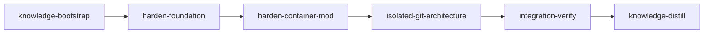

# Plan: Container Backend Security Hardening

## Context

A comprehensive security review of the container backend (`loom/src/orchestrator/terminal/container/*`, `loom/resources/{Dockerfile.tmpl,entrypoint.sh,firewall.sh}`, and the bind-mount layering in `container/mod.rs:240-473`) surfaced 16 findings under the threat model **"the agent inside the container is adversarial."** Three are container escapes (host filesystem compromise via `.git` rw mount, symlink attacks via bind-mounted `.work/` subtrees, daemon shutdown via leaked auth token); four are critical orchestration-manipulation paths (command injection via unescaped `effort`, unpinned `.claude/settings.json`, cross-session forging via `.work/sessions/` rw, wrapper poisoning via `.work/wrappers/` rw); the rest are supply-chain, defense-in-depth, and minor sharp-edges items.

The hardening goal: container mode must be **safe to run an actively malicious agent against** without compromising the host, the operator's secrets, the orchestrator, or sibling stages. Today, none of those guarantees hold.

This plan ships the fixes as three implementation stages (foundation, container-mod hardening, isolated-git architecture) plus the mandatory bookend stages. The deepest architectural change — switching from a host `.git` bind-mount to an in-container git clone with extract-on-completion (B1) — is sequenced last so that the simpler hardening lands first and is independently mergeable if the architectural shift slips.

## Goals

- **Close all three container escapes** (B1, B2, B3) and all four orchestration-manipulation paths (C1, C2, C3, C4)
- **Apply all MAJOR findings**: Dockerfile pinning + checksums (M1), chattr fallback hardening (M2), env strip allowlist (M3), container-name uniqueness (M4), terminal-escape strip in log streaming (M5), `host_repo_root` error propagation (M6), firewall DNS refresh (M7), sudoers removal after firewall install (M8)
- **Apply MINOR sharp edges**: fingerprint width (MN4), Apple Container detection hardening (MN5), image signing surface (MN6), log size cap (MN8)
- **Non-goal**: replace `gosu`/SETUID+SETGID (MN2) — too invasive for this plan
- **Non-goal**: rewrite the firewall to use SNI-based filtering — M7 fix is periodic re-resolve, not architectural

## Execution Diagram



Implementation stages are sequential because Stage 2 consumes the admin-token API and safe-fs helper from Stage 1, and Stage 3 rewrites the same `container/mod.rs` Stage 2 just hardened. Within Stage 1, four parallel subagents do file-disjoint work.

---

## Stages

### 1. Knowledge Bootstrap

**Purpose:** Refresh container-backend knowledge before hardening — the mount-layering doc comment in `container/mod.rs:22-44` is partly stale (e.g. `.git` rw decision rationale), and several past container-related mistakes are already in `doc/loom/knowledge/mistakes.md`.

**Tasks:**

- Run `loom knowledge check` and `loom map --deep` if coverage is incomplete
- Read existing `mistakes.md` entries about container/sandbox before designing fixes (avoid repeating)
- Map current bind-mount topology from `build_mounts` and document what each mount grants vs. what it should grant
- Identify all orchestrator-side writers under `.work/` (Stage 1 subagent A1 needs the inventory)

**Files:** `doc/loom/knowledge/**`

**Acceptance:** `architecture.md`, `entry-points.md`, `patterns.md`, `mistakes.md` populated; `loom knowledge check --min-coverage 50` passes.

---

### 2. Harden Foundation (4 parallel subagents)

**Purpose:** Land all the file-disjoint hardening that doesn't require touching `container/mod.rs`. This unblocks Stage 2 by providing the safe-fs helper, the admin-token API, and the hardened image layer.

**Dependencies:** knowledge-bootstrap

**Subagents:**

| Subagent | Files Owned (write) | Files Read-Only |
| -------- | ------------------- | --------------- |
| A1 — Safe FS Helper + Adoption (senior-engineer) | `loom/src/fs/safe_write.rs` (new), `loom/src/fs/mod.rs`, `loom/src/orchestrator/terminal/container/logs_capture.rs`, plus any other orchestrator-side writers identified by knowledge-bootstrap that target `.work/{sessions,handoffs,memory,crashes,pids,wrappers,stages}/**` | `loom/src/orchestrator/terminal/container/mod.rs`, `loom/src/orchestrator/core/**` |
| A2 — Admin Token + Plan Validation (senior-engineer) | `loom/src/daemon/protocol.rs`, `loom/src/daemon/server/lifecycle.rs`, `loom/src/daemon/server/client.rs`, `loom/src/commands/stop.rs` (or wherever Stop is sent), `loom/src/plan/schema/types.rs` | `loom/src/orchestrator/terminal/container/mod.rs` |
| A3 — Dockerfile + Entrypoint + Firewall (software-engineer) | `loom/resources/Dockerfile.tmpl`, `loom/resources/entrypoint.sh`, `loom/resources/firewall.sh` | — |
| A4 — Image + Fingerprint + Runtime + Container Logs (software-engineer) | `loom/src/orchestrator/terminal/container/image.rs`, `loom/src/orchestrator/terminal/container/fingerprint.rs`, `loom/src/orchestrator/terminal/container/runtime.rs`, `loom/src/commands/container/logs.rs` | — |

**NO FILE OVERLAP** confirmed: A1 owns `logs_capture.rs` (uses safe_write + size cap); A4 stays out of it. A2 owns the schema validation; A3/A4 don't touch plan/schema. `container/mod.rs` is reserved for Stage 2.

#### A1 — Safe FS Helper + Adoption (closes B2, MN8)

Build `safe_write_in_workdir(work_dir: &Path, relpath: &Path, content: &[u8]) -> Result<()>`.

**Linux implementation:** `openat2(RESOLVE_NO_SYMLINKS | RESOLVE_BENEATH | RESOLVE_NO_MAGICLINKS)` via raw syscall (kernel ≥ 5.6). The `open_how` struct is defined in `<linux/openat2.h>`; declare it manually and invoke `syscall(SYS_openat2, ...)` from libc. Verify kernel support at runtime; on EINVAL/ENOSYS, fall through to the portable path.

**macOS / portable fallback:** `O_NOFOLLOW` alone does NOT catch symlinks at intermediate path components — only the final one. Implement a manual component-by-component walk:

1. `open(work_dir, O_RDONLY | O_DIRECTORY | O_NOFOLLOW)` for the initial dirfd
2. For each intermediate path component: `openat(dirfd, comp, O_RDONLY | O_DIRECTORY | O_NOFOLLOW | O_CLOEXEC)` — any symlink at any segment returns `ELOOP` and we abort
3. For the final component: `openat(dirfd, name, O_WRONLY | O_CREAT | O_NOFOLLOW | O_CLOEXEC, 0o644)` then write
4. Close every fd in reverse on success or failure (use a RAII wrapper)

The helper must:

- Refuse any relpath containing `..` components (reject before opening)
- Refuse absolute relpaths (reject before opening)
- Refuse symlinks at ANY path segment, intermediate or terminal
- Be the **only** API used by orchestrator code for writes into `.work/` subtrees that are bind-mounted rw into containers

Adopt at every call site that writes into those subtrees. The knowledge-bootstrap inventory lists them; the most critical are `logs_capture::persist_log` (`loom/src/orchestrator/terminal/container/logs_capture.rs:71-79`), session file writers under `loom/src/models/session/`, and handoff writers.

Add `MAX_LOG_BYTES = 4 * 1024 * 1024` cap in `capture_logs` / `persist_log` — truncate with a trailing `\n--- truncated ---\n` marker. This addresses MN8.

Unit tests on both platforms:

- Symlink at final component rejected
- Symlink at intermediate component rejected (the bug `O_NOFOLLOW` alone misses)
- `..` rejection
- Absolute path rejection
- Escape-via-intermediate-symlink rejection
- Write-through-relative-path success
- Large-content truncation

Use `tempfile` + `std::os::unix::fs::symlink` to construct the attack scenarios in tests.

#### A2 — Admin Token Split + Plan Validation (closes B3, half of C1)

Split `.work/daemon.token` into two files:

- `.work/user.token` — current token semantics; readable by container sessions for RPCs that don't mutate orchestrator state
- `.work/admin.token` — new; required by `Request::Stop`; never mounted into any container

In `daemon/server/client.rs::verify_auth_token` (loom/src/daemon/server/client.rs:19), branch on request type — Stop checks `admin.token`, everything else checks `user.token`. Both tokens are 32-byte cryptographically random hex strings written at daemon startup.

Add a `Capability` enum and tag each `Request` variant. `Stop` → `Capability::Admin`. Everything else → `Capability::User`. `verify_auth_token` becomes `verify_for_capability`.

Update `loom stop` (`loom/src/daemon/server/lifecycle.rs:36-37`) to read `admin.token` instead of `daemon.token`. Migrate by writing both files at startup; `daemon.token` becomes a symlink to `user.token` for backwards-compat **inside this PR only** — drop the symlink in a follow-up commit after the entire plan ships, since the codebase forbids backwards-compat shims (per CLAUDE.md "no backwards-compatibility hacks").

In `loom/src/plan/schema/types.rs`, add an allowlist for `reasoning_effort`: deserialize via a serde validator that rejects anything outside `["low", "medium", "high", "xhigh", "max"]`. This is the schema half of C1; the shell-escape half lives in Stage 2.

#### A3 — Dockerfile + Entrypoint + Firewall (closes M1, M2 partial, M7, M8)

**Realistic supply-chain pinning** — pin what we control, accept what we don't:

In `loom/resources/Dockerfile.tmpl`:

- Pin base image: replace `FROM mcr.microsoft.com/devcontainers/base:ubuntu-24.04` with `FROM mcr.microsoft.com/devcontainers/base@sha256:<digest>`. Document the digest in a comment with the date and how to rotate it. Treat the digest as part of the fingerprint hash (already covered by `compute_fingerprint` which hashes the whole template).
- Pin claude-code: replace `npm install -g @anthropic-ai/claude-code` with `npm install -g @anthropic-ai/claude-code@<exact-version>` (latest stable at plan-execution time; cite in Dockerfile comment). The version becomes part of the fingerprint via the template hash.
- Replace `curl | sh` with download + SHA256 verify + execute for rustup, uv, go:
  - `curl -fsSL <url> -o /tmp/installer` → `echo "<sha256>  /tmp/installer" | sha256sum -c` → `sh /tmp/installer`
  - Pin the rustup-init.sh, uv installer.sh, and go tarball SHA256 values. Document the rotation procedure in a comment.
- **Do NOT pin individual `apt-get install` package versions.** Ubuntu's apt mirrors drop old versions on weekly cadence; per-package pins rot in days. The base-image digest pin already pins the snapshot of apt packages available at base-image build time. Rely on that.

In `loom/resources/entrypoint.sh` (closes M8):

- After firewall install and before `exec gosu loom`: `rm -f /etc/sudoers.d/loom-firewall`. With the sudoers grant gone for the rest of the container lifetime, the loom user has no path to re-run the script even if the lockfile is somehow removed.
- Verify the firewall actually installed expected rules before dropping privileges: `iptables -S OUTPUT | rg -q "match-set loom-allowed"`. Bail with a clear stderr message if not — the container exits and `loom container logs` shows the failure.

In `loom/resources/firewall.sh` (closes M7, partial M2):

- Add a background DNS re-resolver: spawn a sidecar that runs `dig` every 60s and updates `ipset` with refreshed IPs. Use `setsid nohup ... &` so the sidecar survives the entrypoint's `exec gosu loom` (the sidecar continues running as root because it was spawned before the gosu drop). Sidecar must:
  - Write its own PID file at `/var/run/loom-firewall-resolver.pid` with root ownership + mode 0400
  - Use `flock` on the PID file so a second sidecar can't start (defense against the agent somehow triggering a re-fire)
- Add a `MAX_ALLOWLIST_BYTES = 65536` sanity check on `$POLICY` (the host-controlled allowlist file). Reject loading anything larger — prevents the operator (or a poisoned plan) from inserting enough garbage to OOM the ipset during initial resolve.
- Document in a top-of-file comment that IPv4-only allowlist is intentional (ip6tables DROPs everything; AAAA-only domains are unreachable by design).
- **Keep the existing `chattr +i ... || true`** on the firewall script path. `chattr +i` legitimately fails on overlayfs / aufs / many container storage drivers; the load-bearing protection is root ownership + mode 0755 (loom user can't write), not the immutability bit. Update the comment to make this explicit so future readers don't try to "fix" it by removing the `|| true`.

#### A4 — Image + Fingerprint + Runtime + Container Logs (closes MN4, MN5, MN6, M5)

In `loom/src/orchestrator/terminal/container/fingerprint.rs`:

- Widen the hash from 8 hex chars (32 bits) to 16 hex chars (64 bits) — collision becomes negligible (MN4). Update the format string at `fingerprint.rs:100` and existing tests.

In `loom/src/orchestrator/terminal/container/runtime.rs`:

- Harden `is_apple_container` (`runtime.rs:169-187`) — require the binary be code-signed by Apple (use `codesign -dvvv` and grep for `Authority=Apple`). On signature failure, fall back to looking for a verifiable identifier; never trust string heuristics alone (MN5).

In `loom/src/orchestrator/terminal/container/image.rs`:

- Add a cosign-verification step in `ensure_image` (`image.rs:136`) — if `COSIGN_PUBKEY` env or `loom.toml` setting is present, verify the image signature against it before using a cached digest. (MN6)
- **Drop the HMAC-on-digest idea.** It would need a persistent key that survives daemon restarts; that key would have to live in `~/.config/loom/` (out of `.work/` where the agent can read it). Adds key-management complexity for marginal benefit — a manually-edited `image.digest` already requires host-side write access, at which point the attacker has bigger leverage than image-substitution. Cosign verification (above) is the correct primitive when operators want it; don't half-build a homegrown alternative.

In `loom/src/commands/container/logs.rs` (closes M5):

- Strip ANSI escape sequences other than SGR (color/style) from the streamed output before writing to terminal. Use a strict allowlist: only `ESC[` followed by digits/semicolons and ending in `m` is permitted. Drop OSC, DCS, APC, PM, and anything ending in non-`m` characters. Drop `\x07` (BEL) and lone `\x1b`. Pipe through this filter regardless of whether the terminal is interactive — defense in depth.

**Acceptance:**

- `cargo test` passes
- `cargo clippy -- -D warnings` clean
- `safe_write_in_workdir` exists and is called from `persist_log`
- `admin.token` written at daemon startup; `Stop` rejected with `user.token`
- Dockerfile has no unpinned `curl | sh` patterns
- Firewall sidecar re-resolves DNS (test: `ps` shows the watcher PID)

**Verification:**

- `truths`: `loom run --help` (smoke)
- `artifacts`: `loom/src/fs/safe_write.rs`
- `wiring`: protocol.rs imports Capability; client.rs branches on it; image.rs calls cosign helper

---

### 3. Harden container/mod.rs (single subagent, opus)

**Purpose:** Apply every container/mod.rs change in one focused stage now that the foundation API exists. This stage is security-sensitive (mount layering decides what the agent can write) so it uses opus with xhigh effort.

**Dependencies:** harden-foundation

**Files Owned:** `loom/src/orchestrator/terminal/container/mod.rs`

**Single subagent**: loom-senior-software-engineer (security-sensitive mount layering — needs judgment, not boilerplate).

**Detailed changes:**

1. **Per-session rw scope for sessions/, pids/, wrappers/** (closes C3, C4)
   - Replace the directory-wide rw mounts at `mod.rs:313-325` with per-session file mounts. Pre-create empty files (mode 0o644) at orchestrator side before spawn:
     - `<work_dir>/sessions/<session-id>.md` → ro under base; touch file and mount **just this file** rw
     - `<work_dir>/pids/<stage-id>.pid` → same pattern
     - `<work_dir>/wrappers/<stage-id>-wrapper.sh` → same pattern (already written by Stage 2 A1 via safe_write)
   - Keep `memory/`, `handoffs/`, `crashes/` as directory rw (they're append-only and the agent legitimately creates new files there). Note: combined with A1's safe-fs adoption, symlink hijacking from the host side is now blocked.

2. **Settings.json ro pin** (closes C2)
   - Add a Layer-4 ro overlay for `.claude/settings.json` (no `.local`) alongside the existing `settings.local.json` mount at `mod.rs:381-420`. If the host file doesn't exist, materialise an empty `{}` overlay in `<work_dir>/container-settings/<session-id>.settings.json` and ro-mount it. Update `hooks/generator.rs::container_main_settings_path` if needed (read-only from this stage).

3. **Shell-escape effort in claude_cmd** (closes C1 code half)
   - At `mod.rs:589-593`, wrap `effort` with `escape(Cow::Borrowed(effort))` exactly like `model`. Combined with Stage 2 A2's schema allowlist, this is defense in depth — both layers must agree the value is safe.

4. **Remove daemon.token from mount set** (B3 consumer)
   - Strip `daemon.token` from the sensitive-mount list at `mod.rs:368`. Replace with `user.token` (the new file from A2). `admin.token` is never mounted.

5. **Container name uniqueness** (closes M4)
   - At `mod.rs:540-541`, suffix the container name with a daemon-startup nonce (8 hex chars from a daemon-init random buffer). Carry the nonce on `ContainerBackend` as a new field set in `new()`. Update `preemptive_remove_existing` to glob `loom-<stage-id>-<session-type>-*` for cleanup, so retries still find their own orphan but don't trample a foreign daemon's containers.

6. **ENV_STRIP → ENV_ALLOWLIST** (closes M3)
   - Replace `ENV_STRIP` (`mod.rs:115`) with an explicit allowlist. The new constant `ENV_ALLOW: &[&str]` lists exactly the keys forwarded into the container (LANG, LC_ALL, TZ, TERM, anything we know we want). In `build_run_args`, instead of `-e KEY=` strip pairs, pass `--env=KEY=$value` for each allowlist key found in the orchestrator's environment; everything else is implicitly absent (default container-runtime behavior).
   - Update `lifecycle.rs::build_run_args` signature: change `env_strip: &[&str]` to no equivalent (drop entirely), since the allowlist approach doesn't need explicit strips. Update `mod.rs` callers.
   - Update `lifecycle.rs` tests that snapshot the strip args.

7. **host_repo_root error propagation** (closes M6)
   - At `mod.rs:219-233`, replace `unwrap_or_else(|_| self.work_dir.clone())` with explicit error propagation. If canonicalize fails, return an error from `host_repo_root` — don't silently fall back to a path that might mount the wrong host directory.

**Acceptance:**

- `cargo test` in `loom/`
- `cargo clippy -- -D warnings`
- Container backend unit tests pass (`cargo test container::`)
- Snapshot test: rendering `build_mounts` for a Standard stage shows per-session rw scopes, not directory-wide rw on `sessions/`, `pids/`, `wrappers/`
- Snapshot test: `build_run_args` no longer contains `-e SSH_AUTH_SOCK=` strip pairs

**Verification:**

- `truths`: `cargo test --test container_mount_snapshot`
- `artifacts`: `loom/src/orchestrator/terminal/container/mod.rs`
- `wiring`: `Mount::ro` appears on `.claude/settings.json` line in container/mod.rs; `escape(Cow::Borrowed(effort))` appears in claude_cmd construction

---

### 4. Isolated Git Architecture (host-authoritative completion)

**Purpose:** Eliminate the `.git` bind mount entirely (closes B1, the deepest container escape) AND fix the completion-flow conflict surfaced by Codex review: the agent's `loom stage complete` running inside the container must NOT mutate host-visible stage state — it must delegate to the host daemon, which extracts commits while the container is still alive, validates them, imports them into the host repo, and finalizes stage state.

**Dependencies:** harden-container-mod (provides /var/loom/work mount relocation and session-scoped wrappers)

**Files Owned:** see YAML metadata. Touches the daemon RPC, completion command, merge flow, lifecycle paths, and `entrypoint.sh`.

**Architecture:**

```text
Host repo:                    Container (per stage):
.git/  ───┐                   /repo/  (full clone, container-private,
          │                            no host bind mount)
          └── bare-mirror ──ro─▶ /var/loom/mirror   (clone source)

Loom control surface (Stage 3 relocated these out of /repo):
.work/  ───bind─▶  /var/loom/work
~/.claude/hooks/loom/  ───bind─▶  /home/loom/.claude/hooks/loom

Completion (host-authoritative):
  Container: loom stage complete <id>
       │  (sends Request::CompleteStageContainer via Unix socket)
       ▼
  Daemon: extract bundle ── validate ── import to loom/<id> ──
                                                       auto_merge ──
                                                                  kill container ──
                                                                                  write Completed
```

Key design decisions (revised per Codex review):

- **Completion is host-authoritative, not in-container.** Container `loom stage complete` does NOT call `complete_with_merge` locally. It sends a daemon RPC (`Request::CompleteStageContainer`) authenticated with `user.token`. The daemon owns extraction, validation, import, merge, and finalization. Stage state mutates once, on the host, after merge succeeds.

- **Container stays alive until extraction succeeds.** The current `handle_stage_completed` kills the container first then tries to auto-merge — incompatible with container-only commits. New flow keeps the container alive through bundle extraction (via `<runtime> exec` and `<runtime> cp`), then kills only after merge succeeds.

- **Bare mirror is NOT `--shared`.** Codex correctly flagged that `git clone --bare --shared` writes `objects/info/alternates` pointing at host paths invisible inside the container. Use `git clone --bare --no-shared --depth=N` then `git repack -ad` to ensure self-contained. Disk cost is bounded by depth (~10MB for depth 50 of a 50MB repo).

- **Branch targeting matches existing merge flow.** Bundles import into `loom/<stage-id>` for Standard/IntegrationVerify/KnowledgeDistill (matches `branch_name_for_stage`), `main` for Knowledge, the merge target for Merge, `loom/_base/<stage-id>` for BaseConflict. The existing auto-merge consumes these refs as today.

- **Per-session-type completion paths specified explicitly** — see Phase F. The earlier "same clone-then-push pattern" handwave was wrong (Codex blocker B5).

- **Lifecycle paths handled** — completion, handoff, crash, manual kill, daemon stop, stale-merge reap each have a defined commit-preservation policy. See Phase G.

**Phases A–H** are detailed in the YAML metadata (Stage `isolated-git-architecture`). Summary:

| Phase | Topic | Key change |
| ----- | ----- | ---------- |
| A | Mount layering | Drop `/repo` bind, drop `.git` bind, add RO bare-mirror mount at `/var/loom/mirror`. All `.work/` mounts target `/var/loom/work` (Stage 3 relocation). |
| B | Clone in entrypoint | `git clone --depth=$LOOM_DEPTH --branch=$LOOM_BRANCH /var/loom/mirror /repo` as root, then `chown -R loom:loom /repo`, then `exec gosu loom`. |
| C | `git_bridge.rs` helpers | `init_bare_mirror` (no `--shared`, then `repack -ad`), `extract_bundle_from_container` (exec + cp from live container), `validate_bundle` (FF base, branch match, size cap), `import_bundle`, `cleanup_mirror`. |
| D | Container-mode completion command | `commands/stage/complete.rs` and `knowledge_complete.rs` detect container mode and send `Request::CompleteStageContainer` to the daemon instead of running `complete_with_merge` locally. |
| E | Daemon-side RPC handler | New `Request::CompleteStageContainer` variant. Handler does: capability check → extract bundle → validate → import → merge → kill → finalize. |
| F | Per-session-type flow | Standard / IntegrationVerify / KnowledgeDistill import to `loom/<id>`. Knowledge imports to `main` under a merge-lock with moved-main retry. Merge imports to merge target. BaseConflict imports to `loom/_base/<id>`. |
| G | Lifecycle paths | Completion = extract. Handoff = extract to `.work/handoffs/<session>.bundle` for resume. Crash = best-effort. Manual kill = discard (with warning). Daemon stop = deferred bundles. Stale-merge reap = discard. |
| H | Performance | Depth-50 default. Bare mirror NOT `--shared`. Container `/repo` lives in overlay2, not tmpfs. ~100MB per stage. |

**Test plan, failure modes, acceptance, verification:** see YAML metadata for the full list (10+ tests including the Codex-requested race test, dirty-clone rejection, handoff bundle preservation, daemon-stop deferred bundles, and per-session-type flows).

**Verification:**

- `truths`: `cargo test git_bridge::tests`
- `artifacts`: `loom/src/orchestrator/terminal/container/git_bridge.rs`
- `wiring`: completion_handler imports git_bridge; entrypoint.sh contains `git clone /var/loom/mirror`

---

### 5. Integration Verification

**Purpose:** Final integration check across all hardening. Includes adversarial smoke tests that exercise the closed escape paths.

**Dependencies:** isolated-git-architecture

**Tasks:**

_Build & test (zero tolerance — fix every warning):_

- Full `cargo test`, `cargo clippy -- -D warnings`, `cargo build` in `loom/`
- All container-backend integration tests

_Code review (parallel review subagents):_

- security review (loom-code-reviewer + `/loom-security-audit`): re-audit the new mount layering, the git_bridge module, the admin token RPC split. Look for new escape paths introduced by the changes.
- architecture review (loom-code-reviewer): the bare-mirror + container-clone design — does it interact correctly with parallel stages? Are there race conditions in push extraction?
- test coverage (loom-code-reviewer): adversarial tests must exist for each closed escape — verify they actually exercise the attack and pass.

_Functional verification (mandatory — adversarial):_

- Smoke test: spawn a container session that runs the actual attacks from the review report (`rm -rf /repo/*`, write `.git/hooks/post-merge`, `ln -sf ~/.ssh/authorized_keys ./.work/handoffs/x`, `loom stop` from inside, malicious `effort` value in plan YAML) — every attack must FAIL.
- Verify the daemon survives a hostile stage running `loom stop` (admin.token check rejects).
- Verify the host repo's `.git/hooks/` is unchanged after a hostile stage that tried to write to it.

**Acceptance:**

- `cargo test` (all)
- `cargo clippy -- -D warnings`
- `cargo build --release`
- All adversarial smoke tests pass (the agent attempts the escape and is blocked)

**Verification:**

- `truths`: `cargo test container::security::`
- `wiring`: adversarial test module exists; references each finding ID (B1, B2, B3, C1, ...)

---

### 6. Knowledge Distillation

**Purpose:** Curate the security-hardening lessons into permanent knowledge. Update operator-facing docs to describe the new threat model and what container mode now guarantees.

**Dependencies:** integration-verify

**Tasks:**

_Memory curation:_

- Synthesize stage memories from harden-foundation, harden-container-mod, isolated-git into mistakes.md prevention rules (anything subagents flagged as non-obvious)
- Write a new section in `architecture.md` documenting the container security boundary: what the host trusts, what the container can do, what the firewall protects, what the mounts protect
- Write a new patterns.md section on "Safe FS writes into bind-mounted directories" referencing the safe_write helper
- Document the admin/user token split in `entry-points.md` so future agents understand which RPCs need which token

_Knowledge review:_

- Run `loom review`; remove stale entries that contradicted the new architecture
- Update `architecture.md`'s container-backend section: bind-mount topology is now `/repo` as tmpfs, no `.git` mount, per-session rw scopes

_Documentation update:_

- Update `README.md` container-mode section to describe the threat model
- Update `CONTRIBUTING.md` with the security-test pattern for new container changes (run adversarial smoke tests if mount layering changes)

**Acceptance:**

- Knowledge files contain new sections (rg matches the new headers)
- README mentions admin.token vs user.token

---

<!-- loom METADATA -->

```yaml
loom:
  version: 1
  sandbox:
    enabled: true
    auto_allow: true
    excluded_commands:
      - "loom"
    filesystem:
      deny_read:
        - "~/.ssh/**"
        - "~/.aws/**"
        - "~/.gnupg/**"
        - "~/.config/gcloud/**"
      deny_write:
        # .work/** is denied by default; only listing exceptions here
        - "doc/loom/knowledge/**"
      allow_write:
        - "loom/src/**"
        - "loom/resources/**"
        - "loom/tests/**"
    network:
      allowed_domains:
        - "crates.io"
        - "index.crates.io"
        - "static.crates.io"
        - "github.com"
        - "raw.githubusercontent.com"
        - "api.github.com"
      allow_local_binding: false
      allow_unix_sockets: []
  stages:
    - id: knowledge-bootstrap
      name: "Bootstrap Container-Backend Knowledge"
      stage_type: knowledge
      model: "sonnet"
      reasoning_effort: "high"
      description: |
        MANDATORY first stage. Refresh container-backend knowledge before
        the hardening work. The mount-layering doc comment in
        container/mod.rs:22-44 is partly stale (the .git rw mount comment
        will be wrong after this plan). Several past container-related
        mistakes already live in doc/loom/knowledge/mistakes.md — read
        them to avoid repeating.

        Use parallel subagents and skills to maximize performance.

        Step 0 - CHECK EXISTING KNOWLEDGE:
          Run: loom knowledge check
          If coverage < 50% OR architecture shows INCOMPLETE:
            Run: loom map --deep

        Step 1 - PARALLEL EXPLORATION:
          Subagent 1 - Mount topology audit (loom-software-engineer):
            Inventory every Mount::rw and Mount::ro in build_mounts.
            Document for each: source path, target path, rationale,
            attack surface, what restricts the agent today.
            Output: loom knowledge update architecture "..."

          Subagent 2 - .work/ writer inventory (loom-software-engineer):
            Find every std::fs::write call site under loom/src/ that
            targets a path under .work/. Group by which .work/ subtree
            it writes to. This inventory feeds Stage 2 A1 (safe-fs
            adoption).
            Output: loom knowledge update entry-points "..."

          Subagent 3 - Existing mistakes review (loom-software-engineer):
            Read doc/loom/knowledge/mistakes.md. Identify any past
            container-related mistakes that this plan might re-trigger.
            Output: loom memory note "prior mistake: ..."

          Spawn as parallel Task tool calls.

        MEMORY & KNOWLEDGE RECORDING (use loom commands only):
        - loom memory note "..." for surprises and gotchas
        - loom knowledge update for permanent learnings
        - NEVER use Claude Code's auto-memory

        Before completing: loom memory list (verify insights captured).
      dependencies: []
      acceptance:
        - 'loom knowledge check --min-coverage 50'
        - 'rg -q "## " doc/loom/knowledge/architecture.md'
        - 'rg -q "## " doc/loom/knowledge/entry-points.md'
        - 'rg -q "## " doc/loom/knowledge/mistakes.md'
      files:
        - "doc/loom/knowledge/**"
      working_dir: "."
      artifacts:
        - "doc/loom/knowledge/architecture.md"
        - "doc/loom/knowledge/entry-points.md"
        - "doc/loom/knowledge/mistakes.md"

    - id: harden-foundation
      name: "Harden Foundation (4 parallel subagents)"
      stage_type: standard
      model: "opus"
      reasoning_effort: "xhigh"
      description: |
        Land all file-disjoint hardening that doesn't require touching
        container/mod.rs. This unblocks Stage 2 by providing the
        safe-fs helper, admin-token API, hardened image layer, and the
        ANSI-strip log filter.

        Use parallel subagents and skills to maximize performance.

        SUBAGENT FILE ASSIGNMENTS:
          Subagent A1 — Safe FS Helper + Adoption (loom-senior-software-engineer):
            Files Owned:
              loom/src/fs/safe_write.rs (NEW)
              loom/src/fs/mod.rs
              loom/src/orchestrator/terminal/container/logs_capture.rs
              other .work/ writers identified by knowledge-bootstrap
            Files Read-Only:
              loom/src/orchestrator/terminal/container/mod.rs
              loom/src/orchestrator/core/**

          Subagent A2 — Admin Token Split + Plan Validation (loom-senior-software-engineer):
            Files Owned:
              loom/src/daemon/protocol.rs
              loom/src/daemon/server/lifecycle.rs
              loom/src/daemon/server/client.rs
              loom/src/commands/stop.rs (if exists; else wherever Stop is sent)
              loom/src/plan/schema/types.rs
            Files Read-Only:
              loom/src/orchestrator/terminal/container/mod.rs

          Subagent A3 — Dockerfile + Entrypoint + Firewall (loom-software-engineer):
            Files Owned:
              loom/resources/Dockerfile.tmpl
              loom/resources/entrypoint.sh
              loom/resources/firewall.sh
            Files Read-Only:
              (none required)

          Subagent A4 — Image + Fingerprint + Runtime + Logs (loom-software-engineer):
            Files Owned:
              loom/src/orchestrator/terminal/container/image.rs
              loom/src/orchestrator/terminal/container/fingerprint.rs
              loom/src/orchestrator/terminal/container/runtime.rs
              loom/src/commands/container/logs.rs
            Files Read-Only:
              (none required)

        NO FILE OVERLAP between subagents confirmed.
        container/mod.rs is RESERVED for Stage 2 (harden-container-mod).

        SUBAGENT A1 TASKS (closes B2, MN8) — REVISED per Codex review:
        Build a safe_fs module with a FAMILY of helpers, not a single
        write function. Real .work/ writers need locked replacement,
        append, create-new, mode-setting, and mkdir semantics.

        New module: src/fs/safe_fs.rs (and src/fs/safe_write.rs may
        re-export the simple case for convenience). Public API:

          safe_open_dirfd(work_dir) -> RawFd
            Open work_dir as a dirfd with O_DIRECTORY | O_NOFOLLOW.
            All operations below use this dirfd as a base.

          safe_create_dir_all_in_workdir(dirfd, relpath, mode)
            Walk components with mkdirat + openat + O_NOFOLLOW. Each
            intermediate must NOT be a symlink. Idempotent (EEXIST ok
            if existing is a directory).

          safe_locked_write_in_workdir(dirfd, relpath, content)
            For stages/sessions: openat(O_WRONLY|O_CREAT|O_TRUNC|
            O_NOFOLLOW|O_CLOEXEC), flock LOCK_EX, write, release.
            Mirrors fs/locking.rs:88 semantics.

          safe_append_in_workdir(dirfd, relpath, content)
            For memory journals: openat(O_WRONLY|O_APPEND|O_CREAT|
            O_NOFOLLOW|O_CLOEXEC), write atomically (single write()).

          safe_create_new_in_workdir(dirfd, relpath, content)
            For handoffs: openat(O_WRONLY|O_CREAT|O_EXCL|O_NOFOLLOW|
            O_CLOEXEC), fail if exists.

          safe_write_with_mode_in_workdir(dirfd, relpath, content, mode)
            For wrappers (need 0o755 executable): like locked_write
            but fchmod on the opened fd before close.

          safe_remove_in_workdir(dirfd, relpath)
            unlinkat — refuses paths with .. components.

        Linux preferred path: openat2(RESOLVE_NO_SYMLINKS |
        RESOLVE_BENEATH | RESOLVE_NO_MAGICLINKS) via raw syscall;
        invoked from the helpers' open implementations. Detect kernel
        support at module init; on EINVAL/ENOSYS fall through to the
        portable openat-walk path.

        Portable path (macOS Apple Container + older Linux):
        component-by-component dirfd walk. Open each intermediate with
        O_RDONLY|O_DIRECTORY|O_NOFOLLOW|O_CLOEXEC; if any segment is a
        symlink, kernel returns ELOOP and we abort. Terminal openat
        with O_NOFOLLOW for the final file.

        Refuse universally: ".." components, absolute relpaths,
        symlinks at any segment (intermediate or terminal).

        ADOPTION inventory (from knowledge-bootstrap exploration):
        - orchestrator/core/persistence.rs:73,110 — stage/session writes
          → safe_locked_write_in_workdir
        - fs/locking.rs:88 — generic locked write → migrate
        - fs/memory/storage.rs:56,99 — memory journals
          → safe_append_in_workdir
        - handoff/generator/mod.rs:33 — handoff creation
          → safe_create_new_in_workdir
        - native/pid_tracking.rs:426 — wrapper write with mode
          → safe_write_with_mode_in_workdir
        - container/mod.rs:316, logs_capture.rs:72, network.rs:25 —
          directory creation → safe_create_dir_all_in_workdir
        - crash preservation copy/read+write paths — add safe variants
        - Container backend's .work/ targets: sessions, memory,
          handoffs, crashes, pids, wrappers, stages, signals, network,
          container-settings, verifications. Audit ALL.

        Add MAX_LOG_BYTES = 4MiB truncation in capture_logs/persist_log.

        Unit tests (use tempfile + std::os::unix::fs::symlink):
        - Symlink at FINAL component rejected (all variants)
        - Symlink at INTERMEDIATE component rejected (the case
          O_NOFOLLOW alone misses)
        - ".." rejection, absolute-path rejection
        - safe_locked_write: concurrent writers serialize
        - safe_append: order preserved across N concurrent appends
        - safe_create_new: EEXIST returned on second create
        - safe_write_with_mode: resulting file has expected mode bits
        - safe_create_dir_all: intermediate symlink in path fails
        - Large-content truncation

        SUBAGENT A2 TASKS (closes B3, half of C1) — REVISED per Codex:
        Token split alone is NOT enough. The current `loom stop`:
        - terminates container sessions FIRST (commands/stop.rs:33)
          before any auth check
        - falls back to SIGTERM/SIGKILL of the daemon PID on auth
          failure (commands/stop.rs:48-58)
        Both must be fixed or the admin/user split is bypassable.

        TOKEN SPLIT:
        - Split .work/daemon.token into .work/user.token + .work/admin.token.
        - Drop .work/daemon.token entirely (codebase is pre-release;
          CLAUDE.md forbids backwards-compat shims). The plan's previous
          contradictory "create symlink for migration" text is removed.
        - Both tokens written at daemon startup; 32-byte hex random
          generated via OsRng.
        - admin.token: file mode 0o600, ownership host user. Used only
          by the host CLI for privileged ops.
        - user.token: file mode 0o644 (readable in container). Used for
          all non-privileged RPCs.
        - Replace generic read_auth_token with explicit
          read_user_token(work_dir) and read_admin_token(work_dir).

        PROTOCOL CHANGES:
        - Add Capability enum (User, Admin). Tag each Request variant.
          Stop = Admin; everything else = User.
        - verify_for_capability(work_dir, token, cap) replaces
          verify_auth_token. Returns AuthenticationFailed if token does
          not match the required capability's file.

        STOP-PATH HARDENING (mandatory — Codex blocker):
        - Reorder commands/stop.rs::execute: read admin.token FIRST,
          send Request::Stop SECOND, run side effects ONLY after the
          daemon ack. terminate_active_container_sessions runs AFTER
          the daemon has accepted the Stop and entered shutdown.
        - On AuthenticationFailed or token-read failure: print a clear
          error and ABORT. Do NOT fall back to PID kill. Side effects
          must not occur.
        - Reserve PID fallback (kill_daemon_pid) for one specific case:
          socket-connect-timeout (daemon is hung but auth is irrelevant).
          Even then, only after explicit operator confirmation via
          --force flag. Without --force, refuse.
        - Tests (mandatory):
          - Stop with user.token returns AuthenticationFailed AND no
            container sessions are terminated AND daemon.shutdown_flag
            remains false
          - Stop with admin.token succeeds AND containers are killed
            in proper order
          - Ping/SubscribeStatus with user.token succeeds
          - Stop with admin.token where socket is hung: refuses to
            kill PID unless --force is passed

        PLAN SCHEMA VALIDATION (half of C1):
        - In plan/schema/types.rs, add a serde validator for
          reasoning_effort that rejects values outside
          {"low","medium","high","xhigh","max"}. Use a custom
          deserialize_with that returns DeError on mismatch.
        - Add test: plan YAML with reasoning_effort: "low; rm -rf / #"
          fails parsing with a clear error message.

        SUBAGENT A3 TASKS (closes M1, M2 partial, M7, M8) — REVISED:
        Critical correction from Codex: apt-get update runs against
        LIVE mirrors (Dockerfile.tmpl:14), so the base-image digest pin
        does NOT pin the apt package snapshot. Be honest about what is
        and isn't pinned.

        - Dockerfile.tmpl:
          - Pin base image: FROM mcr.microsoft.com/devcontainers/base@sha256:<digest>.
            Comment with rotation procedure.
          - Pin claude-code: npm install -g @anthropic-ai/claude-code@<version>.
          - Replace curl|sh with download+SHA256-verify+execute for
            rustup, uv, go. Pin SHA256 values with rotation comment.
          - Add coverage for NodeSource setup, Node.js apt install,
            TypeScript npm pin, bun install pin. These were missed in
            the original plan.
          - apt-get installs: explicitly document as INTENTIONALLY
            MUTABLE (live apt mirrors). Add a top-of-file comment
            stating: "apt packages reflect the base-image apt mirror
            state at image-build time; rebuild image to refresh."
            If reproducibility matters more than current SLA, the
            operator can switch to a snapshot mirror (snapshot.ubuntu.com)
            via build arg — leave a hook for it, not a default.
          - Pinning script: add scripts/update-pins.sh (host-side helper)
            that prints the current set of digests/SHAs the operator
            should paste into the Dockerfile. Eases rotation.
        - entrypoint.sh:
          - FIRST FIX (Codex blocker): verify entrypoint actually runs
            as root. Docker injects --user=<uid>:<gid> (runtime.rs:64-75)
            which prevents root execution. CAP_NET_ADMIN does not work
            from non-root user without ambient cap propagation, which
            is not configured.
            Resolution: at the top of entrypoint.sh, check `id -u`. If
            non-zero, exit with a clear error explaining that loom
            requires the container to start as root for firewall
            install. Stage 3 (harden-container-mod) drops the Docker
            --user injection (loom runs as root inside the container,
            then gosu drops to loom; the bind-mount UID matching is
            handled by the existing chown -R after clone).
          - After firewall install: "rm -f /etc/sudoers.d/loom-firewall"
            (M8 close — agent loses path to re-run firewall script).
            Only after this is verified working under the corrected
            root-entry model.
          - Verify firewall rules installed before gosu drop:
            iptables -S OUTPUT | rg -q "match-set loom-allowed";
            bail with clear stderr message if missing.
        - firewall.sh:
          - Spawn background DNS re-resolver: "setsid nohup ... &"
            so it survives entrypoint's exec gosu loom. Sidecar runs
            as root (spawned before drop).
            REFRESH SEMANTICS (Codex correction): refresh into a TEMP
            ipset (loom-allowed-next), validate domains during build,
            cap per-domain IP count and total IP count, then
            `ipset swap loom-allowed loom-allowed-next && ipset destroy
            loom-allowed-next`. Atomic. On DNS failure: leave the old
            set in place (no flush, no append). PID file at
            /var/run/loom-firewall-resolver.pid owned root mode 0400;
            flock so double-start is impossible. Ensure `flock` is
            present in the image (add to apt-get install).
          - MAX_ALLOWLIST_BYTES = 65536 sanity check on $POLICY.
          - MAX_TOTAL_IPS = 4096 cap on the resolved ipset to prevent
            unbounded growth via DNS flood.
          - Top-of-file comment: IPv4-only allowlist is intentional;
            ip6tables DROPs everything; AAAA-only domains unreachable
            by design.
          - KEEP existing "chattr +i ... || true" — chattr legitimately
            fails on overlayfs/aufs and removing the || true breaks
            image builds. Load-bearing defense is root ownership +
            mode 0755, not the immutability bit. Update comment to
            make this explicit so future readers don't try to "fix" it.

        SUBAGENT A4 TASKS (closes MN4, MN5, M5, MN6) — REVISED:
        - fingerprint.rs: widen hash from 8 to 16 hex chars.
          CODEX CORRECTION: also include ENTRYPOINT_SCRIPT in the
          fingerprint hash. Currently fingerprint.rs:22-25 hashes only
          Dockerfile.tmpl + firewall.sh, missing entrypoint.sh.
          Stage 4 modifies entrypoint extensively — without this fix,
          cached images won't rebuild on entrypoint changes.
          Update compute_fingerprint_inner signature to accept
          entrypoint content too; update both call site and tests.
          Knowledge update: doc/loom/knowledge/architecture.md should
          mention entrypoint is part of the fingerprint.

        - runtime.rs: harden is_apple_container — codesign -dvvv check
          for Authority=Apple. Don't trust string heuristics alone.

        - image.rs: add cosign verification step in ensure_image.
          CODEX CORRECTION: ensure_image is not the only consumer of
          image_digest. ContainerBackend::new() (mod.rs:144-185) reads
          the persisted digest directly. To protect runtime against a
          tampered .work/config.toml, ALSO verify in:
          (a) preflight (where loom init reads project_execution config)
          (b) ContainerBackend::new() before constructing the backend
          Define a signing policy:
            - opt-in via loom.toml [project_execution.signing]
              with mode = "off" | "required" | "trusted"
            - "required" + missing COSIGN_PUBKEY = preflight error
            - "trusted" = local builds bypass; external digests verify
          Drop the HMAC-on-digest idea (Codex agrees this was
          half-baked); cosign is the correct primitive.

        - commands/container/logs.rs: REWRITE the streaming model.
          CODEX BLOCKER: current code uses Command::exec() (logs.rs:244)
          which replaces the current process — no in-process filtering
          possible. Replace with:
            - Command::new(runtime).args(&args).stdout(Stdio::piped())
              .stderr(Stdio::piped()).spawn()
            - Spawn two threads (or async tasks) that read child
              stdout/stderr through a streaming byte-state-machine
              ANSI filter, then write to the parent's stdout/stderr
            - Forward SIGINT/SIGTERM to the child (use ctrlc crate
              or nix::signal)
            - Wait for child exit; propagate exit status
          Filter allowlist: ESC[ followed by digits/semicolons ending
          in 'm' (SGR only). Drop OSC, DCS, APC, PM; drop BEL; drop
          lone ESC. State machine handles partial sequences across
          chunk boundaries.
          Tests:
            - Split escape sequence across chunk boundaries reassembled
            - OSC removed (terminal injection blocked)
            - BEL / lone ESC removed
            - SGR preserved (colors still work)
            - Follow mode (-f) streams continuously
            - Ctrl-C forwarded; child exits; parent gets correct status
            - Non-follow mode exits cleanly when child exits

        MEMORY RECORDING (use loom memory ONLY):
        - NEVER use Claude Code's auto-memory
        - NEVER use loom knowledge update (reserved for knowledge stages)
        - Record IMMEDIATELY:
          - MISTAKE: loom memory note "mistake: tried X, failed because Y, fix Z"
          - DECISION: loom memory decision "chose X" --context "Y was worse because Z"
          - SURPRISE: loom memory note "found: behavior in file:line"
          - GOTCHA: loom memory note "gotcha: looks right but actually Y"
        - SUBAGENTS MUST also record memories. Include in every subagent
          Task prompt: record mistakes, decisions, surprises via loom memory.
          Do NOT record procedural actions.
      dependencies: ["knowledge-bootstrap"]
      acceptance:
        - "cargo test"
        - "cargo clippy --all-targets -- -D warnings"
        - "cargo build"
        # Moved from removed truths field — these check intent at parse time:
        - 'rg -q "openat2|O_NOFOLLOW" src/fs/safe_write.rs'
        - 'rg -q "admin.token" src/daemon/'
        - 'rg -qF "Capability::Admin" src/daemon/protocol.rs'
        - 'rg -q "ENTRYPOINT_SCRIPT" src/orchestrator/terminal/container/fingerprint.rs'
      files:
        - "src/fs/**"
        - "src/daemon/**"
        - "src/plan/schema/types.rs"
        - "src/orchestrator/terminal/container/logs_capture.rs"
        - "src/orchestrator/terminal/container/image.rs"
        - "src/orchestrator/terminal/container/fingerprint.rs"
        - "src/orchestrator/terminal/container/runtime.rs"
        - "src/commands/container/logs.rs"
        - "src/commands/stop.rs"
        - "resources/**"
      working_dir: "loom"
      artifacts:
        - "src/fs/safe_write.rs"
        - "src/fs/safe_fs.rs"
      wiring:
        - source: "src/daemon/server/client.rs"
          pattern: "Capability"
          description: "Daemon protocol uses Capability enum for admin/user split"
        - source: "src/plan/schema/types.rs"
          pattern: "reasoning_effort"
          description: "reasoning_effort field has validation"
        - source: "src/orchestrator/terminal/container/logs_capture.rs"
          pattern: "safe_write"
          description: "persist_log uses the safe-fs helper"
        - source: "resources/Dockerfile.tmpl"
          pattern: "sha256:"
          description: "Base image pinned by digest"
        - source: "resources/entrypoint.sh"
          pattern: "rm /etc/sudoers.d/loom-firewall"
          description: "Sudoers cleanup after firewall install"
        - source: "src/orchestrator/terminal/container/fingerprint.rs"
          pattern: "ENTRYPOINT_SCRIPT"
          description: "Entrypoint script included in fingerprint hash"
        - source: "src/commands/stop.rs"
          pattern: "read_admin_token"
          description: "Stop path reads admin.token, never user.token"
        - source: "src/commands/container/logs.rs"
          pattern: "Stdio::piped"
          description: "logs subcommand spawns child + filters; no exec()"

    - id: harden-container-mod
      name: "Harden container/mod.rs"
      stage_type: standard
      model: "opus"
      reasoning_effort: "xhigh"
      description: |
        Apply every container/mod.rs change in one focused stage now
        that the foundation API (safe_write, user.token/admin.token,
        reasoning_effort allowlist) exists.

        Use parallel subagents and skills to maximize performance.

        Single subagent — security-sensitive mount layering needs
        judgment, not boilerplate. Use loom-senior-software-engineer.

        FILE OWNERSHIP:
          Files Owned:
            src/orchestrator/terminal/container/mod.rs
            src/orchestrator/terminal/container/lifecycle.rs
            src/orchestrator/terminal/container/runtime.rs
            src/orchestrator/terminal/native/pid_tracking.rs
              (wrapper naming becomes session-scoped)
            src/hooks/generator.rs
              (LOOM_WORK_DIR env now /var/loom/work, not /repo/.work)
          Files Read-Only:
            src/fs/safe_fs.rs (consume the helpers)
            src/daemon/protocol.rs (Capability enum)
            src/plan/schema/types.rs (validated effort)

        CHANGES (apply ALL):

        1. SESSION-SCOPED RW MOUNTS (closes C3, C4) — REVISED per Codex:
           Codex correctly noted wrapper paths are STAGE-scoped
           (pid_tracking.rs:46 — <stage_id>-wrapper.sh) not session-
           scoped. A per-session rw mount of a stage-scoped path still
           lets retry sessions share the same wrapper. Fix:
           - Change wrapper_script_path to include session_id:
             <work_dir>/wrappers/<session-id>-wrapper.sh
           - Native backend wrapper consumers updated; tests updated
           - Per-session rw mounts for:
             <work_dir>/sessions/<session-id>.md
             <work_dir>/pids/<session-id>.pid    (also session-scoped)
             <work_dir>/wrappers/<session-id>-wrapper.sh
             <work_dir>/stages/<NN>-<stage-id>.md (current agent's
               OWN stage file — single-file rw, unchanged from previous)
           Pre-create empty files (0o644 for data, 0o755 for wrapper)
           at orchestrator side before spawn.

           Codex flagged that memory/, handoffs/, crashes/ as
           directory-rw still allows symlink planting from inside
           container. Stage 2's safe-fs adoption covers HOST-SIDE
           writes (and reads) of these paths, but the container CAN
           still create symlinks within the mount. The mitigations:
           (a) host-side reads ALSO go through safe_fs (no symlink
               following on read) — added to Stage 2 A1 scope
           (b) cleanup paths that delete files in these dirs use
               safe_remove_in_workdir (rejects .. and follows nothing)
           (c) directories are mode 0o755; container can write but
               cannot escape host-side safe reads
           This is documented as a residual exposure — the agent can
           still trash its OWN memory/handoff/crash files via symlink
           plant + later write, but cannot affect host files outside.

        2. MOUNT TARGET RELOCATION (Codex blocker B3 dependency):
           Stage 4 needs /repo as a clone destination; current mounts
           use /repo/.work paths. Move ALL loom control mounts to a
           new prefix /var/loom/work BEFORE Stage 4 lands so the two
           changes don't tangle.
           - REPO_MOUNT stays /repo for now (used by Knowledge/Merge/
             BaseConflict which still get rw /repo until Stage 4)
           - NEW: WORK_DIR_IN_CONTAINER = "/var/loom/work" (was
             "/repo/.work")
           - Update LOOM_WORK_DIR env in build_env_for_session
             (mod.rs:484) to /var/loom/work
           - Update wrapper script generator: LOOM_WORK_DIR in the
             generated wrapper uses /var/loom/work
           - Update hooks/generator.rs:110: container LOOM_WORK_DIR
             env value changes to /var/loom/work
           - Update remap_signal_path (mod.rs:917-937) to map host
             .work/signals/foo.md → /var/loom/work/signals/foo.md
           - Update tests that assert /repo/.work/* paths

        3. SETTINGS.JSON RO PIN (closes C2):
           Add Layer-4 ro overlay for .claude/settings.json (no .local)
           alongside the existing settings.local.json mount at
           mod.rs:381-420. If host file doesn't exist, materialise an
           empty {} overlay in <work_dir>/container-settings/<session-id>.settings.json
           and ro-mount it.

        4. SHELL-ESCAPE EFFORT (closes C1 code half):
           At mod.rs:589-593, wrap effort with escape(Cow::Borrowed(effort))
           exactly like model. Stage 1's schema validation is defense
           in depth.

        5. REMOVE daemon.token MOUNT (B3 consumer):
           Strip daemon.token from the sensitive-mount list at mod.rs:368.
           Replace with user.token from Stage 1. admin.token is NEVER
           mounted into any container.

        6. CONTAINER NAME / LABEL HARDENING (closes M4) — REVISED:
           Codex correctly flagged that glob prefix-match cleanup
           can kill a foreign daemon's containers. Switch to LABELS
           for the cleanup discriminator:
           - Pass via build_run_args: --label loom.project_root=<path>
             --label loom.work_dir=<path> --label loom.stage_id=<id>
             --label loom.session_id=<id> --label loom.daemon_nonce=<hex>
           - daemon_nonce is generated at daemon startup, persisted
             at .work/daemon.nonce (admin-token-protected; not
             container-readable)
           - Container name is still derived from tracking_key but
             with a nonce suffix; collision in name still fails the
             `run --name` call, so the name uniqueness from labels
             is doubled-up
           - preemptive_remove_existing: filter by EXACT
             container_name read from session file (not glob).
             Orphan recovery: filter by label
             loom.daemon_nonce=<current> (own daemon only).
             Foreign-daemon containers untouched.

        7. ENV_STRIP → ENV_ALLOWLIST (closes M3):
           Replace ENV_STRIP at mod.rs:115 with explicit ENV_ALLOW.
           In build_run_args, pass --env=KEY=$value for each allowlist
           key found in the orchestrator's environment; nothing else
           propagates (default container behavior).
           Drop the env_strip parameter from build_run_args entirely.
           Update lifecycle.rs tests.

        8. host_repo_root ERROR PROPAGATION (closes M6):
           At mod.rs:219-233, replace unwrap_or_else(|_| self.work_dir.clone())
           with explicit error propagation. Refuse to spawn rather than
           mount the wrong host directory.

        9. DROP DOCKER --user INJECTION (Codex blocker dependency):
           At runtime.rs:64-75 Docker injects --user=<uid>:<gid> which
           prevents root entry — breaking firewall install and the
           Stage 4 in-entrypoint git clone. Drop the --user injection.
           Container starts as root for entrypoint work; gosu loom
           drops to the unprivileged user; chown -R loom:loom /repo
           (added in Stage 4's entrypoint clone step, but pre-stage
           that target doesn't exist yet) and chown of bind-mounted
           .work/ subtrees to loom user happens via entrypoint
           pre-gosu (new addition to entrypoint.sh, coordinated with
           Stage 1 A3). With Podman --userns=keep-id, the mapping
           still gives host-uid ownership of writes; with Docker, the
           entrypoint's explicit chown handles it.

        MEMORY RECORDING (use loom memory ONLY):
        - Record every non-obvious decision about mount ordering or
          per-session naming
        - Surprises about how Docker/Podman/Apple-Container handle the
          new mount layout
      dependencies: ["harden-foundation"]
      acceptance:
        - "cargo test"
        - "cargo clippy --all-targets -- -D warnings"
        - "cargo build"
        - "cargo test container::"
        - "cargo test container::tests::"
      files:
        - "src/orchestrator/terminal/container/mod.rs"
        - "src/orchestrator/terminal/container/lifecycle.rs"
      working_dir: "loom"
      artifacts:
        - "src/orchestrator/terminal/container/mod.rs"
      wiring:
        - source: "src/orchestrator/terminal/container/mod.rs"
          pattern: "user.token"
          description: "container mounts user.token, never admin.token"
        - source: "src/orchestrator/terminal/container/mod.rs"
          pattern: "escape(Cow::Borrowed(effort))"
          description: "effort is shell-escaped in claude_cmd construction"
        - source: "src/orchestrator/terminal/container/mod.rs"
          pattern: "ENV_ALLOW"
          description: "ENV_STRIP replaced with explicit allowlist"

    - id: isolated-git-architecture
      name: "Isolated Git Architecture (host-authoritative completion)"
      stage_type: standard
      model: "opus"
      reasoning_effort: "xhigh"
      description: |
        Eliminate the .git bind mount entirely (closes B1, the deepest
        container escape). Container gets a container-private clone.
        Completion becomes HOST-AUTHORITATIVE via a daemon RPC — the
        agent's `loom stage complete` inside the container sends an
        RPC to the host daemon, which extracts commits via runtime
        exec, validates them, imports them into the host repo's
        loom/<stage-id> branch, runs the existing merge flow, then
        finalizes stage state. Container is alive throughout the
        extraction window.

        Use parallel subagents and skills to maximize performance.

        Single subagent — major architectural shift across daemon,
        completion, merge, and lifecycle paths. Use
        loom-senior-software-engineer with xhigh effort.

        FILE OWNERSHIP:
          Files Owned:
            src/orchestrator/terminal/container/mod.rs
            src/orchestrator/terminal/container/git_bridge.rs (NEW)
            src/orchestrator/auto_merge.rs
            src/orchestrator/core/completion_handler.rs
            src/orchestrator/core/event_handler.rs
              (handoff/crash paths for container-only state)
            src/orchestrator/merge_handler.rs
              (stale merge session reap)
            src/commands/stage/complete.rs
              (container mode delegates to daemon RPC)
            src/commands/stage/progressive_complete.rs
              (skip in-container merge in container mode)
            src/commands/stage/knowledge_complete.rs
              (delegate to daemon RPC; main-moved retry)
            src/daemon/protocol.rs
              (new Request::CompleteStageContainer)
            src/daemon/server/client.rs
              (handler for new request)
            resources/entrypoint.sh
              (clone-in-entrypoint, depends on Stage 3's mount relocation)
          Files Read-Only:
            src/git/** (existing host-side helpers)
            src/fs/safe_fs.rs (consume helpers for bundle paths)

        KEY DESIGN DECISIONS — REVISED PER CODEX REVIEW:

        - HOST-AUTHORITATIVE completion (Codex blockers B1, B2, B6):
          Container `loom stage complete` does NOT call
          complete_with_merge(). Instead it sends a new
          Request::CompleteStageContainer to the daemon, which runs
          the merge against the host repo using commits extracted
          from the live container. Stage state mutates ONCE, from
          the host side, after merge succeeds. No in-container
          stage_file write is permitted to mutate `merged=true`.

        - Container stays alive until extraction succeeds (Codex B6):
          completion_handler::handle_stage_completed currently kills
          the session FIRST then auto-merges. New flow:
            1. RPC enters daemon → bundle extract → validate →
               import to loom/<stage-id> → run auto_merge
            2. ONLY after auto_merge succeeds (or fails with a
               specific error class), kill the session and finalize
               stage state on host.
          Other lifecycle paths (handoff, manual kill, daemon stop,
          stale-merge reap) are updated per Phase H below.

        - Mount target collision resolved by Stage 3 (Codex B3):
          Stage 3 moved WORK_DIR_IN_CONTAINER to /var/loom/work, so
          /repo is now an empty clone destination. Signal paths,
          settings overlays, hooks, allowlist, loom binary all live
          under /var/loom/work or /home/loom — none under /repo.

        - Clone happens in entrypoint.sh BEFORE exec gosu loom — no
          separate runtime-exec round-trip, no sentinel file race.

        - Bare mirror is mounted RO. Agent CANNOT push to it.

        - Branch targeting (Codex B4): bundle imports to
          loom/<stage-id> (branch_name_for_stage). The existing
          attempt_auto_merge path expects worktrees + that branch
          name. Bundle fetch updates the host's loom/<stage-id> ref,
          host worktree at .worktrees/<stage-id>/ checks out the
          new ref, auto_merge proceeds as today.

        - --shared clone NOT used for bare mirror (Codex correction):
          --shared writes objects/info/alternates referencing host
          .git/objects paths which don't exist inside the container.
          Use plain `git clone --bare --mirror` (host-side), then
          `git repack -ad` inside the bare mirror to ensure it's
          self-contained. Bare mirrors are per-stage so disk cost is
          bounded by depth.

        - /repo lives in container's writable image layer (overlay2),
          NOT tmpfs. ~100 MiB per stage at depth 50.

        PHASE A — Mount layering changes (container/mod.rs):
        - Drop /repo ro-base mount for Standard / IntegrationVerify /
          KnowledgeDistill / Knowledge / Merge / BaseConflict — all
          session types now use container-private clones.
        - Drop /repo/.git rw mount (mod.rs:291-294). PRIMARY B1 CLOSURE.
        - Drop worktree rw mount (mod.rs:287-289).
        - Add RO mount: <work_dir>/git-mirrors/<stage-id>/ → /var/loom/mirror (ro).
        - Keep .work/ mounts (per Stage 3 — they now target /var/loom/work).
        - .claude/settings.local.json overlay: write to a fixed location
          /var/loom/work/container-settings/<session>.local.json and ro-mount
          at /home/loom/.claude/settings.local.json (Claude Code reads
          ~/.claude/settings.local.json). This avoids putting the
          overlay inside /repo which is now the agent's clone.

        PHASE B — Clone setup in entrypoint.sh:
        Between firewall install and exec gosu loom:
          LOOM_DEPTH=${LOOM_GIT_CLONE_DEPTH:-50}
          LOOM_BRANCH=${LOOM_BRANCH:?LOOM_BRANCH required}
          git clone --depth=$LOOM_DEPTH --branch=$LOOM_BRANCH \
            /var/loom/mirror /repo
          chown -R loom:loom /repo
          exec gosu loom "$@"
        Orchestrator sets LOOM_BRANCH (per-session-type — see Phase F),
        LOOM_BASE_OID (current ref OID at spawn for fast-forward check),
        and optional LOOM_GIT_CLONE_DEPTH.

        PHASE C — git_bridge.rs helpers (new module):
          bare_mirror_path(work_dir, stage_id) -> PathBuf
            Returns <work_dir>/git-mirrors/<stage-id>/

          init_bare_mirror(host_repo, dest, branch, depth) -> Result
            git clone --bare --no-shared --depth=N --branch=B <host_repo> <dest>
            Then `git -C <dest> repack -ad` to ensure self-contained
            (no alternates pointing at host paths).
            Per Codex correction: NO --shared. Disk cost is bounded
            by depth; depth-50 of a 50MB .git is ~10MB.
            For Merge/BaseConflict: also fetch additional refs the
            agent needs (the conflicting branches) AFTER the initial
            clone, then repack again.

          extract_bundle_from_container(runtime, container_name, host_dest, base_oid, branch) -> Result
            Two-step extraction:
              a. <runtime> exec <container> git -C /repo bundle create \
                   /repo/.loom-export.bundle \
                   --branches=$branch ^$base_oid
                 (creates bundle inside container; runs as loom user)
              b. <runtime> cp <container>:/repo/.loom-export.bundle <host_dest>
                 (cp from a LIVE container — kill_session happens later)
            Errors if exec fails (no commits to export, or branch
            mismatch) — these are normal failure cases handled by
            the caller.

          validate_bundle(bundle_path, expected_base_oid, target_branch) -> Result<Oid>
            Calls `git bundle verify` then `git bundle list-heads`.
            Refuses bundles that:
              - Don't list <target_branch> as exported ref
              - Don't list <expected_base_oid> as a prerequisite
                (agent force-rebased away from parent — REJECTED)
              - Are larger than MAX_BUNDLE_BYTES (default 512 MiB)
              - Contain non-FF updates to <target_branch>
            Returns new tip OID on success.

          import_bundle(host_bare_mirror, bundle_path, target_branch) -> Result
            git -C <host-bare-mirror> fetch <bundle-path> <branch>:<branch>
            Equivalent to a fast-forward fetch into the existing branch.

          cleanup_mirror(work_dir, stage_id) -> Result
            Removes <work_dir>/git-mirrors/<stage-id>/ after the daemon
            has finalized stage state. Best-effort.

        PHASE D — Container-mode completion command (commands/stage/):
        In complete.rs and progressive_complete.rs:
        - Detect container mode via a new helper:
            is_container_completion(work_dir, session_id) -> bool
          Returns true if the current session's backend is Container.
        - When container mode: instead of calling complete_with_merge,
          send Request::CompleteStageContainer { stage_id, session_id,
          auth_token, expected_base_oid, target_branch } to the
          daemon via the existing client socket.
        - Wait for the daemon's response (Ok | Error). On Ok: print
          success and exit 0. On Error: print failure with daemon's
          error message; exit non-zero so the agent can react.
        - In native mode (LOOM_BACKEND != container): keep the
          current flow (complete_with_merge locally).
        knowledge_complete.rs gets the same treatment: container mode
        delegates to the daemon RPC; native mode keeps auto-set
        merged=true.

        PHASE E — Daemon-side RPC handler (daemon/server/client.rs):
        New Request::CompleteStageContainer variant. Handler does:
          1. verify_for_capability(token, Capability::User) — agent
             has user.token; this RPC is non-privileged but auth'd
          2. Look up the session by session_id in active_sessions;
             confirm the requesting session matches and is still
             alive (inspect_running on container)
          3. Determine target_branch from stage_type:
             - Standard / IntegrationVerify / KnowledgeDistill →
               loom/<stage-id>
             - Knowledge → main (with merge-lock; see Phase F)
             - Merge → the merge target branch
             - BaseConflict → loom/_base/<stage-id>
          4. extract_bundle_from_container (container still alive)
          5. validate_bundle
          6. import_bundle into <work_dir>/git-mirrors/<stage-id>
             OR directly into the host repo's .git for Knowledge
             (which uses host main as the bare repo; see Phase F)
          7. Run attempt_auto_merge for Standard etc., or
             fast_forward_main for Knowledge. The existing merge
             code expects worktrees and refs which now have the
             imported commits.
          8. On merge success: kill_session, write final stage state
             with merged=true, return Ok.
          9. On merge failure: leave bundle at
             <work_dir>/git-mirrors/<stage-id>.bundle.rejected,
             mark stage Blocked, return Error with diagnostic.
             Container stays alive for handoff/manual investigation.

        PHASE F — Per-session-type flow (Codex blocker B5):

        Standard / IntegrationVerify (most common):
          - Spawn with LOOM_BRANCH=loom/<stage-id>,
            LOOM_BASE_OID=<ref tip at spawn>
          - Bare mirror clones from host with --branch=loom/<stage-id>
          - Agent commits in container at /repo on loom/<stage-id>
          - Daemon RPC: bundle exports loom/<stage-id>, validates
            FF over LOOM_BASE_OID, imports to host
            <work_dir>/git-mirrors/<stage-id> mirror, host worktree
            at .worktrees/<stage-id>/ fetches from mirror, existing
            auto_merge takes over.

        KnowledgeDistill:
          - Same as Standard. KnowledgeDistill is worktree-backed
            (Codex correction — earlier text incorrectly grouped it
            with Knowledge).

        Knowledge:
          - Spawn with LOOM_BRANCH=main, LOOM_BASE_OID=<host main tip
            at spawn>
          - Bare mirror clones from host main
          - Agent commits to main inside container clone
          - Daemon RPC: extract bundle. BEFORE importing:
              * Take a daemon-side merge_lock (Mutex) so two
                Knowledge stages serialize
              * Re-read host main tip; if it moved since spawn
                (host_main_tip != LOOM_BASE_OID), REJECT with
                MainMoved error. Orchestrator schedules a
                retry-with-rebase: stage Blocked, container killed,
                new container spawned with updated LOOM_BASE_OID.
              * If host main tip unchanged, fast-forward host main
                from imported bundle, release lock, mark stage
                Completed with auto-set merged=true (preserving
                knowledge_complete.rs semantics).
          - Codex correction: knowledge_complete.rs currently
            auto-sets merged=true and skips git merge. That code
            path moves into the daemon handler for container mode;
            native mode keeps the current behavior.

        Merge:
          - Spawn with LOOM_BRANCH=<merge-target>, LOOM_BASE_OID=
            <merge-base>. Bare mirror clones with extra refs for
            conflicting branches (init_bare_mirror does an extra
            fetch step for these).
          - Agent resolves conflict, produces merge commit on
            <merge-target>, exports bundle.
          - Daemon RPC: import to host's <merge-target> ref under
            the merge lock; fast-forward; existing merge_handler
            takes over from there.

        BaseConflict:
          - Spawn with LOOM_BRANCH=loom/_base/<stage-id>,
            LOOM_BASE_OID=<the base-conflict branch tip at spawn>
          - Same flow as Merge but targeting the base-conflict ref.
          - merge_handler.rs is updated to consume bundles for the
            base-conflict path too.

        PHASE G — Lifecycle paths (Codex blocker B6):

        Container kill happens through several paths. For each, the
        plan specifies whether container-only commits are extracted
        or discarded:

        - Normal completion: extracted via Phase E. Container killed
          AFTER daemon merge succeeds.
        - Handoff (event_handler.rs:188, :303): commits ARE preserved.
          Daemon extracts bundle to <work_dir>/handoffs/<session-id>.bundle
          before kill; handoff resume re-imports if the new session
          starts. New helper: extract_bundle_for_handoff.
        - Crash (session exits with non-zero): bundle extracted only
          if /repo/.loom-export.bundle exists in container. Best-effort.
          Otherwise crash report notes container-only commits are lost.
        - Manual kill (loom sessions kill): explicit user action;
          commits DISCARDED. CLI prints a warning before kill.
          With --force, no warning; without --force, prompts.
        - Daemon stop (loom stop): triggered by admin.token holder
          (Stage 1 A2 hardening); each container session is shut down
          in turn; for each: attempt bundle extraction with a 5s
          timeout, store at <work_dir>/git-mirrors/<stage-id>.bundle.deferred
          if successful, then kill. Operator can resume by running
          loom daemon and the deferred bundles are imported.
        - Stale merge-session reap (merge_handler.rs:653): commits
          DISCARDED (stale by definition).
        - Spawn-time wait_until_running timeout: no commits to extract.

        PHASE H — Performance & disk:
        - LOOM_GIT_CLONE_DEPTH=50 default. Tunable per loom.toml.
        - Bare mirrors are NOT --shared (per Codex correction);
          disk bounded by depth. Depth-50 of a 50MB .git ≈ 10MB.
        - Container /repo in overlay2 storage driver (not tmpfs);
          ~100MB per stage at depth 50.
        - cleanup_mirror after successful import.

        TESTS:
        - rm -rf /repo/* in container does NOT affect host repo
        - rm -rf /var/loom/mirror/* in container fails with EROFS
        - Standard stage: commits import to loom/<stage-id>; host
          worktree fetches and auto_merge succeeds
        - Bundle without expected base OID → REJECTED
        - Bundle with wrong target branch → REJECTED
        - Bundle > MAX_BUNDLE_BYTES → REJECTED
        - Bare-mirror is self-contained: `git fsck` passes; no
          alternates pointing at host paths (the --shared regression)
        - Two parallel Knowledge stages: first to take merge lock
          wins; second sees moved-main, returns MainMoved, retries
          with new base
        - Merge stage: resolution bundle imports to merge target;
          fast-forward succeeds
        - BaseConflict: bundle imports to loom/_base/<stage-id>
        - Handoff: bundle preserved; resume re-imports
        - Manual kill: warning printed; commits discarded; --force
          skips warning
        - Daemon stop: deferred bundles created; daemon restart
          imports them
        - Race test: stage file reaches Completed before bundle
          exists → rejected (host-authoritative state means stage
          file is written by daemon, not by in-container CLI;
          this test verifies the in-container CLI cannot bypass)
        - Dirty clone rejection: untracked, unstaged, staged-but-
          uncommitted files in container clone do NOT make it into
          the bundle (--branches=<branch> excludes them)

        FAILURE MODES:
        - Disk-full on bare-mirror init → spawn blocker
        - Agent crashes before bundle → ENOENT during cp →
          stage Blocked, crash flow takes over
        - Malformed bundle → validate_bundle rejects → stage Blocked,
          bundle saved as .rejected
        - Knowledge stage host main moved → MainMoved → retry-with-rebase
        - Merge stage agent creates non-FF merge commit → REJECTED
        - Network namespace can't reach /var/loom/mirror — it's a
          local bind mount, file:// works without network

        MEMORY RECORDING (use loom memory ONLY):
        - Record every architectural decision (bundle format choice,
          base-OID race handling, depth defaults)
        - Record surprises about runtime-specific cp / clone behavior
      dependencies: ["harden-container-mod"]
      acceptance:
        - "cargo test"
        - "cargo clippy --all-targets -- -D warnings"
        - "cargo build"
        - "cargo test git_bridge::tests"
        - "cargo test stage_completion::container_rpc"
      files:
        - "src/orchestrator/terminal/container/mod.rs"
        - "src/orchestrator/terminal/container/git_bridge.rs"
        - "src/orchestrator/auto_merge.rs"
        - "src/orchestrator/core/completion_handler.rs"
        - "src/orchestrator/terminal/native/pid_tracking.rs"
        - "src/commands/stage/complete.rs"
        - "src/commands/stage/progressive_complete.rs"
        - "src/commands/stage/knowledge_complete.rs"
        - "src/daemon/protocol.rs"
        - "src/daemon/server/client.rs"
        - "resources/entrypoint.sh"
      working_dir: "loom"
      artifacts:
        - "src/orchestrator/terminal/container/git_bridge.rs"
      wiring:
        - source: "src/orchestrator/core/completion_handler.rs"
          pattern: "git_bridge"
          description: "completion handler uses git_bridge for extraction"
        - source: "src/orchestrator/terminal/container/mod.rs"
          pattern: "bare_mirror"
          description: "mod.rs references bare-mirror path"
        - source: "resources/entrypoint.sh"
          pattern: "git clone"
          description: "entrypoint.sh clones from /var/loom/mirror before gosu"

    - id: integration-verify
      name: "Integration Verification (with adversarial smoke tests)"
      stage_type: integration-verify
      model: "opus"
      reasoning_effort: "xhigh"
      description: |
        Final integration verification. Includes adversarial smoke
        tests that exercise every closed escape path.

        Use parallel subagents and skills to maximize performance.

        ⛔ NEVER use Claude Code's auto-memory.
        ALL memory/knowledge goes through loom memory / loom knowledge.

        CONTEXT GATHERING (FIRST):
        - Read the plan file from doc/plans/
        - Read ALL stage memories: loom memory show --all
        - Read doc/loom/knowledge/*.md
        - Read the original review report (in conversation context)

        BUILD & TEST (zero tolerance):
        - cargo test (all)
        - cargo clippy --all-targets -- -D warnings
        - cargo build --release
        - Fix every warning. Nothing is "pre-existing."

        CODE REVIEW (parallel review subagents — MANDATORY):
        - Security review (loom-code-reviewer + /loom-security-audit):
          re-audit the new mount layering, git_bridge module, admin token
          RPC split. Look for new escape paths introduced.
        - Architecture review (loom-code-reviewer): bare-mirror +
          container-clone design — parallel stages, race conditions in
          push extraction.
        - Test coverage (loom-code-reviewer): adversarial tests must
          exist for each closed escape — verify they exercise the attack.

        Fix ALL issues using loom-senior-software-engineer.

        ADVERSARIAL FUNCTIONAL VERIFICATION (MANDATORY):
        Place adversarial tests in tests/container_adversarial.rs and
        gate them behind #[ignore] — they require a working container
        runtime and won't run in vanilla `cargo test`. CI invokes them
        explicitly: cargo test -- --ignored --test container_adversarial.
        Document the manual invocation in CONTRIBUTING.md (handled by
        knowledge-distill stage).

        Each test spawns a real container session and runs an attack
        from the review report:
        - rm -rf /repo/* inside container — host repo unchanged
        - Write .git/hooks/post-merge inside container — fails (no .git
          bind mount post-Stage 4)
        - Symlink in bind-mounted .work/handoffs/ pointing at /etc/passwd
          — orchestrator's safe_write_in_workdir refuses to follow
        - Symlink at INTERMEDIATE path component (the macOS O_NOFOLLOW
          bypass case) — also refused
        - loom stop from inside container — rejected (admin.token not mounted)
        - Plan YAML with reasoning_effort: "low; rm -rf / #" — schema
          validator rejects at parse time
        - Plan YAML with a malformed but quoted effort value — shell-escape
          in wrapper generation prevents injection
        - Agent creates a malformed git bundle — validate_bundle rejects
          and leaves the bundle at .rejected
        - Agent attempts to write /var/loom/mirror — fails EROFS

        Every attack MUST fail. Document each attack and its block in
        loom memory for knowledge-distill.

        MEMORY RECORDING:
        - Record any attacks that succeeded (blockers — DO NOT MERGE)
        - Record any review findings that surfaced new issues
        - Record any architectural surprises
      dependencies: ["isolated-git-architecture"]
      acceptance:
        - "cargo test"
        - "cargo clippy --all-targets -- -D warnings"
        - "cargo build"
        # Adversarial tests are #[ignore]'d — require container runtime.
        # Operator invokes manually; verifier checks the tests exist.
        # working_dir is "loom" so paths are relative to that:
        - 'rg -q "fn rm_rf_repo_is_isolated" tests/container_adversarial.rs'
        - 'rg -q "fn intermediate_symlink_rejected" tests/container_adversarial.rs'
        - 'rg -q "fn admin_token_blocks_stop_from_container" tests/container_adversarial.rs'
        - 'rg -q "fn stop_with_user_token_no_side_effects" tests/container_adversarial.rs'
        - 'rg -q "fn bundle_with_wrong_base_rejected" tests/container_adversarial.rs'
        - 'rg -q "fn knowledge_main_moved_retries" tests/container_adversarial.rs'
        # Note: full adversarial run requires container runtime and is invoked
        # manually:  cargo test --test container_adversarial -- --include-ignored
        # CI matrix should run this in jobs that install podman or docker.
      files:
        - "**"
      working_dir: "loom"
      wiring:
        - source: "src/orchestrator/terminal/container/mod.rs"
          pattern: "Mount::ro"
          description: "settings.json pinned ro"
        - source: "src/daemon/server/client.rs"
          pattern: "Capability::Admin"
          description: "Stop requires Admin capability"

    - id: knowledge-distill
      name: "Knowledge Distillation"
      stage_type: knowledge-distill
      model: "sonnet"
      reasoning_effort: "high"
      description: |
        Curate the security-hardening lessons into permanent knowledge.
        Update operator-facing docs to describe the new threat model.

        ⛔ NEVER use Claude Code's auto-memory.

        CONTEXT GATHERING (FIRST):
        - Read the plan file from doc/plans/
        - Read ALL stage memories: loom memory show --all
        - Read doc/loom/knowledge/*.md

        MEMORY CURATION:
        - Synthesize stage memories from harden-foundation,
          harden-container-mod, isolated-git into mistakes.md prevention
          rules
        - New architecture.md section: container security boundary —
          what the host trusts, what the container can do, what the
          firewall protects, what the mounts protect
        - New patterns.md section: "Safe FS writes into bind-mounted
          directories" referencing safe_write helper
        - Document admin/user token split in entry-points.md

        KNOWLEDGE REVIEW:
        - Run loom review
        - Remove stale entries that contradicted the new architecture
        - Update architecture.md container section: /repo is tmpfs,
          no .git mount, per-session rw scopes

        DOCUMENTATION UPDATE:
        - Update README.md container-mode section with the threat model
        - Update CONTRIBUTING.md: security-test pattern for new
          container changes (run adversarial smoke tests if mount
          layering changes)
        - Only update relevant sections — do NOT rewrite entire files
      dependencies: ["integration-verify"]
      acceptance:
        - 'rg -q "## " doc/loom/knowledge/architecture.md'
        - 'rg -q "## " doc/loom/knowledge/patterns.md'
        - 'rg -q "## " doc/loom/knowledge/mistakes.md'
        - 'rg -q "container" README.md'
      files:
        - "doc/loom/knowledge/**"
        - "README.md"
        - "CONTRIBUTING.md"
      working_dir: "."
```

<!-- END loom METADATA -->
