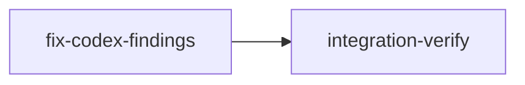

# Plan: Fix Validated Codex Review Findings

## Overview

Addresses 7 validated findings from the GPT-5.4 code review (codex-2026-04-16.md). These are security and correctness bugs — not style issues or performance optimizations. Each fix touches different files with no inter-fix dependencies, enabling full parallelism within a single implementation stage.

## Goals

- **H-01** — Register worktree-file-guard.sh for Read/Glob/Grep (dead code activation)
- **H-02** — Thread plan-level sandbox config into execution (currently dropped)
- **H-03** — Make load_stage() fail-closed on parse/IO errors (currently reconstructs)
- **H-04** — Handle MergeBlocked in finalize_merge_resolution() (currently skipped)
- **M-03** — Evaluate BudgetExceeded independently from health bucket transitions
- **M-04** — Use resolve_target_branch() in merge.rs (currently ignores config)
- **M-07** — Align daemon status semantics with CLI (NeedsHandoff/WaitingForInput)

## Non-Goals (Deferred Findings)

- H-05: Self-update asset signing — already documented tech debt, needs release infra
- H-06: Schema/stage coupling — design quality concern, not a bug
- M-01: Timeout overrun — low practical risk, complex process-group fix
- M-02: Permission promotion — intentional design, needs policy discussion
- M-05: Numeric ID parsing — 100+ stage depth unrealistic
- M-06, M-08, M-09, M-10: Architecture/performance concerns, not correctness bugs

## Execution Diagram



Knowledge bootstrap skipped — doc/loom/knowledge/ already populated with comprehensive coverage.

---

## Stages

### 1. Fix Codex Findings

**Purpose:** Apply all 7 validated fixes as parallel subagents. No file overlap exists between any pair of fixes.

**Model:** opus — H-02 is architectural (cross-cutting data flow change), H-01 is security-sensitive.

**Subagent Assignments:**

| Subagent | Finding | Files Owned (write) | Files Read-Only |
|----------|---------|---------------------|-----------------|
| 1 — Worktree Guard | H-01 | `src/fs/permissions/hooks.rs` | `hooks/worktree-file-guard.sh` |
| 2 — Plan Sandbox | H-02 | `src/plan/graph/loader.rs`, `src/commands/run/foreground.rs`, `src/daemon/server/orchestrator.rs` | `src/plan/parser/mod.rs`, `src/plan/schema/types.rs`, `src/orchestrator/core/orchestrator.rs` |
| 3 — Persistence | H-03 | `src/orchestrator/core/persistence.rs` | `src/verify/transitions/` |
| 4 — Merge Handler | H-04 | `src/orchestrator/core/merge_handler.rs` | `src/models/stage/transitions.rs` |
| 5 — Budget Events | M-03 | `src/orchestrator/monitor/detection.rs` | `src/orchestrator/monitor/context.rs` |
| 6 — Merge Target | M-04 | `src/commands/stage/merge.rs` | `src/git/branch/operations.rs` |
| 7 — Status Semantics | M-07 | `src/daemon/server/status.rs` | `src/commands/status/data/collector.rs` |

**Acceptance:** `cargo test`, `cargo clippy -- -D warnings`

---

### 2. Integration Verification

**Purpose:** Full build + test + lint + code review after all fixes merge. Verify each fix is correctly wired and functional. Curate knowledge from the session.

**Acceptance:** `cargo test`, `cargo clippy -- -D warnings`, `cargo build`, wiring patterns for each fix.

---

<!-- loom METADATA -->

```yaml
loom:
  version: 1
  sandbox:
    enabled: true
    auto_allow: true
    excluded_commands:
      - "loom"
    filesystem:
      deny_read:
        - "~/.ssh/**"
        - "~/.aws/**"
        - "~/.gnupg/**"
      deny_write:
        - ".work/stages/**"
        - "doc/loom/knowledge/**"
    network:
      allowed_domains: []
  stages:
    - id: fix-codex-findings
      name: "Fix Validated Codex Review Findings"
      stage_type: standard
      model: "opus"
      reasoning_effort: "high"
      description: |
        Apply 7 validated fixes from the GPT-5.4 codex review. All fixes touch
        different files with zero overlap — execute as parallel subagents.

        Use parallel subagents and skills to maximize performance.

        SUBAGENT FILE ASSIGNMENTS:

          Subagent 1 — Worktree Guard Registration (loom-software-engineer):
            Files Owned: src/fs/permissions/hooks.rs
            Files Read-Only: hooks/worktree-file-guard.sh, src/fs/permissions/constants.rs

            FIX H-01: worktree-file-guard.sh is installed to disk but never registered
            in the hooks config. Read, Glob, and Grep tools have zero worktree isolation.

            Steps:
            1. Open src/fs/permissions/hooks.rs and find loom_hooks_config() (line 14).
            2. The function builds a JSON value with PreToolUse entries. Currently it has
               entries for worktree-isolation.sh covering Bash, Edit, Write.
            3. Add three NEW PreToolUse entries for worktree-file-guard.sh covering:
               - matcher: "Read" (tool_name pattern)
               - matcher: "Glob" (tool_name pattern)
               - matcher: "Grep" (tool_name pattern)
               Each entry format is identical to existing ones — use format!("{}/worktree-file-guard.sh", hooks_dir)
            4. The hook script expects LOOM_WORKTREE_PATH env var (already set by pid_tracking.rs).
               No changes needed to the script itself.
            5. Add a unit test: verify loom_hooks_config() JSON contains "worktree-file-guard"
               entries for Read, Glob, Grep matchers. Use serde_json::to_string and assert
               it contains the expected patterns.

            DO NOT modify worktree-isolation.sh or worktree-file-guard.sh — only hooks.rs.

          Subagent 2 — Plan-Level Sandbox Threading (loom-senior-software-engineer):
            Files Owned: src/plan/graph/loader.rs, src/commands/run/foreground.rs, src/daemon/server/orchestrator.rs
            Files Read-Only: src/plan/parser/mod.rs, src/plan/schema/types.rs, src/orchestrator/core/orchestrator.rs

            FIX H-02: Plan-level sandbox config is parsed (ParsedPlan.metadata.loom.sandbox)
            but both foreground.rs:68 and daemon/server/orchestrator.rs:84 use
            SandboxConfig::default() instead.

            Steps:
            1. In src/plan/graph/loader.rs:
               a. Change the AsWorkDir trait's build_graph method signature to return
                  Result<(ExecutionGraph, SandboxConfig)> instead of Result<ExecutionGraph>.
               b. Update build_graph_impl to return the tuple. When loading from plan file
                  (load_graph_from_plan_file), extract parsed_plan.metadata.loom.sandbox
                  and return it alongside the graph. When loading from stage files
                  (line 58-61), return SandboxConfig::default() since stage files don't
                  carry plan-level config.
               c. Update load_graph_from_plan_file to return (ExecutionGraph, SandboxConfig).
                  At line 92-95, after parse_plan, extract sandbox before building graph:
                    let sandbox = parsed_plan.metadata.loom.sandbox.clone();
                    let graph = ExecutionGraph::build(parsed_plan.stages)?;
                    Ok((graph, sandbox))
               d. Add use crate::plan::schema::SandboxConfig; at the top.

            2. In src/commands/run/foreground.rs:
               a. Change the call to build_execution_graph() to destructure the tuple:
                    let (graph, plan_sandbox) = build_execution_graph(&work_dir)?;
               b. Replace sandbox_config: SandboxConfig::default() (line 68) with:
                    sandbox_config: plan_sandbox,

            3. In src/daemon/server/orchestrator.rs:
               a. Same pattern — destructure build_execution_graph result.
               b. Replace sandbox_config: SandboxConfig::default() (line 84) with
                  the plan sandbox.

            4. Add a test in loader.rs: parse a plan with custom sandbox config
               (e.g., sandbox.enabled = false), call build_execution_graph, verify
               the returned SandboxConfig matches the plan's config (not default).

          Subagent 3 — Fail-Closed Persistence (loom-software-engineer):
            Files Owned: src/orchestrator/core/persistence.rs
            Files Read-Only: src/verify/transitions/persistence.rs, src/fs/stage_files.rs

            FIX H-03: load_stage() at line 29 uses Err(_) to catch ALL errors, silently
            reconstructing a fresh stage on parse errors, I/O errors, or schema mismatches.

            Steps:
            1. Open src/orchestrator/core/persistence.rs, find load_stage() (line 25).
            2. Replace the Err(_) wildcard with specific error handling:
               a. First, check if the stage file exists using
                  crate::fs::stage_files::find_stage_file(). The stages dir is
                  self.persistence_work_dir().join("stages").
               b. If find_stage_file returns Ok(None) — file genuinely missing — create
                  from graph (existing reconstruction logic, lines 31-46).
               c. If find_stage_file returns Ok(Some(path)) — file exists but load failed —
                  propagate the original error with context, e.g.:
                  Err(e) => Err(e).with_context(|| format!("Stage file exists but failed to parse: {}", path.display()))
               d. If find_stage_file itself fails — propagate that error.
            3. The key principle: only synthesize when the file is genuinely absent.
               Parse/IO/schema errors must fail loudly.
            4. Add a test: create a stage file with invalid YAML frontmatter, call
               load_stage(), verify it returns Err (not a fresh stage).

          Subagent 4 — MergeBlocked Handling (loom-software-engineer):
            Files Owned: src/orchestrator/core/merge_handler.rs
            Files Read-Only: src/models/stage/transitions.rs

            FIX H-04: finalize_merge_resolution() at line 146 only handles
            MergeConflict -> Completed, not MergeBlocked -> Completed.

            Steps:
            1. Open src/orchestrator/core/merge_handler.rs, find line 146:
                 if stage.status == StageStatus::MergeConflict {
            2. Change the condition to also handle MergeBlocked:
                 if stage.status == StageStatus::MergeConflict || stage.status == StageStatus::MergeBlocked {
            3. Verify this transition is valid by reading transitions.rs:
               MergeBlocked -> Completed IS allowed (transitions.rs line 70-75).
            4. Add a test: create a stage in MergeBlocked status, call
               finalize_merge_resolution, verify it transitions to Completed and
               both disk state (merged=true) and graph state converge.

          Subagent 5 — Budget Check Decoupling (loom-software-engineer):
            Files Owned: src/orchestrator/monitor/detection.rs
            Files Read-Only: src/orchestrator/monitor/context.rs

            FIX M-03: BudgetExceeded check at lines 263-282 is inside the
            "if previous_context_health != current_context_health" block (line 217),
            meaning per-stage budgets crossing mid-bucket are never reported.

            Steps:
            1. Open src/orchestrator/monitor/detection.rs, find the budget check
               block (lines 263-282).
            2. Move the entire budget-check block OUTSIDE the health-bucket-change
               guard. It should execute on every poll cycle, not only when the
               coarse Green/Yellow/Red bucket transitions.
            3. The budget check should be placed AFTER the closing brace of the
               "if previous_context_health != Some(&current_context_health)" block
               (currently at line 286), but still within the session iteration loop.
            4. Add a separate tracking map (e.g., last_budget_exceeded: HashMap<String, bool>)
               to avoid re-emitting BudgetExceeded on every tick. Only emit when
               usage first crosses the budget threshold (previous tick was below,
               current tick is above).
            5. Add a test: simulate a session at 66% usage (Red bucket), then 79%
               (still Red bucket) with a stage budget of 70%. Verify BudgetExceeded
               fires when crossing 70%, even though health bucket didn't change.

          Subagent 6 — Merge Target Branch (loom-software-engineer):
            Files Owned: src/commands/stage/merge.rs
            Files Read-Only: src/git/branch/operations.rs

            FIX M-04: Both merge_resolved() (line 89) and merge_retry() (line 200)
            use default_branch() directly instead of resolve_target_branch().

            Steps:
            1. Open src/commands/stage/merge.rs.
            2. Add import: use crate::git::branch::resolve_target_branch;
            3. The function needs access to the configured base_branch. Load it from
               config.toml: let config = crate::fs::load_config(work_dir);
               then extract config.base_branch (it's Option<String>).
               Use: let base_branch = crate::fs::parse_base_branch_from_config(work_dir);
               (check if this helper exists, otherwise parse config.toml directly).
            4. In merge_resolved() (line 89), replace:
                 let target_branch = default_branch(&repo_root).unwrap_or_else(|_| "main".to_string());
               With:
                 let target_branch = resolve_target_branch(&base_branch, &repo_root);
            5. In merge_retry() (line 200), apply the same replacement.
            6. Remove the now-unused import of default_branch if no other call sites
               remain in this file. Check before removing.
            7. Add a test or verify with existing tests that the correct target branch
               resolution path is used.

          Subagent 7 — Status Semantics Alignment (loom-software-engineer):
            Files Owned: src/daemon/server/status.rs
            Files Read-Only: src/commands/status/data/collector.rs

            FIX M-07: Daemon status categorizes NeedsHandoff and WaitingForInput as
            "blocked" (status.rs:68-70), but CLI status categorizes them as "executing"
            (collector.rs:193). The CLI semantics are correct — these are active states.

            Steps:
            1. Open src/daemon/server/status.rs, find the match block at lines 58-77.
            2. Move NeedsHandoff and WaitingForInput from the blocked arm (lines 69-70)
               to the executing arm (line 59). The match should become:
                 StageStatus::Executing
                 | StageStatus::NeedsHandoff
                 | StageStatus::WaitingForInput => {
                     stages_executing.push(stage_info);
                 }
            3. The blocked arm retains: Blocked, MergeConflict, CompletedWithFailures,
               MergeBlocked, NeedsHumanReview.
            4. Add a test: create stages with NeedsHandoff and WaitingForInput status,
               call collect_status, verify they appear in stages_executing not
               stages_blocked.

        NO FILE OVERLAP between subagents confirmed. Each subagent has exclusive
        write access to its listed files.

        MEMORY RECORDING (use loom memory ONLY — never loom knowledge, never auto-memory):
        ⛔ NEVER use Claude Code's auto-memory (~/.claude/projects/*/memory/)
        ⛔ NEVER use loom knowledge update (reserved for knowledge-bootstrap/integration-verify)
        Record IMMEDIATELY when these happen — not at stage end:
        - MISTAKE: tried X, failed -> loom memory note "mistake: tried X, failed because Y, fixed by Z"
        - DECISION: chose X over Y -> loom memory decision "chose X" --context "Y was worse because Z"
        - SURPRISE: unexpected behavior -> loom memory note "found: description in file:line"

        SUBAGENT MEMORY — subagents MUST also record memories:
        Include in every subagent Task prompt: "Record mistakes, decisions, and surprises
        using loom memory. Do NOT record procedural actions like 'read file' or 'ran tests'."
      dependencies: []
      acceptance:
        - "cargo test"
        - "cargo clippy -- -D warnings"
      files:
        - "src/fs/permissions/hooks.rs"
        - "src/plan/graph/loader.rs"
        - "src/commands/run/foreground.rs"
        - "src/daemon/server/orchestrator.rs"
        - "src/orchestrator/core/persistence.rs"
        - "src/orchestrator/core/merge_handler.rs"
        - "src/orchestrator/monitor/detection.rs"
        - "src/commands/stage/merge.rs"
        - "src/daemon/server/status.rs"
      working_dir: "loom"
      wiring:
        - source: "src/fs/permissions/hooks.rs"
          pattern: "worktree-file-guard"
          description: "H-01: worktree-file-guard.sh registered in hooks config"
        - source: "src/commands/run/foreground.rs"
          pattern: "plan_sandbox"
          description: "H-02: Plan-level sandbox config used instead of default"
        - source: "src/daemon/server/orchestrator.rs"
          pattern: "plan_sandbox"
          description: "H-02: Plan-level sandbox config used in daemon mode"
        - source: "src/commands/stage/merge.rs"
          pattern: "resolve_target_branch"
          description: "M-04: Config-aware target branch resolution in merge commands"
      artifacts:
        - "src/fs/permissions/hooks.rs"
        - "src/plan/graph/loader.rs"
        - "src/orchestrator/core/persistence.rs"
        - "src/orchestrator/core/merge_handler.rs"
        - "src/orchestrator/monitor/detection.rs"
        - "src/commands/stage/merge.rs"
        - "src/daemon/server/status.rs"

    - id: integration-verify
      name: "Integration Verification"
      stage_type: integration-verify
      model: "opus"
      reasoning_effort: "high"
      description: |
        Final integration verification — runs AFTER fix-codex-findings merges.

        Use parallel subagents and skills to maximize performance.

        CRITICAL: Verify each fix is correctly wired and functional.
        Code that compiles but doesn't change behavior is useless.

        ⛔ NEVER use Claude Code's auto-memory (~/.claude/projects/*/memory/).
        ALL memory/knowledge goes through loom memory and loom knowledge commands.

        CONTEXT GATHERING (FIRST — before any verification):
        0a. Read the plan file from doc/plans/ (check .work/config.toml for source_path)
        0b. Read ALL stage memories: loom memory show --all
        0c. Read doc/loom/knowledge/*.md for architecture context

        ⛔ ZERO TOLERANCE: ALL compiler warnings, linter errors, test failures must be
        FIXED (not suppressed). Nothing is "pre-existing" or "too trivial."

        BUILD & TEST:
        1. cargo test (full suite)
        2. cargo clippy -- -D warnings
        3. cargo build

        CODE REVIEW (MANDATORY — spawn parallel loom-code-reviewer subagents):
        4. Security review: Verify H-01 isolation actually blocks sibling worktree access
           via Read/Glob/Grep. Verify H-02 sandbox config propagates correctly.
        5. Correctness review: Verify H-03 fails on corrupt stage files (not silently
           reconstructs). Verify H-04 handles MergeBlocked -> Completed. Verify M-03
           fires BudgetExceeded on mid-bucket crossing. Verify M-04 uses config branch.
        6. Consistency review: Verify M-07 daemon and CLI now agree on NeedsHandoff
           and WaitingForInput categorization.

        FUNCTIONAL VERIFICATION (per-fix checks):
        7. H-01: Grep hooks.rs for PreToolUse entries covering Read, Glob, Grep with
           worktree-file-guard.sh path.
        8. H-02: Trace data flow from ParsedPlan.metadata.loom.sandbox through loader
           return value to OrchestratorConfig.sandbox_config in both foreground and daemon.
        9. H-03: Confirm load_stage only reconstructs on file-not-found, not parse errors.
        10. H-04: Confirm finalize_merge_resolution handles both MergeConflict and MergeBlocked.
        11. M-03: Confirm budget check runs on every poll, not only on bucket transitions.
        12. M-04: Confirm merge_resolved() and merge_retry() use resolve_target_branch().
        13. M-07: Confirm daemon status matches CLI categorization for all stage statuses.

        KNOWLEDGE DISTILLATION (MANDATORY):
        14. Record own discoveries to loom memory
        15. Read all stage memories: loom memory show --all
        16. Curate mistakes and patterns into knowledge:
            loom knowledge update mistakes "..." for errors found
            loom knowledge update patterns "..." for reusable patterns
        17. Update concerns.md to note which codex findings are now fixed

        DOCUMENTATION UPDATE:
        18. Update doc/loom/knowledge/concerns.md to reflect fixed findings
        19. If architectural patterns changed (H-02 data flow), update architecture.md
      dependencies: ["fix-codex-findings"]
      acceptance:
        - "cargo test"
        - "cargo clippy -- -D warnings"
        - "cargo build"
      files:
        - "doc/loom/knowledge/**"
      working_dir: "loom"
      truths:
        - "cargo test -- --test-threads=1 2>&1 | tail -5"
      wiring:
        - source: "src/fs/permissions/hooks.rs"
          pattern: "worktree-file-guard"
          description: "H-01: Guard registered for file-access tools"
        - source: "src/commands/run/foreground.rs"
          pattern: "plan_sandbox"
          description: "H-02: Plan sandbox flows to OrchestratorConfig"
        - source: "src/orchestrator/core/persistence.rs"
          pattern: "find_stage_file"
          description: "H-03: Persistence checks file existence before reconstruction"
        - source: "src/orchestrator/core/merge_handler.rs"
          pattern: "MergeBlocked"
          description: "H-04: MergeBlocked handled in finalize_merge_resolution"
        - source: "src/commands/stage/merge.rs"
          pattern: "resolve_target_branch"
          description: "M-04: Config-aware branch resolution in merge commands"
        - source: "src/daemon/server/status.rs"
          pattern: "NeedsHandoff"
          description: "M-07: NeedsHandoff categorized correctly in daemon status"
```

<!-- END loom METADATA -->
