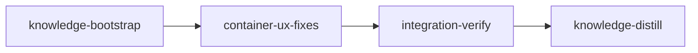

# Plan: Fix Container Backend UX Bugs

## Overview

Several rough edges in the container backend make it hard for users to observe,
debug, and reason about per-stage containers:

1. `loom container logs <stage>` fails with **"No container session found for
   stage X"** even while `loom status --live` shows the stage as Executing.
2. Shell tab-completion does not offer stage IDs after `loom container shell`,
   `loom container logs`, etc., and `logs` itself is missing from the container
   subcommand completion list.
3. Users do not understand that **parallel stages each get their own
   container** (one per stage, named `loom-<stage-id>` /
   `loom-knowledge-<stage>` / `loom-merge-<stage>` / `loom-base-conflict-<stage>`).
4. There is no way to list a project's stage containers — users must drop down
   to `docker ps | grep loom-` to see what is running.
5. The container deletion lifecycle is not documented; users do not know when
   containers are removed (on completion, on `loom sessions kill`, on
   `loom stop`, on `loom clean`, etc.).

This plan fixes all five in one focused stage with parallel subagents, then
verifies functionally and curates the lessons.

## Goals

- `loom container logs <stage>` and `loom container shell <stage>` reliably
  resolve the right container session for the stage. `shell` requires the
  container to be Running; `logs` also accepts Exited containers for
  post-crash diagnostics. When the container is truly gone, the error
  message points users to `.work/crashes/` and `loom container list`.
- Tab-completion offers stage IDs for `container shell|logs` and lists
  `logs` / `list` in the container subcommand set. After `--tail`, no
  stage-ID suggestions appear (the flag expects a number).
- A new `loom container list` command lists **session-backed containers
  for this workspace** — i.e. containers tracked in `.work/sessions/*.md`.
  Its `--help` points users to `loom clean --sessions` for orphan
  containers left behind by a crashed daemon. (This is NOT a runtime-wide
  inventory; project-scoped runtime labels would be required for that and
  are out of scope.)
- Session files written to `.work/sessions/` accurately reflect whether the
  container they reference still exists in the four removal paths covered
  by this plan: stage completion, stale merge-session reap,
  `on_needs_handoff`, and `loom stop`. **Explicit exclusions** (recorded
  as future-fix memory notes, not blockers for this plan):
  `sessions kill` (deletes the session file outright), `clean --sessions`
  (emergency cleanup, typically run alongside `--state`),
  `handle_budget_exceeded` (does not remove the container — identity is
  still accurate).
- The container lifecycle is documented in the container backend module
  docs, surfaced through `--help`, and refreshed in `README.md` by the
  `knowledge-distill` stage.

## Non-Goals

- A `loom container kill <stage>` shortcut (covered today by
  `loom sessions kill --stage <stage>` plus `loom clean`; revisit if requested).
- Refactoring `orchestrator/terminal/container/mod.rs` (a known refactor
  candidate, not blocking these bugs).
- Per-stage container resource limits / cgroups tuning.

## Execution Diagram



A single implementation stage runs three parallel subagents with strictly
non-overlapping file ownership, then the bookend stages verify and curate.

---

## Stages

### 1. Knowledge Bootstrap

**Purpose:** Confirm the container backend area of the knowledge base is
sufficient for the implementation work, fill any gap, then exit.

**Dependencies:** none

**Tasks:**

- Run `loom knowledge check` and read `doc/loom/knowledge/architecture.md`
  (Container Backend section), `entry-points.md` (Container Subcommand
  Implementations + Terminal Backend), and `mistakes.md`.
- Verify the following are documented; add a focused update if a section is
  missing or stale:
  - Container name format per session type (`loom-<stage>`,
    `loom-knowledge-<stage>`, `loom-merge-<stage>`, `loom-base-conflict-<stage>`)
  - Per-stage container topology (parallel stages → parallel containers)
  - Container deletion triggers (completion handler, kill_session, stop,
    sessions kill, clean) and the no-`--rm` log-capture rationale
  - That session files persist after container removal (the root cause of
    bug #1)
- Skip writing any new content if existing sections already cover these.

**Files:** `doc/loom/knowledge/**` (write only if a documented gap exists)

**Acceptance:** `loom knowledge check --min-coverage 50` passes; the
container-related sections in `architecture.md` and `entry-points.md` exist
with `##` headers.

---

### 2. Container UX Fixes

**Purpose:** Implement the user-visible fixes in one stage, three subagents,
no file overlap.

**Dependencies:** knowledge-bootstrap

**Tasks (split across three parallel subagents):**

#### Subagent 1 — Container CLI commands

Implements bug #1 (`logs` / `shell` reliability), bug #4 (new `list`), and
the user-facing CLI surface for #3 / #5.

1. **Refactor session lookup** (`loom/src/commands/container/logs.rs`,
   `shell.rs`). The current `resolve_session_for_stage` scans
   `.work/sessions/*.md` in filesystem-iteration order and returns the
   first match with `container_name.is_some()`. This is unsafe when:
   - Multiple session files exist for the same stage (retries / re-runs).
   - The matching session is `Completed`/`Crashed` and its container is gone.
   - The session file exists but `container_name` was never persisted
     (parse-failure path that silently `continue`s).

   Fix — split for testability:
   - Pure selector `pick_container_session(sessions, stage_id, require_running)`:
     filters Container-backed sessions for the stage_id (and Running status
     when required), picks the newest `last_active` when multiple match. Pure
     function → unit-testable without Docker/Podman.
   - Runtime verifier `verify_container_state(runtime, name)`: shells out
     to `<runtime> inspect`. Reuses the existing "no such" → Missing
     classification from `inspect_running` (mod.rs:748). Daemon-down and
     permission-denied are propagated as real errors — do NOT collapse
     them into "Missing".
   - `shell` requires Running. `logs` accepts Running OR Exited (so
     post-crash diagnostics on still-present exited containers work);
     on Missing, error message points users to `.work/crashes/`.
   - Runtime selection prefers `session.runtime` via `Runtime::from_binary`;
     falls back to `detect_runtime("auto")` only when the session predates
     persistence of that field.
   - Replace silent `continue` on YAML parse failure with `eprintln!`.

2. **Add `loom container list`** (`loom/src/commands/container/list.rs`,
   new file). Lists **session-backed containers for the current
   workspace** (containers tracked in `.work/sessions/*.md` — NOT a
   runtime-level enumeration). Help text and docs must point users to
   `loom clean --sessions` for orphan containers left by a crashed daemon.
   - Implementation: enumerate `.work/sessions/*.md`, filter to
     `backend == Container && container_name.is_some()`. Use the same
     persisted-runtime-first selection as `logs`/`shell`. Call
     `<runtime> inspect -f '{{.State.Status}}'`; treat "no such" as
     `missing`, propagate other inspect errors.
   - Default output: aligned columns —
     `STAGE  CONTAINER  RUNTIME  STATUS  SESSION_ID`. Sort by stage_id ASC.
   - `--all` flag: include exited/missing containers (default = Running only).
   - `--json` flag: emit one JSON object per line for scripting.
   - If no `.work/sessions/` exists, exit 0 with one-line message.
   - Extract `render_table` / `render_jsonl` as pure functions for tests.

3. **Wire into the CLI**:
   - `loom/src/cli/types.rs`: add `List { all: bool, json: bool }` variant
     to `ContainerCommands` (preserve existing variants).
   - `loom/src/cli/dispatch.rs`: route `ContainerCommands::List { all, json }`
     to `commands::container::list::execute(all, json)`.
   - `loom/src/commands/container/mod.rs`: add `pub mod list;`.

4. **Help text** — extend the `Logs`, `Shell`, and new `List` clap doc
   comments to mention:
   - That each stage runs in its own container.
   - That containers are removed on completion / kill / stop / clean.

**Files owned (write):**

- `loom/src/commands/container/logs.rs`
- `loom/src/commands/container/shell.rs`
- `loom/src/commands/container/list.rs` (new)
- `loom/src/commands/container/mod.rs`
- `loom/src/cli/types.rs` (only the `ContainerCommands` enum + its variants)
- `loom/src/cli/dispatch.rs` (only the container dispatch arm)

**Files read-only:**

- `loom/src/models/session/types.rs`, `methods.rs`
- `loom/src/orchestrator/terminal/container/runtime.rs`
- `loom/src/parser/frontmatter.rs`
- `loom/src/fs/work_dir.rs`

#### Subagent 2 — Shell completions

Implements bug #2 (no completion for `logs`/`shell`/`list`, `logs` missing
from subcommand list).

1. **`loom/src/completions/dynamic/commands.rs`**:
   - In `complete_subcommands` under `"container"`, change `&["build",
     "doctor", "rebuild", "shell"]` to
     `&["build", "doctor", "list", "logs", "rebuild", "shell"]` (alphabetical).
   - In `complete_flags`, add:
     - `["container", "list"] => &["--all", "--json"]`
     - `["container", "logs"] => &["--follow", "--tail"]`
   - `has_subcommands` already returns `true` for `"container"` — no change.

2. **`loom/src/completions/dynamic/mod.rs`**:
   - In `complete_after_subcommand`, add a match arm:
     `("container", "shell" | "logs") => complete_stage_ids(cwd, prefix),`
   - `("container", "list")` → `Ok(Vec::new())` (takes no positional args).

3. **Tests** (`loom/src/completions/dynamic/tests.rs` or its module):
   - Add a case: `loom container` (cursor after space) → completions
     include `"logs"` and `"list"`.
   - Add a case: `loom container shell <prefix>` and
     `loom container logs <prefix>` both return stage IDs.

**Files owned (write):**

- `loom/src/completions/dynamic/commands.rs`
- `loom/src/completions/dynamic/mod.rs`
- `loom/src/completions/dynamic/tests.rs` (existing test module; add cases)

**Files read-only:**

- `loom/src/completions/dynamic/stages.rs`
- `loom/src/cli/types.rs` (for context only, must not write)

#### Subagent 3 — Session-file cleanup on container removal + lifecycle docs

Implements bug #5 (container deletion is invisible to the session file) and
documents the lifecycle for #3 / #5.

1. **Add `Session::clear_container_identity`**
   (`loom/src/models/session/methods.rs`) — symmetric counterpart of
   `set_container_identity`:

       pub fn clear_container_identity(&mut self) {
           self.runtime = None;
           self.container_name = None;
           self.last_active = Utc::now();
       }

   Place it directly after `set_container_identity` for proximity. Add a
   unit test in `loom/src/models/session/tests/identity.rs` mirroring the
   existing `set_container_identity` test.

2. **Clear identity after every successful container removal that keeps
   the session file on disk.** Call sites:
   - **`completion_handler.rs::handle_stage_completed`**: capture the
     existing ignored kill result; if Ok and backend == Container,
     clone-mut-clear-save.
   - **`merge_handler.rs:661`** (stale-session reap): same pattern.
   - **`event_handler.rs::on_needs_handoff`**: same pattern after the
     existing `kill_session` block. Stage is requeued; old session record
     must not point at a removed container.
   - **`stop.rs:106`** (daemon shutdown kill-all): same pattern in the loop.

   **Deliberately NOT in scope** (recorded as memory notes for future fixes):
   - `sessions.rs::kill_single_session` — deletes the session file after
     `kill_session`, so clearing identity is a no-op there. The separate
     bug (skipping `kill_session` when `is_session_alive == false` →
     exited containers orphaned) is a different problem.
   - `handle_budget_exceeded` — does NOT remove the container (stage gets
     requeued with the same name; collision on respawn is a separate bug).
     Identity is correct as-is.
   - `clean.rs::clean_sessions` — emergency orphan cleanup; state is
     typically wiped via `--state`/`--all` so updating session records is
     moot in practice.

   Do NOT clear identity on `wait_until_running` failure inside
   `spawn_common` — that path uses an in-memory session that was never
   persisted with `container_name`.

3. **Module-doc lifecycle table**
   (`loom/src/orchestrator/terminal/container/mod.rs` top-of-file
   doc-comment): extend the existing doc-comment with a clearly-titled
   section "Container lifecycle" listing every removal trigger:

       //! ## Container lifecycle
       //!
       //! Containers run **without `--rm`** so logs can be captured on crash.
       //! A `loom-<...>` container is removed when:
       //!
       //!   * The stage completes successfully (handle_stage_completed →
       //!     kill_session). The session file is updated to clear
       //!     `container_name` / `runtime`.
       //!   * A stale merge/base-conflict session is reaped
       //!     (merge_handler.rs).
       //!   * The user runs `loom sessions kill <id>` or
       //!     `loom sessions kill --stage <stage>`.
       //!   * The daemon shuts down (`loom stop`) and reaps active
       //!     container sessions.
       //!   * The user runs `loom clean --sessions` / `--all`, which
       //!     also reaps orphan `loom-*` containers and `loom-net-*`
       //!     networks that survived a crashed daemon.
       //!   * The container fails to reach the Running state during
       //!     spawn (`wait_until_running` timeout) — logs are captured to
       //!     `.work/crashes/` before removal.
       //!
       //! Parallel stages get **independent containers** (one per stage,
       //! named by `Session::derive_tracking_key`). They share only the
       //! per-stage network (`loom-net-<stage>`) and the immutable image.

4. **README / CONTRIBUTING surface — NOT owned by this subagent.** README
   lives at the repo root (outside `working_dir=loom`); user-facing doc
   updates are owned by `knowledge-distill` (which also fixes the stale
   `loom container shell [--stage <stage-id>]` synopsis at README.md:177).
   The knowledge-distill stage handles the canonical
   user-facing rewrite.

**Files owned (write):**

- `loom/src/models/session/methods.rs`
- `loom/src/models/session/tests/identity.rs`
- `loom/src/orchestrator/core/completion_handler.rs`
- `loom/src/orchestrator/core/merge_handler.rs`
- `loom/src/orchestrator/core/event_handler.rs` (`on_needs_handoff` only)
- `loom/src/commands/stop.rs`
- `loom/src/orchestrator/terminal/container/mod.rs` (doc-comment block only —
  do NOT modify Subagent 1's territory in `commands/container/`)

**Deliberately NOT modified (scoped-out, recorded as future-fix notes):**

- `loom/src/commands/sessions.rs` — `kill_single_session` deletes the
  session file after `kill_session`, so clearing identity then re-saving
  is a no-op. The separate exited-container-orphan bug (skipping
  `kill_session` when `is_session_alive` is false) is out of scope.
- `loom/src/commands/clean.rs` — `clean_sessions` is emergency orphan
  cleanup; state directory is typically also wiped. Out of scope.
- `event_handler.rs::handle_budget_exceeded` — does not remove the
  container, so session identity is correct as-is. The respawn-collision
  bug is out of scope.

**Files read-only:**

- `loom/src/orchestrator/terminal/container/mod.rs` (kill_session body — for
  reference; doc-comment is the only writable part)
- `loom/src/cli/types.rs`
- `loom/src/orchestrator/terminal/dispatcher.rs`

**File ownership summary — NO OVERLAP between subagents:**

| Subagent              | Owned (write)                                                                                                    |
| --------------------- | ---------------------------------------------------------------------------------------------------------------- |
| 1 — Container CLI     | `commands/container/{logs,shell,list,mod}.rs`, `cli/types.rs` (Container enum), `cli/dispatch.rs` (container arm) |
| 2 — Completions       | `completions/dynamic/{commands,mod,tests}.rs`                                                                    |
| 3 — Cleanup + docs    | `models/session/methods.rs`, `models/session/tests/identity.rs`, `orchestrator/core/{completion,merge,event}_handler.rs`, `commands/stop.rs`, `orchestrator/terminal/container/mod.rs` (top-of-file `//!` doc-block only). NOT touched: `sessions.rs`, `clean.rs`, `handle_budget_exceeded` (scoped out — see Subagent 3 task notes) |

`cli/types.rs` is touched ONLY by Subagent 1 (Container enum + variants).
`orchestrator/terminal/container/mod.rs` is touched ONLY by Subagent 3, and
only the top-of-file `//!`-comment block. Subagent 1 never opens that file.

**Acceptance:** `cargo build`, `cargo test`, `cargo clippy -- -D warnings`
all pass.

**Verification:**

- Artifacts:
  - `loom/src/commands/container/list.rs`
  - `loom/src/commands/container/logs.rs` (modified — Running-filter + inspect verification)
  - `loom/src/commands/container/shell.rs` (modified — same)
- Wiring:
  - `loom/src/commands/container/mod.rs` imports `list`
  - `loom/src/cli/types.rs` declares `List` variant on `ContainerCommands`
  - `loom/src/cli/dispatch.rs` routes `ContainerCommands::List`
  - `loom/src/completions/dynamic/commands.rs` lists `"logs"` and `"list"`
  - `loom/src/completions/dynamic/mod.rs` routes `("container", "shell" | "logs")` to `complete_stage_ids`
  - `loom/src/models/session/methods.rs` defines `clear_container_identity`
  - `loom/src/orchestrator/core/completion_handler.rs` calls `clear_container_identity`

---

### 3. Integration Verification

**Purpose:** Build, lint, code-review, and functionally verify that the
container UX fixes actually work end-to-end.

**Dependencies:** container-ux-fixes

**Tasks:**

_Build & Test (zero tolerance — fix ALL warnings/errors):_

- `cargo build` and `cargo build --release`
- `cargo test` (entire suite, not just affected modules)
- `cargo clippy -- -D warnings`
- `cargo fmt --check`

_Code Review (parallel `loom-code-reviewer` subagents — read-only review,
fixes are applied by `loom-software-engineer`):_

- Security review: any new code path executes external commands (`docker
  inspect`). Verify container names are not interpolated unsafely into
  shell strings; the `Command::new(...).args(&[...])` pattern is already
  safe — confirm no helpers slip into shelled-out strings.
- Architecture review: confirm
  (a) the session-resolution helper is shared between `logs` and `shell`,
      or is honestly duplicated — no half-extracted helper;
  (b) `list`, `logs`, and `shell` prefer the persisted `session.runtime`
      via `Runtime::from_binary` and fall back to `detect_runtime("auto")`
      only for legacy sessions without that field (NOT detect-first);
  (c) `clear_container_identity` is invoked in the FOUR in-scope sites:
      `completion_handler`, `merge_handler` (stale-session reap),
      `event_handler::on_needs_handoff`, and `stop`.
      `sessions::kill_single_session` is intentionally EXCLUDED because it
      deletes the session file; do not flag its absence.
- Test coverage: confirm new unit tests exist for `clear_container_identity`,
  for the pure `pick_container_session` selector (Running-filter + newest
  `last_active`), and for the completion routing (container subcommands
  include `logs`/`list`; `container shell` and `container logs` return
  stage IDs; `container logs --tail <prefix>` returns an empty Vec).

_Functional verification (catches "compiles but is never reachable"):_

- `./target/debug/loom container list --help` exits 0 (clap rejects
  unknown subcommands, so a green `--help` is the wiring proof).
- `./target/debug/loom container logs --help` exits 0 and documents
  `--follow` and `--tail`.
- `./target/debug/loom container list --help` documents `--all` and
  `--json`.
- Hand-verify the dynamic-completion path. The hidden `complete`
  subcommand takes `<shell> <cwd> <cmdline> <current_word> <prev_word>`:
    ./target/debug/loom complete bash . "loom container " "" "container"
  emits `logs` and `list` among its results.
- Hand-verify stage-ID completion (run from a worktree, so `..` from the
  `loom/` working_dir reaches the worktree's `.work/stages/`):
    ./target/debug/loom complete bash .. "loom container shell " "" "shell"
  emits the current worktree's stage IDs.
- Hand-verify `--tail` value-completion suppression:
    ./target/debug/loom complete bash .. "loom container logs --tail " "" "--tail"
  emits nothing (NOT stage IDs).

_Record discoveries to `loom memory` only — knowledge-distill will curate._

**Files:** code, tests, no docs (docs handled by knowledge-distill)

**Acceptance:**

- `cargo build`, `cargo test`, `cargo clippy -- -D warnings`, `cargo fmt --check`
- `./target/debug/loom container list --help` and `./target/debug/loom container logs --help` exit 0
- Help text contains exact flags `--all`, `--json`, `--follow`, `--tail`
- `loom complete bash . "loom container " "" "container"` includes `list` and `logs`

**Wiring (static source-pattern checks — `truths` is no longer a schema field):**

- `cli/dispatch.rs` references `ContainerCommands::List`
- `completions/dynamic/commands.rs` lists `"logs"` and `"list"`
- `clear_container_identity` appears in `completion_handler.rs`,
  `merge_handler.rs`, `event_handler.rs`, and `stop.rs`

---

### 4. Knowledge Distillation

**Purpose:** Curate all stage memories into permanent knowledge files and
update user-facing documentation that survived this plan.

**Dependencies:** integration-verify

**Tasks:**

_Memory curation:_

- Run `loom memory show --all` and synthesize patterns / mistakes / decisions.
- Curate mistakes as actionable prevention rules in
  `doc/loom/knowledge/mistakes.md`. Likely candidates from this plan:
  - "Session files outlive their containers — always filter by `status ==
    Running` AND verify via `<runtime> inspect` before exec'ing into a
    container by name."
  - "First-match iteration over `.work/sessions/*.md` is unsafe when a
    stage has multiple session files (retries) — sort by `last_active`."
- Curate the container lifecycle table into `architecture.md` (or update
  the existing Container Backend section if it covers some triggers).
- Curate the new `clear_container_identity` symmetry into
  `patterns.md` ("every long-lived resource handle in a Session must have a
  setter and a clearer").

_Knowledge review:_

- `loom review` to scan for stale entries.
- Confirm `architecture.md` references the new `loom container list` and
  the `Session::clear_container_identity` symmetry.

_Documentation update (only sections affected by this plan):_

- `README.md` (or `CONTRIBUTING.md` if it has the container-backend usage
  section): list the new `loom container list` subcommand and add a brief
  pointer to the lifecycle section in the module docs.
- Skip rewriting unrelated sections.

**Files:** `doc/loom/knowledge/**`, `README.md`, `CONTRIBUTING.md`

**Acceptance:** knowledge files contain `##` headers.

---

<!-- loom METADATA -->

```yaml
loom:
  version: 1
  sandbox:
    enabled: true
    auto_allow: true
    excluded_commands:
      - "loom"
    filesystem:
      deny_read:
        - "~/.ssh/**"
        - "~/.aws/**"
        - "~/.config/gcloud/**"
        - "~/.gnupg/**"
      deny_write:
        # `.work/**` is denied by default — listing `.work/stages/**`
        # again would just trigger the "redundant entry" advisory.
        - "doc/loom/knowledge/**"
      allow_write:
        - "loom/src/**"
        - "loom/tests/**"
        - "README.md"
        - "CONTRIBUTING.md"
    network:
      allowed_domains:
        - "crates.io"
        - "index.crates.io"
        - "static.crates.io"
      allow_local_binding: false
      allow_unix_sockets: []
  stages:
    - id: knowledge-bootstrap
      name: "Bootstrap Container Backend Knowledge"
      stage_type: knowledge
      model: "sonnet"
      reasoning_effort: "high"
      description: |
        Confirm the container backend area of doc/loom/knowledge is sufficient,
        fill any gap, then exit. Knowledge already exists and is comprehensive;
        do NOT rewrite — only patch missing pieces.

        Use parallel subagents and skills to maximize performance.

        Tasks:
        - Run `loom knowledge check` and read architecture.md (Container Backend
          section), entry-points.md (Container Subcommand Implementations and
          Terminal Backend sections), and mistakes.md.
        - Verify these are documented; only add a focused update if a section
          is missing or stale:
            * Container name format per session type
              (loom-<stage>, loom-knowledge-<stage>, loom-merge-<stage>,
               loom-base-conflict-<stage>)
            * Per-stage container topology (parallel stages → parallel containers)
            * Container deletion triggers (completion handler, kill_session,
              loom stop, loom sessions kill, loom clean) and the no-`--rm`
              log-capture rationale
            * That session files persist after container removal (root cause
              of bug #1: stale session files poisoning the logs lookup)
        - Use `loom knowledge update <file> "..."` for any additions —
          NEVER call Write/Edit directly on knowledge files.

        ⛔ NEVER use Claude Code's auto-memory (~/.claude/projects/*/memory/).
        ALL memory/knowledge goes through loom memory and loom knowledge commands.

        MEMORY RECORDING (use loom memory ONLY — do NOT use loom knowledge update
        for memory; loom knowledge update is for the bootstrap content itself):
        - Record IMMEDIATELY when these happen — not at stage end:
          * MISTAKE: tried X, failed → loom memory note "mistake: ..."
          * DECISION: chose X over Y → loom memory decision "..." --context "..."
          * SURPRISE: unexpected behavior → loom memory note "found: ..."
        - Do NOT record procedural actions ("ran loom knowledge check").
      dependencies: []
      acceptance:
        - "loom knowledge check --min-coverage 50"
        - 'rg -q "## " doc/loom/knowledge/architecture.md'
        - 'rg -q "## " doc/loom/knowledge/entry-points.md'
        # Content-targeted checks (Finding 13): prove the knowledge base
        # actually covers what this plan depends on, not just that some
        # `##` header exists somewhere.
        - 'rg -qiF "container" doc/loom/knowledge/architecture.md'
        - 'rg -qiF "container" doc/loom/knowledge/entry-points.md'
        - 'rg -qF "loom-" doc/loom/knowledge/architecture.md'
      files:
        - "doc/loom/knowledge/**"
      working_dir: "."
      artifacts:
        - "doc/loom/knowledge/architecture.md"
        - "doc/loom/knowledge/entry-points.md"

    - id: container-ux-fixes
      name: "Container UX Fixes (logs / list / completions / cleanup)"
      stage_type: standard
      model: "sonnet"
      reasoning_effort: "high"
      description: |
        Fix all five container-backend UX bugs in ONE stage with THREE parallel
        subagents and ZERO file overlap.

        Use parallel subagents and skills to maximize performance.

        SUBAGENT FILE ASSIGNMENTS:

          Subagent 1 — Container CLI commands (loom-software-engineer):
            Files Owned:
              loom/src/commands/container/logs.rs
              loom/src/commands/container/shell.rs
              loom/src/commands/container/list.rs    (NEW)
              loom/src/commands/container/mod.rs
              loom/src/cli/types.rs                  (ContainerCommands enum + variants ONLY)
              loom/src/cli/dispatch.rs               (container dispatch arm ONLY)
            Files Read-Only:
              loom/src/models/session/types.rs
              loom/src/models/session/methods.rs
              loom/src/orchestrator/terminal/container/runtime.rs
              loom/src/parser/frontmatter.rs
              loom/src/fs/work_dir.rs

            Task:
            1. Refactor `resolve_session_for_stage` in logs.rs and the in-line
               equivalent in shell.rs. The current implementation iterates
               .work/sessions/*.md in filesystem order and breaks on the first
               match with container_name.is_some(). This is unsafe when:
                 - Multiple session files exist for the same stage (retries).
                 - The matched session is Completed/Crashed (container is gone).
                 - The session file fails to parse (silent `continue`).

               Split the new logic into TWO functions so unit tests don't
               require Docker/Podman to be installed:

               a) Pure selector (testable with temp files only). Spell the
                  lifetime — with two input references, elision will not
                  compile (Finding 4 from review pass 2):
                    fn pick_container_session<'a>(
                        sessions: &'a [Session],
                        stage_id: &str,
                        require_running: bool,
                    ) -> Option<&'a Session>
                  Behavior:
                    - Filter to sessions where:
                        session.stage_id == Some(stage_id)
                        AND session.backend == BackendType::Container
                        AND session.container_name.is_some()
                        AND (if require_running:
                              session.status == SessionStatus::Running)
                    - If multiple match, pick the newest `last_active`.
                    - Returns None if no candidate.

               b) Runtime verifier (calls out to inspect):
                    fn verify_container_state(
                        runtime: Runtime,
                        container_name: &str,
                    ) -> Result<ContainerState>
                  where ContainerState is { Running, Exited(String), Missing }.
                  Reuse the existing `inspect_running` error classification
                  from orchestrator/terminal/container/mod.rs:748: a stderr
                  containing "no such" maps to Missing; other inspect
                  failures bubble up as real errors (do NOT collapse
                  daemon-down or permission-denied into "missing").

               Compose them in the public `resolve_session_for_stage`:
                 - Read .work/sessions/*.md into Vec<Session> (surface YAML
                   parse failures via eprintln! instead of silent `continue`
                   so users see WHICH file failed).
                 - For `shell`: pass require_running=true to pick_*. After
                   selection, call verify_container_state; require Running.
                 - For `logs`: pass require_running=false to pick_* (we want
                   to attach to live OR exited containers for post-crash
                   diagnostics — see Decision below). After selection,
                   call verify_container_state; accept Running OR Exited.
                 - If verifier returns Missing, error message:
                     "Container <name> for stage <id> has been removed.
                      Check .work/crashes/ for captured logs from this
                      session, or run 'loom container list' to see what
                      is currently running."
                 - If verifier returns a real Err (e.g. daemon down),
                   propagate the error verbatim — do NOT pretend it's
                   "missing".

               Decision: `shell` is Running-only (cannot exec into a dead
               container). `logs` accepts Running OR Exited because
               post-crash diagnostics are a valid use case and the runtime's
               `logs` command works on exited-but-still-present containers.

               Runtime selection: ALWAYS prefer `session.runtime` (parsed
               via `Runtime::from_binary`) over `detect_runtime("auto")`.
               Auto-detect targets the WRONG runtime if the operator
               switched from Docker to Podman after spawn. Fall back to
               auto-detect only when `session.runtime` is None (legacy
               session). This matches the existing logs.rs:73-78 pattern.

               Place the new helpers in logs.rs as `pub(crate)` so shell.rs
               can call them (logs.rs is owned by this subagent — no
               cross-file ownership issue). Do NOT half-extract a partial
               helper.

            2. Add new `loom container list` subcommand. Create
               loom/src/commands/container/list.rs with:
                 pub fn execute(all: bool, json: bool) -> Result<()> { ... }
               Scope (IMPORTANT — wording matters): this command lists
               SESSION-BACKED containers for the current workspace, i.e.
               containers tracked in .work/sessions/*.md. It does NOT
               enumerate orphan containers at the runtime level. The
               --help and any user-facing docs MUST say
                 "lists session-backed containers for this workspace; for
                  orphan containers left behind by a crashed daemon, run
                  `loom clean --sessions`"
               so users have the right mental model. (Project-scoped
               runtime labels would be needed to make a runtime-level
               enumeration safe; that is out of scope for this plan.)

               Behavior:
                 - Enumerate .work/sessions/*.md and parse each as Session
                   (surface parse failures via eprintln!).
                 - Filter to Session.backend == BackendType::Container AND
                   container_name.is_some().
                 - For each filtered session, look up the runtime preferring
                   `session.runtime` via `Runtime::from_binary`; fall back
                   to `detect_runtime("auto")` only when None. Call
                   `<runtime> inspect -f '{{.State.Status}}' <container_name>`.
                   Use the same "no such" → Missing classification as
                   `inspect_running` (do NOT collapse daemon-down errors
                   into Missing — propagate them as the row's status text
                   like "error: <stderr>" or surface a warning).
                 - Default: only show containers with status "running".
                 - With --all: include all statuses, INCLUDING "missing".
                 - Default output: aligned columns —
                   STAGE  CONTAINER  RUNTIME  STATUS  SESSION_ID
                   (use format! with width specifiers; do not pull in a
                   table crate).
                 - With --json: one JSON object per line (jsonl) with keys
                   stage, container, runtime, status, session_id.
                 - Sort by stage_id ASC.
                 - If .work/sessions/ does not exist, print one-line
                   "No active loom workspace in <cwd>" and exit 0.

               Extract the rendering paths into pure functions for testing:
                 fn render_table(rows: &[ListRow]) -> String
                 fn render_jsonl(rows: &[ListRow]) -> String
               Unit-test these with fixture rows (no runtime inspect).

            3. Wire into the CLI:
                 - loom/src/cli/types.rs: add variant. Help text MUST scope
                   it as session-backed and point users to clean for
                   orphans (Finding 3 from review pass 2):
                     /// List session-backed loom containers for this workspace.
                     ///
                     /// Shows containers tracked in .work/sessions/. For orphan
                     /// containers left behind by a crashed daemon, run
                     /// `loom clean --sessions`.
                     List {
                         /// Include exited/removed containers
                         #[arg(long)]
                         all: bool,
                         /// Emit JSON Lines instead of a table
                         #[arg(long)]
                         json: bool,
                     },
                   to ContainerCommands. Preserve all existing variants.
                 - loom/src/cli/dispatch.rs: route
                     ContainerCommands::List { all, json } =>
                       commands::container::list::execute(all, json),
                 - loom/src/commands/container/mod.rs: add `pub mod list;`.

            4. Extend the clap doc comments on `Logs`, `Shell`, and `List`
               to mention: "each stage runs in its own container, removed
               on completion / kill / stop / clean". One short sentence
               per variant.

            5. Unit tests (none of these require Docker/Podman):
                 - logs.rs: test `pick_container_session` directly with a
                   Vec<Session> built in-memory. Cases:
                     * one Running + one Completed for same stage → Running wins
                     * two Running for same stage → newest last_active wins
                     * only Completed exists → None when require_running=true,
                       Completed when require_running=false
                     * non-Container backend session is filtered out
                 - list.rs: test `render_table` and `render_jsonl` with
                   fixture ListRow values; assert column ordering, JSON
                   keys, and stable sort by stage. JSON round-trip
                   (serde_json::from_str) confirms shape.

            ⛔ Do NOT touch:
              - loom/src/orchestrator/terminal/container/mod.rs (Subagent 3)
              - loom/src/models/session/methods.rs (Subagent 3)
              - loom/src/completions/** (Subagent 2)
              - any other cli/types.rs section besides ContainerCommands
              - any other cli/dispatch.rs arm besides Container

          Subagent 2 — Shell completions (loom-software-engineer):
            Files Owned:
              loom/src/completions/dynamic/commands.rs
              loom/src/completions/dynamic/mod.rs
              loom/src/completions/dynamic/tests.rs
            Files Read-Only:
              loom/src/completions/dynamic/stages.rs
              loom/src/cli/types.rs (for context only — do NOT write)

            Task:
            1. In loom/src/completions/dynamic/commands.rs:
                 - complete_subcommands: change the "container" arm from
                     &["build", "doctor", "rebuild", "shell"]
                   to
                     &["build", "doctor", "list", "logs", "rebuild", "shell"]
                   (alphabetical).
                 - complete_flags: add two arms:
                     ["container", "list"] => &["--all", "--json"],
                     ["container", "logs"] => &["--follow", "--tail"],
                 - has_subcommands already returns true for "container" —
                   leave it.

            2. In loom/src/completions/dynamic/mod.rs:
                 - In complete_after_subcommand, add match arms:
                     ("container", "shell" | "logs") =>
                       complete_stage_ids(cwd, prefix),
                     ("container", "list") => Ok(Vec::new()),
                   Place these next to the existing ("worktree", "remove")
                   stage-id arm for grouping.
                 - In complete_flag_value, add an arm for `--tail` that
                   returns `Ok(Some(Vec::new()))` to suppress stage-ID
                   suggestions after the flag (tail expects a number).
                   Place it next to the `--session` arm. Without this,
                   the fall-through path would invoke
                   complete_after_subcommand and incorrectly suggest stage
                   IDs after `--tail`.

            3. Tests in loom/src/completions/dynamic/tests.rs (existing test
               module — add cases, do not rewrite). Each test must ASSERT
               on the returned Vec (not just `is_ok()` — that is the
               existing weakness called out by the plan review). Add:
                 - `complete_subcommands("container", "")` returns a Vec that
                   contains both "logs" and "list".
                 - `complete_flags(&["container", "list"], "")` contains
                   "--all" and "--json".
                 - `complete_flags(&["container", "logs"], "")` contains
                   "--follow" and "--tail".
                 - With a fixture cwd containing .work/stages/*.md, the
                   route_completion (or top-level complete_dynamic captured
                   into a Vec) path for "loom container shell <prefix>"
                   returns the fixture stage IDs.
                 - Same for "loom container logs <prefix>".
                 - "loom container logs --tail <prefix>" with a populated
                   .work/stages/ fixture returns an EMPTY Vec (the
                   --tail value-completion suppression works).

            ⛔ Do NOT touch:
              - Any commands/** file
              - Any cli/** file (read-only above)
              - completions/dynamic/stages.rs (read-only above)

          Subagent 3 — Session cleanup on container removal + lifecycle docs (loom-software-engineer):
            Files Owned (paths are relative to working_dir="loom"):
              src/models/session/methods.rs
              src/models/session/tests/identity.rs
              src/orchestrator/core/completion_handler.rs
              src/orchestrator/core/merge_handler.rs
              src/orchestrator/core/event_handler.rs (on_needs_handoff only)
              src/commands/stop.rs
              src/orchestrator/terminal/container/mod.rs (TOP-OF-FILE //! doc-comment block ONLY — DO NOT modify any fn or impl below)
            DELIBERATELY EXCLUDED (do NOT touch):
              src/commands/sessions.rs — deletes session file after kill,
                so clear-and-save is a no-op there. Leave unchanged.
              src/commands/clean.rs — emergency orphan cleanup; state may
                also be wiped via --state. Leave unchanged.
              event_handler.rs::handle_budget_exceeded — does not remove
                the container, so identity is correct. Leave unchanged.
            NOTE: README.md and CONTRIBUTING.md live at the REPO ROOT, outside
            loom/. They are NOT owned by this subagent. The knowledge-distill
            stage (working_dir=".") owns ALL user-facing doc updates.
            Files Read-Only:
              loom/src/orchestrator/terminal/container/mod.rs (kill_session body and below — reference only)
              loom/src/cli/types.rs
              loom/src/orchestrator/terminal/dispatcher.rs

            Task:
            1. Add Session::clear_container_identity to methods.rs,
               directly after set_container_identity. Signature:

                 pub fn clear_container_identity(&mut self) {
                     self.runtime = None;
                     self.container_name = None;
                     self.last_active = Utc::now();
                 }

               Add a unit test in models/session/tests/identity.rs
               mirroring the existing set_container_identity test:
               construct a session, call set_container_identity, then
               clear_container_identity, then assert both fields are None.

            2. Call clear_container_identity AFTER successful container
               removal in every site that owns the Session value AND
               keeps the session file on disk:

               a) orchestrator/core/completion_handler.rs,
                  handle_stage_completed: change the existing
                  `let _ = self.dispatcher.for_session(&session).kill_session(&session);`
                  to capture the result. If Ok AND
                  session.backend == BackendType::Container, clone session
                  as mut, call clear_container_identity, then persist via
                  self.save_session(&updated_session). Errors from save are
                  eprintln!'d, not fatal. Pattern reference:
                  orchestrator/core/event_handler.rs:274-279.

               b) orchestrator/core/merge_handler.rs around the existing
                  stale_session kill at line 661: same pattern — only when
                  the stale session is a container session.

               c) orchestrator/core/event_handler.rs, on_needs_handoff
                  (~line 179): after the existing
                  `dispatcher.for_session(&session_clone).kill_session(...)`
                  block, if the kill returned Ok AND session was a
                  container session, clone-mut-clear-save the same way.
                  The session file is preserved (not deleted) because the
                  stage will be re-queued and a new session record is
                  created for the next attempt; the OLD record must not
                  point at a removed container.

               d) commands/stop.rs around the existing
                  dispatcher.for_session(...).kill_session(...) call at
                  line 106: same pattern, applied in the loop over active
                  sessions. Persist via
                  crate::orchestrator::continuation::save_session (this
                  command runs outside the daemon and may not have
                  Persistence trait access).

               DO NOT touch commands/sessions.rs for clear/re-save —
               `kill_single_session` DELETES the session file at line ~155
               immediately after `kill_session`. Clearing identity then
               re-saving the about-to-be-deleted file is a no-op. The
               (separate) bug that `kill_single_session` skips kill_session
               when `is_session_alive` returns false (leaving exited
               containers orphaned) is out of scope for this plan — record
               it as a memory note ("future fix: exited-container orphan
               in sessions kill") but do NOT attempt the fix here. Leave
               commands/sessions.rs unchanged.

               DO NOT touch handle_budget_exceeded
               (event_handler.rs:240) — that path requeues the stage
               WITHOUT calling kill_session, so the container is still
               live and the container_name in the session file is
               correct. Fixing the orphan-container-on-respawn problem
               (when budget exceeded → requeue → spawn collides on
               container name) is a separate concern out of scope for
               this plan; record as a memory note.

               DO NOT touch commands/clean.rs (`clean_sessions` at
               line 249) — that command is for emergency orphan cleanup
               when the daemon is dead and state is broken; with the
               --state or --all flags, .work/ is also wiped, so updating
               session files in clean --sessions specifically is moot in
               practice. Record as a memory note ("clean --sessions
               leaves stale session records when state is preserved;
               future fix") but do NOT touch this path.

               Important: do NOT clear identity inside
               ContainerBackend::spawn_common when wait_until_running fails
               — that path uses an in-memory Session that was never
               persisted with container_name, so there is nothing to clear
               on disk. Verify by reading the existing spawn_common code
               before changing anything.

            3. Module-doc lifecycle section in
               orchestrator/terminal/container/mod.rs. Extend the existing
               top-of-file //! doc-comment with a "Container lifecycle"
               section. Place it after the "Mount layering pattern"
               section, before the `pub mod fingerprint;` line. Use //!
               comment lines. Content should enumerate every container
               removal trigger:

                 - Stage completes successfully
                   (handle_stage_completed → kill_session). Session file
                   is updated to clear container_name / runtime.
                 - Stale merge / base-conflict session reap
                   (merge_handler.rs).
                 - User invokes `loom sessions kill <id>` or
                   `loom sessions kill --stage <stage>`.
                 - Daemon shutdown (`loom stop`) reaps active container
                   sessions.
                 - `loom clean --sessions` / `--all` reaps orphan loom-*
                   containers and loom-net-* networks left behind by a
                   crashed daemon.
                 - Spawn-time `wait_until_running` timeout — logs captured
                   to .work/crashes/ before removal.

               And a one-line note: "Parallel stages get independent
               containers, named by Session::derive_tracking_key. They
               share only the per-stage loom-net-<stage> network and the
               immutable image."

               DO NOT modify any code below the doc-comment block.

            4. README.md / CONTRIBUTING.md are NOT owned by this subagent —
               they live at the repo root, outside working_dir=loom. The
               knowledge-distill stage owns user-facing doc updates.

            ⛔ Do NOT touch:
              - loom/src/commands/container/** (Subagent 1)
              - loom/src/cli/** (Subagent 1)
              - loom/src/completions/** (Subagent 2)
              - any orchestrator/terminal/container/*.rs OTHER than the
                top-of-file doc-comment of mod.rs

        NO FILE OVERLAP between subagents confirmed.

        ⛔ NEVER use Claude Code's auto-memory (~/.claude/projects/*/memory/).
        ALL memory/knowledge goes through loom memory and loom knowledge commands.

        MEMORY RECORDING (use loom memory ONLY — never loom knowledge update,
        never auto-memory):
        - MISTAKE: tried X, failed → loom memory note "mistake: tried X, failed because Y, fixed by Z"
        - DECISION: chose X over Y → loom memory decision "chose X" --context "Y was worse because Z"
        - SURPRISE: unexpected behavior → loom memory note "found: description in file:line"
        - GOTCHA: trap for future agents → loom memory note "gotcha: X seems right but actually Y"
        - Do NOT record procedural actions, file reads, or task restatements.

        SUBAGENT MEMORY — all three subagents MUST record memories using
        loom memory commands; subagent context is lost on completion, so
        memory is the ONLY way insights survive into knowledge-distill.
      dependencies: ["knowledge-bootstrap"]
      acceptance:
        - "cargo build"
        - "cargo test"
        - "cargo clippy -- -D warnings"
        - "cargo fmt --check"
      files:
        - "src/commands/container/**"
        - "src/cli/**"
        - "src/completions/dynamic/**"
        - "src/models/session/**"
        - "src/orchestrator/core/completion_handler.rs"
        - "src/orchestrator/core/merge_handler.rs"
        - "src/orchestrator/core/event_handler.rs"
        - "src/commands/stop.rs"
        - "src/orchestrator/terminal/container/mod.rs"
      working_dir: "loom"
      artifacts:
        - "src/commands/container/list.rs"
        - "src/commands/container/logs.rs"
        - "src/commands/container/shell.rs"
      wiring:
        - source: "src/commands/container/mod.rs"
          pattern: 'pub mod list'
          description: "list subcommand module is registered"
        - source: "src/cli/types.rs"
          pattern: 'List \{'
          description: "ContainerCommands::List variant exists"
        - source: "src/cli/dispatch.rs"
          pattern: 'ContainerCommands::List'
          description: "List variant is dispatched"
        - source: "src/completions/dynamic/commands.rs"
          pattern: '"logs"'
          description: "Container subcommand list includes logs"
        - source: "src/completions/dynamic/commands.rs"
          pattern: '"list"'
          description: "Container subcommand list includes list"
        - source: "src/completions/dynamic/mod.rs"
          pattern: '"container",\s*"shell"|"container",\s*"logs"'
          description: "Stage-ID completion is wired for container shell/logs (order-agnostic)"
        - source: "src/models/session/methods.rs"
          pattern: 'fn clear_container_identity'
          description: "Session::clear_container_identity exists"
        - source: "src/orchestrator/core/completion_handler.rs"
          pattern: 'clear_container_identity'
          description: "completion handler clears container identity"
        - source: "src/orchestrator/terminal/container/mod.rs"
          pattern: '(?i)container lifecycle'
          description: "Module doc-comment includes the lifecycle section"
        - source: "src/commands/stop.rs"
          pattern: 'clear_container_identity'
          description: "Daemon shutdown clears container identity"
        - source: "src/orchestrator/core/merge_handler.rs"
          pattern: 'clear_container_identity'
          description: "Stale-session reap clears container identity"
        - source: "src/orchestrator/core/event_handler.rs"
          pattern: 'clear_container_identity'
          description: "on_needs_handoff clears container identity after kill"

    - id: integration-verify
      name: "Integration Verification"
      stage_type: integration-verify
      model: "opus"
      reasoning_effort: "xhigh"
      description: |
        Final integration verification — runs AFTER container-ux-fixes is merged.

        Use parallel subagents and skills to maximize performance.

        CRITICAL: This stage must verify FUNCTIONAL INTEGRATION, not just tests
        passing. Code that compiles and passes tests but is never reachable
        is USELESS. The new `loom container list` MUST be invocable; the new
        completion entries MUST surface from `loom complete`.

        ⛔ NEVER use Claude Code's auto-memory (~/.claude/projects/*/memory/).
        ALL memory/knowledge goes through loom memory and loom knowledge commands.

        CONTEXT GATHERING (FIRST — before any verification):
        0a. Read the plan file from doc/plans/ (check .work/config.toml source_path).
        0b. Read ALL stage memories: loom memory show --all.
        0c. Read doc/loom/knowledge/architecture.md (Container Backend section),
            entry-points.md (Container Subcommand Implementations), and
            mistakes.md.

        ⛔ ZERO TOLERANCE for warnings/errors. Fix ALL — nothing is "pre-existing".

        BUILD & TEST:
        1. cargo build (debug and release)
        2. cargo test (full suite)
        3. cargo clippy -- -D warnings
        4. cargo fmt --check
        5. Check for regressions in existing container tests:
             cargo test -p loom container

        CODE REVIEW (MANDATORY — spawn parallel loom-code-reviewer subagents):
        6. Security review subagent:
             - All new shell-outs (docker/podman/container ps and inspect)
               use Command::new(...).args(&[...]) (no string interpolation).
             - Container names are not user-controlled (derived from stage IDs
               which are validated). Confirm.
             - No new credential paths or socket exposures.
        7. Architecture review subagent:
             - resolve_session_for_stage helper shared between logs.rs and
               shell.rs (or honestly duplicated — no half-extracted helper).
             - `list`, `logs`, and `shell` PREFER persisted `session.runtime`
               via Runtime::from_binary and fall back to detect_runtime("auto")
               ONLY when the session was written before that field existed.
               NOT detect-first (would target the wrong runtime if the
               operator switched Docker ↔ Podman after spawn).
             - clear_container_identity called in the FOUR in-scope removal
               sites: completion_handler, merge_handler (stale-session
               reap), event_handler::on_needs_handoff, and stop.
               sessions::kill_single_session is intentionally EXCLUDED
               because it deletes the session file outright — DO NOT flag
               its absence. handle_budget_exceeded is also excluded (it
               does not remove the container).
             - Lifecycle doc-comment in container/mod.rs lists every
               removal trigger.
        8. Test coverage review subagent:
             - Unit test for clear_container_identity (in session/tests/identity.rs).
             - Unit tests for the pure pick_container_session selector with
               in-memory Vec<Session> fixtures (no Docker required).
             - Unit tests for render_table / render_jsonl in list.rs.
             - Tests for completion routing (subcommands include logs/list;
               shell and logs return stage IDs; `--tail` returns empty).
             - One JSON round-trip test for `list --json` output shape.
        9. Fix every issue surfaced by reviewers. Reviewers are read-only —
           the fixes are applied by loom-software-engineer agents OR by
           direct edit if simple.

        FUNCTIONAL VERIFICATION (the wiring check):
        10. `./target/debug/loom container --help` lists `list` and `logs`
            among its subcommands. (clap exits 0 here only if both are wired.)
        11. `./target/debug/loom container list --help` exits 0 and documents
            `--all` and `--json` (the subcommand IS wired).
        12. `./target/debug/loom container logs --help` exits 0 and documents
            `--follow` and `--tail`.
        13. With a fixture .work/sessions/*.md containing a Running container
            session AND a Completed one for the same stage_id, prove the
            new resolution picks the Running one. This is a unit test
            already added in container-ux-fixes; re-run and confirm pass.
        14. Dynamic completion sanity check. The `Complete` subcommand takes
            args in the order: <shell> <cwd> <cmdline> <current_word> <prev_word>.
            Run:
              ./target/debug/loom complete bash . "loom container " "" "container"
            and confirm output includes both "logs" and "list".
        15. Stage-ID completion path. From a worktree (or any cwd with a
            populated .work/stages/), run:
              ./target/debug/loom complete bash . "loom container shell " "" "shell"
            and confirm the output contains stage IDs from the .work/stages/
            fixture.

        NOTE: Knowledge distillation and the canonical documentation update
        are the job of the knowledge-distill stage that runs AFTER this one.
        Record your findings to loom memory so knowledge-distill can curate.
      dependencies: ["container-ux-fixes"]
      acceptance:
        # `cargo build` and `cargo test` come first so the binary exists for
        # the subsequent help-text probes.
        - "cargo build"
        - "cargo test"
        - "cargo clippy -- -D warnings"
        - "cargo fmt --check"
        # These pass ONLY if the subcommand/flag is wired into clap — clap
        # exits non-zero on unknown subcommands or flags, so a green
        # `--help` is the wiring proof we want.
        - "./target/debug/loom container list --help"
        - "./target/debug/loom container logs --help"
        # Exact-flag checks (Finding 6 from review pass 2). `-F` is fixed
        # string; `--` separates rg flags from the literal pattern so
        # `--all` is not parsed as an rg option.
        - './target/debug/loom container list --help | rg -qF -- "--all"'
        - './target/debug/loom container list --help | rg -qF -- "--json"'
        - './target/debug/loom container logs --help | rg -qF -- "--follow"'
        - './target/debug/loom container logs --help | rg -qF -- "--tail"'
        # Verify the dynamic-completion engine returns "list" and "logs"
        # for the `loom container ` prefix. `complete` args:
        # <shell> <cwd> <cmdline> <current_word> <prev_word>
        - './target/debug/loom complete bash . "loom container " "" "container" | rg -qFx "list"'
        - './target/debug/loom complete bash . "loom container " "" "container" | rg -qFx "logs"'
        # Stage-ID completion via the worktree's `.work/stages/` (Finding 7).
        # working_dir is "loom", so `..` reaches the worktree root where
        # `.work` is symlinked. The plan's own stages live there, so the
        # output is non-empty — proves stage_ids reach the completion path.
        - 'test -n "$(./target/debug/loom complete bash .. "loom container shell " "" "shell")"'
        - 'test -n "$(./target/debug/loom complete bash .. "loom container logs " "" "logs")"'
        # --tail value-completion suppression: must emit NOTHING after --tail.
        - 'test -z "$(./target/debug/loom complete bash .. "loom container logs --tail " "" "--tail")"'
      files:
        - "src/**"
        - "tests/**"
      working_dir: "loom"
      # NOTE: the `truths` field was removed from the schema (see
      # doc/loom/knowledge/architecture.md "truths removed, merged into
      # acceptance"). Functional verification commands live in
      # `acceptance` above so they actually run. Keep `wiring` for static
      # source-pattern checks only.
      wiring:
        - source: "src/cli/dispatch.rs"
          pattern: "ContainerCommands::List"
          description: "List variant is dispatched"
        - source: "src/orchestrator/core/completion_handler.rs"
          pattern: "clear_container_identity"
          description: "Session identity cleared after successful container removal"
        - source: "src/orchestrator/core/event_handler.rs"
          pattern: "clear_container_identity"
          description: "on_needs_handoff clears identity after kill"

    - id: knowledge-distill
      name: "Knowledge Distillation"
      stage_type: knowledge-distill
      model: "sonnet"
      reasoning_effort: "high"
      description: |
        Knowledge distillation — curate all stage memories into permanent
        knowledge and update user-facing documentation.

        ⛔ NEVER use Claude Code's auto-memory (~/.claude/projects/*/memory/).
        ALL memory/knowledge goes through loom memory and loom knowledge commands.

        CONTEXT GATHERING (FIRST):
        1. Read the plan file from doc/plans/ (check .work/config.toml source_path).
        2. Read ALL stage memories: loom memory show --all.
        3. Read doc/loom/knowledge/*.md to understand current state.

        MEMORY CURATION (use loom knowledge update — NOT Write/Edit):
        4. Synthesize all stage memories into actionable knowledge.
        5. Likely mistake-rule additions (loom knowledge update mistakes "..."):
             - "Session files outlive their containers — filter by status ==
               Running AND verify via `<runtime> inspect` before exec'ing
               into a named container."
             - "First-match iteration over .work/sessions/*.md is unsafe when
               a stage has multiple session files (retries). Sort by
               last_active or filter by status before picking one."
             - "Every long-lived resource handle on Session needs both a
               setter and a clearer (set_container_identity /
               clear_container_identity); callers must invoke the clearer
               after the resource is gone, otherwise stale session files
               poison lookups."
        6. Patterns to consider for loom knowledge update patterns "...":
             - "Container CLI commands (logs, shell, list) should query the
               runtime directly for State.Status before trusting the
               session file — defense in depth against stale records."
             - "Lifecycle documentation belongs in the module that owns the
               lifecycle (orchestrator/terminal/container/mod.rs //!
               block), not scattered across callers."
        7. Architecture updates (loom knowledge update architecture "..."):
             - Add `loom container list` to the Container Subcommand
               Implementations table in entry-points.md.
             - Add `Session::clear_container_identity` to relevant
               architecture lists (the symmetry rule for runtime identity
               fields).

        KNOWLEDGE REVIEW:
        8. Run `loom review` and remove stale entries.
        9. Confirm architecture.md references `loom container list` and
           the clear_container_identity symmetry.

        DOCUMENTATION UPDATE (MANDATORY):
        10. Update README.md sections that describe the container backend
            to list `loom container list` and `loom container logs` and
            point to the lifecycle section in the module docs. Only
            update affected sections — do NOT rewrite the whole README.
        11. Fix the stale README syntax at README.md:177:
              loom container shell [--stage <stage-id>]
            The CLI takes a POSITIONAL `<stage-id>`, not `--stage`. Change to:
              loom container shell <stage-id>
            and likewise add a `loom container logs <stage-id>` synopsis.
            (Finding 12.)
        12. Update CONTRIBUTING.md only if it currently documents the
            container subcommand surface.
        13. If no user-facing behavior surfaces in README/CONTRIBUTING
            currently, record the reason in memory and skip — do NOT
            invent new sections.
      dependencies: ["integration-verify"]
      acceptance:
        - 'rg -q "## " doc/loom/knowledge/architecture.md'
        - 'rg -q "## " doc/loom/knowledge/patterns.md'
        - 'rg -q "## " doc/loom/knowledge/mistakes.md'
        # Content-targeted checks (Finding 13): prove the curation
        # captured the load-bearing lessons from this plan.
        - 'rg -qiF "loom container list" doc/loom/knowledge/architecture.md'
        - 'rg -qiF "clear_container_identity" doc/loom/knowledge/patterns.md'
        - 'rg -qi "session.*outliv|stale session" doc/loom/knowledge/mistakes.md'
        # README syntax fix (Finding 12): the stale `--stage` form must be gone.
        - '! rg -qF "container shell [--stage <stage-id>]" README.md'
      files:
        - "doc/loom/knowledge/**"
        - "README.md"
        - "CONTRIBUTING.md"
      working_dir: "."
```

<!-- END loom METADATA -->
