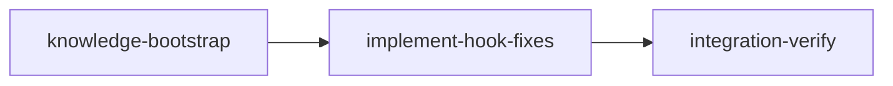

# Plan: Fix Hook False-Positive Pattern Matching

## Overview

All PreToolUse hooks do naive string matching on entire bash command strings, including heredoc bodies and `-m`/`--message` content. This causes false positives when keywords appear in text content rather than as actual operations. Fixes GitHub issue #13 and the same bug class across all hooks.

**Reported case:** `git commit -m "Add .worktrees/ to .gitignore"` blocked by worktree-isolation.sh because `.worktrees/` appears in the message text.

## Goals

- Fix issue #13 (worktree-isolation.sh false positive on `.worktrees/` in commit messages)
- Fix the same bug class in commit-filter.sh, git-add-guard.sh, prefer-modern-tools.sh
- Fix the Rust parallel implementation in validators/bash.rs
- Tighten the overly-broad attribution pattern in commit-filter.sh
- Add comprehensive tests for both true and false positives
- Update knowledge files to document this concern

## Execution Diagram



All work fits in a single implementation stage with parallel subagents (no file overlap between hooks).

---

## Stages

### 1. Knowledge Bootstrap

**Purpose:** Lightweight pass — knowledge already exists with good coverage. Only needs gap-fill for the hook false-positive concern.

**Tasks:**

- Run `loom knowledge check` to verify coverage >= 50%
- Add the hook pattern matching false-positive concern to concerns.md
- Update patterns.md Hook Patterns section with full hook inventory

**Files:** `doc/loom/knowledge/**`

### 2. Implement Hook Fixes

**Purpose:** Create shared content-stripping utility and update all affected hooks.

**Dependencies:** knowledge-bootstrap

**Approach:** Create `hooks/_common.sh` with `strip_embedded_content()` function, then update each hook in parallel via subagents. No file overlap between subagents.

**Subagent assignments:**

| Subagent | Files Owned (write) | Files Read-Only |
|----------|-------------------|-----------------|
| 1 — Common + Isolation | `hooks/_common.sh` (new), `hooks/worktree-isolation.sh` | — |
| 2 — Commit Filter | `hooks/commit-filter.sh` | `hooks/_common.sh` |
| 3 — Git Add Guard + Modern Tools | `hooks/git-add-guard.sh`, `hooks/prefer-modern-tools.sh` | `hooks/_common.sh` |
| 4 — Rust Validators + Install | `loom/src/hooks/validators/bash.rs`, `loom/src/fs/permissions/constants.rs`, `install.sh` | `hooks/_common.sh` |

Note: Subagent 1 creates `_common.sh` first. Main agent coordinates creation before spawning other subagents, or subagents 2-4 can source it after subagent 1 completes.

**Key implementation details:**

`_common.sh` `strip_embedded_content()`:

- Phase 1: awk state machine strips heredoc bodies (between `<<['"]?MARKER['"]?` and end marker)
- Phase 2: sed strips `-m "..."`, `-m '...'`, `--message="..."`, `--message '...'` content
- Source guard to prevent double-sourcing
- Bash 3.2+ compatible (no perl)

`commit-filter.sh` tightening:

- `git[[:space:]].*commit` → `git[[:space:]]+commit(\s|$)` (commit as subcommand only)
- `co-authored-by.*(claude|anthropic)` → anchored to line start: `^[[:space:]]*[Cc]o-[Aa]uthored-[Bb]y:` with word boundaries on names

**Files:** `hooks/*`, `loom/src/hooks/validators/bash.rs`, `loom/src/fs/permissions/constants.rs`, `install.sh`

**Acceptance:** All existing tests pass, new false-positive test cases pass, cargo clippy clean.

### 3. Integration Verification

**Purpose:** Verify all hooks work correctly after changes — both true positives (real violations blocked) and false positives (text content allowed).

**Dependencies:** implement-hook-fixes

**Tasks:**

- Run full Rust test suite
- Run shell hook tests (feed JSON to hooks, verify exit codes)
- Manual smoke test for issue #13
- Code review (security, architecture, testing)
- Knowledge curation from memory
- Documentation updates if needed

**Acceptance:** cargo test, cargo clippy, shell tests pass, issue #13 repro case exits 0.

---

<!-- loom METADATA -->

```yaml
loom:
  version: 1
  sandbox:
    enabled: true
    auto_allow: true
    excluded_commands:
      - "loom"
    filesystem:
      deny_read:
        - "~/.ssh/**"
        - "~/.aws/**"
        - "~/.config/gcloud/**"
        - "~/.gnupg/**"
      deny_write:
        - ".work/stages/**"
      allow_write:
        - "hooks/**"
        - "loom/src/**"
        - "install.sh"
        - "doc/**"
    network:
      allowed_domains: []
      allow_local_binding: false
      allow_unix_sockets: []
  stages:
    - id: knowledge-bootstrap
      name: "Bootstrap Knowledge Base"
      stage_type: knowledge
      description: |
        Lightweight knowledge pass. Existing knowledge is comprehensive but has gaps
        for the hook false-positive concern discovered during issue #13 investigation.

        Use parallel subagents and skills to maximize performance.

        Step 0 - CHECK EXISTING KNOWLEDGE:
          Run: loom knowledge check
          Coverage should already be >= 50%. Verify.

        Step 1 - FILL GAPS:
          Update concerns.md with hook false-positive pattern matching concern:
            loom knowledge update concerns - <<'EOF'
            ## Hook Pattern Matching: False Positives on Embedded Content (2026-03-31)

            All PreToolUse hooks (worktree-isolation.sh, commit-filter.sh, git-add-guard.sh,
            prefer-modern-tools.sh) and Rust validators (bash.rs) matched patterns against
            full bash command strings including heredoc bodies and -m/--message content.
            Keywords in commit messages or string literals triggered false blocks.

            Issue #13: git commit -m "Add .worktrees/ to .gitignore" blocked by
            worktree-isolation.sh because .worktrees/ appeared in message text.

            Fix: Introduced _common.sh with strip_embedded_content() that removes heredoc
            bodies and message content before pattern matching. Rust parallel implementation
            in validators/bash.rs. Also tightened commit-filter.sh attribution pattern to
            require Co-Authored-By: header prefix instead of substring matching.

            Hooks affected: worktree-isolation.sh, commit-filter.sh, git-add-guard.sh,
            prefer-modern-tools.sh, validators/bash.rs.
            EOF

          Update patterns.md Hook Patterns section with full hook inventory:
            loom knowledge update patterns - <<'EOF'
            ## Hook Content-Stripping Pattern

            Hooks that validate bash commands must strip embedded text content before
            pattern matching. The strip_embedded_content() function (in hooks/_common.sh
            for shell, validators/bash.rs for Rust) removes:
            1. Heredoc bodies (awk state machine tracking <<MARKER to MARKER)
            2. -m / --message quoted content (sed replacements)

            Each hook sources _common.sh via: source "$(dirname "$0")/_common.sh"

            Full hook inventory (13 scripts in hooks/):
            - PreToolUse: worktree-isolation.sh, commit-filter.sh, git-add-guard.sh,
              prefer-modern-tools.sh, worktree-file-guard.sh
            - PostToolUse: post-tool-use.sh, ask-user-post.sh
            - Stop: commit-guard.sh, learning-validator.sh
            - SessionStart: session-start.sh
            - SessionEnd: session-end.sh
            - PreCompact: pre-compact.sh
            - UserPromptSubmit: skill-trigger.sh, ask-user-pre.sh
            EOF

        MEMORY RECORDING:
        - Record any additional gaps found: loom memory note "gap: ..."
        - Before completing: loom memory list (verify insights captured)
      dependencies: []
      acceptance:
        - "loom knowledge check --min-coverage 50"
        - 'rg -q "Hook Pattern Matching" doc/loom/knowledge/concerns.md'
        - 'rg -q "Content-Stripping" doc/loom/knowledge/patterns.md'
      files:
        - "doc/loom/knowledge/**"
      working_dir: "."
      artifacts:
        - "doc/loom/knowledge/concerns.md"
        - "doc/loom/knowledge/patterns.md"

    - id: implement-hook-fixes
      name: "Fix Hook False-Positive Pattern Matching"
      stage_type: standard
      description: |
        Fix false-positive pattern matching across all affected hooks.
        Core fix: strip embedded text content (heredoc bodies, -m message content)
        before running pattern checks.

        Use parallel subagents and skills to maximize performance.

        EXECUTION PLAN:

        MAIN AGENT creates hooks/_common.sh first, then spawns parallel subagents.

        hooks/_common.sh design:
          - Source guard (_LOOM_COMMON_LOADED) to prevent double-sourcing
          - strip_embedded_content() function:
            Phase 1: awk strips heredoc bodies (state machine: inside_heredoc flag,
              tracks marker from <<['"]?MARKER['"]? to line matching ^MARKER$)
            Phase 2: sed strips -m "..." / -m '...' / --message="..." / --message '...'
              content (replace quoted content with empty quotes)
          - Bash 3.2+ compatible (macOS default). No perl dependency.
          - Each consumer sources via: source "$(dirname "$0")/_common.sh"

        SUBAGENT FILE ASSIGNMENTS:

          Subagent 1 - Isolation Hook (issue #13 fix):
            Files Owned: hooks/worktree-isolation.sh
            Files Read-Only: hooks/_common.sh
            Tasks:
            - Add source "$(dirname "$0")/_common.sh" after set -euo pipefail
            - In validate_bash_command(): strip command before all 3 pattern checks
              (git -C, path traversal, .worktrees/)
            - Use stripped command for grep checks, keep original for error messages
            - Test: git commit -m "Add .worktrees/ to .gitignore" must exit 0

          Subagent 2 - Commit Filter:
            Files Owned: hooks/commit-filter.sh
            Files Read-Only: hooks/_common.sh
            Tasks:
            - Source _common.sh
            - Strip command before subagent git operation check (line 243)
            - Tighten git commit detection (line 295):
              FROM: grep -qiE 'git[[:space:]].*commit'
              TO: grep -qiE 'git[[:space:]]+commit([[:space:]]|$)'
            - Tighten attribution pattern (line 301):
              FROM: grep -qiE 'co-authored-by.*(claude|anthropic|noreply@anthropic)'
              TO: Check each line for Co-Authored-By: header prefix with word boundaries
              on the name (anchored to start of line, not just substring)
            - Test: git commit -m "Update CLAUDE.md" must exit 0
            - Test: git commit with actual Co-Authored-By: Claude must exit 2

          Subagent 3 - Git Add Guard + Modern Tools:
            Files Owned: hooks/git-add-guard.sh, hooks/prefer-modern-tools.sh
            Files Read-Only: hooks/_common.sh
            Tasks:
            - git-add-guard.sh: Source _common.sh, strip in check_dangerous_patterns()
              before normalization and pattern matching
            - prefer-modern-tools.sh: Source _common.sh, strip before uses_grep() and
              uses_find() checks. Keep existing loom knowledge/memory fast-path skip.
            - Test: git commit -m "Use git add -A" must exit 0 (git-add-guard)
            - Test: git commit -m "Use grep" must exit 0 (prefer-modern-tools)

          Subagent 4 - Rust Validators + Installation:
            Files Owned: loom/src/hooks/validators/bash.rs,
              loom/src/fs/permissions/constants.rs, install.sh
            Files Read-Only: hooks/_common.sh
            Tasks:
            - bash.rs: Add strip_embedded_content() Rust function:
              - extract_heredoc_marker(line) -> Option<String> for <<MARKER detection
              - Line-by-line state machine to strip heredoc bodies
              - Regex replacements for -m/-message content (new LazyLock patterns)
              - Call strip at start of validate_bash_command()
            - bash.rs: Add unit tests for false positives:
              - test_false_positive_worktrees_in_message (issue #13)
              - test_false_positive_git_c_in_message
              - test_false_positive_path_traversal_in_message
              - test_false_positive_heredoc_content
              - test_true_positive_still_blocks (regression safety)
              - test_strip_embedded_content unit tests
            - constants.rs: Add HOOK_COMMON constant with include_str, add to LOOM_HOOKS
            - install.sh: Add "_common.sh" to both all_hooks arrays (lines 211 and 345)
            - Run: cd loom && cargo test validators && cargo clippy -- -D warnings

        NO FILE OVERLAP between subagents confirmed.

        MEMORY RECORDING (use memory ONLY, never knowledge):
        Record IMMEDIATELY when these happen, not at stage end:
        - MISTAKE: tried X, failed -> loom memory note "mistake: ..."
        - DECISION: chose X over Y -> loom memory decision "..." --context "..."
        - SURPRISE: unexpected behavior -> loom memory note "found: ..."
      dependencies: ["knowledge-bootstrap"]
      acceptance:
        - "cd loom && cargo test validators"
        - "cd loom && cargo clippy -- -D warnings"
        - "cd loom && cargo build"
        - "test -f hooks/_common.sh"
        - 'rg -q "strip_embedded_content" hooks/_common.sh'
        - 'rg -q "strip_embedded_content" hooks/worktree-isolation.sh'
        - 'rg -q "strip_embedded_content" hooks/commit-filter.sh'
        - 'rg -q "strip_embedded_content" hooks/git-add-guard.sh'
        - 'rg -q "strip_embedded_content" hooks/prefer-modern-tools.sh'
        - 'rg -q "strip_embedded_content" loom/src/hooks/validators/bash.rs'
        - 'rg -qF "_common.sh" loom/src/fs/permissions/constants.rs'
        - 'rg -qF "_common.sh" install.sh'
      files:
        - "hooks/_common.sh"
        - "hooks/worktree-isolation.sh"
        - "hooks/commit-filter.sh"
        - "hooks/git-add-guard.sh"
        - "hooks/prefer-modern-tools.sh"
        - "loom/src/hooks/validators/bash.rs"
        - "loom/src/fs/permissions/constants.rs"
        - "install.sh"
      working_dir: "."
      artifacts:
        - "hooks/_common.sh"
      wiring:
        - source: "hooks/worktree-isolation.sh"
          pattern: "strip_embedded_content"
          description: "Worktree isolation hook uses content stripping before validation"
        - source: "hooks/commit-filter.sh"
          pattern: "strip_embedded_content"
          description: "Commit filter hook uses content stripping before validation"
        - source: "hooks/git-add-guard.sh"
          pattern: "strip_embedded_content"
          description: "Git add guard hook uses content stripping before validation"
        - source: "hooks/prefer-modern-tools.sh"
          pattern: "strip_embedded_content"
          description: "Prefer modern tools hook uses content stripping before validation"
        - source: "loom/src/hooks/validators/bash.rs"
          pattern: "strip_embedded_content"
          description: "Rust validator uses content stripping before validation"
        - source: "loom/src/fs/permissions/constants.rs"
          pattern: "HOOK_COMMON"
          description: "Common hook script registered in constants"

    - id: integration-verify
      name: "Integration Verification"
      stage_type: integration-verify
      description: |
        Final integration verification after hook fixes are merged.

        Use parallel subagents and skills to maximize performance.

        CRITICAL: Verify FUNCTIONAL INTEGRATION, not just tests passing.

        BUILD & TEST:
        1. Run full Rust test suite: cd loom && cargo test
        2. Run linting: cd loom && cargo clippy -- -D warnings
        3. Run cargo build
        4. Run cargo fmt --check

        FUNCTIONAL VERIFICATION (MANDATORY):
        5. Issue #13 reproduction test - feed JSON to worktree-isolation.sh:
             echo '{"tool_name":"Bash","tool_input":{"command":"git commit -m \"Add .worktrees/ to .gitignore\""}}' |
               LOOM_STAGE_ID=test-stage bash hooks/worktree-isolation.sh
           Must exit 0 (not 2).
        6. Test all hooks with false-positive inputs (keywords in messages)
        7. Test all hooks with true-positive inputs (real violations still blocked)
        8. Test _common.sh strip function with heredoc content
        9. Test commit-filter.sh tightened attribution pattern:
           - "Update CLAUDE.md" -> must allow (exit 0)
           - Actual Co-Authored-By: Claude header -> must block (exit 2)

        CODE REVIEW (MANDATORY):
        10. Spawn PARALLEL review subagents:
            - security review: verify stripping doesn't create bypass vectors
            - architecture review: code quality, pattern consistency
            - /loom-testing skill: test coverage, edge cases
        11. Fix ALL issues found by reviewers

        KNOWLEDGE CURATION (MANDATORY):
        12. Read all stage memory: loom memory show --all
        13. Curate valuable insights to knowledge files
        14. Update mistakes.md if any mistakes were made during implementation

        DOCUMENTATION UPDATE:
        15. No user-facing docs likely need updating (hooks are internal),
            but verify and update if needed
      dependencies: ["implement-hook-fixes"]
      acceptance:
        - "cd loom && cargo test"
        - "cd loom && cargo clippy -- -D warnings"
        - "cd loom && cargo build"
        - 'echo ''{"tool_name":"Bash","tool_input":{"command":"git commit -m \"Add .worktrees/ to .gitignore\""}}'' | LOOM_STAGE_ID=test-stage bash hooks/worktree-isolation.sh'
        - 'echo ''{"tool_name":"Bash","tool_input":{"command":"git commit -m \"Update CLAUDE.md references\""}}'' | LOOM_STAGE_ID=test-stage bash hooks/commit-filter.sh'
      files:
        - "hooks/**"
        - "loom/src/**"
        - "install.sh"
        - "doc/loom/knowledge/**"
      working_dir: "."
      truths:
        - 'echo ''{"tool_name":"Bash","tool_input":{"command":"git commit -m \"Add .worktrees/ to .gitignore\""}}'' | LOOM_STAGE_ID=test-stage bash hooks/worktree-isolation.sh'
        - 'echo ''{"tool_name":"Bash","tool_input":{"command":"git commit -m \"Update CLAUDE.md\""}}'' | LOOM_STAGE_ID=test-stage bash hooks/commit-filter.sh'
      wiring:
        - source: "hooks/_common.sh"
          pattern: "strip_embedded_content"
          description: "Shared content-stripping function exists and is callable"
```

<!-- END loom METADATA -->
