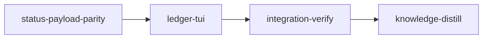

# Plan: Live Ledger Dashboard

## Overview

Rebuild `loom status --live` as the Ledger direction from the design canvas: one aligned row per
stage with its state spelled out beside the glyph, execution models, heartbeat activity, context
gauge, timing and merge state; a needs-attention panel; a footer legend strip; a `?` legend
overlay; and a width policy that drops columns before it truncates. Two implementation stages
carry it: the first makes the daemon push the same `StatusData` the static view renders (the live
view today receives a strictly narrower struct), the second replaces the tree renderer.

## Goals

- Every one of the thirteen `StageStatus` variants reads as a word, never only as a glyph.
- The live view shows what the static view already knows: activity, context tokens, retries,
  review reasons, failure evidence — from one payload, so the two can never disagree again.
- A stage row names the models that executed its work, not only the orchestrator's model.
- Attention coverage extends to `NeedsAdjudication` and `WaitingForInput`.
- Narrow terminals reflow by dropping columns; below 64×16 a notice replaces the dashboard.
- Non-goals: subagent-level rows, cost, per-criterion results (loom holds none of that on the
  status path); the completion screen; the static renderer's row format.

## Answers to the review questions

### 1. Execution models, not only the orchestrator model

Loom records Claude subagent spawns in `.loom/work/subagents/<stage>/spawns.jsonl`
(`hooks/spawn-guard.sh`, function `record_spawn`): each row carries `agent_type`, `model` and
`model_source`, where `model` is the tier resolved for that spawn (`sonnet`, `opus`, or an explicit
id). For a `loom-codex-forwarder` spawn that `model` is the shim's own tier; the codex model is
validated by `hooks/codex-forward.sh` (`gpt-5.6-sol | gpt-5.6-terra | gpt-5.6-luna`, line 17)
and never written to any loom ledger today. Stage 1 adds a `codex.jsonl` ledger written by the
wrapper and a pure reader that merges both ledgers into `StageSummary.execution_models`. The
MODELS column then reads `opus›sonnet,terra`: orchestrator model, then the distinct execution
models in first-seen order. Codex history starts when this plan ships; earlier runs show only the
Claude side. `sol` is displayed like any other codex tier.

### 2. Context utilization is real data

Chain, verified 2026-09-03: `hooks/post-tool-use.sh` computes resident tokens on every tool call
as `input_tokens + cache_creation_input_tokens + cache_read_input_tokens` of the transcript's last
assistant row (`_loom_ctx_last_usage_tokens`), writes `.loom/work/heartbeat/<stage>.json`, the
status collector reads it (`collector.rs`, `read_heartbeat_for_stage`, `heartbeat_facts`) into
`StageSummary.context_tokens`, and resolves the ceiling through `resolve_context_ceiling_tokens`
into `context_ceiling_tokens`. The static `loom status` already prints `[tokens/ceiling]`
(`render/graph.rs`, `format_stage_annotations`). Subagent hooks are classified and excluded, so the
gauge is the orchestrator session's context. The only gap was the live push, which stage 1 closes.

### 3. The other states

| status | row STATE | row ACTIVITY | attention panel |
| --- | --- | --- | --- |
| WaitingForDeps | `○ Waiting` | — | — |
| Queued | `▶ Queued` | `ready` | — |
| Executing | `● Executing` | `working · Edit` / `idle 2m` / `stale 5m 12s` / `orphaned` / `crashed` | — |
| WaitingForInput | `? Input` | `awaiting input` | NEEDS INPUT, with the session's pid and backend |
| NeedsHandoff | `⟳ Handoff` | `handing off` | — |
| Completed | `✓ Completed` | — (MERGE column: merged / unmerged / cleanup!) | CLEANUP FAILED when `cleanup_warning` is set |
| Skipped | `⊘ Skipped` | — | — |
| Blocked | `✗ Blocked` | `crash 2/3` (failure label, retries) | BLOCKED, evidence, `loom stage retry` |
| CompletedWithFailures | `⚠ Failed` | `failed 2/3` | ACCEPTANCE FAILED, evidence, `loom stage retry` |
| MergeConflict | `⚡ Conflict` | `conflict` | MERGE CONFLICT, `loom stage merge` |
| MergeBlocked | `⊗ MergeBlk` | `merge error` | MERGE ERROR, `loom stage merge` |
| NeedsHumanReview | `⏸ Review` | `awaiting you` | NEEDS REVIEW, reason, the three flags |
| NeedsAdjudication | `⚖ Adjudicate` | `dispute 2 · judge working` | NEEDS ADJUDICATION, dispute count, judge liveness |

Judge liveness comes from the judge session's own heartbeat file
(`heartbeat/<stage>.adjudication.json`, written by `post-tool-use.sh` when
`LOOM_SESSION_TYPE=adjudication`). `held` prefixes `held ·` to any activity cell. The `?` overlay
lists all thirteen with a one-line meaning and the resolving command where one exists.

### 4. Narrow terminals

Today: no minimum and no breakpoints. Rows truncate to the pane width
(`tree_widget.rs`, `max_width`), and a short terminal clips from the bottom. After this plan:
columns drop in the order TIME, MODELS, DEPENDS ON, CONTEXT as width shrinks (120 → 111 → 93 →
75 → 64), extra width widens STAGE then DEPENDS ON, and below 64 columns or 16 rows a centred
notice reads `loom status --live needs a terminal of at least 64×16; this one is 48×20` while the
subscription keeps running, so enlarging the window restores the dashboard on the next frame.
Vertically, the activity panel collapses first, then the attention panel caps at four rows, then
the table scrolls.

## Design

Full-width columns (gap 2 between columns, 1 before MERGE; total 120):

| STATE 12 | STAGE 25 | DEPENDS ON 16 | MODELS 16 | ACTIVITY 14 | CONTEXT 9 | TIME 7 | MERGE 8 |
| --- | --- | --- | --- | --- | --- | --- | --- |
| icon + label | wave-indented id | first dep `+n` | `opus›sonnet,terra` | per-state text | `━━━╌╌ 61%` | `3m 12s` | merged / unmerged / cleanup! / conflict / error |

Header keeps the logo's four rows and uses the space to their right: plan name and daemon
liveness (tick age from `orchestrator.tick`), progress bar with `n of N stages complete`, bucket
counts with a red `n need attention`, and the merge summary. Then the alert band (existing
scheduler alerts, zero rows when quiet), the table, NEEDS ATTENTION (from the shared attention
model), ACTIVITY (the existing in-memory transition log), and a footer whose legend strip lists
only the states present. Keys: `?` toggles the legend, `Esc` closes it (or quits, as today),
`↑↓`/`PgUp`/`PgDn`/`Home`/`End`/wheel scroll the table, `q` quits. The completion screen is unchanged.

Colours are the ANSI names already in `theme.rs` and `StageStatus::tui_style()`; the terminal's
theme decides the hues. The canvas shows the intended result:
<https://claude.ai/code/artifact/0438cde8-bb98-42d7-affd-cfbb08b52a99> (board A · Ledger).

## Data provenance

| shown | source |
| --- | --- |
| icon, label, colour, bold | `StageStatus::icon`, `label`, `tui_style` (`models/stage/types.rs`) |
| orchestrator model | `StageSummary.model` (`Stage::effective_model`) |
| execution models | new `StageSummary.execution_models` ← `subagents/<stage>/spawns.jsonl` + new `codex.jsonl` |
| activity, last tool, staleness | `ActivityStatus`, `last_tool`, `staleness_secs` (heartbeat via collector) |
| context | `context_tokens` / `context_ceiling_tokens` |
| time | `execution_secs`, `elapsed_secs` |
| retries, failure label, evidence | `retry_count`, `max_retries`, `failure_info` |
| review reason | `review_reason` |
| dispute count, judge liveness | new `StageSummary.dispute_count`, `judge_heartbeat_secs` |
| session pid, backend | `pid`, new `session_backend` |
| merge state, cleanup | `merged`, `cleanup_warning`, `MergeSummary` |
| held, incoherence | `held`, `incoherence` |
| daemon tick | `orchestrator::tick::read` |
| alerts | `scheduling_report::alerts` |

## Observed baseline (HEAD 8e16e03e, 2026-09-03, main checkout)

| command | result |
| --- | --- |
| `cargo build --all-targets` | ok |
| `cargo clippy --all-targets -- -D warnings` | ok |
| `cargo fmt --check` | ok |
| `RUSTDOCFLAGS="-D warnings" cargo doc --workspace --all-features --no-deps` | ok |
| `cargo test --lib commands::status::` | 67 passed |
| `cargo test --lib daemon::` | 95 passed |
| `cargo test --test maintainability` | 8 passed |
| `cargo test` (full) | 3449 lib tests passed, every integration target ok, exit 0 |
| `bash hooks/tests/codex-forward-wrapper.sh` | PASS |

Negative criteria were dry-run at HEAD: `! rg -q "pub struct StageInfo" loom/src/daemon/protocol.rs`
exits 1 today (the struct exists) and `test ! -f loom/src/commands/status/ui/tree_widget.rs` exits
1 today; both flip to 0 only after the deletion. Named-test `-- --list | rg` criteria pass
only once the named test exists.

## Size ledger

`cargo test --test maintainability` checks `loom/maintainability-baseline.txt` as an EXACT
ledger. Files at their cap that this plan touches: `ui/tui/app.rs` 410, `ui/tui/renderer.rs`
414, `daemon/server/status.rs` 416; functions: `tree_widget.rs build_lines` 183,
`app.rs render` 86, `renderer.rs stage_info_to_stage` 76, `state.rs update` 57,
`collector.rs build_stage_summary` 56, `attention.rs render_problem_stage` 53. Every new file
stays under 400 lines and every function under 50 so it needs no entry. Each stage's orchestrator
reconciles the ledger after its workers return: lower or delete entries that shrank or vanished
(`tree_widget.rs`, `build_lines`, `stage_info_to_stage`), never add one.

## Execution Diagram



No knowledge-bootstrap: `doc/loom/knowledge/` is hierarchical and populated, and
`loom knowledge sync --structural-only` ran clean on 2026-09-03; the status data model this plan
builds on is already written down in `architecture/status-data-model.md`.

## Stages

### 1. status-payload-parity

Necessity: Q3 — the payload swap must be proven (round trip, collector fields, unchanged tree
rows) before a renderer is written against it; Q2 — it edits `state.rs`, `app.rs`, `renderer.rs`
that stage 2 rewrites, so the two must serialise. Five workers; W1, W4 and W5 in the first wave
(disjoint files; W1 declares the module W4 writes), W2 and W3 after W1 returns.

### 2. ledger-tui

Necessity: Q4 — five new modules, four deletions and the app integration are one session's worth
of orchestration on their own. W0 writes the shared types alone; W1, W2, W3 in parallel; W4 after
the crate builds.

### Integration Verification and Knowledge Distillation

Standard bookends. Distillation also rewrites the sections of
`architecture/status-data-model.md` this plan invalidates (`StageInfo` is gone; the push carries
`StatusData`; the four new fields; the live renderer section) from the `stale-knowledge:` memories
integration-verify records, and documents `?`, the MODELS column and the 64×16 minimum in README.

## Prior-stage anchors

Stage 2 edits files stage 1 also edits (`state.rs`, `app.rs`, `renderer.rs`). Every line number
in stage 2's briefs is advisory; anchors are symbol names. Re-read the file before editing.

---

<!-- loom METADATA -->

```yaml
loom:
  version: 1
  auto_merge: null
  sandbox:
    enabled: true
    auto_allow: true
    allow_unsandboxed_escape: false
    excluded_commands: []
    filesystem:
      deny_read:
      - ~/.ssh/**
      - ~/.aws/**
      - ~/.config/gcloud/**
      - ~/.gnupg/**
      - ~/.claude/.credentials.json
      - .loom/work/admin.token
      - .loom/work/user.token
      - ../.loom/work/admin.token
      - ../.loom/work/user.token
      - .work/admin.token
      - .work/user.token
      - ../.work/admin.token
      - ../.work/user.token
      - ../../**
      - ../.worktrees/**
      deny_write:
      - ../../**
      allow_write:
      - loom/**
      - hooks/codex-forward.sh
      - hooks/tests/codex-forward-records-model.sh
      - README.md
    network:
      allowed_domains:
      - crates.io
      - static.crates.io
      - index.crates.io
      additional_domains: []
      allow_local_binding: false
      allow_unix_sockets: []
      allow_all_unix_sockets: false
    linux:
      enable_weaker_nested: false
    command_confinement: confined
  stages:
  - id: status-payload-parity
    name: Live status pushes StatusData; attention and execution-model data
    description: |
      Make the daemon's status push carry the same StatusData the static view renders, extend
      StageSummary with execution models, dispute count, judge heartbeat age and session backend,
      extract the attention model into pure data covering all seven human-needing statuses, and
      start recording the codex model each forwarded task ran with.
      Use parallel subagents and skills to maximize performance.

      WHY: loom status --live subscribes to Response::StatusUpdate, whose StageInfo rows have no
      context tokens, activity, retries or review reason. StatusData (commands/status/data) has
      all of it and collect_status_data is already reachable from the daemon. One payload, two
      renderers.

      BUILD WARM FIRST. Acceptance criteria run under a hard 300 s ceiling and a fresh worktree
      has no loom/target/. Run cargo build --all-targets --manifest-path loom/Cargo.toml before
      anything else so every later cargo criterion runs against a warm target directory.

      Territories below are DISJOINT. Workers NEVER spawn subagents. Spawn every worker BY AGENT
      TYPE, each with the fixed prompt plus "Your brief: <path>. Read it in full before anything
      else." WAVE 1: W1, W4, W5 in ONE message. WAVE 2, after W1 returns: W2 and W3 in ONE
      message (both compile against W1's types).

      Codex workers are spawned as loom-codex-forwarder subagents in the FOREGROUND with an
      explicit Bash timeout of 600000 ms (the Bash tool's maximum), --effort xhigh, and the tier
      named in the table. Tell every codex worker NOT to run git at all, and check git status
      --short after each codex run returns. W5 is Claude sonnet on purpose: hooks/ is
      write-protected for shell writes by the sandbox's bare-git-repo rule, and only the Edit
      and Write tools can change files there.

      | Worker | Role | Tier | Files owned | Shared context | Brief path |
      | ------ | ---- | ---- | ----------- | -------------- | ---------- |
      | W1 | Wire + StageSummary fields (FOUNDATION) | codex gpt-5.6-terra | loom/src/daemon/protocol.rs, loom/src/daemon/mod.rs, loom/src/daemon/server/status.rs, loom/src/daemon/server/tests.rs, loom/src/daemon/wire_tests.rs, loom/src/commands/status/data/mod.rs, loom/src/commands/status/data/collector.rs, loom/src/commands/status/data/collector_tests.rs, the make_stage_summary fixtures in render/attention_tests.rs and render/graph_tests.rs | models/session/types.rs, orchestrator/monitor/heartbeat.rs, fs/work_dir.rs (read-only) | doc/plans/briefs/live-ledger-dashboard/status-payload-parity/w1-wire-and-fields.md |
      | W2 | Existing TUI on the new payload | codex gpt-5.6-terra | loom/src/commands/status/ui/tui/state.rs, app.rs, renderer.rs | data/mod.rs, ui/tree_widget.rs (read-only) | doc/plans/briefs/live-ledger-dashboard/status-payload-parity/w2-tui-consumer.md |
      | W3 | Attention model | codex gpt-5.6-terra | loom/src/commands/status/render/attention_model.rs (new), render/attention_model_tests.rs (new), render/attention.rs, render/graph.rs (failure-label match only), render/mod.rs | render/attention_tests.rs (read-only, pins output) | doc/plans/briefs/live-ledger-dashboard/status-payload-parity/w3-attention-model.md |
      | W4 | execution_models_for_stage | codex gpt-5.6-luna | loom/src/commands/status/data/execution_models.rs (new) | hooks/spawn-guard.sh record_spawn, commands/subagents/table.rs (read-only) | doc/plans/briefs/live-ledger-dashboard/status-payload-parity/w4-execution-models.md |
      | W5 | codex.jsonl ledger in the wrapper | claude loom-software-engineer (sonnet) | hooks/codex-forward.sh (Edit tool only), hooks/tests/codex-forward-records-model.sh (new, Write tool only) | hooks/spawn-guard.sh, hooks/tests/codex-forward-wrapper.sh (read-only) | doc/plans/briefs/live-ledger-dashboard/status-payload-parity/w5-codex-ledger-hook.md |

      BUILD COUPLING: W1 declares mod execution_models and calls execution_models_for_stage;
      W4 writes that module. Nothing compiles until both files exist. If either returns without
      its file, RE-SPAWN it (subagents are one-shot; brief the fresh one with the prior report).
      Do not stub.

      CONTRACT W1 <-> W4: pub fn execution_models_for_stage(work_dir: &WorkDir, stage_id: &str)
      -> Vec<String> in loom/src/commands/status/data/execution_models.rs, re-exported from
      data/mod.rs.

      BEHAVIOUR PINS: render/attention_tests.rs is read-only for every worker and must stay
      green - it proves the static attention output for the five existing statuses is
      byte-identical. The live tree must render the same rows as before for the same stages;
      state.rs tests and the renderer test are the pin.

      LEDGER: no worker edits loom/maintainability-baseline.txt. After all five have returned and
      the crate builds, run cargo test --manifest-path loom/Cargo.toml --test maintainability and
      set every entry it names to the exact value it reports (daemon/server/status.rs and
      render_problem_stage shrink; stage_info_to_stage is renamed) - lower or delete, never add.

      VERIFY AND COMMIT YOURSELF. Run the full acceptance list, fix everything it reports, run
      the mini adversarial code review, fix its findings, re-verify, then commit.

      MEMORY: record mistakes, decisions and surprises via loom memory immediately. NEVER loom
      knowledge (implementation stage). NEVER Claude Code auto-memory. Never read
      .work/admin.token or .work/user.token.
    dependencies: []
    parallel_group: null
    acceptance:
    - cargo fmt --check --manifest-path loom/Cargo.toml
    - cargo build --all-targets --manifest-path loom/Cargo.toml
    - cargo clippy --all-targets --manifest-path loom/Cargo.toml -- -D warnings
    - RUSTDOCFLAGS="-D warnings" cargo doc --workspace --all-features --no-deps --manifest-path loom/Cargo.toml
    - 'cargo test --manifest-path loom/Cargo.toml --lib daemon::'
    - 'cargo test --manifest-path loom/Cargo.toml --lib commands::status::'
    - cargo test --manifest-path loom/Cargo.toml --test maintainability
    - 'cargo test --manifest-path loom/Cargo.toml --lib commands::status:: -- --list 2>/dev/null | rg -q "judge_heartbeat_secs_reads_adjudication_file"'
    - 'cargo test --manifest-path loom/Cargo.toml --lib commands::status:: -- --list 2>/dev/null | rg -q "entries_cover_adjudication_and_input"'
    - 'cargo test --manifest-path loom/Cargo.toml --lib commands::status:: -- --list 2>/dev/null | rg -q "forwarder_rows_are_skipped_and_codex_rows_counted"'
    - '! rg -q "pub struct StageInfo" loom/src/daemon/protocol.rs'
    - bash hooks/tests/codex-forward-records-model.sh
    - bash hooks/tests/codex-forward-wrapper.sh
    setup: []
    files:
    - loom/src/daemon/**
    - loom/src/commands/status/**
    - hooks/codex-forward.sh
    - hooks/tests/codex-forward-records-model.sh
    - loom/maintainability-baseline.txt
    auto_merge: null
    working_dir: .
    stage_type: standard
    artifacts:
    - loom/src/commands/status/render/attention_model.rs
    - loom/src/commands/status/render/attention_model_tests.rs
    - loom/src/commands/status/data/execution_models.rs
    - hooks/tests/codex-forward-records-model.sh
    wiring:
    - source: loom/src/daemon/server/status.rs
      pattern: collect_status_data\(
      description: The daemon's status builder calls the shared collector
    - source: loom/src/commands/status/ui/tui/app.rs
      pattern: Response::StatusUpdate \{ data
      description: The live TUI consumes the StatusData payload
    - source: loom/src/commands/status/render/attention.rs
      pattern: attention_entries\(
      description: The static attention renderer draws from the shared model
    - source: loom/src/commands/status/render/graph.rs
      pattern: failure_label\(
      description: The static graph uses the shared failure label table
    - source: loom/src/commands/status/data/collector.rs
      pattern: execution_models_for_stage\(
      description: The collector fills execution_models from the ledgers
    - source: hooks/codex-forward.sh
      pattern: codex\.jsonl
      description: The forwarding wrapper records the codex model it ran
    context_ceiling_tokens: null
    sandbox: {}
    model: opus
    reasoning_effort: high
    ultracode: false
    implementers:
    - codex
    - claude
    subagent_timeout_secs: 900
  - id: ledger-tui
    name: Ledger renderer for loom status --live
    description: |
      Replace the tree-based live renderer with the ledger: width-adaptive columns, one row
      per stage with the state spelled out, header with plan/daemon/progress/counts/merge
      summary, needs-attention and activity panels, a footer legend strip, a ? legend overlay,
      and a 64x16 minimum-size notice. Delete the orphaned tree widget.
      Use parallel subagents and skills to maximize performance.

      The design is settled (canvas board A - Ledger); the briefs carry the exact column
      widths, drop order, per-state cell text and legend wording. Workers implement the spec,
      they do not redesign it.

      BUILD WARM FIRST: run cargo build --all-targets --manifest-path loom/Cargo.toml before
      anything else.

      Territories below are DISJOINT. Workers NEVER spawn subagents. Spawn every worker BY AGENT
      TYPE with the fixed prompt plus "Your brief: <path>. Read it in full before anything else."
      WAVE 1: W0 alone. WAVE 2, after W0 returns: W1, W2, W3 in ONE message. WAVE 3, after the
      crate builds: W4.

      Codex workers are spawned as loom-codex-forwarder subagents in the FOREGROUND with an
      explicit Bash timeout of 600000 ms, --effort xhigh, and the tier named in the table. Tell
      every codex worker NOT to run git at all, and check git status --short after each run.

      | Worker | Role | Tier | Files owned | Shared context | Brief path |
      | ------ | ---- | ---- | ----------- | -------------- | ---------- |
      | W0 | ledger/mod.rs shared types (FOUNDATION) | codex gpt-5.6-luna | loom/src/commands/status/ui/tui/ledger/mod.rs (new), one line in ui/tui/mod.rs | data/mod.rs, render/attention_model.rs, ui/tui/state.rs (read-only) | doc/plans/briefs/live-ledger-dashboard/ledger-tui/w0-shared-types.md |
      | W1 | Columns and rows | codex gpt-5.6-terra | ledger/columns.rs, ledger/rows.rs, ledger/cells.rs (new) | ledger/mod.rs, ui/theme.rs, models/stage/types.rs, render/attention_model.rs, utils.rs (read-only) | doc/plans/briefs/live-ledger-dashboard/ledger-tui/w1-columns-and-rows.md |
      | W2 | Header, panels, footer, legend | codex gpt-5.6-terra | ledger/header.rs, ledger/panels.rs, ledger/legend.rs (new) | ledger/mod.rs, lib.rs LOGO, ui/theme.rs, ui/tui/renderer.rs, ui/tui/state.rs (read-only) | doc/plans/briefs/live-ledger-dashboard/ledger-tui/w2-header-panels-legend.md |
      | W3 | Layout, size notice, app and key integration, deletions | codex gpt-5.6-terra | ledger/layout.rs (new), ui/tui/app.rs, ui/tui/event_handler.rs, ui/tui/renderer.rs, ui/mod.rs; deletes ui/tree_widget.rs and ui/tree_widget_tests.rs | every other ledger/*.rs, orchestrator/tick.rs (read-only) | doc/plans/briefs/live-ledger-dashboard/ledger-tui/w3-layout-and-integration.md |
      | W4 | TestBackend render tests | codex gpt-5.6-luna | ledger/tests.rs (new) | every ledger/*.rs (read-only) | doc/plans/briefs/live-ledger-dashboard/ledger-tui/w4-render-tests.md |

      BUILD COUPLING: W0's mod.rs declares six modules and a test module written by W1-W4;
      W3's layout calls W1's and W2's functions. The crate compiles only when W0-W3 have all
      returned; W4 spawns after that. A worker that returns without its files is RE-SPAWNED with
      its prior report; never stub a sibling's file.

      KEYS: ? toggles the legend overlay; Esc closes it when open and quits otherwise; q, Ctrl-C,
      Up/Down, PgUp/PgDn, Home/End and the mouse wheel keep today's behaviour. The completion
      screen (renderer.rs render_completion) is untouched.

      LEDGER: no worker edits loom/maintainability-baseline.txt. After the crate builds, run
      cargo test --manifest-path loom/Cargo.toml --test maintainability and reconcile: delete the
      entries for tree_widget.rs, build_lines and stage_info_to_stage, set app.rs, renderer.rs,
      render and run_event_loop to the exact values reported - lower or delete, never add.

      VERIFY AND COMMIT YOURSELF. Run the full acceptance list, fix everything it reports, run
      the mini adversarial code review, fix its findings, re-verify, then commit.

      MEMORY: record mistakes, decisions and surprises via loom memory immediately. NEVER loom
      knowledge (implementation stage). NEVER Claude Code auto-memory. Never read
      .work/admin.token or .work/user.token.
    dependencies:
    - status-payload-parity
    parallel_group: null
    acceptance:
    - cargo fmt --check --manifest-path loom/Cargo.toml
    - cargo build --all-targets --manifest-path loom/Cargo.toml
    - cargo clippy --all-targets --manifest-path loom/Cargo.toml -- -D warnings
    - RUSTDOCFLAGS="-D warnings" cargo doc --workspace --all-features --no-deps --manifest-path loom/Cargo.toml
    - 'cargo test --manifest-path loom/Cargo.toml --lib commands::status::'
    - cargo test --manifest-path loom/Cargo.toml --test maintainability
    - 'cargo test --manifest-path loom/Cargo.toml --lib commands::status:: -- --list 2>/dev/null | rg -q "renders_all_thirteen_states_at_full_width"'
    - 'cargo test --manifest-path loom/Cargo.toml --lib commands::status:: -- --list 2>/dev/null | rg -q "drops_columns_in_priority_order"'
    - 'cargo test --manifest-path loom/Cargo.toml --lib commands::status:: -- --list 2>/dev/null | rg -q "shows_notice_below_minimum_size"'
    - 'cargo test --manifest-path loom/Cargo.toml --lib commands::status:: -- --list 2>/dev/null | rg -q "legend_overlay_lists_every_state"'
    - test ! -f loom/src/commands/status/ui/tree_widget.rs
    - test ! -f loom/src/commands/status/ui/tree_widget_tests.rs
    setup: []
    files:
    - loom/src/commands/status/ui/**
    - loom/maintainability-baseline.txt
    auto_merge: null
    working_dir: .
    stage_type: standard
    artifacts:
    - loom/src/commands/status/ui/tui/ledger/mod.rs
    - loom/src/commands/status/ui/tui/ledger/columns.rs
    - loom/src/commands/status/ui/tui/ledger/rows.rs
    - loom/src/commands/status/ui/tui/ledger/header.rs
    - loom/src/commands/status/ui/tui/ledger/panels.rs
    - loom/src/commands/status/ui/tui/ledger/legend.rs
    - loom/src/commands/status/ui/tui/ledger/layout.rs
    - loom/src/commands/status/ui/tui/ledger/tests.rs
    wiring:
    - source: loom/src/commands/status/ui/tui/app.rs
      pattern: ledger::render\(
      description: The app draws every frame through the ledger layout
    - source: loom/src/commands/status/ui/tui/event_handler.rs
      pattern: KeyCode::Char\('\?'\)
      description: The ? key is handled
    - source: loom/src/commands/status/ui/tui/ledger/layout.rs
      pattern: render_legend_overlay\(
      description: The layout draws the legend overlay when open
    - source: loom/src/commands/status/ui/tui/ledger/layout.rs
      pattern: MIN_COLS
      description: The layout enforces the minimum size
    context_ceiling_tokens: null
    sandbox: {}
    model: opus
    reasoning_effort: high
    ultracode: false
    implementers:
    - codex
    - claude
    subagent_timeout_secs: 900
  - id: integration-verify
    name: Integration Verification
    description: |
      Final verification after both stages. Verify FUNCTIONAL INTEGRATION, not just tests
      passing. NEVER Claude Code auto-memory.
      CONTEXT: read doc/plans/PLAN-live-ledger-dashboard.md, loom memory show --all, and
      doc/loom/knowledge/architecture/status-data-model.md.
      BUILD & TEST (zero tolerance - fix ALL warnings/errors): the full suite, clippy as errors,
      rustdoc as errors, the maintainability ledger, both hook tests.
      CODE REVIEW: spawn parallel loom-code-reviewer subagents (security via
      Skill(skill="loom-skills", args="loom-security-audit"); architecture; test coverage);
      fix ALL findings with an engineer agent.
      FUNCTIONAL: prove the feature is WIRED IN. The daemon socket cannot be opened from a
      sandboxed session, so the live dashboard is proven by the TestBackend render tests in
      ui/tui/ledger/tests.rs (run them by name and read their assertions against the plan's
      design table), by cargo run -- status --help listing --live, and by a static
      cargo run -- status against a temp .loom/work fixture only if one can be built without
      touching shared state; otherwise say so. Confirm attention_entries is the single source
      for both renderers (rg for a second status match), that StageInfo is gone from the crate,
      and that tree_widget has no remaining reference.
      STALE KNOWLEDGE: doc/loom/knowledge/architecture/status-data-model.md now describes a
      payload that no longer exists. Record one loom memory note per section it invalidates:
      loom memory note "stale-knowledge: architecture/status-data-model.md#<heading> claims X;
      the tree does Y (file:line). Correction: <text>" - at least Payload Shapes, What the Live
      TUI Renders Today, and Attention Rendering. Distillation applies them.
      Record every other discovery to loom memory for knowledge-distill.
    dependencies:
    - ledger-tui
    parallel_group: null
    acceptance:
    - cargo fmt --check --manifest-path loom/Cargo.toml
    - cargo build --all-targets --manifest-path loom/Cargo.toml
    - cargo clippy --all-targets --manifest-path loom/Cargo.toml -- -D warnings
    - RUSTDOCFLAGS="-D warnings" cargo doc --workspace --all-features --no-deps --manifest-path loom/Cargo.toml
    - cargo test --manifest-path loom/Cargo.toml
    - cargo test --manifest-path loom/Cargo.toml --test maintainability
    - bash hooks/tests/codex-forward-records-model.sh
    - bash hooks/tests/codex-forward-wrapper.sh
    - cargo run --quiet --manifest-path loom/Cargo.toml -- status --help | rg -q -- "--live"
    - '! rg -q "StageInfo\b" loom/src/daemon loom/src/commands/status --type rust'
    - '! rg -q "tree_widget" loom/src --type rust'
    setup: []
    files: []
    auto_merge: null
    working_dir: .
    stage_type: integration-verify
    artifacts: []
    wiring:
    - source: loom/src/daemon/server/broadcast.rs
      pattern: collect_status\(
      description: The broadcaster still pushes through collect_status each second
    - source: loom/src/commands/status/ui/tui/app.rs
      pattern: attention_entries\(
      description: The live view builds its attention panel from the shared model
    wiring_tests:
    - name: status subcommand still exposes --live
      command: cargo run --quiet --manifest-path loom/Cargo.toml -- status --help
      success_criteria:
        exit_code: 0
        stdout_contains:
        - --live
    context_ceiling_tokens: null
    sandbox: {}
    model: opus
    reasoning_effort: high
    ultracode: false
    implementers:
    - claude
  - id: knowledge-distill
    name: Knowledge Distillation
    description: |
      Curate all stage memories into permanent knowledge; update user docs.
      NEVER Claude Code auto-memory.
      SINGLE-AGENT: do NOT spawn subagents - memories are compact summaries; lean on them and
      keep code spot-reads narrow.
      Read the plan + loom memory show --all + doc/loom/knowledge/*.md.
      CORRECTIONS FIRST: apply every stale-knowledge: memory in place with
      loom knowledge replace-section <file> "<heading>" "<body>" - never with loom knowledge
      update, which appends the fix below the stale text. architecture/status-data-model.md
      gets at least its Payload Shapes, What the Live TUI Renders Today and Attention Rendering
      sections replaced, and a new short section on the two ledgers behind execution_models.
      Then curate mistakes (prevention rules), patterns, decisions, conventions via loom
      knowledge update. TIER ROUTING: findings ~40 lines or fewer go inline in the tier-1 file;
      larger findings go via loom knowledge update <category>/<slug> with a 2-4 line tier-1
      summary + link. INDEX.md regenerates automatically on every knowledge write; then loom
      review prunes stale entries.
      README: in the loom status section document the ? legend key, the MODELS column
      (orchestrator model, then the models that executed subagent work) and the 64x16 minimum
      size. Relevant sections only.
    dependencies:
    - integration-verify
    parallel_group: null
    acceptance:
    - rg -q "## " doc/loom/knowledge/architecture.md
    - rg -q "## " doc/loom/knowledge/patterns.md
    - rg -q "StatusData" doc/loom/knowledge/architecture/status-data-model.md
    - '! rg -qF "strictly narrower" doc/loom/knowledge/architecture/status-data-model.md'
    - count=$(loom knowledge check | rg -o "[0-9]+ issue" | rg -o "[0-9]+" | head -1); test -z "$count" || test "$count" -le 722
    setup: []
    files:
    - doc/loom/knowledge/**
    - README.md
    auto_merge: null
    working_dir: .
    stage_type: knowledge-distill
    artifacts: []
    wiring: []
    context_ceiling_tokens: null
    sandbox: {}
    model: sonnet
    reasoning_effort: high
    ultracode: false
    implementers:
    - claude
```

<!-- END loom METADATA -->
