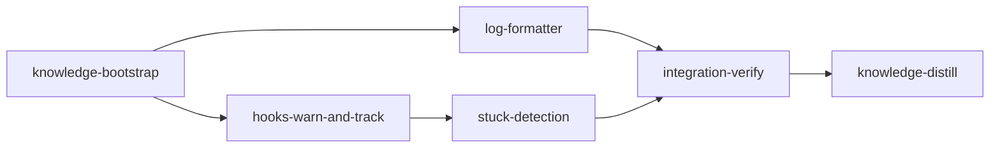

# Plan: Loom Observability & Hook Improvements

## Context

A real loom-orchestrated session (visible via `loom container logs <stage-id>`) exposed
six friction points. After a pressure-review (`doc/plans/codex-PLAN-loom-observability-and-hooks.md`)
identified five blockers and seven high-risk gaps in the first draft, this plan was
revised to:

- Own the log stream instead of `exec`-ing it away
- Use deterministic hook fixtures rather than live discovery
- Persist soft signals to disk so static `loom status` can read them
- **Defer context-growth velocity to a follow-up plan** (no data source today: `hooks/post-tool-use.sh:63` writes `context_percent: null`)
- Use the schema's real `before_stage`/`after_stage` fields instead of the silently-ignored `truths:`

The six original friction points, reordered by feasibility:

1. **Container logs are raw JSONL** — fix by re-architecting the logs command to stream stdout through a formatter (default `--format human`, opt-in `--format json`).
2. **Tool-result content is duplicated** in the transcript — fold into the formatter; render once.
3. **`prefer-modern-tools.sh` hard-blocks legitimate `find`/`grep`** — change to exit 0 emitting JSON `hookSpecificOutput.additionalContext` (pattern from `hooks/skill-trigger.sh:284-289`). Agent sees the nudge inline; tool runs.
4. **Hook blocks vs real failures are indistinguishable** — the additionalContext approach makes warnings agent-visible by design; deferred deeper structured-envelope work isn't needed for launch.
5. **No stuck-agent detection** — `hooks/post-tool-use.sh` writes structured rows to `.work/tool-events.jsonl`; orchestrator monitor reads them and emits a soft signal persisted to `.work/monitor/soft-signals.jsonl`; static `loom status` surfaces a `stuck?` flag.
6. **In-stage context-growth velocity** — **deferred**. The supporting data (per-turn usage from stream-json) isn't captured yet. Will become its own plan once stage 2's formatter has a usage-extraction hook.

## Goals

- `loom container logs <stage-id>` produces a clean human-readable transcript by default; `--format json` preserves the raw byte stream
- `prefer-modern-tools.sh` never burns a turn — warning is visible to the agent without blocking
- `.work/tool-events.jsonl` accumulates structured tool-call records
- `loom status` (static, compact, live) surfaces a `stuck?` flag derived from the soft-signal store
- Foundation in place for future context-velocity work without scope creep here

## Execution Diagram



---

## Stages

### 1. Knowledge Bootstrap

**Purpose:** Confirm coverage of loom's command, hook, monitor, and status modules. If
`loom knowledge check` shows ≥ 50% coverage, only fill the four target areas this plan
touches (container logs, hooks, monitor, status surfacing).

**Files:** `doc/loom/knowledge/**`

---

### 2. Log Formatter (issues #1, #2)

**Purpose:** Re-architect `loom container logs` so loom owns the stdout stream, then add a
human-readable formatter as the default with `--format json` preserving the raw byte stream.

**Dependencies:** knowledge-bootstrap

#### Streaming redesign

The current `loom/src/commands/container/logs.rs:230-244` calls
`Command::new(...).args(&args).exec()` — that hands control to the runtime binary and
loom never sees stdout. To format we need to switch to `spawn + stdout pipe + line
reader` for the human path. The json path keeps a byte-preserving pass-through (still
loom-owned so behavior is identical to today minus the `exec` quirk; this also lets us
add `--show-thinking` etc. consistently).

**Key files (paths relative to `working_dir: "loom"`):**

| Subagent | Files Owned (write) | Files Read-Only |
|----------|---------------------|-----------------|
| A — Streaming core | `src/commands/container/logs.rs`, `src/commands/container/log_format.rs` (new), `src/commands/container/mod.rs` | `src/orchestrator/terminal/container/mod.rs` (verify `--output-format stream-json` invocation) |
| B — CLI wiring | `src/cli/types.rs`, `src/cli/dispatch.rs`, `src/completions/dynamic/commands.rs` | `src/commands/container/logs.rs` |
| C — Fixtures + tests | `tests/log_format_test.rs` (new), `tests/fixtures/stream-json/*.jsonl` (new directory) | `src/commands/container/log_format.rs` |

NO FILE OVERLAP between subagents confirmed.

#### Stream-json event shape catalog (subagent A reference)

Each transcript line is a single JSON object with a top-level `type` field. The
formatter must handle each shape; if an unknown shape appears, render a single
diagnostic line `[unknown event: <type>]` and move on (never crash). Required
coverage:

- `assistant` — `message.content[]` is a list of blocks; each block has `type` ∈ {`text`, `tool_use`, `thinking`}
- `user` — `message.content[]` blocks include `tool_result` (carries `content` and `is_error`); the user message may *also* carry a sibling `tool_use_result` field with the same bytes — render once
- `system` — meta events (suppressed by default)
- `rate_limit_event` — Anthropic rate-limit info (suppressed by default; summarized in `--verbose` footer)
- Anything else — diagnostic fallback

#### Render rules

| Event | Default | With `--show-thinking` | With `--verbose` |
|-------|---------|------------------------|------------------|
| Assistant `text` block | Print as prose + thin separator | (same) | (same) |
| Assistant `tool_use` block | One line `→ ToolName(arg=truncated, ...)` (long strings truncated to 80 chars) | (same) | Show full arg JSON below the summary line |
| User `tool_result` block | One line `← ok (N bytes)` or `← error: <first line of body>`. If `is_error` body looks like a hook block (begins `PreToolUse:`), label as `[hook block] ...`. If body contains `LOOM_HOOK_WARN:`, label as `[hook warn] ...` (defense-in-depth — additionalContext typically lives elsewhere but this handles edge cases) | (same) | Body truncated to 400 chars |
| Assistant `thinking` block | Suppressed | `[thinking] <first line>` | `[thinking] <full body>` |
| `system` / `rate_limit_event` | Suppressed | (same) | Footer summary |
| Duplicated `tool_use_result` field | Discard (dedup the bytes already shown in the `tool_result` block) | (same) | (same) |

#### CLI shape

- `loom container logs <stage-id>` — positional stage id (unchanged)
- `--format human|json` — default `human`
- `--show-thinking` — default `false`
- `--verbose` — default `false`; expands tool args, tool result bodies, system events
- `--follow` / `-f` — unchanged
- `--tail <N>` — unchanged

Update CLI help to reflect the new flags; update bash/zsh completion entries.

#### Fixtures (subagent C)

Build `loom/tests/fixtures/stream-json/` with one file per scenario:

- `assistant-text.jsonl` — single assistant text block
- `tool-use-and-result.jsonl` — assistant tool_use + matching user tool_result, no dup
- `tool-use-with-dup-result.jsonl` — same content in both `tool_result` block AND `tool_use_result` (dedup test)
- `thinking-blocks.jsonl` — assistant message with thinking + text
- `hook-block.jsonl` — user message whose tool_result body begins `PreToolUse:Bash hook error:`
- `hook-warn.jsonl` — assistant message with `tool_use` followed by a regular tool_result whose content carries `LOOM_HOOK_WARN:`
- `rate-limit.jsonl` — `rate_limit_event`
- `malformed.jsonl` — one valid line, one malformed JSON line, one valid line (parser must not crash)
- `unknown-event.jsonl` — `{"type":"some_future_thing", ...}` (renders `[unknown event: some_future_thing]`)

Each fixture has a checked-in `.expected.txt` for the human render so the tests are simple `assert_eq!` golden comparisons. No new test crate dependency.

#### Acceptance

```bash
cargo build
cargo test log_format
cargo clippy --all-targets -- -D warnings
./target/debug/loom container logs --help | rg -qF -- "--format"
./target/debug/loom container logs --help | rg -qF -- "--show-thinking"
./target/debug/loom container logs --help | rg -qF -- "--verbose"
```

#### before_stage / after_stage

- `before_stage`: `./target/debug/loom container logs --help | rg -q '\-\-format'` exits non-zero (flag does not yet exist)
- `after_stage`: same command exits zero

---

### 3. Hooks: Warn-Mode + Tool Event Tracking (issues #3, #4)

**Purpose:** Soften `prefer-modern-tools.sh` to a warning the agent sees inline; teach
`post-tool-use.sh` to append structured rows to `.work/tool-events.jsonl`; add the
Rust `ToolEvent` schema with reader helpers — and **export it publicly** so stage 4 can
reach it.

**Dependencies:** knowledge-bootstrap

#### File ownership

| Subagent | Files Owned (write) | Files Read-Only |
|----------|---------------------|-----------------|
| A — Hook scripts | `hooks/prefer-modern-tools.sh`, `hooks/post-tool-use.sh` | `hooks/_common.sh`, `hooks/skill-trigger.sh` (additionalContext pattern) |
| B — Rust schema + module export | `loom/src/hooks/events.rs`, `loom/src/hooks/mod.rs` | `loom/src/hooks/validators.rs`, `loom/src/hooks/config.rs` |

NO FILE OVERLAP between subagents confirmed.

#### Source-of-truth note

`loom/src/fs/permissions/constants.rs` uses `include_str!("../../../../hooks/<name>.sh")`.
The `hooks/*.sh` files are the only source — `cargo build` re-embeds them. Do NOT modify
`constants.rs`.

#### Subagent A — `hooks/prefer-modern-tools.sh`

- Change `exit 2` → `exit 0`
- Replace stderr block with a JSON object on stdout using the pattern from
  `hooks/skill-trigger.sh:284-289`:

  ```
  jq -nc \
    --arg ctx "LOOM_HOOK_WARN: Prefer rg/fd over grep/find. Example: rg -F 'pattern' path" \
    '{
       hookSpecificOutput: {
         hookEventName: "PreToolUse",
         additionalContext: $ctx
       }
     }'
  ```

- Only emit the warning when `tool_name == "Bash"` AND the command actually invokes a bare `grep`/`find` (avoid false positives on heredoc bodies, echoed strings, or quoted matches — re-use the existing `_common.sh` detection patterns)
- The agent sees the nudge inline as additional context; tool runs unblocked

#### Subagent A — `hooks/post-tool-use.sh`

The PostToolUse payload field name is uncertain between `tool_result` and `tool_response`
(the comment in the file says the former; Claude Code public docs use the latter; no
existing code in the repo parses either). Handle both with `jq` `//` fallback rather
than discovering the schema at runtime:

```
TOOL_RESULT=$(echo "$INPUT_JSON" | jq -r '(.tool_result // .tool_response // empty) | tostring' 2>/dev/null || true)
EXIT_CODE=$(echo "$INPUT_JSON" | jq -r '(.tool_result.exit_code // .tool_response.exit_code // empty)' 2>/dev/null || true)
IS_ERROR=$(echo "$INPUT_JSON" | jq -r '(.tool_result.is_error // .tool_response.is_error // false)' 2>/dev/null || echo "false")
```

After the existing heartbeat update, append one JSONL row to
`${LOOM_WORK_DIR}/tool-events.jsonl`:

```
{
  "ts": "<ISO8601>",
  "tool": "<tool_name>",
  "is_error": <bool>,
  "session_id": "<LOOM_SESSION_ID>",
  "stage_id": "<LOOM_STAGE_ID>",
  "exit": <int or null>,
  "output_bytes": <int or null>,
  "output_head": "<first 200 bytes or null>",
  "output_tail": "<last 200 bytes or null>"
}
```

- Use `jq -nc` to build the JSON; if jq is unavailable, bail silently (must not break heartbeat)
- For string truncation: `head -c 200` and `tail -c 200`; pipe through `iconv -c -t UTF-8` if available
- If `TOOL_RESULT` was empty (field not in payload), `output_*` fields are JSON `null`
- The row is appended via `>> "${LOOM_WORK_DIR}/tool-events.jsonl"` — atomic for short lines on POSIX

#### Subagent B — `loom/src/hooks/events.rs`

Add alongside the existing `HookEventLog`:

```rust
#[derive(Debug, Clone, Serialize, Deserialize)]
pub struct ToolEvent {
    pub ts: String,
    pub tool: String,
    pub is_error: bool,
    pub session_id: String,
    pub stage_id: String,
    #[serde(default)]
    pub exit: Option<i32>,
    #[serde(default)]
    pub output_bytes: Option<u64>,
    #[serde(default)]
    pub output_head: Option<String>,
    #[serde(default)]
    pub output_tail: Option<String>,
}

pub fn read_tool_events(work_dir: &Path) -> std::io::Result<Vec<ToolEvent>>;
pub fn tail_tool_events(work_dir: &Path, n: usize) -> std::io::Result<Vec<ToolEvent>>;
```

Reader reads `.work/tool-events.jsonl` line by line, skips blank lines, tolerates
malformed lines (warn via `tracing`, don't fail).

#### Subagent B — `loom/src/hooks/mod.rs`

Change `mod events;` to `pub mod events;` (or add explicit re-exports
`pub use events::{ToolEvent, read_tool_events, tail_tool_events};`). Either way, stage
4 must be able to `use crate::hooks::events::tail_tool_events`.

Add a doc comment block describing the `ToolEvent` log location and schema (this lands
in knowledge during the distill stage).

#### Tests (subagent B, in `events.rs`)

- Parse minimal row (only required fields)
- Parse full row (all best-effort fields populated, both as numbers and as JSON null)
- `tail_tool_events` returns the right slice when the file is shorter, exactly N long, and longer than N
- Missing file returns `Ok(empty Vec)`
- Malformed line in the middle is skipped, not fatal

#### Hook shell tests (subagent A, in a new `hooks/tests/` directory)

- `tests/prefer-modern-tools-grep.sh`:

  ```bash
  set -euo pipefail
  out=$(printf '%s\n' '{"tool_name":"Bash","tool_input":{"command":"grep -r foo ."}}' \
    | bash hooks/prefer-modern-tools.sh)
  echo "$out" | jq -e '.hookSpecificOutput.additionalContext | contains("LOOM_HOOK_WARN")' >/dev/null
  echo "$out" | jq -e '.hookSpecificOutput.hookEventName == "PreToolUse"' >/dev/null
  ```

- `tests/prefer-modern-tools-find.sh` — same shape, command is `find . -name foo`
- `tests/prefer-modern-tools-rg.sh` — command is `rg foo`, expects **empty stdout** (no warning) and exit 0
- `tests/prefer-modern-tools-quoted.sh` — command is `echo "use grep here"`, expects no warning (false-positive guard)
- `tests/post-tool-use-tool-event.sh`:

  ```bash
  export LOOM_WORK_DIR=$(mktemp -d)
  export LOOM_STAGE_ID=t-stage
  export LOOM_SESSION_ID=t-session
  mkdir -p "$LOOM_WORK_DIR/heartbeat"
  printf '%s\n' '{"tool_name":"Bash","tool_input":{"command":"ls"},"tool_result":{"exit_code":0,"output":"file.txt"}}' \
    | bash hooks/post-tool-use.sh
  test -f "$LOOM_WORK_DIR/heartbeat/t-stage.json"
  test -f "$LOOM_WORK_DIR/tool-events.jsonl"
  jq -e '.tool == "Bash" and .session_id == "t-session"' "$LOOM_WORK_DIR/tool-events.jsonl"
  ```

Wire these tests into a single `hooks/tests/run-all.sh` driver that returns non-zero on
first failure.

#### Acceptance

```bash
(cd loom && cargo build)
(cd loom && cargo test hooks::events)
(cd loom && cargo clippy --all-targets -- -D warnings)
bash hooks/tests/run-all.sh
rg -q "hookSpecificOutput" hooks/prefer-modern-tools.sh
rg -q "tool-events.jsonl" hooks/post-tool-use.sh
rg -q "^pub mod events|^pub use events" loom/src/hooks/mod.rs
rg -q "pub struct ToolEvent" loom/src/hooks/events.rs
rg -q "pub fn tail_tool_events" loom/src/hooks/events.rs
```

#### before_stage / after_stage

- `before_stage`: `(cd loom && cargo build 2>&1) | rg -q "tail_tool_events"` exits non-zero (the function does not yet exist)
- `after_stage`: `(cd loom && cargo test hooks::events::tests)` exits zero

---

### 4. Stuck Detection (issue #5)

**Purpose:** Read `.work/tool-events.jsonl`; emit a `PossiblyStuck` soft signal when a
session's recent tool calls are mostly failures or empty output; **persist** the signal to
`.work/monitor/soft-signals.jsonl`; surface a `stuck?` flag through all three status
render paths (static, compact, live TUI).

**Dependencies:** hooks-warn-and-track (needs `ToolEvent`)

**Note:** RapidContextGrowth from the original plan is **dropped** — `hooks/post-tool-use.sh`
writes `context_percent: null` today and there's no usage parser on the stream-json
path. Once stage 2's formatter is in place, a follow-up plan can add usage extraction
and re-introduce context-velocity detection.

#### File ownership

| Subagent | Files Owned (write) | Files Read-Only |
|----------|---------------------|-----------------|
| A — Tool analysis | `src/orchestrator/monitor/tool_analysis.rs` (new), `src/orchestrator/monitor/mod.rs` | `src/hooks/events.rs` |
| B — Soft-signal store + detection + events | `src/orchestrator/monitor/soft_signals.rs` (new), `src/orchestrator/monitor/detection.rs`, `src/orchestrator/monitor/events.rs`, `src/orchestrator/monitor/handlers.rs`, `src/orchestrator/core/event_handler.rs` | `src/orchestrator/monitor/tool_analysis.rs`, `src/orchestrator/monitor/heartbeat.rs` |
| C — Status surfacing | `src/commands/status/data/mod.rs`, `src/commands/status/data/collector.rs`, `src/commands/status/render/graph.rs`, `src/commands/status/render/compact.rs`, `src/commands/status/ui/tui/renderer.rs`, `src/daemon/protocol.rs` | `src/orchestrator/monitor/soft_signals.rs`, `src/orchestrator/monitor/events.rs` |

NO FILE OVERLAP between subagents confirmed.

#### Shared API contract (all three subagents build to this)

```rust
// src/orchestrator/monitor/tool_analysis.rs
pub const STUCK_WINDOW_SECS: u64 = 60;
pub const STUCK_MIN_EVENTS: u32 = 5;
pub const STUCK_FAILURE_RATIO: f32 = 0.80;

pub struct ToolAnalysis {
    pub recent_events: usize,
    pub recent_failure_count: u32,
    pub recent_failure_ratio: f32,
    pub last_event_age_secs: u64,
}

impl ToolAnalysis {
    pub fn is_possibly_stuck(&self) -> bool {
        self.recent_failure_count >= STUCK_MIN_EVENTS
            && self.recent_failure_ratio >= STUCK_FAILURE_RATIO
    }
}

pub fn analyze_session(work_dir: &Path, session_id: &str) -> std::io::Result<ToolAnalysis>;
```

```rust
// src/orchestrator/monitor/soft_signals.rs
#[derive(Debug, Clone, Serialize, Deserialize, PartialEq)]
#[serde(tag = "kind", rename_all = "snake_case")]
pub enum SoftSignal {
    PossiblyStuck {
        session_id: String,
        stage_id: String,
        recent_events: usize,
        failure_count: u32,
        failure_ratio: f32,
        emitted_at: String, // ISO8601
        expires_at: String, // emitted_at + DECAY_WINDOW
    },
}

pub const DECAY_WINDOW_SECS: u64 = 120; // signal auto-clears 2 min after emission

pub fn append(work_dir: &Path, sig: &SoftSignal) -> std::io::Result<()>;
pub fn read_active(work_dir: &Path, now: SystemTime) -> std::io::Result<Vec<SoftSignal>>;
pub fn read_active_for_session(work_dir: &Path, now: SystemTime, session_id: &str) -> std::io::Result<Vec<SoftSignal>>;
```

**Store semantics:** append-only JSONL at `${LOOM_WORK_DIR}/monitor/soft-signals.jsonl`.
Readers filter rows where `now >= expires_at` (decayed). Detection won't re-emit while a
non-expired row already exists for the same `(session_id, kind)` — that's the
"once-per-crossing" idempotency mirror.

#### Subagent A — `tool_analysis.rs`

- Use `hooks::events::tail_tool_events(work_dir, 50)` for the session
- Filter to events within `STUCK_WINDOW_SECS` of the newest event's timestamp
- An event is "failure-shaped" if `is_error == true` OR `output_bytes == Some(0)`. Treat `output_bytes == None` as not-a-failure (payload may not carry output).
- Compute and return the `ToolAnalysis` struct
- Unit tests: empty file, single event, all-failure window, mixed window above ratio, mixed window below ratio

#### Subagent B — `soft_signals.rs`

- Implement `append`, `read_active`, `read_active_for_session`
- File is auto-created on first append (parent dir created with `create_dir_all`)
- Decay: `read_active` parses every row, filters out those whose `expires_at < now`
- Unit tests: append + read round-trip, decay filtering, missing file returns empty, malformed lines skipped

#### Subagent B — `detection.rs`

- In the existing tick loop (`detection.rs:127-192`), per running session:
  - Skip if a non-expired `PossiblyStuck` already exists for this session in the store
  - Call `tool_analysis::analyze_session`
  - If `analysis.is_possibly_stuck()`, build a `SoftSignal::PossiblyStuck { ... }` and call `soft_signals::append`
  - Also emit `MonitorEvent::PossiblyStuck { session_id, recent_events, failure_count, failure_ratio }` for live consumers

- Mirror the `last_budget_exceeded` HashMap pattern at `detection.rs:29` for in-memory tracking, but the *persistent* dedupe key is the store row's expiry — restart-safe.

#### Subagent B — `events.rs`

Add the new `MonitorEvent` variant:

```rust
PossiblyStuck {
    session_id: SessionId,
    recent_events: usize,
    failure_count: u32,
    failure_ratio: f32,
},
```

#### Subagent B — `handlers.rs` and `event_handler.rs`

Add a real arm (log at INFO level with the session/stage context) to the existing match
on `MonitorEvent`. Don't use `_ => {}` — explicit arm is preferred for grep-ability.

#### Subagent C — Status surfacing

Static, compact, and live render paths each need a "stuck?" flag. The data model and
daemon protocol both gain an `is_possibly_stuck: bool` field; the collector populates it
from `soft_signals::read_active_for_session` for each session at gather time.

- `src/commands/status/data/mod.rs` — extend `StatusData` / `StageSummary` with `is_possibly_stuck: bool`
- `src/commands/status/data/collector.rs` — call `soft_signals::read_active_for_session` when building per-session rows
- `src/commands/status/render/graph.rs:64` (static) — append `[stuck?]` annotation
- `src/commands/status/render/compact.rs:11` (compact) — include `stuck` token in the single-line output
- `src/daemon/protocol.rs:123` (`StageInfo`) — add `is_possibly_stuck: bool`
- `src/commands/status/ui/tui/renderer.rs:65` (TUI) — render flag in the per-stage row

Match existing flag rendering style (color, spacing); do NOT change column layout.

#### Tests

- `cargo test orchestrator::monitor::tool_analysis` — A's heuristic
- `cargo test orchestrator::monitor::soft_signals` — B's store
- `cargo test status_soft_signals` (new test in `tests/`) — write a `PossiblyStuck` row to a temp work dir, build `StatusData` via the collector, assert `is_possibly_stuck == true` for the matching session
- Static render snapshot test in `render/graph_tests.rs` — render a stage row with the flag set, assert the output contains `stuck?`

#### Acceptance

```bash
(cd loom && cargo build)
(cd loom && cargo test orchestrator::monitor::tool_analysis)
(cd loom && cargo test orchestrator::monitor::soft_signals)
(cd loom && cargo test status_soft_signals)
(cd loom && cargo clippy --all-targets -- -D warnings)
rg -q "PossiblyStuck" loom/src/orchestrator/monitor/events.rs
rg -q "STUCK_WINDOW_SECS" loom/src/orchestrator/monitor/tool_analysis.rs
rg -q "STUCK_FAILURE_RATIO" loom/src/orchestrator/monitor/tool_analysis.rs
rg -q "pub mod tool_analysis" loom/src/orchestrator/monitor/mod.rs
rg -q "pub mod soft_signals" loom/src/orchestrator/monitor/mod.rs
rg -q "is_possibly_stuck" loom/src/commands/status/data/mod.rs
rg -q "is_possibly_stuck" loom/src/daemon/protocol.rs
```

#### before_stage / after_stage

- `before_stage`: `rg -q "PossiblyStuck" loom/src/orchestrator/monitor/events.rs` exits non-zero
- `after_stage`: same `rg` exits zero AND a manual end-to-end stub (write 6 failure rows to `.work/tool-events.jsonl`, run `loom status`) shows the `stuck?` flag for that session

---

### 5. Integration Verification

**Purpose:** Full build, lints, code review, end-to-end smoke of the five active scenarios
(context velocity is deferred, not in scope).

**Dependencies:** log-formatter, stuck-detection (transitively covers hooks)

**Smoke scenarios (each documented pass/fail in memory):**

1. **Formatter (default human).** Use `cargo run -- container logs <stage_id>` against a recorded transcript fixture. Assert: assistant text rendered as prose, tool-call summaries as one-liners, tool-result lines deduped, thinking blocks absent.
2. **Formatter (`--format json`).** Same input, output is byte-identical to the fixture (raw passthrough).
3. **Formatter (`--show-thinking`).** Thinking blocks now appear with `[thinking]` prefix.
4. **Hook warn-mode.** `printf '{"tool_name":"Bash","tool_input":{"command":"grep foo bar"}}' | bash hooks/prefer-modern-tools.sh` exits 0, stdout is valid JSON with `hookSpecificOutput.additionalContext` containing `LOOM_HOOK_WARN`. (Removed the old stderr-only check — the contract is JSON stdout.)
5. **Tool event log.** Manually invoke `post-tool-use.sh` with a fixture payload in a temp `LOOM_WORK_DIR`; confirm a parseable row lands in `.work/tool-events.jsonl`.
6. **Stuck detection.** Manually append 6 rows of `{"is_error":true,"output_bytes":0,...}` to `.work/tool-events.jsonl` for a synthetic session; run `loom status`; confirm `stuck?` flag appears. Confirm `.work/monitor/soft-signals.jsonl` was written.

**Code review (parallel subagents using loom-code-reviewer):**

- Architecture: module boundaries, the new `soft_signals` API surface, status data-model changes
- Test coverage: are the new fixtures realistic, do tests exercise both success and failure paths
- Security: any path traversal in JSONL parsers, any unbounded memory growth in the soft-signal store

**Acceptance:**

```bash
(cd loom && cargo test)
(cd loom && cargo clippy --all-targets -- -D warnings)
(cd loom && cargo build)
bash hooks/tests/run-all.sh
./loom/target/debug/loom container logs --help | rg -qF -- "--format"
./loom/target/debug/loom container logs --help | rg -qF -- "--show-thinking"
```

---

### 6. Knowledge Distillation

**Purpose:** Curate memories from stages 2–4 into permanent knowledge; update README /
CONTRIBUTING for the new flags and the tool-event log convention.

**Dependencies:** integration-verify

**Tasks:**

- Add `## Container Logs / Transcript Format` to `architecture.md` (stream-json event types, the `tool_use_result` duplication, `rate_limit_event` shape)
- Add `## Tool Event Log` to `entry-points.md` pointing at `hooks/post-tool-use.sh` and `loom/src/hooks/events.rs::ToolEvent`
- Add `## Soft Signals` to `architecture.md` (the `.work/monitor/soft-signals.jsonl` store + decay window)
- Add `## Hook Output Contract` to `conventions.md`: exit 0 + JSON `hookSpecificOutput` for warnings; exit 2 for blocks
- Add `## Deferred: Context Velocity` to `concerns.md` with the rationale (`context_percent: null` today; needs stream-json usage extraction)
- README: short "Container Logs" section under usage showing `--format`, `--show-thinking`, `--verbose`

---

<!-- loom METADATA -->

```yaml
loom:
  version: 1
  sandbox:
    enabled: true
    auto_allow: true
    excluded_commands:
      - "loom"
    filesystem:
      deny_read:
        - "~/.ssh/**"
        - "~/.aws/**"
        - "~/.config/gcloud/**"
        - "~/.gnupg/**"
    network:
      allowed_domains:
        - "crates.io"
        - "index.crates.io"
        - "static.crates.io"
      allow_local_binding: false
      allow_unix_sockets: []
  stages:
    - id: knowledge-bootstrap
      name: "Bootstrap Knowledge Base"
      stage_type: knowledge
      model: "sonnet"
      reasoning_effort: "high"
      description: |
        Confirm coverage of loom's command, hook, monitor, and status modules.

        Use parallel subagents and skills to maximize performance.

        Step 0:
          Run: loom knowledge check
          If coverage >= 50%, only update entries relevant to the four target areas
          (container logs command, hook system, monitor module, status surfacing).
          Otherwise spawn parallel Explore subagents.

        Step 1 (if needed) - parallel exploration:
          Subagent 1 - Container Logs Command:
            Files Owned: (read-only exploration)
            Output: loom knowledge update entry-points "## Container Logs..."
          Subagent 2 - Hook System:
            Files Owned: (read-only exploration)
            Output: loom knowledge update entry-points "## Hook System..."
          Subagent 3 - Monitor + Status:
            Files Owned: (read-only exploration)
            Output: loom knowledge update architecture "## Monitor + Status..."

        Use loom knowledge CLI commands only.

        MEMORY RECORDING:
        - loom memory note for surprises during exploration
        - Do NOT record procedural actions

        Never use Claude Code auto-memory.
      dependencies: []
      acceptance:
        - "loom knowledge check --min-coverage 50"
      files:
        - "doc/loom/knowledge/**"
      working_dir: "."
      artifacts:
        - "doc/loom/knowledge/architecture.md"
        - "doc/loom/knowledge/entry-points.md"

    - id: log-formatter
      name: "Container Logs Streaming Formatter"
      stage_type: standard
      model: "sonnet"
      reasoning_effort: "high"
      description: |
        Re-architect `loom container logs` from exec() to spawn-with-stdout-pipe so
        loom owns the stream, then format it. Default --format human, opt-in
        --format json preserves the raw byte stream. Add --show-thinking and
        --verbose flags. Update dispatch and completions.

        Use parallel subagents and skills to maximize performance.

        STREAMING REDESIGN (subagent A):
          Current src/commands/container/logs.rs:230-244 calls
          Command::new(...).args(...).exec() which replaces the loom process. The
          new path:
            - --format json: spawn the runtime logs command, copy stdout bytes to
              loom stdout verbatim, propagate exit code. No reserialization.
            - --format human: spawn with piped stdout, read line-by-line via
              BufReader, parse each line as a stream-json event, render via the
              new log_format module. On a malformed line, render a single
              diagnostic and continue. On EOF, exit. On --follow, keep reading.

        STREAM-JSON EVENT CATALOG (subagent A reference):
          Each line is JSON with top-level "type":
            - assistant: message.content[] has blocks of type text|tool_use|thinking
            - user: message.content[] has tool_result blocks (with content +
              is_error). May ALSO carry tool_use_result field at message level
              with same bytes — render once.
            - system: meta events (suppressed by default)
            - rate_limit_event: rate-limit info (suppressed by default)
            - any other: render "[unknown event: <type>]" diagnostic

        RENDER RULES:
          Default human format:
            - Assistant text -> prose + thin separator
            - Assistant tool_use -> one line "-> ToolName(arg=truncated)"
              (string values longer than 80 chars truncated to 77 + "...")
            - User tool_result -> one line "<- ok (N bytes)" or
              "<- error: <first line>"; if body begins "PreToolUse:" label as
              "[hook block]"; if body contains "LOOM_HOOK_WARN:" label as
              "[hook warn]"
            - Assistant thinking -> suppressed (with --show-thinking: show first
              line prefixed "[thinking] ")
            - system / rate_limit_event -> suppressed (with --verbose: footer
              summary)
            - Duplicated tool_use_result with same bytes as tool_result block -> discard

        CLI SHAPE (subagent B):
          loom container logs <stage_id> [--format human|json] [--show-thinking]
            [--verbose] [--follow|-f] [--tail N]
          Update src/cli/types.rs ContainerCommands::Logs struct.
          Update src/cli/dispatch.rs to pass new fields to logs::execute.
          Update src/completions/dynamic/commands.rs to include new flags.

        FIXTURES (subagent C):
          Create loom/tests/fixtures/stream-json/ with one .jsonl per scenario
          and a matching .expected.txt for the human render. Required fixtures:
            assistant-text.jsonl
            tool-use-and-result.jsonl
            tool-use-with-dup-result.jsonl  (dedup test)
            thinking-blocks.jsonl
            hook-block.jsonl
            hook-warn.jsonl
            rate-limit.jsonl
            malformed.jsonl  (mix of valid and malformed lines)
            unknown-event.jsonl

          Tests in tests/log_format_test.rs compare formatter output to .expected.txt
          via assert_eq! (no new crate dependencies).

        SUBAGENT FILE ASSIGNMENTS:
          Subagent A - Streaming + Formatter (loom-software-engineer):
            Files Owned:
              src/commands/container/logs.rs
              src/commands/container/log_format.rs (new)
              src/commands/container/mod.rs
            Files Read-Only:
              src/orchestrator/terminal/container/mod.rs (verify stream-json invocation)
          Subagent B - CLI Wiring (loom-software-engineer):
            Files Owned:
              src/cli/types.rs
              src/cli/dispatch.rs
              src/completions/dynamic/commands.rs
            Files Read-Only:
              src/commands/container/logs.rs
          Subagent C - Fixtures + Tests (loom-software-engineer):
            Files Owned:
              tests/log_format_test.rs (new)
              tests/fixtures/stream-json/ (new directory with .jsonl + .expected.txt)
            Files Read-Only:
              src/commands/container/log_format.rs

        NO FILE OVERLAP between subagents confirmed.

        SUBAGENT MEMORY (ALL subagents): loom memory only. Record mistakes,
        decisions, surprises. Never use loom knowledge update. Never use Claude
        Code auto-memory.
      dependencies: ["knowledge-bootstrap"]
      acceptance:
        - "cargo build"
        - "cargo test log_format"
        - "cargo clippy --all-targets -- -D warnings"
        - './target/debug/loom container logs --help | rg -qF -- "--format"'
        - './target/debug/loom container logs --help | rg -qF -- "--show-thinking"'
        - './target/debug/loom container logs --help | rg -qF -- "--verbose"'
      files:
        - "src/commands/container/**"
        - "src/cli/types.rs"
        - "src/cli/dispatch.rs"
        - "src/completions/dynamic/commands.rs"
        - "tests/log_format_test.rs"
        - "tests/fixtures/stream-json/**"
      working_dir: "loom"
      before_stage:
        - command: 'sh -c "./target/debug/loom container logs --help 2>&1 | rg -q -- \"--format\""'
          exit_code: 1
          description: "--format flag does not exist before this stage"
      after_stage:
        - command: 'sh -c "./target/debug/loom container logs --help 2>&1 | rg -q -- \"--format\""'
          exit_code: 0
          description: "--format flag is registered after this stage"
        - command: "cargo test log_format"
          exit_code: 0
          description: "Formatter tests pass against the fixture corpus"
      artifacts:
        - "src/commands/container/log_format.rs"
        - "tests/log_format_test.rs"
        - "tests/fixtures/stream-json/assistant-text.jsonl"
        - "tests/fixtures/stream-json/tool-use-with-dup-result.jsonl"
        - "tests/fixtures/stream-json/malformed.jsonl"
      wiring:
        - source: "src/commands/container/mod.rs"
          pattern: "log_format"
          description: "log_format module exported from container subcommand"
        - source: "src/commands/container/logs.rs"
          pattern: "log_format::"
          description: "logs.rs invokes formatter on non-json output"
        - source: "src/cli/types.rs"
          pattern: "format"
          description: "--format flag added to logs subcommand"

    - id: hooks-warn-and-track
      name: "Hooks Warn-Mode + Tool Event Tracking"
      stage_type: standard
      model: "sonnet"
      reasoning_effort: "high"
      description: |
        Demote prefer-modern-tools.sh from block to inline-warning (JSON
        additionalContext); teach post-tool-use.sh to append structured rows to
        .work/tool-events.jsonl; add ToolEvent Rust schema with public reader
        helpers.

        Use parallel subagents and skills to maximize performance.

        HOOK SOURCE-OF-TRUTH:
          loom/src/fs/permissions/constants.rs uses include_str! to embed the
          hooks/*.sh files at compile time. The .sh files are the only source.
          Do NOT edit constants.rs.

        SUBAGENT A - hooks/prefer-modern-tools.sh:
          - Change `exit 2` to `exit 0`
          - Replace stderr nudge with stdout JSON using the pattern from
            hooks/skill-trigger.sh:284-289:
              jq -nc --arg ctx "LOOM_HOOK_WARN: Prefer rg/fd over grep/find. ..." \
                '{hookSpecificOutput: {hookEventName: "PreToolUse", additionalContext: $ctx}}'
          - Only emit warning when tool_name == "Bash" AND the command actually
            invokes a bare grep/find (re-use existing _common.sh detection to
            avoid false-positives on heredocs, echoes, quoted matches)

        SUBAGENT A - hooks/post-tool-use.sh:
          - Handle BOTH .tool_result.* and .tool_response.* via jq // fallback;
            do NOT do live-discovery
          - After the existing heartbeat update, append one JSONL row to
            ${LOOM_WORK_DIR}/tool-events.jsonl
          - Row schema:
              ts, tool, is_error, session_id, stage_id (always populated)
              exit, output_bytes, output_head, output_tail (null if payload
                lacks the data — do NOT fail the hook)
          - Use head -c 200 / tail -c 200 for truncation; pipe through
            iconv -c -t UTF-8 if available
          - Use jq -nc to build the JSON; if jq is unavailable, bail silently
            (must not break heartbeat)

        SUBAGENT A - hooks/tests/ (new directory):
          Create these shell tests with deterministic JSON stdin:
            prefer-modern-tools-grep.sh:  expects JSON additionalContext with LOOM_HOOK_WARN
            prefer-modern-tools-find.sh:  same shape for find command
            prefer-modern-tools-rg.sh:    expects empty stdout (no warning)
            prefer-modern-tools-quoted.sh: command="echo \"use grep\"", expects no warning
            post-tool-use-tool-event.sh:  exports temp LOOM_WORK_DIR, feeds fixture
              JSON, asserts heartbeat AND tool-events.jsonl rows parseable
          Wire into hooks/tests/run-all.sh driver

        SUBAGENT B - loom/src/hooks/events.rs:
          Add alongside HookEventLog (lines 16-29):

            #[derive(Debug, Clone, Serialize, Deserialize)]
            pub struct ToolEvent {
                pub ts: String,
                pub tool: String,
                pub is_error: bool,
                pub session_id: String,
                pub stage_id: String,
                #[serde(default)]
                pub exit: Option<i32>,
                #[serde(default)]
                pub output_bytes: Option<u64>,
                #[serde(default)]
                pub output_head: Option<String>,
                #[serde(default)]
                pub output_tail: Option<String>,
            }

            pub fn read_tool_events(work_dir: &Path) -> io::Result<Vec<ToolEvent>>;
            pub fn tail_tool_events(work_dir: &Path, n: usize) -> io::Result<Vec<ToolEvent>>;

          Reader skips blank lines, tolerates malformed lines (warn via tracing).

          Unit tests in #[cfg(test)] mod tests:
            - parses minimal row (only required fields)
            - parses full row (all best-effort fields)
            - tail returns correct slice
            - missing file returns Ok(empty)
            - malformed line is skipped

        SUBAGENT B - loom/src/hooks/mod.rs:
          Current: `mod events;` (private). Change to `pub mod events;` OR add
            pub use events::{ToolEvent, read_tool_events, tail_tool_events};
          Either way, stage 4 must be able to import via
            use crate::hooks::events::tail_tool_events;

        SUBAGENT FILE ASSIGNMENTS:
          Subagent A - Hook Scripts (loom-software-engineer):
            Files Owned: hooks/prefer-modern-tools.sh, hooks/post-tool-use.sh,
              hooks/tests/ (new directory)
            Files Read-Only: hooks/_common.sh, hooks/skill-trigger.sh
          Subagent B - Rust Schema + Module Export (loom-software-engineer):
            Files Owned: loom/src/hooks/events.rs, loom/src/hooks/mod.rs
            Files Read-Only: loom/src/hooks/validators.rs, loom/src/hooks/config.rs

        NO FILE OVERLAP between subagents confirmed.

        SUBAGENT MEMORY: loom memory only. Record mistakes, decisions, surprises.
        Never use loom knowledge update. Never use Claude Code auto-memory.
      dependencies: ["knowledge-bootstrap"]
      acceptance:
        - "(cd loom && cargo build)"
        - "(cd loom && cargo test hooks::events)"
        - "(cd loom && cargo clippy --all-targets -- -D warnings)"
        - "bash hooks/tests/run-all.sh"
        - 'rg -q "hookSpecificOutput" hooks/prefer-modern-tools.sh'
        - 'rg -q "tool-events.jsonl" hooks/post-tool-use.sh'
        - 'rg -q "^pub mod events|^pub use events" loom/src/hooks/mod.rs'
        - 'rg -q "pub struct ToolEvent" loom/src/hooks/events.rs'
        - 'rg -q "pub fn tail_tool_events" loom/src/hooks/events.rs'
      files:
        - "hooks/prefer-modern-tools.sh"
        - "hooks/post-tool-use.sh"
        - "hooks/tests/**"
        - "loom/src/hooks/events.rs"
        - "loom/src/hooks/mod.rs"
      working_dir: "."
      before_stage:
        - command: 'sh -c "(cd loom && cargo build 2>&1) | rg -q tail_tool_events"'
          exit_code: 1
          description: "tail_tool_events does not yet exist (build output does not reference it)"
      after_stage:
        - command: "(cd loom && cargo test hooks::events)"
          exit_code: 0
          description: "ToolEvent unit tests pass"
        - command: "bash hooks/tests/run-all.sh"
          exit_code: 0
          description: "Hook shell tests pass end-to-end"
      artifacts:
        - "hooks/prefer-modern-tools.sh"
        - "hooks/post-tool-use.sh"
        - "hooks/tests/run-all.sh"
        - "loom/src/hooks/events.rs"
      wiring:
        - source: "loom/src/hooks/events.rs"
          pattern: "pub struct ToolEvent"
          description: "ToolEvent struct exists"
        - source: "loom/src/hooks/mod.rs"
          pattern: "events"
          description: "events module is reachable from outside hooks module"
        - source: "hooks/post-tool-use.sh"
          pattern: "tool-events.jsonl"
          description: "post-tool-use hook writes the structured event log"
        - source: "hooks/prefer-modern-tools.sh"
          pattern: "hookSpecificOutput"
          description: "prefer-modern-tools surfaces via JSON additionalContext"

    - id: stuck-detection
      name: "Stuck Detection + Soft-Signal Store"
      stage_type: standard
      model: "sonnet"
      reasoning_effort: "high"
      description: |
        Add stuck-agent detection to the orchestrator monitor with a durable
        soft-signal store so static loom status (not just live TUI) can show
        the flag. Context velocity is deferred to a future plan.

        Use parallel subagents and skills to maximize performance.

        SHARED API CONTRACT (all subagents build to these exact shapes):

          // src/orchestrator/monitor/tool_analysis.rs
          pub const STUCK_WINDOW_SECS: u64 = 60;
          pub const STUCK_MIN_EVENTS: u32 = 5;
          pub const STUCK_FAILURE_RATIO: f32 = 0.80;

          pub struct ToolAnalysis {
              pub recent_events: usize,
              pub recent_failure_count: u32,
              pub recent_failure_ratio: f32,
              pub last_event_age_secs: u64,
          }

          impl ToolAnalysis {
              pub fn is_possibly_stuck(&self) -> bool {
                  self.recent_failure_count >= STUCK_MIN_EVENTS
                      && self.recent_failure_ratio >= STUCK_FAILURE_RATIO
              }
          }

          pub fn analyze_session(work_dir: &Path, session_id: &str) -> io::Result<ToolAnalysis>;

          // src/orchestrator/monitor/soft_signals.rs
          #[derive(Debug, Clone, Serialize, Deserialize, PartialEq)]
          #[serde(tag = "kind", rename_all = "snake_case")]
          pub enum SoftSignal {
              PossiblyStuck {
                  session_id: String,
                  stage_id: String,
                  recent_events: usize,
                  failure_count: u32,
                  failure_ratio: f32,
                  emitted_at: String,
                  expires_at: String,
              },
          }

          pub const DECAY_WINDOW_SECS: u64 = 120;

          pub fn append(work_dir: &Path, sig: &SoftSignal) -> io::Result<()>;
          pub fn read_active(work_dir: &Path, now: SystemTime) -> io::Result<Vec<SoftSignal>>;
          pub fn read_active_for_session(
              work_dir: &Path, now: SystemTime, session_id: &str
          ) -> io::Result<Vec<SoftSignal>>;

        SOFT-SIGNAL STORE SEMANTICS:
          - Append-only JSONL at ${LOOM_WORK_DIR}/monitor/soft-signals.jsonl
          - File auto-created on first append (mkdir -p parent)
          - read_active filters out rows where now >= expires_at
          - Detection does NOT re-emit while a non-expired row already exists for
            the same (session_id, kind) — this is the "once-per-crossing" mirror
            of the existing last_budget_exceeded HashMap pattern at detection.rs:29

        SUBAGENT A - src/orchestrator/monitor/tool_analysis.rs:
          - Use hooks::events::tail_tool_events(work_dir, 50)
          - Filter to events within STUCK_WINDOW_SECS of newest event ts
          - is_failure_shaped = event.is_error OR event.output_bytes == Some(0).
            Treat output_bytes == None as not-a-failure (payload may lack it).
          - Compute the ToolAnalysis struct
          - Unit tests: empty file, single event, all-failure window, mixed above
            ratio, mixed below ratio

        SUBAGENT B - src/orchestrator/monitor/soft_signals.rs:
          - Implement append, read_active, read_active_for_session
          - Decay filter on read
          - Unit tests: append+read round-trip, decay filtering, missing file
            returns empty, malformed lines skipped

        SUBAGENT B - src/orchestrator/monitor/detection.rs:
          - In the existing tick loop (detection.rs:127-192), per running session:
            * Skip if non-expired PossiblyStuck already in store for this session
            * Call tool_analysis::analyze_session
            * If analysis.is_possibly_stuck(), build SoftSignal::PossiblyStuck and
              call soft_signals::append
            * Also emit MonitorEvent::PossiblyStuck for live consumers
          - Mirror the existing last_budget_exceeded HashMap pattern for
            in-memory dedupe; persistent dedupe is via the store's expiry

        SUBAGENT B - src/orchestrator/monitor/events.rs:
          Add new variant:
            PossiblyStuck {
                session_id: SessionId,
                recent_events: usize,
                failure_count: u32,
                failure_ratio: f32,
            }

        SUBAGENT B - handlers.rs + event_handler.rs:
          Add a real match arm (log at INFO with session/stage context) for the new
          variant; do NOT use a catch-all wildcard.

        SUBAGENT C - Status surfacing across THREE render paths:
          The status command has data model, static graph, compact, daemon
          protocol, and TUI renderer files. Each must learn the new flag.

          Files (with the actual current layout):
            src/commands/status/data/mod.rs       - extend StatusData/StageSummary
              with is_possibly_stuck: bool
            src/commands/status/data/collector.rs - call
              soft_signals::read_active_for_session per session at gather time
            src/commands/status/render/graph.rs   - static render appends [stuck?]
              annotation to the per-stage row (around line 64)
            src/commands/status/render/compact.rs - compact output includes a
              "stuck" token (around line 11)
            src/daemon/protocol.rs                - StageInfo gains
              is_possibly_stuck: bool (around line 123)
            src/commands/status/ui/tui/renderer.rs - TUI per-stage row shows the
              flag (around line 65)

          Match existing flag rendering style (color, spacing). Do NOT change
          column layout.

        TESTS:
          - cargo test orchestrator::monitor::tool_analysis
          - cargo test orchestrator::monitor::soft_signals
          - cargo test status_soft_signals (new integration test): write a
            PossiblyStuck row to a temp work dir, build StatusData via the
            collector, assert is_possibly_stuck == true for the matching session
          - render/graph_tests.rs snapshot: render a stage row with the flag set,
            assert output contains "stuck?"

        SUBAGENT FILE ASSIGNMENTS:
          Subagent A - Tool Analysis (loom-software-engineer):
            Files Owned:
              src/orchestrator/monitor/tool_analysis.rs (new)
              src/orchestrator/monitor/mod.rs (add pub mod tool_analysis)
            Files Read-Only: src/hooks/events.rs
          Subagent B - Store + Detection + Events (loom-software-engineer):
            Files Owned:
              src/orchestrator/monitor/soft_signals.rs (new)
              src/orchestrator/monitor/detection.rs
              src/orchestrator/monitor/events.rs
              src/orchestrator/monitor/handlers.rs
              src/orchestrator/core/event_handler.rs
              src/orchestrator/monitor/mod.rs (add pub mod soft_signals — coordinate
                with subagent A who also edits mod.rs; both append-only edits, distinct
                lines)
            Files Read-Only:
              src/orchestrator/monitor/tool_analysis.rs
              src/orchestrator/monitor/heartbeat.rs
          Subagent C - Status Surfacing (loom-software-engineer):
            Files Owned:
              src/commands/status/data/mod.rs
              src/commands/status/data/collector.rs
              src/commands/status/render/graph.rs
              src/commands/status/render/compact.rs
              src/daemon/protocol.rs
              src/commands/status/ui/tui/renderer.rs
            Files Read-Only:
              src/orchestrator/monitor/soft_signals.rs
              src/orchestrator/monitor/events.rs

        MOD.RS COORDINATION:
          Subagents A and B both need to add a "pub mod ..." line to
          src/orchestrator/monitor/mod.rs. This is the only shared file. Stage
          author resolved by having the main agent (not subagents) make both edits
          in one pass after subagents finish, OR sequence the subagents such that
          A finishes first and B reads A's mod.rs edit before adding its own line.
          Prefer: main agent applies both mod.rs edits after collecting subagent
          output.

        SUBAGENT MEMORY: loom memory only. Record mistakes, decisions, surprises.
        Never use loom knowledge update. Never use Claude Code auto-memory.
      dependencies: ["hooks-warn-and-track"]
      acceptance:
        - "cargo build"
        - "cargo test orchestrator::monitor::tool_analysis"
        - "cargo test orchestrator::monitor::soft_signals"
        - "cargo test status_soft_signals"
        - "cargo clippy --all-targets -- -D warnings"
        - 'rg -q "PossiblyStuck" src/orchestrator/monitor/events.rs'
        - 'rg -q "STUCK_WINDOW_SECS" src/orchestrator/monitor/tool_analysis.rs'
        - 'rg -q "STUCK_FAILURE_RATIO" src/orchestrator/monitor/tool_analysis.rs'
        - 'rg -q "pub mod tool_analysis" src/orchestrator/monitor/mod.rs'
        - 'rg -q "pub mod soft_signals" src/orchestrator/monitor/mod.rs'
        - 'rg -q "is_possibly_stuck" src/commands/status/data/mod.rs'
        - 'rg -q "is_possibly_stuck" src/daemon/protocol.rs'
      files:
        - "src/orchestrator/monitor/**"
        - "src/orchestrator/core/event_handler.rs"
        - "src/commands/status/**"
        - "src/daemon/protocol.rs"
      working_dir: "loom"
      before_stage:
        - command: 'rg -q "PossiblyStuck" src/orchestrator/monitor/events.rs'
          exit_code: 1
          description: "PossiblyStuck variant does not yet exist"
      after_stage:
        - command: "cargo test orchestrator::monitor::tool_analysis"
          exit_code: 0
          description: "Tool analysis tests pass"
        - command: "cargo test orchestrator::monitor::soft_signals"
          exit_code: 0
          description: "Soft signal store tests pass"
        - command: "cargo test status_soft_signals"
          exit_code: 0
          description: "End-to-end: a written soft-signal row surfaces through StatusData"
      artifacts:
        - "src/orchestrator/monitor/tool_analysis.rs"
        - "src/orchestrator/monitor/soft_signals.rs"
      wiring:
        - source: "src/orchestrator/monitor/mod.rs"
          pattern: "pub mod tool_analysis"
          description: "tool_analysis module exported"
        - source: "src/orchestrator/monitor/mod.rs"
          pattern: "pub mod soft_signals"
          description: "soft_signals module exported"
        - source: "src/orchestrator/monitor/detection.rs"
          pattern: "tool_analysis::analyze_session"
          description: "Detection tick analyzes tool-event tail"
        - source: "src/orchestrator/monitor/detection.rs"
          pattern: "soft_signals::append"
          description: "Detection persists soft signals"
        - source: "src/commands/status/data/collector.rs"
          pattern: "read_active_for_session"
          description: "Collector reads active signals when building StatusData"
        - source: "src/commands/status/render/graph.rs"
          pattern: "stuck"
          description: "Static graph render shows the stuck flag"
        - source: "src/daemon/protocol.rs"
          pattern: "is_possibly_stuck"
          description: "Daemon protocol carries the flag for live consumers"

    - id: integration-verify
      name: "Integration Verification"
      stage_type: integration-verify
      model: "opus"
      reasoning_effort: "xhigh"
      description: |
        Full build, lints, code review, end-to-end smoke of the five active
        scenarios. Context velocity is explicitly deferred — do NOT test for it.

        Use parallel subagents and skills to maximize performance.

        Never use Claude Code auto-memory.

        CONTEXT GATHERING:
        - Read doc/plans/IN_PROGRESS-PLAN-loom-observability-and-hooks.md
        - loom memory show --all
        - Read doc/loom/knowledge/*.md

        BUILD & TEST (zero tolerance — fix ALL warnings/errors):
        - (cd loom && cargo test)
        - (cd loom && cargo clippy --all-targets -- -D warnings)
        - (cd loom && cargo build --release)
        - bash hooks/tests/run-all.sh

        CODE REVIEW (parallel loom-code-reviewer subagents):
        - Architecture: module boundaries, soft_signals API, status data-model
          changes
        - Test coverage: are fixtures realistic, do tests exercise both success
          and failure paths
        - Security: path traversal in JSONL parsers, unbounded memory growth in
          the soft-signal store, hook stdin handling

        FUNCTIONAL VERIFICATION (FIVE scenarios; document each in loom memory):

        1. FORMATTER DEFAULT HUMAN. Build a recorded transcript fixture; run
           `./target/debug/loom container logs <stage_id>` (positional). Confirm
           assistant text rendered as prose, tool-call summaries one-liners,
           tool-result lines deduped (no double rendering), thinking blocks absent.

        2. FORMATTER --format json. Same input. Output is byte-identical to fixture.

        3. FORMATTER --show-thinking. Thinking blocks appear with [thinking]
           prefix.

        4. HOOK WARN. Run:
             printf '%s\n' '{"tool_name":"Bash","tool_input":{"command":"grep -r foo ."}}' \
               | bash hooks/prefer-modern-tools.sh
           Exit code is 0. Stdout is valid JSON. jq filter
             .hookSpecificOutput.additionalContext | contains("LOOM_HOOK_WARN")
           returns true.

        5. STUCK FLAG. Manually append 6 rows of
             {"is_error":true,"output_bytes":0,"tool":"Bash","session_id":"S",
              "stage_id":"X","ts":"<recent ISO>"}
           to .work/tool-events.jsonl for a synthetic running session.
           Run `loom status`. Confirm `stuck?` annotation appears for that
           session. Confirm `.work/monitor/soft-signals.jsonl` exists and
           contains a PossiblyStuck row for session S.

        Fix any issue found rather than report it. Record discoveries to loom
        memory so knowledge-distill can curate them.
      dependencies: ["log-formatter", "stuck-detection"]
      acceptance:
        - "(cd loom && cargo test)"
        - "(cd loom && cargo clippy --all-targets -- -D warnings)"
        - "(cd loom && cargo build)"
        - "bash hooks/tests/run-all.sh"
        - './loom/target/debug/loom container logs --help | rg -qF -- "--format"'
        - './loom/target/debug/loom container logs --help | rg -qF -- "--show-thinking"'
      files:
        - "loom/src/**"
        - "hooks/**"
        - "README.md"
      working_dir: "."
      wiring:
        - source: "loom/src/commands/container/mod.rs"
          pattern: "log_format"
          description: "Formatter module integrated into container logs"
        - source: "loom/src/orchestrator/monitor/mod.rs"
          pattern: "tool_analysis"
          description: "Monitor exposes tool_analysis"
        - source: "loom/src/orchestrator/monitor/mod.rs"
          pattern: "soft_signals"
          description: "Monitor exposes soft_signals store"

    - id: knowledge-distill
      name: "Knowledge Distillation"
      stage_type: knowledge-distill
      model: "sonnet"
      reasoning_effort: "high"
      description: |
        Curate stage memories into permanent knowledge; update user-facing
        documentation for the new flags and the tool-event log + soft-signal
        store conventions.

        Never use Claude Code auto-memory.

        CONTEXT GATHERING:
        - Read doc/plans/IN_PROGRESS-PLAN-loom-observability-and-hooks.md
        - loom memory show --all
        - Read doc/loom/knowledge/*.md

        MEMORY CURATION (loom knowledge update):
        - "## Container Logs / Transcript Format" in architecture.md — list
          stream-json event types, the content vs tool_use_result duplication,
          the rate_limit_event shape
        - "## Tool Event Log" in entry-points.md — pointers to
          hooks/post-tool-use.sh + loom/src/hooks/events.rs ToolEvent
        - "## Soft Signals" in architecture.md — the
          .work/monitor/soft-signals.jsonl store, decay window, schema
        - "## Hook Output Contract" in conventions.md — exit 0 + JSON
          hookSpecificOutput for warnings; exit 2 for blocks
        - "## Deferred: Context Velocity" in concerns.md — rationale
          (context_percent: null today; needs stream-json usage extraction)

        DOCUMENTATION UPDATE:
        - README.md: short "Container Logs" usage section with --format,
          --show-thinking, --verbose
        - Only update relevant sections — do NOT rewrite entire files
      dependencies: ["integration-verify"]
      acceptance:
        - 'rg -q "## Container Logs" doc/loom/knowledge/architecture.md'
        - 'rg -q "## Tool Event Log" doc/loom/knowledge/entry-points.md'
        - 'rg -q "## Soft Signals" doc/loom/knowledge/architecture.md'
        - 'rg -q "## Hook Output Contract" doc/loom/knowledge/conventions.md'
        - 'rg -q "## Deferred: Context Velocity" doc/loom/knowledge/concerns.md'
        - 'rg -q "container logs" README.md'
      files:
        - "doc/loom/knowledge/**"
        - "README.md"
        - "CONTRIBUTING.md"
      working_dir: "."
```

<!-- END loom METADATA -->
