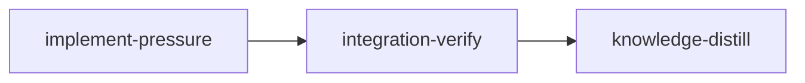

# Plan: `loom pressure` — alternating Claude/Codex plan pressure-testing

## Context

We want a new top-level command, `loom pressure <plan>`, that automates an
iterative plan-hardening loop by alternating between Claude Code and Codex:

1. Claude Code runs `/pressure doc/plans/<plan>` (pressure-tests the plan, edits it in place).
2. Codex runs `$pressure doc/plans/<plan>` (pressure-tests the plan, writes a sidecar review).
3. Claude Code runs `/address doc/plans/<plan>` (reads Codex's review, fixes the plan).

That three-step cycle repeats **2 times by default** (`--rounds N` to override).
Before each Codex step the stale Codex report is deleted so each round starts clean.

This requires three things to ship together:

- **The command files themselves.** Claude commands `pressure`, `address`, and
  `distill` (currently only in `~/.claude/commands/`), plus the Codex `pressure`
  skill (currently only in `~/.codex/skills/pressure/`). These must be vendored
  into this repo and installed by `install.sh` (local mode) — and therefore by
  `dev-install.sh`, which builds the binary then calls `install.sh`. Note the live
  `pressure`/`address`/SKILL.md are not vendored verbatim: they reference
  `planning-omissions.md`, lack the self-containment wording, and re-prepend
  `doc/plans/` to a plain plan *name* (the live SKILL.md would path-double on a full
  path). The vendored versions are the authored content in §1b. `distill.md` carries
  the distill-command content given in §1b verbatim; that content block in this plan is
  its authoritative in-repo source (acceptance cannot diff it against the out-of-repo
  `~/.claude/commands/distill.md`, so the §1b block — not the installed copy — is the
  source of truth).
- **The driver.** A new `loom pressure` subcommand that sequences the
  Claude/Codex invocations as blocking foreground child processes — **without
  `claude -p`** (that mode will soon be billed at API prices). We reuse the
  proven synchronous-spawn pattern from `loom knowledge bootstrap`
  (`commands/knowledge/bootstrap.rs`: `Command::status()` + inherited stdio).
- **Self-contained-plan wording.** The `pressure`/`address` commands and the
  Codex `pressure` skill must make it absolutely clear that the plan they edit
  has to remain a single, current, fully-detailed specification — never
  referencing previous versions, other reviews, reviewers, or "what changed".

### Decisions already made (with the user)

- **Run model:** Inline, block on process exit. Each Claude step runs in the
  current terminal (`Stdio::inherit`, no `-p`); loom blocks until it exits, then
  launches the next. This reuses the *spawn mechanics* of `loom knowledge bootstrap`
  (`Command::status()` + inherited stdio + `CLAUDE_CODE_EXPERIMENTAL_AGENT_TEAMS=1`),
  but deliberately differs in two ways: (a) it omits bootstrap's `--system-prompt`,
  `--allowedTools`, and sandbox backup/restore — `pressure` wants a full,
  unrestricted agent-team session; and (b) a `130`/`2` exit (Ctrl-C) must **actually
  abort the loop** (early-return), which is new logic — bootstrap merely prints a
  message and returns `Ok(())` because it spawns once.
- **Codex step:** `codex exec --sandbox workspace-write -C <repo> '$pressure …'`
  (non-interactive; runs the skill and exits on its own).
- **Clean slate:** delete `doc/plans/codex-<plan>` at the START of every round
  (before the Claude `/pressure` step) so `/pressure` never reads a stale Codex
  report — this keeps each pressure pass independent and also clears any report left
  by a prior manual run before round 1's `/pressure`. After ALL rounds finish,
  delete it once more (final cleanup) so no report lingers on disk.
- **Rounds:** default `2`, with a `--rounds N` flag.
- **Install scope:** local — `install.sh` (local mode) installs the three Claude
  commands to `~/.claude/commands/` and the Codex skill to `~/.codex/skills/pressure/`;
  `dev-install.sh` (no change) builds the binary then calls `install.sh`. The
  curl-pipe/remote path, `loom self-update`, and `.github/workflows/release.yml`
  packaging are deferred (see §1c "Deferred follow-ups").

### Assumptions (flag if wrong)

- **`planning-omissions.md` is kept (reworded).** The vendored `pressure`/`address`
  commands still append discovered issues to `planning-omissions.md` at the repo
  root, but the instruction is reworded to "omissions/wrong-assumptions/missing-steps
  **found in the plan**" rather than "that you made in your original plan" — the
  `loom pressure` loop agent does not author the plan it is hardening. This log is a
  separate repo-root file, so it does not compromise the plan's self-containment
  (it never goes *into* the plan).
- **`distill` is shipped but not invoked by `loom pressure`.** The user asked to
  also ship it; it is vendored + installed alongside the others, nothing more.
- **Knowledge bootstrap is skipped.** `doc/loom/knowledge/` is already fully
  populated, so this plan has no `knowledge-bootstrap` stage (still keeps the
  mandatory `integration-verify` + `knowledge-distill` bookends).
- **Install scope is local-only for now.** The commands + Codex skill ship via
  `install.sh` (local mode) and `dev-install.sh` (which builds the binary then calls
  `install.sh`). The curl-pipe/remote installer, `loom self-update`, and
  `release.yml` packaging are **deferred** — the self-update config path is already
  non-functional (it requires a `checksums.txt` release asset that the workflow never
  produces; see the Deferred follow-ups under §1c), so wiring the new assets into it
  would be dead on arrival. Local install is the supported path until that is fixed.
- **Two external invocation mechanisms are unproven.** Driving Claude with a slash
  command as a positional arg (`claude … "/pressure doc/plans/X.md"`) and driving a
  Codex skill via `codex exec … '$pressure doc/plans/X.md'` are assumed to trigger
  the slash command / skill. Neither has any precedent in this repo (knowledge
  bootstrap passes plain prose, never a slash positional; `codex exec`/`$pressure`
  appear only inside plan documents), and neither is covered by `cargo` acceptance.
  Both are confirmed by the **manual release-validation smokes** in the Verification
  section. These smokes spawn real Claude/Codex sessions, so they **cannot run in
  automated stage acceptance** — passing `loom stage complete` does NOT prove them.
  The integration verifier must run them by hand (or explicitly state they were not
  run) and report each result in the stage completion summary.

---

## Goals

- New `loom pressure <plan> [--rounds N] [--dry-run]` command.
- Vendored, self-containment-hardened command/skill source files in the repo.
- `install.sh` (local mode) and `dev-install.sh` ship the Claude commands and the
  Codex skill. Remote/self-update packaging is deferred (§1c).
- No use of `claude -p`.

## Execution Diagram



---

## Stages

### 1. implement-pressure (opus)

One worktree stage, three disjoint work areas done with parallel subagents (the
opus main agent owns the Rust driver; two `loom-software-engineer` subagents own
the vendored content and the installer). No file overlap.

| Owner | Files Owned (write) | Files Read-Only |
| --- | --- | --- |
| Main agent (opus) — Rust driver | `loom/src/commands/pressure/mod.rs`, `loom/src/codex.rs`, `loom/src/cli/types.rs`, `loom/src/cli/dispatch.rs`, `loom/src/commands/mod.rs`, `loom/src/lib.rs`, `loom/src/completions/dynamic/commands.rs`, `loom/src/completions/dynamic/mod.rs`, `loom/src/completions/dynamic/tests/tests_commands.rs` | `loom/src/commands/knowledge/bootstrap.rs`, `loom/src/claude.rs` |
| Subagent 1 — vendored content | `commands/pressure.md`, `commands/address.md`, `commands/distill.md`, `codex/skills/pressure/SKILL.md` | — |
| Subagent 2 — installer | `install.sh` | `commands/`, `codex/` |

`loom/src/commands/mod.rs` is written ONLY by the main agent (adds `pub mod pressure;`).
Subagent 2 touches only `install.sh` (a shell script — no overlap with the Rust files
the main agent owns). The two subagents and the main agent have fully disjoint file sets.

#### 1a. Rust driver (main agent)

**CLI registration** (3-file pattern — see `patterns.md § CLI Subcommand Registration`):

- `loom/src/cli/types.rs` — add a `Pressure` variant to the `Commands` enum (the
  single top-level `Commands` enum lives here; the `*_memory.rs`/`*_stage.rs` files
  only hold sub-enums):
  - `plan: String` (positional, the plan filename or path)
  - `rounds: u32` (`--rounds`) with clap `default_value_t = 2u32` AND
    `value_parser = clap::value_parser!(u32).range(1..)` so `0` is rejected at parse
    time (see the driver section). The `default_value_t` literal must be typed to the
    field (`u32`); mirror `KnowledgeCommands::Audit` in `types_memory.rs` for the
    `default_value_t` attribute style and `cli/types.rs`'s `value_parser = …` arms for
    the parser attribute. `plan_steps`/`render_dry_run` take `rounds` as `u32`.
  - `dry_run: bool` (`--dry-run`)
- `loom/src/cli/dispatch.rs` — add the match arm calling
  `commands::pressure::execute(plan, rounds, dry_run)`; add `use loom::commands::pressure;` if needed.
- `loom/src/commands/mod.rs` — add `pub mod pressure;`.

**Dynamic shell completions** (Clap registration alone is NOT enough — loom has a
custom completion engine that hardcodes its command/flag tables; without these edits
`loom pressure` compiles and shows in `--help` but is invisible to shell completion):

- `loom/src/completions/dynamic/commands.rs` — add `"pressure"` to the
  `TOP_LEVEL_COMMANDS` array (alphabetical), and add a
  `["pressure"] => &["--rounds", "--dry-run"]` arm to `complete_flags`.
- `loom/src/completions/dynamic/mod.rs` — in `complete_after_command`, treat
  `pressure` like `init`: return `Ok(Vec::new())` so the shell falls back to native
  path completion for the plan-file positional (do NOT add it to `has_subcommands`).
- `loom/src/completions/dynamic/tests/tests_commands.rs` — add tests asserting
  `pressure` appears in top-level command completion and that `--rounds`/`--dry-run`
  appear in flag completion for `["pressure"]`.

**`loom/src/codex.rs`** (new) — modeled on `loom/src/claude.rs::find_claude_path`:

```text
pub fn find_codex_path() -> Result<PathBuf>
  1. which::which("codex")
  2. ~/.bun/bin/codex
  3. ~/.local/bin/codex
  4. ~/.npm-global/bin/codex
  5. ~/.cargo/bin/codex
  6. /usr/local/bin/codex
  7. /opt/homebrew/bin/codex
  bail! if none found.
# NOTE: this is the same RESOLUTION STRATEGY as find_claude_path (which::which
# first, then a fixed list of common install dirs), but a DIFFERENT candidate
# list — codex ships via npm/bun/cargo, so the dirs differ from claude's
# (~/.claude/local, etc.). Do not assume the two lists are identical.
```

Export `pub mod codex;` from `loom/src/lib.rs` (next to `pub mod claude;`).

**`loom/src/commands/pressure/mod.rs`** (new) — the driver. Keep it small, with
pure helpers that are unit-tested (no spawning in tests):

- `resolve_plan_path(arg: &str, repo_root: &Path) -> Result<ResolvedPlan>` where
  `struct ResolvedPlan { fs_path: PathBuf, invocation: String }`. **Two distinct
  paths are required because the child processes are spawned with
  `current_dir(repo_root)` (mirroring `bootstrap.rs:67-68`), so a path that the
  resolver validated relative to the *current* working directory is NOT valid
  relative to the child's working directory.** Resolution:
  1. If `arg` exists as given (relative to cwd, or absolute), that is the plan.
     Otherwise fall back to `repo_root.join("doc/plans").join(arg)`; if neither
     exists, error with a clear message. **Guard against double-prefixing:** if
     `arg` already starts with `doc/plans/`, do not re-prepend it in the fallback
     (otherwise `loom pressure doc/plans/PLAN-foo.md` from a subdirectory would
     probe `repo_root/doc/plans/doc/plans/PLAN-foo.md`).
  2. `fs_path` = the resolved path canonicalized (absolute). Used for **all
     filesystem work**: existence checks, `codex_report_path`, and `DeleteReport`.
  3. `invocation` = the string handed to the slash commands / skill, which the
     children interpret relative to `repo_root`. Compute it as: `fs_path`
     made **repo-relative** when it is inside `repo_root` (e.g.
     `doc/plans/PLAN-foo.md`); otherwise the **absolute** `fs_path` as a string.
     Never pass a cwd-relative string (e.g. `../tmp/PLAN.md`) — it would resolve
     against the wrong directory in the child. The integration-verify dry-run smoke
     uses a temp plan **outside the repo**, so the absolute-fallback branch is
     load-bearing and must be covered by a test.
- `codex_report_path(fs_plan_path: &Path) -> PathBuf`: same directory as
  `fs_path`, filename `codex-` + the plan's file name. e.g. (repo-relative for
  illustration) `doc/plans/PLAN-foo.md` → `doc/plans/codex-PLAN-foo.md`. Always
  derived from the absolute `fs_path` so deletion targets the real file. **This
  naming convention must match the vendored `address` command and the Codex skill
  exactly** (see §1b).
- A pure step-builder used by both real execution and `--dry-run`. `Step` is an
  enum `Claude(String) | DeleteReport(PathBuf) | Codex(String)` — `DeleteReport`
  **carries its own absolute path** so `plan_steps` is fully self-describing and
  unit-testable without closing over external state. A single
  `plan_steps(rounds, invocation, report_fs_path) -> Vec<Step>` builds the WHOLE
  sequence (so `execute()` and `render_dry_run()` can never drift). For each round,
  in order:
  1. `DeleteReport(report_fs_path)` — **before** `/pressure`, so the pressure pass
     never reads a stale Codex report (and round 1 clears any report left by a
     prior manual run).
  2. `Claude("/pressure <invocation>")`
  3. `Codex("$pressure <invocation>")`
  4. `Claude("/address <invocation>")`

  Then ONE trailing `DeleteReport(report_fs_path)` after the last round (final
  cleanup — no report lingers on disk after the whole process finishes).
- `render_dry_run(rounds, invocation, report_fs_path) -> String`: human-readable
  listing of every step in `plan_steps` that WOULD run, including the per-round
  leading deletion and the final cleanup deletion (used by `--dry-run`, asserted in
  tests).
- **Path tests (pure, no spawning):** running from a nested repo subdirectory with
  `doc/plans/PLAN-x.md` (invocation stays `doc/plans/PLAN-x.md`, no double-prefix);
  from a nested subdirectory with an existing relative path outside `doc/plans`
  (invocation becomes repo-relative or absolute, never cwd-relative); and a temp
  plan outside the repo (invocation is absolute).
- `execute(plan, rounds, dry_run)`:
  - resolve repo root via a small local `resolve_repo_root()` that runs
    `git rev-parse --show-toplevel` (falling back to the current dir). Do **not**
    reuse `commands::knowledge::spawn::resolve_project_root` — it is `pub(super)`
    (unreachable from `commands::pressure`, would not compile) and, when no `.work/`
    exists, returns a CWD-relative `"."` rather than the git toplevel, which is wrong
    when `loom pressure` is run from a subdirectory with no active plan. Then call
    `resolve_plan_path`.
  - resolve `ResolvedPlan` and derive `report_fs_path = codex_report_path(&fs_path)`.
  - if `dry_run`: print `render_dry_run` and return `Ok(())` — spawn nothing.
  - else: walk `plan_steps(rounds, invocation, report_fs_path)` in order — each round
    runs delete-report → `/pressure` → `$pressure` → `/address`, with one final
    delete-report after the last round — aborting the whole loop early on an
    interrupt classification (below). A `DeleteReport` step calls
    `std::fs::remove_file`, ignoring NotFound.

  **`--rounds` must be ≥ 1.** `usize` alone admits `--rounds 0`, which would build an
  empty step list and silently do nothing. Reject it at the CLI boundary with a clap
  value parser — `value_parser = clap::value_parser!(u32).range(1..)` on the field
  (mirroring the existing `value_parser = clap_id_validator` attribute style in
  `cli/types.rs`) — so `loom pressure X --rounds 0` errors with a usage message
  rather than no-op'ing.

**Spawning (mirror `bootstrap.rs` exactly):**

- Claude step — `spawn_claude_slash(repo_root, slash_invocation)`:
  - `Command::new(find_claude_path()?)`
  - `.arg("--permission-mode").arg("acceptEdits")`
  - `.arg("--model").arg("opus")`
  - `.arg(slash_invocation)` — a SINGLE positional arg, e.g.
    `"/pressure doc/plans/PLAN-foo.md"` (Claude parses the leading `/pressure` as
    the slash command and the remainder as its argument).
  - `.env("CLAUDE_CODE_EXPERIMENTAL_AGENT_TEAMS", "1")`
  - `.current_dir(repo_root)`
  - stdin/stdout/stderr all `Stdio::inherit()`
  - `.status()` — block. **Never pass `-p`.**
- Codex step — `spawn_codex(repo_root, skill_invocation)`:
  - (report deletion is NOT done here — it is a separate `DeleteReport` step at the
    start of each round and once at the end; see `plan_steps` above.)
  - `Command::new(find_codex_path()?)`
  - `.arg("exec").arg("--sandbox").arg("workspace-write").arg("-C").arg(repo_root)`
  - `.arg(skill_invocation)` — single positional, e.g.
    `"$pressure doc/plans/PLAN-foo.md"`.
  - `.current_dir(repo_root)`, inherited stdio, `.status()` — block.
- Exit handling — route every `ExitStatus` through a **pure classifier**
  `classify_exit(status) -> StepOutcome` (`Ok | Interrupt | Warn`), unit-tested for
  success (code 0), `130`, `2`, other non-zero, **and the signal/no-code case where
  `status.code()` returns `None`** (a child killed by a signal, e.g. `SIGINT`/`SIGTERM`,
  has no exit code on Unix). Mapping:
  - code `0` → `Ok` (continue).
  - code `130` or `2`, **or `None`** → `Interrupt` → **early-return from `execute`**
    to stop the whole pipeline cleanly with a dimmed message (spawn no further step or
    round). Treating `None` as an interrupt is the safe default: a signalled child
    means the user (or the OS) tore the session down.
  - any other non-zero code → `Warn` → print a yellow warning and continue to the
    next step.
  NOTE: this differs from `bootstrap.rs`, which only prints on `130`/`2` and returns
  `Ok(())` regardless — it spawns once, so it has no loop to abort. The driver must
  implement the early-return itself.
- Print a clear header before each step (round N, which tool, which slash
  command) using the existing `colored`/`print_logo_header` helpers.

#### 1b. Vendored content (Subagent 1)

Create these files with EXACTLY the content below (the self-containment language
is the point of the task). The `pressure`/`address` argument is the **full plan
path** (e.g. `doc/plans/PLAN-foo.md`), read directly — no `doc/plans/` prefix is
re-added inside the command body.

`commands/pressure.md`:

```text
---
description: Pressure-test a plan with an agent team
argument-hint: [plan-path]
---
The argument $1 is the path to a plan file (for example doc/plans/PLAN-foo.md).

Read doc/loom/knowledge. Then read the plan at $1 and use an agent team to
explore the codebase and pressure-test the plan: hunt for omissions, wrong
assumptions, missing steps, broken integration points, and unverified claims.
Validate every finding against the actual code before acting on it.

Then update the plan at $1 in place so it is correct and complete.

After you have validated your findings, APPEND a short log of the
omissions, wrong assumptions, and missing steps you found in the plan to
planning-omissions.md at the repo root (create it if it does not exist). Do NOT
read planning-omissions.md first and do NOT rewrite it — only append your new
entries. This log is a separate file; it never goes into the plan itself.

THE PLAN MUST STAY SELF-CONTAINED. After your edits the plan must read as a
single, current, fully-detailed specification — as if written from scratch
today. Do NOT add references to previous versions of the plan, to this pressure
test, to any review, or to any other agent or human. No "previously…", "the
review found…", "as noted by…", no changelog, no meta-commentary. Fold every
validated correction directly into the relevant section as plain, authoritative
plan content. A reader must never need any document other than this plan.
```

`commands/address.md`:

```text
---
description: Address a pressure-test review of a plan
argument-hint: [plan-path]
---
The argument $1 is the path to a plan file (for example doc/plans/PLAN-foo.md).

Read doc/loom/knowledge. The reviewer's report is the sibling file
codex-<basename of $1> in the SAME directory as the plan — for example, for
doc/plans/PLAN-foo.md the report is doc/plans/codex-PLAN-foo.md.

Read that report. For each point: if it is valid, fix the plan at $1; if it is
not valid, leave the plan unchanged for that point. Validate against the actual
code before acting.

After you have validated which points are real, APPEND a short log of the
accepted findings (omissions, wrong assumptions, missing steps) to
planning-omissions.md at the repo root (create it if it does not exist). Do NOT
read planning-omissions.md first and do NOT rewrite it — only append your new
entries. This log is a separate file; it never goes into the plan itself.

THE PLAN MUST STAY SELF-CONTAINED. After your edits the plan must read as a
single, current, fully-detailed specification — as if written from scratch
today. Do NOT reference the review, the reviewer, prior versions, or "what
changed" anywhere in the plan. No "the review suggested…", "addressed
feedback…", no changelog, no meta-commentary. Fold every accepted correction
directly into the relevant section as plain plan content. A reader must never
need the review or any other document — only this plan.
```

`codex/skills/pressure/SKILL.md`:

```text
---
name: pressure
description: Pressure-test a plan file. Trigger when the user invokes $pressure followed by a path to a plan. The argument after $pressure is the plan file path.
---

The user provided a plan file path as the argument after $pressure. Treat that
path as <PLAN_PATH> (for example doc/plans/PLAN-foo.md).

Read doc/loom/knowledge. Then read the plan at <PLAN_PATH> and use an agent team
to explore the codebase and pressure-test the plan: find omissions, wrong
assumptions, missing steps, broken integration points, and unverified claims.
Validate each finding against the actual code.

Write your full report to a sibling file named codex-<basename of PLAN_PATH> in
the SAME directory as the plan — for example, for doc/plans/PLAN-foo.md write
doc/plans/codex-PLAN-foo.md. Make the report standalone and self-contained so a
separate agent can act on it with no other context: list each issue, why it
matters, the evidence (file:line), and the concrete fix. Do NOT edit the plan
itself.
```

`commands/distill.md` — create with EXACTLY this content (this block is the
authoritative in-repo source for the file):

```text
---
description: Distill important session insights into doc/loom/knowledge
---
Add any information that is deemed important for a future agent or human engineer working on this project to `doc/loom/knowledge`, focusing on architectural insights, conventions, and mistakes made (and their resolution if available).

Route each insight to the right file (the files are append-only — add, don't rewrite):
- `architecture.md` — component relationships, data flow, module/dependency graph
- `patterns.md` — reusable architectural patterns found in the codebase
- `conventions.md` — naming, structure, and coding standards
- `mistakes.md` — what went wrong, the misleading signal, root cause, prevention rule, and fix
- `concerns.md` — tech debt, warnings, known issues
- `stack.md` / `entry-points.md` — dependencies/tooling and key files to read first

Only record what is non-obvious and durable. Do NOT record ephemeral task details, procedural steps, or anything already captured in the code, git history, or these files. Convert any relative dates to absolute.
```

#### 1c. Installer (Subagent 2)

Goal: install the three Claude commands to `~/.claude/commands/` and the Codex
skill to `~/.codex/skills/pressure/` from the **local** `install.sh` path
(`dev-install.sh` builds the binary then calls `install.sh`, so it inherits this).

**CRITICAL — do NOT copy-paste `install_agents()` / `install_skills()` verbatim.**
Those loops glob `"$SCRIPT_DIR/agents"/loom-*.md` and `…/skills"/loom-*/` and run a
"remove old unprefixed version" cleanup. The new files are **unprefixed**
(`pressure.md`, `address.md`, `distill.md`, `codex/skills/pressure/SKILL.md`), so a
`loom-*` glob copies **zero** files and the unprefix cleanup is meaningless. The new
functions must use plain globs and no cleanup.

**`install.sh`:**

- Add a `CODEX_DIR="$HOME/.codex"` near the existing `CLAUDE_DIR="$HOME/.claude"`
  (line ~14). The Codex skill target is NOT under `$CLAUDE_DIR`.
- Add a `COUNT_COMMANDS` counter alongside `COUNT_AGENTS`/`COUNT_SKILLS`.
- `install_commands()` (local): `mkdir -p "$CLAUDE_DIR/commands"`; loop
  `for f in "$SCRIPT_DIR/commands"/*.md; do [ -f "$f" ] || continue; cp "$f"
  "$CLAUDE_DIR/commands/"; COUNT_COMMANDS=$((COUNT_COMMANDS+1)); done`. **Count
  copies from the SOURCE loop — do NOT `find "$CLAUDE_DIR/commands" -name "*.md"`**,
  which would tally the user's pre-existing unrelated commands and make a
  zero-copy run look successful. After the loop, **fail if fewer than the three
  expected files were copied** (`pressure.md`, `address.md`, `distill.md`). No
  `loom-*` filter, no unprefix `rm`.
- `install_codex_skill()` (local): assert `"$SCRIPT_DIR/codex/skills/pressure/SKILL.md"`
  exists and `err`/exit if not, **before** any `mkdir`/`cp`; then
  `mkdir -p "$CODEX_DIR/skills/pressure"`; copy the source into it; print an `ok` line.
- Call both new functions in the **local** branch of `main()` (the non-curl-pipe
  branch), next to `install_agents`/`install_skills`.
- Extend `check_requirements()` to assert the **exact source files** exist — not just
  the directories — so an empty `commands/` or `codex/` cannot pass:
  `$SCRIPT_DIR/commands/pressure.md`, `$SCRIPT_DIR/commands/address.md`,
  `$SCRIPT_DIR/commands/distill.md`, and `$SCRIPT_DIR/codex/skills/pressure/SKILL.md`
  (matching the existing per-file `CLAUDE.md.template` assert style).
- `confirm_overwrites()`: the existing function hardcodes a `~/.claude/$item` prefix
  when printing, so the Codex target cannot reuse it. Add the commands warning under
  `~/.claude/commands/` AND add a **separate full-path entry** for
  `~/.codex/skills/pressure/` (do not let it render as a bogus `~/.claude/...` path).
  Because `pressure.md`/`address.md`/`distill.md` are **generic, unprefixed names**
  that could collide with a user's own same-named slash commands, the warning text
  must make clear these specific files will be overwritten (they are loom-owned).
- `print_summary()`: add a **separate `~/.codex/` line** for the Codex skill rather
  than folding it into the `~/.claude` totals.

**Acceptance** is by build + unit tests + `bash -n install.sh` + wiring greps (below).
Do **not** run `install.sh` itself in acceptance — it mutates the real `~/.claude`,
`~/.codex`, and `~/.local/bin`. `bash -n install.sh` (syntax-only) IS added to stage
acceptance so a shell syntax error or an accidentally-copied `loom-*` glob cannot pass
while the Rust compiles; manual `./dev-install.sh` is in the end-to-end Verification
section. An additional acceptance command guards against the `loom-*` regression that
wiring (which can only assert presence, not absence) cannot express — see the stage
metadata `acceptance` block.

**Deferred follow-ups (out of scope here — record, do not implement):**

The curl-pipe/remote installer, `loom self-update`, and `release.yml` packaging are
deferred. The remote/self-update path is **broken in several independent ways today**
— fixing only the checksum-name issue would leave it non-functional, so the whole set
is enumerated here for whoever picks it up:

- **Repository constant mismatch.** `self_update` queries `cosmix/claude-loom`
  (`loom/src/commands/self_update/mod.rs:39`) while `install.sh` uses `cosmix/loom`
  (`install.sh:17`). At most one can be the real release repo; the other path 404s.
- **Binary asset-name mismatch.** `self_update` builds the asset name as
  `loom-<target-triple>`, e.g. `loom-x86_64-unknown-linux-gnu`
  (`mod.rs:113-157`, esp. `get_target()` + `update_binary`), but `release.yml`
  publishes `loom-linux-x86_64` / `loom-darwin-x86_64` / `loom-darwin-arm64`
  (`.github/workflows/release.yml:26-37,233-243`). The updater can never find its
  binary asset.
- **Checksum asset-name mismatch.** `update_config_files()` (`mod.rs:224`, and
  again at `:241,263,266,337,340`) requires a release asset literally named
  `checksums.txt` and `bail!`s if absent, but `release.yml` only ever produces
  `SHA256SUMS.txt` (lines 148/161/240). So `loom self-update` already fails to
  install agents.zip/skills.zip today. Fix the name in one place (rename the workflow
  output to `checksums.txt`, or point all six `mod.rs` references at `SHA256SUMS.txt`).
- **No release asset / updater support for the new Claude commands.** `release.yml`
  packages no `commands.zip`, and `self_update` has no code path to install
  `~/.claude/commands/*.md`. Remote installs/updates will silently lack the
  pressure/address/distill commands until both are added.
- **No release asset / updater support for the Codex skill.** There is no
  `codex-skills.zip` in `release.yml` and no `~/.codex` install path in `self_update`
  (`mod.rs:276-302`). When a `codex-skills.zip` IS added later, build it the way
  `skills.zip` works — from *inside* the `skills/` dir so the archive has no `skills/`
  prefix (`cd codex/skills && zip -r ../../release/codex-skills.zip .`) → extract into
  `get_codex_dir()?.join("skills")`. (This is a **forward-looking packaging note, not
  a present off-by-one bug** — no `codex-skills.zip` exists today.)
- **Remote `install.sh` hook download assumes per-hook assets** the workflow does not
  publish (`install.sh:203-241` vs `.github/workflows/release.yml:233-243`).
- Note the remote `install.sh` `download_and_extract_zip` does NO checksum
  verification, and the `loom-*` glob caveat above applies to its copy loops too.

### 2. integration-verify (opus)

Full build/test/clippy + code review + functional verification:

- `cargo build/test/clippy` (via `--manifest-path loom/Cargo.toml`).
- `loom pressure --help` shows the command, `--rounds`, `--dry-run`.
- **Dry-run smoke (no agents spawned):** create a throwaway plan file in a temp
  dir (NOT under `doc/plans/`, per the stale-plan-reference lesson in
  `mistakes.md`), run `loom pressure <that path> --dry-run`, and confirm the
  output lists, for 2 rounds in order per round: the `codex-…` deletion,
  `/pressure`, `$pressure`, `/address` — plus one final `codex-…` deletion after
  the last round — all with the correct full plan path.
- Confirm the codex-report naming convention agrees across the Rust
  (`codex_report_path`), `commands/address.md`, and `codex/skills/pressure/SKILL.md`.
- Confirm the self-containment wording is present in `pressure.md` and `address.md`,
  and the append-only `planning-omissions.md` instruction is present in both.
- Confirm installer wiring: `install.sh` local-mode `install_commands` +
  `install_codex_skill` exist, use unprefixed globs (no `loom-*`), target
  `~/.claude/commands` and `~/.codex/skills/pressure`, and are called from `main()`.
  Confirm `bash -n install.sh` passes and there is no `loom-*` token inside
  `install_commands`.
- Confirm `loom pressure` is wired into dynamic shell completions: `pressure` in
  `TOP_LEVEL_COMMANDS`, `--rounds`/`--dry-run` in `complete_flags`, and the new
  completion tests pass.
- Confirm subdirectory-safe path handling: the resolver's pure tests cover the
  nested-subdir `doc/plans/PLAN-x.md` case (no double-prefix), a relative path
  outside `doc/plans`, and a temp plan outside the repo (absolute invocation).
- **Scope is LOCAL install only.** `self_update`/`release.yml` are explicitly
  deferred (see §1c) — do NOT audit or "fix" asset/checksum handling here; treat the
  §1c deferred list as a recorded follow-up, not a requirement of this stage.
- Code review (parallel `loom-code-reviewer`): the subprocess/command-construction
  path (shell-arg handling for the slash/skill invocations), the path-resolution
  logic (subdir/relative/absolute/temp-plan cases), and local installer correctness.

### 3. knowledge-distill (opus)

Curate stage memories into `doc/loom/knowledge/`; update `README.md` to document
the new `loom pressure` command and the newly-installed Claude commands + Codex
skill.

---

## Verification (end-to-end, by hand)

```bash
# Build + install locally (dev-install.sh builds the binary, then calls install.sh)
./dev-install.sh

# Confirm files installed to the right places
ls ~/.claude/commands/{pressure,address,distill}.md
ls ~/.codex/skills/pressure/SKILL.md

# Dry-run shows the alternation without spawning anything
loom pressure PLAN-loom-pressure-command.md --dry-run
loom pressure PLAN-loom-pressure-command.md --rounds 1 --dry-run
```

**Invocation smokes (REQUIRED — these prove the two assumptions `cargo`/`--dry-run`
cannot).** Copy a real plan to a throwaway path first, e.g.
`cp doc/plans/PLAN-loom-pressure-command.md doc/plans/PLAN-smoke.md`:

```bash
# (1) Claude slash-as-positional: must actually run /pressure and EDIT the plan file.
claude --permission-mode acceptEdits --model opus "/pressure doc/plans/PLAN-smoke.md"
#   PASS = doc/plans/PLAN-smoke.md was modified by the command.

# (2) Codex skill-as-positional: must run the pressure skill and WRITE the sidecar report.
codex exec --sandbox workspace-write -C "$(git rev-parse --show-toplevel)" '$pressure doc/plans/PLAN-smoke.md'
#   PASS = doc/plans/codex-PLAN-smoke.md was written.
```

If either smoke fails, the invocation mechanism (not the Rust driver) is wrong and
must be fixed before the feature is usable — neither is exercised by stage acceptance,
so they are **manual release-validation** steps, not automated gates. The integration
verifier records in its completion summary whether each was run and its result.

```bash
# Full real run against the scratch plan (watch the alternation; Ctrl-C aborts the loop)
loom pressure PLAN-smoke.md
rm -f doc/plans/PLAN-smoke.md doc/plans/codex-PLAN-smoke.md
```

---

<!-- loom METADATA -->

```yaml
loom:
  version: 1
  sandbox:
    enabled: true
    auto_allow: true
    excluded_commands:
      - "loom"
      - "git"
    network:
      allowed_domains: []
      allow_local_binding: false
      allow_unix_sockets: []
  stages:
    - id: implement-pressure
      name: "Implement loom pressure command + vendored commands/skill + installer"
      stage_type: standard
      model: "opus"
      reasoning_effort: "xhigh"
      description: |
        Implement the `loom pressure <plan> [--rounds N] [--dry-run]` command, vendor the
        Claude commands and Codex skill it drives, and wire them into the LOCAL install
        path only (install.sh local mode + dev-install.sh). Remote/self-update/release
        packaging is explicitly deferred (see plan §1c). The full file contents and exact
        specs are in this plan's body above — follow them verbatim, especially the
        self-containment wording and the codex-report naming convention
        (doc/plans/codex-<plan-filename>).

        Use parallel subagents and skills to maximize performance. Do NOT use `claude -p`
        anywhere — the driver spawns interactive Claude with inherited stdio, mirroring
        loom/src/commands/knowledge/bootstrap.rs (Command::status() + Stdio::inherit).

        SUBAGENT FILE ASSIGNMENTS (NO FILE OVERLAP):
          Main agent (opus) — Rust driver:
            Files Owned: loom/src/commands/pressure/mod.rs, loom/src/codex.rs,
              loom/src/cli/types.rs, loom/src/cli/dispatch.rs,
              loom/src/commands/mod.rs, loom/src/lib.rs,
              loom/src/completions/dynamic/commands.rs, loom/src/completions/dynamic/mod.rs,
              loom/src/completions/dynamic/tests/tests_commands.rs
            Files Read-Only: loom/src/commands/knowledge/bootstrap.rs, loom/src/claude.rs
            Work:
              - New codex.rs::find_codex_path(): same RESOLUTION STRATEGY as
                claude.rs::find_claude_path (which::which first, then a fixed candidate
                list) but a DIFFERENT candidate list — which::which("codex") then
                ~/.bun/bin, ~/.local/bin, ~/.npm-global/bin, ~/.cargo/bin,
                /usr/local/bin, /opt/homebrew/bin. Export `pub mod codex;` from lib.rs.
              - Register the `Pressure { plan, rounds(u32, default 2, value_parser
                range 1..), dry_run }` variant in cli/types.rs (reject --rounds 0 at
                parse time), dispatch it in cli/dispatch.rs, add `pub mod pressure;`
                to commands/mod.rs (CLI Subcommand Registration pattern in patterns.md).
              - DYNAMIC COMPLETIONS (Clap alone is NOT enough): add "pressure" to
                TOP_LEVEL_COMMANDS and `["pressure"] => &["--rounds", "--dry-run"]` to
                complete_flags in completions/dynamic/commands.rs; treat `pressure` like
                `init` (return empty -> native path completion) in
                complete_after_command in completions/dynamic/mod.rs; add completion
                tests in tests/tests_commands.rs.
              - commands/pressure/mod.rs: pure, unit-tested helpers.
                resolve_plan_path(arg, repo_root) -> ResolvedPlan { fs_path, invocation }:
                children run with current_dir(repo_root), so fs_path (absolute,
                canonicalized) is used for existence checks / codex_report_path /
                deletion, and invocation (repo-relative when under repo, else absolute —
                NEVER cwd-relative) is the string handed to the slash commands/skill.
                Fallback to doc/plans/<arg> only when the raw path is absent, and guard
                against double-prefixing when arg already starts with doc/plans/.
                codex_report_path(fs_path) -> sibling codex-<basename>.
                Step enum = Claude(String) | DeleteReport(PathBuf) | Codex(String).
                plan_steps(rounds, invocation, report_fs_path) /
                render_dry_run(rounds, invocation, report_fs_path).
                execute(): walk plan_steps — each round runs DeleteReport(report) ->
                Claude `/pressure <invocation>` -> `codex exec --sandbox workspace-write
                -C <repo> '$pressure <invocation>'` -> Claude `/address <invocation>`,
                then ONE final DeleteReport after all rounds. Per-round delete runs
                BEFORE /pressure so it never reads a stale report. Each Claude spawn:
                --permission-mode acceptEdits --model opus,
                CLAUDE_CODE_EXPERIMENTAL_AGENT_TEAMS=1, single positional slash
                invocation, inherited stdio, .status() blocking.
                Route exits through a pure classify_exit(status): code 0 = continue;
                code 130/2 OR status.code()==None (signal-killed child) = abort the
                whole pipeline cleanly (early return); any other non-zero = warn and
                continue. --dry-run prints render_dry_run and spawns nothing.
          Subagent 1 — vendored content (loom-software-engineer):
            Files Owned: commands/pressure.md, commands/address.md, commands/distill.md,
              codex/skills/pressure/SKILL.md
            Work: create with the EXACT content in plan section 1b (self-containment
              language is the point; distill.md uses the content block in §1b as its
              authoritative in-repo source).
          Subagent 2 — installer (loom-software-engineer):
            Files Owned: install.sh
            Files Read-Only: commands/, codex/
            Work: per plan section 1c — LOCAL mode only. Add CODEX_DIR="$HOME/.codex" and a
              COUNT_COMMANDS counter; add install_commands() (glob commands/*.md ->
              ~/.claude/commands, counting COPIES FROM THE SOURCE loop — not a destination
              find — NO loom-* filter, NO unprefix rm; FAIL if the three expected command
              files were not copied) and install_codex_skill() (assert the source SKILL.md
              exists BEFORE mkdir/cp, then copy codex/skills/pressure/SKILL.md ->
              $CODEX_DIR/skills/pressure); call both from the LOCAL branch of main(); extend
              check_requirements() to assert the EXACT source files exist (commands/pressure.md,
              commands/address.md, commands/distill.md, codex/skills/pressure/SKILL.md) — not
              just the directories; in confirm_overwrites() add the ~/.claude/commands warning
              AND a separate full-path entry for ~/.codex/skills/pressure (it cannot reuse the
              hardcoded ~/.claude/ prefix), noting the generic unprefixed command names are
              loom-owned; add a separate ~/.codex line in print_summary(). Do NOT touch
              self_update or release.yml (deferred). Do NOT run install.sh in acceptance;
              verify with `bash -n install.sh` + wiring greps.

        MEMORY RECORDING (use loom memory ONLY — never loom knowledge, never auto-memory):
        Record IMMEDIATELY: mistakes via `loom memory note "mistake: …"`, non-obvious
        choices via `loom memory decision "…" --context "…"`, surprises via
        `loom memory note "found: … file:line"`. Do NOT record procedural actions.
        SUBAGENT MEMORY — instruct every subagent to record mistakes/decisions/surprises
        via loom memory (not procedural actions).
      dependencies: []
      acceptance:
        - "cargo build --manifest-path loom/Cargo.toml"
        - "cargo test --manifest-path loom/Cargo.toml"
        - "cargo clippy --manifest-path loom/Cargo.toml --all-targets -- -D warnings"
        - command: "loom/target/debug/loom pressure --help"
          stdout_contains: ["--rounds", "--dry-run"]
        # Installer: syntax must be valid, and the new command-install loop must NOT
        # carry over the loom-* glob (which would copy zero unprefixed files).
        - "bash -n install.sh"
        - "! awk '/^install_commands\\(\\)/,/^}/' install.sh | rg -q 'loom-'"
        # Vendored content: critical self-containment / convention phrases must be
        # present verbatim (artifact checks skip stub detection for markdown, and
        # wiring is regex-anywhere — neither catches a wrong-but-nonempty file).
        - "rg -qF 'THE PLAN MUST STAY SELF-CONTAINED' commands/pressure.md"
        - "rg -qF 'Do NOT read planning-omissions.md first' commands/pressure.md"
        - "rg -qF 'codex-<basename of $1> in the SAME directory' commands/address.md"
        - "rg -qF 'Do NOT edit the plan itself' codex/skills/pressure/SKILL.md"
      files:
        - "commands/**"
        - "codex/**"
        - "loom/src/**"
        - "install.sh"
      working_dir: "."
      artifacts:
        - "commands/pressure.md"
        - "commands/address.md"
        - "commands/distill.md"
        - "codex/skills/pressure/SKILL.md"
        - "loom/src/commands/pressure/mod.rs"
        - "loom/src/codex.rs"
      wiring:
        - source: "loom/src/cli/types.rs"
          pattern: "Pressure"
          description: "Pressure command variant registered in the Commands enum"
        - source: "loom/src/cli/dispatch.rs"
          pattern: "pressure::"
          description: "Pressure command dispatched to its handler"
        - source: "loom/src/commands/mod.rs"
          pattern: "pub mod pressure"
          description: "pressure command module exported"
        - source: "loom/src/codex.rs"
          pattern: "find_codex_path"
          description: "Codex binary resolver implemented"
        - source: "loom/src/completions/dynamic/commands.rs"
          pattern: "\"pressure\""
          description: "pressure registered in dynamic top-level command completions"
        - source: "install.sh"
          pattern: "install_commands"
          description: "install.sh installs the Claude commands to ~/.claude/commands"
        - source: "install.sh"
          pattern: "install_codex_skill"
          description: "install.sh installs the Codex pressure skill to ~/.codex/skills"
        - source: "install.sh"
          pattern: "CODEX_DIR"
          description: "install.sh defines the ~/.codex target dir for the Codex skill"

    - id: integration-verify
      name: "Integration Verification"
      stage_type: integration-verify
      model: "opus"
      reasoning_effort: "xhigh"
      description: |
        Final verification after implement-pressure. Verify FUNCTIONAL INTEGRATION, not
        just that tests pass.

        Use parallel subagents and skills to maximize performance.

        ⛔ NEVER use Claude Code's auto-memory. ALL memory goes through loom memory.

        CONTEXT GATHERING (FIRST):
        - Read the plan file from doc/plans/ (check .work/config.toml for source_path)
        - Read ALL stage memories: loom memory show --all
        - Read doc/loom/knowledge/*.md for architecture context and known mistakes

        BUILD & TEST (zero tolerance — fix ALL warnings/errors):
        - cargo build/test/clippy via --manifest-path loom/Cargo.toml

        CODE REVIEW (MANDATORY — parallel loom-code-reviewer; dimensions also in the
        structured code_review block below):
        - command-construction / subprocess path: slash and `$pressure` invocations are
          single positional args; no `claude -p`; codex exec flags correct; exit
          classification (0=continue, 130/2/None=abort, else warn+continue)
        - path handling: subdirectory, repo-relative, absolute, and temp-plan cases
          resolve to a correct fs_path (deletion/report) and invocation string
        - LOCAL installer correctness: exact source assets present, unprefixed globs
          (no loom-*), source-counted copies, overwrite warnings, ~/.codex paths, called
          from main()'s local branch. self_update/release.yml are DEFERRED — do NOT audit
          their asset/checksum handling here (the §1c deferred list is a recorded
          follow-up, not a requirement of this stage).
        Fix ALL issues with loom-senior-software-engineer / loom-software-engineer.

        FUNCTIONAL VERIFICATION (MANDATORY):
        - `loom pressure --help` shows the command, --rounds, --dry-run
        - Dry-run smoke WITHOUT spawning agents: create a throwaway plan file in a temp
          dir (NOT under doc/plans/ — see mistakes.md stale-plan lesson), run
          `loom pressure <temp-path> --dry-run`, and confirm the listed steps for 2 rounds
          are, per round in order, the codex-<…> deletion, /pressure, $pressure, /address —
          plus one final codex-<…> deletion after the last round — with the correct
          invocation path
        - Confirm codex-report naming agrees across loom/src/commands/pressure/mod.rs,
          commands/address.md, and codex/skills/pressure/SKILL.md
        - Confirm self-containment wording AND the append-only planning-omissions.md
          instruction are present in commands/pressure.md + commands/address.md
        - Confirm `loom pressure` is in dynamic completions (pressure in
          TOP_LEVEL_COMMANDS; --rounds/--dry-run in complete_flags) and completion tests pass
        - Confirm `--rounds 0` is rejected (value parser) and the path-resolution unit
          tests cover the subdir/relative/absolute/temp-plan cases
        - Confirm install.sh (local mode) installs the commands + codex skill with
          unprefixed globs to ~/.claude/commands and ~/.codex/skills/pressure; `bash -n
          install.sh` passes and install_commands carries no loom-* token.
          (self_update/release.yml are deferred — not in scope.)
        - The two real-invocation smokes (claude "/pressure …" edits the plan; codex exec
          '$pressure …' writes the codex- sidecar) are MANUAL release-validation and
          CANNOT run in stage acceptance — `loom stage complete` does NOT prove them.
          Run them by hand (or state they were not run) and report each result in the
          completion summary.

        Record discoveries to loom memory for knowledge-distill to curate.
      dependencies: ["implement-pressure"]
      acceptance:
        - "cargo build --manifest-path loom/Cargo.toml"
        - "cargo test --manifest-path loom/Cargo.toml"
        - "cargo clippy --manifest-path loom/Cargo.toml --all-targets -- -D warnings"
        - command: "loom/target/debug/loom pressure --help"
          stdout_contains: ["--rounds", "--dry-run"]
        - "bash -n install.sh"
        - "! awk '/^install_commands\\(\\)/,/^}/' install.sh | rg -q 'loom-'"
      files:
        - "loom/src/**"
        - "commands/**"
        - "codex/**"
        - "install.sh"
      working_dir: "."
      code_review:
        require_all: true
        dimensions:
          - "Command construction: slash and $pressure invocations are single positional args, no claude -p, codex exec flags correct"
          - "Exit classification: 0=continue, 130/2/None=abort pipeline, other non-zero=warn+continue"
          - "Path handling: subdirectory, repo-relative, absolute, and temp-plan cases — fs_path for deletion/report, invocation never cwd-relative"
          - "LOCAL installer correctness: exact source assets, unprefixed globs (no loom-*), source-counted copies, ~/.codex paths, overwrite warnings, local-branch calls"
          - "Verification coverage: dry-run ordering, bash -n, completions, --rounds 0 rejection, manual-smoke status reported"
      wiring:
        - source: "commands/pressure.md"
          pattern: "SELF-CONTAINED"
          description: "pressure command enforces a self-contained plan"
        - source: "commands/address.md"
          pattern: "SELF-CONTAINED"
          description: "address command enforces a self-contained plan"

    - id: knowledge-distill
      name: "Knowledge Distillation"
      stage_type: knowledge-distill
      model: "opus"
      reasoning_effort: "xhigh"
      description: |
        Curate all stage memories into permanent knowledge and update user-facing docs.

        ⛔ NEVER use Claude Code's auto-memory. ALL memory/knowledge goes through
        loom memory and loom knowledge commands.

        CONTEXT GATHERING (FIRST):
        - Read the plan file from doc/plans/ (check .work/config.toml for source_path)
        - Read ALL stage memories: loom memory show --all
        - Read doc/loom/knowledge/*.md for current state

        MEMORY CURATION:
        - Synthesize mistakes as actionable prevention rules via loom knowledge update mistakes
        - Curate patterns (e.g. the synchronous foreground-spawn driver, the codex-report
          naming convention) and architecture entries (new `loom pressure` command,
          codex.rs binary resolver, installer additions)
        - Run loom review; remove stale entries

        DOCUMENTATION UPDATE (MANDATORY):
        - README.md has a `## CLI Reference` section (`### Primary Commands` /
          `### Other Commands`) and a `### What Gets Installed` table. Add a `loom pressure`
          entry to the CLI reference, and add two rows to the install table:
          `~/.claude/commands/*.md` (pressure/address/distill slash commands) and
          `~/.codex/skills/pressure/` (Codex pressure skill). The `rg -q "loom pressure"
          README.md` acceptance enforces the CLI entry.
        - Only update relevant sections — do not rewrite whole files
        - While curating, correct the now-stale note in concerns.md (~line 23) and
          architecture.md (~line 176) claiming agents.zip/skills.zip "lack verification":
          loom self-update DOES checksum-verify them via download_verify_and_extract_zip
          (gated today only by the separate checksums.txt/SHA256SUMS.txt asset-name mismatch).
      dependencies: ["integration-verify"]
      acceptance:
        - 'rg -q "## " doc/loom/knowledge/architecture.md'
        - 'rg -q "## " doc/loom/knowledge/patterns.md'
        - 'rg -q "loom pressure" README.md'
        # The two install-table rows must actually be documented, not just a single
        # `loom pressure` mention (which the CLI-reference entry alone would satisfy).
        - "rg -qF '.claude/commands/' README.md"
        - "rg -qF '.codex/skills/pressure/' README.md"
      files:
        - "doc/loom/knowledge/**"
        - "README.md"
      working_dir: "."
```

<!-- END loom METADATA -->
