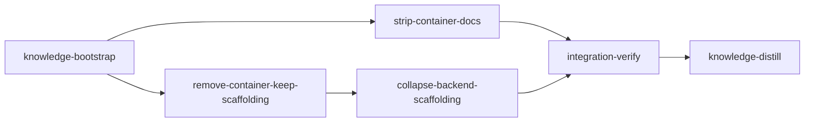

# Plan: Remove the container execution backend

## Overview

Excise "container mode" / the container execution backend from loom entirely and
return loom to **native-only** execution. Anthropic is moving `claude -p` to a
metered usage-charge model that makes the container backend uneconomical.

The container era spans ~155 commits across ~12 interleaved feature branches, so
a `git revert` of merges is infeasible — this is a **feature removal from the
current tree**. The hard constraint: undo *only* what pertains to the container
backend; bugfixes and improvements that merely landed during the
container-development period stay.

This plan was pressure-tested (see `codex-PLAN-remove-container-backend.md`); all
20 findings are folded in.

## Goals

- Delete all container-only code, CLI surface, resources, tests, and docs.
- Collapse the multi-backend abstraction (`BackendType`, `TerminalBackend` trait,
  `BackendDispatcher`, `create_backend`) back to a single concrete
  `NativeBackend` — no vestigial one-armed scaffolding.
- Keep `LivenessService` (rerouted to native — it is a genuine shared-handle
  liveness probe for the monitor thread, not container scaffolding).
- Preserve every non-container bugfix/improvement from the container era.
- **Non-goal:** no behavior change to native execution, except one adjacent
  bugfix explicitly folded in (tracking-key-based liveness, see Stage 4).

## Why this stage shape

Every loom stage runs `cargo build` / `cargo test` as acceptance in an isolated
worktree, so **each stage must compile at completion**. `BackendType` is threaded
through ~45 files; removing it in one shot has no compiling intermediate.
Therefore the code work is split into two stages that each compile:

1. **`remove-container-keep-scaffolding`** — delete all container code but keep
   `BackendType` as a single-variant (`Native`) enum and the one-armed
   `TerminalBackend` trait / `BackendDispatcher` / `LivenessService`. This state
   compiles and the native path is unchanged.
2. **`collapse-backend-scaffolding`** — then rip out the now-vestigial
   abstraction, make `NativeBackend` concrete, reroute `LivenessService`, delete
   the `execution` schema module, and apply the adjacent tracking-key bugfix.

This split also yields a real green-build verification checkpoint between the
two riskiest changes. Documentation stripping is a **separate parallel stage**:
it has no compile dependency, but it cannot be a subagent inside a code stage
because the code stages run with `working_dir: loom` and the docs live at repo
root (`../doc/` would be banned path traversal).

## Execution Diagram



## Sandbox assumptions

This is an internal Rust refactor — it **removes** a dependency (`handlebars`),
adds none. The plan assumes: network limited to `crates.io` mirrors + `github.com`
(for `cargo` metadata / lockfile updates after the `handlebars` removal); standard
sensitive paths denied for read; `.work/stages` and `.work/sessions` denied for
write. Adjust the `sandbox` block in the YAML if your environment differs.

---

## Stages

### 1. Knowledge Bootstrap

**Purpose:** `doc/loom/knowledge/` is already populated — this stage confirms
coverage and produces a *verified container-removal surface map* for the two big
code stages to consume, resolving the open questions the pressure test left for
implementation time.

**Tasks:**

- `loom knowledge check` — confirm coverage ≥ 50%; if not, `loom map --deep`.
- Verify the container surface map (the Stages below list every file). Resolve
  and record to memory the three open items: the exact `daemon/server/client.rs`
  arms for `CompleteStageContainer`; whether `is_cwd_relative_base` in
  `fs/work_dir.rs` becomes dead after the `/repo` fallback removal; and whether
  `loom/tests/stage_completion.rs` exercises the *container* completion path
  (safe to delete) or native completion (keep).
- Refresh any stale notes in `architecture.md` / `entry-points.md` that will be
  invalidated, but do NOT delete container knowledge sections yet — that is
  `strip-container-docs`' job, and doing it here would conflict.

**Files:** `doc/loom/knowledge/**`

**Acceptance:** knowledge files have `##` sections; `loom knowledge check` ≥ 50%.

---

### 2. Strip Container Documentation

**Purpose:** Remove all container documentation. Runs in parallel with the code
removal — zero file overlap, zero compile dependency.

**Tasks:**

- `doc/loom/knowledge/*.md`: strip every container-specific section from
  `architecture.md`, `entry-points.md`, `patterns.md`, `conventions.md`,
  `mistakes.md`, `stack.md`, `concerns.md` (~800 lines total). Leave all
  non-container content intact.
- `README.md`: remove the container `loom init` flags, the "Container Commands"
  section, the "Container Backend" section + threat model, **and** the
  plan-schema rows mentioning `backend` / `bypass-permissions`.
- Delete the eight archived container plan files in `doc/plans/ archive/`
  (the `DONE-PLAN-container-*`, `REVIEW-PLAN-container-*`, and
  `REVIEW-IN_PROGRESS-PLAN-fix-container-backend-ux.md` files).
- **Archive scope:** other (non-container-titled) archived plans contain
  container sections — these are a historical record and are **intentionally
  left as-is**, exempt from any residual `container` sweep.
- `CLAUDE.md.template`: no container references — no change.
- Note: the untracked root draft `container-backend.md` does not exist in a
  fresh worktree (untracked) — handle as a manual cleanup outside loom.

**Files:** `doc/loom/knowledge/**`, `README.md`, `doc/plans/**`

**Acceptance:** no container sections remain in knowledge/README; archived
container plans are deleted; knowledge files still have real content.

---

### 3. Remove Container Code — Keep Scaffolding

**Purpose:** Delete every container-only module, the `loom container` CLI, all
container branches/fields, and the `BackendType::Container` variant — while
**keeping** `BackendType` (now single-variant `Native`), the `TerminalBackend`
trait, `BackendDispatcher`, and `LivenessService` intact. This intermediate state
compiles and leaves the native path behavior-identical.

**Tasks (full file-by-file breakdown):**

*Bulk deletion (Phase 1):*

- Delete `loom/src/orchestrator/terminal/container/` (10 files) and
  `loom/src/commands/container/` (9 files).
- Delete `loom/resources/Dockerfile.tmpl`, `entrypoint.sh`, `firewall.sh`,
  `claude-settings.json`.
- Delete `loom/tests/container_smoke.rs`, `container_adversarial.rs`,
  `log_format_test.rs`, `stage_completion.rs` (confirm container-only in Stage 1),
  `loom/tests/fixtures/stream-json/`,
  `loom/src/completions/dynamic/tests/tests_container.rs`.
- Remove module declarations: `mod container;` in `terminal/mod.rs`,
  `pub mod container;` in `commands/mod.rs`, `mod tests_container;` in the
  completions tests module.
- Remove `handlebars` from `loom/Cargo.toml` (used only by the deleted
  `container/image.rs`). `sha2`, `hex`, `shell-escape` stay.

*CLI surface (Phase 2):*

- `cli/types.rs`: remove the `Container` subcommand variant + `ContainerCommands`
  enum; remove `--backend` / `--no-build` / `--allow-insecure-runtime` from `Init`.
- `cli/dispatch.rs`: remove the `Commands::Container` match arm.
- `commands/init/execute.rs`: drop `backend` / `no_build` /
  `allow_insecure_runtime` params; `loom init` always provisions native.
- `commands/init/plan_setup.rs`: remove `probe_firewall_or_bail()` + the image
  build path.
- `completions/dynamic/commands.rs` + `completions/dynamic/mod.rs`: remove
  `container` from command lists, flag arms, and value-completion arms; update
  the dynamic-completion tests.

*Container branches / fields (kept BackendType, single Native variant):*

- `plan/schema/execution.rs`: remove the `Container` variant from `BackendType`
  (and its `Display` / `FromStr` arms + tests); delete `PlanContainerConfig`,
  `ProjectContainerConfig`, the `.container` fields; delete `validate_git_identity`
  / `GIT_IDENTITY_MAX_LEN` (container git-identity feature) and its callers in
  `fs/work_dir.rs` + `commands/init/execute.rs`. Keep `BackendType`,
  `StageExecutionConfig.backend`, `ProjectExecutionConfig.backend` for now.
- `models/session/{types,methods,mod}.rs`: remove `runtime`, `container_name`
  fields + `set_container_identity()` / `clear_container_identity()`; keep
  `backend` and `tracking_key`.
- `models/stage/{types,methods}.rs`: keep `execution_backend` for now (vestigial).
- `daemon/protocol.rs`: remove `Request::CompleteStageContainer` + its arm in
  `required_capability`. `daemon/server/client.rs`: remove the auth-token arm,
  dispatch arm, and `complete_stage_container` helper. `daemon/server/lifecycle.rs`:
  fix container-completion comments. `commands/stage/complete.rs`: remove
  `is_container_completion()`, `delegate_completion_to_daemon()`, and the
  delegation conditional — the native "proceed path" is unchanged.
- `orchestrator/core/{stage_executor,completion_handler,merge_handler,event_handler}.rs`:
  delete `remove_container_on_failure()` + call sites; remove the `git_bridge`
  import, `container_session` checks, `clear_container_identity()` branches, and
  bare-mirror cleanup.
- `orchestrator/terminal/mod.rs`: remove the `Container` arm of `create_backend()`.
  `orchestrator/terminal/dispatcher.rs`: remove the container construction arm in
  `for_plan` + `BackendNeeds.container`. `orchestrator/monitor/handlers.rs`:
  remove the container log-capture block; keep the memory-preserve call.
- `orchestrator/terminal/native/pid_tracking.rs`: remove the `WrapperPaths` struct
  - `paths` parameter / container-path override arms; keep native wrapper-script
  generation.
- `hooks/generator.rs`: remove the `match config.backend` branches
  (`configure_loom_hooks_for_container`, container `LOOM_WORK_DIR`); remove the
  full container main-session-overlay set together —
  `container_main_settings_path`, `setup_container_main_session_settings`, the
  `hooks/mod.rs` re-exports, the knowledge-stage branch in `stage_executor.rs`
  that calls it, and the container tests in `hooks/generator.rs` + `hooks/tests.rs`.
  Keep `LOOM_MAIN_AGENT_PID` removal, `LOOM_WORK_DIR` insertion (host path), and
  the `.work/` absolute-path permissions block.
- `hooks/config.rs`: remove the container arm of `script_path()` (keep the
  `backend` field/param for now — removed in Stage 4).
- `fs/work_dir.rs`: delete `loom_work_dir_from_env()` (`/repo/` detector) + its
  call site; remove the duplicate `/repo/`-restricted fallback in
  `commands/common/mod.rs::work_dir_from_env`.
- `sandbox/config.rs`: remove the container branch of `default_mode_for()`.
  **Fail-closed:** `validate_config` currently rejects `BypassPermissions` only
  when `backend == Native` — change it to reject `BypassPermissions`
  **unconditionally** ("permission_mode=bypass-permissions is unsupported because
  the container backend has been removed"). Update sandbox tests to assert this.
- `sandbox/settings.rs`: remove `SENSITIVE_ENV_KEYS`, `SENSITIVE_ENV_PREFIXES`,
  `is_sensitive_env_key()`, `scrub_settings_env_for_backend()`, and the container
  branches in `generate_settings_json()` (network-rule skip, sandbox-disable).
- `git/worktree/{operations,settings.rs}`: remove the container-only env-scrub
  logic but **keep both** `settings.local.json` git-exclude helpers; keep all
  `backend` params for now (removed in Stage 4). Update "container-baked" comments.
- `commands/clean.rs`: remove the orphan `loom-*` container / `loom-net-*` network
  scan + `runtime_in_path()` if unused. **`--sessions` decision (recommended):**
  reword `--sessions` to drive native session termination by reusing
  `loom sessions kill` logic; if out of scope, make it an explicit no-op with
  corrected help. Flag for confirmation.
- `commands/stop.rs`: delete `terminate_active_container_sessions()` + its call;
  remove dispatcher imports; fix stale comments + the `--force` hint.

**Files:** `loom/src/**`, `loom/tests/**`, `loom/Cargo.toml`

**Acceptance:** `cargo build`, `cargo test`, `cargo clippy -- -D warnings` all
pass. Container directories are gone; `BackendType::Container` no longer exists;
the native execution path is unchanged.

---

### 4. Collapse the Backend Scaffolding

**Purpose:** Remove the now-vestigial multi-backend abstraction. `NativeBackend`
becomes a plain concrete type; `LivenessService` is rerouted to hold it directly;
the `execution` schema module is deleted; all `backend` params/fields are removed.
Includes one adjacent bugfix.

**Tasks:**

*Concrete `NativeBackend` + adjacent tracking-key bugfix:*

- `orchestrator/terminal/native/mod.rs`: change `impl TerminalBackend for
  NativeBackend` → inherent `impl NativeBackend`; every former trait method
  becomes `pub fn` (`spawn_session`, `spawn_merge_session`,
  `spawn_base_conflict_session`, `spawn_knowledge_session`, `kill_session`,
  `is_session_alive`); drop `backend_type()` + its unit test.
- **Adjacent bugfix:** `kill_session` / `is_session_alive` currently derive the
  window title + PID-file key from `stage_id` as `loom-{stage_id}` /
  `{stage_id}.pid` — wrong for merge/knowledge/base-conflict sessions whose spawns
  use prefixed titles. Use `session.tracking_key` when present, with a legacy
  fallback to `loom-{stage_id}` / `{stage_id}.pid`. Add merge + knowledge session
  liveness/cleanup-key regression tests.
- `orchestrator/terminal/mod.rs`: delete the `TerminalBackend` trait +
  `create_backend()`; add `pub use native::NativeBackend;`.
- `orchestrator/mod.rs`: keep exactly one `NativeBackend` re-export; drop
  `create_backend`, `BackendType`, `TerminalBackend`.

*Delete dispatcher; reroute liveness:*

- Delete `orchestrator/terminal/dispatcher.rs` entirely; remove `mod dispatcher;`.
- `orchestrator/liveness.rs`: `LivenessSource::Dispatcher(Arc<BackendDispatcher>)`
  → `Native(Arc<NativeBackend>)`; `LivenessService::new` takes
  `Arc<NativeBackend>`; keep the `Fixed(bool)` test seam.

*Orchestrator core (one build unit with hooks/sandbox/git below):*

- `orchestrator/core/orchestrator.rs`: `dispatcher: Arc<BackendDispatcher>` →
  `native: Arc<NativeBackend>`; build `Arc::new(NativeBackend::new(
  config.work_dir.clone())?)` (`new` takes `PathBuf` by value); remove the
  `backend_type` field from `OrchestratorConfig`.
- `orchestrator/core/mod.rs`: remove the `backend_type` initializer + test fixtures.
- `stage_executor.rs`: `self.dispatcher.for_stage(...).spawn_session(...)` →
  `self.native.spawn_session(...)`; remove `stage_backend` resolution — its
  downstream uses (`get_or_create_worktree`, sandbox, hooks) lose their `backend`
  param here, which is why this collapses together with the hooks/sandbox/git work.
- `completion_handler.rs` / `merge_handler.rs` / `event_handler.rs`: reroute
  spawn/kill from `dispatcher` to `self.native`.
- `auto_merge.rs`: `attempt_auto_merge` takes **both** `dispatcher:
  &BackendDispatcher` **and** `merge_backend: BackendType` — remove both and the
  `session.set_backend(merge_backend)` call; new shape
  `attempt_auto_merge(..., native: &NativeBackend)`.
- `preflight.rs`: delete `resolve_project_backend()` / `resolve_stage_backend()`;
  if the module is empty, delete it + remove `pub mod preflight;`. Six call sites
  drop the resolution: `daemon/server/orchestrator.rs`,
  `commands/run/foreground.rs`, `commands/stage/merge_resolver.rs`,
  `orchestrator/continuation/mod.rs`, `stage_executor.rs` (×2), `orchestrator.rs`.
- `continuation/mod.rs`: replace the dispatcher construction with
  `NativeBackend::new(work_dir.to_path_buf())`; remove the `backend_type` field +
  `continuation/tests.rs` fixtures.

*Schema / models — collapse the `execution` module:*

- Delete `plan/schema/execution.rs` entirely (`BackendType` + all remaining
  config structs + `#[cfg(test)]`).
- `plan/schema/mod.rs`: remove `mod execution;` + all its re-exports.
- `plan/schema/types.rs`: remove the `execution: Option<...>` fields + import;
  update plan/stage YAML parsing + schema validation.
- `fs/work_dir.rs`: delete the `[project_execution]` / `[plan_execution]`
  config-IO API (`read/write_project_execution`, `read/write_plan_execution`) +
  tests; named callers to remove: `commands/init/execute.rs`, `preflight.rs`
  (already deleted), `plan/graph/loader.rs` (reads `read_plan_execution` "for
  symmetry" — delete the call + comment).
- `models/stage/{types,methods}.rs`: remove `execution_backend` field +
  initializer + accessor.
- `models/session/{types,methods,mod}.rs`: remove the `backend` field +
  `set_backend()`; keep `tracking_key`.
- **Fixture sweep** for `StageDefinition.execution`, `Stage.execution_backend`,
  `StageExecutionConfig`: `fs/stage_loading.rs`, `plan/amendment.rs`,
  `plan/schema/tests/*`, `commands/init/tests.rs`, `orchestrator/core/mod.rs`
  tests, `tests/e2e/criteria_validation/*`, `tests/e2e/daemon_config/*`,
  `tests/integration/helpers.rs`.

*Hooks / sandbox / git — remove `backend` params:*

- `hooks/config.rs`, `hooks/generator.rs`: remove the `backend` field/param
  (keep `permission_mode`).
- `sandbox/config.rs`, `sandbox/settings.rs`: drop the `backend` param from
  `default_mode_for` / `merge_config` / `validate_config` / `write_settings` /
  `generate_settings_json` (the unconditional bypass rejection from Stage 3 stays).
- `git/worktree/{operations,settings.rs}`: remove the `backend` param from
  `create_worktree` / `get_or_create_worktree` / `setup_claude_directory` (keep
  `permission_mode`, keep both gitignore helpers).
- `fs/permissions/{mod,hooks.rs}`: remove `configure_loom_hooks_for_container()`
  - container-only helpers; check whether `is_cwd_relative_base` is now dead.
- `commands/repair.rs`: drop the `BackendType::Native` arguments now that the
  param is gone.

*`.work/config.toml` note:* the `[project_execution]` table is no longer
interpreted or written. `fs/work_dir.rs` round-trips config via `toml_edit`, so a
stale table may be *preserved* as an unknown section — harmless because nothing
reads it. Add a regression test that a stale `[project_execution]` table has no
runtime effect.

**Files:** `loom/src/**`, `loom/tests/**`

**Acceptance:** `cargo build`, `cargo test`, `cargo clippy -- -D warnings` pass.
`BackendType`, `BackendDispatcher`, `TerminalBackend`, `dispatcher.rs`, and
`execution.rs` no longer exist; the orchestrator holds `NativeBackend` directly.

---

### 5. Integration Verification

**Purpose:** Build/test/lint the merged result, run code review, and prove the
native path still works end-to-end after both code stages and the docs stage are
merged.

**Tasks:** full test suite, clippy as errors, build; parallel code-review
subagents (security, architecture, test-coverage) with all findings fixed;
functional verification — `loom --help` shows no `container` subcommand,
`loom plan verify` still parses an existing plan (proves removing the `execution:`
schema fields didn't break plan parsing), `permission_mode: bypass-permissions`
is rejected; residual sweep for container symbols across `loom/src`, `loom/tests`,
`loom/Cargo.toml`, `README.md`, `doc/loom/knowledge/` (NOT `doc/plans/ archive/`).

**Files:** `loom/**`

**Acceptance:** build/test/clippy green; `loom --help` has no `container`;
container symbols absent from live code.

---

### 6. Knowledge Distillation

**Purpose:** Curate stage memories into permanent knowledge; final docs pass.

**Tasks:** synthesize memories from all stages into `doc/loom/knowledge/`
(mistakes as prevention rules, patterns, architecture updates reflecting the
native-only structure); `loom review`; ensure `README.md` reflects the
native-only CLI.

**Files:** `doc/loom/knowledge/**`, `README.md`

**Acceptance:** knowledge files have real `##` sections.

---

<!-- loom METADATA -->

```yaml
loom:
  version: 1
  sandbox:
    enabled: true
    auto_allow: true
    excluded_commands:
      - "loom"
    filesystem:
      deny_read:
        - "~/.ssh/**"
        - "~/.aws/**"
        - "~/.config/gcloud/**"
        - "~/.gnupg/**"
      deny_write:
        - ".work/stages/**"
        - ".work/sessions/**"
    network:
      allowed_domains:
        - "crates.io"
        - "static.crates.io"
        - "index.crates.io"
        - "github.com"
      allow_local_binding: false
      allow_unix_sockets: []
  stages:
    - id: knowledge-bootstrap
      name: "Bootstrap Knowledge Base"
      stage_type: knowledge
      model: "sonnet"
      reasoning_effort: "high"
      description: |
        doc/loom/knowledge/ is already populated. This stage confirms coverage
        and produces a verified container-removal surface map for the two big
        code stages.

        Use parallel subagents and skills to maximize performance.

        Tasks:
        - Run loom knowledge check. If coverage < 50%, run loom map --deep.
        - Verify the container-removal surface map. The human-readable Stages
          section of this plan file (doc/plans/PLAN-remove-container-backend.md,
          or the IN_PROGRESS-/DONE- renamed variant — check .work/config.toml
          source_path) lists every file. Confirm those files/symbols still exist.
        - Resolve and record to memory the three open items:
          1. The exact daemon/server/client.rs arms for CompleteStageContainer
             (auth-token arm, dispatch arm, complete_stage_container helper).
          2. Whether is_cwd_relative_base in fs/work_dir.rs becomes dead once the
             /repo LOOM_WORK_DIR fallback is removed.
          3. Whether loom/tests/stage_completion.rs exercises the CONTAINER
             completion-delegation path (safe to delete) or native completion.
        - Refresh stale notes in architecture.md / entry-points.md that the
          removal will invalidate. Do NOT delete container knowledge sections —
          that is the strip-container-docs stage's job; deleting here causes a
          merge conflict.

        Use loom knowledge CLI commands, NOT Write/Edit, for knowledge files.

        MEMORY RECORDING (use loom memory and loom knowledge ONLY — never
        Claude Code auto-memory under ~/.claude/projects/*/memory/):
        - Record the resolved open items: loom memory note "found: ..."
        - Record surface-map discrepancies: loom memory note "..."
      dependencies: []
      acceptance:
        - "loom knowledge check --min-coverage 50"
        - 'rg -q "## " doc/loom/knowledge/architecture.md'
        - 'rg -q "## " doc/loom/knowledge/entry-points.md'
      files:
        - "doc/loom/knowledge/**"
      working_dir: "."
      artifacts:
        - "doc/loom/knowledge/architecture.md"
        - "doc/loom/knowledge/entry-points.md"

    - id: strip-container-docs
      name: "Strip Container Documentation"
      stage_type: standard
      model: "sonnet"
      reasoning_effort: "high"
      description: |
        Remove all container documentation. Runs in parallel with the code
        removal stages — zero file overlap, zero compile dependency.

        Use parallel subagents and skills to maximize performance.

        Tasks:
        - Strip every container-specific section from each of these files,
          leaving all non-container content intact:
            doc/loom/knowledge/architecture.md
            doc/loom/knowledge/entry-points.md
            doc/loom/knowledge/patterns.md
            doc/loom/knowledge/conventions.md
            doc/loom/knowledge/mistakes.md
            doc/loom/knowledge/stack.md
            doc/loom/knowledge/concerns.md
        - README.md: remove the container loom init flags (--backend, --no-build,
          --allow-insecure-runtime), the "Container Commands" section, the
          "Container Backend" section and its threat model, and the plan-schema
          rows mentioning backend / bypass-permissions.
        - Delete these eight files under "doc/plans/ archive/" (note the literal
          space in the directory name):
            DONE-PLAN-container-backend.md
            DONE-PLAN-container-backend-hardening.md
            DONE-PLAN-container-security-hardening.md
            DONE-PLAN-fix-container-backend-ux.md
            REVIEW-PLAN-container-backend.md
            REVIEW-PLAN-container-backend-hardening.md
            REVIEW-PLAN-container-security-hardening.md
            REVIEW-IN_PROGRESS-PLAN-fix-container-backend-ux.md
        - Do NOT touch other archived plans even if they mention container —
          they are an intentional historical record.
        - CLAUDE.md.template has no container references — no change.

        SUBAGENT FILE ASSIGNMENTS:
          Subagent 1 — Knowledge files (loom-software-engineer):
            Files Owned: doc/loom/knowledge/*.md
            Files Read-Only: this plan file
          Subagent 2 — README + archive deletion (loom-software-engineer):
            Files Owned: README.md, doc/plans/ archive/*container*
            Files Read-Only: none
        NO FILE OVERLAP between subagents confirmed.

        MEMORY RECORDING (loom memory ONLY — never loom knowledge in a standard
        stage, never Claude Code auto-memory under ~/.claude/projects/*/memory/):
        - Record surprises: loom memory note "found: ..."
        - Subagents must also record mistakes/decisions/surprises via loom memory;
          not procedural actions.
      dependencies: ["knowledge-bootstrap"]
      acceptance:
        - 'rg -q "## " doc/loom/knowledge/architecture.md'
        - 'test ! -e "doc/plans/ archive/DONE-PLAN-container-backend.md"'
        - 'test ! -e "doc/plans/ archive/REVIEW-IN_PROGRESS-PLAN-fix-container-backend-ux.md"'
      files:
        - "doc/loom/knowledge/**"
        - "README.md"
        - "doc/plans/**"
      working_dir: "."
      truths:
        - 'test ! -e "doc/plans/ archive/DONE-PLAN-container-backend.md"'
        - '! rg -qi "container backend" README.md'
      artifacts:
        - "doc/loom/knowledge/architecture.md"
        - "README.md"

    - id: remove-container-keep-scaffolding
      name: "Remove Container Code (Keep Scaffolding)"
      stage_type: standard
      model: "opus[1m]"
      reasoning_effort: "xhigh"
      description: |
        Delete every container-only module, the loom container CLI, all container
        branches/fields, and the BackendType::Container variant — while KEEPING
        BackendType (now a single Native variant), the TerminalBackend trait,
        BackendDispatcher, and LivenessService intact. This intermediate state
        MUST compile and leave the native execution path behavior-identical.

        Read the human-readable "Stage 3" section of this plan file
        (doc/plans/PLAN-remove-container-backend.md — check .work/config.toml
        source_path for the renamed variant) for the COMPLETE file-by-file
        breakdown. Key points below.

        Use parallel subagents and skills to maximize performance.

        Critical correctness items (pressure-test findings):
        - sandbox/config.rs is a FAIL-CLOSED edit, not a no-op: validate_config
          currently rejects BypassPermissions only when backend == Native. Change
          it to reject BypassPermissions UNCONDITIONALLY with a clear error.
          Update sandbox tests to assert rejection.
        - The container main-session hook overlay must be removed as a SET:
          container_main_settings_path, setup_container_main_session_settings,
          their hooks/mod.rs re-exports, the knowledge-stage branch in
          stage_executor.rs that calls it, and the container tests in
          hooks/generator.rs + hooks/tests.rs.
        - Keep BOTH settings.local.json git-exclude helpers
          (add_settings_local_to_worktree_gitignore AND
          add_settings_local_to_main_gitignore).
        - Remove handlebars from loom/Cargo.toml (container-only). Keep sha2, hex,
          shell-escape.
        - Also remove the duplicate /repo-restricted LOOM_WORK_DIR fallback in
          commands/common/mod.rs::work_dir_from_env.
        - clean.rs --sessions: recommended — reword to drive native session
          termination via loom sessions kill logic; if out of scope, make it an
          explicit no-op with corrected help. Record the decision in memory.

        Scaffolding KEPT in this stage (removed in the next stage): BackendType
        enum (single Native variant), TerminalBackend trait, create_backend,
        BackendDispatcher, LivenessService, and all backend: BackendType
        params/fields. Keep permission_mode everywhere — it is NOT container.

        SUBAGENT FILE ASSIGNMENTS (each owns disjoint files; the MAIN AGENT does
        the final integration compile + commit — subagents never run git commit
        or loom stage complete):
          Subagent 1 — Bulk deletion + Cargo.toml (loom-software-engineer):
            Files Owned: loom/src/orchestrator/terminal/container/**,
              loom/src/commands/container/**, loom/resources/**,
              loom/tests/container_smoke.rs, loom/tests/container_adversarial.rs,
              loom/tests/log_format_test.rs, loom/tests/stage_completion.rs,
              loom/tests/fixtures/stream-json/**,
              loom/src/completions/dynamic/tests/tests_container.rs,
              loom/Cargo.toml
            Files Read-Only: none
          Subagent 2 — CLI surface (loom-software-engineer):
            Files Owned: loom/src/cli/types.rs, loom/src/cli/dispatch.rs,
              loom/src/commands/init/execute.rs,
              loom/src/commands/init/plan_setup.rs,
              loom/src/completions/dynamic/commands.rs,
              loom/src/completions/dynamic/mod.rs
            Files Read-Only: none
          Subagent 3 — Schema + models container fields (loom-senior-software-engineer):
            Files Owned: loom/src/plan/schema/execution.rs,
              loom/src/plan/schema/types.rs,
              loom/src/models/session/**, loom/src/models/stage/**
            Files Read-Only: none
          Subagent 4 — Orchestrator + daemon container branches (loom-senior-software-engineer):
            Files Owned: loom/src/orchestrator/core/stage_executor.rs,
              loom/src/orchestrator/core/completion_handler.rs,
              loom/src/orchestrator/core/merge_handler.rs,
              loom/src/orchestrator/core/event_handler.rs,
              loom/src/orchestrator/monitor/handlers.rs,
              loom/src/orchestrator/terminal/mod.rs,
              loom/src/orchestrator/terminal/dispatcher.rs,
              loom/src/orchestrator/terminal/native/pid_tracking.rs,
              loom/src/daemon/protocol.rs, loom/src/daemon/server/client.rs,
              loom/src/daemon/server/lifecycle.rs,
              loom/src/commands/stage/complete.rs
            Files Read-Only: none
          Subagent 5 — Hooks/sandbox/fs/git container branches (loom-senior-software-engineer):
            Files Owned: loom/src/hooks/generator.rs, loom/src/hooks/config.rs,
              loom/src/hooks/mod.rs, loom/src/hooks/tests.rs,
              loom/src/fs/work_dir.rs, loom/src/fs/permissions/**,
              loom/src/git/worktree/**, loom/src/sandbox/config.rs,
              loom/src/sandbox/settings.rs, loom/src/commands/common/mod.rs
            Files Read-Only: none
          Subagent 6 — Commands cleanup (loom-software-engineer):
            Files Owned: loom/src/commands/clean.rs, loom/src/commands/stop.rs
            Files Read-Only: none
        NO FILE OVERLAP between subagents. The deletions (Subagent 1) and the
        reference removals (2-6) cannot each compile alone — the MAIN AGENT runs
        the final cargo build/test/clippy, resolves any straggler references not
        in the assignment table, and commits.

        MEMORY RECORDING (loom memory ONLY — never loom knowledge in a standard
        stage, never Claude Code auto-memory under ~/.claude/projects/*/memory/):
        Record IMMEDIATELY when they happen:
        - MISTAKE: loom memory note "mistake: tried X, failed because Y, fix Z"
        - DECISION: loom memory decision "chose X" --context "why"
        - SURPRISE/GOTCHA: loom memory note "found: ... in file:line"
        Do NOT record procedural actions. Every subagent Task prompt MUST instruct
        the subagent to record mistakes/decisions/surprises via loom memory and to
        NEVER run git commit or loom stage complete.
      dependencies: ["knowledge-bootstrap"]
      acceptance:
        - "cargo build"
        - "cargo test"
        - "cargo clippy -- -D warnings"
      files:
        - "loom/src/**"
        - "loom/tests/**"
        - "loom/Cargo.toml"
      working_dir: "loom"
      truths:
        - '! rg -rq "BackendType::Container" src'
        - "test ! -e src/orchestrator/terminal/container"
        - "test ! -e src/commands/container"
      artifacts:
        - "src/orchestrator/terminal/native/mod.rs"
      wiring:
        - source: "src/orchestrator/terminal/mod.rs"
          pattern: "NativeBackend"
          description: "Native backend is still constructed via create_backend"

    - id: collapse-backend-scaffolding
      name: "Collapse the Backend Scaffolding"
      stage_type: standard
      model: "opus[1m]"
      reasoning_effort: "xhigh"
      description: |
        Remove the now-vestigial multi-backend abstraction. NativeBackend becomes
        a plain concrete type; LivenessService is rerouted to hold it directly;
        the execution schema module is deleted; all backend params/fields are
        removed. Includes one adjacent bugfix. This stage MUST compile and pass
        the full test suite.

        Read the human-readable "Stage 4" section of this plan file for the
        COMPLETE file-by-file breakdown. Key points below.

        Use parallel subagents and skills to maximize performance.

        Critical items:
        - Concrete NativeBackend: change "impl TerminalBackend for NativeBackend"
          to an inherent impl; every former trait method becomes pub fn; drop
          backend_type() + its unit test.
        - ADJACENT BUGFIX (in scope — tracking_key is a keeper and the bug is in
          the code being collapsed): kill_session / is_session_alive derive the
          window title + PID-file key from stage_id as loom-{stage_id} /
          {stage_id}.pid, which is wrong for merge/knowledge/base-conflict
          sessions (their spawns use prefixed titles). Use session.tracking_key
          when present, with a legacy fallback to loom-{stage_id} /
          {stage_id}.pid. Add merge + knowledge session regression tests.
        - Delete dispatcher.rs entirely; reroute LivenessService from
          Dispatcher(Arc<BackendDispatcher>) to Native(Arc<NativeBackend>), keep
          the Fixed(bool) test seam.
        - Orchestrator core, hooks, sandbox, and git form ONE build unit:
          backend_type / stage_backend removal cannot land without simultaneously
          removing the backend params they feed in sandbox/hooks/git signatures.
        - auto_merge.rs: attempt_auto_merge takes BOTH dispatcher AND
          merge_backend — remove both plus the session.set_backend call.
        - preflight.rs: delete resolve_project_backend / resolve_stage_backend;
          delete the module + "pub mod preflight;" if empty; update all six
          callers.
        - Delete plan/schema/execution.rs entirely; ripple into schema/mod.rs,
          schema/types.rs (execution: fields), fs/work_dir.rs (the
          project_execution / plan_execution config-IO API), plan/graph/loader.rs.
        - Keep permission_mode everywhere; keep the unconditional bypass rejection
          from the previous stage; keep both gitignore helpers.
        - Fixture sweep: fs/stage_loading.rs, plan/amendment.rs,
          plan/schema/tests/*, commands/init/tests.rs, orchestrator/core/mod.rs
          tests, tests/e2e/criteria_validation/*, tests/e2e/daemon_config/*,
          tests/integration/helpers.rs.
        - Add a regression test that a stale [project_execution] table in
          .work/config.toml has no runtime effect (toml_edit round-trip may
          preserve it as an unknown section — harmless).

        SUBAGENT FILE ASSIGNMENTS (disjoint; MAIN AGENT integrates + commits —
        subagents never run git commit or loom stage complete):
          Subagent 1 — Terminal layer + liveness (loom-senior-software-engineer):
            Files Owned: loom/src/orchestrator/terminal/native/mod.rs,
              loom/src/orchestrator/terminal/mod.rs,
              loom/src/orchestrator/terminal/dispatcher.rs,
              loom/src/orchestrator/mod.rs, loom/src/orchestrator/liveness.rs
            Files Read-Only: none
          Subagent 2 — Orchestrator core + preflight (loom-senior-software-engineer):
            Files Owned: loom/src/orchestrator/core/**,
              loom/src/orchestrator/auto_merge.rs,
              loom/src/orchestrator/continuation/**,
              loom/src/orchestrator/preflight.rs
            Files Read-Only: loom/src/orchestrator/terminal/native/mod.rs
          Subagent 3 — Schema + models + config IO (loom-senior-software-engineer):
            Files Owned: loom/src/plan/schema/**, loom/src/plan/graph/loader.rs,
              loom/src/plan/amendment.rs, loom/src/fs/work_dir.rs,
              loom/src/fs/stage_loading.rs, loom/src/models/**
            Files Read-Only: none
          Subagent 4 — Hooks/sandbox/git backend-param removal (loom-senior-software-engineer):
            Files Owned: loom/src/hooks/**, loom/src/sandbox/**,
              loom/src/git/worktree/**, loom/src/fs/permissions/**
            Files Read-Only: none
          Subagent 5 — Command call sites + fixtures (loom-software-engineer):
            Files Owned: loom/src/commands/stage/merge_resolver.rs,
              loom/src/commands/sessions.rs,
              loom/src/commands/run/foreground.rs,
              loom/src/daemon/server/orchestrator.rs,
              loom/src/commands/repair.rs,
              loom/src/commands/init/**, loom/tests/**
            Files Read-Only: none
        NO FILE OVERLAP between subagents. Subagents cannot each compile alone;
        the MAIN AGENT runs the final cargo build/test/clippy and resolves any
        straggler references.

        MEMORY RECORDING (loom memory ONLY — never loom knowledge in a standard
        stage, never Claude Code auto-memory under ~/.claude/projects/*/memory/):
        - MISTAKE: loom memory note "mistake: ..."
        - DECISION: loom memory decision "..." --context "..."
        - SURPRISE/GOTCHA: loom memory note "found: ..."
        Every subagent Task prompt MUST instruct the subagent to record memories
        via loom memory and to NEVER run git commit or loom stage complete.
      dependencies: ["remove-container-keep-scaffolding"]
      acceptance:
        - "cargo build"
        - "cargo test"
        - "cargo clippy -- -D warnings"
      files:
        - "loom/src/**"
        - "loom/tests/**"
      working_dir: "loom"
      truths:
        - '! rg -rqw "BackendType" src'
        - '! rg -rqw "BackendDispatcher" src'
        - "test ! -e src/orchestrator/terminal/dispatcher.rs"
        - "test ! -e src/plan/schema/execution.rs"
      artifacts:
        - "src/orchestrator/terminal/native/mod.rs"
        - "src/orchestrator/liveness.rs"
      wiring:
        - source: "src/orchestrator/core/orchestrator.rs"
          pattern: "NativeBackend"
          description: "Orchestrator holds a concrete NativeBackend directly"

    - id: integration-verify
      name: "Integration Verification"
      stage_type: integration-verify
      model: "opus[1m]"
      reasoning_effort: "xhigh"
      description: |
        Final verification after the docs stage and both code stages are merged.
        Verify FUNCTIONAL INTEGRATION, not just that tests pass.

        Use parallel subagents and skills to maximize performance.

        NEVER use Claude Code auto-memory (~/.claude/projects/*/memory/). ALL
        memory/knowledge goes through loom memory and loom knowledge commands.

        CONTEXT GATHERING (FIRST):
        - Read this plan file from doc/plans/ (check .work/config.toml source_path)
        - Read ALL stage memories: loom memory show --all
        - Read doc/loom/knowledge/*.md for architecture context and mistakes

        BUILD & TEST (zero tolerance — fix ALL warnings/errors, nothing is
        "pre-existing"):
        - cargo build, cargo test (full suite), cargo clippy -- -D warnings
        - cargo fmt --check

        CODE REVIEW (MANDATORY — parallel loom-code-reviewer subagents):
        - security review (+ /loom-security-audit): the fail-closed
          bypass-permissions change especially — confirm native sessions cannot
          run with bypassPermissions
        - architecture review: confirm the abstraction collapse is clean, no
          dead code, no half-removed scaffolding
        - test coverage: the new tracking-key liveness tests, the stale-config
          regression test, the session-compat test
        Fix ALL issues with loom-senior-software-engineer / loom-software-engineer.

        FUNCTIONAL VERIFICATION (MANDATORY):
        - loom --help shows no container subcommand
        - loom plan verify on an existing plan still parses (proves removing the
          execution: schema fields did not break plan parsing)
        - A plan with permission_mode: bypass-permissions is rejected
        - Residual sweep returns nothing in live code (loom/src, loom/tests,
          loom/Cargo.toml, README.md, doc/loom/knowledge/ — NOT doc/plans/ archive/):
          BackendType, BackendDispatcher, TerminalBackend, create_backend,
          commands::container, orchestrator::terminal::container, git_bridge,
          ContainerCommands, execution_backend, StageExecutionConfig,
          project_execution, CompleteStageContainer, is_container_completion,
          delegate_completion_to_daemon, LOOM_BACKEND, handlebars, "/repo/"

        Record discoveries to loom memory so knowledge-distill can curate them.
      dependencies: ["strip-container-docs", "collapse-backend-scaffolding"]
      acceptance:
        - "cargo build"
        - "cargo test"
        - "cargo clippy -- -D warnings"
        - "cargo fmt --check"
        - '! ./target/debug/loom --help | rg -qi container'
      files:
        - "loom/**"
      working_dir: "loom"
      truths:
        - "./target/debug/loom --help"
        - '! rg -rqw "BackendType" src'
      wiring:
        - source: "src/orchestrator/core/orchestrator.rs"
          pattern: "NativeBackend"
          description: "Orchestrator wired to the concrete native backend"

    - id: knowledge-distill
      name: "Knowledge Distillation"
      stage_type: knowledge-distill
      model: "sonnet"
      reasoning_effort: "high"
      description: |
        Curate all stage memories into permanent knowledge files, and do a final
        documentation pass.

        Use parallel subagents and skills to maximize performance.

        NEVER use Claude Code auto-memory (~/.claude/projects/*/memory/). ALL
        memory/knowledge goes through loom memory and loom knowledge commands.

        CONTEXT GATHERING (FIRST):
        - Read this plan file from doc/plans/ (check .work/config.toml source_path)
        - Read ALL stage memories: loom memory show --all
        - Read doc/loom/knowledge/*.md to understand current state

        MEMORY CURATION:
        - Synthesize memories from all stages. Curate mistakes as actionable
          prevention rules via loom knowledge update mistakes "..."
        - Curate patterns + architectural decisions: the native-only execution
          model, why the container backend was removed, the NativeBackend concrete
          type, the tracking-key liveness fix.
        - Update architecture.md / entry-points.md to reflect the native-only
          structure (the strip-container-docs stage removed container sections;
          this stage ensures what remains is accurate and coherent).
        - Run loom review; remove stale entries.

        DOCUMENTATION UPDATE:
        - Confirm README.md reflects the native-only CLI (strip-container-docs
          already removed container sections — verify coherence, fix any dangling
          references).
        - If no further user-facing doc change is needed, record why in memory.
      dependencies: ["integration-verify"]
      acceptance:
        - 'rg -q "## " doc/loom/knowledge/architecture.md'
        - 'rg -q "## " doc/loom/knowledge/patterns.md'
      files:
        - "doc/loom/knowledge/**"
        - "README.md"
      working_dir: "."
```

<!-- END loom METADATA -->
