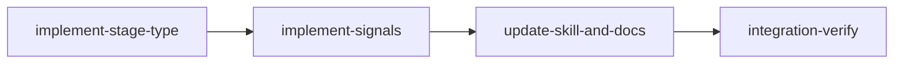

# Plan: Split Knowledge Distillation from Integration-Verify

## Overview

Currently the `integration-verify` stage does two expensive things with opus: (1) code review + functional verification, and (2) knowledge distillation (reading all stage memories, curating into permanent knowledge, generating review docs, updating documentation). Knowledge distillation is mechanical work that doesn't need opus-level judgment -- it reads memories, synthesizes them, and writes to knowledge files. By splitting it into a separate `knowledge-distill` stage type that runs on sonnet with high thinking effort, we make integration-verify faster (less work) and the knowledge step cheaper (sonnet vs opus).

## Design Decision: KnowledgeDistill is a WORKTREE Stage

**KnowledgeDistill is NOT a knowledge-like stage.** It is a normal worktree stage (like Standard and IntegrationVerify) that happens to write knowledge files through the `loom knowledge update` CLI.

| Aspect | Knowledge | KnowledgeDistill |
|--------|-----------|------------------|
| Worktree | NO (runs on main) | YES (runs in worktree) |
| Branch/merge | NO (commits to main) | YES (branch + merge) |
| `stage_executor.rs` routing | Special `start_knowledge_stage` path | Normal worktree path |
| `complete.rs` routing | Special `complete_knowledge_stage` | Normal completion + merge |
| Goal-backward checks | Exempt | Exempt (already -- not in Standard|IV positive match) |
| Signal prefix | `generate_knowledge_stable_prefix` | NEW `generate_knowledge_distill_stable_prefix` |
| Default model | sonnet | sonnet |
| Knowledge file writes | Via `loom knowledge update` CLI | Via `loom knowledge update` CLI |

**Rationale:** Only `StageType::Knowledge` gets no-worktree handling across 7+ runtime paths (stage_executor, complete, verify, merge/status, repair, transitions). Making KD knowledge-like would require touching all of them. A worktree stage is simpler and still works: by the time KD runs, all code is merged to main, so the worktree contains everything.

**Consequence:** No changes to `stage_executor.rs`, `complete.rs`, `verify.rs`, `git/merge/status.rs`, `repair.rs`, or `verify/transitions/state.rs`. The new type only needs: enum + detection + signal + docs.

## Goals

- Add `KnowledgeDistill` stage type to the StageType enum
- Create a dedicated signal stable prefix for knowledge-distill stages
- Update signal format sections for the new stage type
- Update validation heuristics, plan setup detection, and sandbox tests
- Remove knowledge distillation content from integration-verify signals
- Update the loom-plan-writer skill to document the new four-bookend pattern
- Default model for knowledge-distill: sonnet with high reasoning effort

## Non-Goals

- No backwards compatibility shims for old plans (project policy)
- No migration of existing plan files
- No changes to knowledge-stage runtime paths (stage_executor, complete, verify, merge)

## Execution Diagram



All stages are sequential: each depends on code created by the previous stage.

---

## Stages

### 1. Implement KnowledgeDistill Stage Type

**Purpose:** Add the `KnowledgeDistill` variant to `StageType`, wire it through plan setup, fix heuristic functions that would misclassify it, and update sandbox tests.

**Files:**

- `loom/src/models/stage/types.rs` -- add enum variant + default_model arm
- `loom/src/models/stage/methods.rs` -- fix `is_knowledge_stage()` to exclude KD
- `loom/src/commands/init/plan_setup.rs` -- detect_stage_type ordering
- `loom/src/plan/schema/validation.rs` -- fix `check_knowledge_recommendations()`
- `loom/src/sandbox/settings.rs` -- add variant to exhaustive test iteration
- `loom/src/plan/schema/tests/validation_tests.rs` -- new test cases

**Acceptance:** `cargo test`, `cargo clippy -- -D warnings`

---

### 2. Implement Signals for KnowledgeDistill

**Purpose:** Create the knowledge-distill stable prefix (extracted from integration-verify), update the semi-stable sections, and strip knowledge distillation content from integration-verify signals.

**Dependencies:** implement-stage-type

**Files:**

- `loom/src/orchestrator/signals/cache.rs` -- new prefix generator, strip from IV
- `loom/src/orchestrator/signals/format/mod.rs` -- match on new type
- `loom/src/orchestrator/signals/format/sections.rs` -- semi-stable section for KD
- `loom/src/orchestrator/signals/generate.rs` -- build_signal_context for KD

**Acceptance:** `cargo test`, `cargo clippy -- -D warnings`

---

### 3. Update Skill and Documentation

**Purpose:** Update the loom-plan-writer skill to document the new plan structure with knowledge-distill as the final stage. Update knowledge files. Perform repo-wide text sweep for stale references to the old contract.

**Dependencies:** implement-signals

**Files:**

- `skills/loom-plan-writer/SKILL.md`
- `doc/loom/knowledge/architecture.md`
- `doc/loom/knowledge/patterns.md`
- `doc/loom/knowledge/conventions.md`

**Acceptance:** Skill doc and knowledge files reflect the new stage type.

---

### 4. Integration Verification

**Purpose:** Verify all changes compile, pass tests, and work together. Functionally verify the new stage type is properly wired by running `loom init` against a test plan that contains a `knowledge-distill` stage.

**Dependencies:** update-skill-and-docs

---

<!-- loom METADATA -->

```yaml
loom:
  version: 1
  sandbox:
    enabled: true
    auto_allow: true
    excluded_commands:
      - "loom"
      - "git"
    network:
      allowed_domains: []
  stages:
    - id: implement-stage-type
      name: "Add KnowledgeDistill Stage Type"
      stage_type: standard
      model: "sonnet"
      reasoning_effort: "high"
      description: |
        Add a new KnowledgeDistill variant to the StageType enum and wire it
        through plan setup, heuristic functions, and sandbox tests.

        IMPORTANT: KnowledgeDistill is a WORKTREE stage, NOT a knowledge-like
        stage. Do NOT add it to any knowledge-stage-specific runtime paths
        (stage_executor, complete.rs, verify.rs, merge/status.rs, repair.rs,
        transitions/state.rs). Only Knowledge stages get those special paths.

        Use parallel subagents and skills to maximize performance.

        STEP 1 — StageType enum (src/models/stage/types.rs):

        Add a KnowledgeDistill variant to the StageType enum after
        IntegrationVerify. Follow the existing pattern:

            /// Knowledge distillation stage (runs after integration-verify)
            /// Reads all stage memories and curates into permanent knowledge.
            /// This is a WORKTREE stage — NOT a Knowledge stage. It gets a branch
            /// and merge like Standard/IntegrationVerify.
            KnowledgeDistill,

        In the default_model() method, add a match arm. The existing match has:
            StageType::Knowledge => "sonnet",
            StageType::Standard | StageType::IntegrationVerify => "opus",

        Add: StageType::KnowledgeDistill => "sonnet",

        The serde rename_all = "kebab-case" will auto-produce "knowledge-distill".

        STEP 2 — Fix is_knowledge_stage() (src/models/stage/methods.rs):

        The is_knowledge_stage() method at the end of the impl block uses
        id.to_lowercase().contains("knowledge") which would match
        "knowledge-distill". This is a latent trap. Fix it:

            pub fn is_knowledge_stage(&self) -> bool {
                self.stage_type == StageType::Knowledge
                    || (self.id.to_lowercase().contains("knowledge")
                        && !self.id.to_lowercase().contains("knowledge-distill"))
                    || (self.name.to_lowercase().contains("knowledge")
                        && !self.name.to_lowercase().contains("knowledge-distill")
                        && !self.name.to_lowercase().contains("knowledge distill"))
            }

        STEP 3 — Stage type detection (src/commands/init/plan_setup.rs):

        In detect_stage_type(), add detection for the new type BEFORE the
        existing "knowledge" check. This is critical because "knowledge-distill"
        contains "knowledge" — if the Knowledge check runs first, it would
        incorrectly match.

        Add BEFORE the existing "Detect Knowledge stage" block:

            // Detect KnowledgeDistill stage (must come BEFORE Knowledge check)
            if id_lower.contains("knowledge-distill")
                || name_lower.contains("knowledge-distill")
                || name_lower.contains("knowledge distill")
            {
                return StageType::KnowledgeDistill;
            }

        STEP 4 — Fix check_knowledge_recommendations() (src/plan/schema/validation.rs):

        At the bottom of the file, check_knowledge_recommendations() uses
        stage.id.to_lowercase().contains("knowledge") to detect if a plan has
        a knowledge stage. A "knowledge-distill" stage would falsely satisfy
        this check, suppressing the "you should have a knowledge-bootstrap"
        warning. Fix the heuristic:

            let has_knowledge_stage = stages.iter().any(|stage| {
                let id_lower = stage.id.to_lowercase();
                let name_lower = stage.name.to_lowercase();
                (id_lower.contains("knowledge") && !id_lower.contains("knowledge-distill"))
                    || (name_lower.contains("knowledge") && !name_lower.contains("knowledge-distill")
                        && !name_lower.contains("knowledge distill"))
            });

        STEP 5 — Validation goal-backward exemption:

        NO CHANGE NEEDED. The validation at line ~406 uses a positive match:
            let requires_goal_backward = matches!(
                stage.stage_type,
                StageType::Standard | StageType::IntegrationVerify
            );
        KnowledgeDistill does not match either, so it is already exempt.

        STEP 6 — Sandbox tests (src/sandbox/settings.rs):

        At line ~762, there is a test that iterates over all StageType variants
        explicitly: [Standard, Knowledge, IntegrationVerify]. Add
        StageType::KnowledgeDistill to this array.

        Note: merge_config() in sandbox/config.rs has a _stage_type parameter
        that is currently UNUSED (confirmed at line 39-45). No changes needed
        in merge_config() itself — only the test iteration list.

        STEP 7 — Validation tests (src/plan/schema/tests/validation_tests.rs):

        Add tests:
        - test_knowledge_distill_exempt_from_goal_backward: stage with
          stage_type: knowledge-distill, no artifacts/wiring, should pass
        - test_knowledge_distill_with_acceptance_passes: with acceptance criteria

        STEP 8 — Exhaustiveness check:

        After all changes, run: cargo build
        The Rust compiler will catch any exhaustive match statements on
        StageType that are missing the new variant. Fix any that appear.

        MEMORY RECORDING (use loom memory ONLY — never loom knowledge, never auto-memory):
        Record mistakes, decisions, and surprises using loom memory commands.

        SUBAGENT FILE ASSIGNMENTS:
          Subagent 1 — Enum + Detection (loom-software-engineer):
            Files Owned: src/models/stage/types.rs, src/models/stage/methods.rs,
                         src/commands/init/plan_setup.rs
            Files Read-Only: src/plan/schema/types.rs

          Subagent 2 — Validation + Sandbox + Tests (loom-software-engineer):
            Files Owned: src/plan/schema/validation.rs, src/sandbox/settings.rs,
                         src/plan/schema/tests/validation_tests.rs
            Files Read-Only: src/models/stage/types.rs

        NO FILE OVERLAP between subagents confirmed.
      dependencies: []
      acceptance:
        - "cargo test"
        - "cargo clippy -- -D warnings"
      files:
        - "loom/src/models/stage/types.rs"
        - "loom/src/models/stage/methods.rs"
        - "loom/src/commands/init/plan_setup.rs"
        - "loom/src/plan/schema/validation.rs"
        - "loom/src/sandbox/settings.rs"
        - "loom/src/plan/schema/tests/**"
      working_dir: "loom"
      wiring:
        - source: "src/models/stage/types.rs"
          pattern: "KnowledgeDistill"
          description: "KnowledgeDistill variant exists in StageType enum"
        - source: "src/commands/init/plan_setup.rs"
          pattern: "knowledge-distill"
          description: "Stage type detection recognizes knowledge-distill"

    - id: implement-signals
      name: "Signal Generation for KnowledgeDistill"
      stage_type: standard
      model: "opus"
      reasoning_effort: "high"
      description: |
        Create the knowledge-distill signal stable prefix (extracted from
        integration-verify), update the semi-stable sections, and strip knowledge
        distillation content from the integration-verify prefix. This is
        architectural work — the agent must decide what content belongs in each
        prefix and how to restructure the sections.

        Use parallel subagents and skills to maximize performance.

        NOTE: Line numbers below are approximate. The previous stage modified
        src/models/stage/types.rs which may shift some references. Use function
        names and search patterns to locate code rather than relying on exact
        line numbers.

        TASK 1 — Extract knowledge distillation from IV stable prefix (cache.rs):

        In src/orchestrator/signals/cache.rs, the function
        generate_integration_verify_stable_prefix() contains a large
        "Knowledge Distillation (MANDATORY)" section. Find it by searching
        for the string "Knowledge Distillation (MANDATORY)". This section
        needs to:

        a) Be REMOVED from generate_integration_verify_stable_prefix()
        b) Be placed into a NEW function: generate_knowledge_distill_stable_prefix()

        The new function should:
        - Have a header: "## Knowledge Distillation Context"
        - Explain this is a knowledge distillation stage that runs AFTER
          integration-verify, in its own worktree
        - Include the full knowledge distillation workflow (the content being
          removed from IV: reading memories, curating into knowledge files,
          review doc generation)
        - Include the "Do NOT modify CLAUDE.md" reminder (moved from IV)
        - Include the auto-memory prohibition block (moved from IV)
        - Include worktree isolation rules (reuse append_path_boundaries)
        - Include git staging rules (reuse append_git_staging_rules)
        - Include the common footer (reuse append_common_footer)
        - Include completion rules (reuse append_completion_rules)
        - NOT include: code review instructions, zero tolerance, functional
          verification, silent failure detection — those stay in IV

        For the IV prefix, after removing knowledge distillation:
        - Remove the "Knowledge Distillation (MANDATORY)" section entirely
        - Remove the "IMPORTANT — Do NOT modify the project's CLAUDE.md"
          section that follows it
        - Remove the auto-memory prohibition block that follows that
        - Add a brief note in its place: "Knowledge distillation is handled
          by a separate knowledge-distill stage that runs after this stage."
        - Update the Mission list: keep items 1-4 (REVIEW, FIX, VERIFY, TEST),
          remove item 5 (PROMOTE) and item 6 (GENERATE review doc)
        - Keep everything else (zero tolerance, code review, silent failure
          detection, agent teams for IV, isolation, execution rules, git
          staging, common footer)

        TASK 2 — Update prefix selection (format/mod.rs):

        In src/orchestrator/signals/format/mod.rs, find the match on
        stage.stage_type (search for "StageType::IntegrationVerify =>").
        Add a new arm:

            StageType::KnowledgeDistill => generate_knowledge_distill_stable_prefix(),

        Update the import at the top of the file to include the new function:
            use super::cache::{
                generate_integration_verify_stable_prefix,
                generate_knowledge_distill_stable_prefix,
                generate_stable_prefix,
                SignalMetrics,
            };

        TASK 3 — Update semi-stable section (format/sections.rs):

        In format_semi_stable_section(), there are TWO match statements on
        stage_type that need updating:

        Match 1 (search for "Stage-type-aware reminder boxes"):
        Add KnowledgeDistill to the Knowledge|IntegrationVerify arm:
            StageType::Knowledge | StageType::IntegrationVerify | StageType::KnowledgeDistill => {

        Match 2 (search for "Knowledge Management section"):
        Same change — add KnowledgeDistill:
            StageType::Knowledge | StageType::IntegrationVerify | StageType::KnowledgeDistill => {

        Within match 2, there is a check for IntegrationVerify-specific content
        (search for "Review Document" and "DOCUMENTATION UPDATE"). Change these
        to trigger for KnowledgeDistill INSTEAD of IntegrationVerify:
            if stage_type == StageType::KnowledgeDistill {

        This means: review doc generation and documentation update reminders
        move from IntegrationVerify to KnowledgeDistill signals.

        TASK 4 — Update signal context building (generate.rs):

        In generate.rs, find build_cross_stage_summary() (search for the
        function name). It checks stage.stage_type != StageType::IntegrationVerify.
        Add KnowledgeDistill:
            if !matches!(stage.stage_type, StageType::IntegrationVerify | StageType::KnowledgeDistill) {

        Same for build_wiring_checklist():
            if !matches!(stage.stage_type, StageType::IntegrationVerify | StageType::KnowledgeDistill) {

        And in build_signal_context():
            if matches!(stage.stage_type, StageType::IntegrationVerify | StageType::KnowledgeDistill) {

        TASK 5 — Update tests in cache.rs:

        Add test: test_knowledge_distill_stable_prefix_contains_required_sections
        - Must contain "Knowledge Distillation"
        - Must contain "loom memory show --all"
        - Must contain "loom knowledge update" or "loom knowledge"
        - Must contain "loom review"
        - Must contain "Context Recovery"
        - Must contain "Isolation Boundaries" or "Path Boundaries"
        - Must contain "git add <specific-files>"
        - Must NOT contain "ZERO TOLERANCE"
        - Must NOT contain "CODE REVIEW + VERIFICATION"
        - Must NOT contain "FINAL QUALITY GATE"

        Add test: test_knowledge_distill_stable_prefix_is_stable

        Update test: test_integration_verify_stable_prefix_contains_required_sections
        - Add assertion: IV prefix must NOT contain "Knowledge Distillation (MANDATORY)"
        - Keep: all existing assertions that are not knowledge-distillation-specific
        - Review and remove any assertions that tested content now moved to KD

        MEMORY RECORDING (use loom memory ONLY — never loom knowledge, never auto-memory):
        Record mistakes, decisions, and surprises using loom memory commands.
      dependencies: ["implement-stage-type"]
      acceptance:
        - "cargo test"
        - "cargo clippy -- -D warnings"
      files:
        - "loom/src/orchestrator/signals/cache.rs"
        - "loom/src/orchestrator/signals/format/mod.rs"
        - "loom/src/orchestrator/signals/format/sections.rs"
        - "loom/src/orchestrator/signals/generate.rs"
      working_dir: "loom"
      wiring:
        - source: "src/orchestrator/signals/cache.rs"
          pattern: "generate_knowledge_distill_stable_prefix"
          description: "New prefix generator function exists"
        - source: "src/orchestrator/signals/format/mod.rs"
          pattern: "KnowledgeDistill"
          description: "Format module dispatches to new prefix"
        - source: "src/orchestrator/signals/format/sections.rs"
          pattern: "KnowledgeDistill"
          description: "Semi-stable section handles new stage type"

    - id: update-skill-and-docs
      name: "Update Plan Writer Skill and Knowledge"
      stage_type: standard
      model: "sonnet"
      reasoning_effort: "high"
      description: |
        Update the loom-plan-writer skill and knowledge files to document the
        new knowledge-distill stage type and the updated plan structure.

        CRITICAL: The old contract (integration-verify as final stage with
        knowledge distillation) appears in MANY places. A repo-wide text
        sweep is required to find and update ALL stale references.

        Use parallel subagents and skills to maximize performance.

        TASK 1 — Update loom-plan-writer skill (skills/loom-plan-writer/SKILL.md):

        The old contract appears throughout the skill file. ALL of these
        locations need updating:

        a) Line ~15 and ~19: "integration-verify (last)" in the overview.
           Update to: knowledge-bootstrap (first), integration-verify (second-to-last),
           knowledge-distill (last)

        b) Section 3 "Sandbox Configuration" special stage behavior (~line 125):
           Add knowledge-distill alongside knowledge and integration-verify

        c) Section 3b "Model Selection" (~line 130):
           Add: "knowledge-distill stages: Always sonnet (mechanical curation work)"

        d) Section 4 stage-specific defaults (~line 320):
           Add: "knowledge-distill: Default to SINGLE or SUBAGENTS (memory reading +
           knowledge writing is sequential, not parallel)"

        e) Section 6 "Plan Structure" (~line 454):
           Update the mandatory structure box:
             FIRST:  knowledge-bootstrap    (unless knowledge already exists)
             MIDDLE: implementation stages  (parallelized where possible)
             THEN:   integration-verify     (reviews AND verifies — NO knowledge distillation)
             LAST:   knowledge-distill      (curates memories into knowledge)
           Update the mermaid diagram to show knowledge-distill after integration-verify

        f) Section 8 "stage_type Field" table (~line 697):
           Add row: | knowledge-distill | Knowledge distillation stage |
                    Can write to knowledge, sonnet default |

        g) Section 11 "Integration Verify Stage" (~line 976):
           Remove KNOWLEDGE DISTILLATION section (steps 11-17) from the
           template description. Remove DOCUMENTATION UPDATE section (steps 18-21).
           Add note: "Knowledge distillation and documentation updates are handled
           by a separate knowledge-distill stage that runs after this stage."

        h) Add NEW Section 11b "Knowledge Distill Stage (After Integration-Verify)":
           Template YAML for knowledge-distill stage with:
           - stage_type: knowledge-distill
           - model: "sonnet", reasoning_effort: "high"
           - Dependencies: [integration-verify]
           - Description template covering:
             * Context gathering: read plan, read all memories, read knowledge
             * Memory curation: loom memory show --all, synthesize, write
             * Knowledge update: patterns, mistakes, conventions, architecture
             * Review document: loom review
             * Documentation: update README, CONTRIBUTING, etc.
             * Stale cleanup: remove outdated knowledge entries
           - Acceptance: knowledge files have content, loom review succeeds
           - working_dir: "."
           - No artifacts/wiring required (exempt from goal-backward)

        i) Section 13 "Memory vs Knowledge Rules" (~line 1187):
           Add row: | knowledge-distill | YES | YES (curate from memory) |
           Update the workflow section to show knowledge-distill as step 4

        j) Section 12 "Memory Recording" (~line 1118):
           Update: "Only knowledge-bootstrap, integration-verify, AND
           knowledge-distill stages can write to knowledge"

        k) Best Practices (~line 1259):
           Update bookend compliance: "knowledge-bootstrap first,
           integration-verify second-to-last, knowledge-distill last"

        l) Example 3 Complete Plan Template:
           Add knowledge-distill as the final stage after integration-verify

        TASK 2 — Update knowledge files:

        Update doc/loom/knowledge/architecture.md:
        - StageType enum section (search for "StageType Enum"):
          Add KnowledgeDistill variant with description:
          "KnowledgeDistill — Knowledge distillation (runs after integration-verify,
          worktree stage, sonnet default)"
        - Signal generation (search for "3 stable prefix generators"):
          Change to "4 stable prefix generators" and add knowledge-distill
        - Worktree Isolation section (search for "Three stage-type-specific"):
          Change to "Four stage-type-specific prefix generators"

        Update doc/loom/knowledge/patterns.md:
        - Signal Generation Pattern (search for "Three stage-type-specific"):
          Change to "Four stage-type-specific prefix generators" and add
          KnowledgeDistill description
        - Update numbered list of prefix types to include KnowledgeDistill

        Update doc/loom/knowledge/conventions.md:
        - Plan YAML Schema section (search for "stage_type"):
          Add "knowledge-distill" to the list of values

        MEMORY RECORDING (use loom memory ONLY — never loom knowledge, never auto-memory):
        Record mistakes, decisions, and surprises using loom memory commands.

        SUBAGENT FILE ASSIGNMENTS:
          Subagent 1 — Skill Update (loom-software-engineer):
            Files Owned: skills/loom-plan-writer/SKILL.md
            Files Read-Only: loom/src/models/stage/types.rs

          Subagent 2 — Knowledge Update (loom-software-engineer):
            Files Owned: doc/loom/knowledge/architecture.md,
                         doc/loom/knowledge/patterns.md,
                         doc/loom/knowledge/conventions.md
            Files Read-Only: loom/src/orchestrator/signals/cache.rs

        NO FILE OVERLAP between subagents confirmed.
      dependencies: ["implement-signals"]
      acceptance:
        - 'rg -qF "knowledge-distill" skills/loom-plan-writer/SKILL.md'
        - 'rg -qF "KnowledgeDistill" doc/loom/knowledge/architecture.md'
        - 'rg -qi "four.*prefix" doc/loom/knowledge/patterns.md'
        - 'rg -qF "knowledge-distill" doc/loom/knowledge/conventions.md'
      files:
        - "skills/loom-plan-writer/SKILL.md"
        - "doc/loom/knowledge/**"
      working_dir: "."
      artifacts:
        - "skills/loom-plan-writer/SKILL.md"
      wiring:
        - source: "skills/loom-plan-writer/SKILL.md"
          pattern: "knowledge-distill"
          description: "Plan writer skill documents the new stage type"

    - id: integration-verify
      name: "Integration Verification"
      stage_type: integration-verify
      model: "opus"
      reasoning_effort: "high"
      description: |
        Final integration verification after all stages complete.

        Use parallel subagents and skills to maximize performance.

        CRITICAL: Verify FUNCTIONAL INTEGRATION, not just tests passing.

        CONTEXT GATHERING (FIRST):
        - Read the plan file from doc/plans/ (check .work/config.toml for source_path)
        - Read ALL stage memories: loom memory show --all
        - Read doc/loom/knowledge/*.md for architecture context and known mistakes

        BUILD & TEST (zero tolerance):
        1. cargo build
        2. cargo test (all tests)
        3. cargo clippy -- -D warnings
        4. cargo fmt --check

        CODE REVIEW (MANDATORY):
        5. Spawn PARALLEL loom-code-reviewer subagents:
           - security review: OWASP Top 10, input validation, secrets
           - architecture review: code organization, patterns, coupling
        6. Fix ALL issues found

        FUNCTIONAL VERIFICATION (MANDATORY):
        7. Verify StageType::KnowledgeDistill is properly wired:
           - Enum variant exists and serializes as "knowledge-distill"
           - detect_stage_type() recognizes it
           - is_knowledge_stage() returns FALSE for knowledge-distill
           - check_knowledge_recommendations() doesn't count knowledge-distill as a knowledge stage
           - Signal prefix selection dispatches correctly
           - Semi-stable section shows knowledge management content
           - Cross-stage summary and wiring checklist populated for KD
        8. Verify integration-verify prefix NO LONGER contains knowledge distillation
        9. Verify knowledge-distill prefix DOES contain knowledge distillation
        10. Validate the new type end-to-end by creating a minimal test plan
            in a temp dir with a knowledge-distill stage and running loom init
            against it to verify parsing and validation succeed
        11. Run: cargo test -- --test-threads=1 (verify no parallel test issues)

        REPO-WIDE STALE REFERENCE CHECK:
        12. Run: rg -i "integration.verify.*last\|last.*integration.verify" .
            to find any remaining docs/comments that claim IV is the last stage
        13. Run: rg "curate.*knowledge\|knowledge.*distill\|memory.*curate" loom/src/orchestrator/signals/cache.rs
            to verify no knowledge distillation content remains in IV prefix
        14. Fix any stale references found

        KNOWLEDGE DISTILLATION (MANDATORY):
        15. Record own discoveries to loom memory FIRST
        16. Read all stage memories: loom memory show --all
        17. Curate valuable insights into permanent knowledge
        18. Update architecture.md if structure changed
        19. Generate review document: loom review
      dependencies: ["update-skill-and-docs"]
      acceptance:
        - "cargo test"
        - "cargo clippy -- -D warnings"
        - "cargo fmt --check"
        - "cargo build"
      files:
        - "loom/src/**/*.rs"
        - "skills/**"
        - "doc/loom/knowledge/**"
      working_dir: "loom"
      wiring:
        - source: "src/models/stage/types.rs"
          pattern: "KnowledgeDistill"
          description: "Enum variant exists"
        - source: "src/orchestrator/signals/cache.rs"
          pattern: "generate_knowledge_distill_stable_prefix"
          description: "Prefix generator exists"
        - source: "src/orchestrator/signals/format/mod.rs"
          pattern: "generate_knowledge_distill_stable_prefix"
          description: "Format module imports and uses new prefix"
```

<!-- END loom METADATA -->
